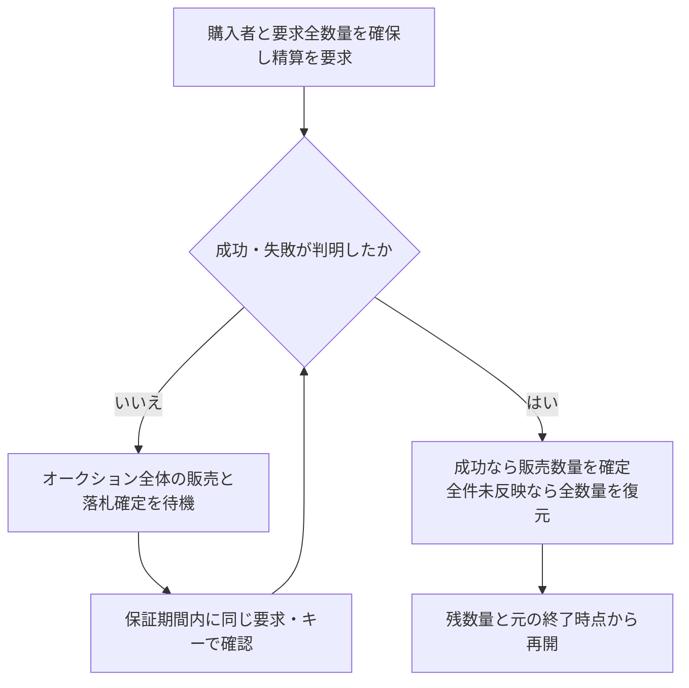
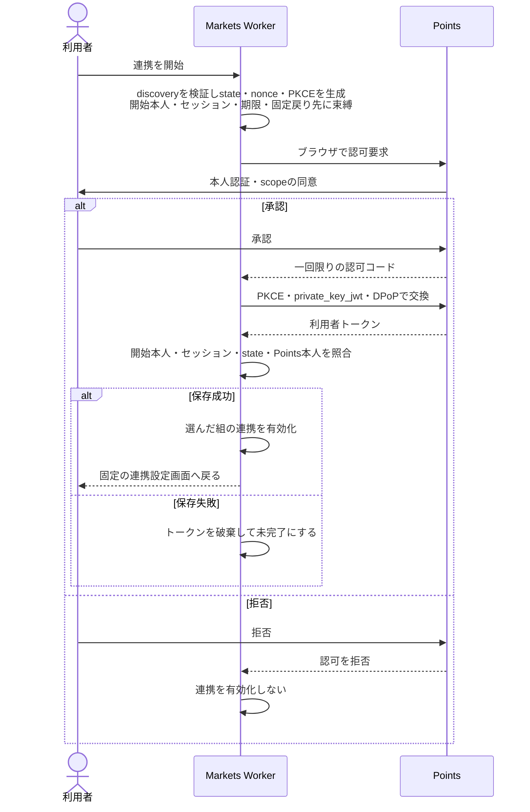
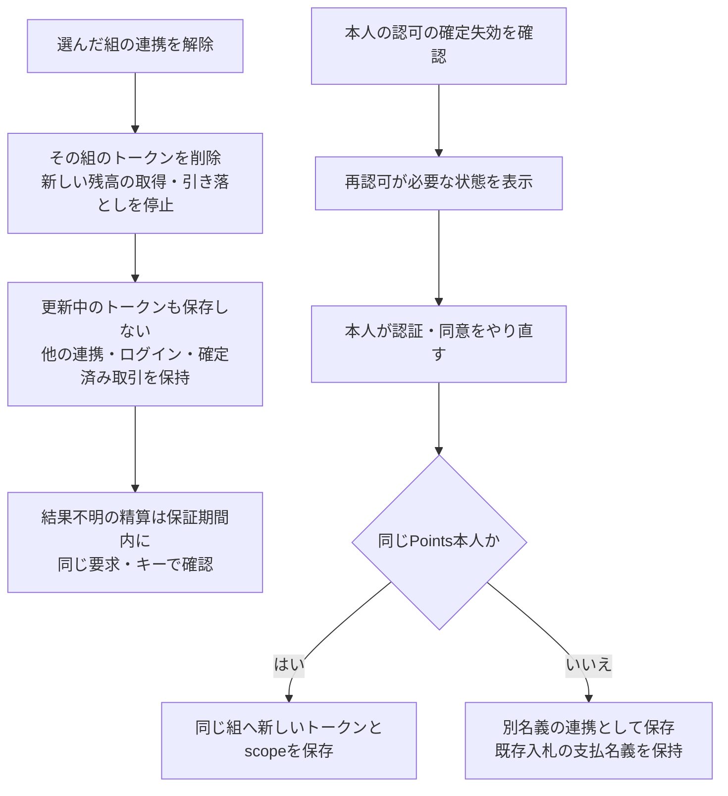
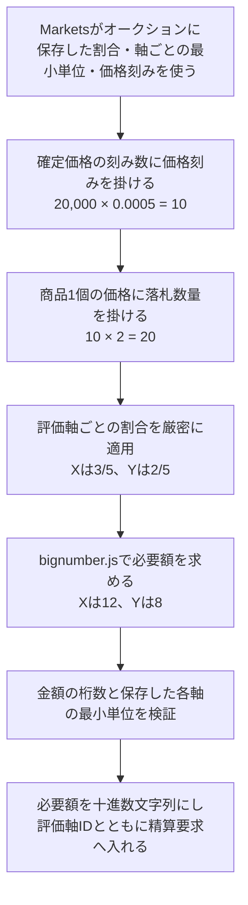
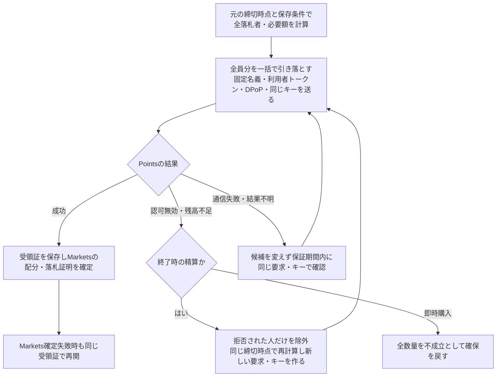

# Freeism Markets v0.2.1 仕様

- [Freeism Markets v0.2.1 仕様](#freeism-markets-v021-仕様)
  - [言語](#言語)
  - [v0.2.1：実装する理由](#v021実装する理由)
  - [v0.2.1：基本方針](#v021基本方針)
    - [設計原則](#設計原則)
    - [機能範囲](#機能範囲)
  - [出品とオークション作成](#出品とオークション作成)
    - [設定項目](#設定項目)
    - [計算条件のスナップショット](#計算条件のスナップショット)
    - [開始前の編集と取消](#開始前の編集と取消)
    - [CSV出品](#csv出品)
    - [CSVのD1一括書き込み](#csvのd1一括書き込み)
  - [オークション一覧](#オークション一覧)
    - [URL](#url)
    - [一覧カード](#一覧カード)
    - [検索](#検索)
    - [詳細画面](#詳細画面)
  - [入札と自動入札](#入札と自動入札)
    - [残高の扱い](#残高の扱い)
    - [受付の流れ](#受付の流れ)
    - [受付の条件](#受付の条件)
    - [入札API](#入札api)
    - [順位](#順位)
    - [自動入札](#自動入札)
    - [確認すること](#確認すること)
  - [オークションの状態と時刻](#オークションの状態と時刻)
    - [状態](#状態)
    - [日時](#日時)
    - [開始と終了](#開始と終了)
    - [終了間際の延長](#終了間際の延長)
    - [確認すること](#確認すること-1)
  - [落札者と落札価格](#落札者と落札価格)
    - [落札者の選び方](#落札者の選び方)
    - [落札価格](#落札価格)
    - [確認すること](#確認すること-2)
  - [即時購入](#即時購入)
    - [受付](#受付)
    - [引き落としと結果](#引き落としと結果)
    - [結果判明後の再開](#結果判明後の再開)
    - [画面](#画面)
    - [確認すること](#確認すること-3)
  - [残高不足者の除外とブラックリスト](#残高不足者の除外とブラックリスト)
    - [除外と再計算](#除外と再計算)
    - [確認すること](#確認すること-4)
  - [落札証明と相互評価](#落札証明と相互評価)
    - [目的](#目的)
    - [落札証明の作成](#落札証明の作成)
    - [落札証明の内容](#落札証明の内容)
    - [外部アカウントの表示](#外部アカウントの表示)
    - [公開とキャッシュ](#公開とキャッシュ)
    - [落札証明画面](#落札証明画面)
    - [相互評価](#相互評価)
    - [確認すること](#確認すること-5)
  - [履歴・ウォッチリスト・公開API](#履歴ウォッチリスト公開api)
    - [履歴](#履歴)
    - [ウォッチリスト](#ウォッチリスト)
    - [公開API](#公開api)
    - [Shields.ioのバッジ](#shieldsioのバッジ)
  - [外部EC・対面での受け渡し](#外部ec対面での受け渡し)
    - [目的](#目的-1)
    - [匿名発送](#匿名発送)
    - [外部EC経由の受け渡し](#外部ec経由の受け渡し)
    - [検証用URLと証明コード](#検証用urlと証明コード)
    - [claim token](#claim-token)
    - [再発行](#再発行)
    - [検証](#検証)
    - [受け渡し完了](#受け渡し完了)
    - [画面の状態と文言](#画面の状態と文言)
    - [外部ECの注文ID](#外部ecの注文id)
    - [漏えい対策](#漏えい対策)
    - [この方式で証明できること](#この方式で証明できること)
    - [対面での受け渡し](#対面での受け渡し)
    - [対面決済・QR決済・店舗履歴](#対面決済qr決済店舗履歴)
  - [GitHub連携の決済](#github連携の決済)
  - [多言語・アクセシビリティ](#多言語アクセシビリティ)
    - [対応言語](#対応言語)
    - [固定公開ページの言語](#固定公開ページの言語)
    - [アクセシビリティ](#アクセシビリティ)
    - [確認すること](#確認すること-6)
  - [利用規約](#利用規約)
  - [プライバシーポリシー](#プライバシーポリシー)
  - [ログイン](#ログイン)
    - [範囲](#範囲)
    - [ログイン方法](#ログイン方法)
    - [本人識別とアカウント連携](#本人識別とアカウント連携)
    - [Better Auth設定](#better-auth設定)
    - [確認すること](#確認すること-7)
  - [Points連携](#points連携)
    - [役割と識別](#役割と識別)
    - [提供先の管理](#提供先の管理)
    - [OAuthクライアントと鍵](#oauthクライアントと鍵)
    - [連携の開始](#連携の開始)
    - [トークンの保存と更新](#トークンの保存と更新)
    - [オークションでの利用](#オークションでの利用)
    - [解除と再認可](#解除と再認可)
    - [連携画面](#連携画面)
    - [確認すること](#確認すること-8)
  - [金額表現と価格刻み](#金額表現と価格刻み)
    - [金額の表し方](#金額の表し方)
    - [価格刻み](#価格刻み)
    - [必要額の計算](#必要額の計算)
    - [確認すること](#確認すること-9)
  - [Points–Markets連携契約](#pointsmarkets連携契約)
    - [境界](#境界)
    - [共通のHTTP](#共通のhttp)
    - [エンドポイント](#エンドポイント)
    - [残高の取得](#残高の取得)
    - [一括精算](#一括精算)
    - [Marketsの責務](#marketsの責務)
    - [要求回数の数え方](#要求回数の数え方)
    - [確認すること](#確認すること-10)
  - [精算](#精算)
    - [落札者と精算の原則](#落札者と精算の原則)
    - [精算の進め方](#精算の進め方)
    - [精算の上限と1,000人の落札者](#精算の上限と1000人の落札者)
    - [手動再試行](#手動再試行)
    - [再試行の予算](#再試行の予算)
    - [失敗の扱い](#失敗の扱い)
    - [精算の状態の取得](#精算の状態の取得)
    - [outboxと突合処理](#outboxと突合処理)
    - [確認すること](#確認すること-11)
  - [リアルタイム配信](#リアルタイム配信)
    - [状態の基準](#状態の基準)
    - [変更はHTTPで行う](#変更はhttpで行う)
    - [WebSocketの接続](#websocketの接続)
    - [attachmentと接続上限](#attachmentと接続上限)
    - [ハートビートを使わない](#ハートビートを使わない)
    - [イベント](#イベント)
    - [確認すること](#確認すること-12)
  - [Cookie、CSRF、Origin](#cookiecsrforigin)
    - [防御の層](#防御の層)
    - [Cookie](#cookie)
    - [CSRFとOrigin](#csrfとorigin)
    - [確認すること](#確認すること-13)
  - [HTTPリクエスト・HTTPレスポンス](#httpリクエストhttpレスポンス)
    - [対象とAPIの区分](#対象とapiの区分)
    - [リクエスト](#リクエスト)
    - [冪等性](#冪等性)
    - [成功](#成功)
    - [失敗](#失敗)
    - [ステータス](#ステータス)
    - [キャッシュ](#キャッシュ)
    - [セキュリティヘッダー](#セキュリティヘッダー)
    - [確認すること](#確認すること-14)
  - [Rate limit](#rate-limit)
    - [確認すること](#確認すること-15)
  - [監査と運用監視](#監査と運用監視)
    - [監査イベント](#監査イベント)
    - [ログとメトリクス](#ログとメトリクス)
    - [運用アラート](#運用アラート)
    - [確認すること](#確認すること-16)
  - [命名規則](#命名規則)
    - [適用範囲](#適用範囲)
    - [リポジトリ・サービス・ドメイン](#リポジトリサービスドメイン)
    - [ID](#id)
    - [金額と時刻](#金額と時刻)
    - [バージョンと状態](#バージョンと状態)
    - [HTTP・OpenAPI](#httpopenapi)
    - [Hono](#hono)
    - [Drizzle・D1](#drizzled1)
    - [Durable Object](#durable-object)
    - [フロントエンド](#フロントエンド)
    - [テスト](#テスト)
    - [スクリプト](#スクリプト)
    - [例外](#例外)
  - [テーブル・データ構造](#テーブルデータ構造)
    - [共通の規則](#共通の規則)
    - [テーブルの一覧](#テーブルの一覧)
    - [`user`](#user)
    - [`session`](#session)
    - [`account`](#account)
    - [`verification`](#verification)
    - [`rate_limit`](#rate_limit)
    - [`markets_user`](#markets_user)
    - [`points_provider`](#points_provider)
    - [`points_connection`](#points_connection)
    - [`points_oauth_state`](#points_oauth_state)
    - [`auction`](#auction)
    - [`auction_command`](#auction_command)
    - [`bid_position`](#bid_position)
    - [`bid`](#bid)
    - [`auction_event`](#auction_event)
    - [`auto_bid`](#auto_bid)
    - [`buy_now_hold`](#buy_now_hold)
    - [`auction_blacklist`](#auction_blacklist)
    - [`settlement`](#settlement)
    - [`auction_close_cutoff`](#auction_close_cutoff)
    - [`settlement_outbox`](#settlement_outbox)
    - [`settlement_round`](#settlement_round)
    - [`settlement_round_winner`](#settlement_round_winner)
    - [`settlement_debit_receipt`](#settlement_debit_receipt)
    - [`settlement_retry_event`](#settlement_retry_event)
    - [`allocation`](#allocation)
    - [`auction_proof`](#auction_proof)
    - [`trade_review`](#trade_review)
    - [`watchlist`](#watchlist)
    - [`auction_claim_token`](#auction_claim_token)
    - [`auction_claim_token_access_log`](#auction_claim_token_access_log)
    - [`idempotency_result`](#idempotency_result)
    - [`audit_event`](#audit_event)
    - [`websocket_connection_lease`](#websocket_connection_lease)
    - [`ops_alert`](#ops_alert)
    - [`ops_alert_cleanup_lease`](#ops_alert_cleanup_lease)
  - [フロントエンドの構成と配信](#フロントエンドの構成と配信)
    - [構成](#構成)
    - [Static Assets](#static-assets)
    - [画面の状態](#画面の状態)
  - [ライブラリと依存関係](#ライブラリと依存関係)
    - [主な採用ライブラリ](#主な採用ライブラリ)
    - [バージョンの固定](#バージョンの固定)
    - [pnpmの設定](#pnpmの設定)
    - [TanStackのインシデント](#tanstackのインシデント)
  - [デプロイ設定](#デプロイ設定)
    - [環境とドメイン](#環境とドメイン)
    - [stagingのBasic認証](#stagingのbasic認証)
    - [IaCの分担](#iacの分担)
    - [GitHub Actions](#github-actions)
    - [`main`のruleset](#mainのruleset)
    - [CI/CDのパイプライン](#cicdのパイプライン)
    - [D1のマイグレーションと復旧](#d1のマイグレーションと復旧)
    - [テストの層](#テストの層)
    - [本番のリリースゲート](#本番のリリースゲート)
    - [受入後の撤去](#受入後の撤去)
  - [採用しないもの](#採用しないもの)
  - [v0.2.0からv0.2.1への変更](#v020からv021への変更)

## 言語

日本語（本ページ）| [English](./all.en.md)

## v0.2.1：実装する理由

- 無料主義ドキュメントv3に、大幅な仕様変更があったため。

## v0.2.1：基本方針

### 設計原則

- 疎結合にする。
  - データ取得元をいつでも簡単に差し替えられるように設計する。
  - ソースをフロントエンド・バックエンド・共通処理へ分け、各領域内は役割別、その中は機能別に整理する。
  - 計算ルールとDB・HTTPの処理を分離し、DB操作は差し替え可能なインターフェースを通して使う。

- 可読性を保つ。

- 簡潔にする。
  - リッチな機能やリッチなUIは提供せず、すぐ理解できるシンプルな機能だけにする。

- 各パラメータは定数ファイルで管理し、すぐに変更できるようにする。

- サーバー負荷と、データベースやストレージの保存容量をできる限り削減する。

- 後方互換とデータ移行は不要
  - v0.2.1は本番リリース前のテスト環境として扱い、後方互換性とデータ移行は不要とする。
  - Supabaseなどからの業務データ移行を行わない。
  - 後方互換URL、旧API、旧DBスキーマ、旧セッション、SSEのフォールバック、Prisma互換層を作らない。

- 文書の範囲
  - この仕様はMarketsの責務だけを書き、Pointsの内部仕様は書かない。
  - 仕様・制約・状態機械・採用しない理由は`docs`に書き、実行作業と順序は各アプリの`plan`に書く。

### 機能範囲

- Marketsに入れる機能
  - 出品
  - 入札
    - 通常入札
    - 自動入札
    - 即決価格
  - 落札商品の管理
  - 評価軸ポイントの精算
  - 落札証明
  - GoogleとGitHubによるログインと、Pointsとの明示的な連携
  - ウォッチリスト
  - 出品者と落札者の相互評価
  - アプリ内通知
  - 対面決済
    - QR決済

- Marketsに入れない機能
  - 評価軸・ポイント残高の情報の保持
  - 商品の発送や住所の管理
    - モノの発送が必要な場合は、他のサービスを使う。
  - タスク、グループ、一般コミュニティメンバー管理、下書きの評価アップロード
  - 通知基盤、メール、Web Push、予約通知、ウォッチリスト通知
  - PWA、Service Worker、オフラインキャッシュ
  - 画像の保存・表示・アップロード
    - R2を商品画像に使わない。
    - 商材詳細はテキストと安全な外部URLで表す。
  - Q&A、チャット、1対1のDM
    - DMは電気通信事業法の対象になるためである。
  - ポイントを一定期間預ける方式、消費しない方式、出品者へのポイント譲渡

## 出品とオークション作成

### 設定項目

- オークションは出品フォームとCSVで作成する。
  - フォームは、＋ボタンから出品内容を設定でき、一括で複数の出品を作成する。
  - CSVは1行で1件のオークションを一括で作成する。
    - CSVは登録の労力を減らすために用意する。

- 出品者は作成時に、Pointsの提供先と、一つ以上のパッケージや評価軸を組み合わせて指定する。

| 項目           | 条件                                                                                                                                                    |
| -------------- | ------------------------------------------------------------------------------------------------------------------------------------------------------- |
| タイトル       | 必須。NFC正規化・前後空白除去後に1〜120コードポイント、UTF-8で最大480バイト。改行と制御文字を許可しない                                                 |
| 説明           | 任意。NFC正規化・CRLFをLFへ統一した後に1〜4,000コードポイント、UTF-8で最大16,000バイト。LFとタブ以外の制御文字を許可しない                              |
| 外部参照URL    | 任意。オークションごとに最大5件。UTF-8で最大2,048バイト。`https`だけを許可し、userinfo・フラグメント・制御文字を拒否する                                |
| 販売数量       | 必須。1〜1,000の安全整数                                                                                                                                |
| 開始・終了時刻 | 必須。`startAt`、`endAt`                                                                                                                                |
| 即決価格       | 任意。作成時に取得した全構成軸が即決を許可する場合だけ設定できる                                                                                        |
| 終了延長ルール | 任意。`extensionThresholdSeconds`・`extensionDurationSeconds`・`maxExtensions`を開始前に固定する。延長する場合は3つすべて必須                           |
| 入札ポイント   | 必須。作成時に取得した全構成軸の割合と最小単位からMarketsが求める。`packageTick`は保存する                                                              |
| Pointsサービス | 必須。作成時に取得した全構成軸の割合と最小単位からMarketsが求める。`packageTick`は保存する。複数のPoints提供先を1つのオークションで選択・混在させない。 |

- 外部参照URLは標準のURLパーサーで正規化して保存する。
  - スキームとIDNA変換後のホストは小文字にし、既定のポートを除く。
  - パスのドットセグメントとパーセントエンコーディングを正規化する。
  - URLの表示ラベルへ生のHTMLを使わず、遷移時も保存済みの正規化したHTTPS URLだけを使う。

- 1回の出品で、1個以上を1人以上へ販売できる。
  - 例えば、複数個の出品、複数人への出品、1個の出品、1人への出品ができる。
  - 出品時には販売数量を指定する。
  - 販売人数は指定できない。
  - 販売人数の指定は無料主義アプリv3で実装する予定である。

- 販売方法
  - 販売方法はオークションだけとする。
    - オークションに即決価格の機能を入れることで、通常の販売機能も内包できる。
  - 出品で選べる購入方式は「消費」だけとする。
    - 落札時に保有ポイントから差し引き、出品者へポイントを渡さない。

### 計算条件のスナップショット

- 作成時に、Pointsからパッケージまたは評価軸の現在の詳細を取得して検証する。
  - MarketsはPointsの詳細取得応答に含まれる`data.calculation`を受け取る。
  - 表示・管理情報と`data.calculation`は、同じ`data`オブジェクト内に入る。
  - 全展開軸の計算情報と表示名は、`calculation`から取得する。
  - 匿名表示の評価軸も、計算対象から除かない。
  - 重複する評価軸は取得時に合算された構成を保存する。
  - パッケージを選ぶ場合は、その現在状態が`ACTIVE`であることを確認する。
  - `packageTick`は取得した`calculation`の割合と最小単位からMarketsが求める。
  - `packageTick`の求め方は金額表現と価格刻みの章にまとめる。

- Pointsが閲覧権限を確認して返した情報を、許可された範囲で表示する。
  - 本人が管理する非公開軸（`isPublic`が`false`で`anonymized`が`false`の軸）の名前は、本人の選択画面だけに表示する。
  - 非公開軸は、公開表示で評価軸IDを表示する。
  - 出品ごとの追加同意は設けず、本人の認可による取得条件と情報の利用条件を守る。

- 保存した条件で、開始から精算まで進める。
  - 入札には作成時に保存した全評価軸と割合を使う。
  - 精算時には保存済みの軸IDと必要額を使う。
  - 評価軸の`minimumUnit`は作成後も変更でき、既存オークションの計算には保存した作成時の単位を使う。
  - 新規作成時にPointsが障害でも、古い任意の構成へフォールバックしない。

- 最初の有効な入札以後は、価格・数量など結果に影響する項目を変更できない。

### 開始前の編集と取消

- オークションの作成者だけが開始前に編集・取消できる。
  - 対象は、`DRAFT`または`SCHEDULED`で、サーバー時刻が`startsAt`より前のオークションである。
  - 要求本文の出品者IDを信用せず、Marketsセッションの作成者IDと一致することを確認する。
  - 自分の出品画面はこの条件を満たす場合だけ編集・取消ボタンを表示する。
  - 画面の表示判定は利便性のためであり、認可と競合判定はサーバーで必ず再実行する。

- `PATCH /api/auctions/{auctionId}`
  - 編集するAPI
  - 入力は作成時と同じルールで再検証し、Pointsの現在の詳細と計算情報を再取得して、確認済みの対象・条件・金額との差を検査する。

- `POST /api/auctions/{auctionId}/cancellations`
  - 取消は確認ダイアログの明示操作
  - 期待するバージョンと理由を送る。
  - 作成者、開始前、`DRAFT`または`SCHEDULED`、受理済み入札0件、自動入札0件、即時購入の確保0件を、同じD1のCASガードで再確認する。
  - 成功時はオークションを同じトランザクションで`CANCELLED`へ進め、取消イベント・冪等性の結果・監査を追加する。
  - 成功後の画面は`CANCELLED`の終端状態を表示し、入札・即決・編集の操作をすべて隠す。

- 競合は期待するバージョンとD1のガードで1件だけを成功させる。
  - 対象は`startsAt`の到来、同時編集、同時取消、初回入札との競合である。
  - 条件付きUPDATEが0行の場合を成功として扱わない。

| 状況                                     | 応答                                                                       |
| ---------------------------------------- | -------------------------------------------------------------------------- |
| バージョン競合                           | `409 AUCTION_VERSION_CONFLICT`                                             |
| 開始済み                                 | `409 AUCTION_ALREADY_STARTED`                                              |
| 入札・自動入札・即時購入の確保がある取消 | `409 AUCTION_CANCELLATION_BLOCKED`。画面上でオークションを取消済みにしない |

### CSV出品

- CSVの主要列は次のとおりとする。
  - `title`
  - `description`
  - `externalUrl`
  - `pointPackageId`または`evaluationCriterionId`（選択した対象のどちらか一方）
  - `quantity`
  - `startsAt`
  - `endAt`
  - `buyNowPrice`（任意）
  - `extensionThresholdSeconds`／`extensionDurationSeconds`／`maxExtensions`（任意。延長する場合は3列すべて必須）
  - `clientRowId`（ファイル内で一意）

- CSVはUTF-8、最大5MiB、最大1,000非空行とし、厳格なヘッダー／セルのスキーマで検証する。
  - 金額は十進数文字列で検証し、保存する精度・最小単位と範囲を守る。
  - 指数表記とUnicodeマイナスは拒否する。

- 画面はファイル選択ボタン、サーバー検証後の確認画面、全エラー一覧を基本とする。
  - ドラッグアンドドロップとサーバーの下書きは使わない。
  - 項目検証のエラーは`errors[]`へ行・項目・コードで返す。
  - サーバー検証後のプレビューには、Pointsから取得したパッケージの構成ベクトル、Marketsが求めた`packageTick`、時刻、即決、延長ルールを表示する。

- 1回のCSVインポートでは、`ACTIVE`なPoints提供先を1つ選ぶ。
  - 全行のパッケージ検証とオークションをその提供先へ固定する。
  - 検証要求では`X-Points-Provider-Id`を必須とする。
  - 確定要求の本文の`providerId`は`preview.providerId`と一致させる。

- 確定時はクライアントのプレビューを信用せず、CSVをサーバーで再解析する。
  - Pointsの詳細取得で、全展開軸・割合・状態・最小単位を再取得し、価格刻みを求め直す。
  - パッケージを選ぶ場合は、その現在状態が`ACTIVE`であることを確認する。
  - プレビューで本人が確認した重要な対象・条件・金額と変わっていれば、再確認を求める。

- 確定は全件成功または全件ロールバックとする。
  - 1件でも不正なら、全件を確定しない。
  - 確認後に1回だけ原子的にコミットする。

- CSVの再送は`Idempotency-Key`と正規化した内容のハッシュで判定する。
  - 同じキーで内容が異なる場合は`409 IDEMPOTENCY_KEY_REUSED`とする。

### CSVのD1一括書き込み

- 1,000行の確定では、値を並べた巨大なmulti-value SQLや1行1クエリを使わない。
  - 現行D1の上限（1クエリ100個のバインドパラメーター、SQL 100KB、文字列／BLOB 2MB、Workers Freeで1呼び出し50クエリ（`batch()`は1クエリと数える）、バッチ全体30秒）をすべて満たす。
  - この制約は精算で複数の落札者を書き込む場合にも適用する。

- 検証済みの行を正規化したJSON配列へ変換し、UTF-8で1チャンク1,500,000バイト以下に分ける。
  - 1行だけでチャンク上限を超える入力は事前に拒否する。

- 各SQL文はJSONチャンク1個だけをバインドパラメーターとする。
  - 固定SQLの`json_each(?)`／`json_extract`から、集合ベースでINSERT／UPDATEする。
  - SQL文字列を入力件数に応じて伸ばさない。

- 全オークション、スナップショット、コマンドのガード、冪等性の結果、監査のSQL文を一つのD1 `batch()`へ入れる。
  - 1つのSQL文でも失敗すれば全件ロールバックし、複数の独立した`batch()`へ分けない。
  - 1回のコミットのSQL文数は100以下とし、クエリ上限50に余裕を持たせる。
  - 100を超えるスキーマ設計になる場合は、行数を黙って削らず、実装を止めて計画を見直す。

## オークション一覧

### URL

- 画面のURLは次のとおりとする。
  - 一覧: `/auctions`
  - オークションのCSV作成: `/auctions/import`
  - Points連携・解除・再連携: `/settings/points-connection`
  - Points提供先管理（Markets ADMIN）: `/admin/points-connections`
  - 詳細・入札: `/auctions/{auctionId}`
  - 自分の出品: `/me/auctions/created`
  - 自分の入札: `/me/auctions/bids`
  - 自分の落札: `/me/auctions/won`
  - 落札証明: `/proofs/{proofId}`
  - 精算状態・手動再試行: `/settlements/{settlementId}`
  - 外部ECの検証: `/admin/claims/verify`
  - 外部ECの落札証明の詳細: `/admin/claims/{claimId}`

- 公開URLは名前ではなく不変IDを使い、名前を変更してもURLを維持する。
  - 各URLは`markets.freeism.app`直下に置く。
  - `/dashboard`接頭辞や旧`freeism.app`のパスへのリダイレクトは作らない。

### 一覧カード

- 一覧のカードには次の項目を表示する。
  - タイトル、説明の要約、出品者の表示名
  - 状態、開始・終了時刻（利用者のローカル時刻で表示する）
  - 販売数量、現在の暫定配分数
  - 保存したパッケージまたは評価軸単体の公開表示名
  - 構成する評価軸の名前・ID・比率
  - パッケージの価格刻み、現在の公開価格、即決価格の有無

- 構成する評価軸とその比率を表示するのは、どのポイントで入札できるかをすぐ分かるようにするためである。
  - 表示にはオークション作成時に保存した公開表示名・評価軸ID・構成比率を使う。
  - 非公開の評価軸は、IDを表示する。

- 画像のプレースホルダーも含め、画像の領域は作らない。

### 検索

- 検索対象はタイトル、説明、オークションID、保存した公開表示名のうちD1で扱える範囲とする。

- 全文検索はDrizzleのクエリで実装する。
  - 保守性を高めるためである。

### 詳細画面

- 詳細画面には次の項目を表示する。
  - オークションの商材情報、出品者、パッケージのスナップショット、提供先の表示名とorigin
  - サーバー基準の状態と残り時間
  - 販売数量、暫定の順位/配分
  - 落札価格の決まり方の説明と、自分の現在の参考値
  - 自分の手動入札、希望数量、自動入札の上限（本人だけに表示する）
  - 入札履歴（自動入札の上限は表示しない）
  - ウォッチリストボタン
  - このオークションの提供先と、その提供先に対する本人の連携状態・明示的な連携の導線
  - WebSocketの接続状態、最終`auctionVersion`/`bidSeq`、再同期の状態

- 暫定配分の最後の落札者には、希望数量が残っていない可能性がある旨の注意を表示する。

- 入札・即時購入・自動入札設定の操作をする詳細画面では、Pointsの残高を参考表示する。
  - 落札価格の説明と自分の参考値の近くに置く。
  - そのオークションの評価軸別の必要額と、本人が選んだPoints名義の評価軸別の残高を並べ、軸ごとの不足額を表示する。
  - 残高はPointsの残高一覧API`QUERY /api/v1/me/point-balances`から取得する。
  - 必要額との比較と不足額の計算はMarketsで行う。
  - この表示はポイントを確保するものではなく、落札時の精算で改めて判定されることを添える。
  - 参考表示は入札を止めず、不足していても入札できる。

## 入札と自動入札

- 入札は`packageTick`単位の価格と数量を指定して行う。

- 出品者が指定したパッケージの評価軸の種類と割合でのみ入札できる。

- 入札状態と入札イベントは[`bid_position`](#bid_position)と[`bid`](#bid)で定める。

- 入札者は初回の入札・自動入札設定・即時購入で、オークションの提供先へ連携済みのPoints名義を支払名義として選ぶ。
  - 支払名義の固定の規則はPoints連携の章にまとめる。

### 残高の扱い

- 入札と自動入札設定の受付では、Pointsの残高を照会せず、予約・減算もしない。
  - ただし、オークションの提供先への有効なPoints連携は必要とする。
  - ポイントは入札時に消費せず、落札時に保有ポイントから差し引く。
  - 落札時に落札額を保有していない場合の扱いは、残高不足者の除外とブラックリストの章にまとめる。

### 受付の流れ

- 入札の変更は認証済みのHTTPだけで受け付ける。

- コマンドは`commandId`、`expectedAuctionVersion`、数量、手動価格または自動入札の上限を持つ。
  - 同じコマンドの再試行は同じ結果を返し、同じキーで内容が異なれば`409 IDEMPOTENCY_KEY_REUSED`とする。
  - 期待する`auctionVersion`が異なるコマンドは`409`にする。

- 通信断のときも、古い画面から確認なしの入札を送らない。
  - HTTPのスナップショットを再取得してから、期待するバージョン付きで送る。

### 受付の条件

- 次の条件をすべて満たす入札だけを受理する。
  - オークションがOPENである。
  - 入札者が出品者本人ではない。
  - オークションの提供先に対する有効なPoints連携があり、提供先が`ACTIVE`である。
  - 数量が1以上で、販売数量以下の安全整数である。
  - 価格が0以上で、`packageTick`の倍数である。
  - オークションに保存した計算条件と入札対象が一致する。
  - 現在の有効価格を引き下げず、受理済みの入札を撤回しない。

- 出品者本人の入札、終了後の入札、価格の引下げ、入札の撤回を拒否する。
  - サーバー、DO、D1のそれぞれで拒否する。

### 入札API

`POST /api/auctions/{auctionId}/bids`

- `Idempotency-Key`ヘッダーを必須とする。

```json
{
	"expectedAuctionVersion": 42,
	"quantity": 2,
	"priceTickCount": "15",
	"autoBidMaxTickCount": "30"
}
```

- 手動入札だけなら`autoBidMaxTickCount`を省略する。
  - 自動入札だけでも、現在の到達値としての`priceTickCount`をサーバーが決定できる。

- 成功時は次を返す。

```json
{
	"data": {
		"commandId": "Uakgb_J5m9g-0JDMbcJqL",
		"auctionVersion": 43,
		"bidSeq": 108,
		"acceptedPriceTickCount": "16",
		"quantity": 2
	},
	"meta": {
		"requestId": "req_V1StGXR8_Z5jdHi6B-myT"
	}
}
```

- 主なエラーは次のとおりとする。

| ステータス | コード                     |
| ---------- | -------------------------- |
| 401        | `AUTHENTICATION_REQUIRED`  |
| 403        | `POINTS_LINK_REQUIRED`     |
| 403        | `SELLER_CANNOT_BID`        |
| 409        | `AUCTION_VERSION_CONFLICT` |
| 409        | `AUCTION_NOT_OPEN`         |
| 409        | `IDEMPOTENCY_KEY_REUSED`   |
| 422        | `INVALID_QUANTITY`         |
| 422        | `INVALID_PRICE_TICK`       |

### 順位

- 高い有効単価を優先する。
  - 同額は、その価格へ最初に到達した`reachedSequence`が小さい順とする。
  - クライアントの時刻で先着を決めない。

### 自動入札

- 利用者が事前に上限額と希望数量を設定し、システムが自動で入札する。
  - 上限は入札APIと同じコマンドでサーバーへ送り、AuctionRoomが直列化してMarkets D1へ保存する。
  - 上限の設定・更新は入札APIと同じコマンド列で直列化する。

- 新しい競合入札ごとに、必要な最小の刻みへ直接進める。
  - 上限を超えて進めない。
  - その価格へ到達した瞬間に`reachedSequence`を確定する。
  - 同時の自動入札はAuctionRoomで決定論的に処理し、同じコマンド集合から同じイベント列を作る。

- 上限の引上げと、自動入札の取消ができる。
  - 取消は将来の自動増額だけを止め、すでに到達した有効な入札を巻き戻さない。
  - 取消の確認ダイアログには現在到達している入札を削除しないことを表示する。

- 上限は本人以外へ公開しない。
  - 公開するのは、現在の到達価格、順位に必要なイベント、数量だけである。
  - 本人専用の応答でも`Cache-Control: private, no-store`とする。
  - WebSocketのイベント、WebSocketのattachment、公開履歴、ログ、監査へ上限を出さない。

- 自動入札は次の流れで進む。
  - まず現在の価格（初めは0）で入札する。
  - 0で購入できる枠が埋まったら、1単位増やして入札し、先着順で最後尾の人の購入枠を奪う。
  - 1単位増やした入札はその価格の列の一番後ろに加わる。
  - 落札者は、順位が上の人から順に、その人の希望数量ずつ割り当てる。

- 順位の例を示す。
  - 購入枠が3人分あり、a→b→cの順で0ポイントで入札した場合、順位はa→b→cになる。
  - その後、dが1ポイントで入札すると、cが枠から外れて、順位はd→a→bになり、d・a・bが商材を得る。
  - このとき、すでに3人で枠が埋まっているため、dは0ポイントでは入札できず、1ポイント以上になる。
  - その後、cが5ポイントで入札すると、bが枠から外れて、順位はc→d→aになる。
  - その後、bが3ポイントで入札すると、aが枠から外れて、順位はc→b→dになる。
  - cは5ポイントなので、順位は一番高いままである。

### 確認すること

- 未ログイン、Points未連携、出品者、終了後の入札の拒否。

- 手動入札、自動入札、自動入札の取消、即決。

- 期待するバージョンの競合とスナップショットの再取得。

- 同じコマンドの再試行と、異なるペイロードの競合。

- 自動入札の上限がAPI、HTML、WebSocket、ログへ漏れないこと。

## オークションの状態と時刻

### 状態

```text
DRAFT -> SCHEDULED -> OPEN -> CLOSING
DRAFT -> CANCELLED
SCHEDULED -> CANCELLED
```

- オークションの状態は`DRAFT`、`SCHEDULED`、`OPEN`、`CLOSING`、`CANCELLED`とする。
  - 作成中は`DRAFT`、作成確定で`SCHEDULED`、開始で`OPEN`、終了処理で`CLOSING`となる。
  - `CLOSING`後の精算の進行と失敗は精算の状態で表し、オークションの状態を過去へ戻さない。
  - `CANCELLED`は精算を開始しない終端状態であり、開始前の取消の条件を満たす`DRAFT`／`SCHEDULED`からだけ進める。

### 日時

- 日時は、APIでもUTC（RFC 3339）を用いる。
  - サーバー時刻を正とする。
  - クライアント時刻は表示にだけ使い、利用者のいる場所の現地時刻に変換して表示する。

- 画面ではカウントダウンだけでなく、絶対の終了日時を併記する。
  - ブラウザのタイムゾーン名を表示する。

### 開始と終了

- オークションの状態と時刻の基準は[`auction`](#auction)で定める。
  - AuctionRoomのアラームのメタデータがD1と一致しない場合は、D1を優先する。

- 作成確定では、オークションを`DRAFT -> SCHEDULED`へ進め、アラーム配送のoutboxを同じD1トランザクションで保存する。
  - コミット後に起動処理が`AuctionRoom.ensureSchedule(auctionId, auctionVersion, startsAt)`を呼ぶ。
  - binding呼び出し前後でクラッシュした場合は、outboxを同じIDで再送する。

- AuctionRoomのアラームは、1オークションにつき1件だけ使う。
  - `SCHEDULED`なら`startsAt`、`OPEN`なら`endAt`という次の1遷移だけを`setAlarm()`する。
  - 精算の次の試行時刻があれば、その時刻と比べて早いほうを設定する。
  - 編集・延長のときは新しい時刻へ置き換える。

- アラームとオークションのスナップショット・コマンドの初回アクセスは、共通の`advanceDueTransitions(serverNow)`を呼ぶ。
  - `SCHEDULED`かつ`serverNow >= startsAt`なら、D1の現在のオークションを再取得し、`SCHEDULED -> OPEN`のD1 CASに成功した1処理だけが遷移イベントを追加して、その`endAt`へ次のアラームを設定する。
  - `OPEN`かつ`serverNow >= endAt`なら、D1の現在の`endAt`を再確認し、`OPEN -> CLOSING`のCASに成功した1処理だけが入札の締切時点のスナップショットを固定する。
  - アラームが遅れても、初回アクセスが期限の来た遷移を進める。
  - アラームと複数アクセスが同時でも、CASに負けた処理は現在のスナップショットを返す。

- `endAt`以後の入札コマンドを拒否する。
  - `CLOSING`へ進んだ後は、再び`OPEN`にしない。
  - 終了時の精算計画の作成は精算の章にまとめる。

- 編集、延長、再デプロイ、eviction、アラームの再試行の後は、D1の現在のオークションを再取得してアラームを設定し直す。
  - 古い`startsAt`／`endAt`向けのアラームは、D1の現在の時刻との不一致を検出して経済状態を変更せず、現在の次の時刻だけを再予約する。

- `CANCELLED`ではアラームを削除してno-opとし、精算を作らない。
  - 取消のコミット後にAuctionRoomへ最新の状態を通知し、残っているアラームを削除する。
  - 通知やアラーム削除が失敗しても、D1の`CANCELLED`を基準とし、outboxの再送または次のアラーム・アクセスで収束させる。

### 終了間際の延長

- 延長は任意の設定とし、`extensionThresholdSeconds`・`extensionDurationSeconds`・`maxExtensions`を開始前に固定する。
  - 延長回数は`maxExtensions`を上限とする。

- 終了間際に受理され、公開価格を更新した入札だけが延長のきっかけになる。
  - 延長の規則を満たす場合に`endAt`を延長し、`auctionVersion`を増やす。
  - 閲覧、拒否された入札、価格を変えない更新では延長しない。

### 確認すること

- `DRAFT -> SCHEDULED`の配送、`startsAt`のアラーム、同時の初回アクセス、アラームの遅延、`endAt`のアラーム。

- 再デプロイ・evictionからの復旧、古い時刻向けのアラーム、`CANCELLED`のno-op。

- 現地時刻の表示と、サーバーの`endAt`の境界。

## 落札者と落札価格

- オークションは販売数量を持つマルチユニット方式とする。
  - 販売数量が1以上で、1番手だけでは販売数量が余る場合は、マルチユニットオークションになる。
  - 落札者ごとに、落札価格の条件で1個当たりの支払額を決める。

### 落札者の選び方

- 有効な入札を、単価の高い順、同額なら`reachedSequence`の小さい順に並べる。
  - 同じ入札額なら先着順、違う入札額なら高い入札額を優先する。
  - 枠より多くの入札があれば、一番安い入札額の最後尾の入札者から落選させる。

- 順位の高い人から順に、その人の希望数量を割り当てる。
  - 残数量より希望数量が多い最後の落札者だけ、残っている分を部分割当する。
  - 残数量が0になった後の希望数量を、落札できなかった数量（losing demand）とする。
  - 画面では、最後の落札者に、希望数量が残っていない可能性がある注意文言を出す。

- 落札者の資格は精算の章、除外と繰上げの規則は残高不足者の除外とブラックリストの章にまとめる。

### 落札価格

- 落札できなかった数量の中で、一番高い入札額の人を「ギリギリ落選者」と呼ぶ。
  - 同じ額が複数あれば、その額へ先に到達した人（`reachedSequence`が最小の人）とする。
  - 一部だけ割り当てられた落札者が残した希望数量も含める。

- 落札価格はギリギリ落選者を基準に落札者ごとに決める。
  - ギリギリ落選者がいなければ、落札者全員が0を支払う。
  - ギリギリ落選者より先にその入札額へ到達した落札者は、ギリギリ落選者と同じ額を支払う。
  - 一部だけ割り当てられてギリギリ落選者になった落札者自身も、同じ額を支払う。
  - ギリギリ落選者より後にその入札額へ到達した落札者は、ギリギリ落選者の入札額に1単位（1 `packageTick`）を加えた額を支払う。
  - 支払額は1個当たりの額である。

- 落札価格は落札者自身の入札額を超えない。
  - ギリギリ落選者より後に到達した落札者の単価は、ギリギリ落選者の入札額より高いためである。
  - Workerはこの条件を検証する。

- 全員の希望数量が販売数量以内なら、正の入札があっても0で落札する。
  - 需要が供給以下で0の入札だけの場合も、0のまま成立し、機械的に1刻みを課さない。
  - 落札価格が0刻みになる成立を許可する。

- 全落札者が同じ額を払う方式、Pay-as-bid、VCGは使わない。

- この条件にした理由は次のとおりである。
  - 落札者を選ぶ条件では、入札日時が前なら同じ額でも落札できる。
  - そうであれば、同じ額で支払ってもらう条件にしている。

- 注意点は次のとおりである。
  - 「落札できない入札者の中の最高入札額に1単位を加えた額を、落札者全員が一律で払う」方式だけだと、無料で入札して先着順で落札できた人も、1ポイントを支払う必要が出てしまう。

### 確認すること

- オークションの順位付け、同額の同順位、部分割当、到達順による落札価格（基準価格と＋1刻み）。

## 即時購入

- 出品者が設定した即決価格で、すぐ落札できるようにする。
  - オークションは時間がかかるが、即決価格があれば通常の販売と同じように使える。

- 即決価格は、作成時に保存した全構成軸が即決を許可する場合だけ設定できる。
  - 即決を許可しない軸だけを除いて割合を変えることはしない。

### 受付

- 即決ボタンは、オークションに即決価格があり、オークションがOPENで、残数量がある場合だけ表示する。
  - コマンド送信前に、数量とパッケージ刻みの総数を確認する。

- 通常の入札と同じ本人認証、出品者自身の入札の拒否、提供先と連携の有効性、冪等性を検証する。
  - 受付ではPointsの残高を照会せず、予約・減算もしない。

- AuctionRoomが通常の入札と直列化し、要求した全数量の確保を作る。
  - 残数量のガード、要求全数量の`buy_now_hold`、不変の`BUY_NOW`精算計画、精算のoutbox、監査イベント、冪等な応答を、同じMarkets D1トランザクションで確定する。
  - 確保した数量は利用できる残数量から除く。
  - コミット後に起動処理がAuctionRoomのアラームを直ちに設定する。
  - 成功する数量を自動で減らさず、指定数量の全量が成功するか失敗するかのどちらかとする。

### 引き落としと結果

- 全落札者の一括精算と同じAPIで、購入者一人の全数量分を要求する。
  - 確保だけでは購入成立としない。

- 成功の引き落としの受領証を確認した後に、販売数量と落札証明を確定する。
  - 落札証明の確定後に、内部の`settleBuyNowHold`で確保を`SETTLED`へ進める。
  - 引き落とし成功後は復元しない。

- 認可無効・残高不足の確定的拒否では、全数量を不成立として復元する。
  - 内部の`restoreBuyNowHold` CASは、外部作用が未開始の場合か、Pointsの全件未反映の確定的拒否を確認した場合だけ、全数量を`FAILED_RESTORED`へ戻す。
  - 代わりの購入者は選ばず、ブラックリストも記録しない。

- 結果が不明な間は、確保を保持してオークション全体の販売と落札確定を待つ。
  - 未確定の数量を他へ割り当てない。
  - 再送保証期間内に、同じ要求・同じキーで結果を確認する。

- 確保の復元と確定は内部のCAS RPCとする。
  - 同じ結果の再実行は同じ受領証を返す。
  - 反対の結果はプロトコルの失敗とする。

### 結果判明後の再開

- 全確保が終端した後に、結果による残数量と元の終了時点から再開する。
  - 終了時刻前なら、残数量0で終了し、残数量があれば再開する。
  - 終了時刻後に判明した場合も、元の締切時点と結果から復元した残数量を使い、終了時の精算計画とoutboxを一度だけ作る。

- 終了時刻に未終端の`BUY_NOW`確保があれば、全確保が終端するまで終了時の精算計画の作成を遅らせる。
  - 確保が0件なら、`OPEN -> CLOSING`と同じトランザクションで計画とoutboxを作る。
  - `CLOSING`へ進んだ後は、確保の復元で残数量が戻っても再び`OPEN`にしない。



### 画面

- API成功だけで確定と表示せず、精算の状態を購読し、落札証明の発行後に完了と表示する。
  - 確保の作成だけで購入完了と表示しない。

- 不足、競合、残数量の変化のときは、Problem Detailsを表示してスナップショットを再取得する。

- `FAILED_RESTORED`は、購入不成立かつ全数量復元済みとして表示する。
  - 同じ精算の再試行導線は出さない。

- 結果不明の`SETTLEMENT_MANUAL_ACTION_REQUIRED`は在庫の確保を維持した確認待ちとして表示する。
  - 購入不成立や数量の復元を断定しない。

### 確認すること

- 即決の受付と、手動入札との直列化。

- 結果不明時のオークション全体の待機と、同じキーでの確認。

- 確定的拒否での全数量の復元と、引き落とし成功後に自動返金しないこと。

## 残高不足者の除外とブラックリスト

- 入札したのに、落札して消費するときに保有ポイントが足りない場合のペナルティーとして、ブラックリストを用意する。

### 除外と再計算

- 終了時点の入札の集合は[`auction_close_cutoff`](#auction_close_cutoff)で定める。

- 全件未反映の確定的拒否を受けた場合だけ、候補を変更する。

- 確定的に拒否された人だけを除外する。
  - 認可無効の人は落札者にせず、ブラックリストは記録しない。
  - 残高不足・負残高の人は、そのオークションと利用者の組のブラックリストを記録してから、落札者にしない。
  - 拒否された人は、Pointsが返した`rejectedWinners`の`index`を、送信した`winners`の同じ位置の候補へ対応付けて特定する（詳細はPoints–Markets連携契約の章）。
  - `rejectedWinners`が空配列や範囲外の`index`の場合は手順の失敗とし、候補を除外しない。

- 拒否された人を除いた同じ締切時点の集合から、計算し直す。
  - 次点の繰上げ、落札者、割当数量、落札価格を再計算する。
  - 順位が次の入札者が繰り上がる。
  - 内容が変わった新しいラウンドには、新しい要求・キーを使う。

- 即時購入の確定的拒否では、除外と繰上げを行わず、ブラックリストも記録しない。

### 確認すること

- 不足者を除外した後の同じ締切時点での再計算。

- `rejectedWinners`の`index`から送信した落札者への対応付け、拒否された人だけの除外、範囲外の`index`の拒否とブラウザへの秘匿。

## 落札証明と相互評価

### 目的

- 落札者がその商材を落札したことを示す公開ページを作る。
  - 証明に必要な情報を一つの画面にすべて載せる。
  - 落札者は購入したことを示したいサイトに落札証明のURLを貼り付けるだけで済む。
  - 落札証明の提供と表示はMarketsが管理する。

### 落札証明の作成

- 精算が完了したときに、配分ごとに落札証明を作る。
  - 落札証明には正規化したURL`/proofs/{proofId}`を割り当てる。
  - 複数人・複数個の出品（マルチユニット）でも、落札者ごとの数量と価格を表示できるようにする。
  - 現在の画面実装は1人分・1個分の落札だけを想定しており、複数人・複数個の出し分けへの対応が必要である。

### 落札証明の内容

- 落札証明が持つ内容は[`auction_proof`](#auction_proof)で定める。

### 外部アカウントの表示

- 出品者/落札者の外部アカウント情報は、Accountsが証明・管理し、Pointsへの情報提供を許可された範囲から表示する。
  - 表示項目は許可されたサービス名、ユーザー名・表示名、固有ID・プロフィールURLのうち、Accountsの提供項目に限る。
  - AccountsからPointsへの情報提供の同意は、貢献者の照合、Pointsの公開プロフィール・公開API、Marketsが提供する落札証明への表示を含む。
  - Marketsはこの許可範囲で提供された情報を表示する。
  - この同意はAccounts自身の一般公開設定とは別の許可として扱い、新しい同意画面や追加の許可は設けない。
  - 具体的な取得経路と、許可を取り消した後の公開条件は、この同意範囲を保ってMarketsの接続設計で確定する。

### 公開とキャッシュ

- 落札証明は未ログインの人を含め、全員が閲覧できる。
  - 当事者だけが見られる落札証明や、落札証明の非公開設定は持たない。
  - 公開の読み取りAPI`GET /api/v1/proofs/{proofId}`で永続的に検証できる。
  - 落札証明のURLに秘密のトークンを含めない。

- 落札証明の本体は変わらないリソースとし、評価を別のリソースにする。
  - `GET /api/v1/proofs/{proofId}`は内容のハッシュ、ETag、`Cache-Control: public, max-age=31536000, immutable`を返す。
  - 落札証明の本体に評価を含めず、評価の作成・更新で内容のハッシュ・ETag・キャッシュを変えない。
  - `GET /api/v1/proofs/{proofId}/reviews`は方向ごとの評価と`updatedAt`を返す。
  - 評価の応答は評価の内容から作ったETagと`Cache-Control: public, max-age=60, stale-while-revalidate=300`を使う。
  - 評価の短期キャッシュを再検証しても、落札証明の本体を作り直さない。

- 落札証明画面の検索インデックス方針は未定である。

### 落札証明画面

- `/proofs/{proofId}`に次を表示する。
  - 落札証明ID、オークションID、保存した計算条件
  - 出品者/落札者のスナップショット
  - 数量、1個当たりの落札価格、component vector
  - `settledAt`、状態

- 落札証明の本体と評価を別々に取得し、評価は方向ごとに表示する。
  - 相互評価の入力欄はそのオークションの出品者/落札者本人にだけ表示する。

### 相互評価

- 取引後、出品者と落札者はお互いを評価できる。
  - 方向は出品者→落札者と落札者→出品者の2つとし、本人の取引だけを対象とする。
  - 評価の列と制約は[`trade_review`](#trade_review)で定める。
  - 評価の作成・更新は認証済みHTTPで行う。

- 入力値の境界をAPIとUIで一致させる。
  - `comment`はNFC・LFへ正規化した後、0〜2,000 UnicodeコードポイントかつUTF-8で8,000バイト以下とする。
  - LFとタブ以外の制御文字を含む`comment`は拒否する。
  - `completionProofUrl`は0件または1件とし、UTF-8で2,048バイト以下の正規化したHTTPS URLとする。
  - userinfo、フラグメント、制御文字を含むURLは拒否する。
  - 空文字は`null`へ正規化する。

- 編集では同じ評価のレコードを条件付きUPDATEで更新する。
  - 変更内容は監査記録に残す。

- 評価の応答にはMarkets内部の利用者ID、メール、Points情報、トークン、非公開の失敗の詳細を含めない。

- 複数アカウントの共謀や、出品者/落札者の虚偽評価は自動で判定しない。
  - 不変の履歴と監査記録で追跡できるようにする。

### 確認すること

- 公開の落札証明を誰でも閲覧でき、相互評価は本人だけが入力できる。

- `comment`の0／2,000／2,001コードポイントと8,000バイト、絵文字・結合文字の境界がAPIとUIで一致する。

- `completionProofUrl`の空・HTTPS・2,048バイト・userinfo・フラグメントの境界がAPIとUIで一致する。

- 評価の更新後も落札証明のハッシュとimmutableのキャッシュが変わらず、評価だけが更新される。

## 履歴・ウォッチリスト・公開API

### 履歴

- 公開のオークションイベント、入札履歴、Marketsユーザー本人の出品・入札・落札履歴を提供する。
  - 履歴はオークションIDで扱う。
  - 本人の履歴は`/me/auctions/created`（出品）、`/me/auctions/bids`（入札）、`/me/auctions/won`（落札）に表示する。
  - OAuthトークン、非公開のPoints情報、内部の失敗の詳細は公開履歴へ出さない。

### ウォッチリスト

- ウォッチリストへの追加と削除を提供する。
  - 追加・削除は認証済みHTTPで行う。

### 公開API

- 読み取り専用の公開APIとして次を提供する。
  - オークション一覧と詳細
  - 公開イベント・配分
  - 落札証明`GET /api/v1/proofs/{proofId}`と評価`GET /api/v1/proofs/{proofId}/reviews`
  - Marketsユーザーの公開出品・落札履歴
  - Shields.io向けの落札証明情報

- 外部からオークション作成、入札、購入、通知を行う公開の書き込みAPIは提供しない。

### Shields.ioのバッジ

- GitHubのIssueなどに表示するバッジで、落札したことを示せるようにする。
  - 「無料主義アプリのユーザーID」と「落札ID」（オークションID）を指定すると、そのユーザーがその落札の落札者であることを示す落札証明情報を返す。
  - 返す項目は落札商材の概要、落札日時、落札ID、表示用の出品者・購入者情報など、外部に見せるのに足る最小限に絞る。
  - 応答はShields.ioでバッジを表示できるJSONとする。

- GitHub Issueでの落札証明はMarkets側の検討事項とする。
  - 必要な識別情報、取得方法、公開条件はMarketsの接続設計で定める。
  - 落札者であることをIssue上で示すため、落札商材名などにリポジトリ名・Issue IDの記載を求める使い方に対応できる形にする。
  - 例えば、APIの応答をShields.io形式のバッジとしてIssueに貼る。
  - 出品者は応答のGitHubユーザー名とIssueのコメント者を照合し、商材名・リポジトリ名・Issue IDから対象の落札証明を確認する。

## 外部EC・対面での受け渡し

### 目的

- 評価軸のポイントを使える場面を増やす。
  - Markets自身はECを行わず、外部ECと連携する。
  - 落札した商材の届け方として、匿名発送、外部EC経由、対面での受け渡しを扱う。
  - Marketsが個人情報を持って届ける方法は、v0.4で実装する。
  - 対面決済は導入する（対面決済・QR決済・店舗履歴の節）。
  - 外部サービス連携（GitHub連携の決済の章）は、ポイントを使う場面の候補とする。
  - その他の方法は、需要が出てから考える。

### 匿名発送

- 外部ECを使わず、個人間で取引する。
  - 商品の引き渡しにかかる費用を払いたくない人向けである。
  - `fanster`などのサービスを使う。
  - 出品者と落札者がそれぞれメモを書けるようにし、やり取りの方法や使うサービスのURLなどを記載する。

- 匿名発送は将来の候補とし、確定した実装は行わない。

### 外部EC経由の受け渡し

- メルカリなどの外部ECを通して、Marketsで落札した商品を届ける。
  - 検証できるトークン付きURLを貼り付けられるのは落札者だけである、という考え方に基づく。
  - 落札者が外部ECの注文メモに検証用URLを貼り、出品者がMarketsの管理画面でそのURLを開くと、クエリの`token`で落札証明を確認できる。

- v0.2.1で、外部EC用のランダムなclaim tokenを実装する。
  - 発行直後だけ表示する検証URL、再発行、販売者による検証、受け渡し完了のPOSTを提供する。

- 流れは次のとおりである。
  1. Marketsで落札が完了する。
  2. Marketsが落札証明のclaim tokenを発行する。
  3. 落札者に検証用URLを表示する。
  4. 落札者が外部ECの注文メモに検証用URLを貼り付ける。
  5. 出品者が外部ECの注文詳細からURLを開き、Marketsの管理画面へ移る。
  6. ログインしていなければログイン画面へ移る。
  7. ログイン後、トークンで検証する。
  8. 管理画面に「有効」「期限切れ」「使用済み」「商品不一致」などを表示する。
  9. 問題がなければ、出品者が受け渡し・発送をする。
  10. 最後に、出品者が管理画面で「受け渡し完了」を押す。

### 検証用URLと証明コード

- 検証用URLの形は`https://markets.freeism.app/admin/claims/verify?token=clm_8fJ29xLmQp7vR4sAzK6TnY`とする。
  - `/admin/claims/verify`はSPAの画面であり、画面がクエリの`token`を本文に入れて`POST /api/claims/verifications`を呼ぶ。
  - ログイン後は元の検証用URLへ戻し、クエリの`token`で検証する。

- 落札者へは「外部ECサイトの注文メモに、以下のURLを貼り付けてください」と表示する。
  - メモが短いときは、URLではなく証明コードだけを貼ってもよい。
  - 例は「落札証明コード: clm_8fJ29xLmQp7vR4sAzK6TnY」である。
  - 販売者の管理画面に証明コードを貼る入力欄があると使いやすい。

### claim token

- トークンは意味を持たないランダムな文字列とする。
  - ランダム性は128ビット以上とする。
  - 形の例は`clm_8fJ29xLmQp7vR4sAzK6TnY`である。
  - ユーザーID、商品ID、落札ID、落札金額、メールアドレス、電話番号を入れない。
  - `AUC-12345`のような連番や、`user_123_auction_456_winner_true`のように中身が読める値にしない。

- 発行時にサーバーで平文を作り、その場でハッシュ化する。
  - 検証では、URLの平文を同じ方法でハッシュ化し、一致した落札証明を取得する。
  - 一致しなければ「無効な落札証明URL」と表示する。

- 保存する列と制約は[`auction_claim_token`](#auction_claim_token)で定める。

### 再発行

- 同じURLを再表示しない。
  - 紛失やコピーし忘れのときは、新しいトークンを再発行する。
  - 再発行すると、古いトークンは無効になる。
  - 新しいURLも発行直後に一度だけ表示する。

- 貼り済みのURLが無効になり得るため、再発行では落札者へ注意を出す。
  - 確認文は「以前のURLは使えなくなります。すでに外部ECサイトに貼り付けた場合は、新しいURLに差し替えてください」とする。
  - 古いURLを開いたときは「この落札証明URLは再発行により無効化されています」と表示する。

### 検証

- 次の順に確認する。
  1. 管理者または販売者としてログインしている。
  2. トークンがある。
  3. `tokenHash`が一致する記録がある。
  4. 期限切れでない。
  5. 失効していない。
  6. 使用済みでない。
  7. ログイン中の販売者が`sellerMarketsUserId`と一致する。

- 確認を通ったら、商品とオークションの情報を表示する。
  - 期限内で未完了なら、検証は何度でもできる。
  - 受け渡し完了は一度だけとする。

- 検証のPOSTで行うのは、次だけである。
  - 検証結果を表示する。
  - `verifiedCount`を増やし、`verifiedAt`を更新する。
  - アクセスログを保存する。
  - 受け渡し完了、トークンの使用済み化、注文の確定、発送済み・返金不可の扱いは行わない。

- 検証後は、画面がURLから`token`を消し、トークンのない詳細画面`/admin/claims/{claimId}`へ移る。
  - 詳細の取得`GET /api/claims/{claimId}`でも、ログインユーザーの権限を必ず確認する。

### 受け渡し完了

- 受け渡し完了は管理画面のボタンから`POST /api/claims/{claimId}/completion`で行う。
  - ボタン名は「受け渡し完了にする」とする。
  - 押した後に確認を出してもよい。
  - 確認文は「この落札証明を受け渡し完了にします。完了後、この証明コードは再利用できません」とする。
  - 完了後の状態は`USED`とし、同じトークンで再び受け渡し完了にはできない。

### 画面の状態と文言

- 画面の状態は少なくとも次の8種類とする。
  - 有効、期限切れ、使用済み、無効化済み、存在しない、販売者不一致、ログインが必要、トークン未指定

- 有効なときは次を表示する。
  - ステータス、商品名、オークションID、落札日時、受け渡し期限、外部EC注文ID、受け渡し状態
  - 販売者への案内文は「外部ECサイト上の商品・注文内容と照合してから受け渡ししてください」とする。
  - 別の文面は「この証明は有効です。外部ECサイト上の注文内容と商品名・金額・購入者情報を確認してから、受け渡しを行ってください」とする。

- 無効なときは理由を表示する。
  - 期限切れの例は「この証明コードは無効です」「理由: 期限切れ」である。

- 販売者がその落札の出品者でないときは、商品名や落札者情報を表示しない。
  - 文言は「この落札証明は確認できません」とする。
  - 案内文は「この落札証明は、あなたが確認できる商品ではありません。URLまたは証明コードをご確認ください」とする。
  - `sellerMarketsUserId`や`winnerMarketsUserId`は表示しない。
  - 不一致を伝える別の文面は「この証明コードはこの販売者の商品ではありません」である。

### 外部ECの注文ID

- 販売者は検証画面で外部ECの注文IDを後から登録できる。
  - 未登録のときは「外部EC注文ID」の入力欄と保存を表示する。
  - 保存した後も、権限と状態の確認を続ける。
  - 問い合わせやトラブルのときに、注文と落札証明を追いやすくするためである。

### 漏えい対策

- トークン付きURLはブラウザ履歴、サーバーログ、外部ECの注文メモ、アクセス解析に残ることがある。
  - そのため、トークンに個人情報や内部情報を入れない。
  - 管理画面では、外部の広告タグや解析タグを読み込まない。
  - 読み込むと`Referer`でトークンが漏れることがあるためである。
  - `Referrer-Policy: no-referrer`（共通ヘッダー）を外さない。
  - `Cache-Control: no-store`を付ける。

### この方式で証明できること

- この方式は署名付きの証明書ではなく、DBに保存した落札証明とトークンを突き合わせる。
  - 安全性はトークンのランダム性、ハッシュ保存、有効期限、失効、使用済み、販売者の権限確認で支える。
  - 証明できるのは、提示した人がMarketsの発行した有効な落札証明トークンを持っていることである。
  - URLの所持者が落札者本人であることまでは証明しない。
  - 運用では、外部ECの注文、販売者の確認、受け渡し完了、検証ログを組み合わせる。

### 対面での受け渡し

- オンラインで落札し、対面で受け渡すときに、落札者であることを証明できるようにする。
  - 落札者が公開の落札証明を提示する。
  - 出品者は落札証明の出品者/落札者のスナップショットと照合して受け渡す。
  - 使用場面は家具の予約や車のオークションである。

### 対面決済・QR決済・店舗履歴

- 対面決済、QR決済、店舗履歴をMarketsに導入する。
  - 詳細な仕様は未定である。
  - 対面決済の候補には、ただの消費とQRコード決済がある。

## GitHub連携の決済

GitHub連携の決済は検討中のアイデアであり、仕様は確定していない。

- 検討中の内容
  - Issueを消化するごとにポイントを使う。
  - オークションをせず、優先的に対応することでポイントを消費する。
  - ポイントを持っていることを提示する。

- 想定する使用場面
  - 評価軸に貢献する人の要望から優先して対応する。
  - AIによるPR・Issueを避けるため、ポイントを持っていることを判断基準にする。

- 要件の案
  - PRをマージするときに、CI/CDからポイントを減らすAPIを呼ぶ。

- 疑問
  - GitHubにポイント消費の処理を入れなくても、GitHubの処理の流れをすべてGitHub APIで取得し、評価軸の側でポイント管理サービスの加算・減算APIを呼べばよいのではないか。
  - 無理にGitHub連携を入れなくてもよい。

## 多言語・アクセシビリティ

### 対応言語

- 日本語と英語に対応する。

- 言語の切替は同一originの`localStorage`キー`freeism.fixed-page-language.v1`へ`ja|en`だけを保存する。

- JavaScriptが有効なときの初期値は、次の順で決める。
  - 同一originに保存済みの有効な値
  - `navigator.languages`の中で最初に現れる`ja|en`
  - `en`

- URL、クエリ、Cookie、サーバーのcontent negotiation、未知または破損した保存値は参照しない。

### 固定公開ページの言語

- `/terms`、`/privacy`、`/help`、`/docs`の4つの固定ルートは、URL・クエリ・HTMLをロケール別に増やさない。
  - 同じ静的HTMLへ、日本語の原文と英語の参照訳を全文レンダリングする。
  - JavaScriptが無効なときは両方の言語を表示する。
  - JavaScriptが有効なときは、上の初期値の順で表示だけを切り替える。
  - これにより、4ルート／5 HTMLとロケールに依存しないキャッシュを保つ。

- 英語の参照訳は本番へ出す前にバイリンガルレビューを必須とする。

### アクセシビリティ

- WCAG 2.1 AA、キーボード操作、スクリーンリーダーに対応する。

- 順位、接続状態、落札者の状態を色だけで表さない。

- WebSocketによる更新は、スクリーンリーダーへ過剰に通知しない。
  - 重要な状態変化だけをライブリージョンへ出す。

### 確認すること

- 4つの固定公開ページで、日本語・英語の内容のハッシュが一致する。

- 4つの固定公開ページを、キーボードとスクリーンリーダーで操作できる。

- JavaScriptが無効なときに、両方の言語を読める。

- ハイドレーションの不一致が0件である。

- 英語参照訳のバイリンガルレビューの記録がないリリースを、本番へ進めない。

## 利用規約

- 利用規約のページ`/terms`を作成・更新して、文言を決める。
  - 日本語と英語の扱いは、多言語・アクセシビリティの章のとおりとする。

- 次のサイトを参考にする。
  - [https://www.hayabusatrip.com/](https://www.hayabusatrip.com/)
  - [https://nani.now/ja/terms](https://nani.now/ja/terms)

- 次のテンプレートを使う。
  - [https://kiyaku.jp/index.html](https://kiyaku.jp/index.html)

## プライバシーポリシー

- プライバシーポリシーのページ`/privacy`を作成・更新して、文言を決める。
  - 日本語と英語の扱いは、多言語・アクセシビリティの章のとおりとする。

- 次のサイトを参考にする。
  - [https://www.hayabusatrip.com/](https://www.hayabusatrip.com/)
  - [https://nani.now/ja/terms?tab=privacy](https://nani.now/ja/terms?tab=privacy)

- 次のテンプレートを使う。
  - [https://kiyaku.jp/index.html](https://kiyaku.jp/index.html)

## ログイン

### 範囲

- Marketsへのログインと、Points–Markets間の認可を区別する。
  - MarketsへのログインはMarketsの利用者セッションを作る。
  - Points–Markets間の認可は、Marketsが利用者の同意を得てPointsのAPIを使い、落札時に全員分の引き落としを要求するためのものである。
  - Points–Markets間の認可は[Points連携](#points連携)の章で扱う。

- Marketsは独立したアプリとしてログインを管理する。
  - Marketsは独立したBetter Authインスタンス、Markets専用D1、ユーザー、セッション、host-only Cookieを持つ。
  - Pointsとの間で認証テーブル、シークレット、Cookie、ソースコード、ランタイムの型を共有しない。
  - MarketsへGoogleまたはGitHubでログインした後、独立した操作としてPointsを明示連携する。

- メールアドレス、表示名、ユーザー名、プロフィールURLは変更可能な属性であり、本人識別に使わない。

### ログイン方法

- MarketsのログインのプロバイダーはGoogleとGitHubとする。
  - どちらもログイン（新規作成を含む）と、ログイン後の明示連携に使える。

- 次の認証は提供しない。
  - メール・パスワード認証
  - Apple、ORCID、Xその他の承認していないプロバイダー
  - Pointsをログイン用のソーシャルプロバイダーとして使うこと

- GitHubはOAuth AppとBetter Auth既定の最小scopeを使う。
  - GitHubのメールは識別・通知・暗黙の連携に使わない。
  - GitHubのメールが欠けている場合は、アカウントID由来の`.invalid`予約ドメインの値を使ってよい。
  - この値も本人識別には使わない。

- Marketsの管理者はBetter Authの`user.role`に`admin`を含む利用者とする。
  - 管理者はPoints提供先の管理と、精算の手動再試行を行う。

### 本人識別とアカウント連携

- 本人は`providerId + accountId`で識別する。
  - メール一致による暗黙のアカウント連携、ユーザー統合、手動審査は行わない。
  - 明示連携ではプロバイダーのメールが既存ユーザーと異なっていてもよい。
  - メールが一致していても自動連携しない。

- GitHubアカウントを複数のMarketsユーザーへ連携しない。
  - 別のユーザーで作成済みのプロバイダーのアカウントを、メールを手がかりに統合しない。

- プロバイダー単位の連携専用を実現する独自のサインイン拒否フックは実装しない。

### Better Auth設定

- アカウント連携とOAuth state／Cookieは次の形で設定する。
  - 各オプションは最上位へ置かず、Better Authの`account`／`account.accountLinking`配下へ設定する。

```ts
const socialProviderIds = ['google', 'github'];

betterAuth({
	// Workers Secretsから組み立てる。先頭がcurrent、残りがdecrypt-only。
	secrets: versionedBetterAuthSecrets,
	account: {
		encryptOAuthTokens: true,
		storeStateStrategy: 'database',
		storeAccountCookie: false,
		accountLinking: {
			enabled: true,
			disableImplicitLinking: true,
			trustedProviders: [...socialProviderIds],
			allowDifferentEmails: true,
			updateUserInfoOnLink: false,
			allowUnlinkingAll: false
		}
	}
});
```

- `trustedProviders`はMarketsの承認済みソーシャルプロバイダー（GoogleとGitHub）と必ず同じにする。
  - これは未検証のメールでも明示連携を成立させるためのプロバイダー信頼設定である。
  - `disableImplicitLinking: true`を維持し、メール一致の暗黙の連携を禁止する。

- ソーシャルのOAuthトークンの保存先は[`account`](#account)で定める。
  - 暗号化には標準のバージョン付きのシークレットを使う。
  - 独自AES-GCMエンベロープ、独自暗号キーリング、平文の直接INSERT、読み取り時の遅延再ラップ、暗号文件数の独自突合は実装しない。
  - バージョン付きのシークレットはWorkers Secretsで環境・アプリ別に管理する。
  - 旧シークレットの廃止は標準のローテーション手順と回帰テストに従う。
  - 標準の暗号形式とアルゴリズムをアプリの仕様へ固定しない。
  - 標準の保存・更新・スキーマ生成の経路を、採用する版で実物検証する。

- 認可コードフローではPKCE S256を必須とする。

- コールバックURLは完全一致の許可リストとする。

### 確認すること

- メール一致で自動連携せず、異なるメールでも明示連携できる。

## Points連携

### 役割と識別

- PointsはOAuth 2.1の認可サーバー兼リソースサーバー、MarketsはOAuthの機密クライアントである。
  - Marketsは利用者トークンを保持し、MarketsセッションとPointsの利用者認可を別に検証する。
  - 認可要求はブラウザで行い、トークン交換・保存・資源APIへの要求はMarkets Workerが行う。
  - ブラウザからPointsの業務APIを直接呼ばない。

- 連携の識別と保存する項目は[`points_connection`](#points_connection)で定める。
  - メール・表示名・Google ID・GitHub IDでは対応付けない。
  - 本人情報は必要な場合にdiscovery掲載の標準UserInfo APIで取得する。

- 利用者のアクセストークンはJWTで、`sub`はPoints標準の`user.id`、有効期間は最長15分である。
  - 各要求で、現在の本人と対象の権限が確認される。
  - 本人の退会・ログイン停止と対象の権限不足では、新規の利用が拒否される。

### 提供先の管理

- Marketsの管理者は複数のPoints互換提供先を`/admin/points-connections`で登録・有効化・停止する。
  - 各提供先のissuerは登録したoriginと一致させる。
  - discoveryで認可・トークン・JWKSなどのエンドポイントを取得し、同一originであることを確認する。

- オークションの読み取りでは`providerId`、`providerDisplayName`、`providerOrigin`、`providerStatus`を返す。

- 停止中の提供先のオークションでは、入札と即時購入を受け付けない。
  - 詳細画面は停止状態を表示し、入札・即時購入の操作を無効にする。
  - 既存の自動入札の取消と、開始前のオークションの取消は受け付ける。

### OAuthクライアントと鍵

- Marketsの管理者は提供先ごとにPointsへOAuthクライアントを登録する。
  - 登録するのは、アプリ名、コールバック`/api/points-connection/callback`を含む1件以上のリダイレクトURI、公開JWKSである。
  - 任意でHTTPSの紹介URLと説明文を登録できる。
  - 登録したクライアントは、Points側の`oauthClientAdmin`または`appAdmin`が管理する。
  - Pointsの登録・管理権限と登録上限に従う。
  - リダイレクトURIは登録値と完全一致させる。
  - 許可されたローカルHTTPのループバックURLだけは、ポートを比較から除く。

- 鍵は提供先ごとにMarketsの管理者が生成する。
  - Pointsへは公開JWKSだけを登録し、秘密鍵を提供先・ブラウザへ渡さない。
  - 鍵を更新するときは、Marketsの秘密鍵を切り替えた後に旧公開鍵を削除する。

- `private_key_jwt`は、トークン取得・イントロスペクション・失効だけで使う。
  - 登録済みの公開JWKSに対応する秘密鍵で署名し、DPoPと併用する。
  - `iss=sub=clientId`、`aud=対象endpointの絶対URL`、約60秒の`iat`／`exp`、ランダムな`jti`、`alg=EdDSA`、登録済みの`kid`とする。

- クライアントが一時停止されている間は、トークン発行・更新が拒否される。
  - 発行済みのJWTは停止中も最長15分の期限まで有効である。
  - Marketsは連携とトークンを保持して停止中と案内し、再開後に期限内のトークンを再利用する。

### 連携の開始

- 連携は、利用者がMarketsへログインした後に本人の操作で始める。
  - Marketsは連携開始前に、`points:read` scope（出品用情報の取得、残高の参照）と`points:edit` scope（落札精算）の利用目的を説明する。
  - 認可要求では`authorization_code`と`refresh_token`、scope `openid profile offline_access points:read points:edit`、Points APIのリソースを指定する。
  - 連携（`LINK`）と再認可（`REAUTHORIZE`）の認可要求には、OIDC標準の`prompt=select_account`を付ける。Pointsは、Pointsにログイン済みならログイン中のPoints名義の一覧と別の名義でのログインを、未ログインならログインを表示し、本人が連携・再認可するPoints名義を選ぶ。

- 連携開始時は、Markets Workerがstate・nonce・PKCE verifier／challengeを生成する。
  - 任意の`marketsUserId`を本人判定に使わない。
  - 期限切れの連携試行は次の連携要求時に期限を確認して終了する。

- OAuth後の戻り先はフロー種別から固定する。
  - stateへ束縛するだけでは防げないオープンリダイレクトを防ぐためである。
  - 連携は`/settings/points-connection`、精算の手動再試行はstateに束縛した`/settlements/{settlementId}`とする。
  - 戻り先はクエリなしの固定パスとし、コールバックのクエリを遷移先に使わない。
  - フラグメント、クエリ、認証情報、スキーム・ホスト、`//`始まり、元の値またはパーセントデコード後のバックスラッシュ・制御文字、複数回デコードで意味が変わる入力を拒否する。
  - 内部関数でも任意の`returnTo`を受け取らない。
  - コールバックはその固定パスへ`303`で戻し、結果コードはサーバー側のflash stateから表示する。

- ブラウザをPointsの認可画面へ送り、利用者が本人認証と同意を行う。
  - コールバック（GET）でMarkets Workerが一回限りの認可コードを、PKCE S256・`private_key_jwt`・DPoPで交換する。
  - state・nonce・issuer・リダイレクトURI・リソース・scope・Refresh Tokenの有無を検証する。
  - 開始時の本人・セッションとstateの期限を確認し、検証済みのPoints本人へトークンを紐付ける。
  - コールバックはトークンを保存し、保存に成功したときだけ連携を有効にして、固定の連携設定画面へ戻す。
  - コールバックではオークション・精算の経済状態を変更しない。
  - 保存に失敗したら取得したトークンを破棄して連携を未完了とし、本人が連携をやり直す。
  - 既存の連携と確定済みの取引は保持する。



### トークンの保存と更新

- Access TokenとRefresh Tokenの保存先は[`account`](#account)で定める。
  - 新規保存、Refresh Tokenのローテーション、再連携などの次の書き込みで、現在のバージョンへそろえる。
  - CASで置き換えるトークンにも標準の暗号化経路を使う。
  - 標準アカウントの暗号化保存・更新経路を実物で検証し、複数のMarkets名義と同じPoints名義の連携を区別して保存・更新できることを確かめる。
  - 標準APIで成立しない場合はリリースを停止し、保存モデルを別途判断する。

- トークンは外へ出さない。
  - PointsのトークンをMarketsのCookie、ブラウザのJavaScript、`localStorage`、セッションのペイロード、Problem Details、ログ、監査へ出さない。

- Access Tokenの期限が切れたら、保存済みのRefresh Tokenで更新し、新しいAccess TokenとRefresh Tokenへ暗号化して置き換える。
  - 取得・更新・資源APIへの要求で同じDPoP鍵を使う。
  - Refresh Tokenのローテーションでは、同じRefresh Tokenを並列に使わない。
  - 同時の更新では勝者の結果を読み直す。

- APIが`401`を返したときの明示の更新と、同じAPI要求の再試行は、それぞれ1回だけとする。
  - `Idempotency-Key`が必須の操作では同じキーを使い、読み取り専用の操作へはキーを追加しない。
  - 更新と再試行の後に認可の確定失効（`invalid_grant`等）が判明したときだけ、連携を`REAUTH_REQUIRED`へ進めて再認可を求める。
  - 無限に再試行しない。

### オークションでの利用

- 出品者はオークション作成時にPointsサービスと、パッケージまたは評価軸単体を選ぶ。

- 入札者は初回の入札・自動入札設定・即時購入で、そのサービスへ連携済みのPoints名義を選ぶ。
  - 支払名義の固定は[`bid_position`](#bid_position)と[`buy_now_hold`](#buy_now_hold)で定める。
  - 精算では、オークションで固定した支払名義の連携のトークンを送る。

### 解除と再認可

- Marketsの連携、認可の失効、Pointsでの同意の取消、トークンの失効を区別する。

- 連携の解除はMarketsの設定画面で選んだ名義・サービスの組だけを対象とする。
  - 解除は同じMarketsセッションのCSRF保護付きPOSTで行う。
  - 対象の組を利用対象から外す。
  - 他の連携、双方のログイン、確定済みのポイントと精算を保持する。
  - 解除後は新しい残高の取得・引き落としを送らず、処理中のトークン更新が戻っても解除した連携へ保存しない。
  - 解除前に送信した精算の結果が不明なら、Pointsの再送保証期間内に同じ要求・同じキーで確認する。
  - 成功済みの引き落としは維持する。

- Marketsでのトークン削除は、Pointsの同意削除やJWTの期限の変更とは別である。
  - トークンを保持するクライアントからRefresh Tokenを失効させるときは、標準の`/oauth2/revoke`を使う。

- APIまたはトークン更新で本人の認可の確定失効が判明したら、その連携を`REAUTH_REQUIRED`とする。
  - 本人が通常の認証・同意をやり直す。
  - 同じPoints本人なら、同じ組へ新しいトークンとscopeを保存する。
  - 別のPoints本人なら、別名義の連携とする。
  - 確定失効したトークンの連携は再認可待ちとし、既存の入札を別名義へ付け替えない。



### 連携画面

- `/settings/points-connection`は、Markets本人・提供先・Points名義の組ごとに状態を表示する。
  - 本人の操作で、連携・解除・再認可を始める。
  - 再認可が必要な連携は、新しい認証・同意へ案内する。
  - 別のPoints本人で認可した場合は、別名義として表示する。
  - 連携先が停止中なら状態を案内し、他の連携と確定済みの取引を保持する。

### 確認すること

- 登録したクライアントのリダイレクトURI・公開JWKS、JWKSの更新と秘密鍵の切替を検証する。

- PKCE・state・nonce・リダイレクトURI・一回限りのコードを検証する。

- JWT・DPoP・issuer・リソース・scope・クライアントID・現在のクライアントと本人の状態を検証する。

- 複数名義、同じ組の再認可、別名義の追加を検証する。

- 選んだ組だけの解除、解除中のトークン更新結果の破棄、他の連携の維持、結果不明の精算の同一要求による確認を検証する。

- トークンの暗号化保存、ブラウザ・ログへの秘匿、single-flightの更新、401の後1回だけの再試行を検証する。

- 戻り先の固定と、クエリ・フラグメント・別origin・区切り文字の難読化の拒否を検証する。

## 金額表現と価格刻み

### 金額の表し方

- 金額は実際のポイント額を表す正規化した十進数文字列とする。
  - API・CSVの金額は十進数文字列で受け渡す。
  - Markets Workerはbignumber.jsで計算し、途中でJavaScriptの`Number`へ変換しない。
  - `REAL`やJavaScriptの浮動小数点で金額を計算しない。
  - 数量・バージョン・順序に使う整数と、金額を区別する。

- Freeism Pointsとの連携では、整数部は最大30桁、小数部は4桁とする。
  - 負号と小数点は桁数に含めない。
  - 新規のオークションには取得時の接続先の精度・桁数上限を適用する。
  - 金額の範囲は接続先の精度・桁数上限で検証し、固定のscale10000やJavaScriptの安全整数へ制限しない。

### 価格刻み

- `packageTick`は、商品1個の価格を各componentへ割合どおりに分けたとき、各軸の必要額がその軸の最小単位の倍数になる、最小の正の価格刻みである。
  - `component`は、パッケージを構成する各評価軸を指す。
  - Markets Workerは、Pointsから取得した`calculation`の各軸の`weight`・`minimumUnit`からこの価格刻みを求める。`totalWeight`は`weight`の合計とする。
  - 各軸の整数の単位数を`unitCount = minimumUnit / amountUnit`とし、各軸の`unitCount * totalWeight / GCD(unitCount * totalWeight, weight)`の最小公倍数に`amountUnit`を掛ける。
  - `GCD`は、二つの整数の最大公約数を表す。
  - 単位数と最小公倍数は任意精度の整数として厳密に計算し、途中の整数が大きくなっても桁落ちや誤差を起こさずに扱う。
  - 結果の金額には接続先の共通の桁数・大きさの上限を適用する。
  - 割合を表す`weight`・`totalWeight`の安全整数の条件とは区別する。

- 価格刻みの例として、X対Y＝3対2、Xの最小単位0.1、Yの最小単位0.05の場合を考える。
  - 商品1個の価格をXへ60％、Yへ40％に分ける。
  - 両方の必要額が各軸の最小単位に合うよう、価格の刻みを決める。

  | 商品1個の価格 | Xの必要額（60％） | Yの必要額（40％） | 最小単位に合うか     |
  | ------------: | ----------------: | ----------------: | -------------------- |
  |          0.25 |              0.15 |              0.10 | Xが0.1の倍数ではない |
  |          0.50 |              0.30 |              0.20 | 両方とも合う         |
  |          1.00 |              0.60 |              0.40 | 両方とも合う         |
  - この条件では、両方の最小単位に合う最小の正の価格刻みは0.5となる。
  - この刻みの整数個分を価格にすれば、各軸の必要額を丸めずに計算できる。
  - `amountUnit = 0.0001`の場合は、次の順で求める。
  1. 各軸の最小単位を、`amountUnit`の整数個分で表す。
     - Xの`unitCount`は`0.1 / 0.0001 = 1000`、Yは`0.05 / 0.0001 = 500`となる。
  2. 価格を`amountUnit`何個分で表すかを考え、各軸の条件を満たす価格の刻み数を求める。`totalWeight = 3 + 2 = 5`、Xの`weight`は3、Yは2とする。
     - Xは`1000 * 5 / GCD(5000, 3) = 5000`となる。価格の刻み数を5000の倍数にすれば、Xの必要額が0.1の倍数になる。
     - Yは`500 * 5 / GCD(2500, 2) = 1250`となる。価格の刻み数を1250の倍数にすれば、Yの必要額が0.05の倍数になる。
  3. 両方の条件を満たす最小の刻み数を金額へ戻す。
     - 5000と1250の最小公倍数は5000なので、`packageTick = 5000 * 0.0001 = 0.5`となる。

- 入札・自動入札の上限・即決価格・落札価格は、保存した`packageTick`の整数個分とする。
  - 個数`priceTickCount`もbignumber.jsの整数値で扱い、APIでは非負整数を表す十進数文字列で保持する。
  - 販売数量・落札数量`quantity`は1〜1,000の安全整数とする。

### 必要額の計算

- Marketsは精算時に、落札者が支払うポイントの種類と、それぞれの必要額を計算してPointsへ送る。
  - 計算にはオークション作成時に保存した評価軸ごとの割合・最小単位・金額刻み・価格刻みを使う。
  - Pointsへ渡すのは`{evaluationCriterionId, requiredAmount}`だけである。
  - Markets内部の価格・価格刻みの個数・数量・割合・計算スナップショット・`planHash`は精算要求に含めない。

- 以下の必要額の計算例では、共通の小数精度を4桁、X・Yの最小単位をともに0.0001ポイントとする。
  - 前述の例とは各軸の最小単位が異なり、価格刻みは0.0005ポイントとなる。
  - 計算に使う変数は次の意味を持つ。

  | 変数                    | 意味                                                    | 具体例の値               |
  | ----------------------- | ------------------------------------------------------- | ------------------------ |
  | `priceTickCount`        | 精算に使う商品1個の確定価格が、価格刻み何個分に当たるか | 20,000個分               |
  | `amountUnit`            | オークション作成時に保存したシステムの金額刻み          | `"0.0001"`               |
  | `packageTick`           | 商品1個の価格刻み                                       | `"0.0005"`               |
  | `price`                 | 商品1個の価格                                           | `"10"`                   |
  | `quantity`              | 落札した商品の数量                                      | 2個                      |
  | `weight`                | 各評価軸の支払い割合を表す整数の重み                    | Xは3、Yは2               |
  | `totalWeight`           | 支払いに使う全評価軸の重みの合計                        | 3＋2＝5                  |
  | `requiredAmount`        | その評価軸で引き落とす必要額                            | Xは`"12"`、Yは`"8"`      |
  | `evaluationCriterionId` | 引き落とすポイントの種類を識別する評価軸ID              | Xの評価軸ID、Yの評価軸ID |

- 商品1個10ポイントを2個落札し、X・Yポイントを3対2で支払う場合、必要額はX12ポイント・Y8ポイントとなる。
  - 支払い総額は10ポイント×2個＝20ポイントとなる。
  - Xの割合は3÷5＝60％、Yの割合は2÷5＝40％となる。
  - この割合では、価格を0.0005ポイント刻みにすると、Xへ0.0003ポイント、Yへ0.0002ポイントと分けられる。
  - 各軸の必要額が保存した各軸の最小単位の倍数になる価格刻みを使う。

- Marketsは商品1個の価格を求めてから、数量と評価軸ごとの割合を掛けて必要額を計算する。
  - 1個の価格は`price = priceTickCount * packageTick`で求める。
  - この例では、`20,000 * 0.0005 = 10`となる。
  - 各軸の必要額は`requiredAmount = price * quantity * weight / totalWeight`で求める。
  - Xは`10 * 2 * 3 / 5 = 12`、Yは`10 * 2 * 2 / 5 = 8`となる。
  - 価格刻みに合わせた価格を使うため、各軸の必要額も保存した各軸の`minimumUnit`の整数個分となる。



### 確認すること

- 十進数文字列による正確な金額計算を検証する。

- Freeism Pointsの整数部30桁と31桁の境界、小数4桁と上限を超える5桁、集計による桁あふれを検証する。

- 保存した最小単位による計算と、数量・バージョンの整数境界を検証する。

- `calculation`の割合・最小単位から求めた`packageTick`で、各軸の必要額が最小単位の倍数になることを検証する。

- 現在の単位と異なる既存のオークションを、保存した単位で精算できることを検証する。
  - 例えば、元の単位0.01で求めた0.03・0.07は、現在の単位が0.1でも合計0.1を実残高と照合する。

## Points–Markets連携契約

### 境界

- PointsとMarketsは独立したアプリとして運用する。
  - 別のアプリとして、同じようなアプリとも連携できる前提で設計したいためである。
  - 疎結合にする対象は「UIとAPI」ではなく「PointsとMarkets」である。
- Marketsは精算のオーケストレーターとして、Pointsと次の境界で連携する。
  - DB、セッション、シークレット、ドメインモデル、ランタイムの型を共有しない。
  - Markets Workerから、登録済みのPoints originへ素の`fetch()`で要求する。
  - 要求・応答の型はPointsのOpenAPIから型定義だけを生成して使う。
  - DPoPの署名など共通のヘッダーは、Marketsの共通のfetch処理で付ける。
  - Pointsのバックエンドのソースを直接インポートしない。

- MarketsはPointsのDB・残高を直接読み書きしない。
  - 精算の確定はPoints APIの成功応答で受け取る。
  - 最新の状態による精算の許可・拒否はPointsが決める。

- Pointsへの精算要求では、評価軸IDと必要額だけを指定する。
  - Marketsが評価軸別の引き落とし額を計算し、Pointsが認証・権限・評価軸の存在と現在状態・金額・残高を検証して確定する。

### 共通のHTTP

- 資源APIには`Authorization: DPoP {accessToken}`と`DPoP`ヘッダーを送る。
  - 一括精算だけは各人のトークンとDPoP proofをJSON本文へまとめる。
  - JWTの署名・issuer・audience・期限・クライアントID・scope、DPoPの鍵結合・HTTPメソッド・URL・トークンとの対応・再送が検証される。

- 一括精算の本文は`application/json`とし、上限は1,048,576バイトとする。
  - 上限を超えると`413`となる。
  - Pointsは落札者の人数に上限を置かず、本文全体のこの上限だけで抑える。

- 成功は`data`と`meta.requestId`、失敗はRFC 9457 Problem Detailsと機械判定用の`code`で受け取る。
  - 認証済みの応答は`Cache-Control: private, no-store`である。

- `Idempotency-Key`は精算の確定に必須である。
  - 欠落は`400 IDEMPOTENCY_KEY_REQUIRED`、同じキーで内容が異なる場合は`409 IDEMPOTENCY_KEY_REUSED`となる。

- Pointsの再送結果の有効期間は、確定から1日である。
  - 確定した精算を同じ要求・同じキーで再送すると、初回のHTTPステータスと業務結果が返る。
  - 全件未反映で終わった失敗は結果として保存されず、同じ要求・同じキーの再送時に現在の条件で再検証される。
  - `requestId`は要求ごとに変わってよい。

- 再送保証の期限後は、同じキーでも新規の処理になり得る。
  - Pointsの二重処理防止は`Idempotency-Key`だけで行われる。
  - そのためMarketsは、別のキーで同じオークションを二重に精算しない。
  - 結果不明のまま期限を超えた精算は自動で新規送信せず、確認待ちを維持する。

### エンドポイント

| メソッド／パス                    | operationId            | 成功 | 本文                | 冪等キー |
| --------------------------------- | ---------------------- | ---- | ------------------- | -------- |
| `QUERY /api/v1/me/point-balances` | `listPointBalances`    | 200  | `{}`                | 不要     |
| `POST /api/v1/settlement-debits`  | `debitPointSettlement` | 200  | 上限1,048,576バイト | 必須     |

### 残高の取得

- `QUERY /api/v1/me/point-balances`へ本文`{}`を送り、本人が残高を持つ全評価軸の残高と評価軸の情報を取得する。
  - 利用者の`points:read` scopeのアクセストークン、Points API audience、DPoP（`Authorization: DPoP`と`DPoP`ヘッダー）で認証する。
  - 本人が退会・ログイン停止中なら拒否される。
  - 公開設定にかかわらず、本人の残高が返る。
  - 認証不成立は401、scope不足は403となる。

- 対象は、本人に残高の行がある全評価軸である。
  - 残高が0や負の評価軸、非公開・停止中の評価軸も含まれる。

- `data`は評価軸ごとの残高の配列であり、各要素は`evaluationCriterionId`・`name`・`status`・`minimumUnit`・`balance`であり、評価軸ID昇順で返る。
  - `status`は`ACTIVE`または`INACTIVE`である。
  - `balance`は全桁を保持した符号付きの実残高の十進数文字列である。

- 取得はポイントを確保しない。
  - 精算は確定時の実残高で改めて判定される。

### 一括精算

- 本文は`winners`だけとする。
  - `winners`は1件以上とし、各要素に`accessToken`・`dpopProof`・`components`を送る。
  - Pointsは全トークンの`client_id`から呼出元のクライアントIDを決める。
  - 全トークンの`client_id`がそろわなければ、`403 ACCESS_TOKEN_CLIENT_MISMATCH`で全件拒否される。
  - 支払名義は各要素の検証済みトークンの`sub`が示すPoints本人である。
  - `components`は1件以上の`{evaluationCriterionId, requiredAmount}`とし、評価軸の重複は拒否される。
  - 必要額は非負の十進数文字列とする。
  - DPoP proofのHTTPメソッドは`POST`、URLは精算APIの絶対URLとし、送信のたびに作り直す。

- Marketsは送信前に要求の記録を保存する。
  - 要求の記録の列は[`settlement_round_winner`](#settlement_round_winner)で定める。

- 結果不明の再送は同じ`Idempotency-Key`・同じ`winners`の並び順・同じ`components`で送る。
  - 再送でも全要素にトークンとDPoP proofを付ける。期限切れのトークンは更新して送る。
  - Pointsは呼出元クライアントID・`Idempotency-Key`と、各落札者の支払名義（トークンの`sub`）と`components`を`winners`の配列順で照合する。
  - トークン更新や新proofだけの違いは要求内容の変更に含めない。
  - PointsはトークンとDPoP proofを冪等性の照合より前に検証する。
  - そのため、再送で受けた`409 AUTHORIZATION_UNAVAILABLE`は、精算が確定済みかどうかを示さない。

- Pointsは必要額0の軸も含めた全指定軸の存在・現在状態、本人の認可、金額、合算必要額と実残高を検査し、全落札者・全軸を一回で確定する。
  - 一人でも失敗したら全件未反映となる。
  - 指定軸の停止は`409 EVALUATION_CRITERION_INACTIVE`、不存在は`404 RESOURCE_NOT_FOUND`であり、オークション全体の失敗として扱う。
  - 非公開や現在のパッケージ構成との違いだけでは拒否されない。
  - 保存済みのオークションの必要額が現在の最小単位の倍数でないことだけでは拒否されず、実残高で判定される。
  - 同じPoints本人を複数のMarkets名義が使う場合、必要額はPoints本人・評価軸ごとに合算して残高と比較される。

- 本人の認可無効は`409 AUTHORIZATION_UNAVAILABLE`、残高不足は`409 INSUFFICIENT_BALANCE`とする。
  - `rejectedWinners`は拒否された落札者ごとの`index`と`reason`だけを`index`昇順で返す。
  - 認可無効と残高不足の落札者が両方いる場合、全体の`code`は`AUTHORIZATION_UNAVAILABLE`となる。
  - `index`は拒否された落札者の`winners`での0始まりの配列位置である。
  - 空配列・残高・軸・必要額・Points本人IDは返さない。

- 成功時の`data`は`status: DEBITED`・`debitedAt`だけである。
  - 同じキー・同じ内容の再送には初回と同じ`data`が返り、`meta.requestId`だけが新しくなる。
  - 成功は要求の全落札者・全軸が`components`のとおりに引き落とされたことを示す。
  - Pointsの200応答を受けた時点で、Marketsが受領証を発行する。
  - 受領証の列と制約は[`settlement_debit_receipt`](#settlement_debit_receipt)で定める。

### Marketsの責務

- 落札者の決定、拒否された人の除外と再計算、一時障害と結果不明の扱い、即時購入の待機は[精算](#精算)の章で扱う。

### 要求回数の数え方

- Pointsは一括精算を、呼出元クライアントIDの枠へ1要求につき1回数える。
  - 上限は60秒間に60回で、その提供先への全オークションの一括精算が同じ枠を使う。
  - 落札者の人数は回数に加えず、確定済み結果の再送も1回数える。

### 確認すること

- Pointsの現行OpenAPIから生成した型と契約テストで、`QUERY /api/v1/me/point-balances`と`POST /api/v1/settlement-debits`のスキーマ・ステータス・本文上限・冪等性を照合する。

- 一括精算で一人が失敗すると全件未反映になることを検証する。

- 同じPoints本人の必要額の合算を検証する。
  - 例えば残高100の同じPoints本人へ、二つのMarkets名義から60・50を要求すると、合計110で全件拒否となる。

- 必要額0の停止軸の拒否を検証する。

- 同じキーの再送、内容違い、1日の期限を検証する。

## 精算

### 落札者と精算の原則

- Marketsは、終了時点の入札、または即時購入の要求から、精算計画を決める。
  - 精算計画の列は[`settlement`](#settlement)で定める。
  - 計算条件・落札者・価格・数量は、同じ締切時点から確定する。

- 落札者は、終了時点でPointsへの利用者認可が有効な入札者だけとする。
  - 利用者認可が有効とは、連携が有効で、Marketsが保持する利用者トークンにより、Pointsがその人のポイントを引き落とせる状態である。
  - 落札精算は利用者認可だけで行い、利用者のいないサービス権限では精算しない。
  - ポイントの仮押さえはしない。

- 引き落としはその時点の落札者全員を利用者認可で1回の要求とする。
  - 各落札者の全評価軸を`components`へまとめ、全落札者分を一つのPoints要求で送る。
  - 一人でも拒否されれば全員分が反映されず、Marketsは受領証を発行しない。
  - 認可が無効なら、必要額0でも拒否される。
  - 同じ計画の再送には、Pointsが初回と同じ成功の`data`を返す。

- 精算の確定点はPointsの一括引き落としである。
  - Pointsの一括引き落とし成功後にMarketsを確定する単調なsagaとする。
  - 二つのD1をまたぐ分散トランザクションは作らない。
  - 成功した引き落としは戻さず、自動返金もしない。
  - 成功後に計画の変更や別の落札者での再計算はしない。
  - 引き落とし成功後にMarkets側の確定が失敗しても、保存した受領証からMarkets側の確定をやり直す。

### 精算の進め方

- オークションの終了後の精算は、AuctionRoomとMarkets D1のoutbox・精算の状態で行う。
  - オークションの終了時に、終了時の精算を作る。
  - Markets D1のoutboxとsagaの状態を基準とし、次の段を1つずつ進める。
  - 各段を冪等で単調な状態遷移にする。
  - 中断した精算は、同じ冪等キーと状態から再開する。

- 精算を進めるのは、AuctionRoomのアラームとCronの突合処理である。
  - アラームの処理では、期限の来た状態遷移と精算の段をまとめて進める。
  - 突合処理は、停滞したoutboxと精算を見つけたら、そのオークションのAuctionRoomのアラームを設定し直す。
  - 同じオークションの精算はAuctionRoomで直列化し、同時に1つだけ進める。

- 再試行の時刻と回数の列は[`settlement`](#settlement)で定める。
  - アラームには次の試行時刻を使う。

- 精算の状態は`PLANNED -> DEBITING -> DEBITED -> FINALIZING -> SETTLED`と進む。
  - 失敗は`SETTLEMENT_RETRYABLE`、`SETTLEMENT_MANUAL_ACTION_REQUIRED`、即時購入専用の`FAILED_RESTORED`として保持する。

- 精算は次の段で進む。
  1. `END_OF_AUCTION | BUY_NOW`、オークションのバージョン、締切時点、保存した計算条件、精算計画のハッシュを検証する。`BUY_NOW`は要求全数量と固定した即決価格・確保IDも照合する。
  2. 元の締切時点の集合から落札者・数量・落札価格を決め、Markets Workerが軸別の必要額を計算する。
  3. 各人の固定した支払名義と有効な利用者トークンを確認し、全落札者の一括引き落としを一つの要求でPointsへ送る。
  4. `END_OF_AUCTION`で認可無効・残高不足の確定的拒否を受けたら、要求内の拒否された人だけを除外し、同じ締切時点から数量・価格を再計算する。変更後の内容には新しい要求・キーを使う。`BUY_NOW`は別の購入者へ振り替えず、全数量を失敗とする。
  5. 一括引き落としの成功を受けたら受領証を発行してMarkets D1へ保存し、配分・商材スナップショット・落札証明・精算結果を確定する。`BUY_NOW`では落札証明の確定後に内部CASで確保を`SETTLED`へ進める。
  6. outboxを完了にする。Points成功後のMarkets障害は、同じ受領証から確定を再開する。



### 精算の上限と1,000人の落札者

- 精算のstaging・本番運用はWorkers Freeを前提とする。
  - Workers Freeの上限は、1呼び出しあたりCPU 10ms、外部サブリクエスト50件・Cloudflareサービスへのサブリクエスト1,000件である。
  - これらの上限はWorkers Freeでは変更できないため、Wranglerで`limits`を設定しない。

- 一つの計算ラウンドは最大1,000人の落札者とし、全員分を一つのPoints要求にまとめる。
  - 補助的な外向き接続は最大6件のプールとし、応答の本文を読み取るかキャンセルする。

- 開始前に、候補数・ラウンド数・再試行の総試行から、サブリクエストの上限と期限を検証する。
  - 上限内で完了できない入力は、副作用を始めない。
  - 終了時の精算は手動対応とし、即時購入は外部作用が0であることを確認して全数量を復元する。

### 手動再試行

- 手動再試行はMarkets D1で`settlementAttempt`を増やし、一意な再試行のoutboxを同じトランザクションで作る。
  - 手動再試行では、同じ精算計画のまま試行だけを増やす。
  - 同じ操作・キーの再送は同じ試行と受領証を返す。

- 同じ計画の通信の再試行では、計画とPointsへの冪等キーを変えない。
  - 拒否された人の除外で内容が変わる場合だけ、新しいラウンドと新しい要求・キーを作る。

- 手動再試行はMarketsの管理者だけが`/settlements/{settlementId}`から行う。
  - MarketsのBetter Authのセッションの`user.role`に`admin`を含むことを確認する。
  - 管理者、理由、対象の状態、レート制限、single-flight、冪等性を検証する。
  - 同じセッションのCSRF保護付き`POST /api/settlements/{settlementId}/retry`で冪等キーを受け取り、`settlementAttempt`を増やした再試行のoutboxを確定する。
  - コミットの後に、起動処理がAuctionRoomのアラームを設定する。
  - Pointsの再送保証期間を超えた結果不明の引き落としは、新たに実行せず確認待ちを維持する。

- 即時購入の手動再試行は結果不明で確保を維持している`SETTLEMENT_MANUAL_ACTION_REQUIRED`だけを対象にする。
  - 同じ要求・キーによる結果の確認から再開する。
  - `FAILED_RESTORED`、`DEBITED`以降、反対の結果を求める再試行は拒否する。

### 再試行の予算

| 個別処理                 | 1試行のタイムアウト | 総試行 | 初期遅延／バックオフ | 最大経過 | 上限時の理由                       |
| ------------------------ | ------------------: | -----: | -------------------- | -------: | ---------------------------------- |
| 全落札者の一括引き落とし |                10秒 |      5 | 2秒／指数            |      2分 | `POINTS_DEBIT_RETRY_EXHAUSTED`     |
| Markets D1の確定         |                10秒 |      3 | 1秒／指数            |      1分 | `MARKETS_FINALIZE_RETRY_EXHAUSTED` |

- 精算の各段とHTTP呼び出しのタイムアウト・試行・期限を明示する。
  - ラウンド全体の最大経過は5分とする。

- タイムアウト・ネットワークエラー・429・5xxだけを再試行する。
  - `Retry-After`が期限を超える場合は再実行しない。
  - 検証・権限・要求ハッシュの不一致・冪等の競合・確定的な不足は、同じ要求で再試行しない。

- 結果不明は保証期間内に同じ要求・キーで確認する。
  - 最大試行または期限に達したら、確認待ちと運用アラートを保持し、自動再試行のループを止める。

- Pointsの成功が確認できれば、確定へ進む。

### 失敗の扱い

- 評価軸の停止・不存在はオークション全体の失敗とし、特定の入札者を除外する理由にしない。

- 通信失敗、タイムアウト、Pointsの`429`・5xx、OAuthの一時障害では候補を除外せず、ブラックリストも記録しない。
  - 通信障害を落選として扱わない。
  - 同じ要求・キーで結果を確認する。

- 同じキーの以前の送信が結果不明のときに受けた`409 AUTHORIZATION_UNAVAILABLE`は、確定的拒否として扱わない。
  - 結果不明のまま候補や確保を変えない。
  - トークンの更新または再認可の後に、保証期間内に同じ要求・キーで確認する。

- `403 ACCESS_TOKEN_CLIENT_MISMATCH`は、手順の失敗とする。
  - 候補や確保を変更しない。

- 生の失敗応答、残高、必要額、トークンを、公開API・HTML・WebSocket・ログへ出さない。

- Pointsの成功後にMarketsの確定が失敗したら、引き落としを戻さず、突合処理が確定を再開する。

### 精算の状態の取得

- ブラウザは`GET /api/settlements/{settlementId}`で進行状態をポーリングする。
  - Marketsセッションと対象への閲覧権限を再確認し、任意の利用者IDを信用しない。
  - 出品者、当該の購入者、手動再試行を行う管理者だけが閲覧できる。

- 返すのは、精算の種類・一般化した状態・進捗・手動対応の可否・updatedAt・要求IDだけである。
  - トークン・残高・軸別の不足額・内部のPoints本人ID・生の失敗内容・除外した候補は返さない。

### outboxと突合処理

- オークションの終了とoutboxへの追加は、同じMarkets D1のトランザクションで確定する。

- Markets Workerの5分のCronで動く突合処理は、未開始のoutbox・停滞したsaga・保存した受領証とMarketsの確定状態の不一致を走査する。
  - Markets D1の精算の状態とアラームの再設定で、重複起動や中断から回復する。

- 突合はMarketsの精算計画のハッシュ・精算の状態・保存した引き落としの受領証・落札証明を比較する。
  - 修復は前進方向の操作だけで行う。

### 確認すること

- 精算の各段でのクラッシュと、アラーム・突合処理からの再開を検証する。

- 引き落とし・確定の各段のタイムアウト・総試行・バックオフ・期限と、上限に達したときの確認待ち・監査・重複を除いたアラートを検証する。

- 利用者トークン・DPoPの不正と、`client_id`の異なるトークンの混在を拒否し、固定した支払名義以外のトークンを送らないことを検証する。

- 結果不明の後の再送で受けた`AUTHORIZATION_UNAVAILABLE`で候補を変えず、同じキーで確認することを検証する。

- 引き落とし成功・Marketsの確定失敗から、同じ受領証による確定の再開を検証する。

- 突合処理を多重に起動しても、結果が1件に収束することを検証する。

- Marketsの管理者だけが手動再試行でき、1時間5回の上限・single-flight・冪等性を守ることを検証する。

## リアルタイム配信

### 状態の基準

- DOのメモリとWebSocketのattachmentはキャッシュと接続状態であり、eviction後にD1から再構築できなければならない。

- 1つのオークションにつき1つの`AuctionRoom` Durable Objectを割り当てる。
  - DO IDは`auctionId`から決定論的に導き、任意の利用者の入力をそのまま名前にしない。
  - AuctionRoomは初回の閲覧・接続・入札時に遅延初期化し、使われないオークションのDOを大量に作らない。

- AuctionRoomは入札の直列化、アラーム、冪等なコマンド、直近のイベントの再送、WebSocketを担当する。
  - 状態の変更はDOで直列化し、D1のCASのコミットが成功した後だけ成功を応答してブロードキャストする。

### 変更はHTTPで行う

```text
Browser
  -> same-origin Hono session/CSRF/validation
  -> AuctionRoom command
  -> D1 transaction/CAS
  -> commit result
  -> WebSocket broadcast
```

- オークションの開始前の編集・取消、入札、自動入札、即決、ウォッチリスト、評価は、認証済みのHTTPで行う。
  - 入札は認証済みのHTTPからHono経由でAuctionRoomのコマンドとして送る。

- WebSocketは購読専用とし、クライアントからドメインコマンドを受け付けない。
  - 更新操作のエラーはWebSocket内の独自の応答で返さず、HTTPのProblem Detailsで返す。

### WebSocketの接続

- `GET /api/auctions/{auctionId}/events`を、同一originのセッション付きで呼ぶ。
  - Durable ObjectのHibernation WebSocket APIを使い、`acceptWebSocket`で受け付ける。

- アップグレード時に、ホスト限定のMarketsセッション、Origin、Fetch Metadata、オークションの公開可否、利用者ID、接続上限を検査する。
  - URLのクエリへアクセストークン、セッショントークン、クライアントシークレットを入れない。
  - クエリのトークンによる認証は受け付けない。

### attachmentと接続上限

- attachmentは`connectionId`、`auctionId`、`marketsUserId`、最後に送信したバージョン／seqだけを持つ。
  - シークレット、自動入札の上限、セッション、巨大なスナップショットを入れない。

- クライアントのフレームは1件4KiBまでとする。

- 接続は同じMarkets利用者・オークションで最大3、全オークションの合計で最大20とする。
  - 上限の判定をAuctionRoom内のメモリだけで行わない。
  - [`websocket_connection_lease`](#websocket_connection_lease)のスロットを同じ原子的なコマンドで確保する。
  - 異なるAuctionRoomへの同時接続でも上限を超えない。

- リースは確実に解放する。
  - D1のリース確保後にWebSocketの受け付け・attachment保存が失敗した場合は、そのリースを解放する。
  - 正常な終了・エラー時も解放する。
  - 切断通知を受けられなかったリースは、短い期限と、再接続時の所有接続IDの照合で回収する。
  - ハイバネーション中の有効なソケットを、期限だけで奪わない。

### ハートビートを使わない

- `setTimeout`、`setInterval`、独自のハートビートでDOを起こし続けない。
  - トランスポートの切断は再接続と欠落の再同期で扱う。

- 理由はDurable Objectの課金の特性による。
  - Upstash Redis Pub/Subとは違い、DOは接続数ではなく時間で課金されるため、起きている時間を減らす。
  - Durationは処理中にメモリを使用した時間である。
  - Workersからアクセスすると、常にRequestsを消費する。
  - クライアントからサーバーへのWebSocketメッセージは、1件につき20分の1のRequestsを消費する。

### イベント

```json
{
	"type": "auction.updated",
	"auctionId": "V1StGXR8_Z5jdHi6B-myT",
	"auctionVersion": 43,
	"bidSeq": 108,
	"occurredAt": "2026-07-11T12:00:00.000Z",
	"data": {}
}
```

- イベントは4KiB以下とし、公開できる差分だけを持つ。
  - 自動入札の上限、トークン、非公開の残高を含めない。

- イベントは`auctionVersion`と`bidSeq`を持ち、どちらも単調に増やす。

- クライアントは欠落を検出したら、HTTPのスナップショットを取り直す。
  - `auctionVersion`または`bidSeq`の欠落、受信済みを除く逆行、未知のイベントを検出したら、その接続を信用せずスナップショットを再取得する。
  - 受信済みの`bidSeq`は無視する。

- 再接続時は最後のバージョンを送れるが、DOが完全なリプレイを保証しない場合はスナップショットへ戻る。

### 確認すること

- D1のコミット前にブロードキャストしないことを検証する。

- 同時のコマンド、CASの競合、コマンドとseqの重複を検証する。

- DOのハイバネーション・eviction・再起動の後に、D1から復元できることを検証する。

- 4KiBを超えるフレーム、クエリのトークン、不正なOriginを拒否することを検証する。

- 異なるDOへの同時接続で20／3のスロットが競合しても上限を守ることを検証する。
  - 20を使用済みの状態から2件を同時に接続すると、1件だけが成功する。
  - 受け付けの失敗・終了・ハイバネーションの後もリースが整合する。

- バージョンとseqの欠落から、HTTPで再同期することを検証する。

- WebSocketのイベントが4KiB以下で、秘密の項目を含まないことを検証する。

## Cookie、CSRF、Origin

### 防御の層

- 防御は次の4層を重ね、どれか1層だけを信用しない。
  - CloudflareのエッジでDDoS、WAF、回数制限、Access、TLSを扱う。
  - Worker・HonoでセッションとOAuthの検証、認可、Origin・CSRF、入力の上限、冪等性を扱う。
  - D1・DOで一意制約とチェック制約、CAS、追記専用の履歴、単調な状態遷移を扱う。
  - CIとサプライチェーンで完全固定、lockfile、脆弱性情報、ruleset、署名済みの成果物を扱う。
  - Service Bindingも認証を省略する根拠にしない。

### Cookie

- MarketsのセッションCookieは`markets.freeism.app`のhost-onlyとし、`Secure; HttpOnly; SameSite=Lax; Path=/`を付ける。
  - `Domain=.freeism.app`を設定せず、サブドメインをまたぐCookieを無効にする。
  - Cookieの接頭辞はMarkets専用とし、Pointsと異なるものにする。

- ブラウザに保存するのはMarketsのセッションCookieだけとする。
  - セッション、アカウント、トークンを`localStorage`へ保存しない。

### CSRFとOrigin

- Better AuthのCSRF検査とOrigin検査を有効のままにする。
  - `disableCSRFCheck=false`、`disableOriginCheck=false`とする。
  - `trustedOrigins`には環境ごとのMarketsの完全一致originだけを列挙する。

- 業務状態の変更はJSONのPOST、PUT、PATCH、DELETEで行い、通常のGETでは状態を変更しない。
  - OAuthのコールバックのGETだけを限定的な例外とする。

- 要求ではOrigin、`Sec-Fetch-Site`などのFetch Metadata、セッション、認可を検査する。
  - OAuthのコールバック、WebSocketのハンドシェイク、重要な更新操作では、環境ごとの正しいoriginかを検証する。
  - トークンの外形やメールを認可の根拠にしない。

- ブラウザは同一originの`/api/*`だけを呼び、CORSに頼らない。
  - cross-originのブラウザ向けAPIは原則として公開しない。
  - CORSを認証・認可として扱わない。
  - 認証情報付きの`Access-Control-Allow-Origin: *`を返さない。

### 確認すること

- MarketsのCookieがPointsへ送信されない。

- stagingのCookie、OAuthクライアント、issuer、audience、シークレットを本番が拒否する。

- 不正なOrigin、CSRF state、Fetch Metadataを拒否する。

- 認証情報付きのワイルドカードのCORSを返さない。

## HTTPリクエスト・HTTPレスポンス

### 対象とAPIの区分

- この章の規則はMarketsのHono REST APIとブラウザ向けBFFへ適用する。
  - WebSocketのイベントとOAuthの標準エンドポイントは、それぞれの標準の形式を優先する。
  - バックエンドのHTTP APIはHonoで実装し、Markets Workerと同じoriginの`/api/*`で提供する。

- APIの名前空間は`auth`、`app`、`public`、`resource`、`internal`、`oauth`、`well-known`の7種類に分ける。
  - 外部向けの公開パスは`/api/v1/...`、ブラウザ向けBFFのパスは`/api/...`とする。
  - OAuthとDiscoveryには、Better Authと標準の`/.well-known/...`を使う。

### リクエスト

- 更新操作の本文は`application/json`とし、JSONの更新操作は`Content-Type: application/json; charset=utf-8`とする。
  - 一般のJSON本文は64 KiB（65,536バイト）まで、CSVは5 MiBまでとする。
  - 上限を超えた本文は`413`、Content-TypeやMIMEの不正は`415`とする。

### 冪等性

- 重要な更新操作は`Idempotency-Key`を必須にする。
  - 同じキーと同じペイロードのハッシュの再送は、初回と同じHTTPステータスと、同じドメインの`data`またはProblem Detailsの結果へ収束する。
  - 初回が`201`なら再送でも`201`を返し、`200`へ変えない。
  - 同じキーでペイロードが異なる場合は`409 IDEMPOTENCY_KEY_REUSED`とする。
  - `meta.requestId`とProblem Detailsの`requestId`は再送ごとに発行し直してよいが、ドメインの結果のIDは同じにする。

### 成功

```json
{
	"data": {},
	"meta": {
		"requestId": "req_01..."
	}
}
```

- 成功は`{data, meta}`とし、`data`、`meta`、`meta.requestId`を必須にする。
  - 単一のリソース、配列、コマンドの結果はすべて`data`へ入れる。
  - 一覧のページネーションには`meta.cursor`と`meta.hasMore`を使う。
  - 更新操作は作成・更新したリソースのID、バージョン、冪等性の結果を返す。
  - `204`を使うエンドポイントは本文を返さない。
  - 成功メッセージだけの独自の形を混ぜない。

### 失敗

失敗はRFC 9457のProblem Details（`application/problem+json`）で返す。

```json
{
	"type": "https://markets.freeism.app/problems/auction-version-conflict",
	"title": "Auction version conflict",
	"status": 409,
	"detail": "Reload the auction snapshot and retry.",
	"instance": "/api/auctions/V1StGXR8_Z5jdHi6B-myT/bids",
	"code": "AUCTION_VERSION_CONFLICT",
	"requestId": "req_01...",
	"currentAuctionVersion": 43
}
```

- `type`、`title`、`status`、`code`、`requestId`は必須、`detail`と`instance`は任意とする。
  - `type`は安定したHTTPS URIにする。
  - `title`はコードごとの短い固定文言にする。
  - `status`はHTTPステータスと一致させる。
  - `code`は安定した`SCREAMING_SNAKE_CASE`にする。
  - 項目の検証エラーは`errors[]`へ行、項目、コードを入れて返す。
  - 最新のスナップショットの再取得が必要な`409`には`currentAuctionVersion`を付ける。

- 失敗の応答に内部情報を出さない。
  - `detail`やエラーへ、スタック、SQL、トークン、シークレット、個人情報、内部のbinding名を出さない。
  - クライアントへの応答の`detail`とサーバーのログの内部情報を分ける（ログに残さないものは監査と運用監視の章）。

### ステータス

| ステータス          | 用途                                                                         |
| ------------------- | ---------------------------------------------------------------------------- |
| `200`               | 読み取りの成功、または操作の形式で200と定めたコマンドの成功                  |
| `201`               | リソースの作成                                                               |
| `202`               | 精算などの非同期処理の開始                                                   |
| `204`               | 本文なしの成功                                                               |
| `400`               | 形式の不正な要求                                                             |
| `401`               | セッションやbearerがない、または無効                                         |
| `403`               | 認証済みだが権限やscopeが足りない                                            |
| `404`               | リソースが見つからない（存在を開示できない場合を含む）                       |
| `409`               | バージョン、冪等性、状態、残高の競合                                         |
| `413`               | 本文やファイルの上限超過                                                     |
| `415`               | Content-TypeやMIMEの不正                                                     |
| `422`               | 項目やドメインの検証                                                         |
| `429`               | 回数制限。`Retry-After`を必須とする                                          |
| `500`               | 想定外の内部エラー                                                           |
| `502`、`503`、`504` | 外部依存の失敗、一時的な利用不能、タイムアウト。再試行できるかをコードで示す |

- 残高不足は再計算できる経済状態の競合なので`409 INSUFFICIENT_BALANCE`とする。

### キャッシュ

- 応答の種類ごとに`Cache-Control`を決める。
  - セッションを使うAPIと非公開のAPIは`Cache-Control: private, no-store`とする。
  - OAuthの認可、コールバック、トークン交換、連携・連携解除、精算の再試行の応答は、成功・失敗とも`Cache-Control: no-store`と`Pragma: no-cache`を付ける。
  - 変更されない公開の落札証明には、内容のハッシュ付きの明示的な公開キャッシュを使う（値は落札証明と相互評価の章）。
  - 変化するオークションのスナップショットは短いキャッシュまたは`no-store`とし、ETagやバージョンを使う。
  - エラー応答の認証内容を共有キャッシュに載せない。

### セキュリティヘッダー

Static Assetsの5つのHTML、SPAのシェル、画面遷移のフォールバックと、Honoが返すHTML、JSON、Problem Detailsに同じ基準を適用する。

デプロイしたHTMLのCSPは次のディレクティブとし、`{appHost}`をビルド対象のMarketsのstaging・本番のホストへ置き換える。

```text
default-src 'none';
script-src 'self' {artifactInlineScriptHashes};
style-src 'self' 'unsafe-inline';
img-src 'self' data: blob:;
font-src 'self';
connect-src 'self' wss://{appHost};
form-action 'self';
base-uri 'none';
object-src 'none';
frame-src 'none';
frame-ancestors 'none';
manifest-src 'self';
worker-src 'none';
upgrade-insecure-requests
```

- インラインスクリプトはビルド成果物のハッシュだけを許可する。
  - 実行されるインラインスクリプトが0件なら`{artifactInlineScriptHashes}`は空にする。
  - TanStackのビルド成果物に避けられないインラインスクリプトがある場合だけ、その成果物から計算した`sha256-...`を並べる。
  - `script-src`に`'unsafe-inline'`、`'unsafe-eval'`、ワイルドカードのoriginを許可しない。

- `style-src 'unsafe-inline'`はstyle属性のためだけに受け入れ、外部のスタイルのoriginを加えない。
  - 将来nonceやハッシュへ狭める変更は、別にレビューする。

- CSPは環境ごとにフラット化済みの成果物から生成する。
  - 開発サーバー用のoriginやWebSocketを本番の成果物へ混ぜない。
  - GitHubのアバターなどの外部画像は、v0.2.1ではプロキシも表示もしない。
  - 外部originの追加が必要になったら、用途別のディレクティブ、情報漏洩、キャッシュを見直す。

共通のヘッダーは次のとおりとする。

| ヘッダー                    | staging                                                        | 本番                                  |
| --------------------------- | -------------------------------------------------------------- | ------------------------------------- |
| `Content-Security-Policy`   | 上記のstagingのホスト版                                        | 上記の本番のホスト版                  |
| `X-Content-Type-Options`    | `nosniff`                                                      | `nosniff`                             |
| `Referrer-Policy`           | `no-referrer`                                                  | `no-referrer`                         |
| `Permissions-Policy`        | `camera=(), microphone=(), geolocation=(), payment=(), usb=()` | 同左                                  |
| `X-Frame-Options`           | `DENY`                                                         | `DENY`                                |
| `Strict-Transport-Security` | `max-age=86400`                                                | `max-age=31536000; includeSubDomains` |

- localhostとテストのランタイムでは、HSTSと`upgrade-insecure-requests`を付けない。

### 確認すること

- 成功のスキーマ、Problem Detailsのスキーマ、ステータスと本文の一致を確かめる。

- すべてのエラーコードが安定している。

- 検証エラーの`errors[]`に行と項目が入る。

- 冪等な再送と競合が規則どおりに返る。

- private・publicのキャッシュヘッダーが付き、認証済みの応答には`Cache-Control: private, no-store`が付く。

- 401、403、404で開示する情報の差が規則どおりである。

- OpenAPIと実際のHonoの応答が一致する。

- `_headers`が適用される静的な応答とHonoのミドルウェアの応答を別々に契約テストする。
  - Asset Bindingから返すシェルでもヘッダーが失われない。

- リリースのテストは、CSPに意図しない外部origin、`unsafe-eval`、スクリプトの`unsafe-inline`があれば失敗する。

## Rate limit

- 回数制限は不正利用の抑止に使い、正確性の根拠にしない。
  - アカウントの一意性、二重付与、再試行回数などの正確性は、D1・DOの状態と一意制約で保証する。
  - 近似的なカウンターを整合性の根拠にしない。

- 初期値はOAuth、入札、WebSocket、CSV、精算の再試行の操作ごとに、操作者＋リソース単位で設定する。

| 操作                                           | キー                         | 上限                                                        |
| ---------------------------------------------- | ---------------------------- | ----------------------------------------------------------- |
| Better Auth OAuth（Google・GitHubのOAuth開始） | IP、プロバイダー、セッション | Better AuthのD1の回数制限＋Cloudflare WAFのマネージドルール |
| Points連携の開始                               | 利用者                       | 利用者単位のD1の回数制限＋WAF                               |
| 入札                                           | 利用者＋オークション         | 10秒5回                                                     |
| 入札全体                                       | 利用者                       | 1分30回                                                     |
| WebSocketのアップグレード                      | 利用者                       | 1分10回                                                     |
| WebSocketのアップグレード                      | IP                           | 1分30回                                                     |
| オークションのCSV                              | Marketsの利用者＋操作        | 1分2回、1時間10回                                           |
| 精算の手動再試行                               | MarketsのADMIN＋オークション | 1時間5回、single-flight、冪等性                             |

- Points連携のOAuth開始、コールバック、トークン要求にも、Better Authの回数制限とWAFを併用する。

- 表はv0.2.1の初期値とし、運用を見て変える。
  - 429の割合、誤検知、不正利用のメトリクスを監視して変更する。
  - 変更もIaCとリポジトリでレビューする。
  - エッジのWAFと回数制限はTerraformで管理する（デプロイ設定の章）。

- 冪等な再試行には保存済みの結果を先に返し、同じ副作用に回数制限を重ねて数えない。

- Pointsから`429`を受けたときは`Retry-After`に従い、再送保証期間と再試行の期限を超えて自動で再送しない。

### 確認すること

- OAuth開始とPoints連携開始の各上限を、操作者・リソース単位で適用する。

- Cloudflareの近似的な回数制限がずれても、D1の一意制約が破られない。

## 監査と運用監視

### 監査イベント

- 監査イベントの列と記録しない項目は[`audit_event`](#audit_event)で定める。

- 認証と連携では、少なくとも次を記録する。
  - Google・GitHubログインの成功と拒否。
  - ソーシャルアカウントの連携の成功と拒否。
  - Pointsとの連携、連携解除、再連携、scopeの同意。
  - Points提供先のOAuthクライアントと鍵の変更。
  - Refreshの失敗、トークンのクラスやscopeの拒否。

- 成功の監査はドメインの状態、イベント、outbox、冪等結果と同じMarkets D1の原子処理で確定する。
  - ガードや認可で拒否したときの監査は、ロールバック後に安全なコードと要求のメタデータだけを追記する。
  - 監査の書込みに失敗しても経済のコマンドを再実行せず、メトリクスとアラートを残す。

### ログとメトリクス

- 正確性の根拠はD1・DOの不変条件とし、ログやメトリクスの結果をトランザクションの成功・失敗の根拠にしない。
  - Cloudflare Workers LogsとTracesは要求単位の診断に使う。
  - Analytics Engine `OPS_METRICS`は時系列の集計に使う。
  - オブザーバビリティの障害で経済のトランザクションをロールバックしない。

- Markets WorkerはWorkers Observabilityを環境別に有効化する。
  - stagingはログとトレースともヘッドサンプリング`1`とする。
  - 本番はログ`1`、トレース`0.05`を初期値とする。
  - 本番とstagingはWorkers FreeのWorkers Logs 3日保持とすることをリリース条件にする。

- 構造化ログの項目を決める。
  - `level`、`event`、`app`、`environment`、`requestId`または`correlationId`、`operation`、`outcome`、安定した`code`、`durationMs`、試行、リソースの型を記録する。
  - correlation IDにはオークションID、精算ID、精算計画のハッシュ、PointsのリクエストIDを使う。
  - 個別のリソースIDはcorrelation IDとして使うオークションID、精算IDのほかは記録しない。

- ログに次を出さない。
  - OAuthのトークン、Authorization Code、OAuthクライアントの秘密鍵、Cookie、シークレット、メール。
  - 外部URLやHTML、CSVの本文とセル、自動入札の上限、プロフィール本文、個人情報を含む本文。

- `OPS_METRICS`のAnalytics Engine bindingはアプリと環境ごとのデータセットへ接続する。
  - データポイントのblobにはイベントの型、アプリ、環境、結果またはコード、リソースの状態を入れる。
  - doubleには件数、所要時間、遅延秒数、試行を入れる。
  - indexには固定したイベント名を使う。
  - 個別のリソースIDは入れない。
  - 書込みは非同期であり、失敗してもドメインのトランザクションを再実行しない。
  - 保持期間は現行上限の3か月とし、SQL APIとGrafanaのクエリは手順書へ保存する。

- メトリクスとアラートの対象は次のとおりとする。
  - オークションの開始・終了の遅延。
  - 期限切れのWebSocketのリースと欠落の再同期。
  - 精算、outbox、停滞したsaga。
  - 手動の再試行。
  - 突合の不一致。
  - 再試行の予算の上限には段と理由別のカウンターと、最も古い停滞時間を持たせる。
  - 同じsagaと理由のアラートは、重複排除のキーで1件にまとめる。

### 運用アラート

- 運用アラートの行は[`ops_alert`](#ops_alert)で定める。
  - 通知本文に`alertKey`を入れる。
  - 削除は5分の監視の中で1日1回のリースを取って行い、締切時点、削除件数、実行結果を追記専用の監査へ残す。

- Markets Workerの5分のCron監視が、D1の状態を照会してアラートを判定する。
  - 同じ`alertKey`へ冪等にupsertする。
  - 通知は`OPEN`への遷移時、継続中の1時間ごと、`RESOLVED`への遷移時だけ送る。
  - 通知先は`OPS_ALERT_EMAIL`のEmail Routing bindingの固定の宛先とする。
  - 宛先は検証済みの宛先としてWranglerとIaCで固定し、要求の入力から選ばない。
  - 送信に失敗したらアラートの行を未通知のまま残し、次回に再送する。

- メールの配送失敗は`ALERT_DELIVERY_FAILED`としてD1、ログ、メトリクスへ記録する。
  - 同じメールのチャネルへ再帰的にアラートを送らない。

- CloudflareネイティブのNotificationは公式のアラートの型で確認できる障害、5xx率、使用量のしきい値に使う。
  - Workerのランタイム例外専用の型は作らず、Workers LogsとTracesに関連付けて調べる。
  - アプリ固有のD1状態のアラートはCron監視が判定する。

初期のアラート条件は次のとおりとする。継続時間はD1とサーバーの時刻で判定し、メトリクスが1回欠けただけではアラートを閉じない。

| アラート                      | OPEN条件                                                                             | RESOLVED条件                                   |
| ----------------------------- | ------------------------------------------------------------------------------------ | ---------------------------------------------- |
| オークションの遷移の遅延      | `startsAt`・`endAt`から2分を超えても期待する状態へ遷移していない                     | 対応する状態のCASが確定した                    |
| WebSocketのリース／欠落の異常 | 期限から2分を超えたリースがある、または5分窓の欠落の再同期率が5%を超え、かつ20件以上 | 期限切れのリースが0件で、直近5分がしきい値未満 |
| 精算／outbox／sagaの停滞      | 進捗のない状態が5分を超えた、または仕様の再試行上限に達した                          | 終端になった                                   |
| 突合の不一致                  | 精算計画、引き落としの受領証（debit receipt）、落札証明が1件でも一致しない           | 全件の突合が一致した                           |
| アラートの配送失敗            | メールのbindingの送信に失敗した                                                      | 保留していた通知の送信の受領証が確定した       |

### 確認すること

- stagingの受入で、各アラートをフィクスチャで1件ずつOPEN、重複排除、RESOLVEDへ進める。
  - メールは専用の検証済みのテスト用宛先で確認する。
  - Analytics EngineはSQL APIで確認する。
  - Workers LogsはリクエストIDとcorrelation IDで確認する。
  - 本番の個人宛先や実際のオークションへテストのアラートを送らない。

## 命名規則

### 適用範囲

- この規則は`projects/markets-web-app`と、そのOpenAPI、IaC、CIへ適用する。
  - 外部のプロトコル、生成されたコード、CloudflareとBetter Authの予約名は変更しない。

### リポジトリ・サービス・ドメイン

- 名前を次のように決める。
  - プロジェクトのディレクトリ: `markets-web-app`
  - Workerのサービス: `markets-worker`
  - ドメイン: `markets.freeism.app`
  - クラス、型、コンポーネント: `PascalCase`
  - TypeScriptの関数、変数、プロパティ: `camelCase`
  - ファイル、ディレクトリ、ルートのセグメント: `kebab-case`
  - 環境変数とenumの通信上の値: `SCREAMING_SNAKE_CASE`
  - D1のテーブル、列、インデックス、制約: `snake_case`

- `Markets`と`Auction`を使い分ける。
  - 製品、プロジェクト、ドメインの境界とWorker名には`Markets`を使う。
  - オークションのドメインオブジェクトだけは、承認済みの名前`AuctionRoom`を使う。
  - 新しい文書や型で、`freeismApp`、`webApp`、`auctionService`をサービス全体の名前に使わない。

### ID

- IDの形式は[共通の規則](#共通の規則)で定める。
  - 整数の連番やメールをIDとして公開しない。
  - OAuthのアイデンティティは`providerId` + `accountId`で表す。
  - `providerId`はOAuthプロバイダーのIDとする。
  - Points連携の主体は`issuer` + `subject`で表す。
  - 冪等性のヘッダーは`Idempotency-Key`、内部のプロパティは`idempotencyKey`とする。
  - correlationには`requestId`、`planHash`を使う。

### 金額と時刻

- 金額はポイント額を表す十進数文字列とし、スケールを含む保存形式を名前に固定しない。
  - 表示値の文字列は`amount`、またはドメイン名を付けた名前（例: `requiredAmount`）とする。
  - Markets内部で扱うパッケージの刻みの個数は、接尾辞`TickCount`を付ける（例: `priceTickCount`、`buyNowPriceTickCount`）。
  - 金額の刻み数は`priceTickCount`、価格は`price`、必要額は`requiredAmount`とする。
  - パッケージの構成比は正の整数`weight`と合計`totalWeight`で表し、`ratioScaled`や`rateFloat`へ近似しない。

- 時刻と期間の名前を決める。
  - 時刻のプロパティは`createdAt`、`effectiveAt`、`expiresAt`のように書き、UTCのRFC 3339で表す。
  - 期間は単位を接尾辞に含める（例: `leaseSeconds`、`freshAgeSeconds`）。

### バージョンと状態

- 並行更新の検査には`expectedAuctionVersion`を使う。

- オークションのイベントの連番は`bidSeq`、同額での到達順は`reachedSequence`とする。

- stateやstatusのenumはドメインごとに1語へそろえ、真偽値の組み合わせで状態機械を表さない。

- 経済のドメインには終端状態から戻す`reset*`や`undo*`を作らない。

### HTTP・OpenAPI

- JSONの名前を決める。
  - JSONのプロパティは`camelCase`とする。
  - DBの`snake_case`をAPIへそのまま出さない。

- ヘッダーは標準の表記`Idempotency-Key`、`Authorization`、`Content-Type`、`X-Request-Id`とする。

### Hono

- Honoのファイルと型の名前を決める。
  - ルートのファイル: `{resource}-routes.ts`
  - ミドルウェア: 名詞または目的を表す`*-middleware.ts`
  - ユースケース: 動詞で始める`create-*`、`verify-*`、`debit-*`
  - リポジトリのインターフェースは`{Domain}Repository`、実装は`D1{Domain}Repository`とする。
  - Honoのbindingsの型は`Bindings`、要求のコンテキストの変数は`Variables`とする。
  - PointsとMarketsのバックエンドの型を相互にインポートせず、OpenAPIから生成した型定義を使う。

### Drizzle・D1

- Drizzleのスキーマとテーブルの名前を決める。
  - スキーマのソースはドメインごとに分ける。
  - テーブル定数はcamelCaseの単数形とする（例: `tradeReview`）。
  - D1のテーブル名・列名・制約名は[共通の規則](#共通の規則)で定める。
  - D1 bindingは`DB`とする。

- マイグレーションファイルの名前はツールが生成する連番と説明の形式に合わせる。
  - 手書きで連番を偽造しない。

### Durable Object

- DOの名前を決める。
  - DOのクラス: `AuctionRoom`
  - DOのbinding: `AUCTION_ROOMS`

### フロントエンド

- フロントエンドの名前を決める。
  - ルートのコンポーネントはTanStack Routerの予約された命名に従う。
  - Reactのコンポーネントは`PascalCase`、フックは`useXxx`、ファイルは`kebab-case.tsx`とする。
  - サーバー状態のキーファクトリーは`camelCase`とし、ドメインの名前空間を先頭の要素にする。
  - ブラウザへ公開する環境変数には`VITE_`の接頭辞を付ける。
  - シークレット、トークン、client secretには`VITE_`を付けない。
  - `NEXT_PUBLIC_`、Server Actionの名前、Next.jsの予約ファイル名を新しいコードへ持ち込まない。

### テスト

- テストの名前を決める。
  - テストファイルは`*.test.ts`または`*.test.tsx`とする。
  - Workersの統合テストは`*.worker.test.ts`とする。
  - 契約のフィクスチャは`test/fixtures`に置き、秘密を含む実際の認証情報を置かない。
  - テスト名は期待する振る舞いを表し、実装のメソッド名だけにしない。

### スクリプト

- パッケージスクリプトの名前を決める。
  - 名前空間を`:`で区切る（例: `test:worker`、`db:migrate:staging`）。
  - スクリプト内の単語は`kebab-case`とする。
  - 環境を省略した本番用のコマンドを作らない。
  - リポジトリのスクリプトやドキュメントに`npm`や`npx`を加えず、pnpmとVite Plusのコマンドを使う。

### 例外

- 外部と互換させる名前は変えない。
  - OAuthの通信上の項目、JWTのclaim、RFCのヘッダー、Better Authが生成するスキーマは外部互換の名前を保つ。
  - OpenAPIから生成した型定義は手で編集しない。
  - Cloudflareのbindingと設定の項目は公式スキーマの名前を保つ。
  - 例外を増やす場合は、理由と出典を近くのコメントまたは仕様に記録する。

## テーブル・データ構造

### 共通の規則

- テーブル名はsnake_caseの単数形とする。
  - Better Authの標準テーブル（`user`、`session`、`account`、`verification`、`rate_limit`）も同じ形である。
  - 表の列名はDrizzleのプロパティ名（camelCase）であり、D1の列名はそのsnake_caseの形とする。
  - 外部キーの列は、D1では`{target}_id`、Drizzleのプロパティでは`{target}Id`とする。
  - Points提供先を指す`providerId`と、`account`を指す`betterAuthAccountId`は、本文とPoints連携の呼び名に合わせた例外とする。
  - Markets利用者を参照する列は`marketsUserId`とし、役割を示す場合は`sellerMarketsUserId`のように役割を前に付ける。
  - 一意制約、チェック制約、インデックスには目的を含む明示的な名前を付ける。

- Better Authの標準テーブルは、生成されたスキーマの列と型をそのまま使う。
  - Adminプラグインの列（`user.role`など）も標準の列として持つ。

- IDは標準Nano ID（URLセーフな文字列）とし、ドメインの接頭辞を付けない。
  - 利用者IDは`markets_user.id`であり、プロフィールURLに入れる利用者IDも同じ値である。
  - 自然なキーで行を特定できる`auction_close_cutoff`、`ops_alert`、`ops_alert_cleanup_lease`は、`id`を持たない。
  - Pointsが発行したID（評価軸ID、`sub`など）は、受け取った値をそのまま文字列で保存する。

- 日時（DateTime）はUTCで保存する。

- 金額はTEXTの十進数文字列で保存する。
  - 保存済みの金額は換算・丸め直しをしない。
  - 精度を広げるための倍率変換や列の型変更も必要としない。
  - `priceTickCount`などの`*TickCount`の列は、`packageTick`の個数を非負整数の十進数文字列で保持する。
  - 数量・バージョン・順序はIntegerとし、金額と区別する。

- 列挙値（Enum）は大文字の文字列で保存し、D1のチェック制約で値を限る。
  - JSONの列は、D1でJSONとして正しい値だけを許す。

- Markets D1を、オークション、入札イベント、配分、精算の永続的なSource of Truthとする。

- 不変または追記専用とするテーブルは、D1でUPDATEとDELETEを拒否する。

- コマンド、seq、精算計画のハッシュ、冪等キーはD1で一意にする。
  - 条件付きUPDATEが0行の場合を成功として扱わない。

- 監査イベントと経済履歴を消さない。
  - 監査イベントをカスケード削除しない。
  - アカウントの終了後も、オークション・精算・証明の経済履歴をカスケード削除しない。
  - 経済履歴・精算の履歴を削除しない。
  - これらの行からの外部キーは`ON DELETE`をカスケードにせず、参照が残る削除を止める。

- OAuthのAccess Token・Refresh Token、claim token、秘密鍵を平文でD1に保存しない。
  - DPoP proofはどのテーブルにも保存しない。

### テーブルの一覧

| テーブル                           | 保存する内容                                                    |
| ---------------------------------- | --------------------------------------------------------------- |
| `user`                             | Better Authのユーザー                                           |
| `session`                          | Better Authのログインセッション                                 |
| `account`                          | Better Authのアカウント（Google・GitHub・Points連携のトークン） |
| `verification`                     | Better AuthのOAuth stateなどの検証値                            |
| `rate_limit`                       | Better Authの回数制限                                           |
| `markets_user`                     | Marketsの利用者                                                 |
| `points_provider`                  | Points提供先と、そのOAuthクライアント・鍵                       |
| `points_connection`                | Markets利用者とPoints名義の連携                                 |
| `points_oauth_state`               | Points連携・再認可・精算の手動再試行のOAuth state               |
| `auction`                          | 商材情報と計算条件を含むオークション                            |
| `auction_command`                  | 受理したオークションのコマンド                                  |
| `bid_position`                     | 利用者ごとの現在の入札状態と、固定した支払名義                  |
| `bid`                              | 不変の入札イベント                                              |
| `auction_event`                    | オークションの公開イベント                                      |
| `auto_bid`                         | 自動入札の上限                                                  |
| `buy_now_hold`                     | 即時購入の確保                                                  |
| `auction_blacklist`                | 残高不足で除外した利用者のブラックリスト                        |
| `settlement`                       | 精算の状態、不変の精算計画、再試行の時刻・回数                  |
| `auction_close_cutoff`             | 終了時点の入札の集合の不変のスナップショット                    |
| `settlement_outbox`                | AuctionRoomへのアラーム配送のoutbox                             |
| `settlement_round`                 | Pointsへの一括引き落とし要求の記録                              |
| `settlement_round_winner`          | 要求に含めた落札者ごとの記録                                    |
| `settlement_debit_receipt`         | 引き落としの受領証                                              |
| `settlement_retry_event`           | 精算の手動再試行の記録                                          |
| `allocation`                       | 確定した落札者ごとの配分                                        |
| `auction_proof`                    | 公開・永続の落札証明                                            |
| `trade_review`                     | 落札証明ごとの相互評価                                          |
| `watchlist`                        | ウォッチリスト                                                  |
| `auction_claim_token`              | 外部EC向けのclaim token                                         |
| `auction_claim_token_access_log`   | claim tokenの検証のアクセスログ                                 |
| `idempotency_result`               | HTTPの更新操作の冪等性の結果                                    |
| `audit_event`                      | 追記専用の監査イベント                                          |
| `websocket_connection_lease`       | WebSocketの接続スロットのリース                                 |
| `ops_alert`                        | 運用アラート                                                    |
| `ops_alert_cleanup_lease`          | 運用アラートの削除のリース                                      |

### `user`

Better Authのユーザーを保存する。

| 列              | 型                 | 説明                                                                 |
| --------------- | ------------------ | -------------------------------------------------------------------- |
| `id`            | String             | PK                                                                   |
| `name`          | String             | 表示名                                                               |
| `email`         | String             | メールアドレス。GitHubのメールが欠けている場合は`.invalid`の値が入る |
| `emailVerified` | Boolean            | メールの検証済みフラグ                                               |
| `image`         | String（NULL可）   | プロフィール画像のURL                                                |
| `role`          | String（NULL可）   | Adminプラグインのロール。`admin`を含む利用者がMarketsの管理者である  |
| `banned`        | Boolean（NULL可）  | Adminプラグインのログイン停止フラグ                                  |
| `banReason`     | String（NULL可）   | Adminプラグインの停止理由                                            |
| `banExpires`    | DateTime（NULL可） | Adminプラグインの停止期限                                            |
| `createdAt`     | DateTime           | 作成日時                                                             |
| `updatedAt`     | DateTime           | 更新日時                                                             |

- `email`、`name`、`image`は本人識別に使わない。

### `session`

Better Authのログインセッションを保存する。

| 列               | 型               | 説明                                  |
| ---------------- | ---------------- | ------------------------------------- |
| `id`             | String           | PK                                    |
| `expiresAt`      | DateTime         | 有効期限                              |
| `token`          | String           | セッショントークン。一意              |
| `createdAt`      | DateTime         | 作成日時                              |
| `updatedAt`      | DateTime         | 更新日時                              |
| `ipAddress`      | String（NULL可） | 要求元のIPアドレス                    |
| `userAgent`      | String（NULL可） | 要求元のUser-Agent                    |
| `impersonatedBy` | String（NULL可） | Adminプラグインのなりすまし元の利用者 |
| `userId`         | String           | `user.id`へのFK（カスケード削除）     |

### `account`

Better Authのアカウントを保存する。
Google・GitHubのログインと、Points連携のトークンの両方をこのテーブルに置く。

| 列                      | 型                 | 説明                                                      |
| ----------------------- | ------------------ | --------------------------------------------------------- |
| `id`                    | String             | PK                                                        |
| `accountId`             | String             | プロバイダーでのアカウントID。Points連携ではPointsの`sub` |
| `providerId`            | String             | プロバイダーのID。Points連携では`points_provider.id`      |
| `userId`                | String             | `user.id`へのFK（カスケード削除）                         |
| `accessToken`           | Text（NULL可）     | 暗号化したAccess Token                                    |
| `refreshToken`          | Text（NULL可）     | 暗号化したRefresh Token                                   |
| `idToken`               | Text（NULL可）     | IDトークン                                                |
| `accessTokenExpiresAt`  | DateTime（NULL可） | Access Tokenの有効期限                                    |
| `refreshTokenExpiresAt` | DateTime（NULL可） | Refresh Tokenの有効期限                                   |
| `scope`                 | Text（NULL可）     | 許可されたscope                                           |
| `password`              | Text（NULL可）     | メール・パスワード認証を提供しないため使わない            |
| `createdAt`             | DateTime           | 作成日時                                                  |
| `updatedAt`             | DateTime           | 更新日時                                                  |

- Google・GitHubのログインの本人は、`providerId`と`accountId`の組で識別する。
  - `providerId`はGoogle・GitHubに加え、管理者が登録したPoints提供先のIDも表す。
  - Points連携のトークンを保存する行では、`providerId`にPoints提供先のID、`accountId`にPointsの`sub`を入れる。
  - Points連携の行は`points_connection.betterAuthAccountId`で特定し、`(providerId, accountId)`を一意にしない。

- ソーシャルのOAuthトークンは、Better Auth標準の`account.encryptOAuthTokens: true`で暗号化してD1へ保存する。
  - PointsのAccess TokenとRefresh Tokenも、同じ標準の暗号化経路でこのテーブルへ保存する。
  - OAuthトークンはアカウントCookieへ保存しない。

- Points連携の許可されたscopeは、この行の`scope`に保存する。
  - `points_connection`にはscopeを重ねて保存しない。

### `verification`

Better Authの検証値を保存する。

| 列           | 型       | 説明           |
| ------------ | -------- | -------------- |
| `id`         | String   | PK             |
| `identifier` | String   | 検証値の識別子 |
| `value`      | Text     | 検証値         |
| `expiresAt`  | DateTime | 有効期限       |
| `createdAt`  | DateTime | 作成日時       |
| `updatedAt`  | DateTime | 更新日時       |

- Google・GitHubのログインのOAuth stateは、このD1上のストレージへ保存する。

### `rate_limit`

Better Authの回数制限のカウンターを保存する。

| 列            | 型      | 説明                         |
| ------------- | ------- | ---------------------------- |
| `id`          | String  | PK                           |
| `key`         | String  | 回数制限のキー。一意         |
| `count`       | Integer | 回数                         |
| `lastRequest` | Integer | 最後の要求時刻（Unixミリ秒） |

### `markets_user`

Marketsの利用者を保存する。
Better Authの`user`と1対1で対応し、ほかのテーブルはこのIDで利用者を参照する。

| 列              | 型                                       | 説明                          |
| --------------- | ---------------------------------------- | ----------------------------- |
| `id`            | 標準Nano ID                              | PK。プロフィールURLの利用者ID |
| `authUserId`    | String                                   | `user.id`へのFK。一意         |
| `profileStatus` | Enum（`ACTIVE`、`CLOSED`、`ANONYMIZED`） | 公開プロフィールの状態        |
| `createdAt`     | DateTime                                 | 作成日時                      |
| `updatedAt`     | DateTime                                 | 更新日時                      |

- 退会時はプロフィールをclosedまたはanonymizedにする。
  - 行は削除せず、`profileStatus`を`CLOSED`または`ANONYMIZED`にする。

### `points_provider`

Marketsの管理者が登録したPoints互換の提供先と、そのOAuthクライアント・鍵を保存する。

| 列                                | 型                          | 説明                                                  |
| --------------------------------- | --------------------------- | ----------------------------------------------------- |
| `id`                              | 標準Nano ID                 | PK。`providerId`                                      |
| `displayName`                     | String                      | 提供先の表示名                                        |
| `origin`                          | String                      | 提供先のorigin。一意                                  |
| `issuer`                          | String                      | 提供先のissuer。`origin`と一致させる                  |
| `resource`                        | String                      | Points APIのリソース                                  |
| `clientId`                        | String（NULL可）            | Pointsに登録したOAuthクライアントのID。登録前は`NULL` |
| `clientPublicJwks`                | JSON                        | Pointsへ登録する公開JWKS                              |
| `signingKid`                      | String                      | 署名に使う鍵の`kid`                                   |
| `signingPrivateKeyCiphertext`     | Text                        | 署名に使うEd25519秘密鍵の暗号文                       |
| `nextSigningKid`                  | String（NULL可）            | 鍵の更新中に追加した新しい鍵の`kid`                   |
| `nextSigningPrivateKeyCiphertext` | Text（NULL可）              | 鍵の更新中に追加した新しいEd25519秘密鍵の暗号文       |
| `dpopPrivateKeyCiphertext`        | Text                        | DPoP鍵の秘密鍵の暗号文                                |
| `status`                          | Enum（`ACTIVE`、`STOPPED`） | 提供先の状態                                          |
| `createdAt`                       | DateTime                    | 作成日時                                              |
| `activatedAt`                     | DateTime（NULL可）          | 有効化した日時                                        |
| `stoppedAt`                       | DateTime（NULL可）          | 停止した日時                                          |

- 鍵は提供先ごとにMarketsの管理者が生成し、クライアントIDとEd25519秘密鍵をMarkets D1に保存する。
  - 秘密鍵はWorker Secretの`POINTS_KEY_ENCRYPTION_KEY`で暗号化する。
  - 鍵を更新するときは、新旧の`kid`を併存させる。
  - 更新中は`signingKid`と`nextSigningKid`の両方の公開鍵を`clientPublicJwks`に含める。

- 提供先を停止しても、既存の取引に必要な鍵・連携・結果を保持する。
  - 停止は`status`を`STOPPED`にし、行を削除しない。

### `points_connection`

Markets利用者と、Points提供先の名義の連携を保存する。

| 列                      | 型                                              | 説明                                          |
| ----------------------- | ----------------------------------------------- | --------------------------------------------- |
| `id`                    | 標準Nano ID                                     | PK。`pointsConnectionId`                      |
| `marketsUserId`         | 標準Nano ID                                     | `markets_user.id`へのFK                       |
| `providerId`            | 標準Nano ID                                     | `points_provider.id`へのFK                    |
| `pointsIssuer`          | String                                          | 検証済みのPointsのissuer                      |
| `pointsSubject`         | String                                          | 検証済みのPointsの`sub`                       |
| `betterAuthAccountId`   | String                                          | トークンを保存する`account.id`へのFK          |
| `status`                | Enum（`ACTIVE`、`REAUTH_REQUIRED`、`UNLINKED`） | 連携状態                                      |
| `tokenVersion`          | Integer                                         | トークンを置き換えるたびに増やすバージョン    |
| `refreshLeaseOwner`     | String（NULL可）                                | Refresh Tokenのローテーションのリースの所有者 |
| `refreshLeaseExpiresAt` | DateTime（NULL可）                              | Refresh Tokenのローテーションのリースの期限   |
| `linkedAt`              | DateTime                                        | 連携日時                                      |
| `updatedAt`             | DateTime                                        | 更新日時                                      |

- 連携はMarkets本人・提供先の`providerId`・検証済みPointsの`sub`の組で区別する。
  - `(marketsUserId, providerId, pointsSubject)`を一意にする。
  - Points本人は検証済みのissuerと`sub`で識別する。
  - 一つのMarkets名義に同じPointsサービスの複数名義を連携でき、同じPoints名義を複数のMarkets名義へ連携できる。

- Refresh Tokenのローテーションは、`pointsConnectionId`単位のD1のリース／CASで1本にする。
  - `refreshLeaseOwner`、`refreshLeaseExpiresAt`、`tokenVersion`を条件付きUPDATEする。

- 解除では、`account`のAccess TokenとRefresh Tokenを削除した結果を`UNLINKED`として保存する。
  - 行は削除しない。

### `points_oauth_state`

Points提供先へのOAuthの認可要求ごとに、サーバー側のstateを保存する。

| 列                   | 型                                                | 説明                                                  |
| -------------------- | ------------------------------------------------- | ----------------------------------------------------- |
| `id`                 | 標準Nano ID                                       | PK。連携試行のID                                      |
| `flowType`           | Enum（`LINK`、`REAUTHORIZE`、`SETTLEMENT_RETRY`） | フロー種別                                            |
| `providerId`         | 標準Nano ID                                       | `points_provider.id`へのFK                            |
| `marketsUserId`      | 標準Nano ID                                       | 開始時のMarkets本人。`markets_user.id`へのFK          |
| `sessionId`          | String                                            | 開始時のMarketsのセッションのID                       |
| `pointsConnectionId` | 標準Nano ID（NULL可）                             | `REAUTHORIZE`で対象とする`points_connection.id`へのFK |
| `settlementId`       | 標準Nano ID（NULL可）                             | `SETTLEMENT_RETRY`で戻り先にする`settlement.id`へのFK |
| `stateHash`          | String                                            | stateのハッシュ。一意                                 |
| `pkceVerifier`       | String                                            | PKCE verifier                                         |
| `nonce`              | String                                            | nonce                                                 |
| `status`             | Enum（`STARTED`、`COMPLETED`、`FAILED`）          | 連携試行の状態                                        |
| `resultCode`         | String（NULL可）                                  | 戻り先の画面に表示する結果コード（flash state）       |
| `expiresAt`          | DateTime                                          | stateの有効期限                                       |
| `createdAt`          | DateTime                                          | 作成日時                                              |
| `updatedAt`          | DateTime                                          | 更新日時                                              |

- サーバー側のstateを、開始時のMarkets本人・セッション・PKCE challenge・nonce・期限・固定の戻り先へ束縛する。
  - PKCE challengeは`pkceVerifier`から求め、別の列に持たない。

- OAuth後の戻り先は任意のURLを保存せず、`flowType`から固定する。
  - `LINK`と`REAUTHORIZE`は`/settings/points-connection`、`SETTLEMENT_RETRY`は`settlementId`の`/settlements/{settlementId}`とする。

### `auction`

オークションに出品される商材の情報と、オークションの条件・状態を保存する。

| 列                          | 型                                                           | 説明                                                        |
| --------------------------- | ------------------------------------------------------------ | ----------------------------------------------------------- |
| `id`                        | 標準Nano ID                                                  | PK。オークションID                                          |
| `sellerMarketsUserId`       | 標準Nano ID                                                  | 出品者。`markets_user.id`へのFK                             |
| `sellerIdentitySnapshot`    | JSON                                                         | 出品者の公開する本人情報のスナップショット                  |
| `providerId`                | 標準Nano ID                                                  | Points提供先。`points_provider.id`へのFK                    |
| `pointsIssuer`              | String                                                       | Pointsのissuer                                              |
| `pointsResource`            | String                                                       | Pointsのresource                                            |
| `packageName`               | String（NULL可）                                             | パッケージの公開表示名。評価軸単体を選んだ場合は`NULL`      |
| `amountUnit`                | 十進数文字列                                                 | 金額の最小単位。Freeism Pointsの小数4桁に合わせた`"0.0001"` |
| `packageTick`               | 十進数文字列                                                 | 価格刻み                                                    |
| `totalWeight`               | Integer                                                      | 構成する評価軸の`weight`の合計                              |
| `pointPackageComponents`    | JSON                                                         | 計算条件を構成する、全展開した評価軸の配列                  |
| `pointPackageFetchedAt`     | DateTime                                                     | 計算条件をPointsから取得した時刻                            |
| `title`                     | String                                                       | タイトル                                                    |
| `description`               | Text                                                         | 説明                                                        |
| `externalUrl`               | String                                                       | 外部参照URL。正規化したHTTPS URL                            |
| `quantity`                  | Integer                                                      | 販売数量（1〜1,000）                                        |
| `startsAt`                  | DateTime                                                     | 開始日時                                                    |
| `endAt`                     | DateTime                                                     | 終了日時。延長すると延びる                                  |
| `buyNowPriceTickCount`      | 十進数文字列（NULL可）                                       | 即決価格。`packageTick`の個数                               |
| `extensionThresholdSeconds` | Integer（NULL可）                                            | 終了延長のきっかけになる終了前の秒数                        |
| `extensionDurationSeconds`  | Integer（NULL可）                                            | 1回の延長で延ばす秒数                                       |
| `maxExtensions`             | Integer（NULL可）                                            | 延長回数の上限                                              |
| `extensionCount`            | Integer                                                      | 延長した回数。既定は0                                       |
| `status`                    | Enum（`DRAFT`、`SCHEDULED`、`OPEN`、`CLOSING`、`CANCELLED`） | オークションの状態                                          |
| `auctionVersion`            | Integer                                                      | 条件付きUPDATEに使うバージョン                              |
| `createdAt`                 | DateTime                                                     | 作成日時                                                    |
| `updatedAt`                 | DateTime                                                     | 更新日時                                                    |

- 「出品」は商材情報を含むオークションを作成して公開予定にする利用者操作を指す。
  - 商材とオークション条件は一つの`auction`に置き、独立した商材やリスティングのIDを作らない。
  - 作成・開始前の編集・取消・検索・履歴・落札証明は、オークションID・`auctionVersion`・オークションのコマンドだけを使う。
  - 再出品は既存オークションを再利用せず、新しいオークションIDで作成する。
  - オークションIDは標準Nano IDとする。

- 1つのオークションは1つのPoints提供先（`providerId`）に固定する。

- オークションは現在のレコードを`auctionVersion`の条件付きUPDATEで更新する。
  - 実行済みの取引・証明・監査記録は保持する。

- 物理削除はせず、履歴と監査を保持する。
  - 取消後も行を`CANCELLED`で残す。

- 最初の有効な入札以後は、結果に影響する項目を変える更新をD1でも拒否する。
  - 対象は、出品者、販売数量、評価軸、割合、各軸の最小単位、入札額の刻み、価格式、Points提供先である。

- 計算条件は`packageName`・`amountUnit`・`packageTick`・`totalWeight`・`pointPackageComponents`・`pointPackageFetchedAt`の列に保存する。
  - 作成時と開始前の編集時に、Pointsから取得して検証した値を保存する。
  - 開始後は書き換えない。
  - その後のパッケージの構成変更・停止・非公開化・削除、評価軸の`minimumUnit`や共通小数桁数の変更では、保存した計算条件を書き換えない。
  - パッケージIDは選択と詳細取得の間だけ扱い、オークション・精算レコードには保存しない。

- `pointPackageComponents`の各要素は、評価軸1件分の計算条件と表示名を持つ。
  - 要素は`evaluationCriterionId`（評価軸ID）・`weight`（割合）・`minimumUnit`（取得時の最小単位）・`criterionStatus`（取得時の状態）・`buyNowAllowed`（即決を許可するか）・`publicName`（公開表示名）とする。
  - 配列の順を表示順とする。
  - 重複する評価軸は取得時に合算された構成を保存し、同じ`evaluationCriterionId`を2件入れない。

- 非公開軸の名前は公開表示へ保存しない。
  - `publicName`には`isPublic`が`true`の評価軸だけ`name`を入れ、非公開軸は`NULL`とする。

- `buyNowPriceTickCount`は、保存した`packageTick`の非負の整数個分とする。

- 終了延長の3列（`extensionThresholdSeconds`・`extensionDurationSeconds`・`maxExtensions`）は任意とし、開始前に固定する。
  - 延長する場合は3つすべてを持つ。

- オークションの状態、開始・終了時刻、次の遷移時刻は、Markets D1の現在のオークションを基準とする。
  - 次の遷移時刻は`status`と`startsAt`・`endAt`、精算の`nextAttemptAt`から求め、別の列に持たない。
  - AuctionRoomのDurable Object SQLiteに保存するアラームのメタデータは、再起動時の復旧用キャッシュである。

- 順位と暫定の配分は保存せず、`bid_position`から求める。

### `auction_command`

AuctionRoomが受理したオークションのコマンドを保存する。

| 列                       | 型                                                                                                      | 説明                                                           |
| ------------------------ | ------------------------------------------------------------------------------------------------------- | -------------------------------------------------------------- |
| `id`                     | 標準Nano ID                                                                                             | PK                                                             |
| `auctionId`              | 標準Nano ID                                                                                             | `auction.id`へのFK                                             |
| `commandId`              | String                                                                                                  | `Idempotency-Key`の値                                          |
| `actorMarketsUserId`     | 標準Nano ID                                                                                             | コマンドを送った利用者。`markets_user.id`へのFK                |
| `operation`              | Enum（`CREATE_AUCTION`、`UPDATE_AUCTION`、`CANCEL_AUCTION`、`PLACE_BID`、`CANCEL_AUTO_BID`、`BUY_NOW`） | コマンドの種類                                                 |
| `payloadHash`            | String                                                                                                  | 要求内容のハッシュ                                             |
| `expectedAuctionVersion` | Integer（NULL可）                                                                                       | コマンドが期待した`auctionVersion`。`CREATE_AUCTION`では`NULL` |
| `createdAt`              | DateTime                                                                                                | 受理した日時                                                   |

- `Idempotency-Key`の値を`commandId`として保存し、`(auctionId, commandId)`をD1で一意にする。

- 追記専用とする。

- 再送に返す応答は`idempotency_result`に保存し、このテーブルには持たない。

### `bid_position`

1利用者1オークションにつき1件の、現在の有効な入札状態を保存する。

| 列                   | 型                                  | 説明                                           |
| -------------------- | ----------------------------------- | ---------------------------------------------- |
| `id`                 | 標準Nano ID                         | PK                                             |
| `auctionId`          | 標準Nano ID                         | `auction.id`へのFK                             |
| `marketsUserId`      | 標準Nano ID                         | 入札者。`markets_user.id`へのFK                |
| `pointsConnectionId` | 標準Nano ID                         | 固定した支払名義。`points_connection.id`へのFK |
| `quantity`           | Integer                             | 希望数量                                       |
| `priceTickCount`     | 十進数文字列（`packageTick`の個数） | 現在の到達価格                                 |
| `reachedSequence`    | Integer                             | 現在の到達価格へ到達した順序                   |
| `createdAt`          | DateTime                            | 作成日時                                       |
| `updatedAt`          | DateTime                            | 更新日時                                       |

- 1ユーザー1オークションにつき、有効な入札状態は1件とする。
  - `(auctionId, marketsUserId)`を一意にする。
  - 再入札は、入札状態の更新と、不変の`bid`の追加で行う。
  - 同じ利用者の新しい有効な入札は、この行の到達価格・数量と、`auto_bid`の自動入札の状態を更新する。

- 初回の入札・自動入札設定・即時購入で選んだ支払名義を、オークションとMarkets本人の組へ固定する。
  - 再認可で別のPoints本人を選んでも、`pointsConnectionId`を変更しない。
  - 同じオークションに`buy_now_hold`がある利用者は、その`pointsConnectionId`を使う。

### `bid`

入札のイベントを保存する。

| 列                | 型                                  | 説明                                      |
| ----------------- | ----------------------------------- | ----------------------------------------- |
| `id`              | 標準Nano ID                         | PK                                        |
| `auctionId`       | 標準Nano ID                         | `auction.id`へのFK                        |
| `bidSeq`          | Integer                             | 対応する`auction_event`の`bidSeq`         |
| `commandId`       | String                              | このイベントを生んだコマンドの`commandId` |
| `marketsUserId`   | 標準Nano ID                         | 入札者。`markets_user.id`へのFK           |
| `bidType`         | Enum（`MANUAL`、`AUTO`）            | 入札の種類                                |
| `quantity`        | Integer                             | 希望数量                                  |
| `priceTickCount`  | 十進数文字列（`packageTick`の個数） | 到達した価格                              |
| `reachedSequence` | Integer                             | その価格へ到達した順序                    |
| `bidAt`           | DateTime                            | 入札日時                                  |

- 不変とし、落札後も更新しない。

- `(auctionId, bidSeq)`をD1で一意にする。
  - サーバーがオークション内で`bidSeq`と`reachedSequence`を単調に増やす。

- `bidType`はイベントの価格へ到達した方法を表す。
  - `MANUAL`は、コマンドの手動価格へ到達したイベントとする。
  - `AUTO`は、自動入札の上限の範囲でサーバーが価格を進めたイベントとする。
  - 手動価格と自動入札の上限を両方持つコマンドでは、手動価格への到達を`MANUAL`、その後の自動の増額を`AUTO`とする。
  - 自動入札の上限だけのコマンドで、サーバーが決めた到達値は`AUTO`とする。

- 1つのコマンドが複数のイベントを生むことがある。
  - 競合の入札をきっかけにした自動の増額は、そのきっかけになったコマンドの`commandId`を持つ。

### `auction_event`

オークションの公開イベントを、オークション内の連番で保存する。

| 列               | 型                                          | 説明                             |
| ---------------- | ------------------------------------------- | -------------------------------- |
| `id`             | 標準Nano ID                                 | PK                               |
| `auctionId`      | 標準Nano ID                                 | `auction.id`へのFK               |
| `bidSeq`         | Integer                                     | オークション内のイベントの連番   |
| `auctionVersion` | Integer                                     | イベントの時点の`auctionVersion` |
| `eventType`      | Enum（`BID`、`STATUS_CHANGED`、`EXTENDED`） | イベントの種類                   |
| `bidId`          | 標準Nano ID（NULL可）                       | `BID`のとき`bid.id`へのFK。一意  |
| `payload`        | JSON                                        | 公開できる差分                   |
| `occurredAt`     | DateTime                                    | 発生日時                         |

- `(auctionId, bidSeq)`をD1で一意にする。
  - 入札、状態の遷移（開始・終了・取消）、終了間際の延長を、同じ連番で記録する。

- `BID`の行の`bidSeq`は、`bidId`の`bid`と同じ値とする。

- 追記専用とする。

### `auto_bid`

自動入札の上限を保存する。

| 列                    | 型                                  | 説明                                    |
| --------------------- | ----------------------------------- | --------------------------------------- |
| `id`                  | 標準Nano ID                         | PK                                      |
| `auctionId`           | 標準Nano ID                         | `auction.id`へのFK                      |
| `marketsUserId`       | 標準Nano ID                         | 設定した利用者。`markets_user.id`へのFK |
| `autoBidMaxTickCount` | 十進数文字列（`packageTick`の個数） | 自動入札の上限                          |
| `active`              | Boolean                             | 自動入札が有効か                        |
| `createdAt`           | DateTime                            | 作成日時                                |
| `updatedAt`           | DateTime                            | 更新日時                                |

- 上限はオークションの`packageTick`の整数個分（`autoBidMaxTickCount`）とする。

- `(auctionId, marketsUserId)`を一意にする。
  - 希望数量は`bid_position.quantity`を使う。

- 自動入札の取消では`active`を`false`にし、行を削除しない。

### `buy_now_hold`

即時購入で確保した数量を保存する。

| 列                     | 型                                              | 説明                                           |
| ---------------------- | ----------------------------------------------- | ---------------------------------------------- |
| `id`                   | 標準Nano ID                                     | PK。確保ID                                     |
| `auctionId`            | 標準Nano ID                                     | `auction.id`へのFK                             |
| `buyerMarketsUserId`   | 標準Nano ID                                     | 購入者。`markets_user.id`へのFK                |
| `pointsConnectionId`   | 標準Nano ID                                     | 固定した支払名義。`points_connection.id`へのFK |
| `quantity`             | Integer                                         | 要求全数量                                     |
| `buyNowPriceTickCount` | 十進数文字列（`packageTick`の個数）             | 固定した即決価格                               |
| `status`               | Enum（`PENDING`、`SETTLED`、`FAILED_RESTORED`） | 確保の状態。`PENDING`は未終端                  |
| `createdAt`            | DateTime                                        | 作成日時                                       |
| `updatedAt`            | DateTime                                        | 更新日時                                       |

- 1件の確保で、要求全数量を確保する。

- 支払名義は、オークションとMarkets本人の組で`bid_position`と同じ連携に固定する。
  - 同じオークションに`bid_position`がある利用者は、その`pointsConnectionId`を使う。

- 終端した確保（`SETTLED`、`FAILED_RESTORED`）の行は削除しない。

### `auction_blacklist`

精算で残高不足・負残高のため落札者にしなかった利用者を、オークションごとに保存する。

| 列                  | 型          | 説明                                    |
| ------------------- | ----------- | --------------------------------------- |
| `id`                | 標準Nano ID | PK                                      |
| `auctionId`         | 標準Nano ID | `auction.id`へのFK                      |
| `marketsUserId`     | 標準Nano ID | `markets_user.id`へのFK                 |
| `settlementRoundId` | 標準Nano ID | 拒否を受けた`settlement_round.id`へのFK |
| `createdAt`         | DateTime    | 記録した日時                            |

- オークションと利用者の組（`auctionId + marketsUserId`）で記録する。
  - 同じオークションと利用者の組のブラックリストは1件だけとする。

- 追記専用とする。

### `settlement`

精算の状態、不変の精算計画、再試行の時刻・回数を保存する。

| 列                  | 型                                                                                                                                                | 説明                                                   |
| ------------------- | ------------------------------------------------------------------------------------------------------------------------------------------------- | ------------------------------------------------------ |
| `id`                | 標準Nano ID                                                                                                                                       | PK。精算ID                                             |
| `auctionId`         | 標準Nano ID                                                                                                                                       | `auction.id`へのFK                                     |
| `kind`              | Enum（`END_OF_AUCTION`、`BUY_NOW`）                                                                                                               | 精算の種類                                             |
| `buyNowHoldId`      | 標準Nano ID（NULL可）                                                                                                                             | `BUY_NOW`の確保。`buy_now_hold.id`へのFK。一意         |
| `auctionVersion`    | Integer                                                                                                                                           | 精算計画を決めた時点のオークションのバージョン         |
| `quantity`          | Integer                                                                                                                                           | 精算計画で割り当てる数量                               |
| `algorithmVersion`  | String                                                                                                                                            | 落札者・落札価格を決めるアルゴリズムのバージョン       |
| `planHash`          | String                                                                                                                                            | 精算計画のハッシュ。一意                               |
| `status`            | Enum（`PLANNED`、`DEBITING`、`DEBITED`、`FINALIZING`、`SETTLED`、`SETTLEMENT_RETRYABLE`、`SETTLEMENT_MANUAL_ACTION_REQUIRED`、`FAILED_RESTORED`） | 精算の状態。`FAILED_RESTORED`は`BUY_NOW`だけで使う     |
| `settlementAttempt` | Integer                                                                                                                                           | 手動再試行で増やす試行の番号。初回は1                  |
| `attemptCount`      | Integer                                                                                                                                           | 試行回数                                               |
| `nextAttemptAt`     | DateTime（NULL可）                                                                                                                                | 次の試行時刻                                           |
| `startedAt`         | DateTime                                                                                                                                          | 開始時刻                                               |
| `deadlineAt`        | DateTime                                                                                                                                          | 期限                                                   |
| `failureReasonCode` | String（NULL可）                                                                                                                                  | 失敗の理由コード（`POINTS_DEBIT_RETRY_EXHAUSTED`など） |
| `createdAt`         | DateTime                                                                                                                                          | 作成日時                                               |
| `updatedAt`         | DateTime                                                                                                                                          | 更新日時                                               |

- 終了時の精算は1オークションにつき1件、即時購入の精算は確保ごとに1件とする。
  - `kind`が`END_OF_AUCTION`の行は`auctionId`で一意にする。
  - `kind`が`BUY_NOW`の行は`buyNowHoldId`を持ち、`buyNowHoldId`で一意にする。

- 再試行の時刻と回数は、Markets D1の精算の行に保存する。
  - 次の試行時刻・試行回数・開始時刻・期限を保存する。
  - `startedAt`と`deadlineAt`は自動の再試行でリセットしない。
  - 手動再試行で`settlementAttempt`を増やすときは、`attemptCount`・`nextAttemptAt`・`startedAt`・`deadlineAt`を設定し直す。

- 精算ID・オークション・要求内容・成功の受領証・送信開始時刻を、`settlement`・`settlement_round`・`settlement_round_winner`・`settlement_debit_receipt`に保持する。

- 精算計画の列（`auctionVersion`・`quantity`・`algorithmVersion`・`planHash`）は精算の作成時に決め、その後は書き換えない。
  - D1でこれらの列の更新を拒否する。
  - 精算計画は締切時点、対象の入札ID、順位入力のハッシュ、計算条件、数量、アルゴリズムのバージョンから決める。
  - `END_OF_AUCTION`の締切時点・対象の入札ID・順位入力のハッシュは、`auction_close_cutoff`の行を使う。
  - `BUY_NOW`の計画は、確保IDと、要求全数量・固定した即決価格を`buy_now_hold`の行から使う。
  - 計算条件は`auction`に保存した値を使う。
  - `planHash`はこれらの入力から求める。

- 拒否された人の除外で内容が変わる場合も、計画は変えず、`settlement_round`に新しいラウンドを追加する。

### `auction_close_cutoff`

終了時点（close cutoff）の入札の集合を、オークションごとに不変のスナップショットとして保存する。

| 列                 | 型          | 説明                           |
| ------------------ | ----------- | ------------------------------ |
| `auctionId`        | 標準Nano ID | PK。`auction.id`へのFK         |
| `cutoffAt`         | DateTime    | 締切時点                       |
| `maxBidSeq`        | Integer     | 締切時点に含める最大の`bidSeq` |
| `eligibleBidIds`   | JSON        | 対象の入札（`bid.id`）の配列   |
| `rankingInputHash` | String      | 順位入力のハッシュ             |
| `createdAt`        | DateTime    | 作成日時                       |

- `OPEN -> CLOSING`のCASと同じトランザクションで作り、不変とする。

- 終了時刻に未終端の即時購入の確保があり精算計画の作成を遅らせる場合も、この行は締切時点で固定する。

### `settlement_outbox`

AuctionRoomへのアラーム配送のoutboxを保存する。

| 列                     | 型                                                                                   | 説明                                              |
| ---------------------- | ------------------------------------------------------------------------------------ | ------------------------------------------------- |
| `id`                   | 標準Nano ID                                                                          | PK。再送でも同じIDを使う                          |
| `auctionId`            | 標準Nano ID                                                                          | `auction.id`へのFK                                |
| `kind`                 | Enum（`AUCTION_SCHEDULE`、`SETTLEMENT_START`、`SETTLEMENT_RETRY`、`BUY_NOW_RESUME`） | outboxの種類                                      |
| `auctionVersion`       | Integer                                                                              | 配送するオークションのバージョン                  |
| `settlementId`         | 標準Nano ID（NULL可）                                                                | 精算の種類で対象とする`settlement.id`へのFK       |
| `settlementAttempt`    | Integer（NULL可）                                                                    | 精算の種類で対象とする`settlementAttempt`         |
| `buyNowHoldId`         | 標準Nano ID（NULL可）                                                                | `BUY_NOW_RESUME`で終端した`buy_now_hold.id`へのFK |
| `status`               | Enum（`PENDING`、`COMPLETED`）                                                       | outboxの状態                                      |
| `deliveryAttemptCount` | Integer                                                                              | 配送を試みた回数                                  |
| `dispatchedAt`         | DateTime（NULL可）                                                                   | 最後に配送した日時                                |
| `createdAt`            | DateTime                                                                             | 作成日時                                          |
| `completedAt`          | DateTime（NULL可）                                                                   | 完了した日時                                      |

- `kind`は配送のきっかけを表す。
  - `AUCTION_SCHEDULE`は、作成確定・開始前の編集・取消の後に、オークションの次の時刻をAuctionRoomへ配送する。
  - `SETTLEMENT_START`は、精算の作成と同じトランザクションで作る。
  - `SETTLEMENT_RETRY`は、手動再試行で`settlementAttempt`を増やすのと同じトランザクションで作る。
  - `BUY_NOW_RESUME`は、即時購入の確保の終端後に、残数量と元の終了時点からの再開をAuctionRoomへ配送する。

- `(settlementId, settlementAttempt)`と`buyNowHoldId`を一意にする。

- 精算の種類の行は、精算が終わった時点で`COMPLETED`にする。
  - ほかの種類の行は、AuctionRoomへの配送が成功した時点で`COMPLETED`にする。

### `settlement_round`

Pointsへの一括引き落とし要求を1件ずつ保存する。

| 列               | 型                                                 | 説明                                                  |
| ---------------- | -------------------------------------------------- | ----------------------------------------------------- |
| `id`             | 標準Nano ID                                        | PK                                                    |
| `settlementId`   | 標準Nano ID                                        | `settlement.id`へのFK                                 |
| `roundNumber`    | Integer                                            | 精算の中のラウンドの番号。1から増やす                 |
| `idempotencyKey` | String                                             | Pointsへ送る`Idempotency-Key`。一意                   |
| `requestHash`    | String                                             | 要求内容（`winners`の並び順と`components`）のハッシュ |
| `status`         | Enum（`PENDING`、`DEBITED`、`REJECTED`、`FAILED`） | 要求の結果                                            |
| `sentAt`         | DateTime（NULL可）                                 | 送信開始時刻                                          |
| `createdAt`      | DateTime                                           | 作成日時                                              |
| `updatedAt`      | DateTime                                           | 更新日時                                              |

- `(settlementId, roundNumber)`を一意にする。

- `status`は要求の結果を表す。
  - `PENDING`は送信前と結果不明を含み、結果が判明していない。
  - `DEBITED`は成功の引き落としを受けた。
  - `REJECTED`は認可無効・残高不足の確定的拒否を受けた。
  - `FAILED`はオークション全体の失敗または手順の失敗とした。

- 同じ要求の再送と手動再試行では、同じラウンドと`idempotencyKey`を使う。
  - 拒否された人の除外で内容が変わる場合だけ、同じ精算計画の下に新しいラウンドを追加する。

### `settlement_round_winner`

Pointsへの要求に含めた落札者ごとの記録を保存する。

| 列                   | 型                                                                    | 説明                                            |
| -------------------- | --------------------------------------------------------------------- | ----------------------------------------------- |
| `id`                 | 標準Nano ID                                                           | PK                                              |
| `settlementRoundId`  | 標準Nano ID                                                           | `settlement_round.id`へのFK                     |
| `winnerIndex`        | Integer                                                               | `winners`での0始まりの配列位置                  |
| `marketsUserId`      | 標準Nano ID                                                           | 落札者。`markets_user.id`へのFK                 |
| `pointsConnectionId` | 標準Nano ID                                                           | 固定した支払名義。`points_connection.id`へのFK  |
| `quantity`           | Integer                                                               | 割当数量                                        |
| `priceTickCount`     | 十進数文字列（`packageTick`の個数）                                   | 1個当たりの落札価格                             |
| `components`         | JSON                                                                  | `{evaluationCriterionId, requiredAmount}`の配列 |
| `rejectionReason`    | Enum（`AUTHORIZATION_UNAVAILABLE`、`INSUFFICIENT_BALANCE`）（NULL可） | `rejectedWinners`で返された拒否の理由           |
| `createdAt`          | DateTime                                                              | 作成日時                                        |

- `winners`の並び順で、各落札者と`components`を要求の記録として保存する。
  - `(settlementRoundId, winnerIndex)`と`(settlementRoundId, marketsUserId)`を一意にする。
  - 要求の記録にはトークンとproofを含めない。

- `rejectionReason`は、`rejectedWinners`の`index`と同じ`winnerIndex`の行に設定する。
  - ほかの列は保存後に更新しない。

### `settlement_debit_receipt`

一括引き落としの成功を受けてMarketsが発行した受領証を保存する。

| 列                  | 型                | 説明                                      |
| ------------------- | ----------------- | ----------------------------------------- |
| `id`                | 標準Nano ID       | PK。Marketsが発行した受領証ID             |
| `settlementRoundId` | 標準Nano ID       | 成功した`settlement_round.id`へのFK。一意 |
| `status`            | Enum（`DEBITED`） | Pointsの成功応答の`status`                |
| `debitedAt`         | DateTime          | Pointsの成功応答の`debitedAt`             |
| `createdAt`         | DateTime          | 発行日時                                  |

- 受領証ID、要求の記録、`debitedAt`を一緒に保存して受領証とする。
  - 要求の記録は`settlementRoundId`で参照する。

- 受領証は精算要求ごとに1件とする。
  - 結果不明の後の再送で成功を受けた場合も1件だけ発行する。

- 不変とする。

### `settlement_retry_event`

Marketsの管理者による精算の手動再試行を保存する。

| 列                   | 型          | 説明                                      |
| -------------------- | ----------- | ----------------------------------------- |
| `id`                 | 標準Nano ID | PK                                        |
| `settlementId`       | 標準Nano ID | `settlement.id`へのFK                     |
| `auctionId`          | 標準Nano ID | `auction.id`へのFK                        |
| `actorMarketsUserId` | 標準Nano ID | 再試行した管理者。`markets_user.id`へのFK |
| `settlementAttempt`  | Integer     | 再試行で増やした後の`settlementAttempt`   |
| `settlementOutboxId` | 標準Nano ID | 作った`settlement_outbox.id`へのFK        |
| `createdAt`          | DateTime    | 再試行した日時                            |

- `(settlementId, settlementAttempt)`を一意にする。

- 同じ管理者とオークションの組で、直近1時間の行が5件ある場合は、D1で追加を拒否する。

- 追記専用とする。

### `allocation`

精算で確定した落札者ごとの配分を保存する。

| 列                        | 型                                  | 説明                                                         |
| ------------------------- | ----------------------------------- | ------------------------------------------------------------ |
| `id`                      | 標準Nano ID                         | PK                                                           |
| `auctionId`               | 標準Nano ID                         | `auction.id`へのFK                                           |
| `settlementId`            | 標準Nano ID                         | `settlement.id`へのFK                                        |
| `settlementRoundWinnerId` | 標準Nano ID                         | 引き落としに成功した`settlement_round_winner.id`へのFK。一意 |
| `winnerMarketsUserId`     | 標準Nano ID                         | 落札者。`markets_user.id`へのFK                              |
| `quantity`                | Integer                             | 落札数量                                                     |
| `priceTickCount`          | 十進数文字列（`packageTick`の個数） | 1個当たりの落札価格                                          |
| `settledAt`               | DateTime                            | 精算日時                                                     |
| `createdAt`               | DateTime                            | 作成日時                                                     |

- 不変とする。

### `auction_proof`

配分ごとに1件の、公開・永続の落札証明を保存する。

| 列                       | 型                                  | 説明                                                       |
| ------------------------ | ----------------------------------- | ---------------------------------------------------------- |
| `id`                     | 標準Nano ID                         | PK。落札証明ID（`proofId`）                                |
| `allocationId`           | 標準Nano ID                         | `allocation.id`へのFK。一意                                |
| `auctionId`              | 標準Nano ID                         | `auction.id`へのFK                                         |
| `itemSnapshot`           | JSON                                | 精算確定時のオークションから固定した商材のスナップショット |
| `sellerIdentitySnapshot` | JSON                                | 出品者の識別情報のスナップショット                         |
| `winnerIdentitySnapshot` | JSON                                | 落札者の識別情報のスナップショット                         |
| `quantity`               | Integer                             | 配分の数量                                                 |
| `priceTickCount`         | 十進数文字列（`packageTick`の個数） | 1個当たりの落札価格                                        |
| `componentVector`        | JSON                                | component vector                                           |
| `status`                 | Enum（`SETTLED`）                   | 完了状態                                                   |
| `settledAt`              | DateTime                            | 精算日時                                                   |
| `planHash`               | String                              | 精算計画のハッシュ                                         |
| `contentHash`            | String                              | 落札証明の内容のハッシュ                                   |
| `createdAt`              | DateTime                            | 作成日時                                                   |

- 精算確定後は落札証明の行を更新しない（不変）。
  - 評価を更新しても落札証明の行は更新しない。

- 出品者/落札者の表示は精算確定時のスナップショットとする。
  - 後で名前を変えても、証明の内容は変わらない。

### `trade_review`

落札証明ごとに、出品者と落札者が相互に付ける評価を保存する。

| 列                      | 型               | 説明                                      |
| ----------------------- | ---------------- | ----------------------------------------- |
| `id`                    | 標準Nano ID      | PK                                        |
| `auctionProofId`        | 標準Nano ID      | 対象の落札証明。`auction_proof.id`へのFK  |
| `reviewerMarketsUserId` | 標準Nano ID      | 評価した利用者。`markets_user.id`へのFK   |
| `revieweeMarketsUserId` | 標準Nano ID      | 評価される利用者。`markets_user.id`へのFK |
| `isSellerReview`        | Boolean          | 出品者による評価か、落札者による評価か    |
| `rating`                | Integer（1〜5）  | 星の評価                                  |
| `comment`               | Text             | 評価のコメント。任意であり、空を許す      |
| `completionProofUrl`    | String（NULL可） | 取引完了を示すURL。任意                   |
| `createdAt`             | DateTime         | 作成日時                                  |
| `updatedAt`             | DateTime         | 更新日時                                  |

- 方向は出品者→落札者と落札者→出品者の2つとし、方向ごと1件の評価を持つ。
  - `(auctionProofId, reviewerMarketsUserId)`を一意にする。

- 編集では現在の行を更新する。

### `watchlist`

利用者がウォッチリストへ追加したオークションを保存する。

| 列              | 型          | 説明                    |
| --------------- | ----------- | ----------------------- |
| `id`            | 標準Nano ID | PK                      |
| `marketsUserId` | 標準Nano ID | `markets_user.id`へのFK |
| `auctionId`     | 標準Nano ID | `auction.id`へのFK      |
| `createdAt`     | DateTime    | 追加した日時            |

- `(marketsUserId, auctionId)`を一意にする。

- ウォッチリストからの削除では行を削除する。

### `auction_claim_token`

外部EC向けの落札証明のclaim tokenを保存する。

| 列                    | 型                                              | 説明                                     |
| --------------------- | ----------------------------------------------- | ---------------------------------------- |
| `id`                  | 標準Nano ID                                     | PK。`claimId`                            |
| `auctionProofId`      | 標準Nano ID                                     | 対象の落札証明。`auction_proof.id`へのFK |
| `auctionId`           | 標準Nano ID                                     | 落札・商品。`auction.id`へのFK           |
| `winnerMarketsUserId` | 標準Nano ID                                     | 落札者。`markets_user.id`へのFK          |
| `sellerMarketsUserId` | 標準Nano ID                                     | 販売者。`markets_user.id`へのFK          |
| `tokenHash`           | String                                          | トークンのハッシュ。一意                 |
| `status`              | Enum（`UNUSED`、`VERIFIED`、`USED`、`REVOKED`） | 使用状態・失効状態                       |
| `expiresAt`           | DateTime                                        | 有効期限                                 |
| `verifiedAt`          | DateTime（NULL可）                              | 最後に検証した日時                       |
| `usedAt`              | DateTime（NULL可）                              | 受け渡し完了の日時                       |
| `revokedAt`           | DateTime（NULL可）                              | 無効化した日時                           |
| `verifiedCount`       | Integer                                         | 検証回数。既定は0                        |
| `externalPlatform`    | String（NULL可）                                | 外部ECの名前（例: `mercari`）            |
| `externalOrderId`     | String（NULL可）                                | 外部ECの注文ID（例: `m123456789`）       |
| `createdAt`           | DateTime                                        | 作成日時                                 |
| `updatedAt`           | DateTime                                        | 更新日時                                 |

- 平文のトークンをDBに保存しない。
  - `tokenHash`だけを保存する。
  - 計算はHMAC-SHA256とし、鍵はWorker Secretに置く。

- `status`の値は次のとおりとする。
  - `UNUSED`（未確認・未使用）、`VERIFIED`（確認済み）、`USED`（受け渡し完了）、`REVOKED`（無効化済み）とする。
  - 期限切れは保存せず、`expiresAt`が現在より前かで都度判定する。

- 再発行では新しい行を作り、古い行を`REVOKED`にする。
  - `USED`の行がある落札証明では再発行しない。
  - `REVOKED`以外の行は落札証明ごとに1件とする。

- 外部ECの注文は`externalPlatform`と`externalOrderId`の2つで保存する。

### `auction_claim_token_access_log`

claim tokenの検証のアクセスログを保存する。

| 列                    | 型                                                               | 説明                                                |
| --------------------- | ---------------------------------------------------------------- | --------------------------------------------------- |
| `id`                  | 標準Nano ID                                                      | PK                                                  |
| `auctionClaimTokenId` | 標準Nano ID                                                      | `tokenHash`が一致した`auction_claim_token.id`へのFK |
| `actorMarketsUserId`  | 標準Nano ID                                                      | 検証したログイン中の利用者。`markets_user.id`へのFK |
| `result`              | Enum（`VALID`、`EXPIRED`、`USED`、`REVOKED`、`SELLER_MISMATCH`） | 検証結果                                            |
| `accessedAt`          | DateTime                                                         | 検証した日時                                        |

- `tokenHash`が一致する記録があった検証のPOSTごとに1行を追加する。

- 追記専用とする。

### `idempotency_result`

`Idempotency-Key`を必須とするHTTPの更新操作の結果を保存する。

| 列                    | 型                             | 説明                                                  |
| --------------------- | ------------------------------ | ----------------------------------------------------- |
| `id`                  | 標準Nano ID                    | PK                                                    |
| `actorMarketsUserId`  | 標準Nano ID                    | 操作者。`markets_user.id`へのFK                       |
| `operation`           | String                         | 操作                                                  |
| `idempotencyKey`      | String                         | `Idempotency-Key`の値                                 |
| `payloadHash`         | String                         | ペイロードのハッシュ。CSVでは正規化した内容のハッシュ |
| `status`              | Enum（`PENDING`、`COMPLETED`） | 処理の状態                                            |
| `responseStatus`      | Integer（NULL可）              | 初回のHTTPステータス                                  |
| `responseBody`        | Text（NULL可）                 | 初回のドメインの`data`またはProblem Details           |
| `responseContentType` | String（NULL可）               | 初回の`Content-Type`                                  |
| `createdAt`           | DateTime                       | 作成日時                                              |
| `completedAt`         | DateTime（NULL可）             | 完了日時                                              |

- `(actorMarketsUserId, operation, idempotencyKey)`を一意にする。

### `audit_event`

追記専用の監査イベントを保存する。

| 列               | 型               | 説明                        |
| ---------------- | ---------------- | --------------------------- |
| `id`             | 標準Nano ID      | PK                          |
| `actorType`      | String           | 操作者の型                  |
| `actorId`        | String（NULL可） | 操作者のID                  |
| `sessionId`      | String（NULL可） | 操作者のセッションID        |
| `oauthClientId`  | String（NULL可） | 操作者のOAuthクライアントID |
| `operation`      | String           | 操作                        |
| `targetType`     | String           | 対象の型                    |
| `targetId`       | String           | 対象のID                    |
| `before`         | JSON（NULL可）   | 変更前の安全な差分          |
| `after`          | JSON（NULL可）   | 変更後の安全な差分          |
| `reason`         | Text（NULL可）   | 理由                        |
| `environment`    | String           | 環境                        |
| `requestId`      | String           | 要求またはcorrelationのID   |
| `idempotencyKey` | String（NULL可） | 冪等キー                    |
| `result`         | String           | 結果                        |
| `occurredAt`     | DateTime         | 発生日時                    |

- Markets D1に追記専用の監査イベントを保存する。

- 監査イベントに次を記録しない。
  - パスワード、OAuthのAuthorization Codeとトークン、OAuthクライアントの秘密鍵とclient secret、Cookie、暗号鍵。
  - CSV本文、外部HTML本文、Authorizationヘッダー。
  - 自動入札の上限、非公開のプロフィール本文、不要な個人情報。

### `websocket_connection_lease`

WebSocketの接続スロットのリースを保存する。

| 列               | 型          | 説明                                   |
| ---------------- | ----------- | -------------------------------------- |
| `id`             | 標準Nano ID | PK                                     |
| `marketsUserId`  | 標準Nano ID | `markets_user.id`へのFK                |
| `auctionId`      | 標準Nano ID | `auction.id`へのFK                     |
| `userSlot`       | Integer     | 利用者全体のスロット（1〜20）          |
| `auctionSlot`    | Integer     | 利用者＋オークションのスロット（1〜3） |
| `connectionId`   | String      | リースを所有する接続のID               |
| `leaseExpiresAt` | DateTime    | リースの期限                           |
| `createdAt`      | DateTime    | 作成日時                               |

- 各スロットは一意制約を持つ。
  - `(marketsUserId, userSlot)`と`(marketsUserId, auctionId, auctionSlot)`を一意にする。

### `ops_alert`

運用アラートを保存する。

| 列                     | 型                                    | 説明                                                         |
| ---------------------- | ------------------------------------- | ------------------------------------------------------------ |
| `alertKey`             | String                                | PK。型またはシグナルとサーバーが生成した内部リソースIDの結合 |
| `signal`               | String                                | 型またはシグナル                                             |
| `severity`             | Enum（`INFO`、`WARNING`、`CRITICAL`） | 重大度                                                       |
| `status`               | Enum（`OPEN`、`RESOLVED`）            | アラートの状態                                               |
| `firstSeenAt`          | DateTime                              | 最初の観測時刻                                               |
| `lastSeenAt`           | DateTime                              | 最後の観測時刻                                               |
| `lastNotifiedAt`       | DateTime（NULL可）                    | 最後の通知時刻                                               |
| `resolvedAt`           | DateTime（NULL可）                    | `RESOLVED`になった時刻                                       |
| `repeatCount`          | Integer                               | 繰り返し回数                                                 |
| `deliveryAttemptCount` | Integer                               | 通知の送信を試みた回数                                       |
| `safeDetailCode`       | String                                | 安全な詳細コード                                             |

- Markets D1の`ops_alert`はアラートの重複判定と配送状態の記録に使う。
  - 同じ`alertKey`で重複を判定する。

- `OPEN`の行は期間で削除しない。
  - `RESOLVED`の行は`resolvedAt`から180日保持する。
  - 179日23:59:59の行は保持し、180日ちょうどの行を削除対象とする。

### `ops_alert_cleanup_lease`

運用アラートの削除を1日1回に限るリースを保存する。

| 列               | 型       | 説明             |
| ---------------- | -------- | ---------------- |
| `leaseKey`       | String   | PK。リースのキー |
| `leaseExpiresAt` | DateTime | リースの期限     |

## フロントエンドの構成と配信

### 構成

- Webアプリの実行と配信はCloudflare Workersで行う。
  - フロントエンドはTanStack Start、React、Vite Plusで作る。

- Marketsは1つのフルスタックのWorkerとし、UIのWorkerとAPIのWorkerに分割しない。

- MarketsはSPAを基本とし、固定した公開ルートだけをビルド時にSSG（事前レンダリング）する。
  - 実行時のSSR、RSC、ISR、TanStack Startのサーバー関数を使わない。
  - `/`はビルド時に`/index.html`へ出力した静的なSPAのシェルからハイドレートし、トップのルートをクライアントで描画する。
  - `/`はトップのルート本体のSSGとしては扱わない。
  - ビルド時のSSGは`/terms`、`/privacy`、`/help`、`/docs`だけとし、それぞれ`/terms.html`、`/privacy.html`、`/help.html`、`/docs.html`へ明示的に出力する。
  - 静的ルートの自動発見とリンクのクロールを無効にする。
  - 公開プロフィール、オークション、落札証明、認証後の画面は事前レンダリングせず、SPAとする。

- 動的な公開ページのOGPはv0.2.1では汎用のものとする。
  - 個別のSEOが必要になった時点で、限定的なSSRを設計し直す。

### Static Assets

- 静的なHTML、JS、CSS、フォントなどは、Workers Static Assetsで配信する。
  - Static Assetsはアセット優先とし、`/api/*`と`/.well-known/*`だけをWorker優先にする。
  - stagingだけはBasic認証のため`run_worker_first=true`とする（デプロイ設定の章）。

- アセットが見つからないときの扱いを明示する。
  - Cloudflareの既定値に頼らず、`not_found_handling: "none"`を明示する。
  - `html_handling`は`"auto-trailing-slash"`とする。
  - 互換性フラグ`assets_navigation_has_no_effect`を使い、アセットが見つからない画面遷移をWorkerへ届ける。
  - WorkerはGETとHEADのHTMLの画面遷移だけに、Asset Bindingの正規化した`/`から取得したシェルを返す。
  - 存在しないAPI、JS、CSS、画像の要求にはHTMLを返さない。
  - 汎用の`single-page-application`のフォールバックは使わない。
  - `not_found_handling: "none"`と`assets_navigation_has_no_effect`を組み合わせるのは、新しい互換性日付でも、アセット優先とTanStack Startのシェル出力、安全な明示のフォールバックを両立するためである。

- キャッシュを配信物ごとに決める。
  - 静的なアセットは内容のハッシュ付きで長期間キャッシュする。
  - HTMLは`no-store`、または短い明示的なキャッシュとする。

### 画面の状態

- 状態の置き場所を種類ごとに決める。
  - サーバー状態はTanStack Queryのメモリキャッシュに置く。
  - URLの状態は型付きの検索パラメーターに置く。
  - 一時的なUIの状態はReactの状態に置く。
  - IndexedDBへの永続キャッシュ、Service Workerのキャッシュ、TanStack DB、OPFSを使わない。

- WebSocketなど、リアルタイム性が必要なデータはキャッシュしない。

## ライブラリと依存関係

### 主な採用ライブラリ

- 2026-07-11の調査時点で固定したバージョンを基準値とする。
  - Node `26.x`（最低`>=24.11.0`）
  - pnpm `10.33.3`
  - Vite Plus `0.2.4`
  - TanStack Start `1.168.27`
  - Hono `4.12.28`
  - Drizzle ORM `0.45.2`
  - Drizzle Kit `0.31.10`
  - Wrangler `4.108.0`
  - `@cloudflare/vite-plugin` `1.43.2`
  - `@cloudflare/vitest-pool-workers` `0.18.2`
  - Better Auth一式 `1.7.0-rc.1`（調査時点の版。採用する版は下記の方針で決める）

- バックエンドのORMにはDrizzleを使う。

- Better Authは互換性のある最新安定版を採用し、関連パッケージとまとめて更新する。
  - 上記の調査値は基準値として扱う。
  - 更新時は、必要な設定と生成スキーマの移行と、認証の回帰を確認する。
  - 公式の`better-auth/minimal`のエントリポイントを使い、使わないKyselyのアダプターをWorkerのバンドルへ含めない。

### バージョンの固定

- 直接の依存関係は`^`、`~`、`latest`を使わず、バージョンを完全に固定する。
  - Vite Plus、TanStack Start、Cloudflare Vite plugin、Better Authも完全固定する。
  - 各アプリ内のBetter Auth関連パッケージのバージョンをそろえる。

- パッケージマネージャーはpnpmとし、lockfileはルートの単一の`pnpm-lock.yaml`とする。
  - lockfileはコミットし、レビューする。

### pnpmの設定

- pnpmで依存関係の導入を制限する。
  - `minimumReleaseAge`は`4320`分（3日）とする。
  - `blockExoticSubdeps: true`とする。
  - `onlyBuiltDependencies`は最小限の許可リストにする。
  - 想定外のライフサイクルスクリプトを拒否する。

- high・criticalの脆弱性情報はリリースブロッカーとする。
  - 例外とする場合は、所有者、理由、有効期限、補う対策を文書に残す。

### TanStackのインシデント

- 2026-05に公表されたTanStackのnpmのサプライチェーンインシデントで影響を受けたバージョンを明示的にブロックする。
  - 既知の悪意あるTanStackのバージョンはリリースブロッカーとする。
  - 新しくlockfileを生成するときは、公式のポストモーテムと脆弱性情報、パッケージのprovenance、公開日時を確認し直す。
  - 「現在latestだから安全」と推測して影響範囲を判断しない。

## デプロイ設定

### 環境とドメイン

- 環境は各アプリの`wrangler.jsonc`のnamed environmentで`local`、`staging`、`production`に分ける。
  - 環境は同じCloudflareアカウントの1つの設定ファイル内のnamed environmentで分ける。
  - Worker、D1、DOの名前空間、OAuthのアプリ・クライアント、シークレット、Cookieを環境間で共有しない。
  - `staging`は共有テスト環境のCloudflare内部名であり、`staging.markets.freeism.app`で公開する。
  - 本番は`markets.freeism.app`で公開する。
  - `workers.dev`のURLでは公開しない。

- Cloudflare Vite pluginを使うビルドでは、`CLOUDFLARE_ENV=staging|production`でnamed environmentを選ぶ。
  - 生成されたフラット化済みのWrangler設定をデプロイする。
  - ビルド済みの成果物の環境を`wrangler deploy --env`だけで切り替えない。

- PRごとの公開されたフルスタックのプレビューは作らない。
  - D1、DO、OAuthのモックは、localのWorkersランタイムで確かめる。

- 本番はWorkers Freeと、D1 Time Travel 7日をリリース条件とする。

### stagingのBasic認証

- 共有テスト環境（`APP_ENV=staging`）では、画面と静的ファイルをWorker内のBasic認証で保護する。
  - 資格情報はMarkets staging専用のWorkers Secrets `BASIC_AUTH_USERNAME`と`BASIC_AUTH_PASSWORD`へ登録する。
  - デプロイ時に`secrets.required`で登録を確かめる。
  - stagingは`assets.run_worker_first=true`とし、認証の後にStatic Assetsを配信する。
  - `/api`と`/.well-known`の配下はBasic認証の対象から外し、既存のセッション、OAuthなどの認証条件に従う。
  - localと本番では、シークレットがあってもBasic認証を適用しない。

- 初回の反映前に、Marketsのプロジェクトで次を実行する。
  - `pnpm exec wrangler secret put BASIC_AUTH_USERNAME --env staging`
  - `pnpm exec wrangler secret put BASIC_AUTH_PASSWORD --env staging`
  - シークレットを登録すると、Workerの新しいバージョンがすぐにデプロイされる。
  - 両方のシークレットがあるstagingで認証が有効になり、シークレットのない事前レンダリングのビルドでもSPAのシェルを生成できる。

### IaCの分担

- WranglerとCloudflare Vite pluginは、Worker、binding、named environment、Static Assets、カスタムドメインのルート、DO、マイグレーションのタグを管理する。
  - named environmentのルートは、stagingと本番のドメインを`custom_domain: true`で持つ。

- TerraformはWorkerへ届く前のエッジの設定を管理する。
  - MarketsのゾーンのDNS、リダイレクト、WAF、回数制限、Accessを扱う。
  - Terraform側にはWranglerと同じカスタムドメインのリソースを書かない。
  - apexのポータルとDocsのホスティングとDNSは、各サイトの配信の範囲で管理する。

- 同じリソースをTerraformとWranglerで二重に管理しない。

- Terraformのstateは専用のCloudflare R2のバケットのS3バックエンドへ保存する。
  - `use_lockfile=true`でロックする。
  - バケットは本体のIaCとは別のブートストラップで作る。
  - バケットに限定したObject Read & Writeの認証情報を、GitHub Environmentのシークレットに保存する。
  - HCL、リポジトリ、成果物に認証情報やstateを入れない。
  - IaCの適用を有効にする前に、stagingで2つを同時に実行し、片方がstateのロックの取得に失敗することを実証する。
  - このR2のstate用バケットはアプリのD1の定期バックアップとは別の用途である。

### GitHub Actions

- `pull_request`と`merge_group`で、同じ必須のCIを実行する。

- ワークフローの権限と参照する値を絞る。
  - `pull_request_target`を使わない。
  - Actionsは完全なコミットSHAへ固定し、`GITHUB_TOKEN`の権限はジョブごとに最小にする。
  - フォークやPRに由来するキャッシュ、成果物、環境の値を本番のデプロイへ流用しない。
  - 本番のシークレットは`main`へのプッシュのワークフローの本番のジョブだけが参照する。
  - `test/*`はGitHub Environment `web-app-staging`、`main`は`web-app-production`を参照し、CloudflareのAPIトークンを環境別に分ける。
  - OIDCまたは最小scopeのCloudflareのAPIトークンを使い、長期のグローバルAPIキーを使わない。

- 事前レンダリングのビルドではWorker Secretを読み込まない。
  - デプロイは別のステップで実行し、シークレットはデプロイ先に登録した値を使う。

### `main`のruleset

- `main`は直接更新せず、ブランチ、PR、merge queueを通して反映する。
  - 直接のプッシュ、強制プッシュ、ブランチの削除、管理者のバイパスを禁止する。
  - PRを必須にする。
  - 必須のチェックとブランチの最新状態を必須にする。
  - merge queueを必須にする。
  - 1人で運用している間の必須の承認は0とし、2人目のメンテナーが加わったら1に変える。

- 2026-07-11のGitHub APIの調査時点では、`main`のブランチ保護ルールとリポジトリのrulesetはどちらも0件だった。
  - 本番の自動デプロイを有効にする前に、上記を必須にする。

### CI/CDのパイプライン

PRとmerge queueでは次を実行する。

1. 完全一致のインストールとlockfileの検証
2. フォーマット、lint、型検査
3. 単体・プロパティテスト
4. Workers VitestによるD1・DOの統合テスト
5. OpenAPIの契約と、生成した型定義の差分の確認
6. ビルドとStatic Assetsのルーティングの検証
7. 依存関係、脆弱性情報、ライセンスのポリシーの確認

`test/*`へのプッシュは共有テスト環境だけ、`main`へのプッシュは本番環境だけを更新する。

`test/*`のパイプライン:

1. 検証、契約、単体・統合テスト
2. `CLOUDFLARE_ENV=staging`でMarketsの成果物をビルドし、検証する
3. Marketsのstaging D1のマイグレーション
4. Marketsのstagingへのデプロイ
5. Marketsのstagingのスモークテスト

`main`のパイプライン:

1. 本番のリリースゲート、検証、契約、単体・統合テスト
2. `CLOUDFLARE_ENV=production`でMarketsの成果物をビルドし、検証する
3. Marketsの本番D1のマイグレーション
4. Marketsの本番へのデプロイ
5. Marketsの本番のスモークテスト

- テストと本番は独立したワークフローとし、テストから本番へ昇格しない。
  - 本番に`workflow_dispatch`と手動の承認を置かない。
  - `main`へのプッシュ以外から本番へデプロイできないようにする。
  - テストの成果物と認証情報を本番へ流用しない。

- 状態を変えるデプロイは直列に実行する。
  - 両ワークフローはそれぞれ固定のconcurrency groupに入れ、`queue: max`かつ`cancel-in-progress: false`とする。
  - 実行中のマイグレーションをキャンセルしない。

- ブランチへのプッシュはパスフィルターで省略せず、`test/*`と`main`の各プッシュを対応する環境へ反映する。

### D1のマイグレーションと復旧

- D1のマイグレーションはDrizzle Kitで生成し、レビューしてコミットする。
  - マイグレーションのチェーンは`0000`から始める。
  - スキーマの変更は前進のみの小さな段階的マイグレーション（expand-contract）にする。
  - コードのデプロイの前後で必要な期間、新旧のWorkerが同じスキーマを扱える順序にする。
  - 状態を持つマイグレーションの後に、自動のダウンマイグレーションを作らない。

- 復旧の手順を問題の種類で分ける。
  - 本番のマイグレーションの直前に、Time TravelのブックマークとリクエストIDを保存する。
  - コードやアセットだけの問題は、直前のWorkerのバージョンへロールバックする。
  - 互換性のないスキーマや経済状態の問題は、トラフィックを止め、手順書に従ってTime Travelで復元し、対応するWorkerをデプロイする。
  - 通常のロールバックにはTime Travelを使わない。

- v0.2.1では、D1を定期的にエクスポートしてR2へバックアップする仕組みを作らない。
  - D1 Time Travelと復旧の手順書を用意する。

### テストの層

- テストはWorkers Vitest integrationとVitest 4.1以上を使い、次の層に分ける。
  - 単体・プロパティ: 金額の計算、オークションの順位と配分と落札価格、状態機械、冪等キー、精算計画のハッシュなどを確かめる。
  - Workersの統合: 実際のD1のマイグレーション・制約・トランザクション、Better Authのスキーマ・セッション・OAuth、Points連携の`private_key_jwt`・DPoP付きの外部fetch、DOとWebSocket、精算の再試行・outbox・突合処理を確かめる。
  - ブラウザ・E2E: ログインとPoints連携、オークション一覧・詳細と入札・自動入札とWebSocketの再同期、精算と落札証明と評価、公開・非公開のプロフィールを確かめる。
  - staging・スモーク: カスタムドメイン、TLS、Static Assets、APIのルーティング、D1のマイグレーションのバージョン、OAuthのリダイレクト・issuer・audience・環境の分離、突合の一致、Vercel・Supabase・Upstashへのランタイムの呼出しが0件であることを確かめる。
  - 各話題の具体的な確認項目はそれぞれの章の「確認すること」に書く。

- リポジトリ全体のカバレッジ率だけでリリース可否を決めない。
  - 金額、OAuth、オークションの順序付け、DOの再同期、精算のsaga、マイグレーションの不変条件のテストを必須にし、その存在と成功を確かめる。
  - Workers Vitest integrationが`>=4.1`と互換であることをリリース条件にする。

### 本番のリリースゲート

初回を含め、本番へのリリースは次をすべて満たしたときだけ進める。

- GitHubのrulesetとmerge queueが有効である。

- Cloudflare APIの認証エラーが解消されている。

- Workers Freeプランで動作している。

- MarketsのBetter Authと関連パッケージを互換性のある最新安定版へ更新し、回帰テストを完了している。
  - Google・GitHubのログイン、明示的な連携、トークンの暗号化を確かめる。
  - Points連携の`private_key_jwt`、トークン取得、Refresh Rotation、DPoP、リソースに束縛したトークンを確かめる。
  - これらはstagingでも確認する。

- 影響を受けたTanStackのバージョンがなく、high・criticalの脆弱性情報がない。

- Google・GitHubのOAuthアプリ、PointsのOAuthクライアント、リダイレクトURI、シークレットが環境別に分かれている。

- stagingのE2Eがすべて成功している。

- 空のD1へ全マイグレーションが成功する。

- DOのハイバネーション・eviction、精算の再試行と突合が成功している。

- Time Travelでの復元の手順書を実証している。

- 本番のスモークテストを定義している。

- Vercel、Supabase、Upstashへのランタイムの参照が0件である。

- `main`へのプッシュ以外から本番へデプロイできない。

### 受入後の撤去

- 本番のスモークテストとランタイムの参照0件を確かめた後だけ、旧基盤を撤去する。
  - Vercelのプロジェクト、デプロイメント、ドメイン、env、cron。
  - Supabaseのテスト・本番のプロジェクト、PostgreSQL、Auth、マイグレーション、シークレット。
  - Upstash Redis、SSEのキー、旧scheduled action。
  - 旧Cloudflare R2の画像バケットと認証情報。
  - 旧Vercel・Supabase・UpstashのGitHub Secrets。
  - 旧Vercel・Supabase・Upstash向けのGitHub Actionsのワークフロー。

- 撤去は実装のデプロイと同じ作業では行わず、別のチェックポイントとする。
  - 棚卸し、承認した対象、削除の証跡を残す。

## 採用しないもの

- 次の技術・方式は採用しない。
  - Next.js、Auth.js/NextAuth、Prisma、Supabase、Vercel、Upstash Redis、SSE
  - PostgreSQL型、RLS、PGroonga、`REAL`による金額計算
  - `api.markets.*`の別の公開ドメイン

- `api.markets.*`を採用しない理由は次のとおりである。
  - ブラウザから同一originのAPIを利用できる。
    - `markets.freeism.app/api/*`という構成にでき、UIから別のサブドメインへ通信する必要がない。
  - CORSとCookie共有を前提にしなくてよい。
    - `markets.freeism.app`から`api.markets.freeism.app`を呼ぶ構成では、CORS、Originの許可、認証情報付きの要求などの管理が増える。
    - 1つのWorkerなら、host-onlyのセッションCookieのまま同一originのBFFを利用できる。
    - ブラウザから別サブドメインのAPIを直接呼ばない。
  - 疎結合にする対象は「UIとAPI」ではなく「PointsとMarkets」である。
    - アプリ間はOAuth・OpenAPI定義・登録済みoriginへの外部HTTPS通信で連携し、各アプリの内部はフルスタックのWorkerとして簡潔に保つ。

## v0.2.0からv0.2.1への変更

- Marketsの提供先・複数名義・固定支払名義、OAuth開始・解除・再認可、秘密鍵とトークンの保存をMarkets側の責務としてまとめる。
- 作成時の割合・軸単位・金額刻み・価格刻みを保存し、bignumber.jsで必要額を計算する。全落札者は利用者認可付きの一括引き落としで精算し、再送保証は1日とする。
- 一括精算は`POST /api/v1/settlement-debits`へ送り、本文は落札者ごとの利用者トークン・DPoP・`components`だけとし、再送でもトークンとDPoPを送る。呼出元はトークンの`client_id`、支払名義はトークンの`sub`で決まる。成功応答は`status`・`debitedAt`だけであり、拒否された落札者は`rejectedWinners`の`index`から送信した落札者へ対応付ける。
- Pointsの二重処理防止は`Idempotency-Key`だけで行い、別のキーで同じオークションを二重精算しない管理はMarketsが行う。冪等キーの欠落は`400 IDEMPOTENCY_KEY_REQUIRED`、一括精算の要求回数は呼出元クライアントIDの枠で1回とする。
- 仕様書はMarketsの責務だけを記載し、Pointsの内部仕様と、それだけを決めた設計決定を除く。Freeism Pointsの金額の小数部は4桁とする。
- 引き落としの受領証は、Pointsの成功応答を受けたMarketsが発行する。
- Workers は Free を前提にする。
- 即時購入の結果が不明な間はオークション全体を待機し、元の終了時点と判明した残数量から再開する。
- 画面の残高の参考表示にはPointsの残高一覧API`QUERY /api/v1/me/point-balances`を使い、評価軸別の不足額はMarkets側で計算する。
- リビジョン管理を廃止し、オークション（`auctionRevision`なし）と評価は現在のレコードを更新する。実行済みの取引・証明・監査記録は保持する。
- 落札価格は、ギリギリ落選者より先にその額へ到達した落札者は同じ額、後に到達した落札者は＋1単位とする。
- オークションは出品フォームとCSVで作成する。対面決済、QR決済、店舗履歴をMarketsに導入する。外部ECのclaim tokenを実装し、検証は画面からのPOSTで行う。MarketsのIDは標準Nano IDとする。
- オークション作成時と開始前編集時にパッケージの構成・割合・入札額の刻み・表示名を保存し、その後の更新・無効化にかかわらず保存した条件で開始・精算する。
- 評価軸の`minimumUnit`は作成後も変更でき、既存のオークションの計算には保存した作成時の単位を使う。
- 金額は十進数文字列としてbignumber.jsで計算し、価格刻み・割合・最小単位・共通精度を作成時に保存する。Freeism Pointsとの連携では整数部は最大30桁、小数部は4桁とし、`amountUnit`は小数4桁に合わせた`"0.0001"`を作成時に保存する。PointsへはMarketsが計算した各軸の必要額を送る。
- Marketsが評価軸別の引き落とし額を計算し、Pointsが認証・権限・評価軸の存在と現在状態・金額・残高を検証して確定する。
- 精算はCloudflare Workflowを使わず、AuctionRoomのアラームとMarkets D1の精算の状態で進める。
- D1のテーブル名はsnake_caseの単数形とし、全テーブルの列と制約を「テーブル・データ構造」にまとめる。
- 評価は落札証明ごとに付け、`trade_review`は`(auctionProofId, reviewerMarketsUserId)`で一意にする。
- 計算条件は`auction`の列に保存し、構成する評価軸はJSONの`pointPackageComponents`にまとめる。精算計画は`settlement`の列に保存する。CSVエクスポートは提供しない。
