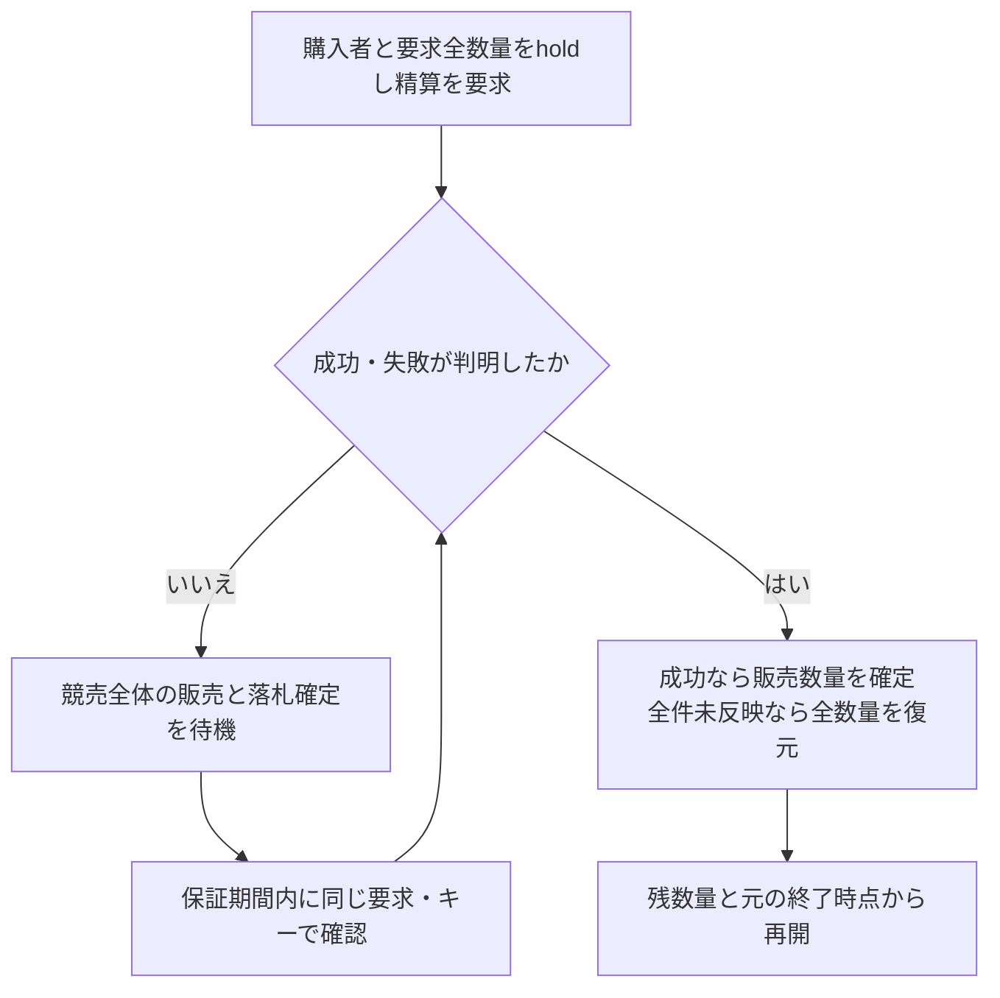
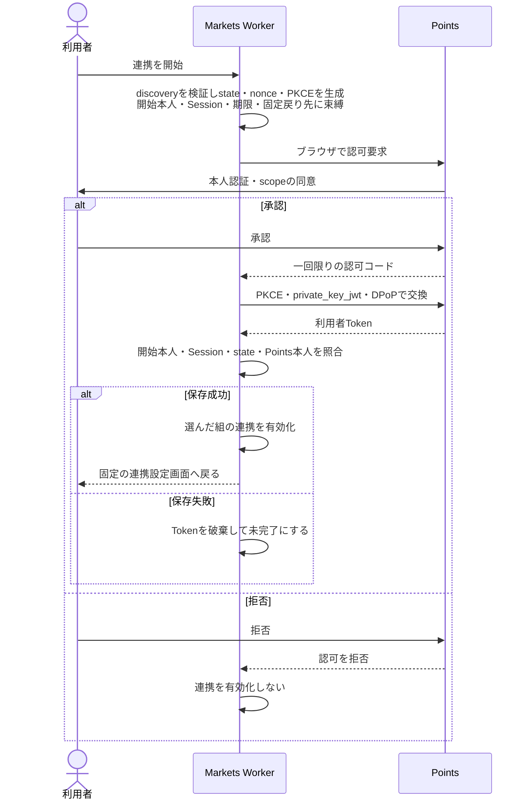
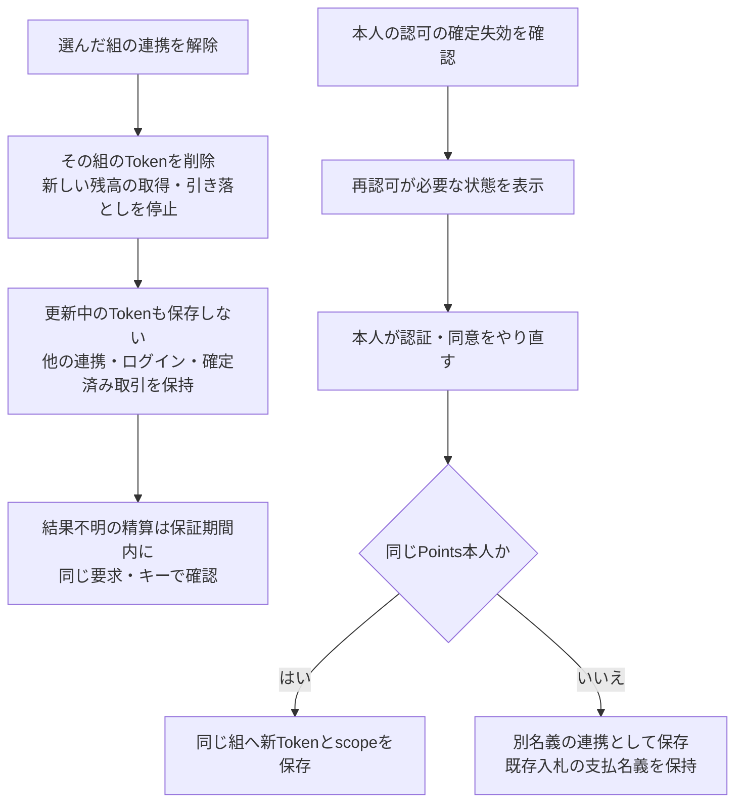
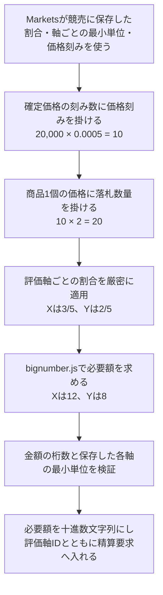
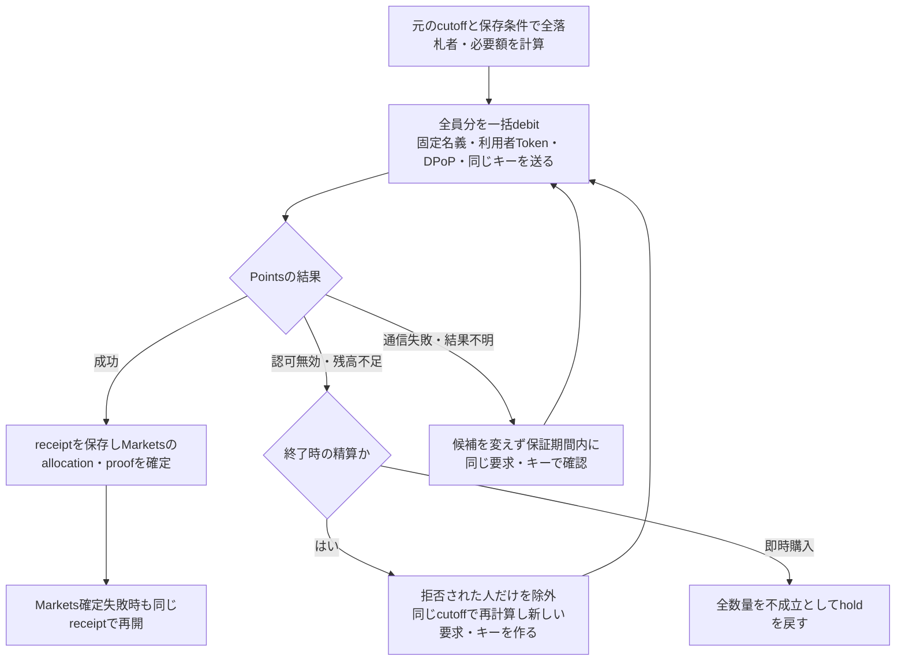

# Freeism Markets v0.2.1 仕様

- [Freeism Markets v0.2.1 仕様](#freeism-markets-v021-仕様)
  - [言語](#言語)
  - [v0.2.1：実装する理由](#v021実装する理由)
  - [v0.2.1：基本方針](#v021基本方針)
    - [優先すること](#優先すること)
    - [設計原則](#設計原則)
    - [PointsとMarketsの独立](#pointsとmarketsの独立)
    - [Marketsの責務](#marketsの責務)
    - [販売方法](#販売方法)
    - [機能範囲](#機能範囲)
    - [後方互換とデータ移行](#後方互換とデータ移行)
    - [文書の範囲](#文書の範囲)
  - [出品とAuction作成](#出品とauction作成)
    - [作成方式](#作成方式)
    - [入力項目](#入力項目)
    - [計算条件のsnapshot](#計算条件のsnapshot)
    - [開始前の編集と取消](#開始前の編集と取消)
    - [CSV出品](#csv出品)
    - [CSVのD1一括書き込み](#csvのd1一括書き込み)
    - [CSV export](#csv-export)
    - [確認すること](#確認すること)
  - [Auction一覧・詳細画面](#auction一覧詳細画面)
    - [URL](#url)
    - [一覧カード](#一覧カード)
    - [検索](#検索)
    - [詳細画面](#詳細画面)
  - [入札とAutoBid](#入札とautobid)
    - [残高の扱い](#残高の扱い)
    - [受付の流れ](#受付の流れ)
    - [受付の条件](#受付の条件)
    - [bid API](#bid-api)
    - [順位](#順位)
    - [AutoBid](#autobid)
    - [確認すること](#確認すること-1)
  - [Auctionの状態と時刻](#auctionの状態と時刻)
    - [状態](#状態)
    - [日時](#日時)
    - [開始と終了](#開始と終了)
    - [終了間際の延長](#終了間際の延長)
    - [確認すること](#確認すること-2)
  - [落札者と落札価格](#落札者と落札価格)
    - [落札者の選び方](#落札者の選び方)
    - [落札価格](#落札価格)
    - [確認すること](#確認すること-3)
  - [即時購入](#即時購入)
    - [受付](#受付)
    - [引き落としと結果](#引き落としと結果)
    - [結果判明後の再開](#結果判明後の再開)
    - [画面](#画面)
    - [確認すること](#確認すること-4)
  - [残高不足者の除外とブラックリスト](#残高不足者の除外とブラックリスト)
    - [除外と再計算](#除外と再計算)
    - [確認すること](#確認すること-5)
  - [落札証明と相互評価](#落札証明と相互評価)
    - [目的](#目的)
    - [proofの作成](#proofの作成)
    - [proofの内容](#proofの内容)
    - [外部アカウントの表示](#外部アカウントの表示)
    - [公開とcache](#公開とcache)
    - [proof画面](#proof画面)
    - [相互評価](#相互評価)
    - [確認すること](#確認すること-6)
  - [履歴・watchlist・公開API](#履歴watchlist公開api)
    - [履歴](#履歴)
    - [watchlist](#watchlist)
    - [公開API](#公開api)
    - [Shields.ioのバッジ](#shieldsioのバッジ)
  - [外部EC・対面での受け渡し](#外部ec対面での受け渡し)
    - [目的](#目的-1)
    - [匿名発送](#匿名発送)
    - [外部EC経由の受け渡し](#外部ec経由の受け渡し)
    - [検証用URLと証明コード](#検証用urlと証明コード)
    - [claim token](#claim-token)
    - [テーブル`auction_claim_tokens`](#テーブルauction_claim_tokens)
    - [再発行](#再発行)
    - [検証](#検証)
    - [受け渡し完了](#受け渡し完了)
    - [画面の状態と文言](#画面の状態と文言)
    - [外部ECの注文ID](#外部ecの注文id)
    - [漏えい対策](#漏えい対策)
    - [この方式で証明できること](#この方式で証明できること)
    - [対面での受け渡し](#対面での受け渡し)
    - [対面決済・QR決済・店舗履歴](#対面決済qr決済店舗履歴)
  - [GitHub連携の決済](#github連携の決済)
  - [多言語・accessibility](#多言語accessibility)
    - [対応言語](#対応言語)
    - [固定公開ページの言語](#固定公開ページの言語)
    - [accessibility](#accessibility)
    - [確認すること](#確認すること-7)
  - [利用規約](#利用規約)
  - [プライバシーポリシー](#プライバシーポリシー)
  - [ログイン](#ログイン)
    - [範囲](#範囲)
    - [ログイン方法](#ログイン方法)
    - [本人識別とAccount link](#本人識別とaccount-link)
    - [Better Auth設定](#better-auth設定)
    - [確認すること](#確認すること-8)
  - [Points連携](#points連携)
    - [役割と識別](#役割と識別)
    - [提供先の管理](#提供先の管理)
    - [OAuth Clientと鍵](#oauth-clientと鍵)
    - [連携の開始](#連携の開始)
    - [Tokenの保存と更新](#tokenの保存と更新)
    - [競売での利用](#競売での利用)
    - [解除と再認可](#解除と再認可)
    - [連携画面](#連携画面)
    - [確認すること](#確認すること-9)
  - [金額表現と価格刻み](#金額表現と価格刻み)
    - [金額の表し方](#金額の表し方)
    - [価格刻み](#価格刻み)
    - [必要額の計算](#必要額の計算)
    - [確認すること](#確認すること-10)
  - [Points–Markets連携契約](#pointsmarkets連携契約)
    - [境界](#境界)
    - [共通のHTTP](#共通のhttp)
    - [Endpoint](#endpoint)
    - [残高の取得](#残高の取得)
    - [一括精算](#一括精算)
    - [Marketsの責務](#marketsの責務-1)
    - [要求回数の数え方](#要求回数の数え方)
    - [確認すること](#確認すること-11)
  - [精算](#精算)
    - [落札者と精算の原則](#落札者と精算の原則)
    - [Settlement Workflow](#settlement-workflow)
    - [Workflowの上限と1,000人の落札者](#workflowの上限と1000人の落札者)
    - [Workflow instanceと手動retry](#workflow-instanceと手動retry)
    - [retry budget](#retry-budget)
    - [失敗の扱い](#失敗の扱い)
    - [Settlementの状態の取得](#settlementの状態の取得)
    - [outboxとreconciler](#outboxとreconciler)
    - [確認すること](#確認すること-12)
  - [リアルタイム配信](#リアルタイム配信)
    - [状態の基準](#状態の基準)
    - [変更はHTTPで行う](#変更はhttpで行う)
    - [WebSocketの接続](#websocketの接続)
    - [attachmentと接続上限](#attachmentと接続上限)
    - [heartbeatを使わない](#heartbeatを使わない)
    - [event](#event)
    - [確認すること](#確認すること-13)
  - [Cookie、CSRF、Origin](#cookiecsrforigin)
    - [防御の層](#防御の層)
    - [Cookie](#cookie)
    - [CSRFとOrigin](#csrfとorigin)
    - [確認すること](#確認すること-14)
  - [HTTPリクエスト・HTTPレスポンス](#httpリクエストhttpレスポンス)
    - [対象とAPIの区分](#対象とapiの区分)
    - [リクエスト](#リクエスト)
    - [冪等性](#冪等性)
    - [成功](#成功)
    - [失敗](#失敗)
    - [status](#status)
    - [cache](#cache)
    - [security header](#security-header)
    - [確認すること](#確認すること-15)
  - [Rate limit](#rate-limit)
    - [確認すること](#確認すること-16)
  - [監査と運用監視](#監査と運用監視)
    - [監査event](#監査event)
    - [logとmetric](#logとmetric)
    - [運用alert](#運用alert)
    - [確認すること](#確認すること-17)
  - [命名規則](#命名規則)
    - [適用範囲](#適用範囲)
    - [repository・service・domain](#repositoryservicedomain)
    - [ID](#id)
    - [金額と時刻](#金額と時刻)
    - [versionと状態](#versionと状態)
    - [HTTP・OpenAPI](#httpopenapi)
    - [Hono](#hono)
    - [Drizzle・D1](#drizzled1)
    - [Durable Object・Workflow](#durable-objectworkflow)
    - [frontend](#frontend)
    - [test](#test)
    - [script](#script)
    - [例外](#例外)
  - [テーブル・データ構造](#テーブルデータ構造)
    - [共通の規則](#共通の規則)
    - [主なaggregate](#主なaggregate)
    - [`auctions`](#auctions)
    - [`bids`](#bids)
    - [`auto_bids`](#auto_bids)
    - [`trade_reviews`](#trade_reviews)
  - [フロントエンドの構成と配信](#フロントエンドの構成と配信)
    - [構成](#構成)
    - [Static Assets](#static-assets)
    - [画面の状態](#画面の状態)
  - [ライブラリと依存関係](#ライブラリと依存関係)
    - [主な採用ライブラリ](#主な採用ライブラリ)
    - [versionの固定](#versionの固定)
    - [pnpmの設定](#pnpmの設定)
    - [TanStackのincident](#tanstackのincident)
  - [デプロイ設定](#デプロイ設定)
    - [環境とドメイン](#環境とドメイン)
    - [stagingのBasic認証](#stagingのbasic認証)
    - [IaCの分担](#iacの分担)
    - [GitHub Actions](#github-actions)
    - [`main`のruleset](#mainのruleset)
    - [CI/CD pipeline](#cicd-pipeline)
    - [D1 migrationと復旧](#d1-migrationと復旧)
    - [テストの層](#テストの層)
    - [production release gate](#production-release-gate)
    - [受入後の撤去](#受入後の撤去)
  - [採用しないもの](#採用しないもの)
  - [v0.2.0からv0.2.1への変更](#v020からv021への変更)

## 言語

日本語（本ページ）| [English](./all.en.md)

## v0.2.1：実装する理由

- 無料主義ドキュメントv3に、大幅な仕様変更があったため。

## v0.2.1：基本方針

### 優先すること

- `v0.2.1`は「実用性」・「移植性」・「仕様理解の簡単さ」を優先する。
  - 本質的な機能のみ実装する。
  - `ver0.1`はポートフォリオとしていろいろな機能を実装したが、`v0.2.1`は本質的な機能だけを残す。
  - 他者がコードを読んで、無料主義の仕様としたいことを理解できるようにする。

### 設計原則

- 疎結合にする。
  - データ取得元をいつでも簡単に差し替えられるように設計する。
  - ソースをfrontend・backend・sharedへ分け、各領域内は役割別、その中は機能別に整理する。
  - 計算ルールとDB・HTTPの処理を分離し、DB操作は差し替え可能なインターフェースを通して使う。

- 可読性を保つ。
  - シェルスクリプトはファイルを分ける。

- 簡潔にする。
  - より多くの人に理解してもらうため、堅牢性を求めず、簡単にすぐ理解できる短い必要最小限のコードにする。
  - リッチな機能やリッチなUIは提供せず、すぐ理解できるシンプルな機能だけにする。
  - アプリとして実用するのではなく、どんなサービスかを体験してもらうためのものとする。

- 各パラメータは定数ファイルで管理し、すぐに変更できるようにする。

- サーバー負荷と、データベースやストレージの保存容量をできる限り削減する。

### PointsとMarketsの独立

- PointsとMarketsは独立したアプリとして運用する。
  - 別のアプリとして、同じようなアプリとも連携できる前提で設計したいためである。
  - 疎結合にする対象は「UIとAPI」ではなく「PointsとMarkets」である。
  - Pointsは`points.freeism.app`、Marketsは`markets.freeism.app`で公開する。
  - Marketsのフロントエンドとバックエンドは`projects/markets-web-app`で一体管理し、Worker名は`auction-worker`とする。

- 連携の詳細はPoints連携の章とPoints–Markets連携契約の章に書く。

### Marketsの責務

- Marketsは商材情報を含むAuctionの作成、入札、配分、精算進行、落札証明を管理する。
  - 現在のAuction関連機能はすべてMarketsが持つ。
  - Taskを作成せず、評価軸、FIX、ポイント残高を所有しない。

- Marketsが持つものは次のとおりである。
  - Marketsユーザーと、Pointsから独立したBetter Authセッション
  - 商材情報とAuction設定を統合した現在のAuctionレコード、競売作成時のパッケージ情報と公開snapshot
  - bid command、bid sequence、AutoBid状態、watchlist
  - AuctionRoom Durable Objectの接続状態と配信用状態
  - Auctionの終了判定、winner計算、落札価格
  - Settlement Workflow、outbox、精算saga状態
  - 落札証明、取引完了証明、seller/buyer相互評価

### 販売方法

- 販売方法はオークションだけとする。
  - オークションに即決価格の機能を入れることで、通常の販売機能も内包できるためである。
  - オークションに絞ることで管理コストを減らせるためである。
  - オークションが無料主義の根幹の仕組みであるためである。

- 出品で選べる購入方式は「消費」だけとする。
  - 一番ニーズがありそうなためである。
  - 落札時に保有ポイントから差し引き、出品者へポイントを渡さない。

### 機能範囲

- Marketsには次の機能を入れる。
  - 出品、入札、自動入札
  - GoogleとGitHubによるログインと、Pointsとの明示的な連携
  - Better Authの`user.role`に`admin`を含む利用者による管理操作
  - 複数のポイント管理サービスとの連携
    - 出品時に提供先を選び、1つの競売は1つの提供先に固定する。
  - 作成したAuction・入札・落札の履歴と、watchlist
  - 公開・永続の落札証明と、seller/buyerの相互評価
  - 外部EC用の落札証明トークン
  - 対面決済、QR決済、店舗履歴
  - OSSライセンスのページ

- Markets自身はECを運営せず、外部ECと連携できるようにする。

- 商品の発送や住所の管理はしない。
  - モノの発送が必要な場合は、他のサービスを使う。
  - 発送の証拠はアプリ内のレビュー画面に記載するだけとする。

- 次の機能は実装しない。
  - Task、Group、一般コミュニティメンバー管理、draft評価
  - 通知基盤、メール、Web Push、アプリ内通知、予約通知、watchlist通知
    - 操作結果を示す短命のtoastはUI部品として残す。
  - PWA、Service Worker、offline cache
  - 画像の保存・表示・アップロード
    - R2を商品画像に使わない。
    - 商材詳細はtextと安全な外部URLで表す。
  - Q&A、chat、1対1のDM
    - DMは電気通信事業法の対象になるためである。
  - 入札中に他のポイントから交換する機能
    - 本質的な機能ではないためである。
  - ポイントを一定期間預ける方式、消費しない方式、sellerへのポイント譲渡
  - reverse auction
  - 引き落としが成功したあとに、その分を取り消して返す機能
  - ポイントを借りて、あとから返すための帳簿
  - 誰かが条件を満たしたときだけ、別の人の代わりに購入する機能
    - 必要なら、このアプリの外で扱う。

### 後方互換とデータ移行

- v0.2.1は本番リリース前のテスト環境として扱い、後方互換性とデータ移行は不要とする。
  - Supabaseなどからの業務データ移行を行わない。
  - 後方互換URL、旧API、旧DB schema、旧Session、SSE fallback、Prisma互換層を作らない。

- この仕様に記載していない仕様は、無料主義アプリv0.1と同じとする。

### 文書の範囲

- この仕様はMarketsの責務だけを書き、Pointsの内部仕様は書かない。

- 仕様・制約・状態機械・採用しない理由は`docs`に書き、実行作業と順序は各アプリの`plan`に書く。

## 出品とAuction作成

- 「出品」は商材情報を含むAuctionを作成して公開予定にする利用者操作を指す。
  - 商材と競売条件は一つの`auction`に置き、独立した商材やListingのIDを作らない。
  - 作成・開始前の編集・取消・検索・履歴・proofは、Auction ID・`auctionVersion`・Auction commandだけを使う。
  - 再出品は既存Auctionを再利用せず、新しいAuction IDで作成する。
  - Auction IDは標準Nano IDとする。

### 作成方式

- Auctionは出品フォームとCSVで作成する。
  - 出品フォームはモーダルから1件ずつ、CSVは1行で1件のAuctionを一括で作成する。
  - CSVは登録の労力を減らすために用意する。
  - どちらも同じ作成処理とshared validatorを使い、出品フォームもCSVの1行と同じ検証・作成処理を呼ぶ。

- 1つのAuctionは1つのPoints提供先（`providerId`）に固定する。
  - 出品者は作成時に、Pointsの提供先と、パッケージまたは評価軸単体のどちらか一方を選ぶ。
  - 全落札者と全評価軸を、同じPointsのデータベースで精算する。
  - 複数のPoints提供先を1つのAuctionで選択・混在させない。

### 入力項目

- Auctionには次の項目を保存する。
  - 文字数はUTF-16 code unitではなく、NFC正規化後のUnicode code pointで数える。
  - bytesは保存する正規化済みUTF-8で別に検査する。
  - CSV、出品フォーム、PATCH API、client previewは同じshared validatorを使い、emoji・結合文字・4-byte文字でも境界を変えない。

| 項目 | 条件 |
| --- | --- |
| title | NFC正規化・前後空白除去後に1〜120 code point、UTF-8で最大480 bytes。改行とcontrol文字を許可しない |
| description | NFC正規化・CRLFをLFへ統一した後に1〜4,000 code point、UTF-8で最大16,000 bytes。LFとtab以外のcontrol文字を許可しない |
| 外部参照URL | Auctionごとにちょうど1件。UTF-8で最大2,048 bytes。`https`だけを許可し、userinfo・fragment・control文字を拒否する |
| 販売数量 | 1〜1,000の安全整数 |
| 開始・終了時刻 | `startsAt`、`endAt`。UTCで保存する |
| 即決価格 | 任意。作成時に取得した全構成軸が即決を許可する場合だけ設定できる |
| 終了延長rule | 任意。`extensionThresholdSeconds`・`extensionDurationSeconds`・`maxExtensions`を開始前に固定する。延長する場合は3つすべて必須 |

- 外部参照URLは標準URL parserで正規化して保存する。
  - schemeとIDNA変換後のhostは小文字にし、default portを除く。
  - pathのdot segmentとpercent encodingを正規化する。
  - URLの表示labelへraw HTMLを使わず、遷移時も保存済みのcanonical HTTPS URLだけを使う。

- 1回の出品で、1個以上を1人以上へ販売できる。
  - 例えば、複数個の出品、複数人への出品、1個の出品、1人への出品ができる。
  - 出品時には販売数量を指定する。
  - 販売人数は指定できない。
  - 販売人数の指定は無料主義アプリv3で実装する予定である。

- このほか、seller Markets user IDと公開identity snapshot、Points issuer／resource、計算条件のsnapshotを保存する。

### 計算条件のsnapshot

- 作成時に、Pointsからパッケージまたは評価軸単体の現在の詳細を取得して検証し、計算条件を保存する。
  - MarketsはPointsの詳細取得応答に含まれる`data.calculation`を受け取る。
  - 表示・管理情報と`data.calculation`は、同じ`data`オブジェクト内に入る。
  - 詳細取得の応答から、表示用の区画と、全展開軸の計算情報（`calculation`）を区別して取得する。
  - 表示用区画の見え方で、計算対象を減らさない。
  - 重複する評価軸は取得時に合算された構成を保存する。
  - 保存するのは、全展開軸のID・割合・各軸の最小単位・`amountUnit`・`packageTick`・状態・即決可否・取得時刻と、提供された公開表示名（パッケージ名、構成軸の公開名とID）である。
  - パッケージを選ぶ場合は、その現在状態が`ACTIVE`であることを確認する。
  - パッケージIDは選択と詳細取得の間だけ扱い、競売・精算レコードには保存しない。
  - `packageTick`の求め方は金額表現と価格刻みの章にまとめる。

- Pointsが閲覧権限を確認して返した情報を、許可された範囲で表示する。
  - 本人が管理する非公開軸の名前は、本人の選択画面だけに表示する。
  - 非公開軸の名前は公開表示へ保存せず、評価軸IDを表示する。
  - 出品ごとの追加同意は設けず、本人の認可による取得条件と情報の利用条件を守る。

- 保存した条件で、開始から精算まで進める。
  - 入札には作成時に保存した全評価軸と割合を使う。
  - 精算時には保存済みの軸IDと必要額を使う。
  - その後のパッケージの構成変更・停止・非公開化・削除、評価軸の`minimumUnit`や共通小数桁数の変更では、既存Auctionの条件を書き換えない。
  - 評価軸の`minimumUnit`は作成後も変更でき、既存Auctionの計算には保存した作成時の単位を使う。
  - 新規作成時にPointsが障害でも、古い任意の構成へfallbackしない。

- 最初の有効bid以後は、価格・数量など結果に影響する項目を変更できない。
  - 変更できないのは、seller、販売数量、評価軸、割合、各軸の最小単位、入札額の刻み、価格式、Points提供先である。
  - server、DO、D1のそれぞれで、これらの変更を拒否する。

### 開始前の編集と取消

- Auctionの作成者だけが開始前に編集・取消できる。
  - 対象は、`DRAFT`または`SCHEDULED`で、server時刻が`startsAt`より前のAuctionである。
  - request bodyのseller IDを信用せず、Markets Sessionの作成者IDと`expectedAuctionVersion`を必須にする。
  - 自分の出品画面はこの条件を満たす場合だけ編集・取消buttonを表示する。
  - 画面の表示判定は利便性のためであり、認可と競合判定はserverで必ず再実行する。

- 編集は`PATCH /api/auctions/{auctionId}`へ送る。
  - 完全な編集対象、`expectedAuctionVersion`、`Idempotency-Key`を送る。
  - 入力は作成時と同じruleで再検証し、Pointsの現在の詳細と計算情報を再取得して、確認済みの対象・条件・金額との差を検査する。
  - `auction`の現在のレコードを`expectedAuctionVersion`の条件付きUPDATEで更新し、`auctionVersion`を増やす。
  - 計算条件が変わる場合は、新しい`pointPackageSnapshot`を追加して参照を置き換える。
  - bodyに`providerId`があれば拒否し、既存Auctionの提供先を使う。
  - 画面は成功responseの新しいversionで置き換え、`409`では最新のsnapshotを再取得する。

- 取消は確認dialogの明示操作から`POST /api/auctions/{auctionId}/cancellations`へ送る。
  - expected versionと理由を送る。
  - 作成者、開始前、`DRAFT`または`SCHEDULED`、受理済みbid 0件、AutoBid 0件、buy-now hold 0件を、同じD1 CAS guardで再確認する。
  - 成功時はAuctionを同じtransactionで`CANCELLED`へ進め、取消event・idempotency result・auditを追加する。
  - 物理削除はせず、履歴とauditを保持する。
  - 成功後の画面は`CANCELLED`の終端状態を表示し、bid・即決・編集の操作をすべて隠す。

- 競合はexpected versionとD1 guardで1件だけを成功させる。
  - 対象は`startsAt`の到来、同時編集、同時取消、初回bidとの競合である。
  - 条件付きUPDATEが0行の場合を成功として扱わない。

| 状況 | 応答 |
| --- | --- |
| version競合 | `409 AUCTION_VERSION_CONFLICT` |
| 開始済み | `409 AUCTION_ALREADY_STARTED` |
| bid・AutoBid・buy-now holdがある取消 | `409 AUCTION_CANCELLATION_BLOCKED`。画面上でAuctionを取消済みにしない |

### CSV出品

- CSVの主要列は次のとおりとする。
  - `title`
  - `description`
  - `externalUrl`
  - `pointPackageId`または`evaluationCriterionId`（選択した対象のどちらか一方）
  - `quantity`
  - `startsAt`
  - `endAt`
  - `buyNowPrice`（任意）
  - `extensionThresholdSeconds`／`extensionDurationSeconds`／`maxExtensions`（任意。延長する場合は3列すべて必須）
  - `clientRowId`（file内で一意）

- CSVはUTF-8、最大5MiB、最大1,000非空行とし、strict header／cell schemaで検証する。
  - 金額は十進数文字列で検証し、保存する精度・最小単位と範囲を守る。
  - 指数表記とUnicodeマイナスは拒否する。

- 画面はfile選択button、server検証後の確認画面、全error一覧を基本とする。
  - drag-and-dropとserver draftは使わない。
  - field validationのerrorは`errors[]`へrow・field・codeで返す。
  - server validation後のpreviewには、Pointsから取得したpackage component vector、計算済みの`packageTick`、時刻、即決、延長ruleを表示する。

- 1回のCSV importでは、`ACTIVE`なPoints提供先を1つ選ぶ。
  - 全行のpackage検証とAuctionをその提供先へ固定する。
  - validate要求では`X-Points-Provider-Id`を必須とする。
  - commit bodyの`providerId`は`preview.providerId`と一致させる。

- 確定時はclient previewを信用せず、CSVをserverで再parseする。
  - Pointsの詳細取得で、全展開軸・割合・状態・最小単位・金額刻み・価格刻みを再取得する。
  - パッケージを選ぶ場合は、その現在状態が`ACTIVE`であることを確認する。
  - previewで本人が確認した重要な対象・条件・金額と変わっていれば、再確認を求める。

- 確定は全件成功または全件rollbackとする。
  - 1件でも不正なら、全件を確定しない。
  - 確認後に1回だけ原子的にcommitする。

- CSVの再送は`Idempotency-Key`と正規化した内容のhashで判定する。
  - 同じkeyで内容が異なる場合は`409 IDEMPOTENCY_KEY_REUSED`とする。

### CSVのD1一括書き込み

- 1,000行の確定では、値を並べた巨大なmulti-value SQLや1行1queryを使わない。
  - 現行D1の上限（1 query 100 bound parameters、SQL 100KB、string／BLOB 2MB、Workers Freeで1 invocation 50 queries（`batch()`は1 queryと数える）、batch全体30秒）をすべて満たす。
  - この制約はSettlementで複数winnerを書き込む場合にも適用する。

- validation済みのrowをcanonical JSON arrayへ変換し、UTF-8で1 chunk 1,500,000 bytes以下に分ける。
  - 1 rowだけでchunk上限を超える入力は事前に拒否する。

- 各statementはJSON chunk 1個だけをbound parameterとする。
  - 固定SQLの`json_each(?)`／`json_extract`から、set-basedにINSERT／UPDATEする。
  - SQL文字列を入力件数に応じて伸ばさない。

- 全Auction、snapshot、command guard、idempotency result、auditのstatementを一つのD1 `batch()`へ入れる。
  - 1 statementでも失敗すれば全件rollbackし、複数の独立した`batch()`へ分けない。
  - 1 commitのstatement数は100以下とし、query上限50に余裕を持たせる。
  - 100を超えるschema設計になる場合は、行数を黙って削らず、実装を止めて計画を見直す。

### CSV export

- CSV exportでは、formula injectionを無害化する。
  - raw文字列のままexportしない。

- exportは物理化したsnapshotから読み出す。
  - 元データの更新でpageの内容が混ざること、期限超過、Workersのmemoryの使いすぎを防ぐためである。
  - 上限は最大50,000行／50MiB、1行8KiB、1 page最大1,000行／8MiBとする。
  - 読み取り時は、ログイン中の作成者とexport IDをD1で照合する。
  - snapshotの30分の有効期限をD1で検査する。
  - cursorは数値のordinalで表し、範囲外を拒否する。

### 確認すること

- CSV 1,000行と1,001行、確認後に対象・条件・金額が変わった場合の再確認、全件rollback。

- 実D1 runtimeで、1,000行、5MiB境界、100 parameter境界、2MB chunk境界、statement数、30秒timeout、途中statement失敗時の0件反映を確認する。
  - 5MiB／1,000行を30秒以内に処理できることを確認する。

- title 0／1／120／121 code pointと480 byte、description 0／1／4,000／4,001 code pointと16,000 byte、emoji・結合文字。
  - 外部URLの1件、2,048 byte、HTTPS、userinfo、fragment、canonical化。
  - これらをCSV、PATCH、UIで一致させる。

- 作成者だけの開始前編集・取消、versionと`startsAt`の競合、bid・AutoBid・buy-now holdがある場合の取消拒否、`CANCELLED`の終端。

- validation errorsのrow／fieldと、CSV再送のidempotency replay／conflict。

## Auction一覧・詳細画面

### URL

- 画面のURLは次のとおりとする。
  - 一覧: `/auctions`
  - Auction CSV作成: `/auctions/import`
  - Points連携・解除・再連携: `/settings/points-connection`
  - Points提供先管理（Markets ADMIN）: `/admin/points-connections`
  - 詳細・入札: `/auctions/{auctionId}`
  - 自分の出品: `/me/auctions/created`
  - 自分の入札: `/me/auctions/bids`
  - 自分の落札: `/me/auctions/won`
  - proof: `/proofs/{proofId}`
  - Settlement状態・手動retry: `/settlements/{settlementId}`
  - 外部ECの検証: `/admin/claims/verify`
  - 外部ECの落札証明の詳細: `/admin/claims/{claimId}`

- 公開URLは名前ではなく不変IDを使い、名前を変更してもURLを維持する。
  - 各URLは`markets.freeism.app`直下に置く。
  - `/dashboard` prefixや旧`freeism.app`のpathへのredirectは作らない。

### 一覧カード

- 一覧のカードには次の項目を表示する。
  - title、descriptionの要約、sellerの表示名
  - 状態、開始・終了時刻（利用者のlocal timeで表示する）
  - 販売数量、現在のprovisional allocation数
  - 保存したパッケージまたは評価軸単体の公開表示名
  - 構成する評価軸の名前・ID・比率
  - package price tick、現在の公開価格、即決価格の有無

- 構成する評価軸とその比率を表示するのは、どのポイントで入札できるかをすぐ分かるようにするためである。
  - 表示には競売作成時に保存した公開表示名・評価軸ID・構成比率を使う。
  - 非公開の評価軸は名前を公開表示へ保存せず、IDを表示する。

- 画像placeholderも含め、画像の領域は作らない。

### 検索

- 検索対象はtitle、description、Auction ID、保存した公開表示名のうちD1で扱える範囲とする。

- 全文検索はDrizzleのクエリで実装する。
  - 保守性を高めるためである。

### 詳細画面

- 詳細画面には次の項目を表示する。
  - Auctionの商材情報、seller、package snapshot、提供先の表示名とorigin
  - server基準の状態と残り時間
  - 販売数量、provisional ranking/allocation
  - 落札価格の決まり方の説明と、自分の現在の参考値
  - 自分のmanual bid、希望quantity、AutoBid上限（本人だけに表示する）
  - bid履歴（AutoBid上限は表示しない）
  - watchlist button
  - このAuctionの提供先と、その提供先に対する本人の連携状態・明示link導線
  - WebSocketの接続状態、最終`auctionVersion`/`bidSeq`、再同期の状態

- provisional allocationの最後の落札者には、希望数量が残っていない可能性がある旨の注意を表示する。

- 入札・即時購入・AutoBid設定の操作をする詳細画面では、Pointsの残高を参考表示する。
  - 落札価格の説明と自分の参考値の近くに置く。
  - その競売の評価軸別の必要額と、本人が選んだPoints名義の評価軸別の残高を並べ、軸ごとの不足額を表示する。
  - 残高はPointsの残高一覧API`GET /api/v1/me/point-balances`から取得する。
  - 必要額との比較と不足額の計算はMarketsで行う。
  - この表示はポイントを確保するものではなく、落札時の精算で改めて判定されることを添える。
  - 参考表示は入札を止めず、不足していても入札できる。

## 入札とAutoBid

- 入札は`packageTick`単位の価格と数量を指定して行う。

- 出品者が指定したパッケージの評価軸の種類と割合でのみ入札できる。

- 1ユーザー1Auctionにつき、有効なbid positionは1件とする。
  - 再入札はpositionの更新と、不変のbid eventの追加で行う。
  - 同じ利用者の新しい有効bidは、現在の到達価格・数量・AutoBid状態を更新し、監査用のbid eventは不変で残す。

- 入札者は初回の入札・AutoBid設定・即時購入で、Auctionの提供先へ連携済みのPoints名義を支払名義として選ぶ。
  - 支払名義の固定の規則はPoints連携の章にまとめる。

### 残高の扱い

- 入札とAutoBid設定の受付では、Pointsの残高を照会せず、予約・減算もしない。
  - ただし、Auctionの提供先への有効なPoints連携は必要とする。
  - ポイントは入札時に消費せず、落札時に保有ポイントから差し引く。
  - 落札時に落札額を保有していない場合の扱いは、残高不足者の除外とブラックリストの章にまとめる。

### 受付の流れ

- bidの変更は認証済みのHTTPだけで受け付ける。

- commandは`commandId`、`expectedAuctionVersion`、quantity、manual priceまたはAutoBid上限を持つ。
  - `(auctionId, commandId)`と`(auctionId, bidSeq)`をD1で一意にする。
  - 同じcommandのretryは同じ結果を返し、同じkeyで内容が異なれば`409 IDEMPOTENCY_KEY_REUSED`とする。
  - expected `auctionVersion`が異なるcommandは`409`にする。

- 通信断のときも、古い画面からblind bidを送らない。
  - HTTP snapshotを再取得してから、expected version付きで送る。

### 受付の条件

- 次の条件をすべて満たすbidだけを受理する。
  - AuctionがOPENである。
  - bidderがseller本人ではない。
  - Auctionの提供先に対する有効なPoints連携があり、提供先が`ACTIVE`である。
  - quantityが1以上で、販売数量以下の安全整数である。
  - priceが0以上で、`packageTick`の倍数である。
  - Auctionに保存した計算条件とbid対象が一致する。
  - 現在の有効価格を引き下げず、受理済みのbidを撤回しない。

- seller本人のbid、終了後のbid、価格の引下げ、bidの撤回を拒否する。
  - server、DO、D1のそれぞれで拒否する。

### bid API

`POST /api/auctions/{auctionId}/bids`

- `Idempotency-Key` headerを必須とする。
  - その値を`commandId`として保存し、`(auctionId, commandId)`で一意にする。

```json
{
	"expectedAuctionVersion": 42,
	"quantity": 2,
	"priceTickCount": "15",
	"autoBidMaxTickCount": "30"
}
```

- manual bidだけなら`autoBidMaxTickCount`を省略する。
  - AutoBidだけでも、現在の到達値としての`priceTickCount`をserverが決定できる。

- 成功時は次を返す。

```json
{
	"data": {
		"commandId": "Uakgb_J5m9g-0JDMbcJqL",
		"auctionVersion": 43,
		"bidSeq": 108,
		"acceptedPriceTickCount": "16",
		"quantity": 2
	},
	"meta": {
		"requestId": "req_V1StGXR8_Z5jdHi6B-myT"
	}
}
```

- 主なerrorは次のとおりとする。

| status | code |
| --- | --- |
| 401 | `AUTHENTICATION_REQUIRED` |
| 403 | `POINTS_LINK_REQUIRED` |
| 403 | `SELLER_CANNOT_BID` |
| 409 | `AUCTION_VERSION_CONFLICT` |
| 409 | `AUCTION_NOT_OPEN` |
| 409 | `IDEMPOTENCY_KEY_REUSED` |
| 422 | `INVALID_QUANTITY` |
| 422 | `INVALID_PRICE_TICK` |

### 順位

- 高い有効単価を優先する。
  - 同額は、その価格へ最初に到達した`reachedSequence`が小さい順とする。
  - serverがAuction内で`bidSeq`と`reachedSequence`を単調に増やす。
  - client timestampで先着を決めない。

### AutoBid

- 利用者が事前に上限額と希望数量を設定し、システムが自動で入札する。
  - 上限はbid APIと同じcommandでserverへ送り、AuctionRoomが直列化してMarkets D1へ保存する。
  - 上限の設定・更新はbid APIと同じcommand列で直列化する。
  - 上限はAuctionの`packageTick`の整数個分（`autoBidMaxTickCount`）とする。

- 新しい競合bidごとに、必要な最小のtickへ直接進める。
  - 上限を超えて進めない。
  - その価格へ到達した瞬間に`reachedSequence`を確定する。
  - 同時のAutoBidはAuctionRoomで決定論的に処理し、同じcommand集合から同じevent列を作る。

- 上限の引上げと、AutoBidの取消ができる。
  - 取消は将来の自動増額だけを止め、すでに到達した有効bidを巻き戻さない。
  - 取消の確認dialogには現在到達しているbidを削除しないことを表示する。

- 上限は本人以外へ公開しない。
  - 公開するのは、現在の到達価格、順位に必要なevent、quantityだけである。
  - 本人専用のresponseでも`Cache-Control: private, no-store`とする。
  - WebSocket event、WebSocket attachment、公開履歴、log、auditへ上限を出さない。

- AutoBidは次の流れで進む。
  - まず現在の価格（初めは0）で入札する。
  - 0で購入できる枠が埋まったら、1単位増やして入札し、先着順で最後尾の人の購入枠を奪う。
  - 1単位増やした入札はその価格の列の一番後ろに加わる。
  - 落札者は、順位が上の人から順に、その人の希望数量ずつ割り当てる。

- 順位の例を示す。
  - 購入枠が3人分あり、a→b→cの順で0ポイントで入札した場合、順位はa→b→cになる。
  - その後、dが1ポイントで入札すると、cが枠から外れて、順位はd→a→bになり、d・a・bが商材を得る。
  - このとき、すでに3人で枠が埋まっているため、dは0ポイントでは入札できず、1ポイント以上になる。
  - その後、cが5ポイントで入札すると、bが枠から外れて、順位はc→d→aになる。
  - その後、bが3ポイントで入札すると、aが枠から外れて、順位はc→b→dになる。
  - cは5ポイントなので、順位は一番高いままである。

### 確認すること

- 未ログイン、Points未連携、seller、終了後のbidの拒否。

- manual bid、AutoBid、AutoBidの取消、即決。

- expected versionの競合とsnapshotの再取得。

- 同じcommandのretryと、異なるpayloadのconflict。

- AutoBid上限がAPI、HTML、WebSocket、logへ漏れないこと。

## Auctionの状態と時刻

### 状態

```text
DRAFT -> SCHEDULED -> OPEN -> CLOSING
DRAFT -> CANCELLED
SCHEDULED -> CANCELLED
```

- Auctionの状態は`DRAFT`、`SCHEDULED`、`OPEN`、`CLOSING`、`CANCELLED`とする。
  - 作成中は`DRAFT`、作成確定で`SCHEDULED`、開始で`OPEN`、終了処理で`CLOSING`となる。
  - `CLOSING`後の精算の進行と失敗はSettlementの状態で表し、Auctionの状態を過去へ戻さない。
  - `CANCELLED`は精算を開始しない終端状態であり、開始前の取消の条件を満たす`DRAFT`／`SCHEDULED`からだけ進める。

- Auctionは`auctionRevision`を持たず、現在のレコードを`auctionVersion`の条件付きUPDATEで更新する。
  - 実行済みの取引・証明・監査記録は保持する。

### 日時

- 日時はUTCで保存し、APIでもUTC（RFC 3339）を用いる。
  - server時刻を正とする。
  - client時刻は表示にだけ使い、利用者のいる場所のlocal timeに変換して表示する。

- 画面ではcountdownだけでなく、絶対の終了日時を併記する。
  - browserのtimezone名を表示する。

### 開始と終了

- Auctionの状態、開始・終了時刻、次の遷移時刻は、Markets D1の現在のAuctionを基準とする。
  - AuctionRoomのDurable Object SQLiteに保存するalarm metadataは、再起動時の復旧用cacheである。
  - D1と一致しない場合はD1を優先する。

- 作成確定では、Auctionを`DRAFT -> SCHEDULED`へ進め、alarm配送のoutboxを同じD1 transactionで保存する。
  - commit後にdispatcherが`AuctionRoom.ensureSchedule(auctionId, auctionVersion, startsAt)`を呼ぶ。
  - binding call前後でcrashした場合は、outboxを同じIDで再送する。

- AuctionRoomのalarmは、1 Auctionにつき1件だけ使う。
  - `SCHEDULED`なら`startsAt`、`OPEN`なら`endAt`という次の1遷移だけを`setAlarm()`する。
  - 編集・延長のときは新しい時刻へ置き換える。

- alarmとAuction snapshot・commandの初回accessは、共通の`advanceDueTransitions(serverNow)`を呼ぶ。
  - `SCHEDULED`かつ`serverNow >= startsAt`なら、D1の現在のAuctionを再取得し、`SCHEDULED -> OPEN`のD1 CASに成功した1処理だけがtransition eventを追加して、その`endAt`へ次のalarmを設定する。
  - `OPEN`かつ`serverNow >= endAt`なら、D1の現在の`endAt`を再確認し、`OPEN -> CLOSING`のCASに成功した1処理だけがbid cutoffのsnapshotを固定する。
  - alarmが遅れても、初回accessが期限の来た遷移を進める。
  - alarmと複数accessが同時でも、CASに負けた処理は現在のsnapshotを返す。

- `endAt`以後のbid commandを拒否する。
  - `CLOSING`へ進んだ後は、再び`OPEN`にしない。
  - 終了時の精算計画の作成は精算の章にまとめる。

- 編集、延長、再deploy、eviction、alarm retryの後は、D1の現在のAuctionを再取得してalarmを設定し直す。
  - 古い`startsAt`／`endAt`向けのalarmは、D1の現在の時刻との不一致を検出して経済状態を変更せず、現在の次の時刻だけを再予約する。

- `CANCELLED`ではalarmを削除してno-opとし、Settlement Workflowを作らない。
  - 取消commit後にAuctionRoomへ最新の状態を通知し、残っているalarmを削除する。
  - 通知やalarm削除が失敗しても、D1の`CANCELLED`を基準とし、outboxの再送または次のalarm・accessで収束させる。

### 終了間際の延長

- 延長は任意の設定とし、`extensionThresholdSeconds`・`extensionDurationSeconds`・`maxExtensions`を開始前に固定する。
  - 延長回数は`maxExtensions`を上限とする。

- 終了間際に受理され、公開価格を更新したbidだけが延長のきっかけになる。
  - 延長ruleを満たす場合に`endAt`を延長し、`auctionVersion`を増やす。
  - 閲覧、拒否されたbid、価格を変えない更新では延長しない。

### 確認すること

- `DRAFT -> SCHEDULED`の配送、`startsAt`のalarm、同時の初回access、alarmの遅延、`endAt`のalarm。

- 再deploy・evictionからの復旧、古い時刻向けのalarm、`CANCELLED`のno-op。

- local timeの表示と、serverの`endAt`の境界。

## 落札者と落札価格

- Auctionは販売数量を持つmulti-unit方式とする。
  - 販売数量が1以上で、1番手だけでは販売数量が余る場合は、マルチユニットオークションになる。
  - 落札者ごとに、落札価格の条件で1個当たりの支払額を決める。

### 落札者の選び方

- 有効bidを、単価の高い順、同額なら`reachedSequence`の小さい順に並べる。
  - 同じ入札額なら先着順、違う入札額なら高い入札額を優先する。
  - 枠より多くの入札があれば、一番安い入札額の最後尾の入札者から落選させる。

- 順位の高い人から順に、その人の希望数量を割り当てる。
  - 残数量より希望数量が多い最後の落札者だけ、残っている分を部分割当する。
  - 残数量が0になった後の希望数量を、落札できなかった数量（losing demand）とする。
  - 画面では、最後の落札者に、希望数量が残っていない可能性がある注意文言を出す。

- 落札者の資格は精算の章、除外と繰上げの規則は残高不足者の除外とブラックリストの章にまとめる。

### 落札価格

- 落札できなかった数量の中で、一番高い入札額の人を「ギリギリ落選者」と呼ぶ。
  - 同じ額が複数あれば、その額へ先に到達した人（`reachedSequence`が最小の人）とする。
  - 一部だけ割り当てられた落札者が残した希望数量も含める。

- 落札価格はギリギリ落選者を基準に落札者ごとに決める。
  - ギリギリ落選者がいなければ、落札者全員が0を支払う。
  - ギリギリ落選者より先にその入札額へ到達した落札者は、ギリギリ落選者と同じ額を支払う。
  - 一部だけ割り当てられてギリギリ落選者になった落札者自身も、同じ額を支払う。
  - ギリギリ落選者より後にその入札額へ到達した落札者は、ギリギリ落選者の入札額に1単位（1 `packageTick`）を加えた額を支払う。
  - 支払額は1個当たりの額である。

- 落札価格は落札者自身の入札額を超えない。
  - ギリギリ落選者より後に到達した落札者の単価は、ギリギリ落選者の入札額より高いためである。
  - Workerはこの条件を検証する。

- 全員の希望数量が販売数量以内なら、正の入札があっても0で落札する。
  - 需要が供給以下で0の入札だけの場合も、0のまま成立し、機械的に1 tickを課さない。
  - 落札価格が0 tickになる成立を許可する。

- 全落札者が同じ額を払う方式、Pay-as-bid、VCGは使わない。

- この条件にした理由は次のとおりである。
  - 落札者を選ぶ条件では、入札日時が前なら同じ額でも落札できる。
  - そうであれば、同じ額で支払ってもらう条件にしている。

- 注意点は次のとおりである。
  - 「落札できない入札者の中の最高入札額に1単位を加えた額を、落札者全員が一律で払う」方式だけだと、無料で入札して先着順で落札できた人も、1ポイントを支払う必要が出てしまう。

### 確認すること

- Auction ranking、同額のtie、部分割当、到達順による落札価格（基準価格と＋1 tick）。

## 即時購入

- 出品者が設定した即決価格で、すぐ落札できるようにする。
  - オークションは時間がかかるが、即決価格があれば通常の販売と同じように使える。

- 即決価格は、作成時に保存した全構成軸が即決を許可する場合だけ設定できる。
  - 即決価格は保存した`packageTick`の非負の整数個分（`buyNowPriceTickCount`）とする。
  - 即決を許可しない軸だけを除いて割合を変えることはしない。

### 受付

- 即決buttonは、Auctionに即決価格があり、AuctionがOPENで、残数量がある場合だけ表示する。
  - command送信前に、quantityと総package tickを確認する。

- 通常bidと同じ本人認証、seller拒否、提供先と連携の有効性、冪等性を検証する。
  - 受付ではPointsの残高を照会せず、予約・減算もしない。

- AuctionRoomが通常bidと直列化し、要求した全数量のholdを作る。
  - 残数量guard、要求全数量の`buyNowHold`、不変の`BUY_NOW` settlement plan、settlement outbox、監査event、冪等responseを、同じMarkets D1 transactionで確定する。
  - holdした数量は利用できる残数量から除く。
  - commit後にdispatcherがWorkflowを直ちに起動する。
  - 成功する数量を自動で減らさず、指定数量の全量が成功するか失敗するかのどちらかとする。

### 引き落としと結果

- 全落札者の一括精算と同じAPIで、購入者一人の全数量分を要求する。
  - holdだけでは購入成立としない。

- 成功の引き落としreceiptを確認した後に、販売数量とproofを確定する。
  - proof確定後に、内部の`settleBuyNowHold`でholdを`SETTLED`へ進める。
  - 引き落とし成功後はrestoreしない。

- 認可無効・残高不足の確定的拒否では、全数量を不成立として復元する。
  - 内部の`restoreBuyNowHold` CASは、外部作用が未開始の場合か、Pointsの全件未反映の確定的拒否を確認した場合だけ、全数量を`FAILED_RESTORED`へ戻す。
  - 代わりの購入者は選ばず、ブラックリストも記録しない。

- 結果が不明な間は、holdを保持して競売全体の販売と落札確定を待つ。
  - 未確定の数量を他へ割り当てない。
  - 再送保証期間内に、同じ要求・同じキーで結果を確認する。

- restoreとsettleは内部のCAS RPCとする。
  - 同じoutcomeの再実行は同じreceiptを返す。
  - 反対のoutcomeはprotocol failureとする。

### 結果判明後の再開

- 全holdが終端した後に、結果による残数量と元の終了時点から再開する。
  - 終了時刻前なら、残数量0で終了し、残数量があれば再開する。
  - 終了時刻後に判明した場合も、元のcutoffと結果から復元した残数量を使い、終了時の精算計画とoutboxを一度だけ作る。

- 終了時刻に未終端の`BUY_NOW` holdがあれば、全holdが終端するまで終了時の精算計画の作成を遅らせる。
  - holdが0件なら、`OPEN -> CLOSING`と同じtransactionで計画とoutboxを作る。
  - `CLOSING`へ進んだ後は、holdの復元で残数量が戻っても再び`OPEN`にしない。



### 画面

- API成功だけで確定と表示せず、Settlementの状態を購読し、proof発行後に完了と表示する。
  - hold作成だけで購入完了と表示しない。

- 不足、競合、残数量の変化のときは、Problem Detailsを表示してsnapshotを再取得する。

- `FAILED_RESTORED`は、購入不成立かつ全数量復元済みとして表示する。
  - 同じSettlementの再試行導線は出さない。

- 結果不明の`SETTLEMENT_MANUAL_ACTION_REQUIRED`は在庫のholdを維持した確認待ちとして表示する。
  - 購入不成立や数量の復元を断定しない。

### 確認すること

- 即決の受付と、manual bidとの直列化。

- 結果不明時の競売全体の待機と、同じキーでの確認。

- 確定的拒否での全数量の復元と、引き落とし成功後に自動返金しないこと。

## 残高不足者の除外とブラックリスト

- 入札したのに、落札して消費するときに保有ポイントが足りない場合のペナルティーとして、ブラックリストを用意する。

### 除外と再計算

- 終了時点（close cutoff）のbid集合を、不変のsnapshotにする。

- 全件未反映の確定的拒否を受けた場合だけ、候補を変更する。

- 確定的に拒否された人だけを除外する。
  - 認可無効の人は落札者にせず、ブラックリストは記録しない。
  - 残高不足・負残高の人は、その競売と利用者の組（`auctionId + marketsUserId`）のブラックリストを1件記録してから、落札者にしない。
  - 同じ競売と利用者の組のブラックリストは1件だけとする。
  - 拒否された人は、Pointsが返した`rejectedWinners`の`index`を、送信した`winners`の同じ位置の候補へ対応付けて特定する（詳細はPoints–Markets連携契約の章）。
  - `rejectedWinners`が空配列や範囲外の`index`の場合は手順の失敗とし、候補を除外しない。

- 拒否された人を除いた同じcutoffの集合から、計算し直す。
  - 次点の繰上げ、落札者、割当数量、落札価格を再計算する。
  - 順位が次の入札者が繰り上がる。
  - 内容が変わった新しいroundには、新しい要求・キーを使う。

- 即時購入の確定的拒否では、除外と繰上げを行わず、ブラックリストも記録しない。

### 確認すること

- 不足者を除外した後の同じcutoffでの再計算。

- `rejectedWinners`の`index`から送信した落札者への対応付け、拒否された人だけの除外、範囲外の`index`の拒否とbrowserへの秘匿。

## 落札証明と相互評価

### 目的

- 落札者がその商材を落札したことを示す公開ページを作る。
  - 証明に必要な情報を一つの画面にすべて載せる。
  - 落札者は購入したことを示したいサイトに落札証明のURLを貼り付けるだけで済む。
  - 落札証明の提供と表示はMarketsが管理する。

### proofの作成

- 精算が完了したときに、allocationごとに公開・永続のproofを作る。
  - proofにはproof IDとcanonical URL`/proofs/{proofId}`を割り当てる。
  - 複数人・複数個の出品（マルチユニット）でも、落札者ごとの数量と価格を表示できるようにする。
  - 現在の画面実装は1人分・1個分の落札だけを想定しており、複数人・複数個の出し分けへの対応が必要である。
  - 精算確定後はproofの行を更新しない。

### proofの内容

- proofは次を持つ。
  - Auction IDと、競売作成時に保存した計算条件（パッケージ情報）
  - 精算確定時のAuctionから固定した商材snapshot
  - seller/buyerのidentity snapshot
  - allocationの数量、1個当たりの落札価格、component vector
  - completion status`SETTLED`と精算日時`settledAt`
  - plan hash

- seller/buyerの表示は精算確定時のsnapshotとする。
  - 後で名前を変えても、証明の内容は変わらない。

### 外部アカウントの表示

- seller/buyerの外部アカウント情報は、Accountsが証明・管理し、Pointsへの情報提供を許可された範囲から表示する。
  - 表示項目は許可されたサービス名、ユーザー名・表示名、固有ID・プロフィールURLのうち、Accountsの提供項目に限る。
  - AccountsからPointsへの情報提供の同意は、貢献者の照合、Pointsの公開プロフィール・公開API、Marketsが提供する落札証明への表示を含む。
  - Marketsはこの許可範囲で提供された情報を表示する。
  - この同意はAccounts自身の一般公開設定とは別の許可として扱い、新しい同意画面や追加の許可は設けない。
  - 具体的な取得経路と、許可を取り消した後の公開条件は、この同意範囲を保ってMarketsの接続設計で確定する。

### 公開とcache

- proofは未ログインの人を含め、全員が閲覧できる。
  - 当事者だけが見られるproofや、proofの非公開設定は持たない。
  - 公開read API`GET /api/v1/proofs/{proofId}`で永続的に検証できる。
  - proofのURLに秘密のtokenを含めない。

- proof本体は変わらないresourceとし、reviewを別のresourceにする。
  - `GET /api/v1/proofs/{proofId}`はcontent hash、ETag、`Cache-Control: public, max-age=31536000, immutable`を返す。
  - proof本体にreviewを含めず、reviewの作成・更新でcontent hash・ETag・cacheを変えない。
  - `GET /api/v1/proofs/{proofId}/reviews`は方向ごとのreviewと`updatedAt`を返す。
  - reviewの応答はreview内容から作ったETagと`Cache-Control: public, max-age=60, stale-while-revalidate=300`を使う。
  - reviewの短期cacheを再検証しても、proof本体を作り直さない。

- proof画面の検索index方針は未定である。

### proof画面

- `/proofs/{proofId}`に次を表示する。
  - proof ID、Auction ID、保存した計算条件
  - seller/buyer snapshot
  - 数量、1個当たりの落札価格、component vector
  - `settledAt`、status

- proof本体とreviewを別々に取得し、reviewは方向ごとに表示する。
  - 相互評価の入力欄はそのAuctionのseller/buyer本人にだけ表示する。

### 相互評価

- 取引後、sellerとbuyerはお互いを評価できる。
  - 方向はseller→buyerとbuyer→sellerの2つとし、本人の取引だけに方向ごと1件のreviewを持つ。
  - reviewは1〜5の`rating`、任意の`comment`、任意の`completionProofUrl`（取引完了を示すURL）からなる。
  - reviewの作成・更新は認証済みHTTPで行う。

- 入力値の境界をAPIとUIで一致させる。
  - `comment`はNFC・LFへ正規化した後、0〜2,000 Unicode code pointかつUTF-8で8,000 bytes以下とする。
  - LFとtab以外の制御文字を含む`comment`は拒否する。
  - `completionProofUrl`は0件または1件とし、UTF-8で2,048 bytes以下のcanonical HTTPS URLとする。
  - userinfo、fragment、制御文字を含むURLは拒否する。
  - 空文字は`null`へ正規化する。

- 編集では同じreviewのレコードを条件付きUPDATEで更新する。
  - 変更内容は監査記録に残し、revision履歴は持たない。
  - reviewを更新してもproofの行は更新しない。

- reviewの応答にはMarkets内部のuser ID、email、Points情報、token、非公開のfailure detailを含めない。

- 複数アカウントの共謀や、seller/buyerの虚偽評価は自動で判定しない。
  - 不変の履歴と監査記録で追跡できるようにする。

### 確認すること

- 公開proofを誰でも閲覧でき、相互評価は本人だけが入力できる。

- `comment`の0／2,000／2,001 code pointと8,000 byte、emoji・結合文字の境界がAPIとUIで一致する。

- `completionProofUrl`の空・HTTPS・2,048 byte・userinfo・fragmentの境界がAPIとUIで一致する。

- review更新後もproofのhashとimmutable cacheが変わらず、reviewだけが更新される。

## 履歴・watchlist・公開API

### 履歴

- 公開Auction event、bid履歴、Marketsユーザー本人の出品・入札・落札履歴を提供する。
  - 履歴はAuction IDで扱う。
  - 本人の履歴は`/me/auctions/created`（出品）、`/me/auctions/bids`（入札）、`/me/auctions/won`（落札）に表示する。
  - OAuth token、非公開のPoints情報、内部のfailure detailは公開履歴へ出さない。

### watchlist

- watchlistへの追加と削除を提供する。
  - 追加・削除は認証済みHTTPで行う。

### 公開API

- 読み取り専用の公開APIとして次を提供する。
  - Auction一覧と詳細
  - 公開event・allocation
  - 落札証明`GET /api/v1/proofs/{proofId}`とreview`GET /api/v1/proofs/{proofId}/reviews`
  - Marketsユーザーの公開出品・落札履歴
  - Shields.io向けの落札証明情報

- 外部からAuction作成、bid、購入、通知を行う公開write APIは提供しない。

### Shields.ioのバッジ

- GitHubのIssueなどに表示するバッジで、落札したことを示せるようにする。
  - 「無料主義アプリのユーザーID」と「落札ID」（Auction ID）を指定すると、そのユーザーがその落札の落札者であることを示す落札証明情報を返す。
  - 返す項目は落札商材の概要、落札日時、落札ID、表示用の出品者・購入者情報など、外部に見せるのに足る最小限に絞る。
  - 応答はShields.ioでバッジを表示できるJSONとする。

- GitHub Issueでの落札証明はMarkets側の検討事項とする。
  - 必要な識別情報、取得方法、公開条件はMarketsの接続設計で定める。
  - 落札者であることをIssue上で示すため、落札商材名などにリポジトリ名・Issue IDの記載を求める使い方に対応できる形にする。
  - 例えば、APIの応答をShields.io形式のバッジとしてIssueに貼る。
  - 出品者は応答のGitHubユーザー名とIssueのコメント者を照合し、商材名・リポジトリ名・Issue IDから対象の落札証明を確認する。

## 外部EC・対面での受け渡し

### 目的

- 評価軸のポイントを使える場面を増やす。
  - Markets自身はECを行わず、外部ECと連携する。
  - 落札した商材の届け方として、匿名発送、外部EC経由、対面での受け渡しを扱う。
  - Marketsが個人情報を持って届ける方法は、v0.4で実装する。
  - 対面決済は導入する（対面決済・QR決済・店舗履歴の節）。
  - 外部サービス連携（GitHub連携の決済の章）は、ポイントを使う場面の候補とする。
  - その他の方法は、需要が出てから考える。

### 匿名発送

- 外部ECを使わず、個人間で取引する。
  - 商品の引き渡しにかかる費用を払いたくない人向けである。
  - `fanster`などのサービスを使う。
  - 出品者と落札者がそれぞれメモを書けるようにし、やり取りの方法や使うサービスのURLなどを記載する。

- 匿名発送は将来の候補とし、確定した実装は行わない。

### 外部EC経由の受け渡し

- メルカリなどの外部ECを通して、Marketsで落札した商品を届ける。
  - 検証できるtoken付きURLを貼り付けられるのは落札者だけである、という考え方に基づく。
  - 落札者が外部ECの注文メモに検証用URLを貼り、出品者がMarketsの管理画面でそのURLを開くと、queryの`token`で落札証明を確認できる。

- v0.2.1で、外部EC用のランダムなclaim tokenを実装する。
  - 発行直後だけ表示する検証URL、再発行、販売者による検証、受け渡し完了のPOSTを提供する。

- 流れは次のとおりである。
  1. Marketsで落札が完了する。
  2. Marketsが落札証明のclaim tokenを発行する。
  3. 落札者に検証用URLを表示する。
  4. 落札者が外部ECの注文メモに検証用URLを貼り付ける。
  5. 出品者が外部ECの注文詳細からURLを開き、Marketsの管理画面へ移る。
  6. ログインしていなければログイン画面へ移る。
  7. ログイン後、tokenで検証する。
  8. 管理画面に「有効」「期限切れ」「使用済み」「商品不一致」などを表示する。
  9. 問題がなければ、出品者が受け渡し・発送をする。
  10. 最後に、出品者が管理画面で「受け渡し完了」を押す。

### 検証用URLと証明コード

- 検証用URLの形は`https://markets.freeism.app/admin/claims/verify?token=clm_8fJ29xLmQp7vR4sAzK6TnY`とする。
  - `/admin/claims/verify`はSPAの画面であり、画面がqueryの`token`を本文に入れて`POST /api/claims/verifications`を呼ぶ。
  - ログイン後は元の検証用URLへ戻し、queryの`token`で検証する。

- 落札者へは「外部ECサイトの注文メモに、以下のURLを貼り付けてください」と表示する。
  - メモが短いときは、URLではなく証明コードだけを貼ってもよい。
  - 例は「落札証明コード: clm_8fJ29xLmQp7vR4sAzK6TnY」である。
  - 販売者の管理画面に証明コードを貼る入力欄があると使いやすい。

### claim token

- tokenは意味を持たないランダムな文字列とする。
  - ランダム性は128bit以上とする。
  - 形の例は`clm_8fJ29xLmQp7vR4sAzK6TnY`である。
  - ユーザーID、商品ID、落札ID、落札金額、メールアドレス、電話番号を入れない。
  - `AUC-12345`のような連番や、`user_123_auction_456_winner_true`のように中身が読める値にしない。

- 平文のtokenをDBに保存しない。
  - 発行時にサーバーで平文を作り、その場でハッシュ化して`token_hash`だけを保存する。
  - 計算はHMAC-SHA256とし、鍵はWorker Secretに置く。
  - 検証では、URLの平文を同じ方法でハッシュ化し、一致した落札証明を取得する。
  - 一致しなければ「無効な落札証明URL」と表示する。

### テーブル`auction_claim_tokens`

- 落札・商品、落札者、販売者、tokenハッシュ、有効期限、使用状態、失効状態、検証回数、作成日時、更新日時を記録する。
  - `id`、`auction_id`、`winner_user_id`、`seller_user_id`は必須の標準Nano ID（TEXT）とする。
  - `token_hash`は必須かつ一意のTEXTとする。
  - `status`は必須のTEXTとする。
  - `expires_at`、`created_at`、`updated_at`は必須のUTC時刻とする。
  - `verified_at`、`used_at`、`revoked_at`は空を許すUTC時刻とする。
  - `verified_count`は既定0のINTEGERとする。
  - `external_order_id`と`external_platform`は空を許すTEXTとする。

- `status`は次の値をとる。
  - `UNUSED`（未確認・未使用）、`VERIFIED`（確認済み）、`USED`（受け渡し完了）、`EXPIRED`（期限切れ）、`REVOKED`（無効化済み）
  - `EXPIRED`はDBへ保存せず、`expires_at`が現在より前かで都度判定してもよい。

### 再発行

- 同じURLを再表示しない。
  - 紛失やコピーし忘れのときは、新しいtokenを再発行する。
  - 再発行すると、古いtokenは無効になる。
  - 新しいURLも発行直後に一度だけ表示する。

- 貼り済みのURLが無効になり得るため、再発行では落札者へ注意を出す。
  - 確認文は「以前のURLは使えなくなります。すでに外部ECサイトに貼り付けた場合は、新しいURLに差し替えてください」とする。
  - 古いURLを開いたときは「この落札証明URLは再発行により無効化されています」と表示する。

### 検証

- 次の順に確認する。
  1. 管理者または販売者としてログインしている。
  2. tokenがある。
  3. `token_hash`が一致する記録がある。
  4. 期限切れでない。
  5. 失効していない。
  6. 使用済みでない。
  7. ログイン中の販売者が`seller_user_id`と一致する。

- 確認を通ったら、商品とAuctionの情報を表示する。
  - 期限内で未完了なら、検証は何度でもできる。
  - 受け渡し完了は一度だけとする。

- 検証のPOSTで行うのは、次だけである。
  - 検証結果を表示する。
  - `verified_count`を増やし、`verified_at`を更新する。
  - アクセスログを保存する。
  - 受け渡し完了、tokenの使用済み化、注文の確定、発送済み・返金不可の扱いは行わない。

- 検証後は、画面がURLから`token`を消し、tokenのない詳細画面`/admin/claims/{claimId}`へ移る。
  - 詳細の取得`GET /api/claims/{claimId}`でも、ログインユーザーの権限を必ず確認する。

### 受け渡し完了

- 受け渡し完了は管理画面のボタンから`POST /api/claims/{claimId}/completion`で行う。
  - ボタン名は「受け渡し完了にする」とする。
  - 押した後に確認を出してもよい。
  - 確認文は「この落札証明を受け渡し完了にします。完了後、この証明コードは再利用できません」とする。
  - 完了後の状態は`USED`とし、同じtokenで再び受け渡し完了にはできない。

### 画面の状態と文言

- 画面の状態は少なくとも次の8種類とする。
  - 有効、期限切れ、使用済み、無効化済み、存在しない、販売者不一致、ログインが必要、token未指定

- 有効なときは次を表示する。
  - ステータス、商品名、オークションID、落札日時、受け渡し期限、外部EC注文ID、受け渡し状態
  - 販売者への案内文は「外部ECサイト上の商品・注文内容と照合してから受け渡ししてください」とする。
  - 別の文面は「この証明は有効です。外部ECサイト上の注文内容と商品名・金額・購入者情報を確認してから、受け渡しを行ってください」とする。

- 無効なときは理由を表示する。
  - 期限切れの例は「この証明コードは無効です」「理由: 期限切れ」である。

- 販売者がその落札の出品者でないときは、商品名や落札者情報を表示しない。
  - 文言は「この落札証明は確認できません」とする。
  - 案内文は「この落札証明は、あなたが確認できる商品ではありません。URLまたは証明コードをご確認ください」とする。
  - `seller_id`や落札者の`user_id`は表示しない。
  - 不一致を伝える別の文面は「この証明コードはこの販売者の商品ではありません」である。

### 外部ECの注文ID

- 販売者は検証画面で外部ECの注文IDを後から登録できる。
  - 未登録のときは「外部EC注文ID」の入力欄と保存を表示する。
  - 保存する項目は`external_platform`と`external_order_id`の2つとする。
  - 値の例は、`external_platform`が`mercari`、`external_order_id`が`m123456789`である。
  - 保存した後も、権限と状態の確認を続ける。
  - 問い合わせやトラブルのときに、注文と落札証明を追いやすくするためである。

### 漏えい対策

- token付きURLはブラウザ履歴、サーバーログ、外部ECの注文メモ、アクセス解析に残ることがある。
  - そのため、tokenに個人情報や内部情報を入れない。
  - 管理画面では、外部の広告タグや解析タグを読み込まない。
  - 読み込むと`Referer`でtokenが漏れることがあるためである。
  - `Referrer-Policy: no-referrer`（共通header）を外さない。
  - `Cache-Control: no-store`を付ける。

### この方式で証明できること

- この方式は署名付きの証明書ではなく、DBに保存した落札証明とtokenを突き合わせる。
  - 安全性はtokenのランダム性、ハッシュ保存、有効期限、失効、使用済み、販売者の権限確認で支える。
  - 証明できるのは、提示した人がMarketsの発行した有効な落札証明tokenを持っていることである。
  - URLの所持者が落札者本人であることまでは証明しない。
  - 運用では、外部ECの注文、販売者の確認、受け渡し完了、検証ログを組み合わせる。

### 対面での受け渡し

- オンラインで落札し、対面で受け渡すときに、落札者であることを証明できるようにする。
  - 落札者が公開の落札証明（proof）を提示する。
  - 出品者はproofのseller/buyer snapshotと照合して受け渡す。
  - 使用場面は家具の予約や車のオークションである。

### 対面決済・QR決済・店舗履歴

- 対面決済、QR決済、店舗履歴をMarketsに導入する。
  - 詳細な仕様は未定である。
  - 対面決済の候補には、ただの消費とQRコード決済がある。

## GitHub連携の決済

GitHub連携の決済は検討中のアイデアであり、仕様は確定していない。

- 検討中の内容
  - Issueを消化するごとにポイントを使う。
  - オークションをせず、優先的に対応することでポイントを消費する。
  - ポイントを持っていることを提示する。

- 想定する使用場面
  - 評価軸に貢献する人の要望から優先して対応する。
  - AIによるPR・Issueを避けるため、ポイントを持っていることを判断基準にする。

- 要件の案
  - PRをマージするときに、CI/CDからポイントを減らすAPIを呼ぶ。

- 疑問
  - GitHubにポイント消費の処理を入れなくても、GitHubの処理の流れをすべてGitHub APIで取得し、評価軸の側でポイント管理サービスの加算・減算APIを呼べばよいのではないか。
  - 無理にGitHub連携を入れなくてもよい。

## 多言語・accessibility

### 対応言語

- 日本語と英語に対応する。

- 言語の切替は同一originの`localStorage` key `freeism.fixed-page-language.v1`へ`ja|en`だけを保存する。

- JavaScriptが有効なときの初期値は、次の順で決める。
  - 同一originに保存済みの有効な値
  - `navigator.languages`の中で最初に現れる`ja|en`
  - `en`

- URL、query、Cookie、serverのcontent negotiation、未知または破損した保存値は参照しない。

### 固定公開ページの言語

- `/terms`、`/privacy`、`/help`、`/docs`の4つの固定routeは、URL・query・HTMLをlocale別に増やさない。
  - 同じ静的HTMLへ、日本語の原文と英語の参照訳を全文renderする。
  - JavaScriptが無効なときは両方の言語を表示する。
  - JavaScriptが有効なときは、上の初期値の順で表示だけを切り替える。
  - これにより、4 route／5 HTMLとlocaleに依存しないcacheを保つ。

- 英語の参照訳はproductionへ出す前にbilingual reviewを必須とする。

### accessibility

- WCAG 2.1 AA、keyboard操作、screen readerに対応する。

- ranking、接続状態、winnerの状態を色だけで表さない。

- WebSocketによる更新は、screen readerへ過剰にannounceしない。
  - 重要な状態変化だけをlive regionへ出す。

### 確認すること

- 4つの固定公開ページで、日本語・英語のcontent hashが一致する。

- 4つの固定公開ページを、keyboardとscreen readerで操作できる。

- JavaScriptが無効なときに、両方の言語を読める。

- hydrationの不一致が0件である。

- 英語参照訳のbilingual review記録がないreleaseを、productionへ進めない。

## 利用規約

- 利用規約のページ`/terms`を作成・更新して、文言を決める。
  - 日本語と英語の扱いは、多言語・accessibilityの章のとおりとする。

- 次のサイトを参考にする。
  - [https://www.hayabusatrip.com/](https://www.hayabusatrip.com/)
  - [https://nani.now/ja/terms](https://nani.now/ja/terms)

- 次のテンプレートを使う。
  - [https://kiyaku.jp/index.html](https://kiyaku.jp/index.html)

## プライバシーポリシー

- プライバシーポリシーのページ`/privacy`を作成・更新して、文言を決める。
  - 日本語と英語の扱いは、多言語・accessibilityの章のとおりとする。

- 次のサイトを参考にする。
  - [https://www.hayabusatrip.com/](https://www.hayabusatrip.com/)
  - [https://nani.now/ja/terms?tab=privacy](https://nani.now/ja/terms?tab=privacy)

- 次のテンプレートを使う。
  - [https://kiyaku.jp/index.html](https://kiyaku.jp/index.html)

## ログイン

### 範囲

- Marketsへのログインと、Points–Markets間の認可を区別する。
  - MarketsへのログインはMarketsの利用者セッションを作る。
  - Points–Markets間の認可は、Marketsが利用者の同意を得てPointsのAPIを使い、落札時に全員分の引き落としを要求するためのものである。
  - Points–Markets間の認可は[Points連携](#points連携)の章で扱う。

- Marketsは独立したアプリとしてログインを管理する。
  - Marketsは独立したBetter Auth instance、Markets専用D1、ユーザー、セッション、host-only Cookieを持つ。
  - Pointsとの間で認証テーブル、Secret、Cookie、ソースコード、runtime型を共有しない。
  - MarketsへGoogleまたはGitHubでログインした後、独立した操作としてPointsを明示連携する。

- メールアドレス、表示名、ユーザー名、プロフィールURLは変更可能な属性であり、本人識別に使わない。

### ログイン方法

- MarketsのログインProviderはGoogleとGitHubとする。
  - どちらもlogin（新規作成を含む）と、ログイン後の明示linkに使える。

- 次の認証は提供しない。
  - メール・パスワード認証
  - Apple、ORCID、Xその他の承認していないProvider
  - Pointsをログイン用Social Providerとして使うこと

- GitHubはOAuth AppとBetter Auth既定の最小scopeを使う。
  - GitHubのメールは識別・通知・暗黙linkに使わない。
  - GitHubのメールが欠けている場合は、Account ID由来の`.invalid`予約ドメインの値を使ってよい。
  - この値も本人識別には使わない。

- Marketsの管理者はBetter Authの`user.role`に`admin`を含む利用者とする。
  - 管理者はPoints提供先の管理と、精算の手動再試行を行う。

### 本人識別とAccount link

- 本人は`providerId + accountId`で識別する。
  - メール一致による暗黙のAccount link、ユーザー統合、手動審査は行わない。
  - 明示linkではProviderのメールが既存ユーザーと異なっていてもよい。
  - メールが一致していても自動linkしない。

- GitHub Accountを複数のMarketsユーザーへlinkしない。
  - 別のユーザーで作成済みのProvider Accountを、メールを手がかりに統合しない。

- Provider単位のlink-onlyを実現する独自のsign-in拒否hookは実装しない。

### Better Auth設定

- Account linkingとOAuth state／Cookieは次の形で設定する。
  - 各optionはtop-levelへ置かず、Better Authの`account`／`account.accountLinking`配下へ設定する。

```ts
const socialProviderIds = ['google', 'github'];

betterAuth({
	// Workers Secretsから組み立てる。先頭がcurrent、残りがdecrypt-only。
	secrets: versionedBetterAuthSecrets,
	account: {
		encryptOAuthTokens: true,
		storeStateStrategy: 'database',
		storeAccountCookie: false,
		accountLinking: {
			enabled: true,
			disableImplicitLinking: true,
			trustedProviders: [...socialProviderIds],
			allowDifferentEmails: true,
			updateUserInfoOnLink: false,
			allowUnlinkingAll: false
		}
	}
});
```

- `trustedProviders`はMarketsの承認済みSocial Provider（GoogleとGitHub）と必ず同じにする。
  - これは未verifiedのemailでも明示linkを成立させるためのProvider信頼設定である。
  - `disableImplicitLinking: true`を維持し、メール一致の暗黙linkを禁止する。

- Social OAuth TokenはBetter Auth標準の`account.encryptOAuthTokens: true`で暗号化してD1へ保存する。
  - 暗号化には標準のversioned secretsを使う。
  - 独自AES-GCM envelope、独自暗号key ring、平文の直接INSERT、読み取り時のlazy rewrap、ciphertext件数の独自reconciliationは実装しない。
  - versioned secretsはWorkers Secretsで環境・アプリ別に管理する。
  - 旧secretの廃止は標準のrotation手順と回帰テストに従う。
  - 標準の暗号形式とalgorithmをアプリの仕様へ固定しない。
  - 標準の保存・更新・schema生成の経路を、採用する版で実物検証する。

- OAuth TokenはAccount Cookieへ保存せず、OAuth stateはD1-backed storageへ保存する。

- Authorization Code flowではPKCE S256を必須とする。

- callback URLは完全一致のallowlistとする。

### 確認すること

- メール一致で自動linkせず、異なるメールでも明示linkできる。

## Points連携

### 役割と識別

- PointsはOAuth 2.1の認可サーバー兼Resource Server、MarketsはOAuthの機密クライアントである。
  - Marketsは利用者Tokenを保持し、Markets SessionとPointsの利用者認可を別に検証する。
  - 認可要求はブラウザで行い、Token交換・保存・資源APIへの要求はMarkets Workerが行う。
  - ブラウザからPointsの業務APIを直接呼ばない。

- 連携はMarkets本人・提供先の`providerId`・検証済みPointsの`sub`の組で区別する。
  - Points本人は検証済みのissuerと`sub`で識別する。
  - メール・表示名・Google ID・GitHub IDでは対応付けない。
  - 一つのMarkets名義に同じPointsサービスの複数名義を連携でき、同じPoints名義を複数のMarkets名義へ連携できる。
  - 連携日時・連携状態・許可されたscopeはMarketsが保存する。
  - 本人情報は必要な場合にdiscovery掲載の標準UserInfo APIで取得する。

- 利用者のアクセストークンはJWTで、`sub`はPoints標準の`user.id`、有効期間は最長15分である。
  - 各要求で、現在の本人と対象の権限が確認される。
  - 本人の退会・ログイン停止と対象の権限不足では、新規の利用が拒否される。

### 提供先の管理

- Marketsの管理者は複数のPoints互換提供先を`/admin/points-connections`で登録・有効化・停止する。
  - 提供先の状態は`ACTIVE`と`STOPPED`である。
  - 各提供先のissuerは登録したoriginと一致させる。
  - discoveryでauthorization・token・JWKSなどのendpointを取得し、同一originであることを確認する。

- 競売の読み取りでは`providerId`、`providerDisplayName`、`providerOrigin`、`providerStatus`を返す。

- 提供先を停止しても、既存の取引に必要な鍵・連携・結果を保持する。
  - 停止中の提供先の競売では、入札と即時購入を受け付けない。
  - 詳細画面は停止状態を表示し、入札・即時購入の操作を無効にする。
  - 既存AutoBidの取消と、開始前の競売の取消は受け付ける。

### OAuth Clientと鍵

- Marketsの管理者は提供先ごとにPointsへOAuth Clientを登録する。
  - 登録するのは、アプリ名、callback `/api/points-connection/callback`を含む1件以上のredirect URI、公開JWKSである。
  - 任意でHTTPSの紹介URLと説明文を登録できる。
  - 登録したClientは、Points側の`oauthClientAdmin`または`appAdmin`が管理する。
  - Pointsの登録・管理権限と登録上限に従う。
  - redirect URIは登録値と完全一致させる。
  - 許可されたローカルHTTPのloopback URLだけは、ポートを比較から除く。

- 鍵は提供先ごとにMarketsの管理者が生成する。
  - Client IDとEd25519秘密鍵をMarkets D1に保存する。
  - 秘密鍵はWorker Secretの`POINTS_KEY_ENCRYPTION_KEY`で暗号化する。
  - Pointsへは公開JWKSだけを登録し、秘密鍵を提供先・ブラウザへ渡さない。
  - 鍵を更新するときは新旧の`kid`を併存させ、Marketsの秘密鍵を切り替えた後に旧公開鍵を削除する。

- `private_key_jwt`は、Token取得・introspection・revokeだけで使う。
  - 登録済みの公開JWKSに対応する秘密鍵で署名し、DPoPと併用する。
  - `iss=sub=clientId`、`aud=対象endpointの絶対URL`、約60秒の`iat`／`exp`、ランダムな`jti`、`alg=EdDSA`、登録済みの`kid`とする。

- Clientが一時停止されている間は、Token発行・更新が拒否される。
  - 発行済みのJWTは停止中も最長15分の期限まで有効である。
  - Marketsは連携とTokenを保持して停止中と案内し、再開後に期限内のTokenを再利用する。

### 連携の開始

- 連携は、利用者がMarketsへログインした後に本人の操作で始める。
  - Marketsは連携開始前に`points` scopeの利用目的（出品用情報の取得、残高の参照、落札精算）を説明する。
  - 認可要求では`authorization_code`と`refresh_token`、scope `openid profile offline_access points`、Points API resourceを指定する。

- 連携開始時は、Markets Workerがstate・nonce・PKCE verifier／challengeを生成する。
  - server-sideのstateを、開始時のMarkets本人・Session・PKCE challenge・nonce・期限・固定の戻り先`/settings/points-connection`へ束縛する。
  - 任意の`marketsUserId`を本人判定に使わない。
  - 期限切れの連携試行は次の連携要求時に期限を確認して終了する。

- OAuth後の戻り先は任意のURLを保存せずflow種別から固定する。
  - stateへ束縛するだけでは防げないopen redirectを防ぐためである。
  - 連携は`/settings/points-connection`、Settlementの手動再試行はstateに束縛した`/settlements/{settlementId}`とする。
  - 戻り先はqueryなしの固定pathとし、callbackのqueryを遷移先に使わない。
  - fragment、query、認証情報、scheme・host、`//`始まり、元の値またはpercent decode後のbackslash・制御文字、複数回decodeで意味が変わる入力を拒否する。
  - 内部関数でも任意の`returnTo`を受け取らない。
  - callbackはその固定pathへ`303`で戻し、結果codeはserver-sideのflash stateから表示する。

- ブラウザをPointsの認可画面へ送り、利用者が本人認証と同意を行う。
  - callback（GET）でMarkets Workerが一回限りの認可コードを、PKCE S256・`private_key_jwt`・DPoPで交換する。
  - state・nonce・issuer・redirect URI・resource・scope・Refresh Tokenの有無を検証する。
  - 開始時の本人・Sessionとstateの期限を確認し、検証済みのPoints本人へTokenを紐付ける。
  - callbackはTokenを保存し、保存に成功したときだけ連携を有効にして、固定の連携設定画面へ戻す。
  - callbackでは競売・精算の経済状態やWorkflowを変更しない。
  - 保存に失敗したら取得したTokenを破棄して連携を未完了とし、本人が連携をやり直す。
  - 既存の連携と確定済みの取引は保持する。



### Tokenの保存と更新

- Access TokenとRefresh Tokenは、Markets専用D1のBetter Auth標準Accountへ、ログインの章と同じ標準の暗号化経路で保存する。
  - 新規保存、Refresh Token rotation、再連携などの次の書き込みで、現在のversionへそろえる。
  - CASで置き換えるTokenにも標準の暗号化経路を使う。
  - 標準Accountの暗号化保存・更新経路を実物で検証し、複数のMarkets名義と同じPoints名義の連携を区別して保存・更新できることを確かめる。
  - 標準APIで成立しない場合はreleaseを停止し、保存モデルを別途判断する。

- Tokenは外へ出さない。
  - Points TokenをMarketsのCookie、ブラウザのJavaScript、`localStorage`、session payload、Problem Details、ログ、監査へ出さない。

- Access Tokenの期限が切れたら、保存済みのRefresh Tokenで更新し、新しいAccess TokenとRefresh Tokenへ暗号化して置き換える。
  - 取得・refresh・資源APIへの要求で同じDPoP鍵を使う。
  - Refresh Token rotationは`pointsConnectionId`単位のD1 lease／CASで1本にし、同じRefresh Tokenを並列に使わない。
  - lease owner、lease expiry、account token versionを条件付きUPDATEし、同時のrefreshではwinnerの結果を読み直す。

- APIが`401`を返したときの明示refreshと、同じAPI要求の再試行は、それぞれ1回だけとする。
  - `Idempotency-Key`が必須の操作では同じキーを使い、read-only操作へはキーを追加しない。
  - refreshと再試行の後に認可の確定失効（`invalid_grant`等）が判明したときだけ、連携を`REAUTH_REQUIRED`へ進めて再認可を求める。
  - 無限に再試行しない。

### 競売での利用

- 出品者は競売作成時にPointsサービスと、パッケージまたは評価軸単体を選ぶ。

- 入札者は初回の入札・自動入札設定・即時購入で、そのサービスへ連携済みのPoints名義を選ぶ。
  - 選んだ支払名義を、競売とMarkets本人の組へ固定する。
  - 再認可で別のPoints本人を選んでも、既存の入札の支払名義を変更しない。
  - 精算では、競売で固定した支払名義の連携のTokenを送る。

### 解除と再認可

- Marketsの連携、認可の失効、Pointsでの同意の取消、Tokenの失効を区別する。

- 連携の解除はMarketsの設定画面で選んだ名義・サービスの組だけを対象とする。
  - 解除は同じMarkets SessionのCSRF保護付きPOSTで行う。
  - 対象の組を利用対象から外し、Access TokenとRefresh Tokenを削除した結果を`UNLINKED`として保存する。
  - 他の連携、双方のログイン、確定済みのポイントと精算を保持する。
  - 解除後は新しい残高の取得・引き落としを送らず、処理中のToken更新が戻っても解除した連携へ保存しない。
  - 解除前に送信した精算の結果が不明なら、Pointsの再送保証期間内に同じ要求・同じキーで確認する。
  - 成功済みの引き落としは維持する。

- MarketsでのToken削除は、Pointsの同意削除やJWTの期限の変更とは別である。
  - Tokenを保持するクライアントからRefresh Tokenを失効させるときは、標準の`/oauth2/revoke`を使う。

- APIまたはToken更新で本人の認可の確定失効が判明したら、その連携を`REAUTH_REQUIRED`とする。
  - 本人が通常の認証・同意をやり直す。
  - 同じPoints本人なら、同じ組へ新しいTokenとscopeを保存する。
  - 別のPoints本人なら、別名義の連携とする。
  - 確定失効したTokenの連携は再認可待ちとし、既存の入札を別名義へ付け替えない。



### 連携画面

- `/settings/points-connection`は、Markets本人・提供先・Points名義の組ごとに状態を表示する。
  - 本人の操作で、連携・解除・再認可を始める。
  - 再認可が必要な連携は、新しい認証・同意へ案内する。
  - 別のPoints本人で認可した場合は、別名義として表示する。
  - 連携先が停止中なら状態を案内し、他の連携と確定済みの取引を保持する。

### 確認すること

- 登録したクライアントのredirect URI・公開JWKS、JWKSの更新と秘密鍵の切替を検証する。

- PKCE・state・nonce・redirect URI・一回限りのcodeを検証する。

- JWT・DPoP・issuer・resource・scope・Client ID・現在のクライアントと本人の状態を検証する。

- 複数名義、同じ組の再認可、別名義の追加を検証する。

- 選んだ組だけの解除、解除中のToken更新結果の破棄、他の連携の維持、結果不明の精算の同一要求による確認を検証する。

- Tokenの暗号化保存、ブラウザ・ログへの秘匿、single-flightのrefresh、401の後1回だけの再試行を検証する。

- 戻り先の固定と、query・fragment・別origin・区切り文字の難読化の拒否を検証する。

## 金額表現と価格刻み

### 金額の表し方

- 金額は実際のポイント額を表す正規化した十進数文字列とする。
  - API・CSVの金額は十進数文字列で受け渡す。
  - Markets Workerはbignumber.jsで計算し、途中でJavaScriptの`Number`へ変換しない。
  - Markets D1は金額をTEXTで保存する。
  - `REAL`やJavaScriptの浮動小数点で金額を計算しない。
  - 数量・version・順序に使う整数と、金額を区別する。

- Freeism Pointsとの連携では、整数部は最大30桁、小数部は4桁とする。
  - 負号と小数点は桁数に含めない。
  - 新規の競売には取得時の接続先の精度・桁数上限を適用する。
  - 保存済みの金額は換算・丸め直しをしない。
  - 精度を広げるための倍率変換や列の型変更も必要としない。
  - 金額の範囲は接続先の精度・桁数上限で検証し、固定のscale10000やJavaScriptの安全整数へ制限しない。

### 価格刻み

- `packageTick`は、商品1個の価格を各componentへ割合どおりに分けたとき、各軸の必要額がその軸の最小単位の倍数になる、最小の正の価格刻みである。
  - `component`は、パッケージを構成する各評価軸を指す。
  - Markets Workerは取得した計算情報を使ってこの価格刻みを再計算し、Pointsの応答と一致することを照合する。
  - 各軸の整数の単位数を`unitCount = minimumUnit / amountUnit`とし、各軸の`unitCount * totalWeight / GCD(unitCount * totalWeight, weight)`の最小公倍数に`amountUnit`を掛ける。
  - `GCD`は、二つの整数の最大公約数を表す。
  - 単位数と最小公倍数は任意精度の整数として厳密に計算し、途中の整数が大きくなっても桁落ちや誤差を起こさずに扱う。
  - 結果の金額には接続先の共通の桁数・大きさの上限を適用する。
  - 割合を表す`weight`・`totalWeight`の安全整数の条件とは区別する。

- 価格刻みの例として、X対Y＝3対2、Xの最小単位0.1、Yの最小単位0.05の場合を考える。
  - 商品1個の価格をXへ60％、Yへ40％に分ける。
  - 両方の必要額が各軸の最小単位に合うよう、価格の刻みを決める。

  | 商品1個の価格 | Xの必要額（60％） | Yの必要額（40％） | 最小単位に合うか |
  | -------------: | -----------------: | -----------------: | ---------------- |
  |           0.25 |               0.15 |               0.10 | Xが0.1の倍数ではない |
  |           0.50 |               0.30 |               0.20 | 両方とも合う |
  |           1.00 |               0.60 |               0.40 | 両方とも合う |

  - この条件では、両方の最小単位に合う最小の正の価格刻みは0.5となる。
  - この刻みの整数個分を価格にすれば、各軸の必要額を丸めずに計算できる。
  - `amountUnit = 0.0001`の場合は、次の順で求める。

  1. 各軸の最小単位を、`amountUnit`の整数個分で表す。
     - Xの`unitCount`は`0.1 / 0.0001 = 1000`、Yは`0.05 / 0.0001 = 500`となる。
  2. 価格を`amountUnit`何個分で表すかを考え、各軸の条件を満たす価格の刻み数を求める。`totalWeight = 3 + 2 = 5`、Xの`weight`は3、Yは2とする。
     - Xは`1000 * 5 / GCD(5000, 3) = 5000`となる。価格の刻み数を5000の倍数にすれば、Xの必要額が0.1の倍数になる。
     - Yは`500 * 5 / GCD(2500, 2) = 1250`となる。価格の刻み数を1250の倍数にすれば、Yの必要額が0.05の倍数になる。
  3. 両方の条件を満たす最小の刻み数を金額へ戻す。
     - 5000と1250の最小公倍数は5000なので、`packageTick = 5000 * 0.0001 = 0.5`となる。

- 入札・AutoBid上限・即決価格・落札価格は、保存した`packageTick`の整数個分とする。
  - 個数`priceTickCount`もbignumber.jsの整数値で扱い、D1とAPIでは非負整数を表す十進数文字列で保持する。
  - 販売数量・落札数量`quantity`は1〜1,000の安全整数とする。

### 必要額の計算

- Marketsは精算時に、落札者が支払うポイントの種類と、それぞれの必要額を計算してPointsへ送る。
  - 計算には競売作成時に保存した評価軸ごとの割合・最小単位・金額刻み・価格刻みを使う。
  - Pointsへ渡すのは`{evaluationCriterionId, requiredAmount}`だけである。
  - Markets内部の価格・価格刻みの個数・数量・割合・計算snapshot・`planHash`は精算要求に含めない。

- 以下の必要額の計算例では、共通の小数精度を4桁、X・Yの最小単位をともに0.0001ポイントとする。
  - 前述の例とは各軸の最小単位が異なり、価格刻みは0.0005ポイントとなる。
  - 計算に使う変数は次の意味を持つ。

  | 変数                    | 意味                                                    | 具体例の値               |
  | ----------------------- | ------------------------------------------------------- | ------------------------ |
  | `priceTickCount`        | 精算に使う商品1個の確定価格が、価格刻み何個分に当たるか | 20,000個分               |
  | `amountUnit`            | 競売作成時にPointsから取得して保存したシステムの金額刻み | `"0.0001"`               |
  | `packageTick`           | 商品1個の価格刻み                                       | `"0.0005"`               |
  | `price`                 | 商品1個の価格                                           | `"10"`                   |
  | `quantity`              | 落札した商品の数量                                      | 2個                      |
  | `weight`                | 各評価軸の支払い割合を表す整数の重み                    | Xは3、Yは2               |
  | `totalWeight`           | 支払いに使う全評価軸の重みの合計                        | 3＋2＝5                  |
  | `requiredAmount`        | その評価軸で引き落とす必要額                            | Xは`"12"`、Yは`"8"`      |
  | `evaluationCriterionId` | 引き落とすポイントの種類を識別する評価軸ID              | Xの評価軸ID、Yの評価軸ID |

- 商品1個10ポイントを2個落札し、X・Yポイントを3対2で支払う場合、必要額はX12ポイント・Y8ポイントとなる。
  - 支払い総額は10ポイント×2個＝20ポイントとなる。
  - Xの割合は3÷5＝60％、Yの割合は2÷5＝40％となる。
  - この割合では、価格を0.0005ポイント刻みにすると、Xへ0.0003ポイント、Yへ0.0002ポイントと分けられる。
  - 各軸の必要額が保存した各軸の最小単位の倍数になる価格刻みを使う。

- Marketsは商品1個の価格を求めてから、数量と評価軸ごとの割合を掛けて必要額を計算する。
  - 1個の価格は`price = priceTickCount * packageTick`で求める。
  - この例では、`20,000 * 0.0005 = 10`となる。
  - 各軸の必要額は`requiredAmount = price * quantity * weight / totalWeight`で求める。
  - Xは`10 * 2 * 3 / 5 = 12`、Yは`10 * 2 * 2 / 5 = 8`となる。
  - 価格刻みに合わせた価格を使うため、各軸の必要額も保存した各軸の`minimumUnit`の整数個分となる。



### 確認すること

- 十進数文字列による正確な金額計算を検証する。

- Freeism Pointsの整数部30桁と31桁の境界、小数4桁と上限を超える5桁、集計による桁あふれを検証する。

- 保存した最小単位による計算と、数量・versionの整数境界を検証する。

- `packageTick`の再計算がPointsの応答と一致し、不一致を検出できることを検証する。

- 現在の単位と異なる既存の競売を、保存した単位で精算できることを検証する。
  - 例えば、元の単位0.01で求めた0.03・0.07は、現在の単位が0.1でも合計0.1を実残高と照合する。

## Points–Markets連携契約

### 境界

- MarketsはSettlement Orchestratorとして、Pointsと次の境界で連携する。
  - DB、session、Secret、domain model、runtime型を共有しない。
  - Markets Workerから、登録済みのPoints originへ素の`fetch()`で要求する。
  - 要求・応答の型はPointsのOpenAPIから型定義だけを生成して使う。
  - DPoPの署名など共通のheaderは、Marketsの共通のfetch処理で付ける。
  - Pointsのbackend sourceを直接importしない。

- MarketsはPointsのDB・残高を直接読み書きしない。
  - 精算の確定はPoints APIの成功応答で受け取る。
  - 最新の状態による精算の許可・拒否はPointsが決める。

- Pointsへの精算要求では、評価軸IDと必要額だけを指定する。
  - Marketsが評価軸別の引き落とし額を計算し、Pointsが認証・権限・評価軸の存在と現在状態・金額・残高を検証して確定する。

### 共通のHTTP

- 資源APIには`Authorization: DPoP {accessToken}`と`DPoP`ヘッダーを送る。
  - 一括精算だけは各人のTokenとDPoP proofをJSON本文へまとめる。
  - JWTの署名・issuer・audience・期限・Client ID・scope、DPoPの鍵結合・HTTPメソッド・URL・Tokenとの対応・再送が検証される。

- 一括精算の本文は`application/json`とし、上限は1,048,576バイトとする。
  - 上限を超えると`413`となる。
  - 最大1,000人の落札者を含む本文でも、この上限を検証する。

- 成功は`data`と`meta.requestId`、失敗はRFC 9457 Problem Detailsと機械判定用の`code`で受け取る。
  - 認証済みの応答は`Cache-Control: private, no-store`である。

- `Idempotency-Key`は精算の確定に必須である。
  - 欠落は`400 IDEMPOTENCY_KEY_REQUIRED`、同じキーで内容が異なる場合は`409 IDEMPOTENCY_KEY_REUSED`となる。

- Pointsの再送結果の有効期間は、確定から1日である。
  - 確定した精算を同じ要求・同じキーで再送すると、初回のHTTP statusと業務結果が返る。
  - 全件未反映で終わった失敗は結果として保存されず、同じ要求・同じキーの再送時に現在の条件で再検証される。
  - `requestId`は要求ごとに変わってよい。

- 再送保証の期限後は、同じキーでも新規の処理になり得る。
  - Pointsの二重処理防止は`Idempotency-Key`だけで行われる。
  - そのためMarketsは精算ID・競売・要求内容・成功receipt・送信開始時刻を保持し、別のキーで同じ競売を二重に精算しない。
  - 結果不明のまま期限を超えた精算は自動で新規送信せず、確認待ちを維持する。

### Endpoint

| Method／path | operationId | 成功 | 本文 | 冪等キー |
| --- | --- | --- | --- | --- |
| `GET /api/v1/me/point-balances` | `listPointBalances` | 200 | なし | 不要 |
| `POST /api/v1/settlement-debits` | `debitPointSettlement` | 200 | 上限1,048,576バイト | 必須 |

### 残高の取得

- `GET /api/v1/me/point-balances`で、本人が残高を持つ全評価軸の残高と評価軸の情報を取得する。
  - 利用者の`points` scopeのアクセストークン、Points API audience、DPoP（`Authorization: DPoP`と`DPoP`ヘッダー）で認証する。
  - 本人が退会・ログイン停止中なら拒否される。
  - 公開設定にかかわらず、本人の残高が返る。
  - 認証不成立は401、scope不足は403となる。

- 対象は、本人に残高の行がある全評価軸である。
  - 残高が0や負の評価軸、非公開・停止中の評価軸も含まれる。

- `data.balances`の各要素は`evaluationCriterionId`・`name`・`status`・`minimumUnit`・`balance`であり、評価軸ID昇順で返る。
  - `status`は`ACTIVE`または`INACTIVE`である。
  - `balance`は全桁を保持した符号付きの実残高の十進数文字列である。

- 取得はポイントを確保しない。
  - 精算は確定時の実残高で改めて判定される。

### 一括精算

- 本文は`winners`だけとする。
  - `winners`は1件以上とし、各要素に`accessToken`・`dpopProof`・`components`を送る。
  - Pointsは全Tokenの`client_id`から呼出元のClient IDを決める。
  - 全Tokenの`client_id`がそろわなければ、`403 ACCESS_TOKEN_CLIENT_MISMATCH`で全件拒否される。
  - 支払名義は各要素の検証済みTokenの`sub`が示すPoints本人である。
  - `components`は1件以上の`{evaluationCriterionId, requiredAmount}`とし、評価軸の重複は拒否される。
  - 必要額は非負の十進数文字列とする。
  - DPoP proofのHTTPメソッドは`POST`、URLは精算APIの絶対URLとし、送信のたびに作り直す。

- Marketsは送信前に、`winners`の並び順で各落札者と`components`を要求の記録として保存する。
  - 要求の記録にはTokenとproofを含めない。

- 結果不明の再送は同じ`Idempotency-Key`・同じ`winners`の並び順・同じ`components`で送る。
  - 再送でも全要素にTokenとDPoP proofを付ける。期限切れのTokenは更新して送る。
  - Pointsは呼出元Client ID・`Idempotency-Key`と、各落札者の`components`を`winners`の配列順で照合する。
  - Token更新や新proofだけの違いは要求内容の変更に含めない。
  - PointsはTokenとDPoP proofを冪等性の照合より前に検証する。
  - そのため、再送で受けた`409 AUTHORIZATION_UNAVAILABLE`は、精算が確定済みかどうかを示さない。

- Pointsは必要額0の軸も含めた全指定軸の存在・現在状態、本人の認可、金額、合算必要額と実残高を検査し、全落札者・全軸を一回で確定する。
  - 一人でも失敗したら全件未反映となる。
  - 指定軸の停止は`409 EVALUATION_CRITERION_INACTIVE`、不存在は`404 RESOURCE_NOT_FOUND`であり、競売全体の失敗として扱う。
  - 非公開や現在のパッケージ構成との違いだけでは拒否されない。
  - 保存済みの競売の必要額が現在の最小単位の倍数でないことだけでは拒否されず、実残高で判定される。
  - 同じPoints本人を複数のMarkets名義が使う場合、必要額はPoints本人・評価軸ごとに合算して残高と比較される。

- 本人の認可無効は`409 AUTHORIZATION_UNAVAILABLE`、残高不足は`409 INSUFFICIENT_BALANCE`とする。
  - `rejectedWinners`は拒否された落札者ごとの`index`と`reason`だけを`index`昇順で返す。
  - `index`は拒否された落札者の`winners`での0始まりの配列位置である。
  - 空配列・残高・軸・必要額・Points本人IDは返さない。

- 成功時の`data`は`status: DEBITED`・`debitedAt`だけである。
  - 同じキー・同じ内容の再送には初回と同じ`data`が返り、`meta.requestId`だけが新しくなる。
  - 成功は要求の全落札者・全軸が`components`のとおりに引き落とされたことを示す。
  - Pointsの200応答を受けた時点で、Marketsがreceipt IDを発行し、要求の記録・`debitedAt`と一緒に保存してreceiptとする。
  - receiptは精算要求ごとに1件とし、結果不明の後の再送で成功を受けた場合も1件だけ発行する。

### Marketsの責務

- 落札者の決定、拒否された人の除外と再計算、一時障害と結果不明の扱い、即時購入の待機は[精算](#精算)の章で扱う。

### 要求回数の数え方

- Pointsは一括精算を、呼出元Client IDの枠へ1要求につき1回数える。
  - 上限は60秒間に60回で、その提供先への全競売の一括精算が同じ枠を使う。
  - 落札者の人数は回数に加えず、確定済み結果の再送も1回数える。

### 確認すること

- Pointsの現行OpenAPIから生成した型と契約テストで、`GET /api/v1/me/point-balances`と`POST /api/v1/settlement-debits`のschema・status・本文上限・冪等性を照合する。

- 一括精算で一人が失敗すると全件未反映になることを検証する。

- 同じPoints本人の必要額の合算を検証する。
  - 例えば残高100の同じPoints本人へ、二つのMarkets名義から60・50を要求すると、合計110で全件拒否となる。

- 必要額0の停止軸の拒否を検証する。

- 同じキーの再送、内容違い、1日の期限を検証する。

## 精算

### 落札者と精算の原則

- Marketsは、終了時点の入札、または即時購入の要求から、不変の精算計画を決める。
  - 精算計画はcutoff、対象のbid ID、順位入力のhash、保存した計算条件、数量、algorithm versionを持つ。
  - 計算条件・落札者・価格・数量は、同じcutoffから確定する。

- 落札者は、終了時点でPointsへの利用者認可が有効な入札者だけとする。
  - 利用者認可が有効とは、連携が有効で、Marketsが保持する利用者Tokenにより、Pointsがその人のポイントを引き落とせる状態である。
  - 落札精算は利用者認可だけで行い、利用者のいないサービス権限では精算しない。
  - ポイントの仮押さえはしない。

- 引き落としはその時点の落札者全員を利用者認可で1回の要求とする。
  - 各落札者の全評価軸を`components`へまとめ、全落札者分を一つのPoints要求で送る。
  - 一人でも拒否されれば全員分が反映されず、Marketsはreceiptを発行しない。
  - 認可が無効なら、必要額0でも拒否される。
  - 同じ計画の再送には、Pointsが初回と同じ成功の`data`を返す。

- 精算の確定点はPointsの一括引き落としである。
  - Markets D1に不変の計画を保存し、Pointsの一括引き落とし成功後にMarketsを確定する単調なsagaとする。
  - 二つのD1をまたぐ分散transactionは作らない。
  - 成功した引き落としは戻さず、自動返金もしない。
  - 成功後に計画の変更や別の落札者での再計算はしない。
  - 引き落とし成功後にMarkets側の確定が失敗しても、保存した受領証からMarkets側の確定をやり直す。

### Settlement Workflow

- 競売の終了後の精算はAuctionRoom、Markets D1のoutbox、Cloudflare WorkflowsのSettlement Workflowで行う。
  - 競売の終了時に、Settlement Workflowを1件開始する。
  - Markets D1のoutboxとsagaの状態を基準とし、Workflowの状態だけに頼らない。
  - 各stepを冪等で単調な状態遷移にする。
  - Workflowの再送・再起動は同じ冪等キーと状態から再開する。

- Settlementの状態は`PLANNED -> DEBITING -> DEBITED -> FINALIZING -> SETTLED`と進む。
  - 失敗は`SETTLEMENT_RETRYABLE`、`SETTLEMENT_MANUAL_ACTION_REQUIRED`、即時購入専用の`FAILED_RESTORED`として保持する。

- Workflowは次のstepで進む。
  1. `END_OF_AUCTION | BUY_NOW`、Auction version、cutoff、保存した計算条件、plan hashを検証する。`BUY_NOW`は要求全数量と固定した即決価格・hold IDも照合する。
  2. 元のcutoffの集合から落札者・数量・落札価格を決め、Markets Workerが軸別の必要額を計算する。
  3. 各人の固定した支払名義と有効な利用者Tokenを確認し、全落札者の一括引き落としを一つの要求でPointsへ送る。
  4. `END_OF_AUCTION`で認可無効・残高不足の確定的拒否を受けたら、要求内の拒否された人だけを除外し、同じcutoffから数量・価格を再計算する。変更後の内容には新しい要求・キーを使う。`BUY_NOW`は別の購入者へ振り替えず、全数量を失敗とする。
  5. 一括引き落としの成功を受けたらreceiptを発行してMarkets D1へ保存し、配分・商材snapshot・落札証明・精算結果を確定する。`BUY_NOW`ではproofの確定後に内部CASでholdを`SETTLED`へ進める。
  6. outboxを完了にする。Points成功後のMarkets障害は、同じreceiptから確定を再開する。



### Workflowの上限と1,000人の落札者

- Settlement Workflowのproduction運用はWorkers Freeを前提とする。
  - Wranglerで`limits.steps=25000`、`limits.subrequests=10000000`、`limits.cpu_ms=300000`を明示する。
  - stagingもWorkers Free上で、productionと同じ`limits`を明示する。
  - localでは対応しないWorker単位のCPU・subrequestの上限を設定せず、`limits.steps=25000`とアプリ内の上限を維持する。

- 一つの計算roundは最大1,000人の落札者とし、全員分を一つのPoints要求にまとめる。
  - 補助的な外向き接続は最大6件のpoolとし、response bodyを読み取るかcancelする。

- Workflowのresultへ、Token・proof・全応答を保存しない。
  - Markets D1のreceipt ID・status・request ID・hashだけを返し、1MiBの上限内とする。

- 開始前に、候補数・round数・retryの総attemptから、stepとsubrequestの上限とdeadlineを検証する。
  - 上限内で完了できない入力は、副作用を始めない。
  - 終了時の精算は手動対応とし、即時購入は外部作用が0であることを確認して全数量を復元する。

### Workflow instanceと手動retry

- instance IDはSettlement ID・精算計画のplan hash・単調なworkflow attemptから決定論的に作る。
  - Cloudflareの100文字の上限内にする。
  - 初回は`attempt:0`とし、完了済みのinstance IDを再利用しない。

- 手動retryはMarkets D1で`workflowAttempt`を増やし、一意なretry outboxを同じtransactionで作る。
  - 手動retryでは、同じ精算計画のままattemptだけを増やす。
  - 同じ操作・キーの再送は同じattemptとreceiptを返す。

- 同じ計画の通信の再試行では、計画とPointsへの冪等キーを変えない。
  - 拒否された人の除外で内容が変わる場合だけ、新しいroundと新しい要求・キーを作る。

- 手動retryはMarketsの管理者だけが`/settlements/{settlementId}`から行う。
  - MarketsのBetter Auth sessionの`user.role`に`admin`を含むことを確認する。
  - 管理者、理由、対象の状態、rate limit、single-flight、冪等性を検証する。
  - 同じSessionのCSRF保護付き`POST /api/settlements/{settlementId}/retry`で冪等キーを受け取り、`workflowAttempt`を増やしたretry outboxを確定する。
  - commitの後に、dispatcherがWorkflowを起動する。
  - Pointsの再送保証期間を超えた結果不明の引き落としは、新たに実行せず確認待ちを維持する。

- 即時購入の手動retryは結果不明でholdを維持している`SETTLEMENT_MANUAL_ACTION_REQUIRED`だけを対象にする。
  - 同じ要求・キーによる結果の確認から再開する。
  - `FAILED_RESTORED`、`DEBITED`以降、反対のoutcomeを求めるretryは拒否する。

### retry budget

| 個別処理 | 1 attempt timeout | 総attempt | 初期delay／backoff | 最大経過 | 上限時reason |
| --- | ---: | ---: | --- | ---: | --- |
| 全落札者の一括引き落とし | 10秒 | 5 | 2秒／exponential | 2分 | `POINTS_DEBIT_RETRY_EXHAUSTED` |
| Markets D1のforward finalize | 10秒 | 3 | 1秒／exponential | 1分 | `MARKETS_FINALIZE_RETRY_EXHAUSTED` |

- `step.do`とHTTP callのtimeout・attempt・deadlineを明示する。
  - D1の開始時刻とdeadlineを、retryでresetしない。
  - round全体の最大経過は5分とする。

- timeout・network error・429・5xxだけを再試行する。
  - `Retry-After`がdeadlineを超える場合は再実行しない。
  - validation・権限・要求hashの不一致・冪等のconflict・確定的な不足は、同じ要求でretryしない。

- 結果不明は保証期間内に同じ要求・キーで確認する。
  - 最大attemptまたはdeadlineに達したら、確認待ちと運用alertを保持し、自動retryのloopを止める。

- Pointsの成功が確認できれば、forward finalizeへ進む。

### 失敗の扱い

- 評価軸の停止・不存在は競売全体の失敗とし、特定の入札者を除外する理由にしない。

- 通信失敗、timeout、Pointsの`429`・5xx、OAuthの一時障害では候補を除外せず、ブラックリストも記録しない。
  - 通信障害を落選として扱わない。
  - 同じ要求・キーで結果を確認する。

- 同じキーの以前の送信が結果不明のときに受けた`409 AUTHORIZATION_UNAVAILABLE`は、確定的拒否として扱わない。
  - 結果不明のまま候補やholdを変えない。
  - Tokenの更新または再認可の後に、保証期間内に同じ要求・キーで確認する。

- `403 ACCESS_TOKEN_CLIENT_MISMATCH`は、手順の失敗とする。
  - 候補やholdを変更しない。

- 生の失敗応答、残高、必要額、Tokenを、公開API・HTML・WebSocket・ログへ出さない。

- Pointsの成功後にMarketsのfinalizeが失敗したら、引き落としを戻さず、reconcilerがforward finalizeする。
  - 経済履歴・Workflowの履歴を削除しない。

### Settlementの状態の取得

- ブラウザは`GET /api/settlements/{settlementId}`で進行状態をpollする。
  - Markets sessionと対象への閲覧権限を再確認し、任意のuser IDを信用しない。
  - 出品者、当該の購入者、手動retryを行う管理者だけが閲覧できる。

- 返すのは、settlement kind・一般化したstate・progress・手動対応の可否・updatedAt・request IDだけである。
  - Token・残高・軸別の不足額・内部のPoints本人ID・生の失敗内容・除外した候補は返さない。

### outboxとreconciler

- 競売の終了とoutboxへの追加は、同じMarkets D1 transactionで確定する。

- scheduler／reconcilerは、未開始のoutbox・停滞したsaga・保存したreceiptとMarketsの確定状態の不一致を走査する。
  - deterministicなWorkflow IDとMarkets D1のoutbox／reconcilerで、重複起動やretention切れから回復する。

- 同じ競売のWorkflowはsingle-flightにする。

- reconciliationはMarketsのplan hash・精算の状態・保存した引き落としのreceipt・proofを比較する。
  - 修復はforwardの操作だけで行う。

### 確認すること

- Workflowの各stepでのcrashとretryを検証する。

- 引き落とし・finalizeの各stepのtimeout・総attempt・backoff・deadlineと、上限に達したときの確認待ち・audit・dedupeされたalertを検証する。

- 利用者Token・DPoPの不正と、`client_id`の異なるTokenの混在を拒否し、固定した支払名義以外のTokenを送らないことを検証する。

- 結果不明の後の再送で受けた`AUTHORIZATION_UNAVAILABLE`で候補を変えず、同じキーで確認することを検証する。

- 引き落とし成功・Markets finalize失敗から、同じreceiptによるforward recoveryを検証する。

- reconcilerを多重に起動しても、結果が1件に収束することを検証する。

- Marketsの管理者だけが手動retryでき、1時間5回の上限・single-flight・冪等性を守ることを検証する。

## リアルタイム配信

### 状態の基準

- Markets D1を、Auction、bid event、配分、settlementの永続的なSource of Truthとする。
  - DOのmemoryとWebSocketのattachmentはcacheと接続状態であり、eviction後にD1から再構築できなければならない。

- 1つの競売につき1つの`AuctionRoom` Durable Objectを割り当てる。
  - DO IDは`auctionId`から決定論的に導き、任意のuser inputをそのまま名前にしない。
  - AuctionRoomは初回の閲覧・接続・入札時にlazyに初期化し、使われない競売のDOを大量に作らない。

- AuctionRoomは入札の直列化、alarm、冪等なcommand、直近のeventの再送、WebSocketを担当する。
  - 状態の変更はDOで直列化し、D1のCAS commitが成功した後だけ成功を応答してbroadcastする。

### 変更はHTTPで行う

```text
Browser
  -> same-origin Hono session/CSRF/validation
  -> AuctionRoom command
  -> D1 transaction/CAS
  -> commit result
  -> WebSocket broadcast
```

- 競売の開始前の編集・取消、bid、AutoBid、即決、watchlist、reviewは、認証済みのHTTPで行う。
  - bidは認証済みのHTTPからHono経由でAuctionRoomのcommandとして送る。

- WebSocketは購読専用とし、clientからdomain commandを受け付けない。
  - mutationのerrorはWebSocket内の独自responseで返さず、HTTPのProblem Detailsで返す。

### WebSocketの接続

- `GET /api/auctions/{auctionId}/events`を、同一originのsession付きで呼ぶ。
  - Durable ObjectのHibernation WebSocket APIを使い、`acceptWebSocket`で受け付ける。

- upgrade時に、host-onlyのMarkets Session、Origin、Fetch Metadata、競売の公開可否、利用者ID、接続上限を検査する。
  - URLのqueryへaccess token、session token、client secretを入れない。
  - queryのtokenによる認証は受け付けない。

### attachmentと接続上限

- attachmentは`connectionId`、`auctionId`、`marketsUserId`、最後に送信したversion／seqだけを持つ。
  - secret、AutoBid上限、session、巨大なsnapshotを入れない。

- client frameは1件4KiBまでとする。

- 接続は同じMarkets user・競売で最大3、全競売の合計で最大20とする。
  - 上限の判定をAuctionRoom内のmemoryだけで行わない。
  - Markets D1の`websocket_connection_leases`へ、user全体のslot 1〜20と、user＋競売のslot 1〜3を同じ原子commandで確保する。
  - 各slotは一意制約を持ち、異なるAuctionRoomへの同時接続でも上限を超えない。

- leaseは確実に解放する。
  - D1のlease確保後にWebSocketのaccept・attachment保存が失敗した場合は、そのleaseを解放する。
  - 正常なclose・error時も解放する。
  - 切断通知を受けられなかったleaseは、短い期限と、再接続時の所有connection IDの照合で回収する。
  - hibernation中の有効なsocketを、期限だけで奪わない。

### heartbeatを使わない

- `setTimeout`、`setInterval`、独自のheartbeatでDOを起こし続けない。
  - transportの切断は再接続とgapの再同期で扱う。

- 理由はDurable Objectの課金の特性による。
  - Upstash Redis Pub/Subとは違い、DOは接続数ではなく時間で課金されるため、起きている時間を減らす。
  - Durationは処理中にメモリを使用した時間である。
  - Workersからアクセスすると、常にRequestsを消費する。
  - clientからserverへのWebSocketメッセージは、1件につき20分の1のRequestsを消費する。

### event

```json
{
	"type": "auction.updated",
	"auctionId": "V1StGXR8_Z5jdHi6B-myT",
	"auctionVersion": 43,
	"bidSeq": 108,
	"occurredAt": "2026-07-11T12:00:00.000Z",
	"data": {}
}
```

- eventは4KiB以下とし、公開できる差分だけを持つ。
  - AutoBid上限、token、非公開の残高を含めない。

- eventは`auctionVersion`と`bidSeq`を持ち、どちらも単調に増やす。

- clientはgapを検出したら、HTTPのsnapshotを取り直す。
  - `auctionVersion`または`bidSeq`のgap、受信済みを除く逆行、未知のeventを検出したら、その接続を信用せずsnapshotを再取得する。
  - 受信済みの`bidSeq`は無視する。

- 再接続時は最後のversionを送れるが、DOが完全なreplayを保証しない場合はsnapshotへ戻る。

### 確認すること

- D1のcommit前にbroadcastしないことを検証する。

- 同時のcommand、CASの競合、commandとseqの重複を検証する。

- DOのhibernation・eviction・再起動の後に、D1から復元できることを検証する。

- 4KiBを超えるframe、queryのtoken、不正なOriginを拒否することを検証する。

- 異なるDOへの同時接続で20／3のslotが競合しても上限を守ることを検証する。
  - 20を使用済みの状態から2件を同時に接続すると、1件だけが成功する。
  - accept失敗・close・hibernationの後もleaseが整合する。

- versionとseqのgapから、HTTPで再同期することを検証する。

- WebSocketのeventが4KiB以下で、秘密のfieldを含まないことを検証する。

## Cookie、CSRF、Origin

### 防御の層

- 防御は次の4層を重ね、どれか1層だけを信用しない。
  - Cloudflare edgeでDDoS、WAF、rate limit、Access、TLSを扱う。
  - Worker・HonoでSessionとOAuthの検証、認可、Origin・CSRF、入力の上限、冪等性を扱う。
  - D1・DO・Workflowでunique制約とcheck制約、CAS、append-onlyの履歴、単調な状態遷移を扱う。
  - CIとsupply chainでexact pin、lockfile、advisory、ruleset、署名済みartifactを扱う。
  - Service Bindingも認証を省略する根拠にしない。

### Cookie

- Markets Session Cookieは`markets.freeism.app`のhost-onlyとし、`Secure; HttpOnly; SameSite=Lax; Path=/`を付ける。
  - `Domain=.freeism.app`を設定せず、subdomainをまたぐCookieを無効にする。
  - cookie prefixはMarkets専用とし、Pointsと異なるものにする。

- ブラウザに保存するのはMarkets Session Cookieだけとする。
  - session、account、tokenを`localStorage`へ保存しない。

### CSRFとOrigin

- Better AuthのCSRF検査とOrigin検査を有効のままにする。
  - `disableCSRFCheck=false`、`disableOriginCheck=false`とする。
  - `trustedOrigins`には環境ごとのMarketsの完全一致originだけを列挙する。

- 業務状態の変更はJSONのPOST、PUT、PATCH、DELETEで行い、通常のGETでは状態を変更しない。
  - OAuth callbackのGETだけを限定的な例外とする。

- 要求ではOrigin、`Sec-Fetch-Site`などのFetch Metadata、Session、認可を検査する。
  - OAuth callback、WebSocket handshake、重要なmutationでは、環境ごとの正しいoriginかを検証する。
  - Tokenの外形やemailを認可の根拠にしない。

- ブラウザは同一originの`/api/*`だけを呼び、CORSに頼らない。
  - cross-originのbrowser APIは原則として公開しない。
  - CORSを認証・認可として扱わない。
  - credential付きの`Access-Control-Allow-Origin: *`を返さない。

### 確認すること

- Markets CookieがPointsへ送信されない。

- stagingのCookie、OAuth Client、issuer、audience、Secretをproductionが拒否する。

- 不正なOrigin、CSRF state、Fetch Metadataを拒否する。

- credential付きのwildcard CORSを返さない。

## HTTPリクエスト・HTTPレスポンス

### 対象とAPIの区分

- この章の規則はMarketsのHono REST APIとbrowser BFFへ適用する。
  - WebSocket eventとOAuthの標準endpointは、それぞれの標準の形式を優先する。
  - バックエンドのHTTP APIはHonoで実装し、Markets Workerと同じoriginの`/api/*`で提供する。

- API namespaceは`auth`、`app`、`public`、`resource`、`internal`、`oauth`、`well-known`の7種類に分ける。
  - 外部向けの公開pathは`/api/v1/...`、browser BFFのpathは`/api/...`とする。
  - OAuthとDiscoveryには、Better Authと標準の`/.well-known/...`を使う。

### リクエスト

- mutationの本文は`application/json`とし、JSON mutationは`Content-Type: application/json; charset=utf-8`とする。
  - 一般のJSON本文は64 KiB（65,536バイト）まで、CSVは5 MiBまでとする。
  - 上限を超えた本文は`413`、Content-TypeやMIMEの不正は`415`とする。

### 冪等性

- 重要なmutationは`Idempotency-Key`を必須にする。
  - 同じkeyと同じpayload hashの再送は、初回と同じHTTP statusと、同じdomainの`data`またはProblem Detailsの結果へ収束する。
  - 初回が`201`なら再送でも`201`を返し、`200`へ変えない。
  - 同じkeyでpayloadが異なる場合は`409 IDEMPOTENCY_KEY_REUSED`とする。
  - `meta.requestId`とProblem Detailsの`requestId`は再送ごとに発行し直してよいが、domainの結果のIDは同じにする。

### 成功

```json
{
	"data": {},
	"meta": {
		"requestId": "req_01..."
	}
}
```

- 成功は`{data, meta}`とし、`data`、`meta`、`meta.requestId`を必須にする。
  - 単一のresource、配列、commandの結果はすべて`data`へ入れる。
  - 一覧のpaginationには`meta.cursor`と`meta.hasMore`を使う。
  - mutationは作成・更新したresourceのID、version、冪等性の結果を返す。
  - `204`を使うendpointは本文を返さない。
  - 成功messageだけの独自の形を混ぜない。

### 失敗

失敗はRFC 9457のProblem Details（`application/problem+json`）で返す。

```json
{
	"type": "https://markets.freeism.app/problems/auction-version-conflict",
	"title": "Auction version conflict",
	"status": 409,
	"detail": "Reload the auction snapshot and retry.",
	"instance": "/api/auctions/V1StGXR8_Z5jdHi6B-myT/bids",
	"code": "AUCTION_VERSION_CONFLICT",
	"requestId": "req_01...",
	"currentAuctionVersion": 43
}
```

- `type`、`title`、`status`、`code`、`requestId`は必須、`detail`と`instance`は任意とする。
  - `type`は安定したHTTPS URIにする。
  - `title`はcodeごとの短い固定文言にする。
  - `status`はHTTP statusと一致させる。
  - `code`は安定した`SCREAMING_SNAKE_CASE`にする。
  - fieldのvalidation errorは`errors[]`へrow、field、codeを入れて返す。
  - 最新snapshotの再取得が必要な`409`には`currentAuctionVersion`を付ける。

- 失敗の応答に内部情報を出さない。
  - `detail`やerrorへ、stack、SQL、token、secret、個人情報、内部のbinding名を出さない。
  - client応答の`detail`とserver logの内部情報を分ける（logに残さないものは監査と運用監視の章）。

### status

| status | 用途 |
| --- | --- |
| `200` | readの成功、またはoperationの形式で200と定めたcommandの成功 |
| `201` | resourceの作成 |
| `202` | Workflowなどの非同期処理の開始 |
| `204` | 本文なしの成功 |
| `400` | 形式の不正な要求 |
| `401` | sessionやbearerがない、または無効 |
| `403` | 認証済みだが権限やscopeが足りない |
| `404` | resourceの存在を開示できない場合を含むnot found |
| `409` | version、冪等性、状態、残高の競合 |
| `413` | 本文やfileの上限超過 |
| `415` | Content-TypeやMIMEの不正 |
| `422` | fieldやdomainのvalidation |
| `429` | rate limit。`Retry-After`を必須とする |
| `500` | 想定外の内部error |
| `502`、`503`、`504` | 外部依存の失敗、一時的な利用不能、timeout。retryできるかをcodeで示す |

- 残高不足は再計算できる経済状態の競合なので`409 INSUFFICIENT_BALANCE`とする。

### cache

- 応答の種類ごとに`Cache-Control`を決める。
  - sessionを使うAPIと非公開のAPIは`Cache-Control: private, no-store`とする。
  - OAuthのauthorization、callback、token exchange、link・unlink、Settlement retryの応答は、成功・失敗とも`Cache-Control: no-store`と`Pragma: no-cache`を付ける。
  - 変更されない公開proofには、content hash付きの明示的なpublic cacheを使う（値は落札証明と相互評価の章）。
  - 変化するAuction snapshotは短いcacheまたは`no-store`とし、ETagやversionを使う。
  - error応答の認証内容を共有cacheに載せない。

### security header

Static Assetsの5つのHTML、SPA shell、navigation fallbackと、Honoが返すHTML、JSON、Problem Detailsに同じbaselineを適用する。

deployしたHTMLのCSPは次のdirectiveとし、`{appHost}`をbuild対象のMarkets staging・productionのhostへ置き換える。

```text
default-src 'none';
script-src 'self' {artifactInlineScriptHashes};
style-src 'self' 'unsafe-inline';
img-src 'self' data: blob:;
font-src 'self';
connect-src 'self' wss://{appHost};
form-action 'self';
base-uri 'none';
object-src 'none';
frame-src 'none';
frame-ancestors 'none';
manifest-src 'self';
worker-src 'none';
upgrade-insecure-requests
```

- inline scriptはbuild成果物のhashだけを許可する。
  - 実行されるinline scriptが0件なら`{artifactInlineScriptHashes}`は空にする。
  - TanStackのbuild成果物に避けられないinline scriptがある場合だけ、その成果物から計算した`sha256-...`を並べる。
  - `script-src`に`'unsafe-inline'`、`'unsafe-eval'`、wildcardのoriginを許可しない。

- `style-src 'unsafe-inline'`はstyle属性のためだけに受け入れ、外部のstyle originを加えない。
  - 将来nonceやhashへ狭める変更は、別にreviewする。

- CSPは環境ごとにflatten済みのartifactから生成する。
  - development server用のoriginやWebSocketをproductionのartifactへ混ぜない。
  - GitHub avatarなどの外部画像は、v0.2.1ではproxyも表示もしない。
  - 外部originの追加が必要になったら、用途別のdirective、情報漏洩、cacheを見直す。

共通のheaderは次のとおりとする。

| Header | staging | production |
| --- | --- | --- |
| `Content-Security-Policy` | 上記のstaging host版 | 上記のproduction host版 |
| `X-Content-Type-Options` | `nosniff` | `nosniff` |
| `Referrer-Policy` | `no-referrer` | `no-referrer` |
| `Permissions-Policy` | `camera=(), microphone=(), geolocation=(), payment=(), usb=()` | 同左 |
| `X-Frame-Options` | `DENY` | `DENY` |
| `Strict-Transport-Security` | `max-age=86400` | `max-age=31536000; includeSubDomains` |

- localhostとtest runtimeでは、HSTSと`upgrade-insecure-requests`を付けない。

- browserでのdownloadには、正しい`Content-Disposition`と安全なfilenameを付ける。

### 確認すること

- success schema、Problem Details schema、statusと本文の一致を確かめる。

- すべてのerror codeが安定している。

- validation errorの`errors[]`にrowとfieldが入る。

- 冪等なreplayとconflictが規則どおりに返る。

- private・publicのcache headerが付き、認証済みの応答には`Cache-Control: private, no-store`が付く。

- 401、403、404で開示する情報の差が規則どおりである。

- OpenAPIと実際のHonoの応答が一致する。

- `_headers`が適用される静的な応答とHono middlewareの応答を別々にcontract testする。
  - Asset Bindingから返すshellでもheaderが失われない。

- release testは、CSPに意図しない外部origin、`unsafe-eval`、scriptの`unsafe-inline`があれば失敗する。

## Rate limit

- Rate limitは不正利用の抑止に使い、正確性の根拠にしない。
  - Accountの一意性、二重付与、retry回数などの正確性は、D1・DOの状態と一意制約で保証する。
  - 近似的なcounterを整合性の根拠にしない。

- 初期値はOAuth、bid、WebSocket、CSV、Settlement retryの操作ごとに、Actor＋resource単位で設定する。

| 操作 | key | limit |
| --- | --- | --- |
| Better Auth OAuth（Google・GitHubのOAuth開始） | IP、provider、session | Better AuthのD1 rate limit＋Cloudflare WAFのmanaged rule |
| Points連携の開始 | user | user単位のD1 rate limit＋WAF |
| bid | user＋Auction | 10秒5回 |
| bid全体 | user | 1分30回 |
| WebSocket upgrade | user | 1分10回 |
| WebSocket upgrade | IP | 1分30回 |
| Auction CSV | Markets user＋operation | 1分2回、1時間10回 |
| Settlementの手動retry | Markets ADMIN＋Auction | 1時間5回、single-flight、冪等性 |

- Points連携のOAuth開始、callback、Token要求にも、Better Authのrate limitとWAFを併用する。

- 表はv0.2.1の初期値とし、運用を見て変える。
  - 429の割合、誤検知、abuseのmetricを監視して変更する。
  - 変更もIaCとrepositoryでreviewする。
  - edgeのWAFとrate limitはTerraformで管理する（デプロイ設定の章）。

- 冪等なretryには保存済みの結果を先に返し、同じ副作用にrate limitを重ねて数えない。

- Pointsから`429`を受けたときは`Retry-After`に従い、再送保証期間とretry deadlineを超えて自動で再送しない。

### 確認すること

- OAuth開始とPoints連携開始の各limitを、Actor・resource単位で適用する。

- Cloudflareの近似的なRate Limitがずれても、D1の一意制約が破られない。

## 監査と運用監視

### 監査event

- Markets D1にappend-onlyの監査eventを保存する。
  - actorのtypeとID、session IDまたはOAuth client IDを記録する。
  - operation、targetのtypeとIDを記録する。
  - before・afterの安全な差分を記録する。
  - reason、environment、requestまたはcorrelationのIDを記録する。
  - idempotency key、result、occurredAtを記録する。

- 認証と連携では、少なくとも次を記録する。
  - Google・GitHubログインの成功と拒否。
  - Social Account linkの成功と拒否。
  - Points連携のlink、unlink、relink、scopeの同意。
  - Points提供先のOAuth Clientと鍵の変更。
  - Refreshの失敗、Token classやscopeの拒否。

- 監査eventに次を記録しない。
  - password、OAuthのAuthorization Codeとtoken、OAuth Clientの秘密鍵とclient secret、Cookie、暗号鍵。
  - CSV本文、外部HTML本文、Authorization header。
  - AutoBid上限、非公開のprofile本文、不要な個人情報。

- 監査eventと経済履歴を消さない。
  - 監査eventをcascade deleteしない。
  - 退会時はprofileをclosedまたはanonymizedにする。
  - account close後も、競売・精算・証明の経済履歴をcascade deleteしない。

- 成功の監査はdomain state、event、outbox、冪等結果と同じMarkets D1の原子処理で確定する。
  - guardや認可で拒否したときの監査は、rollback後に安全なcodeとrequest metadataだけを追記する。
  - 監査の書込みに失敗しても経済commandを再実行せず、metricとalertを残す。

### logとmetric

- 正確性の根拠はD1・DOの不変条件とし、logやmetricの結果をtransactionの成功・失敗の根拠にしない。
  - Cloudflare Workers LogsとTracesはrequest単位の診断に使う。
  - Analytics Engine `OPS_METRICS`は時系列の集計に使う。
  - Markets D1の`ops_alerts`はalertの重複判定と配送状態の記録に使う。
  - observabilityの障害で経済transactionをrollbackしない。

- Markets WorkerはWorkers Observabilityを環境別に有効化する。
  - stagingはlogsとtracesともhead sampling `1`とする。
  - productionはlogs `1`、traces `0.05`を初期値とする。
  - productionとstagingはWorkers FreeのWorkers Logs 3日保持とすることをrelease条件にする。

- structured logの項目を決める。
  - `level`、`event`、`app`、`environment`、`requestId`または`correlationId`、`operation`、`outcome`、安定した`code`、`durationMs`、attempt、resource typeを記録する。
  - correlation IDにはAuction ID、settlement ID、Workflow instance ID、plan hash、Pointsのrequest IDを使う。
  - 個別のresource IDはcorrelation IDとして使うAuction ID、settlement ID、Workflow instance IDのほかは記録しない。

- logに次を出さない。
  - OAuth token、Authorization Code、OAuth Clientの秘密鍵、Cookie、Secret、email。
  - 外部URLやHTML、CSVの本文とcell、AutoBid上限、profile本文、個人情報を含む本文。

- `OPS_METRICS`のAnalytics Engine bindingはappと環境ごとのdatasetへ接続する。
  - data pointのblobにはevent type、app、environment、outcomeまたはcode、resource stateを入れる。
  - doubleには件数、所要時間、遅延秒数、attemptを入れる。
  - indexには固定したevent名を使う。
  - 個別のresource IDは入れない。
  - 書込みは非同期であり、失敗してもdomainのtransactionを再実行しない。
  - 保持期間は現行上限の3か月とし、SQL APIとGrafanaのqueryはrunbookへ保存する。

- metricとalertの対象は次のとおりとする。
  - Auctionのopen・closeの遅延。
  - 期限切れのWebSocket leaseとgap resync。
  - Workflow、outbox、停滞したsaga。
  - 手動retry。
  - reconciliationの不一致。
  - retry budgetの上限にはstepとreason別のcounterと、最も古い停滞時間を持たせる。
  - 同じsagaとreasonのalertは、dedupe keyで1件にまとめる。

### 運用alert

- D1の`ops_alerts`に運用alertの行を保存する。
  - typeまたはsignalとサーバーが生成した内部resource IDを結合した`alertKey`、`OPEN|RESOLVED`、最初と最後の観測時刻、最後の通知時刻、繰り返し回数、安全なdetail codeを保存する。
  - 同じ`alertKey`で重複を判定し、通知本文にもこのキーを入れる。
  - `OPEN`の行は期間で削除しない。
  - `RESOLVED`の行は`resolvedAt`から180日保持する。
  - 179日23:59:59の行は保持し、180日ちょうどの行を削除対象とする。
  - 削除は5分monitorの中で1日1回のleaseを取って行い、cutoff、削除件数、実行結果をappend-onlyの監査へ残す。

- Markets Workerの5分Cron monitorが、D1の状態を照会してalertを判定する。
  - 同じ`alertKey`へ冪等にupsertする。
  - 通知は`OPEN`への遷移時、継続中の1時間ごと、`RESOLVED`への遷移時だけ送る。
  - 通知先は`OPS_ALERT_EMAIL`のEmail Routing bindingの固定destinationとする。
  - 宛先はverified destinationとしてWranglerとIaCで固定し、requestの入力から選ばない。
  - 送信に失敗したらalertの行を未通知のまま残し、次回に再送する。

- Emailの配送失敗は`ALERT_DELIVERY_FAILED`としてD1、log、metricへ記録する。
  - 同じEmail channelへ再帰的にalertを送らない。

- Cloudflare native Notificationは公式のalert typeで確認できるincident、5xx率、使用量のthresholdに使う。
  - Workerのruntime exception専用のtypeは作らず、Workers LogsとTracesに関連付けて調べる。
  - app固有のD1状態のalertはCron monitorが判定する。

初期のalert条件は次のとおりとする。継続時間はD1とserverの時刻で判定し、metricが1回欠けただけではalertを閉じない。

| Alert | OPEN条件 | RESOLVED条件 |
| --- | --- | --- |
| Auction transition delay | `startsAt`・`endAt`から2分を超えても期待するstateへ遷移していない | 対応するstateのCASが確定した |
| WebSocket lease／gap anomaly | expiryから2分を超えたleaseがある、または5分窓のgap resync率が5%を超え、かつ20件以上 | 期限切れのleaseが0件で、直近5分がthreshold未満 |
| Workflow／outbox／saga stuck | 進捗のない状態が5分を超えた、または仕様のretry上限に達した | terminalになった |
| reconciliation mismatch | plan、引き落としの受領証（debit receipt）、proofが1件でも一致しない | full reconciliationが一致した |
| alert delivery failure | Email bindingの送信に失敗した | 保留していた通知の送信receiptが確定した |

### 確認すること

- staging acceptanceで、各alertをfixtureで1件ずつOPEN、dedupe、RESOLVEDへ進める。
  - Emailは専用のverified test destinationで確認する。
  - Analytics EngineはSQL APIで確認する。
  - Workers Logsはrequest IDとcorrelation IDで確認する。
  - productionの個人宛先や実際のAuctionへtest alertを送らない。

## 命名規則

### 適用範囲

- この規則は`projects/markets-web-app`と、そのOpenAPI、IaC、CIへ適用する。
  - 外部protocol、生成されたcode、CloudflareとBetter Authの予約名は変更しない。

### repository・service・domain

- 名前を次のように決める。
  - project directory: `markets-web-app`
  - Worker service: `auction-worker`
  - domain: `markets.freeism.app`
  - class、type、component: `PascalCase`
  - TypeScriptの関数、変数、property: `camelCase`
  - file、directory、route segment: `kebab-case`
  - 環境変数とenumのwire value: `SCREAMING_SNAKE_CASE`
  - D1のtable、column、index、constraint: `snake_case`

- 「Markets」と「Auction」を使い分ける。
  - product、project、domainの境界には`Markets`を使う。
  - Worker名とAuctionのdomain objectだけは、承認済みの名前`auction-worker`と`AuctionRoom`を使う。
  - 新しい文書や型で、`freeismApp`、`webApp`、`auctionService`をサービス全体の名前に使わない。

### ID

- IDは標準Nano ID（URL-safeな文字列）とし、domainの接頭辞を付けない。
  - 整数の連番やemailをIDとして公開しない。
  - OAuthのidentityは`providerId` + `accountId`で表す。
  - `providerId`はOAuth providerのIDとする。Google・GitHubに加え、管理者が登録したPoints提供先も`providerId`で表す。
  - Points連携のTokenを保存するBetter Auth Accountでは、`providerId`にPoints提供先のID、`accountId`にPointsの`sub`を入れる。
  - Points連携の主体は`issuer` + `subject`で表す。
  - 冪等性のheaderは`Idempotency-Key`、内部のpropertyは`idempotencyKey`とする。
  - correlationには`requestId`、`workflowInstanceId`、`planHash`を使う。

### 金額と時刻

- 金額はポイント額を表す十進数文字列とし、scaleを含む保存形式を名前に固定しない。
  - 表示値の文字列は`amount`、またはdomain名を付けた名前（例: `requiredAmount`）とする。
  - Markets内部で扱うpackage tickの個数は、接尾辞`TickCount`を付ける（例: `priceTickCount`、`buyNowPriceTickCount`）。
  - 金額の刻み数は`priceTickCount`、価格は`price`、必要額は`requiredAmount`とする。
  - Packageの構成比は正の整数`weight`と合計`totalWeight`で表し、`ratioScaled`や`rateFloat`へ近似しない。

- 時刻と期間の名前を決める。
  - timestampのpropertyは`createdAt`、`effectiveAt`、`expiresAt`のように書き、UTCのRFC 3339で表す。
  - 期間は単位を接尾辞に含める（例: `leaseSeconds`、`freshAgeSeconds`）。

### versionと状態

- 並行更新の検査には`expectedAuctionVersion`を使う。

- Auctionのevent sequenceは`bidSeq`、同額での到達順は`reachedSequence`とする。

- stateやstatusのenumはdomainごとに1語へそろえ、booleanの組み合わせで状態機械を表さない。

- 経済のdomainにはterminal stateから戻す`reset*`や`undo*`を作らない。

### HTTP・OpenAPI

- JSONの名前を決める。
  - JSONのpropertyは`camelCase`とする。
  - DBの`snake_case`をAPIへそのまま出さない。

- headerは標準の表記`Idempotency-Key`、`Authorization`、`Content-Type`、`X-Request-Id`とする。

### Hono

- Honoのfileと型の名前を決める。
  - route file: `{resource}-routes.ts`
  - middleware: 名詞または目的を表す`*-middleware.ts`
  - use case: 動詞で始める`create-*`、`verify-*`、`debit-*`
  - repositoryのinterfaceは`{Domain}Repository`、実装は`D1{Domain}Repository`とする。
  - Honoのbindingsの型は`Bindings`、request contextの変数は`Variables`とする。
  - PointsとMarketsのbackendの型を相互にimportせず、OpenAPIから生成した型定義を使う。

### Drizzle・D1

- Drizzleのschemaとtableの名前を決める。
  - schemaのsourceはdomainごとに分ける。
  - table定数はcamelCaseの複数形とする（例: `tradeReviews`）。
  - DBの名前はsnake_caseの複数形とする（例: `trade_reviews`）。
  - FKは`{target}_id`、Drizzleのpropertyは`{target}Id`とする。
  - unique、check、indexには目的を含む明示的な名前を付ける。
  - D1 bindingは`DB`とする。

- migration fileの名前はtoolが生成するsequenceと説明の形式に合わせる。
  - 手書きでsequenceを偽造しない。

### Durable Object・Workflow

- DOとWorkflowの名前を決める。
  - DO class: `AuctionRoom`
  - DO binding: `AUCTION_ROOMS`
  - Workflow class: `AuctionSettlementWorkflow`
  - Workflow binding: `AUCTION_SETTLEMENT`

### frontend

- frontendの名前を決める。
  - route componentはTanStack Routerの予約された命名に従う。
  - React componentは`PascalCase`、hookは`useXxx`、fileは`kebab-case.tsx`とする。
  - server stateのkey factoryは`camelCase`とし、domainのnamespaceを先頭の要素にする。
  - browserへ公開する環境変数には`VITE_`の接頭辞を付ける。
  - secret、token、client secretには`VITE_`を付けない。
  - `NEXT_PUBLIC_`、Server Actionの名前、Next.jsの予約file名を新しいcodeへ持ち込まない。

### test

- testの名前を決める。
  - test fileは`*.test.ts`または`*.test.tsx`とする。
  - Workers integrationのtestは`*.worker.test.ts`とする。
  - contractのfixtureは`test/fixtures`に置き、秘密を含む実際のcredentialを置かない。
  - test名は期待するbehaviorを表し、実装のmethod名だけにしない。

### script

- package scriptの名前を決める。
  - namespaceを`:`で区切る（例: `test:worker`、`db:migrate:staging`）。
  - script内の単語は`kebab-case`とする。
  - 環境を省略したproduction用のcommandを作らない。
  - repositoryのscriptやdocsに`npm`や`npx`を加えず、pnpmとVite Plusのcommandを使う。

### 例外

- 外部と互換させる名前は変えない。
  - OAuthのwire field、JWT claim、RFCのheader、Better Authが生成するschemaは外部互換の名前を保つ。
  - OpenAPIから生成した型定義は手で編集しない。
  - Cloudflareのbindingと設定fieldは公式schemaの名前を保つ。
  - 例外を増やす場合は、理由とsourceを近くのcommentまたは仕様に記録する。

## テーブル・データ構造

### 共通の規則

- 利用者IDは標準Nano IDの文字列とする。
  - プロフィールURLに入れる利用者IDも同じ値である。

- テーブル名はD1の名前（snake_caseの複数形）で書く。
  - 表の列名はDrizzleのproperty名（camelCase）であり、D1の列名はそのsnake_caseの形とする。

- command、seq、settlementのplan hash、冪等キーはD1で一意にする。

- 条件付きUPDATEが0行の場合を成功として扱わない。

### 主なaggregate

- Marketsが持つ主なaggregateは次のとおりとする。
  - `marketsUser`と、Markets自身のBetter Authのsessionとaccount。
  - `pointsConnection`と、暗号化したOAuth tokenのmetadata。
  - `auction`、`pointPackageSnapshot`、`bid`、`autoBid`。
  - `settlementPlan`、`settlementSaga`、`settlementFailure`、`outbox`。
  - `allocation`、`auctionProof`、`tradeReview`、`watchlist`。
  - `idempotencyResult`、append-onlyの`auditEvent`。

- ほかの章で定めるD1のtableもある。
  - WebSocketの接続slotを確保する`websocket_connection_leases`（リアルタイム配信の章）。
  - 運用alertを記録する`ops_alerts`（監査と運用監視の章）。
  - 外部EC向けのclaim tokenを記録する`auction_claim_tokens`（外部EC・対面での受け渡しの章）。

### `auctions`

オークションに出品される商品の情報を入れる。

| 列 | 型 | 説明 |
| --- | --- | --- |
| `id` | 標準Nano ID | tableのID |
| `startsAt` | DateTime | 開始日時 |
| `endAt` | DateTime | 終了日時 |
| `status` | Enum（`DRAFT`、`SCHEDULED`、`OPEN`、`CLOSING`、`CANCELLED`） | オークションの状態 |
| `createdAt` | DateTime | 作成日時 |
| `updatedAt` | DateTime | 更新日時 |

- リレーションは次のとおりとする。
  - `bids`との1:N。不変のbid eventであり、落札後も更新しない。
  - `allocations`との1:N。落札者ごとの数量と価格を保存する。
  - 今の順位は入札者ごとのpositionと暫定の配分から求める。

### `bids`

入札のeventを保存する。

| 列 | 型 | 説明 |
| --- | --- | --- |
| `userId` | 標準Nano ID | 入札した利用者のID |
| `priceTickCount` | 十進数文字列（`packageTick`の個数） | 入札価格の刻み数 |
| `bidAt` | DateTime | 入札日時 |
| `bidType` | Enum（`MANUAL`／`AUTO`） | 入札の種類 |

- 監査、取消、オークションの`id`（FK）など、実装時に必要な項目を加える。

### `auto_bids`

自動入札の設定を保存する。

| 列 | 型 | 説明 |
| --- | --- | --- |
| `userId` | 標準Nano ID | 設定した利用者のID |
| `auctionId` | 標準Nano ID | 対象のオークション（`auctions.id`） |
| `autoBidMaxTickCount` | 十進数文字列（`packageTick`の個数） | 自動入札の上限 |

- 有効フラグ、更新日時などの推奨項目を加える。

### `trade_reviews`

オークションの取引後に、出品者と落札者が相互に付ける評価を保存する。

| 列 | 型 | 説明 |
| --- | --- | --- |
| `id` | 標準Nano ID（PK） | tableのID |
| `auctionId` | 標準Nano ID（`auctions`へのFK） | 対象のオークションの`id` |
| `reviewerId` | 標準Nano ID | 評価した利用者のID |
| `revieweeId` | 標準Nano ID | 評価される利用者のID |
| `rating` | Integer（1〜5） | 星の評価 |
| `comment` | Text（空を許す） | 評価のコメント。任意であり、空を許す |
| `completionProofUrl` | String（Nullable） | 完了証明として添付するURL |
| `isSellerReview` | Boolean | 出品者による評価か、買い手による評価か |
| `createdAt` | DateTime | 作成日時 |
| `updatedAt` | DateTime | 更新日時 |

- `(auctionId, reviewerId, revieweeId)`にunique制約を付ける。

## フロントエンドの構成と配信

### 構成

- Webアプリの実行と配信はCloudflare Workersで行う。
  - フロントエンドはTanStack Start、React、Vite Plusで作る。

- Marketsは1つのFull-stack Workerとし、UI WorkerとAPI Workerに分割しない。

- MarketsはSPAを基本とし、固定した公開routeだけをbuild時にSSG（prerender）する。
  - 実行時のSSR、RSC、ISR、TanStack Startのserver functionsを使わない。
  - `/`はbuild時に`/index.html`へ出力した静的なSPA shellからhydrateし、top routeをclientで描画する。
  - `/`はtop route本体のSSGとしては扱わない。
  - build時のSSGは`/terms`、`/privacy`、`/help`、`/docs`だけとし、それぞれ`/terms.html`、`/privacy.html`、`/help.html`、`/docs.html`へ明示的に出力する。
  - 静的routeの自動発見とlinkのcrawlを無効にする。
  - 公開プロフィール、Auction、proof、認証後の画面はprerenderせず、SPAとする。

- 動的な公開ページのOGPはv0.2.1では汎用のものとする。
  - 個別のSEOが必要になった時点で、限定的なSSRを設計し直す。

### Static Assets

- 静的なHTML、JS、CSS、fontなどは、Workers Static Assetsで配信する。
  - Static Assetsはasset-firstとし、`/api/*`と`/.well-known/*`だけをWorker-firstにする。
  - stagingだけはBasic認証のため`run_worker_first=true`とする（デプロイ設定の章）。

- asset missのときの扱いを明示する。
  - Cloudflareの既定値に頼らず、`not_found_handling: "none"`を明示する。
  - `html_handling`は`"auto-trailing-slash"`とする。
  - compatibility flag `assets_navigation_has_no_effect`を使い、asset missしたnavigationをWorkerへ届ける。
  - WorkerはGETとHEADのHTML navigationだけに、Asset Bindingのcanonical `/`から取得したshellを返す。
  - 存在しないAPI、JS、CSS、画像の要求にはHTMLを返さない。
  - 汎用の`single-page-application` fallbackは使わない。
  - `not_found_handling: "none"`と`assets_navigation_has_no_effect`を組み合わせるのは、新しいcompatibility dateでも、asset-firstとTanStack Startのshell出力、安全な明示fallbackを両立するためである。

- cacheを配信物ごとに決める。
  - 静的assetはcontent hash付きで長期間cacheする。
  - HTMLは`no-store`、または短い明示的なcacheとする。

### 画面の状態

- 状態の置き場所を種類ごとに決める。
  - server stateはTanStack Queryのmemory cacheに置く。
  - URL stateは型付きのsearch paramsに置く。
  - 一時的なUIの状態はReact stateに置く。
  - IndexedDBへの永続cache、Service Workerのcache、TanStack DB、OPFSを使わない。

- WebSocketなど、リアルタイム性が必要なデータはcacheしない。

## ライブラリと依存関係

### 主な採用ライブラリ

- 2026-07-11の調査時点で固定したversionを基準値とする。
  - Node `26.x`（最低`>=24.11.0`）
  - pnpm `10.33.3`
  - Vite Plus `0.2.4`
  - TanStack Start `1.168.27`
  - Hono `4.12.28`
  - Drizzle ORM `0.45.2`
  - Drizzle Kit `0.31.10`
  - Wrangler `4.108.0`
  - `@cloudflare/vite-plugin` `1.43.2`
  - `@cloudflare/vitest-pool-workers` `0.18.2`
  - Better Auth一式 `1.7.0-rc.1`（調査時点の版。採用する版は下記の方針で決める）

- バックエンドのORMにはDrizzleを使う。

- Better Authは互換性のある最新安定版を採用し、関連パッケージとまとめて更新する。
  - 上記の調査値は基準値として扱う。
  - 更新時は、必要な設定と生成schemaの移行と、認証の回帰を確認する。
  - 公式の`better-auth/minimal` entrypointを使い、使わないKysely adapterをWorkerのbundleへ含めない。

### versionの固定

- 直接のdependencyは`^`、`~`、`latest`を使わず、versionを完全に固定する。
  - Vite Plus、TanStack Start、Cloudflare Vite plugin、Better Authもexact pinする。
  - 各app内のBetter Auth関連パッケージのversionをそろえる。

- package managerはpnpmとし、lockfileはrootの単一の`pnpm-lock.yaml`とする。
  - lockfileはcommitし、reviewする。

### pnpmの設定

- pnpmで依存関係の導入を制限する。
  - `minimumReleaseAge`は`4320`分（3日）とする。
  - `blockExoticSubdeps: true`とする。
  - `onlyBuiltDependencies`は最小限のallowlistにする。
  - 想定外のlifecycle scriptを拒否する。

- high・criticalのadvisoryはrelease blockerとする。
  - 例外とする場合は、owner、理由、有効期限、補う対策を文書に残す。

### TanStackのincident

- 2026-05に公表されたTanStackのnpm supply-chain incidentで影響を受けたversionを明示的にblockする。
  - 既知のmaliciousなTanStackのversionはrelease blockerとする。
  - 新しくlockfileを生成するときは、公式のpostmortemとadvisory、packageのprovenance、publish日時を確認し直す。
  - 「現在latestだから安全」と推測して影響範囲を判断しない。

## デプロイ設定

### 環境とドメイン

- 環境は各appの`wrangler.jsonc`のnamed environmentで`local`、`staging`、`production`に分ける。
  - 環境は同じCloudflare accountの1つの設定file内のnamed environmentで分ける。
  - Worker、D1、DO namespace、Workflow、OAuth App・Client、Secret、Cookieを環境間で共有しない。
  - `staging`は共有test環境のCloudflare内部名であり、`staging.markets.freeism.app`で公開する。
  - productionは`markets.freeism.app`で公開する。
  - `workers.dev`のURLでは公開しない。

- Cloudflare Vite pluginを使うbuildでは、`CLOUDFLARE_ENV=staging|production`でnamed environmentを選ぶ。
  - 生成されたflatten済みのWrangler設定をdeployする。
  - build済みの成果物の環境を`wrangler deploy --env`だけで切り替えない。

- PRごとの公開されたFull-stack previewは作らない。
  - D1、DO、Workflow、OAuth mockは、localのWorkers runtimeで確かめる。

- productionはWorkers Freeと、D1 Time Travel 7日をrelease条件とする。

### stagingのBasic認証

- 共有test環境（`APP_ENV=staging`）では、画面と静的ファイルをWorker内のBasic認証で保護する。
  - 資格情報はMarkets staging専用のWorkers Secrets `BASIC_AUTH_USERNAME`と`BASIC_AUTH_PASSWORD`へ登録する。
  - deploy時に`secrets.required`で登録を確かめる。
  - stagingは`assets.run_worker_first=true`とし、認証の後にStatic Assetsを配信する。
  - `/api`と`/.well-known`の配下はBasic認証の対象から外し、既存のSession、OAuthなどの認証条件に従う。
  - localとproductionでは、SecretがあってもBasic認証を適用しない。

- 初回の反映前に、Marketsのprojectで次を実行する。
  - `pnpm exec wrangler secret put BASIC_AUTH_USERNAME --env staging`
  - `pnpm exec wrangler secret put BASIC_AUTH_PASSWORD --env staging`
  - Secretを登録すると、Workerの新しいversionがすぐにdeployされる。
  - 両方のSecretがあるstagingで認証が有効になり、Secretのないprerender buildでもSPA shellを生成できる。

### IaCの分担

- WranglerとCloudflare Vite pluginは、Worker、binding、named environment、Static Assets、custom domainのroute、DO、Workflow、migration tagを管理する。
  - named environmentのroutesは、stagingとproductionのdomainを`custom_domain: true`で持つ。

- TerraformはWorkerへ届く前のedgeの設定を管理する。
  - MarketsのzoneのDNS、redirect、WAF、rate limit、Accessを扱う。
  - Terraform側にはWranglerと同じcustom domainのresourceを書かない。
  - apex portalとDocsのhostingとDNSは、各サイトのdeliveryの範囲で管理する。

- 同じresourceをTerraformとWranglerで二重に管理しない。

- Terraformのstateは専用のCloudflare R2 bucketのS3 backendへ保存する。
  - `use_lockfile=true`でlockする。
  - bucketは本体のIaCとは別のbootstrapで作る。
  - bucketに限定したObject Read & Writeのcredentialを、GitHub EnvironmentのSecretに保存する。
  - HCL、repository、artifactにcredentialやstateを入れない。
  - IaCのapplyを有効にする前に、stagingで2つを同時に実行し、片方がstate lockの取得に失敗することを実証する。
  - このR2 state bucketはアプリのD1の定期backupとは別の用途である。

### GitHub Actions

- `pull_request`と`merge_group`で、同じrequired CIを実行する。

- workflowの権限と参照する値を絞る。
  - `pull_request_target`を使わない。
  - Actionsはfull commit SHAへ固定し、`GITHUB_TOKEN`のpermissionsはjobごとに最小にする。
  - forkやPRに由来するcache、artifact、環境の値をproductionのdeployへ流用しない。
  - production Secretsは`main` pushのworkflowのproduction jobだけが参照する。
  - `test/*`はGitHub Environment `web-app-staging`、`main`は`web-app-production`を参照し、Cloudflare API tokenを環境別に分ける。
  - OIDCまたは最小scopeのCloudflare API tokenを使い、長期のglobal API keyを使わない。

- prerender buildではWorker Secretを読み込まない。
  - deployは別のstepで実行し、Secretはdeploy先に登録した値を使う。

### `main`のruleset

- `main`は直接更新せず、branch、PR、merge queueを通して反映する。
  - direct push、force push、branchの削除、admin bypassを禁止する。
  - PRを必須にする。
  - required checksとbranchのup-to-dateを必須にする。
  - merge queueを必須にする。
  - 1人で運用している間のrequired approvalは0とし、2人目のmaintainerが加わったら1に変える。

- 2026-07-11のGitHub APIの調査時点では、`main`のbranch protection ruleとrepository rulesetはどちらも0件だった。
  - 本番の自動deployを有効にする前に、上記を必須にする。

### CI/CD pipeline

PRとmerge queueでは次を実行する。

1. exact installとlockfileの検証
2. format、lint、typecheck
3. unit・property test
4. Workers VitestによるD1・DO・Workflowのintegration test
5. OpenAPIのcontractと、生成した型定義の差分の確認
6. buildとStatic Assetsのroutingの検証
7. dependency、advisory、licenseのpolicyの確認

`test/*`へのpushは共有test環境だけ、`main`へのpushはproduction環境だけを更新する。

`test/*`のpipeline:

1. validate、contract、unit・integration test
2. `CLOUDFLARE_ENV=staging`でMarketsのartifactをbuildし、検証する
3. Markets staging D1のmigration
4. Markets stagingへのdeploy
5. Markets stagingのsmoke test

`main`のpipeline:

1. production release gate、validate、contract、unit・integration test
2. `CLOUDFLARE_ENV=production`でMarketsのartifactをbuildし、検証する
3. Markets production D1のmigration
4. Markets productionへのdeploy
5. Markets productionのsmoke test

- testとproductionは独立したworkflowとし、testからproductionへ昇格しない。
  - productionに`workflow_dispatch`と手動approvalを置かない。
  - `main`へのpush以外からproductionへdeployできないようにする。
  - testのartifactとcredentialをproductionへ流用しない。

- 状態を変えるdeployは直列に実行する。
  - 両workflowはそれぞれ固定のconcurrency groupに入れ、`queue: max`かつ`cancel-in-progress: false`とする。
  - 実行中のmigrationをcancelしない。

- branchへのpushはpath filterで省略せず、`test/*`と`main`の各pushを対応する環境へ反映する。

### D1 migrationと復旧

- D1 migrationはDrizzle Kitで生成し、レビューしてcommitする。
  - migrationのchainは`0000`から始める。
  - schemaの変更はforward-onlyの小さな段階的migration（expand-contract）にする。
  - codeのdeployの前後で必要な期間、新旧のWorkerが同じschemaを扱える順序にする。
  - 状態を持つmigrationの後に、自動のdown migrationを作らない。

- 復旧の手順を問題の種類で分ける。
  - production migrationの直前に、Time Travelのbookmarkとrequest IDを保存する。
  - codeやassetsだけの問題は、直前のWorker versionへrollbackする。
  - 互換性のないschemaや経済状態の問題は、trafficを止め、runbookに従ってTime Travelでrestoreし、対応するWorkerをdeployする。
  - 通常のrollbackにはTime Travelを使わない。

- v0.2.1では、D1を定期的にexportしてR2へbackupする仕組みを作らない。
  - D1 Time Travelと復旧のrunbookを用意する。

### テストの層

- testはWorkers VitestのintegrationとVitest 4.1以上を使い、次の層に分ける。
  - unit・property: 金額の計算、Auctionの順位と配分と落札価格、状態機械、idempotency key、plan hashなどを確かめる。
  - Workers integration: 実際のD1のmigration・制約・transaction、Better Authのschema・session・OAuth、Points連携の`private_key_jwt`・DPoP付きの外部fetch、DOとWebSocket、Workflowのretry・outbox・reconcilerを確かめる。
  - browser・E2E: ログインとPoints連携、Auction一覧・詳細と入札・AutoBidとWebSocketのresync、精算とproofとreview、公開・非公開のprofileを確かめる。
  - staging・smoke: custom domain、TLS、Static Assets、APIのrouting、D1 migrationのversion、OAuthのredirect・issuer・audience・環境の分離、reconciliationの一致、Vercel・Supabase・Upstashへのruntimeの呼出しが0件であることを確かめる。
  - 各話題の具体的な確認項目はそれぞれの章の「確認すること」に書く。

- repository全体のcoverage率だけでrelease可否を決めない。
  - 金額、OAuth、Auctionのordering、DOのresync、settlementのsaga、migrationの不変条件のtestを必須にし、その存在と成功を確かめる。
  - Workers Vitest integrationが`>=4.1`と互換であることをrelease条件にする。

### production release gate

初回を含め、productionへのreleaseは次をすべて満たしたときだけ進める。

- GitHubのrulesetとmerge queueが有効である。

- Cloudflare APIの認証errorが解消されている。

- Workers Free planで動作している。

- MarketsのBetter Authと関連パッケージを互換性のある最新安定版へ更新し、回帰testを完了している。
  - Google・GitHubのlogin、明示link、Tokenの暗号化を確かめる。
  - Points連携の`private_key_jwt`、Token取得、Refresh Rotation、DPoP、resource-bound Tokenを確かめる。
  - これらはstagingでも確認する。

- 影響を受けたTanStackのversionがなく、high・criticalのadvisoryがない。

- Google・GitHubのOAuth app、PointsのOAuth client、redirect URI、Secretsが環境別に分かれている。

- staging E2Eがすべて成功している。

- 空のD1へ全migrationが成功する。

- DOのhibernation・eviction、Workflowのretry、settlementのreconciliationが成功している。

- Time Travelでのrestoreのrunbookを実証している。

- production smokeを定義している。

- Vercel、Supabase、Upstashへのruntimeの参照が0件である。

- `main`へのpush以外からproductionへdeployできない。

### 受入後の撤去

- production smokeとruntimeの参照0件を確かめた後だけ、旧基盤を撤去する。
  - Vercelのproject、deployment、domain、env、cron。
  - Supabaseのtest・production project、PostgreSQL、Auth、migration、Secret。
  - Upstash Redis、SSEのkey、旧scheduled action。
  - 旧Cloudflare R2の画像bucketとcredential。
  - 旧Vercel・Supabase・UpstashのGitHub Secrets。
  - 旧Vercel・Supabase・Upstash向けのGitHub Actions workflow。

- 撤去は実装のdeployと同じ作業では行わず、別のcheckpointとする。
  - inventory、承認した対象、削除の証跡を残す。

## 採用しないもの

- 次の技術・方式は採用しない。
  - Next.js、Auth.js/NextAuth、Prisma、Supabase、Vercel、Upstash Redis、SSE
  - PostgreSQL型、RLS、PGroonga、`REAL`による金額計算
  - `api.markets.*`の別の公開domain

- `api.markets.*`を採用しない理由は次のとおりである。
  - ブラウザから同一originのAPIを利用できる。
    - `markets.freeism.app/api/*`という構成にでき、UIから別のサブドメインへ通信する必要がない。
  - CORSとCookie共有を前提にしなくてよい。
    - `markets.freeism.app`から`api.markets.freeism.app`を呼ぶ構成では、CORS、Originの許可、credential付きrequestなどの管理が増える。
    - 1つのWorkerなら、host-only session Cookieのまま同一originのBFFを利用できる。
    - ブラウザから別subdomainのAPIを直接呼ばない。
  - 疎結合にする対象は「UIとAPI」ではなく「PointsとMarkets」である。
    - アプリ間はOAuth・OpenAPI定義・登録済みoriginへの外部HTTPS通信で連携し、各アプリの内部はFull-stack Workerとして簡潔に保つ。

## v0.2.0からv0.2.1への変更

- Marketsの提供先・複数名義・固定支払名義、OAuth開始・解除・再認可、秘密鍵とTokenの保存をMarkets側の責務としてまとめる。
- 作成時の割合・軸単位・金額刻み・価格刻みを保存し、bignumber.jsで必要額を計算する。全落札者は利用者認可付きの一括debitで精算し、再送保証は1日とする。
- 一括精算は`POST /api/v1/settlement-debits`へ送り、本文は落札者ごとの利用者Token・DPoP・`components`だけとし、再送でもTokenとDPoPを送る。呼出元はTokenの`client_id`、支払名義はTokenの`sub`で決まる。成功応答は`status`・`debitedAt`だけであり、拒否された落札者は`rejectedWinners`の`index`から送信した落札者へ対応付ける。
- Pointsの二重処理防止は`Idempotency-Key`だけで行い、別のキーで同じ競売を二重精算しない管理はMarketsが行う。冪等キーの欠落は`400 IDEMPOTENCY_KEY_REQUIRED`、一括精算の要求回数は呼出元Client IDの枠で1回とする。
- 仕様書はMarketsの責務だけを記載し、Pointsの内部仕様と、それだけを決めた設計決定を除く。Freeism Pointsの金額の小数部は4桁とする。
- 引き落としのreceiptは、Pointsの成功応答を受けたMarketsが発行する。
- Workers は Free を前提にする。
- 即時購入の結果が不明な間は競売全体を待機し、元の終了時点と判明した残数量から再開する。
- 画面の残高の参考表示にはPointsの残高一覧API`GET /api/v1/me/point-balances`を使い、評価軸別の不足額はMarkets側で計算する。
- revision管理を廃止し、Auction（`auctionRevision`なし）とReviewは現在のレコードを更新する。実行済みの取引・証明・監査記録は保持する。
- 落札価格は、ギリギリ落選者より先にその額へ到達した落札者は同じ額、後に到達した落札者は＋1単位とする。
- Auctionは出品フォームとCSVで作成する。対面決済、QR決済、店舗履歴をMarketsに導入する。外部ECのclaim tokenを実装し、検証は画面からのPOSTで行う。MarketsのIDは標準Nano IDとする。
- 競売作成時と開始前編集時にパッケージの構成・割合・入札額の刻み・表示名を保存し、その後の更新・無効化にかかわらず保存した条件で開始・精算する。
- 評価軸の`minimumUnit`は作成後も変更でき、既存競売の計算には保存した作成時の単位を使う。
- 金額は十進数文字列としてbignumber.jsで計算し、価格刻み・割合・最小単位・共通精度を作成時に保存する。Freeism Pointsとの連携では整数部は最大30桁、小数部は4桁とし、`amountUnit`は作成時にPointsから取得した値を保存する。PointsへはMarketsが計算した各軸の必要額を送る。
- Marketsが評価軸別の引き落とし額を計算し、Pointsが認証・権限・評価軸の存在と現在状態・金額・残高を検証して確定する。
