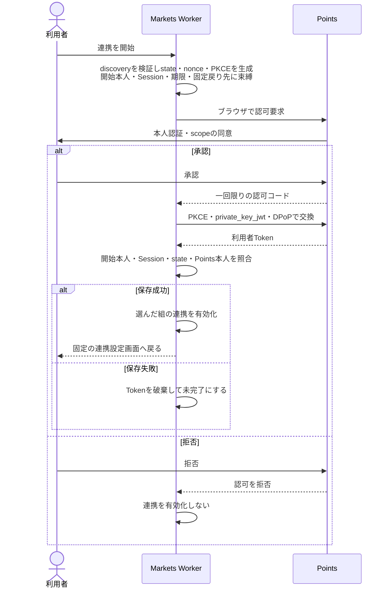
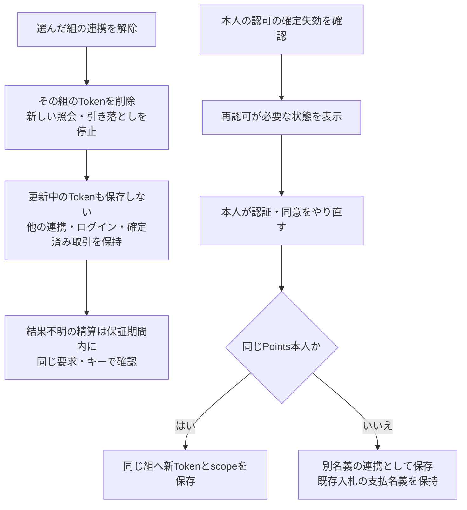
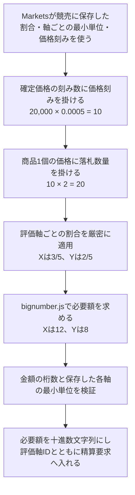
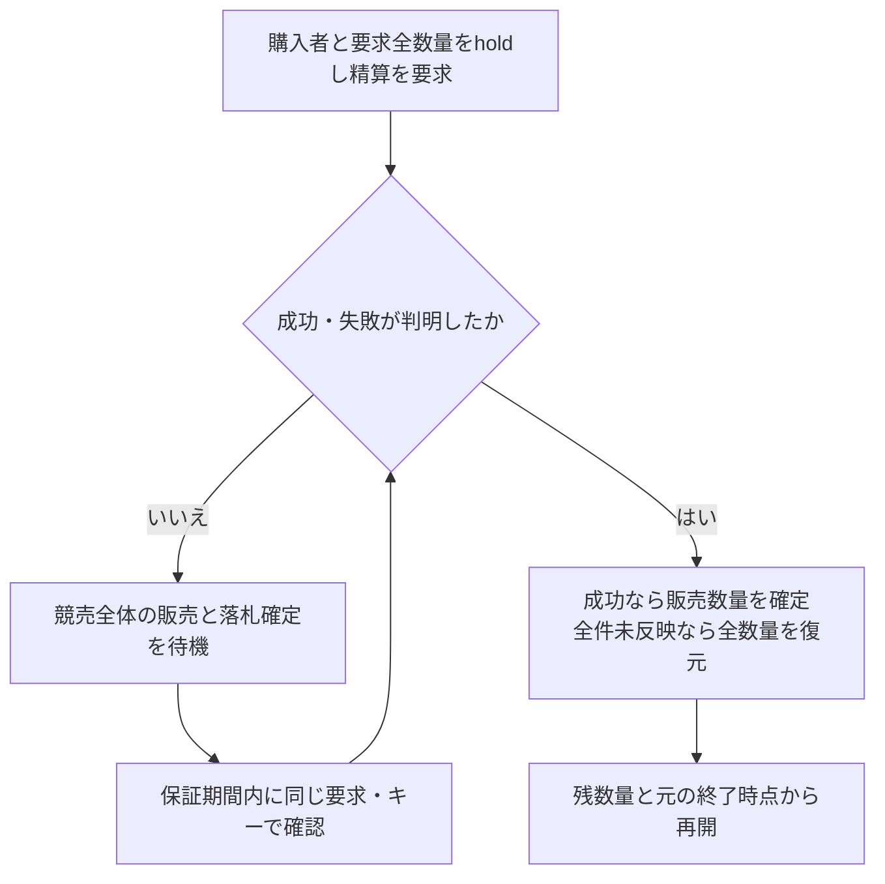
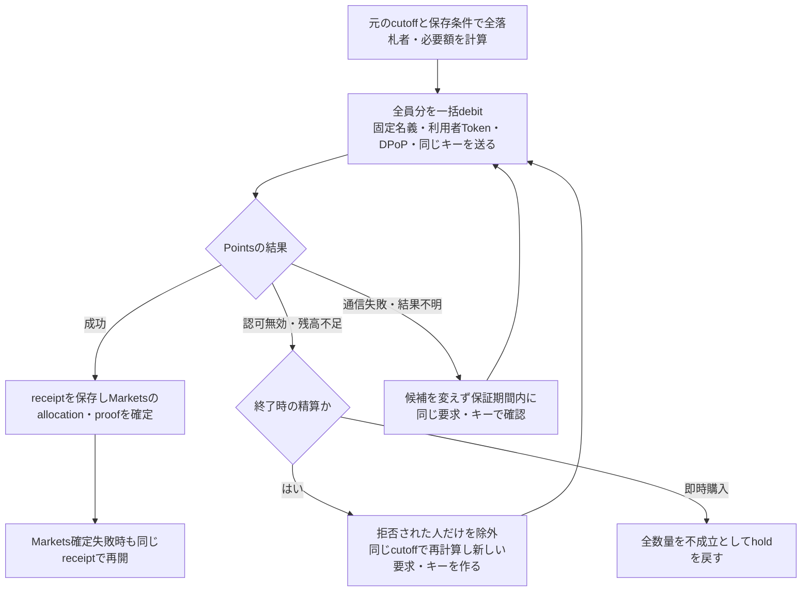

# Freeism Markets v0.2.1 仕様

- [Freeism Markets v0.2.1 仕様](#freeism-markets-v021-仕様)
  - [言語](#言語)
  - [v0.2.1：実装する理由](#v021実装する理由)
  - [v0.2.1：基本方針](#v021基本方針)
  - [その他](#その他)
  - [v0.2.1：出品・商材一覧・オークション・落札証明](#v021出品商材一覧オークション落札証明)
    - [基本情報](#基本情報)
    - [要件](#要件)
  - [利用規約](#利用規約)
  - [プライバシーポリシー](#プライバシーポリシー)
  - [テーブル構造](#テーブル構造)
  - [意思決定](#意思決定)
  - [8. 落札と即時購入](#8-落札と即時購入)
  - [外部EC](#外部ec)
  - [GitHub連携の決済](#github連携の決済)
  - [要件](#要件-1)
    - [5.1 Auction作成](#51-auction作成)
    - [5.2 入札時のPoints扱い](#52-入札時のpoints扱い)
    - [5.3 履歴・証明・評価](#53-履歴証明評価)
    - [7.1 AuctionRoom Durable Object](#71-auctionroom-durable-object)
    - [7.2 Settlement Workflow](#72-settlement-workflow)
    - [branch pushのdeploy pipeline](#branch-pushのdeploy-pipeline)
    - [9. Durable Object/Workflow](#9-durable-objectworkflow)
    - [8. WebSocket event](#8-websocket-event)
  - [4. Token保存とrefresh](#4-token保存とrefresh)
  - [9. セキュリティ、品質、release gate](#9-セキュリティ品質release-gate)
  - [採用しないもの](#採用しないもの)
  - [v0.2.0からv0.2.1への変更](#v020からv021への変更)
- [Auction画面・API仕様](#auction画面api仕様)
  - [1. URL](#1-url)
  - [2. 一覧card](#2-一覧card)
  - [3. CSV出品](#3-csv出品)
    - [主要列](#主要列)
    - [開始前の編集・取消](#開始前の編集取消)
  - [4. 詳細画面](#4-詳細画面)
    - [Points連携画面](#points連携画面)
  - [5. bid API](#5-bid-api)
    - [request](#request)
    - [成功](#成功)
    - [主なerror](#主なerror)
  - [6. AutoBid操作](#6-autobid操作)
  - [7. 即決](#7-即決)
  - [8. proof画面](#8-proof画面)
  - [9. accessibilityと時刻](#9-accessibilityと時刻)
  - [10. 必須テスト](#10-必須テスト)
- [v0.2 認証・外部ID・サービス間認可仕様](#v02-認証外部idサービス間認可仕様)
  - [1. 目的と適用範囲](#1-目的と適用範囲)
  - [2. アプリと認証データの境界](#2-アプリと認証データの境界)
  - [3. Better Auth共通設定](#3-better-auth共通設定)
  - [4. PointsのGoogle・GitHubログインと明示連携](#4-pointsのgooglegithubログインと明示連携)
    - [4.1 共通Provider集合](#41-共通provider集合)
    - [4.2 Google](#42-google)
    - [4.3 GitHub](#43-github)
  - [5. Pointsログイン用OAuth主体の永久対応](#5-pointsログイン用oauth主体の永久対応)
    - [5.1 永久対応](#51-永久対応)
    - [5.2 Accountsとの責務境界](#52-accountsとの責務境界)
  - [6. Google fresh認証](#6-google-fresh認証)
    - [6.1 判定条件](#61-判定条件)
    - [6.2 対象操作](#62-対象操作)
  - [7. Accountsとの情報連携と未受領FIX](#7-accountsとの情報連携と未受領fix)
    - [7.1 外部アカウントの照合](#71-外部アカウントの照合)
    - [7.2 未受領FIX](#72-未受領fix)
  - [8. Points–Markets OAuth](#8-pointsmarkets-oauth)
    - [8.1 OAuthの分離](#81-oauthの分離)
    - [8.2 認可コードと本人の確認](#82-認可コードと本人の確認)
    - [8.3 開発者向けOAuthクライアント管理](#83-開発者向けoauthクライアント管理)
    - [8.4 Token保存とRefresh](#84-token保存とrefresh)
  - [9. Cookie、CSRF、Origin](#9-cookiecsrforigin)
  - [10. Account closeと認証記録](#10-account-closeと認証記録)
  - [11. バージョンと本番Gate](#11-バージョンと本番gate)
  - [12. Rate Limit](#12-rate-limit)
  - [13. 監査event](#13-監査event)
  - [14. 必須テスト](#14-必須テスト)
    - [14.1 Pointsログイン・Account link](#141-pointsログインaccount-link)
    - [14.2 Pointsログイン用の永久対応](#142-pointsログイン用の永久対応)
    - [14.3 Google fresh認証](#143-google-fresh認証)
    - [14.4 Accounts照合・未受領FIX](#144-accounts照合未受領fix)
    - [14.5 Points–Markets OAuth](#145-pointsmarkets-oauth)
    - [14.6 Cookie・CSRF・環境分離](#146-cookiecsrf環境分離)
    - [14.7 Rate Limit](#147-rate-limit)
    - [14.8 Release回帰](#148-release回帰)
- [v0.2 設計決定台帳](#v02-設計決定台帳)
  - [1. 目的](#1-目的)
    - [Status](#status)
    - [Canonical document](#canonical-document)
  - [2. 移行範囲・基盤](#2-移行範囲基盤)
  - [3. アプリ・リポジトリ・文書境界](#3-アプリリポジトリ文書境界)
  - [4. 責務・機能境界](#4-責務機能境界)
  - [5. ADMIN・評価軸・Package](#5-admin評価軸package)
  - [6. ログイン・Social Account・Session](#6-ログインsocial-accountsession)
  - [7. OAuth主体・外部URL所有権・未受領FIX](#7-oauth主体外部url所有権未受領fix)
  - [8. Google fresh・Better Auth version](#8-google-freshbetter-auth-version)
  - [9. Points–Markets OAuth認可](#9-pointsmarkets-oauth認可)
  - [10. FIX・台帳・金額](#10-fix台帳金額)
  - [11. Transfer・Exchange・Substitution・自動分配・退会](#11-transferexchangesubstitution自動分配退会)
  - [12. Markets・Auction](#12-marketsauction)
  - [13. WebSocket・Frontend・API](#13-websocketfrontendapi)
  - [14. Settlement・失敗回復](#14-settlement失敗回復)
  - [15. 環境・Deployment・旧基盤撤去](#15-環境deployment旧基盤撤去)
  - [16. Security・Rate Limit・Audit・Test](#16-securityrate-limitaudittest)
  - [17. 旧文書の案・将来候補](#17-旧文書の案将来候補)
  - [18. 既存v0.2から保持する機能要件](#18-既存v02から保持する機能要件)
  - [19. 実行可能性のための補完決定](#19-実行可能性のための補完決定)
  - [20. 文書適用規則](#20-文書適用規則)
- [Marketsドメイン仕様](#marketsドメイン仕様)
  - [1. 責務](#1-責務)
    - [主なaggregate](#主なaggregate)
  - [2. MarketsアカウントとPoints連携](#2-marketsアカウントとpoints連携)
  - [3. Auction作成と不変revision](#3-auction作成と不変revision)
    - [3.1 作成方式](#31-作成方式)
    - [3.2 開始前の編集と取消](#32-開始前の編集と取消)
    - [3.3 必須項目](#33-必須項目)
  - [固定公開ページ](#固定公開ページ)
  - [4. package price tick](#4-package-price-tick)
  - [5. Auction lifecycle](#5-auction-lifecycle)
    - [状態](#状態)
    - [時刻](#時刻)
  - [6. bid](#6-bid)
    - [command](#command)
    - [validation](#validation)
    - [ordering](#ordering)
  - [7. AutoBid](#7-autobid)
  - [8. winnerとuniform clearing price](#8-winnerとuniform-clearing-price)
    - [allocation](#allocation)
    - [clearing price](#clearing-price)
  - [9. 即決](#9-即決)
  - [10. 終了時の不足者除外](#10-終了時の不足者除外)
  - [11. 履歴とwatchlist](#11-履歴とwatchlist)
  - [12. 落札証明と相互評価](#12-落札証明と相互評価)
  - [13. Public read API](#13-public-read-api)
  - [14. 実装しないもの](#14-実装しないもの)
- [Webアプリ v0.2 命名規則](#webアプリ-v02-命名規則)
  - [1. 適用範囲](#1-適用範囲)
  - [2. repository・service・domain](#2-repositoryservicedomain)
  - [3. ID](#3-id)
  - [4. 金額と時刻](#4-金額と時刻)
  - [5. revisionとstate](#5-revisionとstate)
  - [6. HTTP/OpenAPI](#6-httpopenapi)
  - [7. Hono](#7-hono)
  - [8. Drizzle/D1](#8-drizzled1)
  - [9. Durable Object/Workflow](#9-durable-objectworkflow-1)
  - [10. frontend](#10-frontend)
  - [11. test](#11-test)
  - [12. script](#12-script)
  - [13. 例外](#13-例外)
- [Points–Markets連携契約](#pointsmarkets連携契約)
  - [1. 境界](#1-境界)
  - [2. 複数名義と支払名義](#2-複数名義と支払名義)
  - [3. OAuth ClientとResource Server](#3-oauth-clientとresource-server)
  - [4. Token保存とrefresh](#4-token保存とrefresh-1)
  - [5. 共通HTTP contract](#5-共通http-contract)
  - [6. 金額と構成情報](#6-金額と構成情報)
  - [7. Endpoint wire正本](#7-endpoint-wire正本)
    - [7.1 残高確認](#71-残高確認)
    - [7.2 一括精算](#72-一括精算)
  - [8. Settlementの責務](#8-settlementの責務)
  - [9. Rate limitとContract test](#9-rate-limitとcontract-test)
- [リアルタイム配信とSettlement](#リアルタイム配信とsettlement)
  - [1. Source of Truth](#1-source-of-truth)
  - [2. HTTP mutation](#2-http-mutation)
  - [3. Hibernation WebSocket](#3-hibernation-websocket)
    - [upgrade](#upgrade)
    - [attachmentと上限](#attachmentと上限)
    - [event](#event)
  - [4. start／close coordination](#4-startclose-coordination)
  - [5. Settlement Workflow](#5-settlement-workflow)
    - [状態](#状態-1)
    - [step](#step)
    - [Paid plan上限と1,000 winner処理](#paid-plan上限と1000-winner処理)
    - [Workflow instanceと手動retry](#workflow-instanceと手動retry)
    - [明示retry budget](#明示retry-budget)
  - [6. Points呼出し](#6-points呼出し)
  - [7. 失敗処理](#7-失敗処理)
    - [Settlement状態read](#settlement状態read)
  - [8. outboxとreconciler](#8-outboxとreconciler)
  - [9. observability](#9-observability)
  - [10. 必須テスト](#10-必須テスト-1)
- [Hono HTTPレスポンス仕様](#hono-httpレスポンス仕様)
  - [1. 対象](#1-対象)
  - [2. 成功](#2-成功)
  - [3. 失敗](#3-失敗)
  - [4. status](#4-status)
  - [5. idempotency](#5-idempotency)
  - [6. cache](#6-cache)
  - [7. security header](#7-security-header)
  - [8. WebSocket event](#8-websocket-event-1)
  - [9. logとの分離](#9-logとの分離)
  - [10. contract test](#10-contract-test)
- [セキュリティ・テスト・デリバリー仕様](#セキュリティテストデリバリー仕様)
  - [1. 防御層](#1-防御層)
  - [2. browser sessionとCookie](#2-browser-sessionとcookie)
  - [3. 重要操作のGoogle fresh session](#3-重要操作のgoogle-fresh-session)
  - [4. ADMIN](#4-admin)
  - [5. same-origin API](#5-same-origin-api)
    - [5.1 HTTP security header](#51-http-security-header)
  - [6. 外部アカウント検証のセキュリティ境界](#6-外部アカウント検証のセキュリティ境界)
  - [7. Durable Object/WebSocket](#7-durable-objectwebsocket)
  - [8. 初期rate limit](#8-初期rate-limit)
  - [10. CSV](#10-csv)
    - [D1 bulk write制約](#d1-bulk-write制約)
  - [11. D1不変条件](#11-d1不変条件)
  - [12. 監査](#12-監査)
    - [12.1 Observabilityと運用alert](#121-observabilityと運用alert)
  - [13. 依存関係とsupply chain](#13-依存関係とsupply-chain)
    - [13.1 version](#131-version)
    - [13.2 pnpm policy](#132-pnpm-policy)
    - [13.3 TanStack incident](#133-tanstack-incident)
  - [14. GitHub Actions](#14-github-actions)
  - [15. main ruleset](#15-main-ruleset)
  - [16. CI/CD pipeline](#16-cicd-pipeline)
    - [PR/merge queue](#prmerge-queue)
    - [`test/*` push](#test-push)
    - [`main` push](#main-push)
  - [17. 環境とIaC所有権](#17-環境とiac所有権)
  - [18. D1 migrationとrecovery](#18-d1-migrationとrecovery)
  - [19. test matrix](#19-test-matrix)
    - [unit/property](#unitproperty)
    - [Workers integration](#workers-integration)
    - [browser/E2E](#browsere2e)
    - [staging/smoke](#stagingsmoke)
  - [20. production release gate](#20-production-release-gate)
  - [21. 受入後の撤去](#21-受入後の撤去)

## 言語

日本語（本ページ）| [English](./all.en.md)

## v0.2.1：実装する理由

1. 無料主義ドキュメントv3に、大幅な仕様変更があったため

## v0.2.1：基本方針

1. `v0.2.1`**は、「実用性」・「移植性」・「仕様理解の簡単さ」を優先する**
   - 説明
     - 本質的な機能のみ実装する
     - `ver0.1`はポートフォリオ的にいろいろな機能を実装したが、`v0.2.1`は本質的な機能のみ残す
     - 他者がコードを読んで、「無料主義の仕様・したいこと」を理解してもらう必要がある
2. **設計の大原則**
   1. 疎結合
      - 評価軸、評価ロジック、データ取得元が、いつでも簡単に差し替えられるように設計
      - ソースをfrontend・backend・sharedへ分け、各領域内は役割別、その中は付与・分配・交換などの機能別に整理する。
      - 計算ルールとDB・HTTPの処理を分離し、DB操作は差し替え可能なインターフェースを通して使う。
   2. 可読性
      - 可読性のために、シェルスクリプトはファイルを分ける。
   3. 簡潔さ
      - より多くの人に理解してもらうために、堅牢性を求めず、簡単にすぐ理解できて短い必要最小限のコードにする
      - リッチな機能は提供せず、簡単に素早く理解できるようにシンプルな機能のみにする
      - アプリとして実用するのではなく、どんなサービスか体験してもらうだけ
      - リッチなUIは不要
3. **定数管理**
   - 説明
     - それぞれのパラメータは、すぐに変更できるように、定数ファイルを作成して管理する
4. **商品発送・住所の管理などは不要**
   - 説明
     - モノの発送が必要な場合は、他サービスを使用して行う。
     - その発送の証拠のみをアプリ内のレビュー画面で記載するのみ
5. **後方互換性は不要**
   - 説明
     - データ移行、後方互換性は不要
6. **注意**
   - 説明
     - ここに記載されていない仕様に関しては、無料主義アプリv0.1と同じ仕様
7. **PointsとMarketsは、独立的に運用する**
   - 説明
     - 別アプリとして同じようなアプリとの連携をする前提で設計したいため
     - 疎結合にする対象は「UIとAPI」ではなく「PointsとMarkets」

## その他

- Points側の入札では、評価軸IDと評価軸ポイントの値のみ指定して精算できるようにする

## v0.2.1：出品・商材一覧・オークション・落札証明

### 基本情報

- 概要
  - 無料主義アプリで、商材を出品・商材一覧・オークション・落札証明する際の仕様について定める

### 要件

1.  **オークションに出品されている商材一覧画面**
    - 要件
      1.  カード形式の中に表示する項目に、以下の項目を追加表示する
          1. パッケージ名
          2. 保存した構成軸のID
          3. 構成する評価軸名
          4. 構成する各ポイントの比率
      2.  全文検索は、Drizzleのクエリを使用する
    - 実装する理由
      1.  どのポイントで入札できるかすぐわかるようにしたい
      2.  保守性を高める
2.  **オークションの出品する際の仕様**
    - 要件
      1.  **CSVアップロードのみ対応**
          - GUIフォームは設けない
          - 必要な理由
            1.  登録する労力を削減するため
                - 登録が面倒なので、一括登録できるようにするため
      2.  **出品作成処理**
          - 要件
            1.  CSVの各行は、共通の関数で処理する
            2.  モーダルからも、その共通関数を呼ぶ
      3.  **以下の入力項目を追加**
          1. 入札できるポイントを、パッケージまたは評価軸単体で指定する
             - パッケージの場合は、現在有効な対象を選ぶ
             - 評価軸の組み合わせや割合は、先に作成したパッケージから取得する
          2. 販売個数
             - 一つの出品枠で複数商品を出品できる
          3. 即決価格の設定
             - 要件
               1. 指定したパッケージを構成する評価軸の設定として「即決価格」が可能な場合のみ出品時に選択できる
3.  **オークションの仕様**
    - 参考
      1.  Multi-unit auction
    - 説明
      - 無料主義アプリv0.2.1の販売方法は「オークション」のみ
        - その理由
          1.  オークションに「即決価格」機能も入れることで通常の販売機能も内包するため
          2.  オークションに絞って実装することで管理コストの削減
    - 実装する理由
      1.  オークションが無料主義の根幹の仕組みなため
    - 要件
      1.  **商材は、一回の出品で、一つ以上の、一人以上への、販売を可能にする**
          - 例
            - 複数個の出品、複数人へ出品、一個の出品、一人へ出品
      2.  **出品時に、入力欄として「販売個数」を指定可能**
          - v0.2.1では、「販売人数」を指定できない。無料主義アプリv3で実装予定
          - 「販売数量が一つ以上」かつ「1番手だけでは販売数が余る」場合は、マルチユニットオークションになる
      3.  **落札者を選ぶ条件**
          1. 同じ入札額なら先着順
          2. 違う入札額なら、高い入札額
          - つまり、枠より多いときに入札があった場合は、一番安い入札額の最後尾の入札者から落選させる
      4.  **落札価格の条件**
          - 要件
            - 落札できなかった入札者達の中で、一番高い入札額の人を、「ギリギリ落選者」と呼ぶ
            - 「ギリギリ落選者」より「入札日時が前の人」は、「ギリギリ落選者」と同じ額
            - 「ギリギリ落選者」より「入札日時が後の人」は、「ギリギリ落選者」の入札額に1単位だけ加算した額
            - 落札者は一律で、上記の額・条件で支払う
          - ポイント
            1.  「落札者を選ぶ条件」に沿って、入札日時が前なら同じ額でも落札できるのであれば、同じ額で支払ってもらう条件にしている。
          - 注意
            1.  「落札できない入札者の中で最高入札額+1単位だけ加算した額を、落札者全員が一律で払う」方式だけだと、無料で入札して落札して、先着順で取得できた場合に1ポイント支払う必要が出てきてしまう
      5.  **入札は、`packageTick`単位の価格で、数量を指定して行う**
          - `packageTick`は1目盛りの価格、`priceTickCount`はその数量である。
          - Markets Workerは`priceTickCount * packageTick`から価格を求め、bignumber.jsで評価軸別の必要額を計算する。数量`quantity`は1〜1,000の安全整数とし、金額は十進数文字列で扱う。
          - Pointsへの残高照会・引き落とし要求には、Marketsが計算した評価軸別の`components`を渡す。
      6.  **一人につき複数個を購入する場合**
          1. 優先度が高い人から順に購入枠を占めて、希望数だけ得られる
          2. 希望数が残っていない場合は、最後尾の人は希望数が残っている分だけ配布
      7.  **複数人への出品は、シングルプライスとする。全落札者が同じ1個当たりの清算価格を支払う。評価軸のオークション方式として設定できるのもシングルプライスである。**
      8.  **即決価格**
          - 説明
            1.  出品者が設定した「即決価格」ですぐ落札できるようにする機能
          - 必要な理由
            1.  オークションだと時間がかかるが、即決価格だと通常の販売と同じように使用できるため
      9.  **入札時の保有ポイントチェックはしない**
          - 要件
            1.  入札時は消費せず、落札時にポイントを保有ポイントから差し引く
            2.  もし落札額を保有していない場合は、次の人の入札者が落札になる
      10. **入札額を保有していない場合の対応**
          - 説明
            - 入札したのに、実際に落札して消費するときに保有ポイントを保有していない場合のペナルティーを用意したい
          - 要件
            1.  残高が足りないときは、その競売と利用者のブラックリストを1件記録する
            2.  記録したあと、次の入札者を落札者にする
      11. **複数の種類の評価軸ポイントを組み合わせて入札する場合の処理**
          - 各評価軸のポイント方式は「消費」とする。出品で選べる購入方式も消費だけである。一番ニーズがありそうなためである。落札時に保有から差し引く。評価軸の設定で選べるポイント方式も消費だけである。
          - 入札には作成時に保存した全評価軸と割合を使う。即決価格は、作成時に全構成評価軸が即決価格の利用を許可している場合に設定できる。
      12. **複数ポイントの組み合わせ入札**
          - 要件
            1.  出品者が指定した、入札に使用できるパッケージの「ポイントの種類」や「ポイントの組み合わせの割合」でのみ入札可能
            2.  入札時に、他のポイントから交換可能にする機能は実装しない
                - 本質的な機能ではない。
                - 別画面で実装する予定なので、そちらから行ってもらう
      13. **出品者本人は自身の出品に入札できない**
      14. **オークションが既に終了している場合、新規入札は受け付けない**
      15. **日時の保存と表示**

          日時はUTCで保存し、APIでもUTCを用いる。画面では、それぞれの利用者がいる場所の現地時間に変換して表示する。

      16. **できる限りの、サーバー負荷・データベースやストレージの保存容量の削減**
      17. **入札タイプ（同額入札）の対応**
          - race conditionの同じ入札額のユーザーが複数いた場合は、入札日時が早い人が落札する先着順で決める
      18. **自動入札機能**
          - ユーザーが事前に上限額を設定し、システムが自動で入札を行う仕組み。
          - できる限り State で管理し、画面から離れるときに DB に保存するなどの工夫を行う。
          - **流れ**
            1.  まず現状の価格（初めは0ポイント）で入札する
            2.  0ポイントで購入できる権利が枠いっぱいになった場合は、ポイントを一単位増やして入札することで、先着順の並びで最後尾の人の商材購入の権利を奪える
                - 1単位増やした場合は、一番後ろに追加して
            3.  落札者は、優先度が上の人から順に、その上の人が求めた数量ずつ割り当てていき、まだ残っている場合は次の人に割り当てる
                - 落札者の最後の人は、希望数量が残っていない可能性がある注意文言を入れる
            4.  落札したが、消費する額のポイントを保有していない場合は、その競売と利用者のブラックリストを1件記録し、次の優先度の人に落札権を回す。
          - **例**
            1.  3人の購入枠があり、a→b→cの順番で0ポイントで入札した場合は、優先度はa→b→cになる
            2.  その後、dが1ポイントで入札したら、cが枠から外れて、優先度はd→a→bになり、d,a,bが商材を得られる
                - この際、すでに3人の枠を占めているため、dは0ポイントで入札できない。1ポイント以上になる
            3.  その後、cが5ポイントで入札したら、bが枠から外れて、優先度はc→d→aになる
            4.  その後、bが3ポイントで入札したら、aが枠から外れて、優先度はc→b→dになる
                - cは5ポイントなので、優先度が一番高いまま

4.  **落札後の画面**
    - 説明
      - 自分自身が、指定商材を落札したことを証明するページを作成したい。
      - そのため、証明に必要な情報が一つの画面にすべて記載された状態にしたい
    - 目的
      1.  自分がこの商材の購入者であることを示す仕組みを実装したい
      2.  落札情報URLを、自身が購入した事を示したいサイトにコピペすれば完了にしたい
    - 表示する項目
      1.  落札商材の内容
      2.  非公開設定を実装する
      3.  複数人・複数個向けの出品（マルチユニット）の場合の画面表示にも対応する必要がある
          - 現状の実装は、**1人分・1個分の落札**を想定した表示に留まり、**複数人・複数個**の出し分けには未対応である

## 利用規約

- 概要
  - 利用規約のページについて定める

- ↓を参考
  1.  [https://www.hayabusatrip.com/](https://www.hayabusatrip.com/)
  2.  [https://nani.now/ja/terms](https://nani.now/ja/terms)

- 利用規約のテンプレート
  1.  [https://kiyaku.jp/index.html](https://kiyaku.jp/index.html)

- 要件
  1.  利用規約のページを作成・更新して、ちゃんと文言を決める

## プライバシーポリシー

- 概要
  - プライバシーポリシーのページについて定める

- ↓を参考
  - [https://www.hayabusatrip.com/](https://www.hayabusatrip.com/)
  - [https://nani.now/ja/terms?tab=privacy](https://nani.now/ja/terms?tab=privacy)

- プライバシーポリシーのテンプレート
  - [https://kiyaku.jp/index.html](https://kiyaku.jp/index.html)

- 要件
  1.  プライバシーポリシーのページを作成・更新して、ちゃんと文言を決める

## テーブル構造

- **利用者ID**
  - 利用者IDは標準Nano ID（文字列）である。プロフィールURLに入れる利用者IDも同じである。
  - 評価軸IDとパッケージIDも標準Nano IDであり、利用者IDとは別の値である。

- **フィールド命名**
  - アプリ上の名前は camelCase とする。Cloudflare D1の列名は snake_case とする。

- `BidHistory`
  - 説明
    - 入札履歴を保存するテーブル
  - カラム
    1. `userId`
       - 型
         - 標準Nano ID
       - 説明
         - 入札した利用者のID
    2. `amount`（入札額）
       - 型
         - 数値
       - 説明
         - 入札額
    3. `bidAt`（入札日時）
       - 型
         - DateTime
       - 説明
         - 入札日時
    4. `bidType`
       - 型
         - Enum（通常入札 / 自動入札）
       - 説明
         - 入札タイプ
    5. `status`
       - 型
         - Enum（入札中 / 落札済み など）
       - 説明
         - 入札レコードの状態
    6. その他
       - 説明
         - 監査・取消し・オークション`id`（FK）など、実装時に必要な項目を追加

- `AutoBid`
  - 説明
    - 自動入札の設定を保存するテーブル
  - カラム
    1. `userId`
       - 型
         - 標準Nano ID
       - 説明
         - 設定した利用者のID
    2. `auctionId`
       - 型
         - UUID
         - 文字列
       - 説明
         - 対象オークション（`Auction.id`）の`id`
    3. `autobidPoint`
       - 型
         - 数値
       - 説明
         - 自動入札の上限額等（仕様に合わせて定義）
    4. その他
       - 説明
         - 有効フラグ、更新日時など推奨項目を追加

- `AuctionReview`（`Review`）
  - 説明
    - オークション取引後の相互評価（出品者・落札者のレビュー）を保存するテーブル
  - カラム
    1. `id`
       - 型
         - UUID（PK）
       - 説明
         - テーブルのID
    2. `auctionId`
       - 型
         - UUID（FK to Auction）
       - 説明
         - 対象オークションの`id`
    3. `reviewerId`
       - 型
         - 標準Nano ID
       - 説明
         - 評価した利用者のID
    4. `revieweeId`
       - 型
         - 標準Nano ID
       - 説明
         - 評価される利用者のID
    5. `rating`
       - 型
         - Integer（1〜5）
       - 説明
         - 星評価
    6. `comment`
       - 型
         - Text
       - 説明
         - 評価コメント
    7. `completionProofUrl`
       - 型
         - String（Nullable）
       - 説明
         - 完了証明の添付URL
    8. `isSellerReview`
       - 型
         - Boolean
       - 説明
         - 出品者による評価か買い手による評価か
    9. `createdAt`
       - 型
         - DateTime
       - 説明
         - 作成日時
  - ユニーク制約
    - `(auctionId, reviewerId, revieweeId)` — 1つのオークションにつき1回のみ評価可能

- `Auction`
  - 説明
    - オークションに出品される商品の情報を入れるテーブル
  - カラム
    1. `id`
       - 型
         - UUID
         - 文字列
       - 説明
         - テーブルのID
    2. `startTime`
       - 型
         - DateTime
       - 説明
         - 開始日時
    3. `endTime`
       - 型
         - DateTime
       - 説明
         - 終了日時
    4. `currentHighestBid`
       - 型
         - 整数
       - 説明
         - 現在の最高入札額
    5. `currentHighestBidderId`
       - 型
         - 標準Nano ID
       - 説明
         - 現在の最高入札者の利用者ID。`BidHistory.userId`と同じ標準Nano IDである
    6. `winnerIds`
       - 型
         - Cloudflare D1に保存する文字列の配列
       - 説明
         - 落札が確定した利用者のIDを、配分の順に並べた一覧。1人の落札でも配列にする。金額と数量の内訳は`BidHistory`の確定記録を正とし、この配列は一覧の参照である。
    7. `status`
       - 型
         - Enum（`DRAFT`, `SCHEDULED`, `OPEN`, `CLOSING`, `CANCELLED`）
       - 説明
         - オークションの状態。開始前は`DRAFT`。開始は`OPEN`。終了処理は`CLOSING`。開始前の取消は`DRAFT`または`SCHEDULED`から`CANCELLED`へ進める
    8. `createdAt`
       - 型
         - DateTime
       - 説明
         - 作成日時
    9. `updatedAt`
       - 型
         - DateTime
       - 説明
         - 更新日時
  - リレーション
    1. `bids`
       - 説明
         - `BidHistory`（1:N）。落札内容の詳細・数量はこちらを正とする。落札終了後、`winnerIds`
           と整合するよう落札確定状態の行を更新する。
    2. `currentHighestBidder`
       - 説明
         - 入札進行中の最高入札者（`User`）。単一参照。
    3. （任意）落札者ユーザーへの参照
       - 説明
         - `winnerIds` は、Cloudflare D1に保存した利用者IDの配列である。別テーブルは作らない。金額と数量の内訳は `BidHistory` を正とする。

## 意思決定

- Markets D1をAuction業務上の唯一の正本とし、Auction IDごとに1つの`AuctionRoom` DOを割り当てる。

- Auctionの作成は、フォームとCSVで可能にする

- AuctionRoomは初回閲覧・接続・入札時にlazy初期化し、未利用Auctionを大量作成しない。
- 順位は価格降順、同額はその価格へ到達したsequence昇順、最後のwinnerだけ残数による部分落札を許可する。

- 枠外最高単位がなければ0 tick、同額なら同額、異なるなら枠外最高額＋1 tickをclearing priceとする。

- 全需要が販売数量以内なら正の入札があっても0 tickで落札する。

- AutoBidは非公開上限、必要最小tickへ直接進め、上限引上げとrule取消を許可する。取消前に到達した有効入札は残す。

- Buy nowは全構成軸が許可する場合だけ設定し、指定数量の全量成功または失敗とする。
  - Status: 採用
  - 上書き・撤回関係: NG軸だけ除外して比率を壊す案を不採用。
- seller本人のbid、終了後bid、価格引下げ、bid撤回を拒否する。
  - Status: 採用
  - 上書き・撤回関係: 旧自由変更案を不採用。
- 入札後にseller、数量、評価軸、比率、入札額の刻み、価格式、Points serviceを変更できない。
  - Status: 採用
  - 上書き・撤回関係: live Auctionの条件変更を禁止。
- Auction history、winning history、watchlistをMarketsへ残す。
- Allocationごとに公開・永続proofを作り、商材、数量、価格vector、buyer／seller公開identityの落札時snapshotを表示する。

- Reviewはseller→buyer、buyer→seller、1〜5、comment、任意URL、方向ごと1件とし、編集は同じReviewレコードを更新し、変更内容を監査記録に残す。

- 1つの競売は1つの`pointsServiceId`に固定する。落札者も評価軸も、同じPointsのデータベースで精算する。

- WebSocketは購読専用とし、bid mutationは認証済みHTTPからHono→AuctionRoom commandで行う。

- WebSocketはMarkets SessionとOriginをhandshakeで検証し、URL queryへTokenを入れない。

- WebSocket message上限は4 KiB、user×Auction 3接続、user全体20接続、heartbeatなしとする。

- Eventに`auctionVersion`と`bidSeq`を持たせ、gap時はsnapshot再取得、重複seqは無視する。

- Auction close後の決済はAuctionRoom＋Markets D1 outbox＋Settlement Workflowで行う。

- 対面決済、QR決済、店舗履歴は、Marketsに導入する。

- 外部EC用random claim Token、再発行、seller検証、受渡完了POST。

- 引き落としが成功したあとに、その分を取り消して返す機能は作らない。成功した引き落としは台帳に残す。ポイントを借りて、あとから返すための帳簿は持たない。誰かが条件を満たしたときだけ、別の人の代わりに購入する機能は作らない。必要なら、このアプリの外で扱う。

- 商材と競売条件は、一つの`auction`に置く。
  - 開始前の編集と取消は、Auction IDだけを使う。作成者だけが、`DRAFT`または`SCHEDULED`から`CANCELLED`へ終了できる。bid、AutoBid、成立した即時購入が1件でもあれば取消を拒否する。

- AuctionRoomはD1の現在のAuctionレコードを正本に1 alarmだけを持ち、`startsAt`でOPEN、`endAt`でCLOSINGへCASする。WebSocket上限はuser全体20／user＋Auction 3のD1 unique slotを同じ原子commandで確保する。

- Auctionの商材fieldはtitle 1〜120 code point／480 bytes、description 1〜4,000／16,000 bytes、canonical HTTPS外部URLちょうど1件／2,048 bytesとする。reviewはcomment 0〜2,000／8,000 bytes、completion URL 0〜1件／2,048 bytesとする。

- Marketsは、`test/*` pushは共有test環境として既存Cloudflare `staging`資源だけを更新し、`main` pushはproductionだけを更新する。両workflowは相互に昇格せず、固定concurrency group、`queue: max`、`cancel-in-progress: false`で直列化する。

- Marketsの管理者
  - Marketsの管理者が、複数のPoints互換提供先を登録・有効化・停止する。
  - MarketsのBetter Auth `user.role`に`admin`を含む利用者が管理操作として行う。
  - 利用者は提供先ごとにOAuth連携する。
  - issuerは登録済みoriginと一致させ、OAuth endpointをdiscoveryから取得する。
  - Marketsの管理者が生成した提供先別鍵をMarkets D1に暗号化保存し、登録済みoriginへ外部HTTPSで接続する。
  - Pointsへの利用者認可・refreshは標準OAuthで扱い、Marketsが連携情報を保持する。

## 8. 落札と即時購入

Marketsは、終了時点の入札、または即時購入の要求から、不変の精算計画を決める。

落札者は、終了時点でPointsへの利用者認可が有効な入札者だけとする。利用者認可が有効とは、連携が有効で、Marketsが保持する利用者トークンによりPointsがその人のポイントを引き落とせる状態である。

ポイントの仮押さえはしない。利用者のいないサービス権限では精算しない。入札とAutoBidの設定時は、有効なPoints連携を必要とする。その時点では残高照会と仮押さえは行わない。

認可がない入札者は落札者にしない。ブラックリストは記録しない。残高が足りない入札者は、その競売と利用者のブラックリストを1件記録してから落札者にしない。同じ終了時点の入札から落札者、数量、清算価格を計算し直す。順位が次の入札者が繰り上がる。同じ競売と利用者の組のブラックリストは1件だけである。通信失敗、429、5xxでは記録せず、同じ計画を再送する。

引き落としは、その時点の落札者全員を利用者認可で1回の処理とする。一人でも失敗すれば台帳も受領証も0件である。引き落としは評価軸ごとの負の台帳とし、`evaluationTotal`は変えない。必要額が0のときは台帳を作らず、残高と`evaluationTotal`は変えない。認可が無効なら0でも拒否する。成功していない引き落としは台帳に残さない。成功した引き落としは戻さない。同じ計画の再送は同じ受領証を返す。

Marketsは保存した作成時の構成・割合・各軸の最小単位・金額刻みから必要額を計算し、Pointsへ非負の十進数文字列で送る。Pointsは認可・軸の現在状態・金額・実残高を検査して全員分を確定する。重複軸は拒否し、作成後の構成や最小単位変更では保存条件を変えない。

即時購入は、成功した引き落としreceiptを確認してから販売数量を減らす。認可無効・残高不足の確定的拒否では全数量を不成立として復元する。結果が不明な間は競売全体の販売と落札確定を待ち、同じ要求・キーで保証期間内に確認する。結果判明後は残数量と元の終了時点から処理を再開し、残数量0で終了する。

引き落とし成功後にMarkets側の確定が失敗しても、ポイントは戻さない。受領証を照会してMarkets側の確定をやり直す。

## 外部EC

- 無料主義の評価軸ポイントの使用場所を増やしたい
  - 説明
    - ポイントの使用場面を増やしたい
  - アイデア
    1. EC
       1. 匿名発送で届ける
       2. 外部EC経由で届ける
       3. 自社で個人情報を持つ
          - v0.4で実装する
       4. 落札して対面で受け渡し
    2. 対面決済
       1. ただの消費
       2. QRコード決済
    3. 外部サービス連携
       1. GitHub連携の決済
    4. その他
       - また需要が出てきてから考える

- 落札して対面で受け渡し
  - 説明
    - オンラインのオークションで落札して、対面で受け渡しする際に、落札者である事を証明できるようにしたい
  - 設計
    - 出品者と落札者しか見えない画面を見せる事で対応する
    - 画面にも、出品者と落札者しか見えない旨を表示しておく
    - 対面の受け渡し時は、その画面を見せて受け渡しする
  - 使用場面
    1. 家具の予約
    2. 車のオークション

- 匿名発送で届ける
  - 説明
    - 外部ECを使用せず、個人間取引する
  - 使用場面
    - 商品引き渡しの際の価格を払いたくない人向け
  - 要件
    - `fanster`などのサービスを使用する
    - 出品者・落札者が、それぞれメモを書けるようにして、そこにやり取りの方法や使用するサービスのURLなどを記載する

- 外部EC経由で届ける
  - 説明
    - 外部EC経由で落札した商品を届ける方法
  - 使用場面
    1. メルカリなどの外部EC経由で、無料主義アプリで落札した商品を提供する
  - 核となる考え方
    - 検証できるトークン付きURLを貼り付けられるのは落札者しかいない
  - 全体の流れ
    1. 自社オークションで落札完了
    2. 自社サイトが落札証明トークンを発行
    3. 落札者に検証用URLを表示
    4. 落札者が外部ECサイトの注文メモに検証用URLを貼り付ける
    5. 出品者が外部ECサイトの注文詳細からURLをクリック
    6. 自社サイトの管理画面に遷移
    7. ログイン済みでなければログイン画面へ
    8. ログイン後、token を使って検証
    9. 管理画面に「有効」「期限切れ」「使用済み」「商品不一致」などを表示
    10. 問題なければ販売者が受け渡し・発送対応
    11. 最後に管理画面で「受け渡し完了」を押す
    - 外部ECサイトの注文メモに落札者が **検証用URL** を貼り付け、販売者・管理者が自社サイトの管理画面でそのURLにアクセスすると、クエリパラメータの `token` を使って落札証明を確認できる、という形です。

たとえばこうです。このURLにアクセスすると、自社サイト側で `token` を読み取り、DB上の落札証明トークンと照合します。

`https://markets.freeism.app/claims/verify?token=ea6a8133-6bd1-3796-c1cb-176f774d2dc1`

ここで大事なのは、**URLにアクセスしただけでは受け渡し完了にしない**ことです。
URLアクセスはあくまで「検証結果の表示」までにして、`used` や `completed` にする処理は管理画面上のボタン操作、つまり `POST` 処理で行うのが安全です。

落札者へ見せる文は「外部ECサイトの注文メモに、以下のURLを貼り付けてください」です。メモが短いときは、URLではなく証明コードだけでもよいです。例は「落札証明コード: clm_8fJ29xLmQp7vR4sAzK6TnY」です。コードを貼る入力欄が販売者の管理画面にあると、親切に使えます。ログイン後は、元の検証用URLへ戻してクエリの `token` で検証します。管理画面は `GET /admin/claims/verify?token=...` を受けます。

トークンは、意味を持たないランダムな文字列です。ユーザーIDや商品IDや落札IDは入れません。落札金額やメールアドレスや電話番号も対象外です。ランダム性は最低でも128bitです。形の例は `clm_8fJ29xLmQp7vR4sAzK6TnY` とします。`AUC-12345`のような連番は対象外です。`user_123_auction_456_winner_true`のように中身が読める値も対象外です。

平文トークンをDBへ残すことはありません。発行時にサーバーで平文を作り、その場でハッシュ化します。保存するのは `token_hash` だけです。計算は `sha256(token + server_secret)` です。可能なら、単純なハッシュではなく、サーバーの秘密値を加えたHMACかpepper付きハッシュにします。検証に使う値は、URLの平文を同じ方法でハッシュ化した結果です。一致したときの取得対象は、その落札証明です。不一致のときは「無効な落札証明URL」と表示します。

記録に残す識別子は、落札IDと商品IDです。落札者IDと販売者IDも残します。トークンハッシュと有効期限と使用状態も残します。失効状態と検証回数も、記録の対象です。作成日時と更新日時も残します。テーブル `auction_claim_tokens` では、`id` と `auction_id` を必須のBIGINTにします。`winner_user_id` と `seller_user_id` も、必須のBIGINTです。`token_hash` は必須かつ一意のVARCHAR(255)です。`status` は必須のVARCHAR(32)にします。`expires_at` と `created_at` と `updated_at` は、必須のDATETIMEです。`verified_at` と `used_at` と `revoked_at` は、空を許すDATETIMEにします。`verified_count` は既定0のINTです。`external_order_id` は空を許すVARCHAR(255)にします。`external_platform` は空を許すVARCHAR(64)です。`status` の例は、`unused`（未確認・未使用）と `verified`（確認済み）と `used`（受け渡し完了）です。あわせて `expired`（期限切れ）と `revoked`（無効化済み）も含めます。`expired` はDBへ保存せず、`expires_at` が今より前かで都度判定してもよいです。

同じURLを再表示することはありません。紛失したときや、コピーし忘れたときは、新しいトークンを再発行します。再発行に伴い、古いトークンは無効になります。確認の1文目は「以前のURLは使えなくなります」です。2文目は「すでに外部ECサイトに貼り付けた場合は、新しいURLに差し替えてください」です。新しいURLも、発行直後に一度だけ表示します。古いURLを開いたときの文言は「この落札証明URLは再発行により無効化されています」です。貼り済みのURLが無効になり得るので、再発行では落札者へ注意を出します。

検証の順は、次のとおりです。最初に、管理者または販売者としてログインしていることを確認します。次にtokenがあることを確認します。その次に、`token_hash` が一致する記録があることです。続けて、期限切れでないことを確認します。失効していないことも確認します。使用済みでないことです。ログイン中の販売者が `seller_user_id` と一致することも確認します。そのあと、商品とオークションの情報を表示します。期限内で未完了なら、検証自体は何度でもよいです。受け渡し完了は一度だけに限ります。

URLアクセス時にできるのは、検証結果の表示と `verified_count` の増加です。あわせて `verified_at` の更新と、アクセスログの保存を行います。受け渡し完了や、トークンの使用済み化は行いません。注文の確定や発送済みや返金不可も、同じように行いません。実行先は `POST /admin/claims/:claimId/complete` です。画面のボタン名は「受け渡し完了にする」とします。押したあとの確認は、出してもよいです。確認の1文目は「この落札証明を受け渡し完了にします」とします。2文目は「完了後、この証明コードは再利用できません」です。完了後の状態は `used` または `completed` にします。同じトークンでの再度の受け渡しはできません。

検証後は、可能ならtoken付きURLのまま表示を続けません。移る先は、tokenのない詳細です。流れでは `GET /admin/claims/verify?token=xxxxx` のtokenを検証し、claimIdを特定します。権限を確認したあと、`302` で `/admin/claims/{claimId}` へ移し、詳細を表示します。`/admin/claims/{claimId}` でも、ログインユーザーの権限確認は必須です。

有効なときの表示項目は、ステータスと商品名とオークションIDです。落札日時と受け渡し期限も出します。外部EC注文IDと受け渡し状態も出します。販売者へ出す文は「外部ECサイト上の商品・注文内容と照合してから受け渡ししてください」です。別の文面の1文目は「この証明は有効です」です。2文目は「外部ECサイト上の注文内容と商品名・金額・購入者情報を確認してから、受け渡しを行ってください」とします。無効なら、理由を出します。期限切れの例は「この証明コードは無効です」と「理由: 期限切れ」です。

画面の状態は、少なくとも8種類です。内訳には、有効と期限切れと使用済みと無効化済みを含めます。存在しない状態も含みます。販売者不一致と、ログインが必要と、token未指定も状態です。販売者がその落札の出品者でないときは、商品名や落札者情報は非表示です。そのときの文言は「この落札証明は確認できません」とします。案内の1文目は「この落札証明は、あなたが確認できる商品ではありません」です。2文目は「URLまたは証明コードをご確認ください」とします。`seller_id` や落札者の `user_id` は出しません。不一致を伝える別の文は「この証明コードはこの販売者の商品ではありません」です。

外部ECの注文IDは、販売者が検証画面で後から登録できます。未登録のときは、入力欄を出します。画面の例は「外部EC注文ID」の入力と保存です。保存項目は `external_platform` と `external_order_id` の2つとします。値の例は、`external_platform` がmercariで、`external_order_id` がm123456789です。保存したあとも、権限と状態の確認は続けます。目的は、問い合わせやトラブルのときに、注文と落札証明を追いやすくすることです。

トークン付きURLは、ブラウザ履歴やサーバーログに残ることがあります。外部ECの注文メモやアクセス解析にも、残ることがあります。そのため、トークンへ個人情報や内部情報は入れません。管理画面では、外部の広告タグや解析タグを読みません。読み込むと `Referer` でトークンが漏れることがあるためです。ヘッダーは `Referrer-Policy: no-referrer` を基本とし、少なくとも `same-origin` にします。あわせて `Cache-Control: no-store` を付けます。

この方式は、署名付きの証明書ではありません。突合するのは、DBに保存した落札証明とトークンです。安全性を支えるのは、トークンのランダム性とハッシュ保存です。有効期限と失効と使用済みと、販売者の権限確認も支えます。証明できるのは、提示した人が、自社サイトの発行した有効な落札証明トークンを持っていることです。URLの所持者が落札者本人であることまでは、証明しません。運用では、外部ECの注文と販売者の確認を組み合わせます。受け渡し完了と検証ログも、組み合わせの対象です。

MVPは、次の設計にします。表示するのは、発行直後の検証URLだけです。紛失時は再表示せず、再発行します。確定は、販売者が管理画面で検証したあとのPOSTです。

## GitHub連携の決済

- 説明
  - Issueを消化するごとに、ポイントを使用する
  - オークションせず、ただ優先的に対応することによってポイントを消費
  - ポイントを持っていることを提示する
- 疑問
  - GitHubでポイント消費する処理を入れなくても、GitHubの処理の流れすべてをGitHub
    APIで取得してきて、そこから評価軸側でポイント管理サービスの加算・減算のAPIを叩けば良いだけでは？
    - 無理矢理、GitHub連携を入れなくても良い
- 使用場面
  1. 評価軸に貢献する人の要望から優先対応する
  2. AIによるプルリク・イシューを避けるために、ポイントを持つことを判断基準にする
- 要件定義
  1. PRをマージする際に、CI/CDでポイントのマイナにするAPIを叩く

## 要件

- 出品のCSVは、1行で競売1件を作る。

- 画像管理・アップロードを廃止し、R2を商品画像用途に使用しない。
- Auction単位のDurable Object＋WebSocket Hibernationを採用する
  - 手動reloadだけにする旧案も上書き。
  - `setTimeout`、`setInterval`、独自heartbeatでDOを起こし続けない。常駐型realtime案を不採用。

- 1対1のDMはNG
  - 電気通信事業法

- WebSocketなど、リアルタイム性が必要なデータはキャッシュしない。

- WebSocketは購読専用。bid mutationは認証済みHTTP。
- upgradeでhost-only session、Origin、接続上限を検査し、query tokenを禁止する。
- 1 frame最大4KiB、同一user/Auction最大3接続、全体最大20接続。
- attachmentはIDとlast sequenceだけ。secret、AutoBid上限、sessionを保存しない。
- heartbeat timerを使わない。
- D1 CAS commit後だけbroadcastし、version/seq gapはHTTP snapshotでresyncする。
- seller自己入札、終了後bid、Auction economic field変更をserver/DO/D1で拒否する。

- Markets
  - 入れる機能
    - 出品
    - 入札
    - 自動入札
    - Marketsの管理者は、Better Authの`user.role`に`admin`を含む利用者とする。
    - 認証
      - OAuthは、GitHubとGoogleに対応する
      - Marketsは独立Better Authユーザー、D1、Session Cookieを持ち、Pointsを後から明示linkする。
  - 入れない機能
    - メールとPUSH
    - PWAとoffline機能を廃止する。

- Marketsは、複数のポイント管理サービスと連携して、それぞれのポイントを使用できるようにしたい
  - 決済時に、自由に選べるようにしたい。
  - さらに、複数のポイント管理サービスから選択できるようにしたい

- EC
  - ECもしたい訳では無い。外部ECと連携できるようにしたい
  - なので、その外部連携APIが欲しい
  - ECは別サービスととして切り出す。それで他ECがAPIと同じ方法でやり取りするのを
  - ECや他のあらゆる取引に必要なAPIを用意する

- Cloudflare Durable Objectを使用して、リアルタイム更新する
  - 使わない状態を実現するために、setTimeout/setIntervalしない
  - Upstash Redis Pub/Subとは違い、接続数ではなく時間で課金される。なので課金数が少なくなるよう実装する。
    - また、ハートビートも不要
  - WebSocketで実装する
  - Workersからアクセスする場合は常にれRequestsを消費する
    - さらに、クライアントからサーバーへWebSocket通信する場合は20ぶn20分の1のRequestsを消費する
  - Durationは、処理中にメモリを使用した時間

| `projects/markets-web-app` | `markets.freeism.app` | `auction-worker` | 独立認証、商材情報を含むAuction、入札、リアルタイム配信、精算saga |

- Marketsユーザーと独立したBetter Authセッション
- 商材情報とAuction設定を統合した現在のAuctionレコード、競売作成時のパッケージ情報と公開snapshot
- bid command、bid sequence、AutoBid状態、watchlist
- AuctionRoom Durable Objectの接続状態と配信用状態
- Auctionの終了判定、winner計算、clearing price
- Settlement Workflow、outbox、精算saga状態
- 落札証明、取引完了証明、seller/buyer相互評価

### 5.1 Auction作成

- Marketsで作成するのは、商材情報を内包するAuctionだけである。開始前の編集もAuction IDだけを使う。
- Auction作成はCSV-onlyを基本とし、登録前に全件previewとvalidation結果を確認できるようにする。
- Auction cardと詳細には、競売作成時に保存した公開表示名・評価軸ID・構成比率を表示する。非公開軸の名前は公開表示へ保存せず、IDを表示する。
- Auctionは販売数量を持つmulti-unit方式とする。
- 入札は価格の高い順、同額は`reachedSequence`が早い順に順位付けする。
- 最後のwinnerだけ部分割当を許可し、全winnerは同じuniform clearing priceを支払う。
- clearing priceが0 tickとなる成立条件を仕様として許可し、`minimumPriceTick`の倍数だけを受け付ける。
- 即決価格、非公開のAutoBid上限、終了間際の延長をサポートする。
- AutoBidを取り消しても、すでに到達・確定した入札額は巻き戻さない。
- sellerの自己入札、終了後の入札、価格tick不一致、数量不正を拒否する。
- server時刻を正とし、clientでは利用者local timeへ変換して表示する。
- 最初の有効bid以後、価格・数量など結果に影響するAuction項目を変更できない。パッケージの構成・割合・入札額の刻み・表示名は競売作成時に固定する。

### 5.2 入札時のPoints扱い

- すべてのwinnerと評価軸は同じPoints service／Points D1に属さなければならない。複数Points serviceを1 Auctionで混在させない。

### 5.3 履歴・証明・評価

- bid、作成したAuction、落札履歴とwatchlistを提供するが、通知は送らない。
- 落札証明は公開read APIで永続的に検証できる。
- 証明にはAuction ID、競売作成時のパッケージ情報、seller/buyer identity snapshot、winner、数量、clearing price、完了状態を含める。
- sellerとbuyerは相互に1〜5の評価、comment、`completionProofUrl`を記録できる。
- 外部EC claim token、匿名配送、対面決済の詳細はv0.2の実装確定事項ではなく将来候補として保持する。

### 7.1 AuctionRoom Durable Object

- 1 Auctionにつき1つの`AuctionRoom` Durable Objectを割り当てる。
- D1を永続的なSource of Truthとし、DO memoryを正本にしない。
- Durable Object Hibernation WebSocket APIを使う。
- WebSocketはread-only subscriptionとし、bid mutationは認証済みHTTPをHonoからDOへ送る。
- WebSocket URLのqueryへsession/tokenを入れない。upgrade時にOriginとsessionを検証する。
- attachmentへ秘密や巨大payloadを保存せず、識別子だけを保存する。
- client frameは最大4KiB、同一user・Auctionは最大3接続、全Auction合計は最大20接続とする。
- 独自heartbeatは送らず、切断・再接続・gap resyncを前提にする。
- `auctionVersion`と`bidSeq`を単調増加させ、gap検出時はHTTP snapshotを再取得する。
- D1へcommit後にbroadcastし、`(auctionId, commandId)`と`(auctionId, bidSeq)`を一意にする。

### 7.2 Settlement Workflow

- Auction終了時に、Cloudflare WorkflowsのSettlement Workflowを1件開始する。
- Markets D1のoutboxとsaga状態を正本にし、各stepを冪等・単調状態遷移にする。
- package vector、winner、price、quantityを同じcutoffから確定する。
- Markets Workerが保存済み計算条件から必要額を求め、各落札者の`marketsUserId`・`pointsSubject`・利用者Token・DPoP・`components`を一括精算へ送る。`planHash`はMarkets内部に保持し、Pointsへは評価軸IDと十進数文字列の必要額を送る。
- Settlement Workflowの再送・再起動は同じidempotency keyと状態から再開する。

1. `minimumReleaseAge: 4320`を使う
2. Better Auth のメール一致 implicit link は禁止し、本人は `providerId + accountId` で識別する。
3. OSSライセンスのページを用意する
4. Google/GitHubのOAuth認証を login/linkで用意する
5. PointsとMarketsの落札精算は利用者認可だけを使う。Accounts照合でクライアント資格情報が必要な場合は、その連携の仕様に従う。
6. named env の routes は staging/production domain を `custom_domain: true` で所有する。Terraform 側には同じ custom domain resource を書かない。
7. `main`の直接更新は行わず、branch／PR／merge queue経由で反映する。
8. 後方互換、旧 URL/API/schema/session fallback、旧データ移行を実装しない。
9. runtime SSR、TanStack server functions、Next Server Actions を使わない。
10. Static Assetsは次の形にし、Cloudflareの既定値に暗黙依存せず`not_found_handling: "none"`を明示する。汎用`single-page-application` fallbackは使わない。
11. Better Authは公式の`better-auth/minimal` entrypointを使い、未使用のKysely adapterをWorker bundleへ含めない。
12. 日本語と英語に対応する
    - 言語切替は同一originの`localStorage` key `freeism.fixed-page-language.v1`へ`ja|en`だけを保存する。
    - 初期値resolverは、JavaScript有効時は、同一originに保存済み有効値、`navigator.languages`内で最初に現れる`ja|en`、`en`の順で決定し、URL／query／Cookie／server content negotiation/未知／破損した保存値は参照しない。
13. Task/Group/一般 member/notification/PWA/image upload/Next.js/Auth.js/Prisma/Supabase/Upstash/SSE を新実装へ持ち込まない。
14. Points と Markets は別 Better Auth、別 host-only Cookie、別 D1、別 user ID、別 session を持つ。

- 廃止する機能
  - Marketsの機能範囲にはTask作成を含めない。
  - Groupと一般コミュニティメンバー管理は完全廃止する。
  - 評価結果のdraft、承認待ちFIX、一般memberの権限は持たない。アップロードはFIX結果だけを受け付ける。
  - 通知基盤、メール、Web Push、アプリ内通知、予約通知は廃止する。操作結果を示すtoastはUI部品として残す。
  - PWA、Service Worker、offline cache、画像アップロード、Q&A、chatは廃止する。

- Next.jsを廃止し、TanStack Start、React、Vite Plusへ移行する。
- 両アプリともSPAを基本とし、固定した公開routeだけをbuild時にSSG/prerenderする。
- runtime SSR、TanStack Start server functions、Next.js Server Actionsを使わない。
- APIは同一originのHono Workerへ`/api/*`として実装する。
- build成果物はCloudflare Workers Static Assetsで配信する。
- TanStack StartのSPA shellは`/index.html`へ出力する。`/`はbuild時に生成した静的shellからhydrateしてtop routeをclient描画するSPAであり、top route本体のSSGとは扱わない。
- build-time SSGは`/terms`、`/privacy`、`/help`、`/docs`だけに限定し、それぞれ`/terms.html`、`/privacy.html`、`/help.html`、`/docs.html`へ明示出力する。自動static route discoveryとlink crawlを無効にし、公開プロフィール、Auction、proof、認証後画面をprerenderしない。
- Workers Static Assetsはasset-first、`not_found_handling="none"`、`html_handling="auto-trailing-slash"`とする。`assets_navigation_has_no_effect` compatibility flagでasset missしたnavigationをWorkerへ到達させ、WorkerはGET/HEADのHTML navigationだけAsset Bindingのcanonical `/`からshellを取得して返す。存在しないAPI
- browserから別subdomainのAPIを直接呼ばない。各アプリの同一origin BFFを通す。
- server stateはTanStack Queryのmemory cacheを使う。IndexedDB永続cache、Service Worker cache、Next.js cacheを持ち込まない。
- 静的assetはcontent hash付き長期cache、HTMLと認証済みAPIは適切な`no-store`または短い明示cacheとする。
- バックエンドORMはDrizzleを使用する
- WCAG 2.1 AA、keyboard操作、screen reader対応

- 認証とサービス連携
  - PointsとMarketsは別ユーザー・別セッション・host-only Cookieを持つ独立アプリである。
  - Marketsは独立アカウントを作り、利用者が後からPointsを明示連携する。
  - Markets利用者は提供先ごとに複数のPoints名義を連携でき、同じPoints名義も複数のMarkets名義へ連携できる。
  - PointsのSocial Provider集合はGoogleとGitHubである。両方をログイン画面と既存ユーザーへの明示連携画面に同じように表示する。
  - Provider単位のlink-onlyを実現する独自sign-in拒否hookは実装しない。
  - 本人識別は`providerId + accountId`で行い、メール一致による暗黙linkを禁止する。
  - PointsのGitHubログインと、Accountsの外部アカウント所有権証明は、それぞれのサービスが管理する。
- 共有test環境は既存のCloudflare named environment `staging`を内部名として使い、`staging.points.freeism.app`と`staging.markets.freeism.app`で公開する。productionは`points.freeism.app`と`markets.freeism.app`を使う。
- apex `freeism.app`は`projects/main-web-app`の独立ポータルを配信し、`docs.freeism.app`、`points.freeism.app`、`markets.freeism.app`、`accounts.freeism.app`へ通常のHTTPSリンクで案内する。`www.freeism.app`はapexへ正規化する。
- ポータルとドキュメントのhosting／DNSはPoints／Markets v0.2 migrationのdeploy対象に含めず、それぞれの独立した公開境界として扱う。DNS／redirectの範囲では、Wranglerが`freeism.app`と`docs.freeism.app`のWorker custom domainおよびapex DNSを所有し、Terraformはproxied `www.freeism.app`と`https://freeism.app/`への301正規化だけを所有する。Access、WAF、rate limit、通知はTerraformが所有する。
- 廃止したapex／`www`からPointsへのredirectを再作成しない。`www`正規化ではsource pathとqueryを破棄する。
- Cloudflare Vite pluginを使うbuildでは`CLOUDFLARE_ENV=staging|production`でnamed environmentを選び、生成されたflattened Wrangler設定をdeployする。`wrangler deploy --env`だけでbuild済み成果物の環境を切り替えない。
- D1 migrationは前方互換の段階migrationにし、状態migrationを伴う自動rollbackを行わない。
- v0.2では定期R2 backupを作らず、D1 Time Travelと復旧runbookを用意する。
- Vercel、Supabase、Upstashは受入完了後にdomain、env、cron、projectを撤去する。

### branch pushのdeploy pipeline

`test/*`へのpushは共有test環境だけ、`main`へのpushはproduction環境だけを更新する。testからproductionへの自動昇格と手動production承認は置かない。

`test/*` pipeline:

1. validate、contract、unit/integration test
2. `CLOUDFLARE_ENV=staging`でPoints／Markets artifactを個別build・検証
3. Points staging D1 migration、Markets staging D1 migration
4. Points staging deploy、Markets staging deploy
5. Points staging smoke

`main` pipeline:

1. production release gate、validate、contract、unit/integration test
2. `CLOUDFLARE_ENV=production`でPoints／Markets artifactを個別build・検証
3. Points production D1 migration、Markets production D1 migration
4. Points production deploy、Markets production deploy
5. Points production smoke

両pipelineは別の固定concurrency groupで直列queueにし、`queue: max`かつ`cancel-in-progress: false`として実行中migrationをcancelしない。test artifact／credentialをproductionへ流用しない。Pointsだけproductionへ進んだ場合でも、旧Markets productionと互換なAPI contractを保つ順序でdeployする。

2.  **指定ユーザーが落札したか示す情報を取得**
    - 目的
      1.  GitHubのIssuesなどに表示するバッジで、落札したことを証明するために必要
    - 要件
      1.  「無料主義アプリのユーザーID」と「落札ID」（オークション ID）を指定して、当該ユーザーがその落札の落札者であることの**落札証明情報**を取得する（例：落札商材の概要、落札日時、落札ID、表示用の出品者・購入者情報など。外部に見せるのに足る最小限のフィールドに絞る）
      2.  Json形式で返す
          - Shields.io を使ってバッジを表示できるJSON
      3.  **GitHub 上での明示向け**の場合の補足
          - GitHub Issueでの落札証明は、利用側サービスの検討事項とする。必要な識別情報、取得方法、公開条件を利用側の接続設計で定める。
          - 落札者であることを Issue 上で示す用に、**落札商材名**等に**リポジトリ名・Issue
            ID**の記載を求める使い方に対応しうる形にする
          - 例：APIの戻りをshields.io形式のバッジとしてIssueに貼り、出品者が応答のGitHubユーザー名とIssueコメント者を照合し、商材名・リポジトリ名・Issue IDから対象の落札証明を確認する。

- 競売は、Marketsの出品者が出品CSVで作成する。

- 出品CSVでは、出品者が利用するパッケージIDまたは評価軸IDのどちらか一方を指定する。

- Marketsは競売作成時に、Pointsのパッケージまたは評価軸単体の現在の詳細情報から全展開軸のID・割合・最小単位・金額刻み・価格刻み・状態・即決可否と、提供された公開表示名を保存する。パッケージIDは選択と詳細取得の間だけ扱い、既存競売は保存した条件で進行する。

- 作成時はPointsが返した閲覧可能な対象詳細と計算情報を検証し、パッケージを選ぶ場合はその現在状態が`ACTIVE`であることを確認する。評価軸の`minimumUnit`は作成後も変更でき、既存競売では保存した作成時の単位を使う。

- 販売数量は1〜1,000とする。`packageTick`は構成割合・作成時の`amountUnit`・各軸の`minimumUnit`から求める。

- 1ユーザー1Auctionにつき有効bid position 1件とし、再入札はposition更新＋不変bid event追加とする。

- Workflow stateは正本にせず、deterministic Workflow IDとMarkets D1 outbox／reconcilerで重複起動・retention切れから回復する。

- Markets内部で扱うpackage tickの個数: suffix `TickCount`。例: `priceTickCount`、`buyNowPriceTickCount`。

- Auction event sequence: `bidSeq`、同額到達順は`reachedSequence`。

MarketsはPointsをログインProviderにしない。MarketsへGoogleまたはGitHubでログインした後、独立した操作としてPointsを明示連携する。

### 9. Durable Object/Workflow

- DO class: `AuctionRoom`
- DO binding: `AUCTION_ROOMS`
- Workflow class: `AuctionSettlementWorkflow`
- Workflow binding: `AUCTION_SETTLEMENT`
- DO IDは`auctionId`から決定論的に導出し、任意user inputをそのまま名前にしない。
- Workflow instance IDはSettlement ID、精算計画のplanHash、単調なworkflow attemptの組から決定論的に生成し、Cloudflareの100文字上限内にする。初回は`attempt:0`、通信失敗の再送は同じ精算計画のままattemptだけを増やし、完了済みinstance IDを再利用しない。

「Markets」と「Auction」の使い分け:

- product/project/domain境界は`Markets`を使う。
- Worker名とAuction domain objectだけは承認済み名称`auction-worker`、`AuctionRoom`を使う。
- 新規文書・型で旧一般名`freeismApp`、`webApp`、`auctionService`をサービス全体の名前に使わない。

### 8. WebSocket event

```json
{
	"type": "auction.updated",
	"auctionId": "auc_01...",
	"auctionVersion": 43,
	"bidSeq": 108,
	"occurredAt": "2026-07-11T12:00:00.000Z",
	"data": {}
}
```

- eventは4KiB以下。
- AutoBid上限、token、private balanceを含めない。
- errorをsocket内独自responseで処理せず、mutation errorはHTTP Problem Detailsで返す。
- gap時はHTTP snapshotへ戻る。

- mutable Auction snapshot: 短いcacheまたは`no-store`、ETag/versionを使用

## 4. Token保存とrefresh

MarketsはPoints利用者のAccess TokenとRefresh Tokenを、Markets専用D1のBetter Auth Accountへ暗号化して保存する。保存と更新には、Better Auth標準の`account.encryptOAuthTokens: true`とversioned secretsを使う。versioned secretsはWorkers Secretsで環境・アプリ別に管理し、先頭を現在の暗号化用secret、残りを旧データの復号専用secretとする。新規保存、Refresh Token rotation、再連携などの次回書き込みで現在のversionへ揃える。CASで置換するTokenにも標準の暗号化経路を使い、独自AES-GCM envelope、key ring、平文の直接INSERT、読み取り時のlazy rewrap、ciphertext件数の独自reconciliationは実装しない。標準の暗号形式とalgorithmをアプリの契約へ固定せず、旧secretの廃止は標準のrotation手順と回帰テストに従う。MarketsはPointsをログイン用Social Providerとして公開しない。Task 6Aで標準Accountの暗号化保存・更新経路を実物検証し、複数Markets名義と同じPoints名義の連携を区別して保存・更新できることも確認する。標準APIで成立しない場合はreleaseを停止し、保存モデルを別途判断する。

MarketsのブラウザにはMarkets Session Cookieだけを保存する。Points TokenはMarketsのCookie、ブラウザJavaScript、`localStorage`、session payload、Problem Details、ログ、監査へ出さない。Cookie、Authorization Code、OAuth Clientの秘密鍵もログへ出さない。

MarketsはAccess Tokenの期限が切れたとき、保存済みRefresh Tokenで更新し、新しいAccess TokenとRefresh Tokenへ暗号化して置き換える。Refresh Token rotationは`pointsConnectionId`単位のD1 lease/CASでsingle-flightにし、同じRefresh Tokenを並列使用しない。lease owner、lease expiry、account token versionを条件付きUPDATEし、同時refreshではwinnerの結果を読み直す。APIが`401`を返したときの明示refreshと同じAPI要求の再試行は、それぞれ1回だけとする。`Idempotency-Key`が必須の操作では同じキーを使い、read-only操作へキーを追加しない。`401`に対するrefreshと再試行に失敗したときは、再連携を要求する。`invalid_grant`の場合は連携を`REAUTH_REQUIRED`へ進め、無限に再試行しない。

| 操作              | key            | limit   |
| ----------------- | -------------- | ------- |
| bid               | user + Auction | 10秒5回 |
| bid全体           | user           | 1分30回 |
| WebSocket upgrade | user           | 1分10回 |
| WebSocket upgrade | IP             | 1分30回 |
| WebSocket接続     | user + Auction | 同時3   |
| WebSocket接続     | user           | 同時20  |

| 操作        | key                      | limit             |
| ----------- | ------------------------ | ----------------- |
| Auction CSV | Markets user + operation | 1分2回、1時間10回 |

| App     | Alert                        | OPEN条件                                                          | RESOLVED条件                          |
| ------- | ---------------------------- | ----------------------------------------------------------------- | ------------------------------------- |
| Markets | Auction transition delay     | `startsAt`／`endAt`から2分超、期待stateへ未遷移                   | 対応stateのCAS確定                    |
| Markets | WebSocket lease／gap anomaly | expiryから2分超のlease、または5分窓のgap resync率5%超かつ20件以上 | stale lease 0、直近5分がthreshold未満 |
| Markets | Workflow／outbox／saga stuck | 進捗なし5分超                                                     | terminal                              |
| Markets | reconciliation mismatch      | plan、引き落とし受領証、proofが1件でも不一致                      | full reconciliation一致               |

- 終了時点で利用者認可が有効な入札者だけを落札者にする。認可がない人は次の入札者にする。残高が足りない人は、その競売と利用者のブラックリストを1件記録してから、次の入札者にする。

- 即時購入は、認可・残高検査後の成功receiptで数量を確定する。結果不明の間は競売全体を待機し、確定的拒否なら全数量を復元する。
- 精算の手動再試行はMarketsのADMINが対象状態・頻度・冪等性を確認して行う。Pointsの再送保証期間を超えた結果不明の引き落としは、新たに実行せず確認待ちを維持する。

- 競売の出品CSVではパッケージまたは評価軸単体を指定し、Marketsは作成時の詳細取得結果から競売条件を保存する。

- 商材と競売条件は、一つの`auction`に置く。開始前の編集と取消は、Auction IDだけを使う。

- 1つの競売は1つの`pointsServiceId`に固定し、落札者も評価軸も同じPointsのデータベースで精算する。

- 落札者のIDは、Cloudflare D1に保存する。

- Refresh Tokenの同時更新は、`pointsConnectionId`単位で1本にする。

- 競売の状態は、`DRAFT`、`SCHEDULED`、`OPEN`、`CLOSING`、`CANCELLED`である。

- Marketsは、登録した提供先のoriginへ外部のfetchで要求する。

- 対面決済、QR決済、店舗履歴は、Marketsに導入する。

- 入札は、`packageTick`単位の価格で、数量を指定して行う。
  - Marketsは独立アカウントを作り、利用者が後からPointsを明示連携する。
  - Markets利用者は複数のPoints互換提供先へ個別に連携できる。

- Marketsは選んだ連携を利用対象から外し、同じ組のTokenを削除した結果を`UNLINKED`として保存する。

Marketsは配列の全IDが、今回送った落札候補であることを確認する。空、未知、request外のIDは手順の失敗とし、候補を除外しない。

## 9. セキュリティ、品質、release gate

- Cloudflare edge、Hono authn/authz、D1/DO invariantの多層防御を使う。
- browser mutationは同一origin、JSON、CSRF/Origin/Fetch Metadata検証、最大64KiBを基本とする。CSVだけは別途5MiB上限を適用する。
- Points Resource APIは標準JWKSでJWT署名を検証し、issuer、Points API audience、期限、Client ID、scope、Client有効状態を照合する。利用者Tokenの`sub`はPointsの標準`user.id`とする。落札精算は各落札者の利用者認可を要求する。
- 重要mutationは`Idempotency-Key`を必須にする。
- ledger、FIX、Pointsログイン用の永久OAuth主体対応、監査eventをcascade deleteしない。退会時はprofileをclosed/anonymizedにする。
- 依存versionを完全固定し、lockfileをcommitする。`minimumReleaseAge`は4,320分、`blockExoticSubdeps`を有効にし、install scriptはallowlist化する。
- 2026-05のTanStack npm supply-chain incidentで影響を受けたversionをblockし、導入前に公式advisoryとlockfileを再確認する。
- GitHub Actionsはfull commit SHA、最小permissions、PR由来cacheをdeployに使わない構成にする。
- `main`はdirect push、force push、deleteを禁止し、required checks、up-to-date、merge queueを必須にする。現在1名運用中はapproval 0、2人目のmaintainer追加時に1へ変更する。
- 全体coverage率だけのrelease gateは設けず、金額、FIX、Accounts照合、OAuth、Auction ordering、DO resync、settlement saga、migrationのinvariant testを必須にする。
- 4固定公開ページは日本語・英語のcontent hash一致、keyboard／screen reader操作、JavaScript無効時の両言語可読性、hydration不一致0を必須testとする。英語参照訳のbilingual review記録がないreleaseをproductionへ進めない。

## 採用しないもの

- Next.js、Auth.js/NextAuth、Prisma、Supabase、Vercel、Upstash Redis、SSE
- email/password、Apple、ORCIDのv0.2認証Provider
- provider別link-onlyを作る独自Better Auth sign-in拒否hook
- email一致によるaccount merge、暗黙link、手動審査
- PostgreSQL型、RLS、PGroonga、`REAL`による金額計算
- `api.points.*`の別公開domain

1. ブラウザから同一originのAPIを利用できる  
   `points.freeism.app/api/*`、`markets.freeism.app/api/*`という構成にでき、UIから別サブドメインへ通信する必要がありません。

2. CORSとCookie共有を前提にしなくてよい  
   `points.freeism.app`から`api.points.freeism.app`を呼ぶ構成では、CORS、Origin許可、credential付きrequestなどの管理が増えます。1 Workerならhost-only session Cookieのまま同一origin BFFを利用できます。現在の仕様にも「browserから別subdomainのAPIを直接呼ばない」と明記されています。

3. PointsとMarketsの独立的に運用する
   - 別アプリとして同じようなアプリとの連携をする前提で設計したいため
   - 疎結合にする対象は「UIとAPI」ではなく「PointsとMarkets」です。アプリ間はOAuth・OpenAPI契約・登録済みoriginへの外部HTTPS通信で連携し、各アプリ内部はFull-stack Workerとして簡潔に保つ、という整理です。

## v0.2.0からv0.2.1への変更

- Marketsの提供先・複数名義・固定支払名義、OAuth開始・解除・再認可、秘密鍵とTokenの保存をMarkets側の責務としてまとめる。
- 作成時の割合・軸単位・金額刻み・価格刻みを保存し、bignumber.jsで必要額を計算する。全落札者は利用者認可付きの一括debitで精算し、再送保証は1日とする。
- 即時購入の結果が不明な間は競売全体を待機し、元の終了時点と判明した残数量から再開する。

- revision管理を廃止し、現在のレコードを更新する。実行済みの取引・証明・監査記録は保持する。
- 競売作成時にパッケージの構成・割合・入札額の刻み・表示名を保存し、その後の更新・無効化にかかわらず同じ条件で開始・精算する。
- 評価軸の`minimumUnit`は作成後も変更でき、既存競売の計算には保存した作成時の単位を使う。
- 金額は十進数文字列としてbignumber.jsで計算し、価格刻み・割合・最小単位・共通精度を作成時に保存する。PointsへはMarketsが計算した各軸の必要額を送る。
- Marketsが評価軸別の引き落とし額を計算し、Pointsが認証・権限・金額・残高を検証して確定する。

# Auction画面・API仕様

経済ruleの正本は[Marketsドメイン仕様](./markets-domain.md)、リアルタイムと精算は[リアルタイム・精算](./realtime-and-settlement.md)を参照する。

DEC-262により、出品は独立Listingの作成ではなく、商材情報を含むAuctionの作成を意味する。

## 1. URL

- 一覧: `/auctions`
- Auction CSV作成: `/auctions/import`
- Points連携・解除・再連携: `/settings/points-connection`
- Points提供先管理（Markets ADMIN）: `/admin/points-connections`
- 詳細・入札: `/auctions/{auctionId}`
- 自分の出品: `/me/auctions/created`
- 自分の入札: `/me/auctions/bids`
- 自分の落札: `/me/auctions/won`
- proof: `/proofs/{proofId}`
- Settlement状態・手動retry: `/settlements/{settlementId}`

`/dashboard`prefixや旧`freeism.app`のpathへ後方互換redirectを作らない。

## 2. 一覧card

- title、description要約、seller表示名
- 状態、開始・終了時刻を利用者local timeで表示
- 販売数量、現在のprovisional allocation数
- 保存したパッケージまたは評価軸単体の公開表示名
- 構成評価軸名・ID・比率
- package price tick、現在の公開価格、即決価格の有無

画像placeholderも含め画像領域は作らない。検索はtitle、description、auction ID、保存した公開表示名のD1対応範囲とする。

## 3. CSV出品

> Auction商材fieldの文字／URL境界はDEC-254を維持し、Points取得・計算snapshotは現在の連携契約を使う。

### 主要列

- `title`
- `description`
- `externalUrl`
- `pointPackageId`または`evaluationCriterionId`（選択した対象のどちらか一方）
- `quantity`
- `startsAt`
- `endsAt`
- `buyNowPrice`: 任意
- `extensionThresholdSeconds`: 任意
- `extensionDurationSeconds`: 任意
- `maxExtensions`: 任意
- `clientRowId`: file内一意

CSVはUTF-8、最大5MiB、1,000非空行。title／description／外部URLのcode point、UTF-8 byte、HTTPS正規化境界はMarketsドメイン3.3と同じshared validatorを使う。server validation後のpreviewには、Pointsから取得したpackage component vector、計算済みpackage tick、時刻、即決、延長ruleを表示する。1件でも不正なら全件を確定しない。

1回のCSV importでは`ACTIVE`なPoints提供先を1つ選び、全行のpackage検証とAuctionをその提供先へ固定する。validate要求の`X-Points-Provider-Id`を必須とし、commit bodyの`providerId`は`preview.providerId`と一致させる。Auction readは`providerId`、`providerDisplayName`、`providerOrigin`、`providerStatus`を返す。開始前PATCHのbodyに`providerId`があれば拒否し、既存Auctionの提供先を使う。

確定時はCSVをserverで再parseし、Pointsの詳細取得で全展開軸・割合・状態・最小単位・金額刻み・価格刻みを再取得する。パッケージを選ぶ場合は、その現在状態が`ACTIVE`であることを確認する。previewで本人が確認した重要な対象・条件・金額と変わっていれば再確認を求める。開始前PATCHも同じ検査を行う。保存済み競売は後日の構成変更で書き換えず、新規作成時のPoints障害では古い任意の構成へfallbackしない。

1,000行の確定は巨大multi-value SQLや1行1queryを使わない。validation済みrowをUTF-8 1,500,000 bytes以下のcanonical JSON chunkへ分け、各固定SQLが1 chunkを`json_each(?)`でset-based展開する。全Auction、Auction revision、snapshot、idempotency、audit statementを100以下の同じD1 `batch()`へ入れ、1 statement失敗時は全件rollbackする。5MiB／1,000行を実D1 runtimeで30秒以内に処理できることをintegration testで固定する。

### 開始前の編集・取消

- 自分の出品画面は`DRAFT`／`SCHEDULED`かつserver時刻が`startsAt`より前の場合だけ編集・取消buttonを表示する。表示判定は利便性であり、認可と競合判定はserverで必ず再実行する。
- 編集は`PATCH /api/auctions/{auctionId}`へ完全な編集対象、`expectedAuctionVersion`、`Idempotency-Key`を送る。成功responseの新versionで画面を置き換え、409では最新snapshotを再取得する。
- 取消は確認dialogの明示操作から`POST /api/auctions/{auctionId}/cancellations`へexpected versionと理由を送る。受理済みbid、AutoBid、buy-now holdが1件でもある場合は`409 AUCTION_CANCELLATION_BLOCKED`を表示し、Auctionを画面上で取消済みにしない。
- 成功時は`CANCELLED`終端状態を表示し、bid／即決／編集操作をすべて隠す。取消は物理削除ではなく履歴とauditを保持する。

## 4. 詳細画面

- Auction revisionの商材情報、seller、package snapshot、提供先の表示名とorigin
- server基準の状態と残り時間
- 販売数量、provisional ranking/allocation
- uniform priceの説明と現在の参考値
- 自分のmanual bid、希望quantity、AutoBid上限の本人専用表示
- bid履歴。AutoBid上限は非表示
- watchlist button
- このAuctionの提供先と、その提供先に対する本人の連携状態・明示link導線
- 提供先が`STOPPED`の場合は停止状態を表示し、入札・即時購入操作を無効化
- WebSocket接続状態、最終`auctionVersion`/`bidSeq`、再同期状態

通信断時も古い画面からblind bidを送らず、HTTP snapshot再取得後にexpected version付きで送る。

### Points連携画面

- `/settings/points-connection`はMarkets本人・提供先・Points名義の組ごとに状態を表示する。
- 本人の操作で連携・解除・再認可を始め、解除は同じMarkets SessionのCSRF保護POSTで選んだ組だけに適用する。
- 再認可が必要な連携は新しい認証・同意へ案内し、別のPoints本人で認可した場合は別名義として表示する。
- 連携先停止中は状態を案内し、他の連携と確定済み取引を保持する。

## 5. bid API

### request

`POST /api/auctions/{auctionId}/bids`

```json
{
	"commandId": "cmd_01...",
	"expectedAuctionVersion": 42,
	"quantity": 2,
	"priceTickCount": "15",
	"autoBidMaxTickCount": "30"
}
```

- manualだけなら`autoBidMaxTickCount`を省略する。
- AutoBidだけでも現在到達値として`priceTickCount`をserverが決定できる。
- 価格刻みの個数は、非負整数を表す十進数文字列で送る。

### 成功

```json
{
	"data": {
		"commandId": "cmd_01...",
		"auctionVersion": 43,
		"bidSeq": 108,
		"acceptedPriceTickCount": "16",
		"quantity": 2
	}
}
```

### 主なerror

- `401 AUTHENTICATION_REQUIRED`
- `403 POINTS_LINK_REQUIRED`
- `403 SELLER_CANNOT_BID`
- `409 AUCTION_VERSION_CONFLICT`
- `409 AUCTION_NOT_OPEN`
- `409 IDEMPOTENCY_KEY_REUSED`
- `422 INVALID_QUANTITY`
- `422 INVALID_PRICE_TICK`

失敗はRFC 9457 Problem Detailsとし、最新snapshotの再取得が必要な409には`currentAuctionVersion`を付ける。

## 6. AutoBid操作

- 上限設定・更新はbid APIと同じcommand列で直列化する。
- 取消APIは将来増額だけを停止し、現在到達bidを削除しないことを確認dialogに表示する。
- 上限は本人専用responseでも`Cache-Control: private, no-store`とし、WebSocket eventへ含めない。

## 7. 即決

- 即決buttonはAuctionのcurrent revisionに価格があり、AuctionがOPENで、残数量がある場合だけ表示する。
- command送信前にquantityと総package tickを確認する。
- API成功をもって確定表示せず、Settlement状態を購読し、proof発行後に完了表示する。
- 不足、競合、残数量変化時はProblem Detailsを表示してsnapshotを再取得する。
- `FAILED_RESTORED`は購入不成立かつ全数量復元済みとして表示し、同Settlementの再試行導線を出さない。結果不明の`SETTLEMENT_MANUAL_ACTION_REQUIRED`は在庫holdを維持した確認待ちとして表示し、購入不成立や数量復元を断定しない。

## 8. proof画面

> reviewの文字／URL境界はDEC-254で確定している。

- 未ログインでも閲覧できる。
- proof ID、Auction ID／Auction revision、保存した計算条件、seller/buyer snapshot、数量、uniform price、component vector、settledAt、statusを表示する。
- seller/buyerの外部アカウントは、[落札証明仕様](markets-domain.md#12-落札証明と相互評価)に従ってAccounts由来の情報を表示する。GitHub Issueでの利用はMarkets側の検討事項とし、必要な識別情報と取得方法をMarketsの接続設計で定める。
- secret tokenをURLへ含めず、`Cache-Control`と検索index方針を公開proof仕様に合わせる。
- seller/buyer本人だけに相互評価入力を表示する。
- proof本体とreview APIを別々に取得する。review作成・更新後もproof本体のcontent hash、ETag、immutable cacheを変更しない。
- current reviewは方向ごとに表示し、revision履歴はcursor paginationで別表示する。reviewの短期cacheを再検証してもproof本体を再生成しない。

## 9. accessibilityと時刻

- ranking、connection、winner状態を色だけで表さない。
- countdownだけでなく絶対終了日時を併記する。
- browser timezone名を表示し、server timestampはUTC/RFC 3339で受け取る。
- WebSocket updateはscreen readerへ過剰announceせず、重要状態変化だけをlive regionへ出す。

## 10. 必須テスト

- CSV 1,000/1,001、確認後の対象・条件・金額変更、全件rollback
- Auction title 0／1／120／121 code pointと480 byte、description 0／1／4,000／4,001 code pointと16,000 byte、emoji／結合文字、外部URL 1件／2,048 byte／HTTPS／userinfo／fragment／canonical化をCSV、PATCH、UIで一致させる
- 作成者だけの開始前編集・取消、version／startsAt競合、bid／AutoBid／buy-now holdがある取消拒否、`CANCELLED`終端
- 未ログイン、Points未連携、seller、終了後のbid拒否
- manual/AutoBid/取消/即決
- expected version競合とsnapshot再取得
- 同じcommand retryと異なるpayload conflict
- local time表示とserver endAt境界
- AutoBid上限のAPI/HTML/WebSocket/log漏えい防止
- public proofと本人だけの相互評価
- review comment 0／2,000／2,001 code pointと8,000 byte、emoji／結合文字、completionProofUrl空／HTTPS／2,048 byte／userinfo／fragmentのAPI／UI境界
- proof hash／immutable cacheがreview revision追加後も不変で、current review／revision履歴だけが更新される
- 選んだ組の解除、更新中Tokenの保存防止、他の連携維持、同じ名義の再認可と別名義追加、結果不明精算の同一要求による確認

# v0.2 認証・外部ID・サービス間認可仕様

## 1. 目的と適用範囲

本書はMarketsの認証と、PointsのOAuth Provider／Resource APIを利用するクライアント側の仕様を定める。外部アカウントの登録・所有権証明・公開設定は[Accounts v0.1仕様](../../../projects/accounts-web-app/docs/specification/v0.1/main.ja.md)を正本とする。

次の3種類を混同しない。

1. **アプリへのログイン**：PointsまたはMarketsの利用者セッションを作る。
2. **Accountsとの情報連携**：Accountsが公開許可に基づいて照合した情報を使い、Pointsが未受領FIXの受領先を決める。
3. **Points–Markets間の認可**：Marketsが利用者の同意を得て残高を確認し、落札時に全員分の引き落としを要求する。

メールアドレス、表示名、ユーザー名、プロフィールURLは変更可能な属性であり、本人識別の正本にしない。

## 2. アプリと認証データの境界

| 対象               | ログインProvider                    | 本人識別                               | セッション・認証DB                  |
| ------------------ | ----------------------------------- | -------------------------------------- | ----------------------------------- |
| Points             | Google、GitHub                      | `providerId + accountId`               | Points専用D1・Points専用Cookie      |
| Markets            | Google、GitHub                          | `providerId + accountId`               | Markets専用D1・Markets専用Cookie    |
| Points–Markets連携 | 登録済み提供先が発行するOAuth Token | `providerId + subject`と登録issuer照合 | Markets D1の暗号化済みOAuth Account |

両アプリで次を禁止する。

- メール・パスワード認証
- Appleその他の未承認Provider
- メール一致による暗黙のAccount link・ユーザー統合
- PointsとMarketsのBetter Authテーブル、Secret、Cookieの共有
- `.freeism.app`をDomain属性とする共通Cookie
- Google ID、GitHub ID、メールアドレスを使ったPoints–Markets間の暗黙対応

MarketsはPointsをログインProviderにしない。MarketsへGoogleまたはGitHubでログインした後、独立した操作としてPointsを明示連携する。

PointsとAccountsは、それぞれのログイン手段、ユーザー、セッションを持つ独立サービスである。Pointsへのログイン後に、Accountsとの情報連携を明示的に許可する。

## 3. Better Auth共通設定

PointsとMarketsは、それぞれ独立したBetter Auth instanceを持つ。Better Auth標準AccountはProvider Accountの再利用を検査するが、Pointsの永久`providerId + accountId -> Points userId`対応の正本にはしない。永久対応とその一意制約は5節のapp-owned tableで保証し、本番公開前に必ず実装する。

Account linkingとOAuth state／Cookieの正本設定形は次とする。各optionをtop-levelへ置かず、Better Authの`account`／`account.accountLinking`配下へ設定する。

```ts
const socialProviderIds = ['google', 'github'];

betterAuth({
	// Workers Secretsから組み立てる。先頭がcurrent、残りがdecrypt-only。
	secrets: versionedBetterAuthSecrets,
	account: {
		encryptOAuthTokens: true,
		storeStateStrategy: 'database',
		storeAccountCookie: false,
		accountLinking: {
			enabled: true,
			disableImplicitLinking: true,
			trustedProviders: [...socialProviderIds],
			allowDifferentEmails: true,
			updateUserInfoOnLink: false,
			allowUnlinkingAll: false
		}
	}
});
```

- `trustedProviders`は各appの承認済みSocial Provider正本集合と必ず同じにする。PointsはGoogle＋GitHub、MarketsもGoogle＋GitHubである。これは未verified emailでも明示linkを成立させるためのProvider信頼設定であり、`disableImplicitLinking: true`を維持してメール一致の暗黙linkを禁止する。
- Social OAuth TokenはBetter Auth標準の`account.encryptOAuthTokens: true`で暗号化してD1へ保存する。独自AES-GCM envelope、独自暗号key ring、read時lazy rewrapを実装せず、標準のversioned secretsを使う。標準暗号形式・algorithmをアプリ契約へ固定しない。
- OAuth TokenをAccount Cookieへ保存せず、OAuth stateはD1-backed storageへ保存する。
- Authorization Code flowではPKCE S256を必須とする。
- CSRF検査とOrigin検査を無効化しない。
- `trustedOrigins`は環境ごとの完全一致originだけを列挙する。
- 認証済み・非公開レスポンスは`Cache-Control: private, no-store`、OAuth／token／callback responseは`Cache-Control: no-store`とする。

明示linkではProviderのメールが既存ユーザーと異なっていてもよい。ただし、メールが一致していても自動linkしない。Providerから取得した名前、メール、画像で既存Pointsプロフィールを上書きしない。

## 4. PointsのGoogle・GitHubログインと明示連携

### 4.1 共通Provider集合

PointsではGoogleとGitHubを同じSocial Provider集合として扱う。

2026-07-11にBetter Auth公式のSocial Provider／Account Linking optionsを確認した範囲では、Provider単位で「`linkSocial`は許可するが`signIn.social`は禁止する」標準optionを確認できなかった。したがって独自hookで経路を分岐せず、次の同一集合を正本とする。将来標準optionが追加されても、v0.2の仕様変更として別途承認されるまでは自動でProvider集合を分岐しない。

- ログイン画面にはGoogleとGitHubの両方を表示する。
- ログイン済みユーザーの連携画面にもGoogleとGitHubの両方を表示する。
- `signIn.social`と`linkSocial`で異なるProvider許可リストを作らない。
- Provider別にログインだけを拒否する独自hookは実装しない。
- Google・GitHub以外はv0.2のログイン／Social Account Linking対象外とする。

GoogleとGitHubで別々のPointsユーザーを作成した後、それらをメール一致で統合しない。あるProvider Accountがすでに別のPointsユーザーに属する場合、そのAccountを別ユーザーへlinkできない。同一Pointsユーザーとして使いたい場合は、第二のProviderで別ユーザーを作る前に、ログイン済みの既存ユーザーへ明示linkする。

### 4.2 Google

- Google Accountは`providerId = google`とGoogle `sub`に相当する`accountId`で識別する。
- email、email verified、表示名は本人識別に使用しない。
- Google APIを別用途で利用しない限り、ログインに不要な追加scopeやGoogle Refresh Tokenを要求しない。
- 重要操作のstep-upに使うため、link済みGoogle Accountの物理unlinkは許可しない。
- GitHubだけで作成したPointsユーザーも通常ログインは可能だが、重要操作の前にGoogleを明示linkする必要がある。

### 4.3 GitHub

- GitHub OAuth Appを使用する。
- Better Auth GitHub Providerの既定の最小scopeを使用し、用途のないscopeを追加しない。
- GitHubの不変な数値Account IDを`accountId`とする。
- GitHub username、表示名、メール、プロフィールURLの変更で本人対応を変更しない。
- メールはBetter Auth schemaを満たす属性としてのみ保持し、本人識別、通知、暗黙linkに使用しない。
- Providerからメールを取得できない場合は、`github-{accountId}@github.oauth.invalid`形式の予約ドメイン値を使用できる。この値も本人識別・通知・link判定には使用しない。
- 同じGitHub Accountを複数のPointsユーザーへ紐付けない。
- 一人のPointsユーザーが複数のGitHub Accountを明示linkすることは許可するが、各GitHub Accountの永久対応先は同じPointsユーザーに固定する。

## 5. Pointsログイン用OAuth主体の永久対応

### 5.1 永久対応

初めて成立した次の対応は永久記録とする。

```text
(providerId, accountId) -> Points userId
```

- 永久対応を別のPointsユーザーへ移動しない。
- Account close後も永久対応を物理削除しない。
- 同じOAuth主体で再度ログインした場合は、新しい空ユーザーを作らず元のPointsユーザーを再開する。
- 受領済みFIX、`evaluationTotal`、台帳、訂正先を別ユーザーへ移動しない。
- この永久対応はPoints app-owned tableへ保存し、`(providerId, accountId)`複合一意制約を持たせる。Better Auth CLI生成Account schemaにこの永久性を期待しない。
- login／明示link／Account close後の再開は、app-owned永久対応を同じD1 transactionまたは失敗時に再実行可能な単調処理で照合する。同じ主体を別ユーザーへ割り当てない。
- 永久対応table、一意制約、既存対応への再開経路はPoints実装計画Task 9が所有し、Task 9完了をproduction release blockerとする。Task 1ではBetter Auth標準Accountの既存Account再利用だけを検査する。

### 5.2 Accountsとの責務境界

本節の永久対応はPointsへのログインと経済記録の再開を対象とする。外部アカウントの所有権証明・紐付け・解除は[Accounts v0.1仕様](../../../projects/accounts-web-app/docs/specification/v0.1/main.ja.md)に従い、PointsはAccountsから提供を許可された照合結果を貢献者の特定に利用する。

## 6. Google fresh認証

### 6.1 判定条件

重要操作では次の両方を満たす必要がある。

1. Better Auth Sessionが15分以内のfresh sessionである。
2. 検証済みGoogle ID Tokenの`auth_time`が現在から900秒以内である。

step-upでは専用Google Authorization Code flowを開始する。authorization requestへPKCE S256と`claims={"id_token":{"auth_time":{"essential":true}}}`を含め、Google側で`auth_time` claimを有効にする。Googleの現行公式referenceが列挙する`prompt`は`none`、`consent`、`select_account`であり、`prompt=login`や未掲載の`max_age`を再認証保証として固定しない。`prompt=select_account`を使う場合もaccount選択UIのためだけで、freshnessの証明には扱わない。

- Authorization Code交換で得たGoogle ID Tokenの署名、`iss`、`aud`／`azp`、`exp`、`sub`、`auth_time`をWorkerで検証する。
- `auth_time <= 900秒`だけを許可し、claim欠落、未来時刻、901秒以上を拒否する。
- Google `sub`が現在のPointsユーザーにlink済みのGoogle `accountId`と一致する。
- email一致では通さない。
- 成功後にSession IDをローテーションする。

採用するBetter AuthのGoogle認証で`state`、PKCE S256、`claims`、nonceと実Google OAuth Appの`auth_time`をstagingで検証する。Google freshを要する操作は900秒以内の`auth_time`と現在ユーザーに紐付くGoogle `sub`を確認する。

再認証中に対象データが変化した場合は、古い確認内容を無効にし、件数・正負合計・評価軸などを再取得して再確認する。

### 6.2 対象操作

- Google／GitHubの明示link
- 正負の未受領FIX一括受領
- FIX、評価軸、Package、交換比率、譲渡、交換、代用、自動分配の全CSV確定
- ADMINの追加・削除
- Account close
- Account reopen
- profile全体または評価軸別visibilityの`PRIVATE -> PUBLIC`を含む公開範囲拡大
- ADMIN権限によるCSV export snapshot作成
- OAuth Client、公開鍵、署名鍵の変更
- 接続先Accountsの作成・有効化・取り下げ
- Settlementの管理者再試行

Pointsの業務APIは利用者のOAuth認可とDPoPで保護し、一括精算では呼出元の`private_key_jwt`も検証する。

Points Workerは対象操作を散在するif文で管理せず、次のroute／operation policy registryを認可の正本にする。各routeはregistryからsession、ADMIN、Google fresh、reason、idempotencyの要否を適用し、未登録の重要mutationを起動時testで拒否する。

| operation                                 | route／protocol                                                                                                     | 追加条件                                                  |
| ----------------------------------------- | ------------------------------------------------------------------------------------------------------------------- | --------------------------------------------------------- |
| Social Account明示link                    | Better Auth `linkSocial` wrapper                                                                                    | login済み、Google fresh                                   |
| 未受領FIX claim                           | `/api/unclaimed-fixes/claims`                                                                                       | Google fresh後の最新preview hash、idempotency             |
| Points–Markets通常unlink | Marketsの同一SessionによるCSRF保護POST | 選んだ名義・提供先の組を解除 |
| ADMIN CSV確定                             | `/api/admin/{fixes,evaluation-criteria,point-packages,exchange-rates,substitutions}/csv/commit`                     | ADMIN、Google fresh、reason、idempotency                  |
| 利用者CSV確定                             | `/api/{transfers,exchanges}/csv/commit`、`/api/settings/auto-distribution/csv/commit`                               | 本人、Google fresh、idempotency                           |
| ADMIN追加／削除                           | `/api/admin/admin-memberships*`                                                                                     | ADMIN、Google fresh、reason、最後の1人保護                |
| Account close                             | `/api/account/close`                                                                                                | Google fresh、最後のADMIN保護       |
| Account reopen                            | `/api/account/reopen`                                                                                               | 制限付きCLOSED Session、Google fresh、最新`reopenSetHash` |
| 公開範囲拡大                              | profile／評価軸visibility更新                                                                                       | `PRIVATE -> PUBLIC`を1つでも含む時だけGoogle fresh        |
| ADMIN CSV export                          | `/api/csv-exports`                                                                                                  | ADMINとして他者／全体を出力する時だけGoogle fresh         |
| OAuth Client／公開鍵 | Better Auth標準のクライアント管理 | PointsのOrganizationにおけるoauthClientAdminまたはappAdmin |
| 接続先Accountsの作成／有効化／取り下げ    | `/api/admin/accounts-connections`、`/api/admin/accounts-connections/{accountsConnectionId}/{activation,withdrawal}` | ADMIN、Google fresh、reason、idempotency                  |
| Settlement retry                          | Marketsのretry POST                                                                                                 | Markets ADMIN、seller、対象状態、reason                   |

Google freshを必要とするoperationは、`auth_time` 899秒、900秒、901秒、Google未link、`sub`不一致を同じtable-driven contract testで検証する。900秒以内だけを許可し、個別routeがmiddlewareを迂回できないことを確認する。

## 7. Accountsとの情報連携と未受領FIX

### 7.1 外部アカウントの照合

外部アカウントの登録、OAuth・Webページによる所有権証明、URL正規化、公開先ごとの同意、外部fetchの安全条件は[Accounts v0.1仕様](../../../projects/accounts-web-app/docs/specification/v0.1/main.ja.md)に従う。Pointsは独立したOAuthクライアントとして、本人がPointsへの提供を許可したアカウントを照合する。本人がPointsを操作していない場合も、許可済みの情報を照合できる。

未受領FIXの対象集合と帰属は[未受領FIX仕様](../../../projects/points-web-app/docs/specification/v0.2/details-ja/unclaimed-fix-and-ownership.md)に従う。

### 7.2 未受領FIX

未受領FIXはdraftではなく、受領先だけが未確定の正式なFIX結果である。

- 正・負のどちらも登録できる。
- Accountsの照合結果とPointsユーザーへの対応を確認した後、Google fresh sessionで最新previewと集合hashを確認し、claim可能な正負すべてを選択不可で一括受領する。ledgerへの反映はPointsの明示confirmで行う。
- 受領前に評価軸別の正味合計、正件数、負件数を表示する。
- 同じ対象者について各Revisionの未受領差分をまとめて受領し、受領額は最新Revisionの額と一致する。受領者が未確定の対象者への修正差分は未受領とする。
- 単一のPoints D1 transactionで処理し、1件でも失敗すれば全件を未受領のままにする。
- 同じFIX Revisionの二重受領を一意制約で防ぐ。
- 受領後の訂正は同じ受領者への差分台帳として反映する。
- Accountsの紐付けや公開許可が変更されても既受領FIXを巻き戻さない。

## 8. Points–Markets OAuth

Markets側の連携手順、名義の保持、解除・再認可は[MarketsアカウントとPoints連携](#2-marketsアカウントとpoints連携)にまとめる。OAuth利用者権限は`openid profile offline_access points`とし、残高確認と落札精算は利用者の認可で行う。

### 8.1 OAuthの分離

Pointsは認可サーバー兼Resource Server、Marketsは利用者Tokenを保持する機密クライアントである。MarketsはPointsをログインProviderにせず、Markets SessionとPoints利用者認可を別に検証する。

### 8.2 認可コードと本人の確認

PKCE S256、state、nonce、一回限りのcode、登録済みredirect URI、issuer、resource、scope、JWTとDPoPを検証する。認可要求はブラウザで行い、Token交換・保存・資源API要求はMarkets Workerが行う。

### 8.3 開発者向けOAuthクライアント管理

Marketsの管理者は提供先のPointsでクライアントを登録し、Points側の`oauthClientAdmin`または`appAdmin`が管理する。アプリ名、1件以上のredirect URI、公開JWKSを登録し、任意のHTTPS紹介URL・説明文と、Pointsの登録・管理権限と登録上限を守る。更新時は新旧`kid`を併存させ、Marketsの秘密鍵切替後に旧公開鍵を削除する。登録済みredirect URIとは完全一致させ、許可されたローカルHTTPのloopback URLではポートだけを比較から除く。

Settlement手動再試行ではMarketsのBetter Auth sessionに`admin` roleを含むことを確認する。Marketsはseller、対象Settlementの状態、理由、1時間5回の上限と冪等性を確認する。同じMarkets SessionのCSRF保護付き`POST /api/settlements/{settlementId}/retry`がoutboxを確定し、commit後にdispatcherがWorkflowを起動する。

### 8.4 Token保存とRefresh

Access／Refresh TokenはMarkets D1のBetter Auth標準Accountへ、`account.encryptOAuthTokens: true`とversioned secretsで暗号化保存する。新規保存・rotation・再連携時の書き込みで現在の暗号鍵版へそろえる。Refreshは連携単位のD1 lease／CASでsingle-flightとし、同じRefresh Tokenを並列使用しない。401後の明示Refreshと同じAPI要求の再試行は1回だけとし、確定失効なら再認可を案内する。Tokenをブラウザ・Cookie・session payload・ログ・監査へ返さない。

## 9. Cookie、CSRF、Origin

| 項目           | Points                           | Markets                          |
| -------------- | -------------------------------- | -------------------------------- |
| Cookie domain  | `points.freeism.app` host-only   | `markets.freeism.app` host-only  |
| Cookie prefix  | Points専用                       | Markets専用                      |
| 属性           | `Secure; HttpOnly; SameSite=Lax` | `Secure; HttpOnly; SameSite=Lax` |
| 認証DB・Secret | Points専用                       | Markets専用                      |

- 業務状態の変更はJSONのPOST／PUT／PATCH／DELETEとし、通常のGETで変更しない。
- OAuth callbackのGETでは、標準の認証検証に続いて認証・連携情報を保存する限定例外を認める。callbackで競売・精算の経済状態やWorkflowを変更しない。
- OriginとFetch Metadataを検査する。
- credential付き`Access-Control-Allow-Origin: *`を禁止する。
- CORSを認証・認可として扱わない。
- OAuth callback、WebSocket handshake、重要mutationで環境ごとの正しいoriginを検証する。
- 重要mutationは`Idempotency-Key`を要求し、同じkey・異なるpayloadは`409`とする。

## 10. Account closeと認証記録

Account closeは経済記録と永久主体対応の物理削除ではない。

- 全SessionとOAuth consentを失効する。
- 公開プロフィールを非表示にし、不要な属性を削除または匿名化する。
- Better Auth Accountと永久OAuth主体対応は、再登録時に元ユーザーへ戻すため保持する。
- FIX、Claim、台帳、残高、負残高、監査eventを保持する。
- 最後のADMINである場合はcloseを拒否し、別のADMINを追加した後にだけ再実行できる。未定義の「ADMIN対象アーカイブ」経路は作らない。

close後に同じ永久OAuth主体でloginした場合、認証callbackは新しいPoints userを作らず元の`pointsUserId`へCLOSED sessionを結び付ける。callbackだけで公開状態へ戻さず、利用者へ再開画面を表示する。Google freshを伴う明示POSTで`CLOSED -> ACTIVE`へ進め、Sessionを再rotateし、監査eventを追加する。匿名化済みのPoints表示名、説明、画像は、利用者が再設定する。外部URLの管理・提供条件は[Accounts v0.1仕様](../../../projects/accounts-web-app/docs/specification/v0.1/main.ja.md)を参照する。FIX、claim、ledger、残高、永久主体対応は同じuserに残す。

## 11. バージョンと本番Gate

- MarketsのBetter Auth関連packageは、互換性のある最新安定版へまとめて更新する。設定・schemaの移行と認証回帰をrelease前に確認する。
- Google／GitHub login、明示link、fresh認証、OAuth Client管理、JWT Access Token、DPoP、Token暗号化、Refresh Rotationをstagingで確認する。

## 12. Rate Limit

Rate Limitは不正利用の抑止に使用するが、Account一意性、FIX二重受領などの正確性はD1の状態・一意制約で保証する。

| 操作                     | v0.2初期値                                 |
| ------------------------ | ------------------------------------------ |
| Google／GitHub OAuth開始 | Better AuthのD1 rate limit＋Cloudflare WAF |
| Points–Markets link開始  | user単位のD1 rate limit＋WAF               |
| Accounts連携開始         | user単位のD1 rate limit（1時間10回）       |

## 13. 監査event

少なくとも次をappend-onlyで記録する。

- Google／GitHub loginの成功・拒否
- Social Account linkの成功・拒否
- Google fresh認証の成功・拒否と時刻
- Points–Markets link、unlink、relink、scope同意
- Accountsとの情報連携・解除、照合の成功・拒否
- 未受領FIX claim
- OAuth Client／公開鍵／署名鍵変更
- Refresh失敗、Token class／scope拒否
- Account close・再開

Token、Cookie、Authorization Code、OAuth Client秘密鍵、CSV本文、取得したWebページ本文は監査eventへ記録しない。

## 14. 必須テスト

### 14.1 Pointsログイン・Account link

- ログイン画面と連携画面の双方にGoogle・GitHubだけが表示される。
- GoogleとGitHubの新規ログイン・既存Accountログインが成功する。
- email/password、Apple、未設定Providerを利用できない。
- 同じemail・異なるGoogle `sub`またはGitHub IDを暗黙linkしない。
- 異なるemailのGoogle／GitHub Accountをログイン済みユーザーへ明示linkできる。
- Task 1でBetter Auth標準Accountの既存Account再利用を検査し、Task 9でapp-owned永久対応の複合一意制約、競合、close後の再開を検査する。
- Provider Accountが別ユーザーに属する場合、メール一致で統合しない。
- link時にPointsの名前、メール、画像を上書きしない。
- GitHub email欠落時の予約ドメイン値を本人識別・通知・link判定に使わない。
- Social OAuth Tokenが`account.encryptOAuthTokens: true`によりD1上で暗号化され、Account Cookie・ブラウザへ出ず、versioned secret rotation後のrefresh／再連携でcurrent versionへ収束する。

### 14.2 Pointsログイン用の永久対応

- 別Pointsユーザーが同じログイン用GitHub Accountをlinkできない。
- Account close後の同一OAuth主体ログインが元のPointsユーザーへ戻り、新規空ユーザーを作らない。
- Accountsとの情報連携の変更後も、Pointsのログイン用主体対応と受領済み経済記録が保持される。

### 14.3 Google fresh認証

- `auth_time`が14分59秒なら許可し、15分を超えた場合は拒否する。
- Better Auth SessionだけfreshでもGoogle `auth_time`が古ければ拒否する。
- 別Google `sub`、email一致、未検証ID Token、署名・issuer・audience・nonce不正を拒否する。
- 成功時にSession IDをローテーションする。
- GitHubだけのユーザーはGoogle linkとstep-up完了前に重要操作を実行できない。
- 再認証中に確認対象が変化した場合、古い確認を破棄する。

### 14.4 Accounts照合・未受領FIX

- Pointsへの提供を許可されたアカウントだけを照合し、本人の操作中以外でも許可済み情報を利用できる。
- 正負未受領FIXを選択不可・全件原子的にclaimする。
- 同じFIX Revisionを二重claimできない。
- claim途中失敗で全件rollbackする。
- Accountsの紐付けや公開許可の変更後も既受領FIXが移動しない。
- 外部アカウントの証明・検証のテスト要件は[Accounts v0.1仕様](../../../projects/accounts-web-app/docs/specification/v0.1/main.ja.md)に従い、Accounts側で検証する。

### 14.5 Points–Markets OAuth

- 登録クライアントの必須情報・Organizationの管理権限・登録上限、JWKS更新と秘密鍵切替、PKCE・state・nonce・redirect URI・一回限りcodeを検証する。
- JWT・DPoP・issuer・resource・scope・Client ID・現在のクライアントと本人状態、複数名義、同じ組の再認可と別名義の追加を検証する。
- 選んだ組だけの解除、解除中のToken更新結果の破棄、他の連携維持、結果不明精算の同一要求での確認を検証する。
- Tokenの暗号化保存、browser・logへの秘匿、single-flight refresh、401後1回だけの再試行、Markets ADMINによるSettlement retryを検証する。

### 14.6 Cookie・CSRF・環境分離

- Points CookieがMarketsへ、Markets CookieがPointsへ送信されない。
- stagingのCookie、OAuth Client、issuer、audience、Secretをproductionが拒否する。
- 不正Origin、CSRF state、Fetch Metadataを拒否する。
- 認証済みレスポンスに`Cache-Control: private, no-store`が付く。
- credential付きwildcard CORSを返さない。

### 14.7 Rate Limit

- OAuth開始、Points–Markets link開始の各limitをActor／resource単位で適用する。
- Cloudflareの近似Rate Limitがずれても、D1の一意制約が破られない。

### 14.8 Release回帰

- Points側が採用するBetter AuthでGoogle／GitHub login、明示link、fresh認証、Token暗号化、OAuth Provider、JWT Access Token、private_key_jwt、Refresh Rotation、DPoP、resource-bound Token、Marketsの互換性のある最新安定版Better AuthでGoogle／GitHub loginと明示Points連携の全テストが成功する。
- 上記テストが未完了の場合はProduction releaseを許可しない。

# v0.2 設計決定台帳

## 1. 目的

本書は、Cloudflare全面移行とPoints／Markets分離に関する設計会話で選択された事項を、上書き・撤回・保留を含めて追跡する正本である。実装手順は扱わない。

旧文書に記載された案は、本台帳で`採用`とされた内容、または`一部上書き済み`のうち後発決定が上書きしていない内容だけがv0.2の確定仕様になる。特に旧`index.ja.md`、旧`auth.md`、旧`other.md`のメモや生成回答を、記載されているだけで確定事項として扱わない。

### Status

| Status           | 意味                                                             |
| ---------------- | ---------------------------------------------------------------- |
| `採用`           | v0.2の最終仕様                                                   |
| `一部上書き済み` | 後発決定が明示した部分だけ規範性を失い、それ以外はv0.2の最終仕様 |
| `上書き済み`     | 後発決定により規範性を失った旧決定                               |
| `撤回`           | 明示的に取り下げた決定                                           |
| `対象外`         | 情報は保持するがv0.2では実装しない                               |
| `未確定`         | 検討メモであり、採用判断をしていない                             |
| `承認対象`       | 詳細案として保持するが、利用者が明示承認するまで実装入力にしない |

### Canonical document

- `ARCH`：[アーキテクチャ](./architecture.md)
- `AUTH`：[ログイン・サービス間認可](./authentication.md)
- `ACCOUNTS`：[Accounts v0.1仕様](../../../projects/accounts-web-app/docs/specification/v0.1/main.ja.md)
- `API`：[レスポンス形式](./response-format.md)
- `CONTRACT`：[Points–Markets連携契約](./points-markets-contract.md)
- `POINTS`：[Points v0.2仕様](../../../projects/points-web-app/docs/specification/v0.2/index.ja.md)
- `MARKETS`：[Markets v0.2仕様](../../../projects/markets-web-app/docs/specification/v0.2/index.ja.md)
- `AUCTION`：[Auction詳細](../../../projects/markets-web-app/docs/specification/v0.2/details-ja/auction.md)

## 2. 移行範囲・基盤

| ID      | Status | 決定                                                                                       | 上書き・撤回関係                                                          | Canonical             |
| ------- | ------ | ------------------------------------------------------------------------------------------ | ------------------------------------------------------------------------- | --------------------- |
| DEC-001 | 採用   | v0.2は本番リリース前のテスト環境であり、Supabase等からの業務データ移行を行わない。         | 旧データ移行案を不採用。                                                  | ARCH                  |
| DEC-002 | 採用   | 後方互換URL、旧API、旧DB schema、旧Session、SSE fallback、Prisma互換層を作らない。         | 旧実装との互換維持を不採用。                                              | ARCH                  |
| DEC-003 | 採用   | Webアプリの実行・配信先をCloudflare Workersへ統一する。                                    | Vercel hostingを廃止。                                                    | ARCH                  |
| DEC-004 | 採用   | 静的HTML、JS、CSS、font等はWorkers Static Assetsで配信する。                               | Cloudflare PagesとVercel CDNを不採用。                                    | ARCH                  |
| DEC-005 | 採用   | Supabase PostgreSQLを廃止し、アプリごとに独立したCloudflare D1を使用する。                 | PostgreSQL継続案を不採用。                                                | ARCH                  |
| DEC-006 | 採用   | Prisma ORMを廃止し、Drizzle ORMと手書きD1 migration／constraintを使用する。                | Prisma field・migration案を上書き。                                       | ARCH, POINTS, MARKETS |
| DEC-007 | 採用   | バックエンドHTTP APIをHonoへ統一する。                                                     | Next.js Server Actions、Route Handlers、TanStack Server Functionsを廃止。 | ARCH, API             |
| DEC-008 | 採用   | フロントエンドはNext.jsを廃止し、TanStack StartとVite+へ移行する。                         | Next.js App Router前提を上書き。                                          | ARCH                  |
| DEC-009 | 採用   | TanStack StartはSSG＋SPAに限定し、実行時SSR、RSC、ISRを使用しない。                        | SSR全面利用案を不採用。                                                   | ARCH                  |
| DEC-010 | 採用   | Vite+、TanStack Start、Cloudflare Vite plugin等は完全固定したversionを使用する。           | `^`、`latest`を不採用。                                                   | ARCH                  |
| DEC-011 | 採用   | Upstash Redis＋SSEを廃止し、Auction単位のDurable Object＋WebSocket Hibernationへ移行する。 | 手動reloadだけにする旧案も上書き。                                        | ARCH, AUCTION         |
| DEC-012 | 採用   | `setTimeout`、`setInterval`、独自heartbeatでDOを起こし続けない。                           | 常駐型realtime案を不採用。                                                | AUCTION               |
| DEC-013 | 採用   | 画像管理・アップロードを廃止し、R2を商品画像用途に使用しない。                             | 旧Cloudflare R2画像仕様を廃止。                                           | POINTS, MARKETS       |
| DEC-014 | 採用   | Package managerはpnpm、lockfileはrootの単一`pnpm-lock.yaml`とする。                        | npm中心の旧コマンドを上書き。                                             | ARCH                  |

## 3. アプリ・リポジトリ・文書境界

| ID      | Status | 決定                                                                                                                      | 上書き・撤回関係                                     | Canonical  |
| ------- | ------ | ------------------------------------------------------------------------------------------------------------------------- | ---------------------------------------------------- | ---------- |
| DEC-015 | 採用   | `points.freeism.app`と`markets.freeism.app`を独立アプリとして分離する。                                                   | 単一`freeism.app/dashboard`案を上書き。              | ARCH       |
| DEC-016 | 採用   | Pointsのフロントエンドとバックエンドは`projects/points-web-app`で一体管理する。                                           | 旧`projects/web-app`を置換。                         | ARCH       |
| DEC-017 | 採用   | Marketsのフロントエンドとバックエンドは`projects/markets-web-app`で一体管理する。                                         | 旧`auction-worker`単体名を置換。                     | ARCH       |
| DEC-018 | 採用   | 1ドメインにつき1つのFull-stack Workerとし、UI WorkerとAPI Workerをさらに分割しない。                                      | `api.points.freeism.app`等の別API domain案を不採用。 | ARCH       |
| DEC-019 | 採用   | Points／MarketsのDB、認証model、domain型を共有packageにしない。                                                           | 共通domain package案を不採用。                       | ARCH       |
| DEC-020 | 採用   | PointsがOpenAPI契約を所有し、Marketsは生成Clientを通して利用する。                                                        | Points内部実装の共有を禁止。                         | ARCH, API  |
| DEC-021 | 採用   | v0.1〜v0.3のアプリ固有docsとplanは、それぞれのweb-app配下へ情報を失わず移動する。                                         | 全docsを`/docs/web-app`へ集約する初期案を上書き。    | ARCH       |
| DEC-022 | 採用   | `/docs/web-app`にはArchitecture、認証連携、API契約、migration判断、運用等の横断仕様だけを置く。                           | DEC-021と両立する修正版。                            | ARCH       |
| DEC-023 | 採用   | 仕様・制約・状態機械・不採用理由はdocs、実行作業と順序は各アプリのplanへ分離する。                                        | 会話要約だけをplanにする案を不採用。                 | ARCH       |
| DEC-024 | 採用   | 旧見出しと固有情報へsource ID、会話決定へDEC IDを付け、canonical見出しへのtraceabilityを持つ。未割当0件を完了条件とする。 | 情報欠落防止の追加決定。                             | 本書, ARCH |
| DEC-025 | 採用   | 旧`auth.md`の重複文章・同義code例は一度だけ記載し、固有条件、例外、注意、却下案、version差は保持する。                    | 文章の単純削除を禁止。                               | AUTH       |
| DEC-026 | 採用   | `projects/web-app`は移行後に廃止し、`.next`、生成物、`node_modules`は移動しない。                                         | 旧app丸ごと複製案を不採用。                          | ARCH       |

## 4. 責務・機能境界

| ID      | Status         | 決定                                                                                                                                                                       | 上書き・撤回関係                                                                               | Canonical        |
| ------- | -------------- | -------------------------------------------------------------------------------------------------------------------------------------------------------------------------- | ---------------------------------------------------------------------------------------------- | ---------------- |
| DEC-027 | 採用           | Pointsはポイント付与・ポイント管理と、それに必要なPointsプロフィール、評価軸、Package、FIX、台帳、予約を所有する。外部アカウント情報はAccountsから許可に基づいて取得する。 | サービスごとの責務境界。                                                                       | POINTS, ACCOUNTS |
| DEC-028 | 一部上書き済み | 現行Auction関連機能はすべてMarketsへ移し、ListingとAuctionをMarketsが所有する。                                                                                            | Markets所有は維持し、独立Listingの所有だけをDEC-262で上書き。                                  | MARKETS, AUCTION |
| DEC-029 | 上書き済み     | Task作成もMarketsで行う。                                                                                                                                                  | DEC-030のTask完全廃止で上書き。                                                                | 本書             |
| DEC-030 | 一部上書き済み | Task model・Task作成・報告・実行者・Task FIX・Task経由Auctionを完全廃止する。Marketsでは商材出品とAuction作成だけを行う。                                                  | Task完全廃止は維持し、商材出品とAuction作成を別resourceとして読める部分だけをDEC-262で上書き。 | POINTS, MARKETS  |
| DEC-031 | 採用           | Group、GroupMembership、Group owner、Group formを完全廃止する。                                                                                                            | 旧Group仕様を廃止。                                                                            | POINTS           |
| DEC-032 | 採用           | 評価軸の一般community memberを管理しない。                                                                                                                                 | Group memberの置換ではない。                                                                   | POINTS           |
| DEC-033 | 採用           | 評価結果draft、承認待ち、部分FIXを持たず、確定したFIXだけをCSVで登録する。                                                                                                 | 旧draft管理を廃止。                                                                            | POINTS           |
| DEC-034 | 採用           | 通知Center、メール、Push、通知作成、watchlist通知を廃止する。操作結果の短命toastだけを残す。                                                                               | `other.md`の「通知を残す」メモを不採用。                                                       | POINTS, MARKETS  |
| DEC-035 | 採用           | PWA、Service Worker、offline機能を廃止する。                                                                                                                               | 旧manifest／PWA cache仕様を廃止。                                                              | ARCH             |
| DEC-036 | 採用           | Q&A、chat、DM、商品画像、SSE、Upstashを新アプリへ移植しない。                                                                                                              | 旧周辺機能を廃止。                                                                             | POINTS, MARKETS  |

## 5. ADMIN・評価軸・Package

| ID      | Status | 決定                                                                                                                                     | 上書き・撤回関係                                      | Canonical       |
| ------- | ------ | ---------------------------------------------------------------------------------------------------------------------------------------- | ----------------------------------------------------- | --------------- |
| DEC-037 | 採用   | v0.2の管理Roleは単一種類の同格`ADMIN`だけとする。                                                                                        | owner、super admin、reviewerを廃止。                  | POINTS, AUTH    |
| DEC-038 | 採用   | 全ADMINが全評価軸・Packageを同じ権限で管理し、軸別・Package別ADMINを作らない。                                                           | 初期Section 4のresource別ADMIN案をSection 9で上書き。 | POINTS, AUTH    |
| DEC-039 | 採用   | 最後のADMINを削除できず、ADMIN権限は重要操作ごとにD1から再取得する。                                                                     | Session固定Roleを不採用。                             | AUTH, POINTS    |
| DEC-040 | 採用   | 初期ADMINはGoogleログイン後にD1のGoogle `account_id`とPoints userを照合し、`wrangler d1 execute`で`admin_membership`へ一度だけ追加する。 | 本人照合はGoogle `sub`とPoints userのJOINで行う。     | AUTH            |
| DEC-041 | 採用   | 評価軸IDは不変の標準Nano ID、名前30文字以下、説明200文字以下、関連URL最大20件とする。                                                    | 旧Group ID／UUID設計を置換。                          | POINTS          |
| DEC-042 | 採用   | 評価軸作成・更新はCSVのみ、1回20件までとし、状態は`ACTIVE / ARCHIVED`とする。                                                            | GUI一括formを不採用。                                 | POINTS          |
| DEC-043 | 採用   | FIX、台帳、Package、予約から参照された評価軸を物理削除しない。                                                                           | cascade delete案を不採用。                            | POINTS          |
| DEC-044 | 採用   | Package構成をJSON配列で上書きせず、不変Revisionと正規化itemで保持する。                                                                  | 旧PostgreSQL JSON／配列案を上書き。                   | POINTS          |
| DEC-045 | 採用   | Package IDも標準Nano ID、作成・更新CSVは1回20件、比率は正の整数を最大公約数で正規化する。                                                | 旧曖昧比率案を上書き。                                | POINTS          |
| DEC-046 | 採用   | プロフィールへ公式Packageを複数登録できるが、自動分配で同時に有効にできるPackageは1つとする。                                            | 単一登録案と無制限同時有効案を調整。                  | POINTS          |
| DEC-047 | 採用 | Marketsは出品時の全展開軸・割合・最小単位・金額刻み・価格刻みをsnapshot保存し、後のPoints編集でも既存競売の計算条件を保持する。 | 保存条件で価格と必要額を再現する。 | POINTS, AUCTION |

## 6. ログイン・Social Account・Session

| ID      | Status     | 決定                                                                                                                        | 上書き・撤回関係                                                                      | Canonical      |
| ------- | ---------- | --------------------------------------------------------------------------------------------------------------------------- | ------------------------------------------------------------------------------------- | -------------- |
| DEC-048 | 採用       | Marketsは独立Better Authユーザー、D1、Session Cookieを持ち、Pointsを後から明示linkする。                                    | PointsをMarkets唯一login Providerにする案を不採用。                                   | AUTH           |
| DEC-049 | 上書き済み | Pointsのv0.2 loginはGoogleだけとする。                                                                                      | DEC-050が上書き。                                                                     | 本書           |
| DEC-050 | 採用       | PointsではGoogleとGitHubを、login画面と既存ユーザーの明示link画面の両方で同じProvider集合として有効化する。                 | DEC-049とGitHub link-only案を上書き。                                                 | AUTH           |
| DEC-051 | 採用 | Markets自身のログインProviderはGoogleとGitHubとする。 | MarketsのアカウントとPoints利用者認可を分離する。 | AUTH           |
| DEC-052 | 正本参照   | GitHubの外部アカウント所有権証明はACCOUNTS、PointsへのGoogle・GitHubログインはAUTHを参照する。                              | ログインと情報連携の責務を分離する。                                                  | AUTH, ACCOUNTS |
| DEC-053 | 採用       | 本人識別の正本は`providerId + accountId`であり、email一致による暗黙link・統合を禁止する。                                   | email identity案を不採用。                                                            | AUTH           |
| DEC-054 | 上書き済み | `disableImplicitLinking: true`、`trustedProviders: []`、`allowDifferentEmails: true`、`updateUserInfoOnLink: false`とする。 | 空の`trustedProviders`だけをDEC-266が上書き。その他のoptionと暗黙link禁止は維持する。 | AUTH           |
| DEC-055 | 採用       | OAuth Tokenを暗号化してD1へ保存し、Account Cookieとブラウザへ保存しない。                                                   | Token Cookie案を不採用。                                                              | AUTH           |
| DEC-056 | 採用       | Points／Markets CookieはSecure、HttpOnly、SameSite=Lax、host-onlyで、prefixも分離する。                                     | `.freeism.app`共有Cookieを禁止。                                                      | AUTH           |
| DEC-057 | 採用       | OAuth stateをD1に保存し、PKCE S256、CSRF、Origin、Fetch Metadata検査を有効にする。                                          | 検査無効化を禁止。                                                                    | AUTH           |
| DEC-058 | 採用       | GitHubはOAuth AppとBetter Auth既定の最小scopeを使い、メールを識別・通知・暗黙linkに使わない。                               | ORCID、X、追加scopeを対象外。                                                         | AUTH           |
| DEC-059 | 採用       | GitHub email欠落時はAccount ID由来の`.invalid`予約ドメイン値を使用できるが、本人識別には使わない。                          | email必須identity案を不採用。                                                         | AUTH           |
| DEC-060 | 採用       | GitHub Accountを複数Pointsユーザーへlinkせず、別ユーザーで作成済みのProvider Accountをメールで統合しない。                  | 自動Account mergeを禁止。                                                             | AUTH           |

## 7. OAuth主体・外部URL所有権・未受領FIX

| ID      | Status   | 決定                                                                                                                           | 上書き・撤回関係                                          | Canonical        |
| ------- | -------- | ------------------------------------------------------------------------------------------------------------------------------ | --------------------------------------------------------- | ---------------- |
| DEC-061 | 採用     | Pointsログイン用の `providerId + accountId -> Points userId` 対応は、経済記録とAccount再開のため最初のユーザーへ永久固定する。 | Accountsで管理する外部アカウント紐付けはACCOUNTSに従う。  | AUTH, ACCOUNTS   |
| DEC-062 | 正本参照 | 外部アカウントの紐付け解除の要件はACCOUNTSを参照する。                                                                         | 外部アカウント管理の仕様を集約する。                      | ACCOUNTS         |
| DEC-063 | 正本参照 | 外部アカウントの再連携の要件はACCOUNTSを参照する。                                                                             | 外部アカウント管理の仕様を集約する。                      | ACCOUNTS         |
| DEC-064 | 正本参照 | 外部アカウントの有効性・公開許可はACCOUNTS、照合結果に基づく未受領FIXの保留・受領はPOINTSを参照する。                          | 証明と経済処理の責務を分離する。                          | ACCOUNTS, POINTS |
| DEC-065 | 正本参照 | Webアカウントの紐付けと有効性の要件はACCOUNTSを参照する。                                                                      | 外部アカウント管理の仕様を集約する。                      | ACCOUNTS         |
| DEC-066 | 正本参照 | 所有権証明の対応方式の要件はACCOUNTSを参照する。                                                                               | 外部アカウント管理の仕様を集約する。                      | ACCOUNTS         |
| DEC-067 | 正本参照 | Webアカウントの検証方法の要件はACCOUNTSを参照する。                                                                            | 外部アカウント管理の仕様を集約する。                      | ACCOUNTS         |
| DEC-068 | 正本参照 | Webアカウントの検証手続きの要件はACCOUNTSを参照する。                                                                          | 外部アカウント管理の仕様を集約する。                      | ACCOUNTS         |
| DEC-069 | 正本参照 | 外部ページに設置する証明リンクの要件はACCOUNTSを参照する。                                                                     | 外部アカウント管理の仕様を集約する。                      | ACCOUNTS         |
| DEC-070 | 正本参照 | リンクのURL正規化・一致条件の要件はACCOUNTSを参照する。                                                                        | 外部アカウント管理の仕様を集約する。                      | ACCOUNTS         |
| DEC-071 | 正本参照 | 検証対象となるリンク要素の要件はACCOUNTSを参照する。                                                                           | 外部アカウント管理の仕様を集約する。                      | ACCOUNTS         |
| DEC-072 | 正本参照 | Webアカウントの初回検証・有効性の要件はACCOUNTSを参照する。                                                                    | 外部アカウント管理の仕様を集約する。                      | ACCOUNTS         |
| DEC-073 | 正本参照 | Webアカウントの紐付け解除の要件はACCOUNTSを参照する。                                                                          | 外部アカウント管理の仕様を集約する。                      | ACCOUNTS         |
| DEC-074 | 正本参照 | 別Accountsユーザーへの紐付け変更の要件はACCOUNTSを参照する。                                                                   | 外部アカウント管理の仕様を集約する。                      | ACCOUNTS         |
| DEC-075 | 正本参照 | 紐付け変更時の所有権証明の要件はACCOUNTSを参照する。                                                                           | 外部アカウント管理の仕様を集約する。                      | ACCOUNTS         |
| DEC-076 | 正本参照 | 外部アカウントの紐付けはACCOUNTS、照合結果から決めるFIX帰属と受領対象はPOINTSを参照する。                                      | 帰属変更後の未受領FIXの扱いはPointsの確認事項として扱う。 | ACCOUNTS, POINTS |
| DEC-077 | 採用     | 未受領FIXはdraftではなく、受領先だけ未確定の正式FIXである。                                                                    | 評価draftと分離。                                         | POINTS           |
| DEC-078 | 採用     | 正・負の未受領FIXを両方許可し、Accounts照合により受領可能と判定した集合を選択不可・原子的に受領する。                          | Pointsが対象集合と経済処理を管理する。                    | POINTS           |
| DEC-079 | 採用     | 受領前に評価軸別正味合計と正負件数を表示し、1件失敗で全件rollbackする。                                                        | 部分claimを不採用。                                       | AUTH, POINTS     |
| DEC-080 | 採用     | 受領後のURL解除・再所有でも既受領FIXを移動・rollbackせず、後続訂正は元受領者へ差分反映する。                                   | 所有権変更による移転を禁止。                              | POINTS           |

## 8. Google fresh・Better Auth version

| ID      | Status     | 決定                                                                                                                                       | 上書き・撤回関係                                                                                 | Canonical |
| ------- | ---------- | ------------------------------------------------------------------------------------------------------------------------------------------ | ------------------------------------------------------------------------------------------------ | --------- |
| DEC-081 | 採用       | 重要操作はBetter Auth fresh SessionとGoogle `auth_time <= 15分`の両方を要求する。                                                          | Session作成時刻だけの判定を強化。                                                                | AUTH      |
| DEC-082 | 上書き済み | step-upは`prompt=login`、署名済みID Token、同じGoogle `sub`を検証し、成功時にSession IDをrotateする。                                      | `prompt=login`はGoogle現行公式値にないためDEC-244で上書き。email一致禁止とSession rotateは維持。 | AUTH      |
| DEC-083 | 採用       | GitHubだけで登録したPointsユーザーは、重要操作前にGoogleを明示linkしてstep-upする。                                                        | DEC-050とDEC-081の帰結。                                                                         | AUTH      |
| DEC-084 | 採用 | Google freshを必要とする操作はAUTHのpolicy registryで管理する。Points–Marketsの利用者認可は標準の本人認証と同意で行う。 | Marketsの管理操作に必要なfresh検査と、PointsのOAuth認可を区別する。 | AUTH |
| DEC-085 | 採用 | MarketsのBetter Auth関連パッケージは互換性のある最新安定版へまとめて更新する。 | 必要な設定・schemaの移行と認証回帰を確認し、解決した版をlockfileへ保存する。 | AUTH      |
| DEC-086 | 採用 | Marketsの認証・Google/GitHubログイン・Points OAuth・JWT・DPoP・Token暗号化の回帰をrelease条件とする。 | stagingで実フローを確認する。 | AUTH      |

## 9. Points–Markets OAuth認可

| ID      | Status         | 決定                                                                                                                                                                                | 上書き・撤回関係                                                                                                                               | Canonical |
| ------- | -------------- | ----------------------------------------------------------------------------------------------------------------------------------------------------------------------------------- | ---------------------------------------------------------------------------------------------------------------------------------------------- | --------- |
| DEC-087 | 採用           | PointsをOAuth 2.1 Authorization Server／Protected Resource、MarketsをOAuth Clientとする。                                                                                           | 自社共通Cookie、Google ID突合を不採用。                                                                                                        | AUTH      |
| DEC-088 | 採用 | Markets本人・登録提供先・検証済みPoints subの組で連携を区別し、両方向で複数名義を許可する。 | issuerは登録済みoriginと一致させ、メールや表示名で対応付けない。 | AUTH      |
| DEC-089 | 採用 | Marketsは提供先ごとにPointsのOAuth Clientを登録し、Client IDと暗号化した秘密鍵をMarkets D1へ保持する。Points側の管理は対象のoauthClientAdminまたはappAdminが行う。 | 各サービスの管理権限と秘密鍵の保管先を区別する。 | AUTH |
| DEC-090 | 採用 | 利用者TokenはAuthorization Code＋PKCE／Refresh Tokenで取得し、標準scopeとpoints権限で残高確認・精算を行う。 | 各要求で現在の本人・対象の権限を確認する。 | AUTH      |
| DEC-091 | 採用 | 一括精算の呼出元はprivate_key_jwtで認証し、各落札者の利用者TokenとDPoPを別に検証する。 | サービス認証と利用者認可を分離する。 | AUTH      |
| DEC-092 | 採用 | 同意画面ではpointsによる本人用情報・設定・操作の委任と、profile・offline_accessの利用を説明する。 | 認可scopeと利用目的を本人へ示す。 | AUTH      |
| DEC-093 | 一部上書き済み | Access／Refresh TokenはMarkets D1へ暗号化保存し、OAuth Client秘密JWKはMarkets Worker Secretへ保存する。                                                                             | DEC-271で秘密JWKの保存先を提供先別のMarkets D1暗号化列に変更する。Tokenの暗号化保存とbrowserへの秘匿は維持する。                               | AUTH      |
| DEC-094 | 採用           | Refresh Token RotationをMarkets Account単位のD1 lease／CASでsingle-flight化する。                                                                                                   | process内だけの重複抑止を強化。                                                                                                                | AUTH      |
| DEC-095 | 採用           | 401後の明示Refreshと再試行は1回だけとし、失敗時は再連携を要求する。                                                                                                                 | 無限再試行を禁止。                                                                                                                             | AUTH      |
| DEC-096 | 一部上書き済み | Worker間通信はService BindingのHTTPを使うが、OAuth Bearer Token、audience、scope、client IDを必ず検証する。                                                                         | DEC-271で通信先を登録済みoriginへの外部HTTPS fetchに変更する。OAuth検証は維持する。                                                            | AUTH      |
| DEC-097 | 採用 | Marketsの解除は選んだ名義と提供先の組を利用対象から外し、その組のTokenを削除する。 | 他の連携・確定済み取引を保持し、送信済み結果不明の精算は保証期間内に同じ要求で確認する。 | AUTH      |

## 10. FIX・台帳・金額

| ID      | Status     | 決定                                                                                                       | 上書き・撤回関係                          | Canonical       |
| ------- | ---------- | ---------------------------------------------------------------------------------------------------------- | ----------------------------------------- | --------------- |
| DEC-098 | 採用       | FIXは安定result IDを持ち、訂正ごとに不変Revisionを追加する。                                               | 返却IDによる行UPDATEを上書き。            | POINTS          |
| DEC-099 | 採用       | 訂正時は新値全額を再加算せず、旧最新値との差分だけを台帳へ記録する。取消は値0の新Revisionとする。          | 履歴消去・二重加算を禁止。                | POINTS          |
| DEC-100 | 採用       | 負のFIXと負残高を許可する。                                                                                | 非負残高CHECKを廃止。                     | POINTS          |
| DEC-101 | 採用       | 負残高でもFIXは反映するが、reserve、transfer、exchange等の消費系は残高不足なら原子的に拒否する。           | 負FIX拒否案と借越消費案を不採用。         | POINTS          |
| DEC-102 | 採用       | `evaluationTotal`を残高とは別に、FIX評価だけの符号付き累計として管理する。                                 | 曖昧な`earnedTotal`を置換。               | POINTS          |
| DEC-103 | 採用       | transfer、exchange、reserve、capture、releaseは`evaluationTotal`を変更しない。Substitution FIXは変更する。 | 累計と取引残高を分離。                    | POINTS          |
| DEC-104 | 採用       | `point_ledger_entries`を監査上の正本、`point_accounts`をTrigger更新される投影とする。                      | appによる二重UPDATEと毎回全合算を不採用。 | POINTS          |
| DEC-105 | 採用       | 台帳UPDATE／DELETEを禁止し、台帳から残高・`evaluationTotal`・予約投影を再構築できるようにする。            | 可変履歴を禁止。                          | POINTS          |
| DEC-106 | 上書き済み | ポイント額と`minimumUnit`は正の整数だけを扱う。                                                            | DEC-107の固定小数方式へ上書き。           | 本書            |
| DEC-107 | 採用 | 金額は十進数文字列で保持し、Workerのbignumber.jsで正確に計算する。 | 共通小数精度と評価軸単位は作成時の計算snapshotへ保存する。 | POINTS          |
| DEC-108 | 採用 | 最小単位は共通精度の範囲で軸ごとに設定し、Marketsは作成時の単位を保存する。 | 既存競売は保存単位で計算し、Points精算は現在単位の倍数でないことだけを理由に拒否しない。 | POINTS          |
| DEC-109 | 採用       | 残高・台帳・予約計算でREALとJavaScript浮動小数点を使わない。API／CSVの金額は10進文字列とする。             | number APIを不採用。                      | POINTS, API     |
| DEC-110 | 採用 | 金額と刻み数はbignumber.jsで計算し、途中でNumberへ変換せずD1へTEXT保存する。 | 数量・version・順序用の整数と金額を区別する。 | POINTS          |
| DEC-111 | 上書き済み | FIX、transfer、exchange等のCSVは1回100行とする。                                                           | DEC-112が上書き。                         | 本書            |
| DEC-112 | 採用       | PointsのFIX、transfer、exchange、substitution CSVは最大1,000非空データ行とする。                           | DEC-111を上書き。                         | POINTS          |
| DEC-113 | 上書き済み | FIX CSVの最大file sizeを1 MiBとする。                                                                      | DEC-114が後発Section 9で上書き。          | 本書            |
| DEC-114 | 採用       | v0.2の一括CSVはUTF-8、最大5 MiB、最大1,000非空行とする。                                                   | DEC-113を上書き。                         | POINTS, MARKETS |
| DEC-115 | 採用       | CSVは全行検証後に確認し、確定時にserver再検証、全件成功または全件rollbackとする。server draftを持たない。  | 部分成功を禁止。                          | POINTS, MARKETS |
| DEC-116 | 採用       | FIX CSVは1行1外部URLとし、旧カンマ区切り複数URL案はv0.2で採用しない。                                      | 受領者曖昧性を解消。                      | POINTS          |
| DEC-117 | 採用       | FIXは評価期間（月必須・日時任意UTC）、軸管理ID任意、memo 200文字以下、安定result IDを保持する。            | 「Task実行年月」をTask非依存語へ変更。    | POINTS          |
| DEC-118 | 採用       | CSV再送はIdempotency-Keyと正規化内容hashで判定し、同じkey・異なる内容は`409`とする。                       | 二重付与を禁止。                          | POINTS, API     |
| DEC-119 | 採用       | CSV exportではformula injectionを無害化し、検証済み負数は数値として保持する。                              | raw文字列exportを禁止。                   | POINTS, MARKETS |

## 11. Transfer・Exchange・Substitution・自動分配・退会

| ID      | Status | 決定                                                                                                               | 上書き・撤回関係                         | Canonical    |
| ------- | ------ | ------------------------------------------------------------------------------------------------------------------ | ---------------------------------------- | ------------ |
| DEC-120 | 採用   | Transfer／ExchangeはCSVのみ、正の額、全件原子的、残高不足拒否とする。                                              | GUI一括formと部分成功を不採用。          | POINTS       |
| DEC-121 | 採用   | Exchange比率は不変Revisionと整数`numerator / denominator`で保持し、出力最小単位に決定的に丸める。                  | REAL比率を禁止。                         | POINTS       |
| DEC-122 | 採用   | 「貢献評価を代用する仕組み」をv0.2へ前倒しし、`SUBSTITUTION_FIX`として不変Revision・差分台帳へ載せる。             | 旧v0.3実装予定を上書き。                 | POINTS       |
| DEC-123 | 採用   | 自動分配は正のFIXだけを対象とし、負FIXは本人へ反映する。分配先の`evaluationTotal`を変更しない。                    | 負FIX分配を不採用。                      | POINTS       |
| DEC-124 | 採用   | 自動分配はPackage Revisionと`max(evaluationTotal, 0)`をweightとし、最大剰余方式・user ID tie-breakで決定的にする。 | 浮動小数・非決定配分を禁止。             | POINTS       |
| DEC-125 | 採用   | 自動分配時のPackage Revision、設定、weightをsnapshot保存し、後の訂正にも同じsnapshotを使う。                       | 最新状態で再計算する案を不採用。         | POINTS       |
| DEC-126 | 採用   | Account closeでSession／consentと公開profileを閉じるが、FIX、Claim、台帳、残高、負残高、永久OAuth主体を保持する。  | 「その人の全データを物理削除」を上書き。 | AUTH, POINTS |

## 12. Markets・Auction

| ID      | Status         | 決定                                                                                                                 | 上書き・撤回関係                                                                                         | Canonical |
| ------- | -------------- | -------------------------------------------------------------------------------------------------------------------- | -------------------------------------------------------------------------------------------------------- | --------- |
| DEC-127 | 採用           | Markets D1をAuction業務上の唯一の正本とし、Auction IDごとに1つの`AuctionRoom` DOを割り当てる。                       | DO storageだけをSoTにする案を不採用。                                                                    | AUCTION   |
| DEC-128 | 採用           | DOは入札直列化、alarm、冪等command、直近event再送、WebSocketを担当し、D1 commit後だけ成功応答・broadcastする。       | memory状態への依存を禁止。                                                                               | AUCTION   |
| DEC-129 | 一部上書き済み | Listing／Auction作成はCSVだけで、1行からListingと最初のAuctionを同時作成し、最大1,000行とする。                      | CSV-only／最大1,000行は維持し、1行から独立Listingも作る部分だけをDEC-262で上書き。                       | MARKETS   |
| DEC-130 | 採用           | AuctionRoomは初回閲覧・接続・入札時にlazy初期化し、未利用Auctionを大量作成しない。                                   | 全件事前DO生成を不採用。                                                                                 | AUCTION   |
| DEC-131 | 採用           | 販売数量は1〜1,000とし、Packageの複数軸minimum unitからLCMによる整数package tickを作る。                             | REAL丸めを禁止。                                                                                         | AUCTION   |
| DEC-132 | 採用           | 1ユーザー1Auctionにつき有効bid position 1件とし、再入札はposition更新＋不変bid event追加とする。                     | 可変履歴のみの方式を不採用。                                                                             | AUCTION   |
| DEC-133 | 採用           | 順位は価格降順、同額はその価格へ到達したsequence昇順、最後のwinnerだけ残数による部分落札を許可する。                 | client timestamp順を禁止。                                                                               | AUCTION   |
| DEC-134 | 採用           | v0.2はMulti-unit uniform-priceのみとし、全winnerが同じ1個当たりclearing priceを支払う。                              | Pay-as-bid、VCGを対象外。                                                                                | AUCTION   |
| DEC-135 | 採用           | 枠外最高単位がなければ0 tick、同額なら同額、異なるなら枠外最高額＋1 tickをclearing priceとする。                     | 旧曖昧なギリギリ落選者式を確定。                                                                         | AUCTION   |
| DEC-136 | 採用           | 全需要が販売数量以内なら正の入札があっても0 tickで落札する。                                                         | 常に最低1 tick案を不採用。                                                                               | AUCTION   |
| DEC-137 | 採用           | AutoBidは非公開上限、必要最小tickへ直接進め、上限引上げとrule取消を許可する。取消前に到達した有効入札は残す。        | 1 tickごとの大量eventを不採用。                                                                          | AUCTION   |
| DEC-138 | 採用           | Buy nowは全構成軸が許可する場合だけ設定し、指定数量の全量成功または失敗とする。                                      | NG軸だけ除外して比率を壊す案を不採用。                                                                   | AUCTION   |
| DEC-139 | 採用           | 受理済みbid／AutoBid／buy-now holdが一度でもあればseller取消を禁止する。                                             | 入札後任意取消を不採用。                                                                                 | AUCTION   |
| DEC-140 | 採用           | 終了間際延長は任意設定、受理された価格更新だけをtriggerとし、回数上限を持つ。                                        | 閲覧・拒否bidによる延長を禁止。                                                                          | AUCTION   |
| DEC-141 | 採用           | 入札、AutoBid設定時に残高参照・予約・減算を行わない。ただし有効なPoints連携は要求する。                              | 入札時reservationを不採用。                                                                              | AUCTION   |
| DEC-142 | 採用           | seller本人のbid、終了後bid、価格引下げ、bid撤回を拒否する。                                                          | 旧自由変更案を不採用。                                                                                   | AUCTION   |
| DEC-143 | 採用           | 入札後にseller、数量、評価軸、比率、minimum unit、価格式、Points serviceを変更できない。                             | live Auctionの条件変更を禁止。                                                                           | AUCTION   |
| DEC-144 | 採用           | 残高不足・負残高で落札候補から除外された場合だけ、`auctionId + userId`につきblacklist行為を最大1回記録する。         | Token失効、429、5xx等のpenaltyを禁止。                                                                   | AUCTION   |
| DEC-145 | 一部上書き済み | Auction history、winning history、listing history、watchlistをMarketsへ残すが通知は作らない。                        | Auction作成・入札・落札履歴、watchlist、通知なしは維持し、独立listing historyだけをDEC-262で上書き。     | MARKETS   |
| DEC-146 | 採用           | Allocationごとに公開・永続proofを作り、商材、数量、価格vector、buyer／seller公開identityの落札時snapshotを表示する。 | 現在の可変profileだけを表示する案を不採用。                                                              | MARKETS   |
| DEC-147 | 採用           | Reviewはseller→buyer、buyer→seller、1〜5、comment、任意URL、方向ごと1件とし、編集は不変Revisionを残す。              | 上書きだけのReviewを不採用。                                                                             | MARKETS   |
| DEC-148 | 一部上書き済み | v0.2の1 Auctionは1つの`pointsServiceId`に固定し、全winner・全axisを同じPoints D1で決済する。                         | DEC-271で選択値を`providerId`とする。1 Auction内の全winner・全axisが同じ提供先で決済する制約は維持する。 | AUCTION   |

## 13. WebSocket・Frontend・API

| ID      | Status         | 決定                                                                                                                                           | 上書き・撤回関係                                                                                | Canonical       |
| ------- | -------------- | ---------------------------------------------------------------------------------------------------------------------------------------------- | ----------------------------------------------------------------------------------------------- | --------------- |
| DEC-149 | 採用           | WebSocketは購読専用とし、bid mutationは認証済みHTTPからHono→AuctionRoom commandで行う。                                                        | WebSocket commandを不採用。                                                                     | AUCTION         |
| DEC-150 | 採用           | WebSocketはMarkets SessionとOriginをhandshakeで検証し、URL queryへTokenを入れない。                                                            | query Token認証を禁止。                                                                         | AUTH, AUCTION   |
| DEC-151 | 採用           | WebSocket message上限は4 KiB、user×Auction 3接続、user全体20接続、heartbeatなしとする。                                                        | Section 5の16 KiB案をSection 9で上書き。                                                        | AUCTION         |
| DEC-152 | 採用           | Eventに`auctionVersion`と`bidSeq`を持たせ、gap時はsnapshot再取得、重複seqは無視する。                                                          | event全再送・client time順を不採用。                                                            | AUCTION         |
| DEC-153 | 採用           | Static Assetsはasset-first、`/api/*`と`/.well-known/*`だけWorker-firstとする。                                                                 | 全request Worker-firstを不採用。                                                                | ARCH            |
| DEC-154 | 採用           | SPA shellは`/index.html`へ出力し、asset miss後のfallbackはGET／HEADのHTML navigationだけに返す。存在しないAPI・JS・CSS・画像へHTMLを返さない。 | TanStack Startの現行shell出力と安全な明示fallbackを両立し、Cloudflare汎用SPA fallbackを不採用。 | ARCH            |
| DEC-155 | 一部上書き済み | SSGは固定top／規約／privacy／help、公開動的profile・Auction・proofと認証後画面はSPAとする。                                                    | top SSGだけDEC-235で上書き。動的routeをSPAとする判断は維持する。                                | ARCH            |
| DEC-156 | 採用           | 動的公開ページのv0.2 OGPは汎用とし、個別SEOが必要な将来に限定SSRを再設計する。                                                                 | 今回のSSR追加を対象外。                                                                         | ARCH            |
| DEC-157 | 採用           | API namespaceをauth、app、public、resource、internal、oauth、well-knownへ分離する。                                                            | Server Action／Route Handler混在を廃止。                                                        | API             |
| DEC-158 | 採用           | 通常成功は`{data}`、一覧は`{data, meta}`、失敗はRFC 9457 `application/problem+json`とする。                                                    | `PromiseResult`等の後方互換を廃止。                                                             | API             |
| DEC-159 | 採用           | Server stateはTanStack Query memory cache、URL stateはtyped search params、一時UIはReact stateとする。                                         | IndexedDBへの全Query永続化を廃止。                                                              | ARCH            |
| DEC-160 | 採用           | TanStack DB、OPFS、Service Workerをv0.2で使用しない。                                                                                          | `other.md`の候補を確定仕様にしない。                                                            | ARCH            |
| DEC-161 | 採用           | 旧`/dashboard` prefixとredirectを廃止し、各subdomain直下に不変ID URLを置く。                                                                   | 旧「dashboardを残す」仕様を上書き。                                                             | ARCH            |
| DEC-162 | 採用           | 日本語／英語対応、browser言語初期値、WCAG 2.1 AA、keyboard、screen reader要件を保持する。                                                      | 新stack移行で失わない既存要件。                                                                 | POINTS, MARKETS |

## 14. Settlement・失敗回復

| ID      | Status | 決定                                                                                                                        | 上書き・撤回関係                                       | Canonical       |
| ------- | ------ | --------------------------------------------------------------------------------------------------------------------------- | ------------------------------------------------------ | --------------- |
| DEC-163 | 採用   | Auction close後の決済はAuctionRoom＋Markets D1 outbox＋Settlement Workflowで行う。                                          | DO Alarmだけ、Queue、疑似2PCを不採用。                 | AUCTION         |
| DEC-164 | 採用 | Markets D1に不変planを保存し、Pointsの一括debit成功後にMarketsを確定する単調sagaとする。 | 二つのD1を跨ぐ分散transactionを作らない。 | AUCTION         |
| DEC-165 | 採用 | 決済commit pointはPointsの一括debitとし、成功後は同じreceiptからMarketsを確定する。 | 成功後にplan変更・別winner再計算・自動refundを行わない。 | POINTS, AUCTION |
| DEC-166 | 採用 | 各winnerの全評価軸をcomponentsへまとめ、全winner分を一つのPoints要求で送る。 | 一人または一軸でも失敗したら全件未反映とする。 | POINTS, AUCTION |
| DEC-167 | 採用 | Marketsは作成時snapshotの価格刻み・数量・割合から必要額を計算し、Pointsへ軸IDと必要額を送る。 | Pointsは認可・軸の現在状態・金額・実残高を検証する。 | POINTS          |
| DEC-168 | 採用 | Pointsの冪等結果は1日保持し、結果不明はその期間内に同じ要求・キーで確認する。 | 保証期間後に結果不明の引き落としを新規実行しない。 | POINTS, AUCTION |
| DEC-169 | 採用 | 確定的に拒否された入札者だけを除外し、同じclose cutoffからwinner・数量・価格を再計算する。 | 変更内容には新しい要求・キーを使い、一時障害で候補を変えない。 | AUCTION         |
| DEC-170 | 採用   | 一時障害では候補を除外せず同じround／keyでretryし、残高不足者だけを除外する。                                               | network障害を落選扱いしない。                          | AUCTION         |
| DEC-171 | 採用 | 全winner・全axisの引き落としをPoints D1で全件成功または0件にする。 | winnerごとの部分成功を扱わない。 | POINTS          |
| DEC-172 | 採用   | Workflow stateは正本にせず、deterministic Workflow IDとMarkets D1 outbox／reconcilerで重複起動・retention切れから回復する。 | Workflowだけを正本にしない。                           | AUCTION         |
| DEC-173 | 採用 | Points成功後にMarkets確定が失敗しても返金せず、保存したdebit receiptからMarkets確定を再開する。 | 同じ成功結果へforwardで収束させる。 | AUCTION         |
| DEC-174 | 採用 | 成功した引き落としに対する自動refundを行わない。 | Marketsの確定・証明作成を同じreceiptから再試行する。 | POINTS          |

## 15. 環境・Deployment・旧基盤撤去

| ID      | Status         | 決定                                                                                                                                                | 上書き・撤回関係                                        | Canonical  |
| ------- | -------------- | --------------------------------------------------------------------------------------------------------------------------------------------------- | ------------------------------------------------------- | ---------- |
| DEC-175 | 採用           | 各appの`wrangler.jsonc` named environmentでlocal、staging、productionを分離する。                                                                   | 環境別設定fileとCloudflare account分離を不採用。        | ARCH       |
| DEC-176 | 採用           | staging／productionでWorker、D1、DO、Workflow、OAuth App／Client、Secret、Cookieを共有しない。                                                      | 共通credentialを禁止。                                  | ARCH, AUTH |
| DEC-177 | 採用           | stagingは`staging.points.freeism.app`／`staging.markets.freeism.app`をAccess保護し、productionは`points.freeism.app`／`markets.freeism.app`とする。 | `workers.dev`公開を不採用。                             | ARCH       |
| DEC-178 | 採用           | TerraformはWorker到達前のDNS、redirect、Access、WAF、Rate Limitを管理し、WranglerはWorker／binding／domain／DO／Workflowを管理する。                | 「Terraformを使わない」旧index記述を上書き。            | ARCH       |
| DEC-179 | 採用           | PRごとの公開Full-stack previewを作らず、local Workers runtimeでD1／DO／Workflow／OAuth mockを検証する。                                             | 公開Preview URL案を不採用。                             | ARCH       |
| DEC-180 | 上書き済み     | staging検証済みSHAを`workflow_dispatch`＋手動Environment承認でproductionへ出す。                                                                    | DEC-181が上書き。                                       | 本書       |
| DEC-181 | 上書き済み     | Production deployの唯一のtriggerは`main`へのpushとし、staging deploy・自動E2E成功後だけ自動productionへ進む。                                       | DEC-180を上書きした後、DEC-268が上書き。                | ARCH       |
| DEC-182 | 一部上書き済み | productionに`workflow_dispatch`と手動approvalを置かず、失敗時はproduction昇格を停止する。                                                           | 手動gateなしは維持し、昇格方式だけDEC-268が上書き。     | ARCH       |
| DEC-183 | 上書き済み     | 関係ない他projectだけの変更ではPoints／Marketsをdeployしない。                                                                                      | DEC-268がbranch pushの常時deployへ上書き。              | ARCH       |
| DEC-184 | 採用           | `main`は直接push、force push、delete、admin bypassを禁止し、PR、required checks、up-to-date、merge queueを必須とする。                              | 無保護mainからの自動本番を禁止。                        | ARCH       |
| DEC-185 | 採用           | 一人運用中のrequired approvalは0、二人目のmaintainer追加後は1とする。                                                                               | 現在の自己承認不能を回避。                              | ARCH       |
| DEC-186 | 採用           | 状態変更deployは`cancel-in-progress: false`で直列化し、migration途中のcancelを禁止する。                                                            | 最新pushで実行中migrationをcancelする旧workflowを廃止。 | ARCH       |
| DEC-187 | 採用           | D1 migrationは新規chainを0000から開始し、forward-only／expand-contractとする。                                                                      | Prisma／Supabase migration移植を禁止。                  | ARCH       |
| DEC-188 | 採用           | ProductionはWorkers PaidとD1 Time Travel 30日をrelease条件とし、通常rollbackにTime Travelを使わない。                                               | Free plan 7日を不採用。                                 | ARCH       |
| DEC-189 | 採用           | v0.2では定期D1 export→R2 backupを導入しない。                                                                                                       | `other.md`の長期backup案を対象外。                      | ARCH       |
| DEC-190 | 上書き済み     | apexと`www`は旧path／queryを保持せず`https://points.freeism.app/`へ恒久redirectする。                                                               | DEC-269が上書き。                                       | ARCH       |
| DEC-191 | 採用           | Cloudflare acceptance後にVercel、Supabase、Upstash、旧画像R2、旧Secret／workflowを確認のうえ撤去する。                                              | 旧基盤併用を不採用。                                    | ARCH       |

## 16. Security・Rate Limit・Audit・Test

| ID      | Status   | 決定                                                                                                                                                                                              | 上書き・撤回関係                           | Canonical                   |
| ------- | -------- | ------------------------------------------------------------------------------------------------------------------------------------------------------------------------------------------------- | ------------------------------------------ | --------------------------- |
| DEC-192 | 採用     | Cloudflare Edge防御、Worker認証、D1／DO不変条件を重ねる。                                                                                                                                         | Edgeだけ／appだけへの依存を不採用。        | ARCH, AUTH                  |
| DEC-193 | 採用     | Rate Limitは不正利用抑止に使うが、二重付与・retry回数等の正確性はD1／DOで保証する。                                                                                                               | 近似counterを整合性根拠にしない。          | ARCH                        |
| DEC-194 | 採用     | Points・Marketsの初期Rate LimitはOAuth、bid、WebSocket、CSV、Settlement retryごとにActor＋resource単位で設定する。Accountsの外部アカウント検証の制限はACCOUNTSに従う。                            | サービスごとに制限を管理する。             | AUTH, AUCTION, ACCOUNTS     |
| DEC-195 | 採用     | PointsとMarketsはCloudflare WAF、Rate Limit、D1の状態・一意制約を使う。Accountsの外部アカウント検証はAccounts v0.1仕様に従う。                                                                    | アプリ間の責務を分ける。                   | AUTH, ACCOUNTS              |
| DEC-196 | 正本参照 | Webページ検証の外部fetch・SSRF対策・応答制限はACCOUNTSを参照する。                                                                                                                                | 外部ページ取得の要件をAccountsに集約する。 | ACCOUNTS                    |
| DEC-197 | 採用     | 一般JSON bodyは64 KiB、private responseは`no-store`、重要mutationはIdempotency-Key必須とする。                                                                                                    | 無制限body／再送を禁止。                   | API                         |
| DEC-198 | 採用     | Points／Markets D1にappend-only audit eventを保存し、Token、Cookie、Secret、CSV本文、取得ページ本文を記録しない。                                                                                 | sensitive logを禁止。                      | AUTH, ARCH                  |
| DEC-199 | 採用     | ADMINによる虚偽FIXや複数Markets accountの共謀をv0.2で自動判定せず、不変履歴と監査を残余対策とする。                                                                                               | 未定義heuristic検知を追加しない。          | POINTS, MARKETS             |
| DEC-200 | 採用     | Better Auth／TanStack／Vite+をexact pinし、既知malicious TanStack version、High／Critical advisoryをrelease blockerとする。                                                                       | 緩いversion rangeを禁止。                  | ARCH                        |
| DEC-201 | 採用     | pnpm `minimumReleaseAge` 3日、exotic dependency制限、lifecycle script allowlist、lockfile reviewを行う。                                                                                          | 新規package即時導入を抑制。                | ARCH                        |
| DEC-202 | 採用     | `pull_request_target`を使わず、GitHub Actionsをfull SHA、GITHUB_TOKEN最小権限、production Secretをdeploy job限定とする。                                                                          | mutable Action tag／広権限を禁止。         | ARCH                        |
| DEC-203 | 採用     | Workers Vitest integrationとVitest 4.1以上を使用し、Static、domain、D1、Worker contract、DO／Workflow、browser、staging、production smokeを検証する。                                             | v0.3までtestを延期する旧案を上書き。       | ARCH, AUTH, POINTS, AUCTION |
| DEC-204 | 採用     | repository全体coverage率だけでrelease可否を決めず、列挙した不変条件testの存在と成功を必須にする。                                                                                                 | 単一coverage gateを不採用。                | ARCH                        |
| DEC-205 | 採用     | 初回ProductionはGitHub ruleset、Cloudflare認証、Paid plan、Better Auth 1.7 final、dependency安全性、staging E2E、migration、DO／Workflow、reconciliation、Runbook、旧runtime通信0件を全て満たす。 | 条件未達のmain自動本番を禁止。             | ARCH, AUTH                  |

## 17. 旧文書の案・将来候補

将来候補と、別サービスの正本へ集約した要件の参照を記載する。各行のStatusとCanonicalに従う。

| ID      | Status   | 内容                                                            | 理由・扱い                                                           | Canonical       |
| ------- | -------- | --------------------------------------------------------------- | -------------------------------------------------------------------- | --------------- |
| DEC-206 | 未確定   | 複数のPoints管理serviceをMarketsで選択し、1 Auction内で跨ぐ。   | v0.2はDEC-148の1 service固定。将来の分散原子性課題として保持。       | 本書            |
| DEC-207 | 正本参照 | 独立した外部アカウント統合サービスの要件はACCOUNTSに集約する。  | 各サービスは独立したログイン・セッションを持ち、情報連携を許可する。 | ACCOUNTS        |
| DEC-208 | 未確定   | 対面決済、QR決済、店舗履歴をPointsまたはMarketsへ追加する。     | 責務案が揺れており未承認。                                           | 本書            |
| DEC-209 | 未確定   | 外部EC用random claim Token、再発行、seller検証、受渡完了POST。  | 公開落札proofとは別の詳細案。情報を将来案として保持。                | MARKETS         |
| DEC-210 | 未確定   | GitHub Issue／PRと連動してポイントを直接消費する。              | 外部write APIと運用が未確定。                                        | POINTS          |
| DEC-211 | 対象外   | 外部service向け任意debit、出品、bid、購入等のpublic write API。 | v0.2はread APIとMarkets内部OAuth Resource APIに限定。                | POINTS, MARKETS |
| DEC-212 | 対象外   | Pay-as-bid、VCG、reverse Auction、市場型報酬。                  | v0.2はuniform-price Auctionだけ。                                    | MARKETS         |
| DEC-213 | 対象外   | Pointを一定期間預けて返還、消費なし、sellerへ譲渡する購入方式。 | v0.2のAuctionは消費だけ。                                            | MARKETS         |
| DEC-214 | 対象外   | Capture後refund、借入・返済台帳、条件付き代理購入。             | v0.2では不可変captureと外部運用。                                    | POINTS          |
| DEC-215 | 対象外   | 限定公開の落札proof。                                           | v0.2 proofは公開・永続。                                             | MARKETS         |
| DEC-216 | 対象外   | ORCID、X、Discord、Apple等のSocial Account Provider。           | v0.2 PointsはGoogle＋GitHub、MarketsはGoogleのみ。                   | AUTH            |
| DEC-217 | 対象外   | TanStack DB、OPFS、Query永続cache。                             | DEC-160により不採用。                                                | ARCH            |
| DEC-218 | 対象外   | 定期R2 DB backup、30日超の長期backup Workflow。                 | DEC-189により将来検討。                                              | ARCH            |
| DEC-219 | 対象外   | PRごとの公開Cloudflare Preview環境。                            | DEC-179により不採用。                                                | ARCH            |
| DEC-220 | 対象外   | 旧Vercel／Supabase／Upstashをfallbackとして残す。               | 後方互換不要・DEC-191により撤去。                                    | ARCH            |

## 18. 既存v0.2から保持する機能要件

次は旧実装方式を保持するという意味ではなく、会話で確定した新しい責務・技術境界へ読み替えて保持する機能要件である。

| ID      | Status   | 内容                                                                                                                                    | 上書き・注意                                                                             | Canonical             |
| ------- | -------- | --------------------------------------------------------------------------------------------------------------------------------------- | ---------------------------------------------------------------------------------------- | --------------------- |
| DEC-221 | 採用     | Pointsの公開プロフィール、名前／ID検索、評価軸／Package検索を提供する。外部アカウントの表示にはAccountsから提供を許可された情報を使う。 | 外部アカウントの一般公開設定はACCOUNTSを参照する。                                       | POINTS, ACCOUNTS      |
| DEC-222 | 採用     | プロフィール、評価軸残高、transfer／exchange／FIX履歴は項目ごとの公開設定を持ち、認証済み非公開APIは`no-store`とする。                  | `other.md`の空欄メモではなく旧v0.2の具体要件を継承。                                     | POINTS                |
| DEC-223 | 正本参照 | 外部URLの登録上限、検証状態・検証日時、公開設定の要件はACCOUNTSを参照する。                                                             | 外部アカウント管理の仕様を集約する。                                                     | ACCOUNTS              |
| DEC-224 | 採用     | 読取専用Public APIとしてPoints残高・公開ユーザー情報、Markets落札proof／Shields向け情報を提供する。                                     | 外部からのwrite取引APIはDEC-211により対象外。                                            | API, POINTS, MARKETS  |
| DEC-225 | 採用     | CSV操作はfile選択button、server検証後の確認画面、全error一覧を基本とし、drag-and-dropと永続draftを使わない。                            | 旧Next.js form実装は保持しない。                                                         | POINTS, MARKETS       |
| DEC-226 | 採用     | `/terms`、`/privacy`、`/help`、`/docs`を保持し、SSGで配信する。                                                                         | Google Docs埋込みとNext.js依存を保持しない。                                             | ARCH                  |
| DEC-227 | 採用     | 日時は保存・APIではUTC、表示では利用者のlocal timeを用いる。                                                                            | client時刻をAuction orderingには使わない。                                               | API, AUCTION          |
| DEC-228 | 採用     | 公開URLは名前ではなく不変IDを使用し、名前変更後もURLを維持する。                                                                        | 旧`/dashboard` prefixだけを廃止。                                                        | ARCH, POINTS, MARKETS |
| DEC-229 | 未確定   | 一つのブラウザで複数プロフィールSessionを保持し切り替える旧機能。                                                                       | 旧Cookie実装はhost-only／`storeAccountCookie: false`と未整合。機能採用を確定していない。 | 本書                  |

## 19. 実行可能性のための補完決定

| ID      | Status         | 内容                                                                                                                                                                                                                                                                                                                                                                                                                                                                                                                                                                                                                        | 理由・扱い                                                                                                                                                                                                                                                                                                                                                                                                                                                                                          | Canonical                        |
| ------- | -------------- | --------------------------------------------------------------------------------------------------------------------------------------------------------------------------------------------------------------------------------------------------------------------------------------------------------------------------------------------------------------------------------------------------------------------------------------------------------------------------------------------------------------------------------------------------------------------------------------------------------------------------- | --------------------------------------------------------------------------------------------------------------------------------------------------------------------------------------------------------------------------------------------------------------------------------------------------------------------------------------------------------------------------------------------------------------------------------------------------------------------------------------------------- | -------------------------------- |
| DEC-230 | 採用           | Terraform remote stateは専用Cloudflare R2 bucketのS3 backendに保存し、`use_lockfile=true`、bucket-scoped credential、GitHub Environment Secret、同時lock実証を必須にする。                                                                                                                                                                                                                                                                                                                                                                                                                                                  | CIのlocal state・無lock applyを禁止する。アプリDBの定期R2 backupとは別用途。                                                                                                                                                                                                                                                                                                                                                                                                                        | ARCH                             |
| DEC-231 | 採用 | Markets出品ではパッケージまたは評価軸単体を選び、Pointsの詳細取得結果から展開済み計算条件を検証して保存する。 | パッケージIDは選択と詳細取得の間だけ扱う。 | API, POINTS, MARKETS             |
| DEC-232 | 上書き済み     | MarketsのSettlement手動retryは保存済みPoints連携の利用者JWTを使い、Points Resource APIで現在のADMIN資格を確認したうえで、Marketsが対象状態・理由・冪等性を検査してWorkflowを再試行する。                                                                                                                                                                                                                                                                                                                                                                                                                                    | DEC-271でMarketsのBetter Auth ADMIN権限へ変更する。                                                                                                                                                                                                                                                                                                                                                                                                                                                 | AUTH, POINTS, MARKETS            |
| DEC-233 | 採用           | 交換比率は同格ADMIN＋Google freshがCSVで登録する有向pair別の不変Revisionとし、ACTIVEは正の整数比率、DISABLEDは比率なし、出力はtarget minimumUnitへ切り下げる。                                                                                                                                                                                                                                                                                                                                                                                                                                                              | 旧評価軸別ADMINとGUI formを廃止し、未登録／旧0比率を明示DISABLEDへ置換する。過去参照は保持する。                                                                                                                                                                                                                                                                                                                                                                                                    | POINTS                           |
| DEC-234 | 正本参照       | 外部アカウントの識別・URL照合はACCOUNTS、FIX CSVの入力・確定時の帰属snapshotはPOINTSを参照する。                                                                                                                                                                                                                                                                                                                                                                                                                                                                                                                            | 識別とFIX確定の責務を分離する。                                                                                                                                                                                                                                                                                                                                                                                                                                                                     | ACCOUNTS, POINTS                 |
| DEC-235 | 採用           | `/`は`/index.html`へ出力する静的SPA shellからhydrateするtop routeとし、top本体のSSGとは扱わない。build-time SSGは`/terms`、`/privacy`、`/help`、`/docs`だけを明示生成する。                                                                                                                                                                                                                                                                                                                                                                                                                                                 | DEC-154のshell pathを維持してDEC-155の出力衝突を解消する。自動discovery／crawlを禁止する。                                                                                                                                                                                                                                                                                                                                                                                                          | ARCH                             |
| DEC-236 | 採用           | Static Assetsは`not_found_handling=none`、`html_handling=auto-trailing-slash`、`assets_navigation_has_no_effect`とし、navigation missだけWorkerがAsset Bindingのcanonical `/`からshellを返す。                                                                                                                                                                                                                                                                                                                                                                                                                              | 新しいcompatibility dateでもasset-firstと安全なcustom fallbackを両立する。                                                                                                                                                                                                                                                                                                                                                                                                                          | ARCH                             |
| DEC-237 | 採用 | PointsはWorkerで正確に計算した履歴・残高・冪等結果をD1で原子的に確定する。MarketsはAPIで成功を受け取る。 | MarketsはPointsのDB・残高projectionへ直接書き込まない。 | POINTS                           |
| DEC-238 | 採用 | Marketsの連携解除・認可失効・Pointsの同意取消・Token失効を区別する。 | 解除した組への新しい要求と更新Token保存を止め、確定済み取引を保持する。 | AUTH, POINTS, MARKETS            |
| DEC-239 | 採用           | 業務mutationのGETは禁止するが、OAuth callback GETは単回state／code消費と期限付きpending protocol state保存だけを許可し、経済状態・Workflow・grant statusは後続CSRF POSTだけが変更する。                                                                                                                                                                                                                                                                                                                                                                                                                                     | OAuth callbackの安全な相関保存とGETの副作用禁止を区別する。                                                                                                                                                                                                                                                                                                                                                                                                                                         | AUTH                             |
| DEC-240 | 採用           | claim前には評価軸別正味合計・正負件数と選択不可集合hashをpreviewし、fresh後に再確認する。外部アカウントの検証ライフサイクルはACCOUNTSに従う。                                                                                                                                                                                                                                                                                                                                                                                                                                                                               | Pointsは最新の対象集合を確認して経済処理を確定する。                                                                                                                                                                                                                                                                                                                                                                                                                                                | POINTS, ACCOUNTS                 |
| DEC-241 | 採用 | 一般browser JSONは64KiB、CSVは5MiB、Points一括精算だけ1MiBとする。 | 最大1,000winnerの処理でもbody上限を検証する。 | API, POINTS, MARKETS             |
| DEC-242 | 正本参照       | Accountsの紐付け・照合に基づく未受領FIXの対象集合はPOINTSに従う。                                                                                                                                                                                                                                                                                                                                                                                                                                                                                                                                                           | 紐付け先が変わった場合の過去未受領FIXの扱いはPointsの確認事項として扱う。                                                                                                                                                                                                                                                                                                                                                                                                                           | POINTS, ACCOUNTS                 |
| DEC-243 | 正本参照       | Webアカウントの紐付け変更時の検証の要件はACCOUNTSを参照する。                                                                                                                                                                                                                                                                                                                                                                                                                                                                                                                                                               | 外部アカウント管理の仕様を集約する。                                                                                                                                                                                                                                                                                                                                                                                                                                                                | ACCOUNTS                         |
| DEC-244 | 採用           | Google step-upはOIDC `claims`で`auth_time`を必須要求し、署名／nonce／issuer／audience／subject／時刻を検証する。`prompt=login`／未掲載`max_age`へ依存せず、Better Authと実Googleのlive spike不成立時はreleaseを止めて再承認する。                                                                                                                                                                                                                                                                                                                                                                                           | DEC-082の未検証parameterを上書きし、15分freshという承認済み不変条件自体は維持する。                                                                                                                                                                                                                                                                                                                                                                                                                 | AUTH                             |
| DEC-245 | 採用           | Static AssetsとHonoへ同じCSP、nosniff、no-referrer、Permissions Policy、frame拒否、環境別HSTSを適用し、inline scriptはbuild artifactのhashだけを許可する。                                                                                                                                                                                                                                                                                                                                                                                                                                                                  | scriptの`unsafe-inline`／`unsafe-eval`、環境外origin、OAuth callback cacheを禁止する。                                                                                                                                                                                                                                                                                                                                                                                                              | ARCH, AUTH                       |
| DEC-246 | 採用           | OAuth後のreturn先は任意URLを保存せず、connectionは`/settings/points-connection`、Settlement retryはstate束縛済み`/settlements/{id}`へ固定し、query／fragment／別origin／separator難読化を拒否する。                                                                                                                                                                                                                                                                                                                                                                                                                         | stateへ束縛するだけのopen redirect対策を強化する。                                                                                                                                                                                                                                                                                                                                                                                                                                                  | AUTH, MARKETS                    |
| DEC-247 | 採用           | Workers Logs／Traces、app別Analytics Engine、D1 `ops_alerts`、5分Cron monitor、固定Email Routing destination、Cloudflare native runtime alertを組み合わせる。観測失敗をdomain成功／失敗の根拠にしない。                                                                                                                                                                                                                                                                                                                                                                                                                     | D1状態のcustom alertとCloudflare native error／usage alertを分離し、stagingでOPEN→dedupe→RESOLVEDを実証する。                                                                                                                                                                                                                                                                                                                                                                                       | ARCH, POINTS, MARKETS            |
| DEC-248 | 採用 | 連携は標準の認可コード・PKCE・state・nonce・issuerの検証後にTokenを保存できたときだけ有効化する。 | 保存失敗は取得Tokenを破棄し、連携を未完了としてやり直す。 | AUTH, POINTS, MARKETS            |
| DEC-249 | 採用           | 4固定routeはURL／query／HTMLをlocale別に増やさず、同じ静的HTMLへ日本語正本と英語参照訳を全文renderする。JavaScript無効時は両方を表示し、有効時は保存値→browser言語→日本語fallbackで表示だけを切り替える。                                                                                                                                                                                                                                                                                                                                                                                                                   | 4 route／5 HTMLとlocale非依存cacheを維持しながら日本語・英語要件を満たす。英語はproduction前bilingual review必須。                                                                                                                                                                                                                                                                                                                                                                                  | ARCH                             |
| DEC-250 | 一部上書き済み | listing／Auctionは作成者だけが開始前にversion付きPATCH／取消でき、`DRAFT`または`SCHEDULED`から`CANCELLED`への遷移を終端とする。bid、AutoBid、buy-now holdが1件でもあれば取消を原子的に拒否する。                                                                                                                                                                                                                                                                                                                                                                                                                            | 作成者・開始前・Auction version CAS・終端遷移・3種の取消blockは維持し、独立ListingのID／versionだけをDEC-262で上書き。                                                                                                                                                                                                                                                                                                                                                                              | MARKETS                          |
| DEC-251 | 採用           | AuctionRoomはD1 current revisionを正本に1 alarmだけを持ち、`startsAt`でOPEN、`endAt`でCLOSINGへCASする。WebSocket上限はuser全体20／user＋Auction 3のD1 unique slotを同じ原子commandで確保する。                                                                                                                                                                                                                                                                                                                                                                                                                             | alarm遅延、再deploy、旧revision、異なるDO間の同時接続でも状態と上限を守る。                                                                                                                                                                                                                                                                                                                                                                                                                         | MARKETS                          |
| DEC-252 | 採用 | 一括debitは10秒×5attempt・最大2分、Markets finalizeは10秒×3attempt・最大1分、round全体最大5分とする。 | exponential backoffと明示deadlineを使い、確定的errorを同じ要求でretryしない。 | MARKETS                          |
| DEC-253 | 採用 | Pointsの認可無効・残高不足は要求内marketsUserIdとreasonを持つrejectedWinnersで受け取り、同cutoff再計算へ使う。 | 0額の軸も現在状態を検証し、失敗時は全件未反映とする。 | API, POINTS, MARKETS             |
| DEC-254 | 採用           | Auctionの商材fieldはtitle 1〜120 code point／480 bytes、description 1〜4,000／16,000 bytes、canonical HTTPS外部URLちょうど1件／2,048 bytesとする。reviewはcomment 0〜2,000／8,000 bytes、completion URL 0〜1件／2,048 bytesとする。                                                                                                                                                                                                                                                                                                                                                                                         | CSV／API／UIのUnicode・D1境界を一致させる補完値。                                                                                                                                                                                                                                                                                                                                                                                                                                                   | MARKETS                          |
| DEC-255 | 採用           | immutable proofからreviewを分離し、current reviewとappend-only revision履歴を別resourceにする。proofは1年immutable、review collectionは60秒＋`stale-while-revalidate=300`とする。                                                                                                                                                                                                                                                                                                                                                                                                                                           | review更新でproof body／hash／ETagを変えず、履歴とcurrent表示を両立する。                                                                                                                                                                                                                                                                                                                                                                                                                           | MARKETS                          |
| DEC-256 | 採用 | 新規競売と開始前編集ではPointsの現在の詳細と計算情報を再取得し、確認済み対象・条件・金額との差を検査する。 | 確定後はsnapshotを保持し、Points障害時に古い任意構成へfallbackしない。 | API, POINTS, MARKETS             |
| DEC-257 | 採用 | Pointsの詳細取得応答から表示用区画と全展開軸の計算情報を区別して取得する。 | 閲覧可能な表示情報と計算に必要な全軸を混同しない。 | POINTS, API                      |
| DEC-258 | 採用           | CSV exportは物理化snapshotを最大50,000行／50MiB、1行8KiB、1page最大1,000行／8MiBとし、作成者とexport IDをD1で照合する。cursorは数値ordinalとし、snapshotの30分期限をD1で検査する。                                                                                                                                                                                                                                                                                                                                                                                                                                          | source更新のpage混在、期限超過、Workers memory過大使用を防ぐ。                                                                                                                                                                                                                                                                                                                                                                                                                                      | POINTS                           |
| DEC-259 | 採用           | 貢献評価代用は有向method revisionとUTC月別result revisionを分け、正規FIXだけをsourceにし、`source × similarity × exchange rate`をBigIntで計算してtarget minimumUnitへ0方向切捨てする。再計算は旧resultとの利用者和集合へ差分ledgerだけを追加する。                                                                                                                                                                                                                                                                                                                                                                          | cycle／二重付与／負値の丸め／訂正先落ちを一意にする補完方式。                                                                                                                                                                                                                                                                                                                                                                                                                                       | POINTS                           |
| DEC-260 | 採用           | 自動分配は正FIXだけを対象に、PERCENT 0.001〜100%または固定保持額をminimumUnitへ切下げ、Package componentごとの`max(evaluationTotal,0) × weight`をscoreとする最大剰余方式で配り切る。対象者とcreditは各1,000上限、訂正は初回snapshotの同じ対象へ差分だけを追加する。                                                                                                                                                                                                                                                                                                                                                         | 浮動小数、非決定tie、暗黙上位切捨て、訂正時の対象差替えを防ぐ補完方式。                                                                                                                                                                                                                                                                                                                                                                                                                             | POINTS                           |
| DEC-261 | 採用           | Points Account close中の正負FIXは未受領で保留する。再開は元のPointsユーザーに対してGoogle freshを伴う明示POSTで行い、Session rotationと監査を行う。再開時の受領対象はPOINTSに従う。                                                                                                                                                                                                                                                                                                                                                                                                                                         | Pointsの経済記録・ログイン用主体対応と、Accountsの外部アカウント紐付けをそれぞれ管理する。                                                                                                                                                                                                                                                                                                                                                                                                          | AUTH, POINTS, ACCOUNTS           |
| DEC-262 | 採用           | v0.2では独立したListing aggregateを廃止し、商材情報とAuction条件を単一の`auction`／不変`auctionRevision`へ統合する。CSV 1行はAuction 1件だけを作り、作成・開始前編集・取消・検索・履歴・proof・Package可否receiptはAuction ID、Auction version、Auction commandだけを使用する。再出品は既存Auctionの再利用ではなく新しいAuction IDで作成する。                                                                                                                                                                                                                                                                              | DEC-028、DEC-030、DEC-129、DEC-145、DEC-250の独立Listingに関する部分だけを上書きする。Task完全廃止、Markets所有、CSV-only／最大1,000件、作成・入札・落札履歴とwatchlist／通知なし、開始前編集・取消と3種の取消blockは維持する。DEC-254の文字境界とDEC-256の30秒receiptは意味を変えずAuctionへ適用し、旧Listing名のAPI・scope・ID・互換aliasを作らない。                                                                                                                                             | MARKETS, AUCTION, API            |
| DEC-263 | 採用 | Pointsの利用者JWTは標準user.idをsubとし、有効期間は最長15分とする。 | JWT・DPoP・issuer・audience・期限・Client ID・scope・現在の利用可否を検証する。 | AUTH, POINTS, MARKETS, API       |
| DEC-264 | 採用 | 即時購入は要求全数量をholdし、結果不明の間は競売全体の販売と落札確定を待機する。 | 全件未反映の確定的拒否だけ全数量を復元し、成功後はproofへforward確定する。元終了時点と判明した残数で再開する。 | MARKETS, AUCTION, POINTS         |
| DEC-265 | 採用 | Pointsの現行OpenAPIからMarkets clientを生成し、QUERY残高確認とPOST一括debitのschema・status・body上限・冪等性を照合する。 | issuerとendpointは登録originとdiscoveryを検証する。 | CONTRACT                         |
| DEC-266 | 採用 | MarketsのtrustedProvidersはGoogle・GitHubとし、暗黙Account linkingを禁止する。TokenはBetter Auth標準暗号化とversioned secretsで保存する。 | 標準の保存・更新・schema生成経路を採用版で実物検証する。 | AUTH, POINTS, MARKETS            |
| DEC-267 | 採用 | Marketsの価格は保存したpackageTickの整数個分priceTickCountとし、bignumber.jsで金額を計算する。 | Pointsには価格刻み数・価格・数量・plan hashを送らず、軸IDと十進数文字列requiredAmountを送る。 | MARKETS, POINTS, API             |
| DEC-268 | 採用           | `test/*` pushは共有test環境として既存Cloudflare `staging`資源だけを更新し、`main` pushはproductionだけを更新する。両workflowは相互に昇格せず、固定concurrency group、`queue: max`、`cancel-in-progress: false`で直列化する。                                                                                                                                                                                                                                                                                                                                                                                                | DEC-181の同一run内staging→production昇格を上書きする。Cloudflare資源名、domain、package scriptの`staging`内部名は維持する。                                                                                                                                                                                                                                                                                                                                                                         | ARCH                             |
| DEC-269 | 採用           | apex `freeism.app`は独立ポータルを配信し、Docs／Points／Marketsへ通常のHTTPSリンクで案内する。`www`はapexへ正規化し、apexからPointsへの恒久redirectは行わない。                                                                                                                                                                                                                                                                                                                                                                                                                                                             | DEC-190を上書きし、4つの公開サイトの境界を分離する。ポータルとDocsのhosting／DNS切替はPoints／Markets v0.2 deployから分離する。                                                                                                                                                                                                                                                                                                                                                                     | ARCH                             |
| DEC-270 | 採用           | DNS／redirectの範囲ではWranglerが`freeism.app`と`docs.freeism.app`のWorker custom domainおよびapex DNSを所有する。Terraformはproxied `www.freeism.app`と`https://freeism.app/`への301、Access、WAF、rate limit、通知を所有する。                                                                                                                                                                                                                                                                                                                                                                                            | 同一DNSの二重管理を防ぐ。                                                                                                                                                                                                                                                                                                                                                                                                                                                                           | ARCH                             |
| DEC-271 | 採用 | MarketsのBetter Auth user.roleにadminを含む管理者が複数Points提供先とSettlement手動retryを管理する。Auctionは選んだproviderIdへ固定する。 | 提供先別鍵を暗号化保存し、issuer・discoveryを検証した外部HTTPSで接続する。停止後も既存取引に必要な鍵と連携を保持する。 | AUTH, MARKETS, AUCTION, CONTRACT |

| DEC-272 | 採用 | Marketsは互換性のある最新安定版Better AuthによるGoogle・GitHubの独立認証、提供先と複数名義ごとのOAuth連携・固定支払名義を管理する。Workerのbignumber.jsで作成時の保存条件から金額を計算し、全落札者の利用者Token・DPoP・軸別必要額を`POST /api/v1/settlements/{settlementId}/debits`へ送る。冪等結果は1日、残高確認はQUERYとする。計算条件は全展開軸・割合・各軸単位・amountUnit・packageTickのsnapshotとし、Point Package Revisionや現在状態のlease receiptをPointsへ要求しない。即時購入の結果不明時は競売全体を待機し、成功receiptからMarketsをforward確定する。 | 過去の1対1、独自link-attempt／解除API、予約・capture・release／M2M、固定scale整数とPoints価格再計算、即時購入中の競売継続を、この行に記載した範囲で上書きする。競売選定・数値上限・時刻・retryの固有条件は現在の本文に保持する。 | MARKETS, CONTRACT |

## 20. 文書適用規則

1. `採用`行と、`一部上書き済み`行のうち後発決定が上書きしていない部分だけをv0.2の規範として扱う。
2. `上書き済み`・`撤回`行をcanonical仕様へ併記する場合は、採用案ではなく履歴として明示する。`一部上書き済み`行は上書き境界を後発決定と同じ行に明記する。
3. `未確定`・`対象外`行を実装計画へ入れない。
4. 旧文書と本台帳が衝突する場合は、後発の`採用`行とそのCanonical documentを優先する。
5. 新しい変更は既存行を書き換えて履歴を消さず、新しいDEC IDから上書き対象IDを参照する。

# Marketsドメイン仕様

## 1. 責務

Marketsは、商材情報を含むAuctionの作成、入札、配分、精算進行、落札証明を管理する。Taskを作成せず、評価軸、FIX、ポイント残高を所有しない。「出品」はAuctionを作成して公開予定にする利用者操作を指し、独立したListing resourceは持たない。

### 主なaggregate

- `marketsUser`とMarkets自身のBetter Auth session/account
- `pointsConnection`と暗号化OAuth token metadata
- `auction`、`auctionRevision`、`pointPackageSnapshot`、`bid`、`autoBid`
- `settlementPlan`、`settlementSaga`、`settlementFailure`、`outbox`
- `allocation`、`auctionProof`、`tradeReview`、`watchlist`
- `idempotencyResult`、append-only `auditEvent`

Markets D1とPoints D1は完全分離し、相手DBを直接queryしない。

## 2. MarketsアカウントとPoints連携

- Marketsは独立したBetter Auth、D1、host-only Cookie、ユーザー、セッションを持つ。
  - GoogleとGitHubでログインし、ログイン後にPointsとの連携を明示的に始める。
  - Better Authと関連パッケージは、互換性のある最新安定版へまとめて更新する。必要な設定・生成schemaの移行と認証回帰を確認する。
  - Pointsとの間で認証テーブル、Secret、Cookie、ソースコード、runtime型を共有しない。

- MarketsのBetter Auth `user.role`に`admin`を含む管理者は、複数のPoints互換提供先を登録・有効化・停止する。
  - 各提供先のissuerは登録したoriginと一致させ、discoveryでauthorization・token・JWKSなどのendpointと同一originを確認する。
  - 提供先ごとのClient IDとEd25519秘密鍵をMarkets D1に保存し、秘密鍵はWorker Secretの`POINTS_KEY_ENCRYPTION_KEY`で暗号化する。公開JWKSだけをPointsへ登録する。
  - Points側では対象の`oauthClientAdmin`または`appAdmin`がクライアントを管理する。
  - 利用者認可の`authorization_code`と`refresh_token`、scope `openid profile offline_access points`、Points API resource、callback `/api/points-connection/callback`を登録する。
  - `points`は本人用の非公開情報取得・設定変更・譲渡・交換・受領・精算・退会や、本人に管理権限がある対象への操作を委任する権限である。Marketsは利用目的を同意時に説明する。

- 連携は、Markets本人・提供先の`providerId`・検証済みPointsの`sub`の組で区別する。
  - Points本人は検証済みissuerと`sub`で識別し、`sub`はPointsの標準`user.id`とする。メール・表示名・Google ID・GitHub IDでは対応付けない。
  - 一つのMarkets名義に同じPointsサービスの複数名義を連携でき、同じPoints名義を複数のMarkets名義へ連携できる。
  - 連携日時・連携状態・許可されたscopeはMarketsが保存する。本人情報は必要な場合にdiscovery掲載の標準UserInfo APIで取得する。

- 連携開始時は、Markets Workerがstate・nonce・PKCE verifier／challengeを生成する。
  - server-sideのstateを開始時のMarkets本人・Session・PKCE challenge・nonce・期限・固定戻り先`/settings/points-connection`へ束縛する。任意の`marketsUserId`を本人判定に使わない。
  - 戻り先はqueryなしの固定pathとし、callback queryを遷移先に使わない。fragment、query、認証情報、scheme・host、`//`始まり、元の値またはpercent decode後のbackslash・制御文字、複数回decodeで意味が変わる入力を拒否する。
  - 内部関数でも任意の`returnTo`を受け取らず、flow種別から固定pathを組み立てる。callbackはそのpathへ`303`で戻し、結果codeはserver-sideのflash stateから表示する。
  - 期限切れの連携試行は、次の連携要求時に期限を確認して終了する。

- ブラウザをPointsの認可画面へ送り、利用者が本人認証と同意を行う。
  - Markets Workerは、一回限りの認可コードをPKCE S256・`private_key_jwt`・DPoPで交換する。state・nonce・issuer・redirect URI・resource・scope・Refresh Tokenの有無を検証する。
  - Token取得・introspection・revokeには、登録済み公開JWKSに対応する秘密鍵による`private_key_jwt`とDPoPを使う。
  - `private_key_jwt`は`iss=sub=clientId`、`aud=対象endpointの絶対URL`、約60秒の`iat`／`exp`、ランダムな`jti`、`alg=EdDSA`、登録済み`kid`で署名する。
  - 開始時の本人・Sessionとstateの期限を確認し、検証済みPoints本人へTokenを紐付ける。保存に成功したときだけ連携を有効にして、固定の連携設定画面へ戻す。
  - 保存失敗時は取得Tokenを破棄して連携を未完了とし、本人が連携をやり直す。既存の連携と確定済み取引は保持する。



- 出品者は、競売作成時にPointsサービスと、パッケージまたは評価軸単体を選ぶ。
  - 入札者は、初回の入札・自動入札設定・即時購入で、そのサービスへ連携済みのPoints名義を選ぶ。
  - 選んだ支払名義を競売とMarkets本人の組へ固定し、再認可で別のPoints本人を選んでも既存入札の支払名義を変更しない。
  - 一つの競売は一つの提供先へ固定する。入札・即時購入では提供先と連携が有効であることを確認し、提供先停止後も既存AutoBidの取消と開始前競売の取消を受け付ける。

- 連携解除は、Marketsの設定画面で選んだ名義・サービスの組だけを対象とする。
  - 対象の組を利用対象から外し、Access Token・Refresh Tokenを削除する。他の連携・双方のログイン・確定済みのポイントと精算を保持する。
  - 解除後は新しい残高照会・引き落としを送らず、処理中のToken更新が戻っても解除した連携へ保存しない。
  - 解除前に送信した精算の結果が不明なら、Pointsの再送保証期間内に同じ要求・同じキーで確認する。成功済み引き落としは維持する。
  - MarketsでのToken削除はPointsの同意削除やJWT期限の変更とは別である。Tokenを保持するクライアントからRefresh Tokenを失効するときは標準`/oauth2/revoke`を使う。

- APIまたはToken更新で本人の認可の確定失効が判明した場合、その連携を`REAUTH_REQUIRED`とする。
  - 本人が通常の認証・同意をやり直し、同じPoints本人なら同じ組へ新Tokenとscopeを保存する。別のPoints本人なら別名義の連携とする。
  - OAuthクライアントの一時停止だけなら、連携・Tokenを保持して停止中と案内し、再開後に期限内のTokenを再利用する。
  - 発行済みJWTは、クライアント・本人・権限などの条件を満たす場合に最長15分の期限まで利用できる。Refresh Tokenの失効と同意の削除は別に扱う。



## 3. Auction作成と不変revision

DEC-262により独立Listingを廃止し、以下の商材fieldとAuction条件を単一Auction aggregateへ統合する。

### 3.1 作成方式

- CSVの同じ1行からAuction 1件と最初の不変`auctionRevision` 1件を作成する。一般利用者向けGUI一括入力formを作らない。
- UTF-8、最大5MiB、1,000非空行、全件validation、preview、confirm、全件原子確定を共通ruleとする。
- Auctionの作成者だけが開始前に編集・取消できる。ただし受理済みbid、AutoBid、buy-now holdが1件でもあれば取消できない。
- 最初の有効bid以後、結果へ影響するeconomic fieldを変更できない。
- title、description、外部URL、seller snapshot、展開済み計算snapshot、数量、開始・終了時刻、即決価格、延長ruleは`auctionRevision`へ保存する。別の商材／Listing IDやversionを作らない。

### 3.2 開始前の編集と取消

- browser BFFは`PATCH /api/auctions/{auctionId}`と`POST /api/auctions/{auctionId}/cancellations`を提供する。request bodyのseller IDを信用せず、Markets Sessionの作成者IDと`expectedAuctionVersion`を必須にする。
- 編集はserver時刻が`startsAt`より前で、Auctionが`DRAFT`または`SCHEDULED`である場合だけ許可する。入力をCSV作成時と同じruleで再検証し、既存rowを上書きせず新しい`auctionRevision`と、必要なら`pointPackageSnapshot`を追加する。
- 取消は作成者、開始前、`DRAFT`または`SCHEDULED`、受理済みbid 0件、AutoBid 0件、buy-now hold 0件を同じD1 CAS guardで再確認する。成功時はAuctionを同じtransactionで`CANCELLED`へ進め、取消event、idempotency result、auditを追加する。物理削除しない。
- startsAt到来、同時編集、同時取消、初回bidとの競合はexpected versionとD1 guardで1件だけを成功させる。条件付きUPDATEが0行の場合を成功扱いにせず、version競合は`409 AUCTION_VERSION_CONFLICT`、開始済みは`409 AUCTION_ALREADY_STARTED`、bid／AutoBid／buy-now hold存在時の取消は`409 AUCTION_CANCELLATION_BLOCKED`を返す。
- 取消commit後にAuctionRoomへ最新revisionを通知し、残っているalarmを削除する。通知失敗時もD1の`CANCELLED`を正本とし、outbox再送または次回accessで収束させる。

### 3.3 必須項目

> Auction商材fieldの文字／URL境界はDEC-254を維持し、Points取得・計算snapshotは現在の連携契約を使う。

- 不変Auction ID
- title: NFC正規化・前後空白除去後1〜120 Unicode code point、UTF-8で最大480 bytes。改行とcontrol文字を許可しない
- description: NFC正規化・CRLFをLFへ統一後1〜4,000 Unicode code point、UTF-8で最大16,000 bytes。LFとtab以外のcontrol文字を許可しない
- 外部参照URL: v0.2はAuctionごとにちょうど1件。UTF-8で最大2,048 bytes、`https`だけを許可し、userinfo、fragment、control文字を拒否する。scheme／IDNA変換後hostは小文字、default portは除去し、pathのdot segmentとpercent encodingを標準URL parserで正規化して保存する
- seller Markets user IDと公開identity snapshot
- Points issuer/resource
- 作成・開始前編集時に選んだパッケージまたは評価軸単体の詳細取得結果。パッケージの場合は現在状態が`ACTIVE`であることを確認する
- 公開表示用のパッケージ名・構成軸の公開名とIDのsnapshot（非公開名は評価軸IDで表示する）
- 作成時の全展開軸ID・割合・各軸の最小単位・`amountUnit`・`packageTick`・取得時刻のsnapshot
- 販売数量: 1〜1,000の安全整数
- Auction開始・終了時刻
- 最小package price tick
- 即決価格: 任意。ただし作成時に取得した全構成軸が即決を許可する場合だけ設定できる
- 終了延長rule: 任意。threshold、extension duration、最大延長回数を開始前に固定する

文字数はUTF-16 code unitではなくNFC正規化後のUnicode code pointで数え、bytesは保存する正規化済みUTF-8で別に検査する。CSV、PATCH API、client previewは同じshared validatorを使い、emoji／結合文字／4-byte文字でも境界を変えない。URLの表示labelへraw HTMLを使用せず、遷移時も保存済みcanonical HTTPS URLだけを使う。

v0.2は画像を保存・表示しない。Auctionの商材詳細はtextと安全な外部URLで表現する。

## 固定公開ページ

`/`は`/index.html`の静的SPA shellからhydrateするtop routeで、top本体のSSGとは扱わない。`/terms`、`/privacy`、`/help`、`/docs`だけをbuild時に`terms.html`、`privacy.html`、`help.html`、`docs.html`へprerenderする。Auction、proof、履歴などの動的routeはSPAとする。

## 4. package price tick

- Marketsは、Pointsから同じ詳細取得応答に含まれる`calculation`を受け取る。
  - 全展開軸のID・整数の`weight`・`totalWeight`・`minimumUnit`・状態・`amountUnit`・`packageTick`を取得し、表示用区画の見え方で計算対象を減らさない。
  - 照合した割合・各軸の最小単位・共通の金額刻み・価格刻みと、提供された公開表示名を競売へ保存する。パッケージIDは選択と詳細取得の間だけ扱い、競売・精算レコードには保存しない。精算時には保存済みの軸IDと必要額を使う。
  - 作成済み競売の条件は、子構成変更・停止・非公開化・完全削除や、最小単位・共通小数桁数の変更で置き換えない。Pointsの精算時には軸の存在と現在状態などが別に検証される。

- `packageTick`は、商品1個の価格を各componentへ割合どおりに分けたとき、各軸の必要額がその軸の最小単位の倍数になる、最小の正の価格刻みである。`component`は、パッケージを構成する各評価軸を指す。
  - Markets Workerは、取得した計算情報を使い、この価格刻みを再計算してPointsの応答と一致することを照合する。
  - 各軸の整数の単位数を`unitCount = minimumUnit / amountUnit`とし、各軸の`unitCount * totalWeight / GCD(unitCount * totalWeight, weight)`の最小公倍数に`amountUnit`を掛ける。`GCD`は、二つの整数の最大公約数を表す。
  - 単位数と最小公倍数は任意精度の整数として厳密に計算し、計算途中の整数が大きくなっても桁落ちや誤差を起こさずに扱う。
  - 結果の金額には接続先の共通の桁数・大きさの上限を適用する。割合を表す`weight`・`totalWeight`の安全整数条件とは区別する。

- 価格刻みの例：X対Y＝3対2、Xの最小単位0.1、Yの最小単位0.05の場合
  - 商品1個の価格をXへ60％、Yへ40％に分ける。両方の必要額が各軸の最小単位に合うよう、価格の刻みを決める。

  | 商品1個の価格 | Xの必要額（60％） | Yの必要額（40％） | 最小単位に合うか |
  | -------------: | -----------------: | -----------------: | ---------------- |
  |           0.25 |               0.15 |               0.10 | Xが0.1の倍数ではない |
  |           0.50 |               0.30 |               0.20 | 両方とも合う |
  |           1.00 |               0.60 |               0.40 | 両方とも合う |

  - この条件では、両方の最小単位に合う最小の正の価格刻みは0.5となる。この刻みの整数個分を価格にすれば、各軸の必要額を丸めずに計算できる。
  - `amountUnit = 0.0001`の場合は、次の順で求める。

  1. 各軸の最小単位を、`amountUnit`の整数個分で表す。
     - Xの`unitCount`は`0.1 / 0.0001 = 1000`、Yは`0.05 / 0.0001 = 500`となる。
  2. 価格を`amountUnit`何個分で表すかを考え、各軸の条件を満たす価格の刻み数を求める。`totalWeight = 3 + 2 = 5`、Xの`weight`は3、Yは2とする。
     - Xは`1000 * 5 / GCD(5000, 3) = 5000`となる。価格の刻み数を5000の倍数にすれば、Xの必要額が0.1の倍数になる。
     - Yは`500 * 5 / GCD(2500, 2) = 1250`となる。価格の刻み数を1250の倍数にすれば、Yの必要額が0.05の倍数になる。
  3. 両方の条件を満たす最小の刻み数を金額へ戻す。
     - 5000と1250の最小公倍数は5000なので、`packageTick = 5000 * 0.0001 = 0.5`となる。

- Pointsが閲覧権限を確認して返した情報を、許可された範囲で表示する。
  - 本人が管理する非公開軸の名前は本人の選択画面だけに表示し、競売の公開表示へ実名を保存せず評価軸IDを表示する。
  - 出品ごとの追加同意は設けず、本人認可による取得条件と情報利用条件を守る。Pointsの応答制御によって、すでに取得された情報の消去まで保証することはできない。

- bid・AutoBid上限・即決・clearing priceは、保存した`packageTick`の整数個分とする。
  - 個数`priceTickCount`もbignumber.jsの整数値で扱い、金額・途中値・金額刻みを`Number`へ変換しない。D1とAPIでは十進数文字列として保持する。
  - 販売数量は1〜1,000の安全整数とする。金額の範囲は接続先の精度・桁数上限を検証し、固定のscale10000やJavaScript安全整数へ制限しない。

- Marketsは精算時に、落札者が支払うポイントの種類と、それぞれの必要額を計算してPointsへ送る。
  - 計算には、競売作成時に保存した評価軸ごとの割合・最小単位・システムの金額刻み・価格刻みを使う。
  - 金額は十進数文字列として扱い、bignumber.jsで正確に計算する。

- 以下の必要額の計算例では、共通の小数精度を4桁、X・Yの最小単位をともに0.0001ポイントとする。
  - 前述の例とは各軸の最小単位が異なり、価格刻みは0.0005ポイントとなる。計算に使う変数は、次の意味を持つ。

  | 変数                    | 意味                                                    | 具体例の値               |
  | ----------------------- | ------------------------------------------------------- | ------------------------ |
  | `priceTickCount`        | 精算に使う商品1個の確定価格が、価格刻み何個分に当たるか | 20,000個分               |
  | `amountUnit`            | 競売作成時の確定小数桁数から求めたシステムの金額刻み       | `"0.0001"`               |
  | `packageTick`           | 商品1個の価格刻み                                      | `"0.0005"`               |
  | `price`                 | 商品1個の価格                                          | `"10"`                   |
  | `quantity`              | 落札した商品の数量                                      | 2個                      |
  | `weight`                | 各評価軸の支払い割合を表す整数の重み                    | Xは3、Yは2               |
  | `totalWeight`           | 支払いに使う全評価軸の重みの合計                        | 3＋2＝5                  |
  | `requiredAmount`        | その評価軸で引き落とす必要額                            | Xは`"12"`、Yは`"8"`     |
  | `evaluationCriterionId` | 引き落とすポイントの種類を識別する評価軸ID              | Xの評価軸ID、Yの評価軸ID |

- 商品1個10ポイントを2個落札し、X・Yポイントを3対2で支払う場合、必要額はX12ポイント・Y8ポイントとなる。
  - 支払い総額は、10ポイント×2個＝20ポイントとなる。
  - Xの割合は3÷5＝60％、Yの割合は2÷5＝40％となる。
  - この割合では、価格を0.0005ポイント刻みにすると、Xへ0.0003ポイント、Yへ0.0002ポイントと分けられる。
  - 各軸の必要額が、保存した各軸の最小単位の倍数になる価格刻みを使う。

- Marketsは、商品1個の価格を求めてから、数量と評価軸ごとの割合を掛けて必要額を計算する。
  - 1個の価格は、`price = priceTickCount * packageTick`で求める。
  - この例では、`20,000 * 0.0005 = 10`となる。
  - 各軸の必要額は、`requiredAmount = price * quantity * weight / totalWeight`で求める。
  - Xは`10 * 2 * 3 / 5 = 12`、Yは`10 * 2 * 2 / 5 = 8`となる。
  - 価格刻みに合わせた価格を使うため、各軸の必要額も保存した各軸の`minimumUnit`の整数個分となる。
  - `priceTickCount`もbignumber.jsの整数値として計算し、大きな金額を扱う途中で`Number`へ変換しない。



## 5. Auction lifecycle

### 状態

```text
DRAFT -> SCHEDULED -> OPEN -> CLOSING -> SETTLING -> SETTLED
DRAFT -> CANCELLED
SCHEDULED -> CANCELLED
```

`CANCELLED`は精算を開始しない終端状態である。失敗は`SETTLEMENT_RETRYABLE`または`SETTLEMENT_MANUAL_ACTION_REQUIRED`へ単調遷移し、過去状態へ戻さない。取消は上記3.2のguardを満たす`DRAFT/SCHEDULED`だけで許可する。

### 時刻

- server時刻を正とする。
- client時刻は表示にだけ使い、利用者local timezoneへ変換する。
- CSV確定はAuctionを`DRAFT -> SCHEDULED`へ進め、最新revisionの`startsAt`をAuctionRoomへ配送するoutboxを同じD1 transactionへ保存する。
- AuctionRoomは1件だけ持てるalarmを`SCHEDULED`なら`startsAt`、`OPEN`なら`endAt`へ設定する。`startsAt`到来時はcurrent revisionを再確認して`SCHEDULED -> OPEN`をD1 CASし、成功後に同revisionの`endAt`へalarmを置き換える。
- alarm遅延中の初回HTTP accessも同じdue-transition処理を実行する。alarmと同時accessが競合してもD1 CASの1件だけがtransition eventを作る。
- endAt以後のbid commandを拒否する。
- 終了間際に受理され、公開価格を更新したbidだけがimmutable extension ruleを満たす場合にendAt revisionを進める。閲覧、拒否bid、価格を変えない更新では延長しない。
- edit、延長、再deploy、eviction後はD1のcurrent revisionを再取得してalarmを再設定する。旧startsAt／endAt向けalarmはrevision不一致を検出してeconomic stateを変更せず、最新revisionの次の時刻だけを再予約する。

## 6. bid

### command

- bid mutationは認証済み`POST /api/auctions/{auctionId}/bids`だけで受け付ける。
- commandは`commandId`、`expectedAuctionVersion`、quantity、manual priceまたはAutoBid上限を持つ。
- `(auctionId, commandId)`を一意にし、retryは同じ結果を返す。
- WebSocketからbid commandを受け付けない。

### validation

- AuctionがOPENである。
- bidderがseller本人ではない。
- Auctionの提供先に対する有効なPoints連携があり、提供先が`ACTIVE`である。
- quantityが1以上で販売数量以下の安全整数である。
- priceが0以上でpackage tickの倍数である。
- Auctionのcurrent revisionに保存した計算条件とbid対象が一致する。
- 現在の有効価格を引き下げず、受理済みbidを撤回しない。
- 入札時にはPoints残高照会、予約、減算をしない。

### ordering

- 高い有効単価を優先する。
- 同額はそのpriceへ最初に到達した`reachedSequence`が小さい順とする。
- serverがAuction内で`bidSeq`と`reachedSequence`を単調増加させる。client timestampで先着を決めない。
- 同一利用者の新しい有効bidは現在の到達価格・数量・AutoBid状態を更新するが、監査用bid eventは不変で残す。

## 7. AutoBid

- 利用者は非公開の最大package priceと希望数量を設定できる。
- 公開するのは現在到達価格、順位に必要なevent、quantityだけで、最大値を配信・logへ出さない。
- 新しい競合bidごとに必要最小tickだけを進め、上限を超えない。
- priceへ到達した瞬間に`reachedSequence`を確定する。
- AutoBid取消後は将来の自動増額だけを停止し、すでに到達した有効bidを巻き戻さない。
- 同時AutoBidはAuctionRoomで決定論的に処理し、同じcommand集合から同じevent列を生成する。

## 8. winnerとuniform clearing price

### allocation

1. 有効bidを単価降順、`reachedSequence`昇順で並べる。
2. 各bidderの希望quantityを順に割り当てる。
3. 残数量より希望quantityが多い最後のwinnerだけ部分割当する。
4. 残量が0になった後のunit demandをlosing demandとする。

### clearing price

- losing demandがない場合、uniform clearing priceは0 tickとする。
- highest losing unit priceとlowest winning unit priceが同じ場合、tieは先着順で解決済みなので、その同じpriceをclearing priceとする。
- lowest winning unit priceがhighest losing unit priceより高い場合、clearing priceは`highest losing unit price + 1 package tick`とする。ただしlowest winning priceを超えないことを検証する。
- すべてのwinnerが同じclearing priceを支払う。pay-as-bid、VCG、multi-priceは使わない。

このruleにより、需要が供給以下で0入札だけの場合は0のまま成立し、機械的に1 tickを課さない。

## 9. 即決

- 保存した全構成軸が即決を許可し、即決価格が保存した`packageTick`の非負の整数個分である場合だけ利用できる。
- 通常bidと同じ本人認証・seller拒否・提供先と連携の有効性・冪等性を検証し、AuctionRoomが通常bidと直列化して要求全数量のholdを作る。成功数量を自動で減らさない。
- 全落札者の一括debitと同じ精算APIで購入者一人の全数量分を要求する。holdだけでは購入成立としない。
- 成功receipt確認後に販売数量・proofを確定する。全件未反映の確定的拒否では全数量を復元し、代替buyerや不足者blacklistを使わない。
- 結果不明では競売全体の販売と落札確定を待機し、未確定数量を他へ配分しない。保証期間内に同じ要求・キーで確認する。
- 判明後は結果による残数量と元の終了時点から再開し、終了時刻後に判明しても同じ条件で精算する。



## 10. 終了時の不足者除外

- close cutoff時点のbid集合を不変snapshotにする。
- 全落札候補の必要額を一つのPoints要求で送り、全件未反映の確定的拒否を受けた場合だけ候補を変更する。
- `rejectedWinners`の`marketsUserId`を要求内の候補へ照合し、認可無効・残高不足の人だけを除く。残高不足・負残高の人には`auctionId + marketsUserId`ごとにblacklist eventを一回だけ記録する。
- network error、Points 5xx、timeout、OAuth一時障害では候補を除外せず、同じ要求・キーで結果を確認する。
- 拒否された人を除いた同じcutoff集合から、次点の繰上げ・winner・allocation・clearing priceを再計算する。内容が変わった新roundは新しい要求・キーとする。
- 必要数量を勝手に減らして一部成功とせず、全winner・全評価軸を一回で精算する。

## 11. 履歴とwatchlist

- 公開Auction event、bid履歴、Marketsユーザー本人の出品・入札・落札履歴を提供する。
- watchlistへの追加・削除を提供するが、終了・価格変化の通知は送らない。
- AutoBid上限、OAuth token、非公開Points情報、内部failure detailは公開履歴へ出さない。

## 12. 落札証明と相互評価

> reviewの文字／URL境界はDEC-254で確定している。

- settle完了時に公開・永続的なproof IDとcanonical URLを作る。
- 落札証明の提供と表示はMarketsが管理する。
  - AccountsからPointsへの情報提供同意は、貢献者の照合、Pointsの公開プロフィール・公開API、Marketsが提供する落札証明への表示を含む。Marketsはこの許可範囲で提供された情報を表示する。
  - Accounts自身の一般公開設定とは別の許可として扱い、新しい同意画面や追加の許可は設けない。

- proofはAuction ID／Auction revision／保存した計算条件、Auction revisionから固定した商材snapshot、seller/buyer identity snapshot、allocation quantity、uniform price、component vector、`SETTLED` completion status、settlement timestamp、plan hashを持つ。
- seller/buyerの外部identityはsettle時snapshotを表示し、後の名前変更で証明内容を改変しない。
- seller/buyerの外部アカウント情報は、Accountsが証明・管理し、Pointsへの情報提供を許可された範囲から表示する。表示項目は、許可されたサービス名、ユーザー名・表示名、固有ID・プロフィールURLのうち、[Accountsの提供項目](../../../../../accounts-web-app/docs/specification/v0.1/main.md#管理画面と監査)に限る。具体的な取得経路と許可取消後の公開条件は、この同意範囲を維持してMarketsの接続設計で確定する。
- 通常proofは全員が閲覧できる。seller/buyer限定proofはv0.2で実装しない。
- immutable proof本体とmutable reviewを別resourceにする。`GET /api/v1/proofs/{proofId}`のcontent hash、ETag、`Cache-Control: public, max-age=31536000, immutable`はreviewを含めず、review作成・更新で変化させない。
- sellerとbuyerは相互に1〜5、任意comment、任意`completionProofUrl`を記録できる。commentはNFC／LF正規化後0〜2,000 Unicode code pointかつUTF-8最大8,000 bytes、LFとtab以外のcontrol文字を拒否する。`completionProofUrl`は0件または1件、最大2,048 UTF-8 bytesのcanonical HTTPS URLとし、userinfo／fragment／control文字を拒否する。空文字は`null`へ正規化する。本人の取引だけに方向ごと1件のcurrent reviewを持ち、更新はappend-only revisionを追加してcurrent pointerを進める。proof rowを更新しない。
- `GET /api/v1/proofs/{proofId}/reviews`は方向ごとのcurrent review、current revision ID、updatedAtを返し、review内容から生成したETagと`Cache-Control: public, max-age=60, stale-while-revalidate=300`を使う。`GET /api/v1/proofs/{proofId}/review-revisions?cursor=...`はrevision ID、方向、rating、comment、`completionProofUrl`、createdAtをcursor順で返し、collectionは同じ短期cacheとする。revision ID単体の不変responseを提供する場合だけ1年immutable cacheを使用する。
- review responseへMarkets内部user ID、email、Points情報、token、非公開failure detailを含めない。

## 13. Public read API

- Auction一覧と詳細
- 公開event・allocation・settlement状態
- immutable公開落札証明`GET /api/v1/proofs/{proofId}`、mutable current review`GET /api/v1/proofs/{proofId}/reviews`、append-only review履歴`GET /api/v1/proofs/{proofId}/review-revisions`
- Marketsユーザーの公開出品・落札履歴

外部からAuction作成、bid、購入、通知を行うpublic write APIはv0.2で提供しない。

## 14. 実装しないもの

- Task、Group、一般member、draft評価
- 画像、R2 upload、Q&A、chat、通知、PWA
- 入札中のポイント交換
- 一定期間預ける、消費なし、sellerへのポイント譲渡
- reverse auction、Pay-as-bid、VCG、COST、借入・返済
- 複数Points serviceを同じAuctionで選択・混在する機能
- 外部EC claim token、匿名配送、対面決済の確定実装

# Webアプリ v0.2 命名規則

## 1. 適用範囲

この規則は`projects/points-web-app`、`projects/markets-web-app`、両者のOpenAPI/IaC/CIへ適用する。外部protocol、generated code、Cloudflare/Better Authの予約名は変更しない。

## 2. repository・service・domain

- project directory: `points-web-app`、`markets-web-app`
- Worker service: `points-worker`、`auction-worker`
- domain: `points.freeism.app`、`markets.freeism.app`
- class/type/component: `PascalCase`
- TypeScript関数・変数・property: `camelCase`
- file/directory/route segment: `kebab-case`
- environment variable・enum wire value: `SCREAMING_SNAKE_CASE`
- D1 table/column/index/constraint: `snake_case`

「Markets」と「Auction」の使い分け:

- product/project/domain境界は`Markets`を使う。
- Worker名とAuction domain objectだけは承認済み名称`auction-worker`、`AuctionRoom`を使う。
- 新規文書・型で旧一般名`freeismApp`、`webApp`、`auctionService`をサービス全体の名前に使わない。

## 3. ID

- opaque IDはdomain prefix付きのURL-safe stringにする。例: `pusr_`, `musr_`, `evc_`, `pkg_`, `fix_`, `auc_`, `stl_`。
- IDを整数の連番やemailで公開しない。
- OAuth identityは`providerId` + `accountId`。
- Points–Markets主体は`issuer` + `subject`。
- idempotencyは`Idempotency-Key` header、内部propertyは`idempotencyKey`。
- correlationは`requestId`、`workflowInstanceId`、`planHash`。

## 4. 金額と時刻

- 表示値文字列: `amount`またはdomain名付き`fixAmount`。
- 金額はポイント額を表す十進数文字列とし、scaleを含む保存形式を名前へ固定しない。
- Markets内部で扱うpackage tickの個数: suffix `TickCount`。例: `priceTickCount`、`buyNowPriceTickCount`。
- 金額の刻み数は`priceTickCount`、価格は`price`、必要額は`requiredAmount`とする。
- Package構成比: 正の整数`weight`と合計`totalWeight`。`ratioScaled`や`rateFloat`へ近似しない。
- timestamp property: `createdAt`、`effectiveAt`、`expiresAt`。UTC RFC 3339。
- duration: unitをsuffixに含める。例: `leaseSeconds`、`freshAgeSeconds`。

## 5. revisionとstate

- 不変entityの版: `revision`、IDは`{domain}RevisionId`。
- concurrency check: `expectedRevision`または`expectedAuctionVersion`。
- Auction event sequence: `bidSeq`、同額到達順は`reachedSequence`。
- state/status enumはdomainごとに1語へ統一し、booleanの組合せで状態機械を表さない。
- terminal stateから戻す`reset*`/`undo*`を経済domainへ作らない。

## 6. HTTP/OpenAPI

- public path: `/api/v1/...`
- browser BFF path: `/api/...`
- OAuth/Discovery: Better Authと標準の`/.well-known/...`
- JSON propertyは`camelCase`。
- success envelopeは`data`、metadataは`meta`。
- errorはRFC 9457で、機械判定codeは`SCREAMING_SNAKE_CASE`。
- headerは標準表記`Idempotency-Key`、`Authorization`、`Content-Type`、`X-Request-Id`。
- DBの`snake_case`をAPIへそのまま露出しない。

## 7. Hono

- route file: `{resource}-routes.ts`
- middleware: 名詞または目的の`*-middleware.ts`
- use case: 動詞開始の`create-*`, `verify-*`, `debit-*`。
- repository interface: `{Domain}Repository`、実装は`D1{Domain}Repository`。
- Hono bindings型: `Bindings`、request context variables: `Variables`。
- Points/Markets backendの型を相互importせず、OpenAPI generated clientの型を使う。

## 8. Drizzle/D1

- schema sourceはdomainごとに分割し、table constantはcamelCase複数形。例: `fixRevisions`。
- DB名はsnake_case複数形。例: `fix_revisions`。
- FKは`{target}_id`、Drizzle propertyは`{target}Id`。
- unique/check/indexへ目的を含む明示名を付ける。
- migration file名はtoolが生成するsequence + kebab/snakeの説明を既存tool規約に合わせる。手書きでsequenceを偽造しない。
- D1 bindingは各appで`DB`、Service Bindingは意味のある`POINTS_SERVICE`等を使う。

## 9. Durable Object/Workflow

- DO class: `AuctionRoom`
- DO binding: `AUCTION_ROOMS`
- Workflow class: `AuctionSettlementWorkflow`
- Workflow binding: `AUCTION_SETTLEMENT`
- DO IDは`auctionId`から決定論的に導出し、任意user inputをそのまま名前にしない。
- Workflow instance IDはSettlement ID + immutable settlement revision + 単調なworkflow attemptで一意にし、Cloudflareの100文字上限内にする。初回は`attempt:0`、手動retryは同じ業務revisionのままattemptだけを増やし、完了済みinstance IDを再利用しない。

## 10. frontend

- route componentはTanStack Routerの予約命名に従う。
- React component `PascalCase`、hook `useXxx`、fileは`kebab-case.tsx`。
- server state key factoryは`camelCase`。domain namespaceを先頭elementにする。
- browser公開環境変数は`VITE_`prefix。ただしsecret、token、client secretへ絶対に付けない。
- `NEXT_PUBLIC_`、Server Action名、Next.js予約file名を新規コードへ持ち込まない。

## 11. test

- test fileは`*.test.ts`/`*.test.tsx`。
- Workers integrationは`*.worker.test.ts`。
- contract fixtureは`test/fixtures`、秘密を含む実credentialを置かない。
- test名は期待behaviorを表し、実装method名だけにしない。

## 12. script

- package scriptはnamespaceを`:`で区切る。例: `test:worker`、`db:migrate:staging`。
- scripts内の単語は`kebab-case`。
- environmentを省略したproduction commandを作らない。
- `npm`/`npx`をrepository script/docsへ追加せず、pnpm/Vite Plusの正本commandを使う。

## 13. 例外

- OAuth wire field、JWT claim、RFC header、Better Auth generated schemaは外部互換名を維持する。
- generated OpenAPI clientは手編集しない。
- Cloudflare binding/config fieldは公式schemaの名前を維持する。
- 例外を増やす場合は理由とsourceを近接commentまたは仕様へ記録する。

# Points–Markets連携契約

## 1. 境界

PointsはOAuth Authorization Server兼Resource Server、MarketsはOAuth Client兼Settlement Orchestratorである。DB、session、Secret、domain model、runtime型を共有せず、Markets Workerから登録済みPoints originへ外部`fetch()`する。PointsのOpenAPIを正本とする生成clientを使い、Points backend sourceやHono RPC型を直接importしない。

## 2. 複数名義と支払名義

連携の保存・解除・再認可と競売ごとの支払名義の固定は[MarketsアカウントとPoints連携](#2-marketsアカウントとpoints連携)にまとめる。APIには検証済みissuerと`sub`に対応する`pointsSubject`を指定する。同じPoints本人を複数のMarkets名義が使う場合、必要額はPoints本人・評価軸ごとに合算して残高と比較される。

## 3. OAuth ClientとResource Server

- 利用者のAuthorization Code＋PKCE／Refresh Tokenと、scope `openid profile offline_access points`、Points API resourceを使う。
- 資源APIには`Authorization: DPoP {accessToken}`と`DPoP`ヘッダーを送り、取得・refresh・資源API要求で同じDPoP鍵を使う。一括精算だけは各人のToken・proofとclient assertionをJSON本文へまとめる。
- JWTの署名、issuer、audience、期限、Client ID、scope、DPoPの鍵結合・HTTPメソッド・URL・Tokenとの対応・再送を検証する。利用者の`sub`はPoints標準`user.id`であり、JWTは最長15分とする。
- クライアント停止・削除、本人の退会・ログイン停止、対象の権限不足は新規利用を拒否する。クライアント停止中は保存済み精算結果の再送も拒否される。

## 4. Token保存とrefresh

Tokenの標準暗号化保存とsingle-flight更新は認証章のToken保存とRefreshにまとめる。秘密鍵は提供先ごとにMarkets D1で暗号化し、公開JWKSだけをPointsへ登録する。Token、Cookie、code、秘密鍵はブラウザ・ログ・監査へ出さない。

## 5. 共通HTTP contract

- 本文は`application/json`とし、残高確認は`QUERY`、確定は`POST`で行う。`QUERY`への本文には検査する必要額を送る。
- 一括精算の本文上限は1,048,576バイト、一般のJSON要求は65,536バイトとし、超過は`413`とする。
- 成功は`data`と`meta.requestId`、失敗はRFC 9457 Problem Detailsと機械判定用`code`を受け取る。認証済み応答は`Cache-Control: private, no-store`とする。
- `Idempotency-Key`は精算確定に必須で、欠落は`422 IDEMPOTENCY_KEY_REQUIRED`、同じキーで内容が異なる場合は`409 IDEMPOTENCY_KEY_REUSED`とする。
- Pointsの再送結果の有効期間は確定から1日である。同じ要求・同じキーの再送は、初回のHTTP statusと業務結果へ収束する。`requestId`は要求ごとに変わってよい。
- 再送保証の期限後は同じキーでも新規処理になり得る。Marketsは精算ID・競売・要求内容・成功receipt・送信開始時刻を保持し、別キーで同じ競売を二重精算しない。結果不明のまま期限を超えた精算は自動で新規送信せず、確認待ちを維持する。

## 6. 金額と構成情報

- 金額は実際のポイント額を表す正規化した十進数文字列で送る。Workerのbignumber.jsで計算し、途中でJavaScript `Number`へ変換しない。Markets D1も金額をTEXTで保存する。
- Pointsの詳細取得応答には、表示・管理情報と`data.calculation`が同じ`data`オブジェクト内に入る。Marketsは計算用の全展開軸ID・整数の割合・状態・最小単位・`amountUnit`・`packageTick`を使う。
- `weight / totalWeight`を厳密な割合として使い、重複する評価軸は取得時に合算された構成を保存する。計算方法と数値例は[package price tick](#4-package-price-tick)にまとめる。
- 作成時の条件と価格刻みを競売へ保存し、その後にPointsの構成・小数桁数・最小単位が変わっても既存競売の計算条件を保持する。
- Pointsへ渡す金額は`{evaluationCriterionId, requiredAmount}`だけであり、Markets内部の価格・数量・割合・計算snapshot・`planHash`は精算要求に含めない。

## 7. Endpoint wire正本

| Method／path | operationId | 成功 | 本文上限 | 冪等キー |
| --- | --- | --- | --- | --- |
| `QUERY /api/v1/me/balance-checks` | `checkPointBalance` | 200 | 65,536バイト | 不要 |
| `POST /api/v1/settlements/{settlementId}/debits` | `debitPointSettlement` | 200 | 1,048,576バイト | 必須 |

### 7.1 残高確認

- 利用者のDPoP付きTokenで、`components`に1件以上の`{evaluationCriterionId, requiredAmount}`を送る。評価軸の重複は拒否する。必要額は非負の十進数文字列とする。
- 応答には各軸の残高と必要額の充足結果を受け取る。この確認で残高を変更せず、実際の確定時にも再検査される。
- 保存済み競売の必要額が現在の最小単位の倍数でなくても、それだけを理由に拒否されない。精算には現在単位で求めた`spendableBalance`ではなく実残高を使う。

### 7.2 一括精算

- pathに`settlementId`、本文に`auctionId`・`winners`と、呼出元の`client_id`・`client_assertion_type`・`client_assertion`を送る。
- assertion typeは`urn:ietf:params:oauth:client-assertion-type:jwt-bearer`、assertionの`aud`は今回の精算APIの絶対URLとする。
- `winners`の各要素に`marketsUserId`・`pointsSubject`・`components`を送る。新規引き落としには`accessToken`・`dpopProof`も必須とする。`marketsUserId`は要求内で重複させない。
- `pointsSubject`は固定した支払名義のPoints標準`user.id`であり、検証済みTokenの`sub`と一致させる。`components`は残高確認と同じ表現とする。
- 有効な同一冪等結果の確認では利用者Token・proofを省略できるが、client assertion・支払名義・競売・落札者・金額は照合する。Token更新や新proofだけの違いは要求内容の変更に含めない。
- Pointsは必要額0の軸も含めた全指定軸の存在・現在状態、本人の認可、金額、合算必要額と実残高を検査し、全落札者・全軸を一回で確定する。一人でも失敗したら全件未反映となる。
- 指定軸の停止は`409 EVALUATION_CRITERION_INACTIVE`、不存在は`404 RESOURCE_NOT_FOUND`であり、競売全体の失敗として扱う。非公開や現在のパッケージ構成との違いだけでは拒否されない。
- 本人の認可無効は`409 AUTHORIZATION_UNAVAILABLE`、残高不足は`409 INSUFFICIENT_BALANCE`とする。`rejectedWinners`は要求内の`marketsUserId`と各人の`reason`だけを返し、空配列・残高・軸・必要額・Points本人IDは返さない。
- 成功時は`debitReceiptId`・`settlementId`・`auctionId`・`status: DEBITED`・`winners`・`debitedAt`を受け取る。各winnerは`marketsUserId`・`components`・`status: DEBITED`を持つ。Marketsは要求のID・軸・金額と照合し、receiptを保存する。
- 成功応答を受け取った後は、Marketsの確定失敗を理由に再引き落としや自動返金を行わず、同じreceiptからMarkets側の確定を再開する。

## 8. Settlementの責務

Marketsは元の終了cutoffと保存条件から落札者・数量・価格を決める。確定的に拒否された入札者だけを除き、同じcutoffから再計算する。内容が変わった精算は新しい要求・キーとし、通信失敗・結果不明・429・5xxでは候補を変更せず同じ要求・キーで確認する。即時購入の結果待ちは競売全体を待機する。

## 9. Rate limitとContract test

- OAuth開始・callback・Token要求はBetter Authのrate limitとWAFを併用する。Pointsの`429`と`Retry-After`を尊重し、再送保証期間とretry deadlineを超えて自動再送しない。
- OpenAPI生成client、JWT・DPoP・PKCE・state・nonce・redirect URI・code再利用、複数名義、解除と更新の競合、Tokenの秘匿を検証する。
- 一括精算の一人失敗で全件未反映、同じPoints本人の必要額合算、0額の停止軸拒否、現在単位と異なる既存競売、同じキーの再送・内容違い・1日期限、引き落とし成功後のMarkets forward recoveryを検証する。
- 例えば残高100の同じPoints本人へ、二つのMarkets名義から60・50を要求すると合計110で全件拒否となる。元の単位0.01で求めた0.03・0.07は現在単位0.1でも合計0.1を実残高と照合する。

# リアルタイム配信とSettlement

## 1. Source of Truth

- Markets D1がAuction、bid event、allocation、settlementの永続Source of Truthである。
- 1 Auctionにつき1つの`AuctionRoom` Durable Objectを使用する。
- DO memoryとWebSocket attachmentはcache/接続状態であり、eviction後にD1から再構築できなければならない。
- 状態mutationはDOで直列化し、D1 CAS commit成功後だけbroadcastする。
- Auctionの状態、current revision、次回transition時刻はMarkets D1を正本とする。Durable Object SQLiteに保存するalarm metadataは再起動時の復旧用cacheであり、D1と不一致ならD1を優先する。

## 2. HTTP mutation

```text
Browser
  -> same-origin Hono session/CSRF/validation
  -> AuctionRoom command
  -> D1 transaction/CAS
  -> commit result
  -> WebSocket broadcast
```

- Auction開始前編集・取消、bid、AutoBid、即決、watchlist、reviewは認証済みHTTPで行う。
- WebSocketはsubscription専用で、clientからdomain commandを受け付けない。
- `(auctionId, commandId)`と`(auctionId, bidSeq)`をD1 uniqueにする。
- expected`auctionVersion`が異なるcommandは409にする。

## 3. Hibernation WebSocket

### upgrade

- `GET /api/auctions/{auctionId}/events`を同一origin session付きで呼ぶ。
- query stringへaccess token、session token、client secretを入れない。
- Origin、Fetch Metadata、Auction公開可否、利用者ID、接続上限を検査する。
- `acceptWebSocket`とHibernation APIを使用する。

### attachmentと上限

- attachmentは`connectionId`、`auctionId`、`marketsUserId`、最後に送信したversion/seqだけを持つ。
- secret、AutoBid上限、session、巨大snapshotを入れない。
- 1 frameは最大4KiB。
- 同一Markets user・Auctionは最大3接続、全Auction合計は最大20接続。上限判定をAuctionRoom内memoryだけで行わず、Markets D1の`websocketConnectionLeases`へuser全体slot 1〜20とuser＋Auction slot 1〜3を同じ原子commandで確保する。各slotは一意制約を持ち、異なるAuctionRoomへの同時接続でも上限を超えない。
- D1 lease確保後にWebSocket accept／attachment保存が失敗した場合はそのleaseを解放する。正常close/error時も解放し、切断通知を受けられなかったleaseは短い期限と再接続時の所有connection ID照合で回収する。hibernation中の有効socketを期限だけで奪わない。
- heartbeat用`setInterval`を使わない。transport切断は再接続で扱う。

### event

```json
{
	"type": "auction.updated",
	"auctionId": "auc_01...",
	"auctionVersion": 43,
	"bidSeq": 108,
	"occurredAt": "2026-07-11T12:00:00.000Z",
	"data": {}
}
```

- eventは公開可能な差分だけを持つ。
- clientは`auctionVersion`または`bidSeq`のgap、逆行、未知eventを検出したら接続を信用せず、HTTP snapshotを再取得する。
- reconnect時はlast versionを送れるが、DOが完全replayを保証しない場合はsnapshotへfallbackする。

## 4. start／close coordination

- Durable Object alarmは1 Auctionにつき1件だけ使う。`SCHEDULED`ではcurrent revisionの`startsAt`、`OPEN`ではcurrent revisionの`endAt`という次の1遷移だけを`setAlarm()`し、edit／延長時は新時刻へ置き換える。
- Auction commitは`DRAFT -> SCHEDULED`とalarm配送outboxを同じMarkets D1 transactionで確定する。commit後dispatcherが`AuctionRoom.ensureRevisionSchedule(auctionId, revision, startsAt)`を呼び、binding call前後のcrashはoutboxを同じIDで再送する。
- alarmとAuction snapshot／commandの初回accessは共通の`advanceDueTransitions(serverNow)`を呼ぶ。`SCHEDULED`かつ`serverNow >= startsAt`ならcurrent revisionを再取得し、`SCHEDULED -> OPEN`のD1 CASに成功した1処理だけがtransition eventを追加し、同revisionの`endAt`へ次のalarmを設定する。
- `OPEN`かつ`serverNow >= endAt`ならcurrent revision／endAtを再確認する。`OPEN -> CLOSING`のCASに成功した1処理だけがbid cutoff snapshotを固定する。未終端`BUY_NOW` holdが0件なら同じtransactionでimmutable `END_OF_AUCTION` planとoutboxも作り、1件以上なら全hold終端までplan作成を遅延する。`CLOSING`へ進んだ後はhold restoreで残数が戻っても再OPENしない。
- `OPEN`中の即時購入はAuctionRoomが通常bidと直列化し、残数量guard、要求全数量の`buyNowHold`、immutableな`BUY_NOW` settlement plan、settlement outbox、監査event、冪等responseを同じMarkets D1 transactionで確定する。hold数量は利用可能残数から除外し、commit後dispatcherがWorkflowを直ちに起動する。
- `BUY_NOW`の内部`restoreBuyNowHold` CASは、外部作用未開始またはPointsの全件未反映の確定的拒否を確認した場合だけ、全数量を`FAILED_RESTORED`へ戻す。結果不明はholdを保持して競売全体を待機する。引き落とし成功後はrestoreせず、proof確定後に`settleBuyNowHold`で`SETTLED`へ進める。
- restore／settleは内部CAS RPCとし、同じoutcomeの再実行は同じreceipt、反対outcomeはprotocol failureとする。全hold終端後、終了時刻前なら残数0で終了・残数ありで再開し、終了時刻後なら元のcutoffと結果から復元済み残数を用いて終了時plan／outboxを一度だけ作る。
- alarmが遅延しても初回accessがdue transitionを進める。alarmと複数accessが同時でもCAS loserはcurrent snapshotを返す。Worker再deploy、DO eviction、alarm retry後もD1から再構築し、延長／編集済みの旧revisionはeconomic stateを変更せず最新revisionの次のalarmだけを再設定する。
- `CANCELLED`はalarmを削除してno-opとし、Settlement Workflowを作らない。取消commit後のalarm削除通知が失敗しても、次のalarm／accessがD1の終端状態を確認して収束する。
- planはcutoff、eligible bid IDs、ranking input hash、保存した計算条件、quantity、algorithm versionを持つ。

## 5. Settlement Workflow

### 状態

`PLANNED -> DEBITING -> DEBITED -> FINALIZING -> SETTLED`

失敗はretryable、`SETTLEMENT_MANUAL_ACTION_REQUIRED`、BUY_NOW専用`FAILED_RESTORED`として保持する。Pointsの引き落とし成功後は同じreceiptからforwardに進める。

### step

1. `END_OF_AUCTION | BUY_NOW`、競売revision、cutoff、保存した計算条件、plan hashを検証する。BUY_NOWは要求全数量と固定即決価格・hold IDも照合する。
2. 元のcutoff集合から落札者・数量・clearing priceを決め、Markets Workerが軸別の必要額を計算する。
3. 各人の固定した支払名義と有効な利用者Tokenを確認し、全落札者の一括debitを一つの要求でPointsへ送る。
4. END_OF_AUCTIONで認可無効・残高不足の確定的拒否を受けたら、要求内の拒否された人だけを除外し、同じcutoffから数量・価格を再計算する。変更後の内容には新しい要求・キーを使う。BUY_NOWは別の購入者へ振り替えず全数量を失敗とする。
5. 一括debit成功のreceiptをMarkets D1へ保存し、allocation・商材snapshot・落札証明・精算結果を確定する。BUY_NOWではproof確定後に内部CASでholdを`SETTLED`へ進める。
6. outboxを完了にする。Points成功後のMarkets障害は同じreceiptから確定を再開する。



### Paid plan上限と1,000 winner処理

- Settlement Workflowのproduction運用はWorkers Paidを前提とし、Wranglerで`limits.steps=25000`、`limits.subrequests=10000000`、`limits.cpu_ms=300000`を明示する。Free planのlocal／stagingは非対応のWorker-level CPU／subrequest limitを設定せず、`limits.steps=25000`とアプリ内上限を維持する。
- 一つの計算roundは最大1,000 winnerとし、全員分を一つのPoints要求にまとめる。補助的な外向き接続は最大6件のpoolとし、response bodyを読取またはcancelする。
- Workflow resultへToken・proof・全応答を保存せず、Markets D1のreceipt ID・status・request ID・hashだけを返して1MiB上限内とする。
- 開始前にcandidate数・round数・retry総attemptからstep／subrequest上限とdeadlineを検証する。上限内で完了できない入力は副作用を始めず、終了時精算はmanual action、BUY_NOWは外部作用0を確認して全数量を復元する。

### Workflow instanceと手動retry

- instance IDはSettlement ID・精算plan hash・単調なworkflow attemptから決定し、100文字以内とする。初回は`attempt:0`とし、完了済みinstance IDを再利用しない。
- 手動retryごとにMarkets D1で`workflowAttempt`を増やし、一意なretry outboxを同じtransactionで作る。同じ操作・キーの再送は同じattemptとreceiptを返す。
- 同じplanの通信再試行ではplanとPointsへの冪等キーを変えない。拒否された人の除外で内容が変わる場合だけ、新roundと新しい要求・キーを作る。

### 明示retry budget

| 個別処理 | 1 attempt timeout | 総attempt | 初期delay／backoff | 最大経過 | 上限時reason |
| --- | ---: | ---: | --- | ---: | --- |
| 全落札者の一括debit | 10秒 | 5 | 2秒／exponential | 2分 | `POINTS_DEBIT_RETRY_EXHAUSTED` |
| Markets D1 forward finalize | 10秒 | 3 | 1秒／exponential | 1分 | `MARKETS_FINALIZE_RETRY_EXHAUSTED` |

- `step.do`とHTTP callのtimeout・attempt・deadlineを明示し、D1の開始時刻とdeadlineをretryでresetしない。round全体の最大経過は5分とする。
- timeout・network error・429・502／503／504だけを再試行し、`Retry-After`がdeadlineを超える場合は再実行しない。validation・権限・要求hash不一致・冪等conflict・確定的な不足は同じ要求でretryしない。
- 結果不明は保証期間内に同じ要求・キーで確認する。最大attemptまたはdeadline到達時は確認待ちと運用alertを保持し、自動retry loopを止める。BUY_NOWは結果不明の数量を復元しない。
- Points成功が確認できればforward finalizeへ進む。未送信または全件未反映の確定的拒否が確認できたBUY_NOWだけ、全数量を一度だけ`FAILED_RESTORED`へ戻す。

## 6. Points呼出し

- Auctionの提供先を登録済みoriginへ解決し、Markets Workerが外部`fetch()`でAPIを呼ぶ。ブラウザからPointsの業務APIを直接呼ばない。
- 詳細取得の表示用区画と計算情報を区別し、作成時snapshotから必要額を計算する。Pointsへは軸ID・必要額・落札者・支払名義・認証情報を送る。
- 利用者のToken・DPoP・client assertionを送信時に検証し、結果不明の再送では必要に応じて更新する。内容照合にToken・proof・client assertionを含めない。
- 提供先が停止しても既存取引に必要な鍵・連携・結果を保持する。Tokenの確定失効は再認可待ちとし、別名義へ既存入札を付け替えない。

## 7. 失敗処理

- END_OF_AUCTIONの認可無効・残高不足では、Pointsが返した`rejectedWinners`を要求内のMarkets userへ照合する。拒否された入札者だけを除外し、残高不足・負残高に該当する人は既定のblacklist eventを一件記録する。
- BUY_NOWの確定的拒否は別buyerを選ばず、全件未反映を確認してhold全数量を戻す。結果不明では競売全体の販売と落札確定を待機する。
- 評価軸の停止・不存在は競売全体の失敗であり、特定の入札者を除外する理由にしない。一時障害・429・5xxでも候補を変更しない。
- `rejectedWinners`の未知ID・空配列はprotocol failureとし、候補やholdを変更しない。生の失敗応答、残高、必要額、Tokenを公開API・HTML・WebSocket・ログへ出さない。
- Points成功後にMarkets finalizeが失敗したら、引き落としを戻さずreconcilerがforward finalizeする。経済履歴・Workflow履歴を削除しない。

### Settlement状態read

- ブラウザは`GET /api/settlements/{settlementId}`で進行状態をpollする。Markets sessionと対象への閲覧権限を再確認し、任意のuser IDを信用しない。
- settlement kind・一般化したstate・progress・manual action可否・updatedAt・request IDだけを返す。Token・残高・軸別不足額・内部Points本人ID・raw failure・除外候補は返さない。
- sellerと当該buyerだけが閲覧でき、ADMINは対象外Settlementへの閲覧権限を追加しない。hold作成だけを購入完了と表示せず、proof確定後だけ成功とする。

## 8. outboxとreconciler

- Auction closeとoutbox insertを同じMarkets D1 transactionで確定する。
- scheduler/reconcilerは未開始outbox・停滞saga・保存receiptとMarkets確定状態の不一致を走査する。
- 同じAuctionのWorkflowはsingle-flightにする。手動retryではMarketsのBetter Auth sessionの`user.role`に`admin`を含むか確認する。
- `BUY_NOW`の手動retryは結果不明でholdを維持している`SETTLEMENT_MANUAL_ACTION_REQUIRED`だけを対象にし、同じ要求・キーによる結果確認から再開する。`FAILED_RESTORED`、`DEBITED`以降、反対outcomeを要求するretryを拒否する。
- MarketsはADMIN、seller、理由、対象状態、1時間5回の上限、single-flightを検証する。同じSessionのCSRF保護付き`POST /api/settlements/{settlementId}/retry`で冪等keyを受け取り、`workflowAttempt`を増分したretry outboxを確定する。commit後にdispatcherがWorkflowを起動する。
- reconciliationはMarketsのplan hash・精算state・保存したPoints debit receipt・proofを比較し、修復はforward actionだけを行う。

## 9. observability

- Cloudflare Workers Logs／Tracesをrequest単位の診断正本、Analytics Engine `OPS_METRICS`を時系列集計、Markets D1 `ops_alerts`をalert dedupe／delivery状態の正本とする。5分Cronが[横断セキュリティ・配信仕様](../../../../../../docs/web-app/v0.2/security-and-delivery.md)のthresholdを評価し、Email Routingで運用alertを送る。
- correlation ID: Auction ID、settlement ID、Workflow instance ID、plan hash、Points request ID。
- logへOAuth token、AutoBid上限、Cookie、CSV本文、個人情報bodyを出さない。
- metric／alert対象はAuction open／close遅延、stale WebSocket lease／gap resync、Workflow／outbox／stuck saga、manual retry、reconciliation mismatchとする。
- retry budget上限はstep／reason別counterと最古停滞時間を持ち、同じsaga／reasonのalertはdedupe keyで1件へ収束させる。
- Email配送失敗は`ALERT_DELIVERY_FAILED`としてD1、log、metricへ記録し、同じEmail channelを再帰的にalertしない。economic transactionはobservability障害でrollbackしない。
- append-only auditにactor、operation、before/after state、reason、request ID、結果を残す。

## 10. 必須テスト

- D1 commit前にbroadcastしない
- 同時command、CAS conflict、command/seq重複
- DO hibernation、eviction、再起動後のD1復元
- frame 4KiB、token query、hostile Origin拒否、cross-DO同時接続の20／3 slot競合、20使用済みから2同時接続で1件だけ成功、accept失敗／close／hibernation後のlease整合
- version/seq gapからHTTP resync
- `DRAFT -> SCHEDULED`配送、startsAt alarm、同時初回access、alarm遅延、endAt alarm、再deploy／eviction復旧、旧revision／`CANCELLED` no-op
- Workflow各stepでのcrash/retry
- debit／finalize各stepのtimeout・総attempt・backoff・deadline、上限時の確認待ち・audit・dedupe alert
- 不足者除外後の同cutoff再計算
- 利用者Token・DPoP・呼出元client assertionの不正と異なる支払名義を拒否
- debit成功・Markets finalize失敗から同じreceiptによるforward recovery
- `rejectedWinners`の要求内ID照合、拒否者だけを除外した同cutoff再計算、未知IDの拒否とbrowserへの秘匿
- debit後の自動refundなし、結果不明時の競売全体待機と同じキーでの確認
- reconciler多重起動で結果が1件に収束

# Hono HTTPレスポンス仕様

## 1. 対象

Points/MarketsのHono REST API、browser BFF、Service Binding APIへ適用する。WebSocket eventとOAuth標準endpointはそれぞれの標準contractを優先する。

## 2. 成功

```json
{
	"data": {},
	"meta": {
		"requestId": "req_01..."
	}
}
```

- 単一resource、配列、command resultはすべて`data`へ入れる。
- success envelopeは`data`と`meta`を必須にし、`meta.requestId`も必須にする。
- paginationは`meta.cursor`、`meta.hasMore`を使う。
- mutationは作成/更新されたresource ID、revision/version、idempotency resultを返す。
- `204`を使うendpointはbodyを返さない。成功messageだけの独自形を混在させない。

## 3. 失敗

RFC 9457 Problem Detailsを使う。

```json
{
	"type": "https://markets.freeism.app/problems/auction-version-conflict",
	"title": "Auction version conflict",
	"status": 409,
	"detail": "Reload the auction snapshot and retry.",
	"instance": "/api/auctions/auc_01.../bids",
	"code": "AUCTION_VERSION_CONFLICT",
	"requestId": "req_01...",
	"currentAuctionVersion": 43
}
```

- `type`は安定したHTTPS URI。
- `title`はcodeごとの短い固定文言。
- `status`はHTTP statusと一致。
- `detail`へsecret、SQL、stack、個人情報を入れない。
- `code`は安定した`SCREAMING_SNAKE_CASE`。
- `type`、`title`、`status`、`code`、`requestId`は必須、`detail`と`instance`は任意とする。
- field validationは`errors[]`へrow/field/codeを返す。

## 4. status

- `200`: readまたはoperation contractで200と定義したcommand成功
- `201`: resource作成
- `202`: Workflow等の非同期開始
- `204`: bodyなしの成功
- `400`: malformed request
- `401`: session/bearerなし・無効
- `403`: 認証済みだが権限/scope不足
- `404`: resourceを開示できない場合を含むnot found
- `409`: revision/version/idempotency/state/残高競合
- `413`: body/file上限
- `415`: Content-Type/MIME不正
- `422`: field/domain validation
- `429`: rate limit。`Retry-After`必須
- `500`: 想定外内部error
- `502/503/504`: 外部依存・一時不能・timeout。retry可否をcodeで示す

残高不足は再計算可能な経済状態競合なので`409 INSUFFICIENT_BALANCE`とする。

## 5. idempotency

- critical mutationは`Idempotency-Key`必須。
- 同じkey/payload hashは初回と同じHTTP status、domain `data`またはProblem Details domain結果へ収束する。初回`201`のreplayを`200`へ変えない。
- 同じkeyでpayloadが異なる場合は`409 IDEMPOTENCY_KEY_REUSED`。
- transport observabilityの`meta.requestId`／Problem Detailsの`requestId`はretryごとに再発行してよいが、domain result IDは同じにする。

## 6. cache

- session/private API: `Cache-Control: private, no-store`
- OAuth/token/callback: `Cache-Control: no-store`
- immutable public revision/proof: content hash付きの明示public cache
- mutable Auction snapshot: 短いcacheまたは`no-store`、ETag/versionを使用
- error responseは認証内容を共有cacheしない

## 7. security header

- JSON mutationは`Content-Type: application/json; charset=utf-8`
- browser downloadは正しい`Content-Disposition`と安全なfilename
- token/proofを含む可能性がある画面は`Referrer-Policy`を明示
- HTMLはCSP、`X-Content-Type-Options: nosniff`等の共通headerを適用
- header値、環境差、Static AssetsとWorker responseの適用範囲は[セキュリティ・テスト・デリバリー仕様 5.1](./security-and-delivery.md#51-http-security-header)を正本とする

## 8. WebSocket event

```json
{
	"type": "auction.updated",
	"auctionId": "auc_01...",
	"auctionVersion": 43,
	"bidSeq": 108,
	"occurredAt": "2026-07-11T12:00:00.000Z",
	"data": {}
}
```

- eventは4KiB以下。
- AutoBid上限、token、private balanceを含めない。
- errorをsocket内独自responseで処理せず、mutation errorはHTTP Problem Detailsで返す。
- gap時はHTTP snapshotへ戻る。

## 9. logとの分離

client responseの`detail`とserver logの内部情報を分離する。server logにもOAuth token、Cookie、CSV/HTML本文、AutoBid上限を残さない。

## 10. contract test

- success schema、Problem Details schema、status/body一致
- 全error codeの安定性
- validation errorsのrow/field
- idempotency replay/conflict
- private/public cache header
- 401/403/404の情報開示差
- WebSocket 4KiBと秘密field不在
- OpenAPIと実Hono responseの一致

# セキュリティ・テスト・デリバリー仕様

## 1. 防御層

1. Cloudflare edge: DDoS、WAF、rate limit、Access、TLS
2. Worker/Hono: session/OAuth検証、authorization、Origin/CSRF、input limit、idempotency
3. D1/DO/Workflow: unique/check constraint、CAS、append-only history、単調状態遷移
4. CI/supply chain: exact pin、lockfile、advisory、ruleset、署名済みartifact

いずれか1層だけを信用しない。Service Bindingも認証を省略する根拠にしない。

## 2. browser sessionとCookie

- PointsとMarketsは別Better Auth secret、別D1、別host-only Cookieを持つ。
- `Secure=true`、`HttpOnly=true`、`SameSite=Lax`、`Path=/`。
- `Domain=.freeism.app`を設定せず、cross-subdomain Cookieを無効にする。
- PointsとMarketsで異なるcookie prefixを使う。
- session/account/tokenをlocalStorageへ保存しない。
- `disableCSRFCheck=false`、`disableOriginCheck=false`。
- `trustedOrigins`は環境ごとの当該アプリ完全一致originだけとする。
- OAuth stateはDB-backed、Authorization CodeはPKCE S256、callback URLは完全一致allowlistとする。
- Points OAuthの利用者JWTは最長15分で、`sub`は標準`user.id`とする。Marketsは現在のPoints連携契約に対応するBetter Authを使う。
- Points Resource APIは標準JWKS署名、issuer、audience、期限、Client ID、required scope、Clientの有効状態を検証する。利用者操作ではPoints userのACTIVE状態も確認する。Tokenの外形、emailを認可根拠にしない。
- OAuth ClientはPointsの登録者が管理し、Marketsは提供先ごとの公開JWKSを登録する。秘密JWKは`POINTS_KEY_ENCRYPTION_KEY`で暗号化してMarkets D1へ保存する。
- private/認証responseは`Cache-Control: private, no-store`。

Better Authの詳細は[認証仕様](./authentication.md)を正本とする。

## 3. 重要操作のGoogle fresh session

重要操作は、Better Auth sessionのfreshnessと、Google ID tokenの`auth_time`が現在時刻から900秒以内であることの両方を要求する。

- DB sessionを再取得し、Cookie cacheだけを信用しない。
- stale時は専用Google Authorization Code flowを開始し、`claims={"id_token":{"auth_time":{"essential":true}}}`、nonce、PKCEを要求する。公式referenceにない`prompt=login`／`max_age`をfreshness保証に使わない。
- 再認証したGoogle `sub`が現在ユーザーへlink済みの`(google, accountId)`と一致することを検証する。
- email一致で通さない。
- 成功後はsessionをrotateする。

対象operation、route、条件の完全な一覧は[認証仕様6.2](./authentication.md#62-対象操作)のpolicy registryを唯一の正本とする。本書では一覧を複製しない。少なくともSocial link、未受領claim、Points–Markets link／unlink／relink、全CSV commit、ADMIN変更、account close／reopen、公開範囲拡大、ADMIN CSV export、OAuth鍵、Settlement retry／reconciliationを含み、個別routeのif文で対象を増減しない。

GitHubだけで作成したPointsユーザーは、Googleを明示linkするOAuth成功を最初のfresh proofとして使える。

Settlement手動retryはMarketsのBetter Auth sessionの`admin` roleで認可し、対象・seller・理由・頻度・冪等性を検証する。同じSessionのCSRF保護POSTでretry outboxを確定し、dispatcherがWorkflowを起動する。

## 4. ADMIN

- グローバルな同格`ADMIN`だけを持つ。
- owner、super admin、評価軸別admin、impersonation、`setBalance`を作らない。
- ADMINは最大50人、最後のADMINを削除できない。
- 初期ADMINはGoogleでログイン後、対象のGoogle `account_id`とPoints userをD1で確認し、`wrangler d1 execute`で`admin_membership`へ追加する。
- ADMIN mutationはfresh session、理由、before/after、request ID、env、結果をappend-only auditへ残す。

## 5. same-origin API

- browserは各アプリの同一origin`/api/*`だけを呼ぶ。
- CORSは認証の代わりにしない。原則cross-origin browser APIを公開しない。
- mutationは`application/json`、一般bodyは64KiB、CSVだけ5MiB、一括精算要求だけ1MiBとする。
- Origin、`Sec-Fetch-Site`等のFetch Metadata、session、authorizationを検査する。
- important mutationは`Idempotency-Key`必須。
- 同じkey・同じpayloadは同じ結果、異なるpayloadは409。
- successは`{data, meta?}`、errorはRFC 9457 Problem Detailsに統一する。
- errorへstack、SQL、token、secret、内部binding名を出さない。

### 5.1 HTTP security header

Static Assetsの5 HTML、SPA shell、navigation fallbackと、Honoが返すHTML／JSON／Problem Detailsへ同じbaselineを適用する。OAuth authorization、callback、token exchange、consent、fresh認証、Accounts連携、link／unlink、Settlement retryのresponseは成功・失敗とも`Cache-Control: no-store`と`Pragma: no-cache`を付ける。認証済みAPIは`Cache-Control: private, no-store`とする。

deployed HTMLのCSP baselineは次のdirectiveを正本とし、`{appHost}`をbuild対象のPointsまたはMarkets staging／production hostへ置換する。

```text
default-src 'none';
script-src 'self' {artifactInlineScriptHashes};
style-src 'self' 'unsafe-inline';
img-src 'self' data: blob:;
font-src 'self';
connect-src 'self' wss://{appHost};
form-action 'self';
base-uri 'none';
object-src 'none';
frame-src 'none';
frame-ancestors 'none';
manifest-src 'self';
worker-src 'none';
upgrade-insecure-requests
```

- executable inline scriptが0件なら`{artifactInlineScriptHashes}`は空にする。TanStackのbuild成果物に不可避なinline scriptがある場合だけ、その成果物から計算した`sha256-...`を列挙する。`script-src 'unsafe-inline'`、`'unsafe-eval'`、wildcard originを許可しない。
- `style-src 'unsafe-inline'`はstyle属性だけに限定して受容し、外部style originを追加しない。将来nonce/hashへ狭める変更は別reviewとする。
- development server用originやWebSocketをproduction artifactへ混ぜない。各environmentのCSPはflatten済みartifactから生成する。
- GitHub avatar等の外部画像をv0.2でproxy／表示しない。外部origin追加が必要になった場合は用途別directive、情報漏洩、cacheを再reviewする。

共通headerは次のとおりとする。

| Header                      | staging                                                        | production                            |
| --------------------------- | -------------------------------------------------------------- | ------------------------------------- |
| `Content-Security-Policy`   | 上記のstaging host版                                           | 上記のproduction host版               |
| `X-Content-Type-Options`    | `nosniff`                                                      | `nosniff`                             |
| `Referrer-Policy`           | `no-referrer`                                                  | `no-referrer`                         |
| `Permissions-Policy`        | `camera=(), microphone=(), geolocation=(), payment=(), usb=()` | 同左                                  |
| `X-Frame-Options`           | `DENY`                                                         | `DENY`                                |
| `Strict-Transport-Security` | `max-age=86400`                                                | `max-age=31536000; includeSubDomains` |

localhost／test runtimeではHSTSと`upgrade-insecure-requests`を付けない。`_headers`が適用される静的responseとHono middleware responseを別々にcontract testし、Asset Bindingから返すshellでもheaderが失われないことを確認する。release testはCSPから意図しない外部origin、`unsafe-eval`、scriptの`unsafe-inline`を検出したら失敗する。

## 6. 外部アカウント検証のセキュリティ境界

Webページ検証のURL正規化、外部fetch、SSRF対策、応答上限、監査は[Accounts v0.1仕様](../../../projects/accounts-web-app/docs/specification/v0.1/main.ja.md)を正本とし、Accountsが実施する。PointsはAccountsへの提供許可と照合結果を使い、FIXの帰属・受領を判定する。

## 7. Durable Object/WebSocket

- WebSocketは購読専用。bid mutationは認証済みHTTP。
- upgradeでhost-only session、Origin、接続上限を検査し、query tokenを禁止する。
- 1 frame最大4KiB、同一user/Auction最大3接続、全体最大20接続。
- attachmentはIDとlast sequenceだけ。secret、AutoBid上限、sessionを保存しない。
- heartbeat timerを使わない。
- D1 CAS commit後だけbroadcastし、version/seq gapはHTTP snapshotでresyncする。
- seller自己入札、終了後bid、Auction economic field変更をserver/DO/D1で拒否する。

## 8. 初期rate limit

以下はv0.2の初期値であり、429率・誤検知・abuse metricを監視して変更する。変更もIaC/repositoryでreviewする。

| 操作                  | key                                   | limit                                      |
| --------------------- | ------------------------------------- | ------------------------------------------ |
| Better Auth OAuth     | IP、provider、session                 | Better Auth D1 limit + WAF managed rule    |
| bid                   | user + Auction                        | 10秒5回                                    |
| bid全体               | user                                  | 1分30回                                    |
| WebSocket upgrade     | user                                  | 1分10回                                    |
| WebSocket upgrade     | IP                                    | 1分30回                                    |
| WebSocket接続         | user + Auction                        | 同時3                                      |
| WebSocket接続         | user                                  | 同時20                                     |
| CSV validation/commit | ADMIN + 評価軸                        | 1分2回、1時間10回                          |
| Auction CSV           | Markets user + operation              | 1分2回、1時間10回                          |
| settlement手動retry   | Markets ADMIN + Markets user + Auction | 1時間5回、single-flight、冪等性 |

idempotent retryは保存済み結果を先に返し、同じ副作用へrate limitを重ねない。

## 10. CSV

- UTF-8、最大5MiB、最大1,000非空行、strict header/cell schema。
- client previewを信用せずserverで再parseする。
- server draftなし、確認後1回の原子commit。
- 金額は十進数文字列で検証し、保存した精度・最小単位と範囲を守る。指数表記・Unicodeマイナスは拒否する。
- 1件errorで全体0件反映。
- exportはformula injectionを無害化する。snapshotの読取はログイン中の作成者とexport IDを照合し、D1の有効期限を確認する。cursorは数値ordinalで表し、範囲外を拒否する。
- file本文、自由入力cell、個人情報を通常logへ出さない。

### D1 bulk write制約

CSV 1,000行とSettlementの複数winner書込みは、値を並べた巨大multi-value SQLや1行1queryで実装しない。現行D1の1 query 100 bound parameters、SQL 100KB、string／BLOB 2MB、Paid 1 invocation 1,000 queries、batch全体30秒の上限をすべて満たす。

- validation済みrowをcanonical JSON arrayへ変換し、UTF-8で1 chunk 1,500,000 bytes以下に分割する。1 rowがchunk上限を超える入力は事前に拒否する。
- 各statementはJSON chunk 1個だけをbound parameterとし、固定SQLの`json_each(?)`／`json_extract`からset-based INSERT／UPDATEする。SQL文字列を入力件数に応じて伸ばさない。
- chunkごとの各target table statement、command guard、ledger、idempotency result、auditを一つのD1 `batch()`へ入れ、projectionはledger triggerだけで更新する。1 statement／triggerでも失敗すれば全rollbackし、複数の独立`batch()`へ分割しない。
- 1 commitのstatement数を100以下に制限し、query上限1,000に余裕を持たせる。100を超えるschema設計なら行数を黙って削らず、実装を停止して計画を見直す。
- integration testは1,000行、5MiB境界、100 parameter境界、2MB chunk境界、statement数、30秒timeout、途中statement失敗時0件を実D1 runtimeで確認する。

## 11. D1不変条件

- Marketsのcommand・seq・settlement plan hash・冪等キーは一意にし、CASの0行を成功扱いにしない。
- Marketsの金額は実際のポイント額を表す十進数文字列としてTEXTへ保存し、Workerのbignumber.jsで正確に計算する。作成時snapshotの桁数・刻み・最小単位と接続先が受け付ける範囲を検証する。
- domain state・event・outbox・冪等結果・成功auditは同じMarkets D1原子処理で確定し、失敗時は全件rollbackする。
- Pointsの残高検査・全落札者の引き落としはPoints APIが原子的に行い、Marketsは相手DBを更新しない。Points成功後はreceiptを保存し、Marketsの確定をforwardで再開する。
- guard・認可拒否のauditはrollback後に安全なcodeとrequest metadataだけをappendする。audit失敗によって経済commandを再実行せずmetric／alertを残す。
- account close後も競売・精算・証明の経済履歴をcascade deleteしない。

## 12. 監査

append-only audit eventへ次を記録する。

- actor type/ID、session IDまたはOAuth client ID
- operation、target type/ID
- before/afterの安全な差分
- reason、environment、request/correlation ID
- idempotency key、result、occurredAt

記録しないもの:

- password、OAuth code/token、client secret、Cookie、暗号鍵
- CSV本文、外部HTML本文、Authorization header
- AutoBid上限、private profile本文、不要な個人情報

ADMINによる不正FIX、複数アカウントの談合、seller/buyerの虚偽評価はv0.2で自動検知しない残余riskである。不変履歴と監査で追跡可能にする。

### 12.1 Observabilityと運用alert

正確性の根拠はD1／DOの不変条件とし、logやAnalytics Engine metricをtransaction成功の根拠にしない。両Workerはenvironment別に次を持つ。

- Workers Observabilityを有効化する。stagingはlogs／tracesともhead sampling `1`、productionはlogs `1`、traces `0.05`を初期値とする。productionはWorkers PaidのWorkers Logs 7日保持、stagingもPaid環境として7日保持をrelease条件にする。
- structured logは`level`、`event`、`app`、`environment`、`requestId`／`correlationId`、`operation`、`outcome`、stable `code`、`durationMs`、attempt、resource typeを記録する。個別のresource IDは記録しない。OAuth token、Cookie、Secret、email、外部URL／HTML、CSV cell、AutoBid上限、profile本文も記録しない。
- `OPS_METRICS` Analytics Engine bindingをapp／environment別datasetへ接続する。data pointはevent type、app、environment、outcome／code、resource stateをblob、count／duration／lag seconds／attemptをdouble、固定されたevent名をindexに使う。個別のresource IDは含めない。書込みは非同期であり失敗してもdomain transactionを再実行しない。保持は現行上限の3か月とし、SQL API/Grafana queryの正本をrunbookへ保存する。
- app D1の運用alertには、type／signalとサーバー生成の内部resource IDを結合した`alertKey`、`OPEN|RESOLVED`、first／last observed、last notified、repeat count、safe detail codeを保存する。同じ`alertKey`で重複判定し、通知本文にもこのキーを含める。Pointsの`ops_alert`には別のresource ID列を置かない。`OPEN`は期間で削除せず、`RESOLVED`だけを`resolvedAt`から180日保持する。5分monitor内の1日1回leaseで期限到来行を削除し、cutoff、削除件数、実行結果をappend-only auditへ残す。179日23:59:59は保持し、180日ちょうどを削除対象とする。
- 各Workerの5分Cron monitorがD1の正本状態を照会し、同じ`alertKey`へ冪等upsertする。`OPEN`遷移時、継続1時間ごと、`RESOLVED`遷移時だけ固定destinationの`OPS_ALERT_EMAIL` Email Routing bindingへ通知する。宛先はverified destinationとしてWrangler/IaCで固定し、request入力から選ばない。送信失敗はalert rowを未通知のまま保持し次回再送する。
- Cloudflare native Notificationは、公式alert typeで確認できるincident／5xx率／usage threshold用とする。Worker runtime exception専用typeは捏造せずWorkers Logs／Tracesと相関し、app固有D1状態のalertはCron monitorが判定する。

初期alert条件は次を正本とする。durationはD1/server時刻で判定し、単発metric欠落だけでalertを閉じない。

| App     | Alert                            | OPEN条件                                                          | RESOLVED条件                                  |
| ------- | -------------------------------- | ----------------------------------------------------------------- | --------------------------------------------- |
| Points  | command／revocation outbox stuck | `PENDING`／`VALIDATED`／未送信が5分超                             | terminal／送信receipt確定                     |
| Points  | reconciliation mismatch          | ledger、projection、claim集合が1件でも不一致         | full reconciliation一致                       |
| Points  | rejection audit failure          | rejection auditまたはalert書込みが1件失敗                         | 次のhealth probe成功。失敗event自体は消さない |
| Markets | Auction transition delay         | `startsAt`／`endAt`から2分超、期待stateへ未遷移                   | 対応stateのCAS確定                            |
| Markets | WebSocket lease／gap anomaly     | expiryから2分超のlease、または5分窓のgap resync率5%超かつ20件以上 | stale lease 0、直近5分がthreshold未満         |
| Markets | Workflow／outbox／saga stuck     | 進捗なし5分超、または仕様のretry上限到達                          | terminalまたは明示manual action state         |
| Markets | reconciliation mismatch          | plan、debit receipt、proofが1件でも不一致                  | full reconciliation一致                       |
| 共通    | alert delivery failure           | Email binding送信失敗                                             | 保留通知の送信receipt確定                     |

staging acceptanceでは各alertをfixtureで1件ずつOPEN→dedupe→RESOLVEDへ進め、Emailは専用verified test destination、Analytics EngineはSQL API、Workers Logsはrequest／correlation IDで確認する。productionの個人宛先や実Auctionへtest alertを送らない。

## 13. 依存関係とsupply chain

### 13.1 version

2026-07-11調査baseline（当時の固定version）:

- Node `26.x`（minimum `>=24.11.0`）
- pnpm `10.33.3`
- Vite Plus `0.2.4`
- TanStack Start `1.168.27`
- Hono `4.12.28`
- Drizzle ORM `0.45.2`
- Drizzle Kit `0.31.10`
- Wrangler `4.108.0`
- `@cloudflare/vite-plugin` `1.43.2`
- `@cloudflare/vitest-pool-workers` `0.18.2`
- Better Auth一式 `1.7.0-rc.1`は開発/stagingだけ

Marketsは互換性のある最新安定版を採用し、Better Authと関連パッケージをまとめて更新する。旧版の調査値は上表のbaselineとして扱い、更新時に必要な設定・生成schemaの移行と認証回帰を確認する。

直接dependencyは`^`、`~`、`latest`を使わず完全固定する。lockfileをcommitし、各app内のBetter Auth関連packageのversionを揃える。

### 13.2 pnpm policy

- `minimumReleaseAge: 4320`分
- `blockExoticSubdeps: true`
- `onlyBuiltDependencies`を最小allowlist化
- unexpected lifecycle scriptを拒否
- high/critical advisoryはrelease blocker。例外はowner、理由、有効期限、補償controlを文書化する

### 13.3 TanStack incident

2026-05に公表されたTanStack npm supply-chain incidentのaffected versionを明示blockする。新規lockfile生成時に公式postmortem/advisory、package provenance、publish日時を再確認する。affected範囲を「現在latestだから安全」と推測しない。

## 14. GitHub Actions

- `pull_request`と`merge_group`で同じrequired CIを実行する。
- `pull_request_target`を使わない。
- Actionsはfull commit SHAへ固定し、permissionsはjob最小にする。
- fork/PR由来cache、artifact、environment値をproduction deployへ流用しない。
- production secretsはmain push workflowのproduction jobだけが参照する。
- `test/*`はGitHub Environment `web-app-staging`、`main`は`web-app-production`を参照し、Cloudflare tokenとaccount IDを分離する。
- prerender buildはWorker Secretを読み込まない。deployは別stepで実行し、Secretはデプロイ先の登録値を使う。
- Marketsの共有test環境（`APP_ENV=staging`）では、画面と静的ファイルをBasic認証で保護する。資格情報はMarkets staging専用のWorkers Secrets `BASIC_AUTH_USERNAME`と`BASIC_AUTH_PASSWORD`へ登録し、`secrets.required`でデプロイ時に登録を検証する。
- stagingは`assets.run_worker_first=true`で認証後にStatic Assetsを配信する。`/api`と`/.well-known`配下は既存のセッション・OAuth等の認証条件に従い、Basic認証の対象から外す。localとproductionはSecretが存在してもBasic認証を適用しない。
- 初回反映前にMarketsプロジェクトで`pnpm exec wrangler secret put BASIC_AUTH_USERNAME --env staging`と`pnpm exec wrangler secret put BASIC_AUTH_PASSWORD --env staging`を実行する。Secret登録はWorkerの新versionを直ちにデプロイする。両Secretがあるstagingで認証が有効になり、Secretのないprerender buildではSPA shellを生成できる。
- OIDCまたは最小scopeのCloudflare API tokenを使い、長期global API keyを使わない。

## 15. main ruleset

2026-07-11のGitHub API調査時点では、`main`のbranch protection ruleとrepository rulesetはいずれも0件だった。本番自動deployを有効にする前に次を必須化する。

- direct push、force push、branch delete禁止
- PR必須
- required checksとbranch up-to-date
- merge queue
- admin bypassなし
- 1人運用中のrequired approvalは0。2人目のmaintainer追加時に1へ変更

## 16. CI/CD pipeline

### PR/merge queue

1. exact install/lockfile検証
2. format、lint、typecheck
3. unit/property test
4. Workers Vitest D1/DO/Workflow integration
5. OpenAPI contract/client generation差分
6. build、Static Assets routing検証
7. dependency/advisory/license policy

### `test/*` push

1. validate
2. staging artifact build (`CLOUDFLARE_ENV=staging`)
3. Points staging migration/deploy
4. Markets staging migration/deploy
5. staging smoke

### `main` push

1. production release gateとvalidate
2. production artifact build (`CLOUDFLARE_ENV=production`)
3. Points production migration/deploy
4. Markets production migration/deploy
5. production smoke

- production手動approvalを置かない。
- testとproductionは独立workflowとし、test workflowからproductionへ昇格しない。
- 両workflowは固定concurrency group、`queue: max`、`cancel-in-progress=false`で直列化し、実行中migrationをcancelしない。
- branch pushはpath filterで省略せず、`test/*`と`main`の各pushを対応環境へ反映する。
- public per-PR previewは作らない。

## 17. 環境とIaC所有権

- `local`、`staging`、`production`でWorker、D1、DO namespace、Workflow、OAuth app/client、Secretsを分離する。`staging`は共有test環境のCloudflare内部名である。
- Wrangler/Vite plugin: Worker binding、named environment、Static Assets、custom domain route、migration tag。
- Terraform: Points／Marketsのzone DNS、WAF、rate limit、Access等のedge設定。apex portalとDocsのhosting／DNSは各サイトのdelivery境界で管理する。
- 同じresourceをTerraformとWranglerで二重管理しない。
- Cloudflare Vite pluginはbuild時に`CLOUDFLARE_ENV`を選び、flatten済み設定をdeployする。
- Terraform stateは専用Cloudflare R2 bucketのS3 backendへ保存し、`use_lockfile=true`でlockingする。bucketは本体IaCとは別のbootstrapで作り、bucket-scoped Object Read & Write credentialをGitHub Environment Secretに保存する。HCL、repository、artifactへcredentialやstateを入れない。
- IaC applyを有効にする前に、stagingで2つの同時実行を起こし、片方がstate lock取得失敗になることを実証する。R2 state bucketはアプリD1の定期backupではない。

## 18. D1 migrationとrecovery

- schema変更はforward-onlyの小さい段階migrationにする。
- code deploy前後で必要な期間、旧新Workerが同じschemaを扱える順序にする。
- 状態を持つmigration後の自動down migrationを作らない。
- Workers PaidのproductionはD1 Time Travel 30日をrelease条件とし、production migration直前にbookmarkとrequest IDを保存する。
- code/assetsだけの問題は直前Worker versionへrollbackできる。
- 非互換schema/経済状態の問題はtrafficを止め、runbookに従いTime Travel restoreと対応Workerをdeployする。
- v0.2ではscheduled R2 backupを作らない。

## 19. test matrix

### unit/property

- 十進数文字列の正確な金額計算、保存した最小単位、数量・versionの整数境界
- FIX delta、balance/evaluationTotal式
- Accounts照合結果とPointsのFIX帰属・受領
- Auction ranking、tie、partial allocation、clearing
- state machine、idempotency key、plan hash

### Workers integration

- 実D1 migration/constraint/transaction
- Better Auth schema/session/OAuth
- Service Binding + bearer validation
- DO hibernation/eviction/CAS/WebSocket
- Workflow retry、outbox、reconciler

### browser/E2E

- Google/GitHub Points login/linkとGoogle fresh
- Markets Google／GitHub login、Points明示link
- FIX CSVから未受領claim
- Auction/bid/AutoBid/WS resync
- settlement/proof/review
- public/private profile

### staging/smoke

- custom domain/TLS/Static Assets/API routing
- D1 migration version
- OAuth redirect/issuer/audience/env分離
- reconciliation一致
- Vercel/Supabase/Upstash runtime call 0

全体coverage percentageだけのgateを設けず、上記invariant testの存在と成功を必須にする。Workers Vitest integrationは`>=4.1`互換をrelease条件にする。

## 20. production release gate

- GitHub ruleset/merge queue有効
- Cloudflare API認証エラー解消
- Workers Paid plan有効
- MarketsのBetter Authと関連パッケージを互換性のある最新安定版へ更新し、Google・GitHubログインとPoints認可の回帰testを完了する。
- affected TanStack versionなし、high/critical advisoryなし
- Google/GitHub OAuth app、Points OAuth client、redirect URI、Secretsが環境別
- staging E2E全成功
- 空D1への全migration成功
- DO hibernation/eviction、Workflow retry、settlement reconciliation成功
- Time Travel restore runbook実証
- production smoke定義済み
- Vercel/Supabase/Upstashへのruntime参照0
- `main` push以外からproduction deploy不能

## 21. 受入後の撤去

production smokeとruntime参照0を確認した後だけ実施する。

- Vercel project/deployment/domain/env/cron
- Supabase test/production project、PostgreSQL、Auth、migration、Secret
- Upstash Redis、SSE key、旧scheduled action
- 旧Cloudflare R2画像bucket/credential
- 旧Vercel/Supabase/Upstash GitHub Secrets

撤去は実装deployと同じtransactionでは行わず、inventory、承認済み対象、削除証跡を残す別checkpointとする。
