# Freeism Points v0.2.1 仕様

- [Freeism Points v0.2.1 仕様](#freeism-points-v021-仕様)
  - [言語](#言語)
  - [v0.2.1：実装する理由](#v021実装する理由)
  - [v0.2.1：基本方針](#v021基本方針)
  - [「プロフィール」画面](#プロフィール画面)
    - [公開プロフィールと本人の設定画面](#公開プロフィールと本人の設定画面)
    - [公開する情報と画面の構成](#公開する情報と画面の構成)
    - [ポイント増減履歴](#ポイント増減履歴)
    - [利用者のプロフィール取得API](#利用者のプロフィール取得api)
  - [検索の機能](#検索の機能)
    - [検索対象と表示範囲](#検索対象と表示範囲)
    - [ヘッダーからの検索](#ヘッダーからの検索)
    - [検索画面の一覧と絞り込み](#検索画面の一覧と絞り込み)
    - [並び順と結果の更新](#並び順と結果の更新)
    - [検索の入出力とサーバー検証](#検索の入出力とサーバー検証)
    - [検索API](#検索api)
  - [「設定」画面](#設定画面)
    - [自分のプロフィールURL](#自分のプロフィールurl)
    - [評価軸の作成・更新・削除](#評価軸の作成更新削除)
      - [「貢献評価を代用する仕組み」の設定](#貢献評価を代用する仕組みの設定)
      - [「交換する仕組み」の係数を設定](#交換する仕組みの係数を設定)
      - [評価軸ポイントの加算・減算](#評価軸ポイントの加算減算)
        - [登録する操作](#登録する操作)
        - [宛先の指定](#宛先の指定)
        - [直接評価の登録時の照合](#直接評価の登録時の照合)
    - [ポイント交換する機能](#ポイント交換する機能)
    - [ポイント譲渡する機能](#ポイント譲渡する機能)
    - [退会ボタン](#退会ボタン)
    - [公式パッケージの設定・自動分配](#公式パッケージの設定自動分配)
  - [分配・再分配・訂正の共通ルール](#分配再分配訂正の共通ルール)
    - [分配方式](#分配方式)
    - [宛先と配分の重み](#宛先と配分の重み)
    - [分配を始める時点](#分配を始める時点)
    - [設定履歴と子パッケージの版管理](#設定履歴と子パッケージの版管理)
    - [配分の計算順序](#配分の計算順序)
    - [本人分と分配しない額](#本人分と分配しない額)
    - [計算元を除外する場合の例](#計算元を除外する場合の例)
    - [正の重み合計が0の場合の例](#正の重み合計が0の場合の例)
    - [合算単位と端数](#合算単位と端数)
    - [再分配と循環](#再分配と循環)
    - [配分と受領待ちの計算例](#配分と受領待ちの計算例)
    - [帰属統合と連鎖訂正](#帰属統合と連鎖訂正)
      - [帰属統合と訂正対象](#帰属統合と訂正対象)
      - [元の分配時点の条件での再計算](#元の分配時点の条件での再計算)
      - [後続取引への訂正](#後続取引への訂正)
    - [分割確定と再開](#分割確定と再開)
    - [分配結果と計算記録の保存](#分配結果と計算記録の保存)
    - [共通ルールの確認例](#共通ルールの確認例)
  - [多言語に対応](#多言語に対応)
  - [複数のPointsアカウントの切り替え](#複数のpointsアカウントの切り替え)
  - [OAuthログイン](#oauthログイン)
    - [Better Auth共通設定](#better-auth共通設定)
  - [Accountsと連携](#accountsと連携)
    - [Accounts連携の役割と単位](#accounts連携の役割と単位)
    - [連携・再連携の操作](#連携再連携の操作)
    - [連携情報の更新と公開](#連携情報の更新と公開)
    - [連携・情報更新後の自動受領](#連携情報更新後の自動受領)
    - [連携解除](#連携解除)
    - [接続先Accountsの管理](#接続先accountsの管理)
    - [Accounts認証・APIの処理](#accounts認証apiの処理)
  - [評価軸のプロフィール画面](#評価軸のプロフィール画面)
    - [評価軸のプロフィール・交換倍率取得API](#評価軸のプロフィール交換倍率取得api)
  - [パッケージのプロフィール画面](#パッケージのプロフィール画面)
    - [パッケージのプロフィール取得API](#パッケージのプロフィール取得api)
  - [公式パッケージの作成・更新・削除](#公式パッケージの作成更新削除)
    - [利用停止・再開・完全削除](#利用停止再開完全削除)
    - [精算要求で受け取る情報](#精算要求で受け取る情報)
    - [出品用の評価軸・パッケージ情報](#出品用の評価軸パッケージ情報)
    - [パッケージ情報の提供と精算時の検証](#パッケージ情報の提供と精算時の検証)
  - [利用規約](#利用規約)
  - [プライバシーポリシー](#プライバシーポリシー)
  - [通知](#通知)
    - [アプリ内通知](#アプリ内通知)
    - [通知する出来事と送信先](#通知する出来事と送信先)
    - [管理者のお知らせの送信](#管理者のお知らせの送信)
    - [通知の閲覧と保存](#通知の閲覧と保存)
    - [通知の公開範囲](#通知の公開範囲)
    - [通知APIと確定処理](#通知apiと確定処理)
    - [通知の具体例と確認事項](#通知の具体例と確認事項)
  - [ドキュメント画面](#ドキュメント画面)
    - [ページと掲載内容](#ページと掲載内容)
    - [閲覧と言語切替](#閲覧と言語切替)
    - [ドキュメントの全文検索](#ドキュメントの全文検索)
    - [文書の更新と公開](#文書の更新と公開)
    - [OSSライセンス画面](#ossライセンス画面)
  - [ライブラリ](#ライブラリ)
    - [画面・画面遷移・取得データ](#画面画面遷移取得データ)
    - [入力フォーム・表示補助](#入力フォーム表示補助)
    - [CSV・ファイル・日時](#csvファイル日時)
    - [バックエンド・認証・配信](#バックエンド認証配信)
    - [開発・品質検査・テスト](#開発品質検査テスト)
    - [開発支援・文書作成](#開発支援文書作成)
    - [標準機能へまとめる項目](#標準機能へまとめる項目)
    - [v0.2.1の対象外・今後の検討](#v021の対象外今後の検討)
  - [JSONエクスポート・設定復元仕様](#jsonエクスポート設定復元仕様)
  - [CSVアップロード](#csvアップロード)
    - [対象操作と画面](#対象操作と画面)
    - [ファイル形式と受付上限](#ファイル形式と受付上限)
    - [列名と入力値](#列名と入力値)
    - [操作ごとの列と指定方法](#操作ごとの列と指定方法)
    - [検証・確認・確定](#検証確認確定)
    - [行の処理順と重複](#行の処理順と重複)
    - [条件変更と再送](#条件変更と再送)
    - [保存・D1処理・ログ](#保存d1処理ログ)
    - [確認する例](#確認する例)
  - [命名規則](#命名規則)
    - [対象と基本方針](#対象と基本方針)
    - [ファイル・型・変数の名前](#ファイル型変数の名前)
    - [IDと照合キー](#idと照合キー)
    - [金額と時刻](#金額と時刻)
    - [versionと業務状態](#versionと業務状態)
    - [HTTPとAPI](#httpとapi)
    - [バックエンドのファイルと型](#バックエンドのファイルと型)
    - [データベース](#データベース)
    - [フロントエンド](#フロントエンド)
    - [テスト](#テスト)
    - [スクリプト](#スクリプト)
    - [標準仕様・生成コードの例外](#標準仕様生成コードの例外)
    - [実装との差の確認](#実装との差の確認)
  - [アカウント紐付け時のポイント付与](#アカウント紐付け時のポイント付与)
    - [本人への受領と再分配](#本人への受領と再分配)
    - [受領資格とAccounts一覧の照合](#受領資格とaccounts一覧の照合)
    - [自動受領と再実行](#自動受領と再実行)
    - [受領の処理順と確定](#受領の処理順と確定)
    - [Pointsが保存する経済データ](#pointsが保存する経済データ)
    - [退会後の受領](#退会後の受領)
    - [実装時に確認する例](#実装時に確認する例)
  - [Cookie、CSRF、Origin](#cookiecsrforigin)
  - [権限](#権限)
    - [管理操作の認証・権限](#管理操作の認証権限)
  - [HTTPリクエスト・HTTPレスポンス](#httpリクエストhttpレスポンス)
    - [適用範囲と標準](#適用範囲と標準)
    - [HTTPメソッドと入力](#httpメソッドと入力)
    - [CSVの要求形式と容量上限](#csvの要求形式と容量上限)
    - [成功時の応答](#成功時の応答)
    - [失敗時の応答](#失敗時の応答)
    - [HTTP状態コード](#http状態コード)
    - [通信IDと二重処理防止](#通信idと二重処理防止)
    - [応答のキャッシュ](#応答のキャッシュ)
    - [APIの呼び出し経路](#apiの呼び出し経路)
    - [セキュリティヘッダー](#セキュリティヘッダー)
    - [確認例と実装との差](#確認例と実装との差)
  - [金額表現](#金額表現)
  - [ポイント増減履歴、残高、累計評価額](#ポイント増減履歴残高累計評価額)
    - [概要](#概要)
    - [ポイント増減履歴と集計値の保存](#ポイント増減履歴と集計値の保存)
    - [履歴・受領・集計値の更新](#履歴受領集計値の更新)
    - [残高と累計評価額の計算](#残高と累計評価額の計算)
    - [引き落としの検査と拒否](#引き落としの検査と拒否)
    - [金額の検査](#金額の検査)
    - [業務変更の一括確定](#業務変更の一括確定)
    - [D1の一括書き込み制約](#d1の一括書き込み制約)
    - [一括保存の確認例と実装との差](#一括保存の確認例と実装との差)
    - [本人の残高一覧API](#本人の残高一覧api)
  - [Points–Markets連携契約](#pointsmarkets連携契約)
    - [サービスごとの役割](#サービスごとの役割)
    - [開発者向けOAuthクライアント管理](#開発者向けoauthクライアント管理)
    - [Access TokenとResource APIの検証](#access-tokenとresource-apiの検証)
    - [認可された本人の確認](#認可された本人の確認)
    - [複数名義の連携と支払名義](#複数名義の連携と支払名義)
    - [同意と連携の開始](#同意と連携の開始)
    - [認可コードによる連携手順](#認可コードによる連携手順)
    - [連携解除と外部失効](#連携解除と外部失効)
    - [連携・精算の確認例](#連携精算の確認例)
    - [落札精算の引き落とし](#落札精算の引き落とし)
    - [連携APIの確認例と実装との差](#連携apiの確認例と実装との差)
  - [Rate limit](#rate-limit)
  - [フォルダ構成](#フォルダ構成)
    - [構成図](#構成図)
    - [各領域の役割と依存関係](#各領域の役割と依存関係)
    - [テストとスクリプトの配置](#テストとスクリプトの配置)
    - [開発ツールの設定と生成先](#開発ツールの設定と生成先)
    - [フォルダ構成の移行時に確認すること](#フォルダ構成の移行時に確認すること)
  - [デプロイ設定](#デプロイ設定)
    - [環境と配信先](#環境と配信先)
    - [画面・静的ファイル・ビルド](#画面静的ファイルビルド)
    - [テスト環境の認証とPRプレビュー](#テスト環境の認証とprプレビュー)
    - [自動配信と設定の管理](#自動配信と設定の管理)
    - [DB更新と失敗時の対応](#db更新と失敗時の対応)
    - [基盤のセキュリティと運用監視](#基盤のセキュリティと運用監視)
    - [監査ログ](#監査ログ)
    - [実環境での確認](#実環境での確認)
    - [配信・取得の効率](#配信取得の効率)
  - [テーブル・データ構造](#テーブルデータ構造)
  - [採用しないもの](#採用しないもの)
  - [v0.2.0からv0.2.1への変更](#v020からv021への変更)

## 言語

日本語（本ページ）| [English](./all.en.md)

## v0.2.1：実装する理由

1. 無料主義ドキュメントv3に、大幅な仕様変更があったため

## v0.2.1：基本方針

1. `v0.2.1`**は、「実用性」・「移植性」・「仕様理解の簡単さ」を優先する**
   - 説明
     - 本質的な機能のみ実装する
     - `ver0.1`はポートフォリオ的にいろいろな機能を実装したが、`v0.2.1`は本質的な機能のみ残す
     - 他者がコードを読んで、「無料主義の仕様・したいこと」を理解してもらう必要がある
2. **設計の大原則**
   1. 疎結合
      - 評価軸、評価ロジック、データ取得元が、いつでも簡単に差し替えられるように設計
      - ソースをfrontend・backend・sharedへ分け、各領域内は役割別、その中は付与・分配・交換などの機能別に整理する。
      - 計算ルールとDB・HTTPの処理を分離し、DB操作は差し替え可能なインターフェースを通して使う。
   2. 可読性
      - 可読性のために、シェルスクリプトはファイルを分ける。
   3. 簡潔さ
      - より多くの人に理解してもらうために、堅牢性を求めず、簡単にすぐ理解できて短い必要最小限のコードにする
      - リッチな機能は提供せず、簡単に素早く理解できるようにシンプルな機能のみにする
      - アプリとして実用するのではなく、どんなサービスか体験してもらうだけ
      - リッチなUIは不要
3. **定数管理**
   - 説明
     - それぞれのパラメータは、すぐに変更できるように、定数ファイルを作成して管理する
4. **後方互換性は不要**
   - 説明
     - データ移行、後方互換性は不要
5. **注意**
   - 説明
     - ここに記載されていない仕様に関しては、無料主義アプリv0.1と同じ仕様
6. **PointsとMarketsは、独立的に運用する**
   - 説明
     - 別アプリとして同じようなアプリとの連携をする前提で設計したいため
     - 疎結合にする対象は「UIとAPI」ではなく「PointsとMarkets」
7. Pointsが情報提供しても、OAuthクライアントは常に最新情報を取得してくれるとは限らない。

## 「プロフィール」画面

### 公開プロフィールと本人の設定画面

- 利用者の本人確認や貢献・保有ポイントの確認に使う公開プロフィールを設ける。
- 公開プロフィールはログイン不要で閲覧でき、本人が開いた場合も他人と同じ公開範囲を表示する。
- 非公開プロフィールへの直接アクセスは404を返し、検索結果にも含めない。
- 基本情報区画が非公開の利用者も、公開の利用者一覧と検索結果に含めない。
- URLは`https://points.freeism.app/user-profile/{userId}`とする。ユーザーIDにはBetter Auth標準の`user.id`を使い、表示名の変更後も同じURLを維持する。
- 基本情報にはユーザーID・表示名・任意の説明を表示する。表示名は標準`user.name`へ保存し、1〜100文字、初期値は「仮ユーザー」とする。説明は0〜500文字とする。
- 本人は設定画面でプロフィールを編集し、公開範囲を設定する。非公開情報、すべてのポイントと履歴もこの画面で確認する。
  - 評価軸自体が非公開・停止中でも、本人のポイント一覧には軸の名前・ID・残高・累計評価額を表示し、本人のポイント増減履歴を確認できる。評価軸の管理者である必要はない。
- 設定画面に「公開プロフィールを確認」の導線を設ける。公開中は保存済みの公開内容を確認でき、非公開中は公開URLが404になることを示す。
- プロフィール全体・各区画・各評価軸の金額の初期値は非公開とする。公開設定は`PUBLIC | PRIVATE`で保持する。

### 公開する情報と画面の構成

- 基本情報・ポイント一覧・公式パッケージ・連携情報を表示し、履歴は別タブにまとめる。
  - 公開項目がない場合も区画を表示し、「この情報は非表示です」と案内する。

- ポイント一覧は評価軸の名前・IDと、公開した残高`balance`・累計評価額`evaluationTotal`を表示する。
  - 残高と累計評価額は評価軸ごとに別々に公開設定する。
  - 両方非公開の軸と、評価軸自体が非公開の軸は一覧に表示しない。

- 公開を選んだ軸は0・負の額もそのまま表示する。
  - 停止中の軸には停止状態を表示する。
  - 評価軸の名前・IDからそのプロフィールへ移動できる。

- 公式パッケージは、本人が公開を選んだ公開パッケージを設定した順に表示する。
  - 複数ある場合も一覧で表示し、パッケージ名・IDと、直接の構成要素（評価軸・パッケージ）・その割合を示す。

- 公開パッケージは、直接登録した評価軸・子パッケージと、その割合を表示する。
  - 公開の構成要素には名前・ID・プロフィールへのリンクを表示する。
  - 非公開の構成要素は「匿名Aの評価軸」「匿名Bのパッケージ」などの匿名名と割合を表示し、実名・実ID・リンク・非公開の子構成は含めない。
  - 割合は全構成に対する値を保ち、公開要素だけで計算し直さない。
  - 匿名名は構成の表示順から生成し、保存しない。

- 連携情報は一覧全体で公開設定する。
  - 公開する場合は、Accountsが提供したサービス名・ユーザー名・表示名・固有ID・検証したプロフィールURL・検証状態・検証方法・検証日時・連携日時を表示する。
  - 連携先AccountsのプロフィールURL・ユーザーIDも表示する。
  - 各項目は提供元が取得・提供したものに限る。

- Pointsへの情報提供同意は公開表示の許可を含み、Accounts自身の一般公開設定とは独立する。
  - 実際の表示はPointsのプロフィール全体と連携情報の公開設定で決める。

- 連携情報は連携・再連携直後と、本人が「情報を更新」で全連携をまとめて更新したときに取得する。
  - 公開プロフィールには保存済み情報を表示し、Accounts側の変更は次の取得時に反映する。

### ポイント増減履歴

- 直接評価・代用評価・分配・譲渡・交換・消費と、自動計算による訂正を一つの履歴にまとめ、種類・評価軸で絞り込めるようにする。
  - 履歴区画の公開設定は一つにまとめる。

- 一回の実行に属する本人の軸別増減をまとめ、増減が発生した日時の新しい順に20件ずつ表示する。
  - 後日の訂正は別の履歴として残す。
  - 未受領中の登録・訂正の履歴も、受領後は本人の履歴に含める。各履歴の発生日時と、本人が実際に受領した日時を区別して表示する。

- 公開履歴には実行日時・種類・評価軸・増減額を表示する。
  - 評価対象月がある操作では、その月も表示し、任意の日・時刻が記録されていれば確認できるようにする。

- 競売精算などの消費も本人用・公開の履歴に含める。
  - 公開履歴には、履歴区画・評価軸・金額の公開条件を満たす消費だけを表示し、購入内容と相手方は含めない。
  - 競売精算の場合に、どのサービスからの精算かデータを保存して表示する。

- 残高と累計評価額が両方非公開の軸と、評価軸自体が非公開の軸は、公開履歴でも隠す。
  - 複数軸を含む取引は公開した軸の増減だけを表示し、非表示の軸の名前・ID・額と、その額を推測できる交換倍率を公開の応答へ含めない。
  - 例えばA軸だけを公開してAからBへ交換した場合は、Aの消費額だけを表示する。Bの名前・ID・受取額と適用倍率は本人用の設定画面で確認する。

- 代用評価の再計算で100から50へ変わった場合は、初回＋100と自動計算による訂正−50を残す。
  - 公開している軸の訂正詳細には旧額100・新額50と、元の公開履歴へのリンクを表示する。

- 本人用履歴は公開設定に関係なく全情報を表示する。
  - 種類・評価軸の絞り込みと、新しい順の20件表示は公開履歴と同じ構成にする。

- サーバーで本人用の閲覧権限と公開設定を検証し、公開画面と公開応答には表示が許可された情報だけを含める。

### 利用者のプロフィール取得API

- 利用者の詳細と履歴は、公開画面と本人の設定画面で同じAPIを使う。
  - 他サービスからも公開プロフィールや貢献・保有ポイントを取得できる。
  - ポイントとバッジは、GitHub Issuesで貢献評価や保有ポイントを確認し、対応の優先順位を判断する用途などに使う。

| メソッド・経路                                                    | 目的・operationId                   | 入力                                                | 成功時の`data`                                                                                   |
| ----------------------------------------------------------------- | ----------------------------------- | --------------------------------------------------- | ------------------------------------------------------------------------------------------------ |
| `QUERY /api/v1/users/{userId}`                                    | 利用者の詳細・`getPointsUser`       | ユーザーID、任意の`evaluationCriterionId`           | 閲覧できる基本情報・ポイント一覧・公式パッケージ・連携情報と、本人用の設定を持つ単一オブジェクト |
| `QUERY /api/v1/users/{userId}/history`                            | 履歴・`listPointHistory`            | ユーザーID、`page`、`kind`、`evaluationCriterionId` | 閲覧できる実行単位の履歴の配列                                                                   |
| `GET /api/v1/users/{userId}/points/{evaluationCriterionId}/badge` | バッジ用JSON・`getPublicPointBadge` | 両ID、`metric`                                      | Shields.io専用の本文を返す                                                                       |

- 利用者の詳細は、JSON本文の`evaluationCriterionId`でポイント部分だけを指定軸へ絞り込める。
  - 指定しない場合は、閲覧できる全軸のポイントを返す。
  - 指定軸が存在しない場合は、本人の取得でも`404 RESOURCE_NOT_FOUND`を返す。
  - 指定しても基本情報・公式パッケージ・連携情報・本人用設定の取得範囲は変えない。
  - ポイントは軸IDと閲覧できる`balance`・`evaluationTotal`を持ち、金額は正規化した符号付きの十進数文字列で返す。
  - 0・負の金額も返す。

- 公開情報は認証なしで取得できる。本人用情報は、認証本人と指定したユーザーIDが一致する場合に返す。
  - 対象軸・パッケージの管理者やアプリ全体管理者であることだけでは、他人の非公開ポイント・履歴・設定を取得できない。
  - 存在しない対象と退会済み利用者は、同じ`404 RESOURCE_NOT_FOUND`を返す。

- 公開情報の取得では、画面と同じ公開条件を適用する。
  - プロフィール全体・区画・軸別金額・参照する評価軸やパッケージの公開設定を、取得時にサーバーで判定する。
  - 非公開プロフィールへの個別取得は`404 RESOURCE_NOT_FOUND`を返す。
  - 基本情報が非公開でも、プロフィール全体と該当区画が公開なら、その区画の個別取得は許可する。

- 利用者の詳細と履歴の公開取得には、次の条件を適用する。
  - 非公開の区画はその旨だけを示し、隠した項目の値や件数を含めない。公開区画に表示項目がない場合も区画を返し、画面と同じ案内を示す。
  - 公開できる増減のない実行を除外してからページを分け、ページ情報を算出する。
  - 履歴区画が非公開なら、履歴の個別取得は404とする。非公開軸の指定でその軸の存在や履歴を返さない。
  - 非公開の金額項目は省く。`evaluationCriterionId`を指定した詳細取得で、その軸の残高・累計評価額が両方非公開なら`404 RESOURCE_NOT_FOUND`を返す。
  - `evaluationCriterionId`を指定した公開詳細取得では、ポイント区画が非公開の場合、評価軸自体が非公開の場合も、同じ404を返す。
  - 非公開軸の名前・ID・金額は、プロフィールと公開履歴の応答にも含めない。

- 本人の設定画面では、公開設定にかかわらず本人用の情報を取得できる。
  - プロフィール取得は、基本情報、区画・軸別金額の公開設定、公式パッケージの登録・順序、自動分配設定、保存済みの連携情報を返す。
  - 本人のポイント一覧・軸別ポイント・履歴には、非公開・停止中の評価軸も含める。
  - 保有者本人には軸の名前・IDと自分の金額・履歴を返し、軸の管理用設定はその軸の管理権限で判定する。
  - 例えばAさんの非公開プロフィールは、Aさんの設定画面では取得できる。公開表示の確認とBさんからの取得では404を返す。

- 履歴は履歴APIから新しい順に20件ずつ取得する。
  - `page`は1から始まり、既定は1とする。
  - JSON本文の任意の`kind`・`evaluationCriterionId`で絞り込める。
  - 受領対象の初回履歴行にある帰属先本人から、受領前に記録された履歴も確定本人の履歴として返す。発生日時は各履歴の確定日時、受領日時は初回履歴行の受領日時から取得して返す。
  - 合計0で受領した場合も、登録・訂正の各実行に増減があれば履歴へ含める。
  - 閲覧できる履歴へ絞り込んでからページを分ける。

- バッジの`metric`は`BALANCE | EVALUATION_TOTAL`とし、省略時は`EVALUATION_TOTAL`を使う。
  - 指定した金額の公開条件を満たす場合だけ200を返す。非公開・不存在は404とし、別の金額への自動切替は行わない。
  - 成功本文は`schemaVersion: 1`、文字列の`label`・`message`を持つJSONとする。通常APIの`data`・`meta`で囲まない。[Shields.io公式資料](https://shields.io/badges/endpoint-badge)
  - `label`は公開された評価軸名と指標名、`message`は共通の金額表示形式で整えた値とする。
  - `metric`の不正値は422とする。404などの失敗は共通のProblem Details形式で返す。

- 履歴のページ情報と、バッジ以外の応答形式は共通HTTP仕様を使う。
  - バッジでも通信IDは`X-Request-Id`応答ヘッダーへ返す。

- 確認する例
  - 公開取得では、全体・基本情報・各区画・軸別金額の公開設定と、参照先の公開範囲を組み合わせて確認する。
  - 本人は非公開情報を取得でき、他人や軸の管理者はその人の非公開金額・履歴を取得できないことを確認する。
  - 軸指定あり・なしのポイント取得、0・負の金額、指定軸の不存在・非公開と本人取得の例外を確認する。
  - 履歴の種類・評価軸による絞り込み、20件の境界と次・前のページを確認する。
  - バッジの指定省略で累計評価額、`BALANCE`指定で残高を返し、指定値が非公開なら404になることを確認する。
  - 公開画面のCookieなしの取得、本人設定からの取得、外部サービスのサーバーからの取得、Shields.ioによるバッジ取得、期限切れセッションと`no-store`を確認する。

- 実装時には、本人プロフィールを取得する現在の`GET /api/profile`を含め、画面の取得先・応答項目・公開条件・ページ情報を共用APIへそろえる。

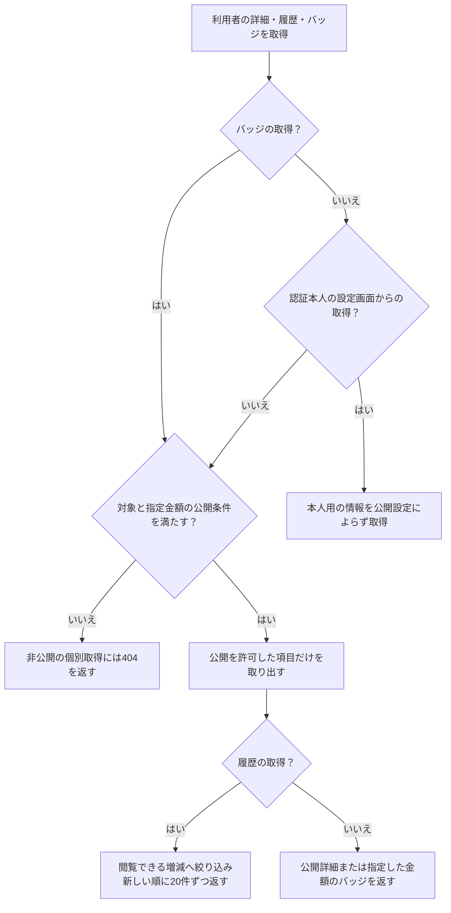

## 検索の機能

### 検索対象と表示範囲

- 未ログインでも、利用者・評価軸・パッケージを一つの検索欄で探せる。
  - ポイント交換に使う評価軸や、登録するパッケージもここから探す。

- 名前とIDを検索対象とする。
  - 検索語を全角・半角の空白で区切り、すべての語が同じ項目の名前またはIDに部分一致するものを表示する。
  - 英字の大小は区別せず、入力の前後の空白を除く。

- プロフィール全体または基本情報が非公開の利用者と、退会済みの利用者は検索結果に含めない。

- 公開範囲は「すべて・公開のみ・非公開のみ」から選び、初期値は「すべて」とする。
  - 「すべて」は公開項目と本人が編集できる非公開の評価軸・パッケージ、「公開のみ」は公開項目、「非公開のみ」は本人が編集できる非公開の評価軸・パッケージを表示する。
  - 非公開項目の編集権限は、検索している本人の現在の管理権限で判定する。未ログインでは「非公開のみ」の結果は0件となる。
  - 非公開の利用者は、本人や管理者が検索した場合も結果に含めない。

- 利用状態は「すべて・稼働のみ・停止中のみ」から選び、初期値は「すべて」とする。
  - 評価軸・パッケージの有効・停止状態で絞り込み、公開範囲は別に判定する。
  - 「すべて」は有効・停止中の両方、「稼働のみ」は有効、「停止中のみ」は停止中の評価軸・パッケージを表示する。
  - 利用者は「すべて」「稼働のみ」で既存の公開条件を満たす人を表示し、「停止中のみ」では表示しない。

### ヘッダーからの検索

- ヘッダーの検索欄からダイアログを開く。入力前は検索の案内を表示し、入力後は3種類を混ぜた検索結果を最大5件表示する。
- `Command`+`K`で検索欄を開けるショートカットを用意する
- 結果結果から選ぶと、その項目のプロフィールへ移動する。非公開の場合は、編集権限があっても404を返す。
- 「検索結果をすべて見る」で、検索語を引き継いで検索画面へ移動する。

- 結果には種類・名前・IDを表示する。
  - 非公開・停止中の状態と、検索している本人の「管理者・編集可能」バッジも該当する場合に表示する。
  - 評価軸の結果から交換倍率の一覧を開けるようにする。

### 検索画面の一覧と絞り込み

- 3種類を混ぜた一覧を1ページ20件で表示し、次・前のページへ移動できる。
  - 初期の並び順で検索語が空なら、名前順の一覧を表示する。

- 種類はユーザー・評価軸・パッケージから複数選択する。「すべて」は種類の条件を指定しない状態とする。
  - 利用状態は「すべて・稼働のみ・停止中のみ」、公開範囲は「すべて・公開のみ・非公開のみ」から選ぶ。
  - 編集権限は「すべて・権限あり・権限なし」から選び、初期値は「すべて」とする。

- 種類・利用状態・公開範囲・編集権限の条件をすべて満たす項目だけを表示する。

- 編集権限は、検索している本人がその項目を編集できるかで判定する。
  - 評価軸は対象軸の`evaluationCriterionAdmin`または`appAdmin`、パッケージは対象パッケージの`packageAdmin`または`appAdmin`なら「権限あり」とする。
  - ユーザーは、自分のプロフィールを「権限あり」、他人のプロフィールを「権限なし」とする。非公開のプロフィールは引き続き検索対象に含めない。
  - 「権限なし」で他人の非公開項目を表示することはない。「非公開のみ」と「権限なし」の組み合わせは0件となる。
  - 未ログインでは全項目を「権限なし」とし、「権限あり」の結果は0件となる。

- 一覧にも種類・名前・IDと、該当する状態・編集権限のバッジを表示する。

- 各結果からプロフィールへ移動する。
  - 非公開の場合は、編集権限があっても404を返す。

- 評価軸の結果には、交換倍率の一覧を開く導線も表示する。
- 管理者のみに編集画面へ移動するボタンも表示して、そのボタンを押せば非公開でも情報を閲覧できるようにする。
- 検索語・フィルター・並び順・ページを画面URLへ保存し、詳細から戻ったときに復元する。検索条件を変更したら最初のページへ戻す。

### 並び順と結果の更新

- 初期の並び順は、前後の空白を除いた入力全体による「ID完全一致・名前完全一致・名前前方一致・その他の部分一致」の順とする。
- 同順位は名前・種類・IDの順で固定する。種類の順序は利用者・評価軸・パッケージとする。
- 名前順と、登録・作成日時の古い順・新しい順へ切り替えられる。
  - 日時が同じ場合は種類・IDの順とし、利用者だけの場合はユーザーID順となる。
  - 日時順を指定した場合は、検索語が空でもその指定を使う。
- 結果0件と通信失敗を区別して表示する。
- 検索語を変更した場合は最新の検索結果を表示する。

### 検索の入出力とサーバー検証

- 検索の入力は検索語・種類・ID集合・編集権限・利用状態・公開範囲の絞り込み・並び順・ページとする。
- ヘッダーでは簡易表示の5件、検索画面では1ページ20件を返す。
- 検索結果は種類・ID・表示名・公開状態・利用状態・本人の編集可否を持つ。
- 検索画面では次・前のページへ移動できるかも返す。
- サーバーは公開範囲・管理権限・状態・検索条件を検証してから結果を返す。
- 非公開項目と編集可否は、ログイン中の本人の権限から判定する。
- 検索結果から移動した画面で交換・編集などを実行するときは、その操作の権限と利用可否をサーバーで再検証する。

### 検索API

- `QUERY /api/v1/search`を、公開検索・本人用検索・外部アプリの出品用選択・利用者一覧の集計で共用する。
  - 認証なしでは公開項目、有効なCookieセッションまたは`points` scopeのOAuth認証がある場合は、本人が管理する非公開の評価軸・パッケージも対象とする。
  - サーバーが現在の本人と権限を検証してから検索する。

- JSON本文へ`q`、`types`、`ids`、`statusFilter`、`visibilityFilter`、`permissionFilter`、`sort`、`page`、`pageSize`を指定できる。
  - `types`は`USER`・`EVALUATION_CRITERION`・`POINT_PACKAGE`の複数選択とし、指定する場合は重複のない1件以上の配列とする。省略時はすべてを対象とする。
  - `ids`は完全一致するIDの配列とする。指定した場合は、そのID集合に属し、種類・検索語・各フィルターも満たす対象だけを返す。
  - `ids`を省略した場合は、ID集合による絞り込みを行わない。存在しないIDや閲覧できない対象は、検索結果に含めない。
  - `statusFilter`は`ALL | ACTIVE | INACTIVE`とし、既定は`ALL`とする。画面の「すべて・稼働のみ・停止中のみ」にそれぞれ対応する。
  - `visibilityFilter`は`ALL | PUBLIC | PRIVATE`とし、既定は`ALL`とする。画面の「すべて・公開のみ・非公開のみ」にそれぞれ対応する。
  - `permissionFilter`は`ALL | EDITABLE | NOT_EDITABLE`とし、既定は`ALL`とする。画面の「すべて・権限あり・権限なし」にそれぞれ対応する。
  - `sort`は`RELEVANCE | NAME | CREATED_AT_ASC | CREATED_AT_DESC`で、既定は`RELEVANCE`とする。
  - `RELEVANCE`は一致の順位、`NAME`は名前順、`CREATED_AT_ASC`は登録・作成日時の古い順、`CREATED_AT_DESC`は新しい順とする。
  - `RELEVANCE`で検索語が空の場合は名前順とする。日時順の同時刻は種類・ID順とし、それ以外の同順位は名前・種類・ID順とする。
  - `page`は既定1、`pageSize`はヘッダー用の5または検索画面用の20とし、既定は20とする。
  - 応答の`data`は種類・ID・表示名・公開状態・利用状態・編集可否を持つ結果の配列とする。
  - `permissionFilter=ALL`は閲覧できる全項目、`EDITABLE`は本人が編集できる項目、`NOT_EDITABLE`は本人が閲覧できるが編集できない項目だけを返す。
  - `visibilityFilter=ALL`は公開項目と本人が編集できる非公開の評価軸・パッケージ、`PUBLIC`は公開項目、`PRIVATE`は本人が編集できる非公開の評価軸・パッケージだけを返す。
  - 有効な本人認証がない場合、編集可否はすべて`false`とし、`permissionFilter=EDITABLE`または`visibilityFilter=PRIVATE`の結果は200で空配列を返す。
  - 公開範囲と本人の権限で検索対象を決め、種類・利用状態・公開範囲・編集権限の条件で絞り込んでから、並べ替えとページ分割を行う。
  - 成功時は200と結果・ページ情報を返す。
  - 対象0件は空配列、入力値の誤りは422とする。

- 利用者一覧は、「無料主義アプリの発展の評価軸」などの集計に使う。
  - `types: ["USER"]`、`sort: "CREATED_AT_ASC"`で公開利用者を登録日時の古い順に取得する。
  - プロフィール全体と基本情報が公開の、退会していない利用者だけを返す。
  - 例は`{ "types": ["USER"], "ids": ["V1StGXR8_Z5jdHi6B-myT", "Uakgb_J5m9g-0JDMbcJqL"], "sort": "CREATED_AT_ASC", "page": 1, "pageSize": 20 }`とする。
  - 結果の`id`はユーザーID、`name`は表示名とする。登録日時は並び替えに使う。

- 選択した対象の詳細は、検索結果の種類とIDから対象別の詳細APIで取得する。
  - 利用者は`QUERY /api/v1/users/{userId}`、評価軸は`QUERY /api/v1/evaluation-criteria/{evaluationCriterionId}`、パッケージは`QUERY /api/v1/point-packages/{pointPackageId}`を使う。
  - 検索は簡潔な一覧を返し、構成全体と計算情報は対象別の詳細で返す。

- 検索画面では種類を複数選択できる。「すべて」は種類の指定を省略する状態とし、検索条件を画面のURLへ保存する。
- 検索はJSON本文を送り、冪等性キーは要求しない。

- 確認する例
  - 複数種類・複数ID・検索語・各フィルターを組み合わせ、権限で絞り込んでから並べ替えとページ分割を行うことを確認する。
  - 登録・作成日時の昇順・降順、同時刻、空の検索語、5件・20件の境界、対象0件を確認する。
  - 利用者一覧から非公開・退会済みの利用者を除外し、ID指定でも公開条件を変えないことを確認する。

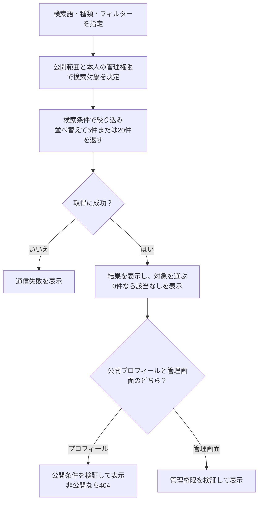

## 「設定」画面

### 自分のプロフィールURL

- 設定画面に、自分のユーザープロフィールのURLを表示する。
  - コピーボタンを押すと、そのURLをクリップボードへコピーする。

### 評価軸の作成・更新・削除

- 操作する人と画面
  - ログインしたPoints利用者は誰でも評価軸を作成できる。作成者は、その軸の`evaluationCriterionAdmin`になる。
  - 更新・完全削除・利用停止・再開は、その軸の`evaluationCriterionAdmin`または`appAdmin`が行う。
  - 設定画面に管理できる評価軸の一覧を表示し、フォームまたはCSVで管理操作を行う。
  - 評価軸のプロフィール画面からも更新画面を開ける。
  - 管理者設定画面でユーザーIDを指定し、その軸の管理者を追加・解除する。

- 入力項目と初期値
  - IDは作成時に発行する不変の標準Nano IDとする。
  - 同じ名前の軸を作成でき、選択画面では名前とIDを表示する。
    - 更新対象はIDで指定する。
  - 名前は必須で1〜30文字、説明は必須で1〜200文字、関連URLは任意で最大20件とする。
  - 説明内のURLは安全にリンク表示する。
  - 新規作成の初期状態は`INACTIVE`とする。譲渡・交換・即決価格の利用可否はON、自動分配方式は「本人の取り分から配る方式」、最小単位は1ポイントを初期値とする。
  - 最小単位は0.0001以上で小数4桁までの正の値とし、作成後も変更できる。
    - 新規の評価・付与・譲渡・通常消費・交換には現在の値、競売には作成時の値、過去取引の受領・自動訂正とそこからの再分配には元取引の基準時刻の値を使う。
    - 変更後も過去の付与額・残高・累計評価額・ポイント増減履歴の金額を保持する。
  - 確定済みの増減と、その発生元を示す参照はポイント増減履歴へ保存する。
  - 公開範囲は軸全体で`PUBLIC | PRIVATE`とし、新規作成時は`PRIVATE`とする。
  - 対象軸の`evaluationCriterionAdmin`または`appAdmin`がフォーム・CSVで変更できる。利用状態とは別に保存する。
  - フォーム・CSVの作成・更新項目に公開範囲を含める。非公開の軸は、設定画面の管理対象一覧から管理画面を開く。
  - 自動分配方式は`autoDistributionMode`へ保存する。
    - 値は`OWN_SHARE`（本人の取り分から配る方式）または`ADDITIONAL_ISSUANCE`（追加発行して配る方式）とし、受け取ったポイントの評価軸の設定を初回分配と再分配へ適用する。
  - 月別の直接・代用評価と交換倍率は、それぞれの設定操作で管理する。

- 確認と確定
  - サーバーで認証・権限・文字数・URL数・金額設定・公開範囲・利用状態・versionを検証し、確定前に作成・更新内容を表示する。
  - 確認後に評価軸の保存を原子的に確定する。
  - 作成の同じ確定要求の再送には、冪等性の共通条件に従って保存済みの結果を返す。
  - 更新・停止・再開では、同じIDの最新レコードを更新する。
  - versionは更新・停止・再開・完全削除の競合検査に使い、競合時は`409`とする。同じ確定要求の再送も、この検査で二重に反映しない。

- 未使用の軸の完全削除
  - Points内の付与、未受領の評価、経済処理の入力と確定履歴、残高、パッケージ、交換設定、代用設定、過去の本人・パッケージの計算設定の版などから参照されていない軸だけ、データを完全削除できる。外部サービスの競売レコードは参照検査に含めない。
  - その軸自身の作成・設定変更だけを記録した入力と確定結果は、完全削除を妨げる参照に含めず、削除後も保持する。金額0の経済計算で参照した軸は、参照済みとして扱う。
  - 削除の確定時に参照を再検査する。参照済みなら完全削除せず、利用停止を案内する。
  - 完全削除では、作成に付随する管理者所属や、その軸自身の計算設定の版も削除する。既存のポイント増減履歴は保持し、削除した評価軸IDを再利用しない。

- 利用停止と再開
  - 利用停止は`ACTIVE`から`INACTIVE`への変更とする。
  - 停止中は、競売・即時購入などの新しい決済の引き落としを拒否し、自動分配の計算元から除外する。設定変更・評価付与・自動計算による訂正・受領・その種類のポイントの分配・譲渡・交換・代用元の参照には、各機能の通常条件を適用する。
  - 利用停止しても、軸のレコード、設定、残高、累計評価額、付与と増減の記録を保持する。
  - 競売の作成・進行は外部サービスが管理する。
  - 管理者は同じIDのまま`ACTIVE`へ戻し、既存の設定と残高で決済利用と、新規分配の計算元としての利用を再開できる。
  - 停止・再開自体では、確定済みの評価・分配・決済の結果を変更しない。

- 利用停止と非公開の違い
  - 利用状態は、新しい決済でその軸のポイントを使えるかと、自動分配の計算元に含めるかを決める。
  - 公開範囲は、一般向けのプロフィール・検索・APIで情報を見せるかを決める。
    - 一般に公開せず、評価や分配を行いたいときに使用する。
  - 管理者は利用状態と公開範囲を別々に変更できる。
  - 作成直後は「停止中・非公開」とする。

| 利用状態             | 公開範囲            | 新しい決済                 | 評価軸の公開プロフィール | 保有者本人のポイント確認 |
| -------------------- | ------------------- | -------------------------- | ------------------------ | ------------------------ |
| 有効（`ACTIVE`）     | 公開（`PUBLIC`）    | 各操作の条件を満たせば可能 | 閲覧できる               | できる                   |
| 有効（`ACTIVE`）     | 非公開（`PRIVATE`） | 各操作の条件を満たせば可能 | 全員に404を返す          | できる                   |
| 停止中（`INACTIVE`） | 公開（`PUBLIC`）    | できない                   | 停止中として閲覧できる   | できる                   |
| 停止中（`INACTIVE`） | 非公開（`PRIVATE`） | できない                   | 全員に404を返す          | できる                   |

- 非公開でもできること
  - 保有者本人はログイン後の自分の設定画面で、自分のポイントと履歴を確認できる。
  - 保有者の公開プロフィールには、その非公開軸の名前・ID・金額を表示しない。
  - 軸の管理者またはアプリ全体管理者は、設定画面の管理対象一覧から軸の設定や評価結果を管理できる。
    - 保有しているだけの人には、軸の編集権限や他人の非公開情報の閲覧権限を与えない。
  - 管理者による新規付与と、保有者本人による譲渡・交換ができる。
    - 操作ごとの管理権限、譲渡・交換の許可、交換倍率、宛先、金額、残高などを検証する。
  - 非公開に変更しても、既存の評価・残高・履歴を保持する。
    - 代用評価・分配の再計算と、未受領分の受領を行える。
    - 競売精算は、引き落とす全評価軸が有効なら、非公開でも行える。
  - 非公開の軸は一般向けの検索結果に含めない。
    - 編集権限のある本人の検索には表示できるが、公開プロフィールは保有者・管理者を含む全員に404を返す。
  - 非公開の構成軸も自動分配の計算に使える。計算対象の条件は、[配分の計算順序](#配分の計算順序)にまとめる。
    - 外部サービス向けの構成取得では、非公開軸もID・割合・利用状態を返す。名前などの詳細は、その軸も管理できる認証本人に限って返す。

- 利用停止と非公開の例
  - 管理者が「チームへの貢献」軸を有効・非公開で作成し、自動分配を無効にしているAさんへ100ポイントを付与する。
    - Aさんは軸の管理者でなくても、本人の設定画面で軸の名前・ID、残高100、累計評価額100、履歴の＋100を確認できる。
    - 他人がAさんの公開プロフィールを見ても、この軸と金額は表示しない。
    - 譲渡が許可されていれば、Aさんは残高の範囲内で譲渡できる。
  - 同じ軸を利用停止にしても、Aさんの残高100と本人用の表示を保持する。
    - 停止中に代用評価を再計算して100から50へ変更した場合、Aさんの残高・累計評価額・評価の現在額は50となり、履歴には元の＋100と訂正の−50を残す。
    - 停止中は決済で使えず、再開後は現在の残高50で決済できる。
  - 公開パッケージの構成軸が非公開・停止中でも、外部サービスはIDと構成割合を取得できる。
    - 競売を作成するかは外部サービスが決める。
    - 精算時にその軸が停止中ならPointsは拒否し、有効なら非公開でも精算できる。

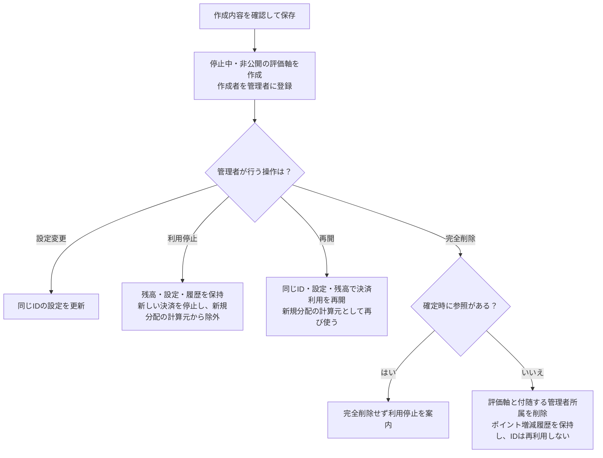

#### 「貢献評価を代用する仕組み」の設定

- 評価方式の選択
  - 付与先の評価軸ごと・評価対象月ごとに、「直接評価」または「代用評価」を選ぶ。
  - 同じ月の方式を利用者全員へ一括適用する。
  - 評価対象月はUTCの年月を`YYYY-MM`で指定する。9月分を10月に処理しても、9月の設定を使う。
  - 設定と実行は、付与先の評価軸の`evaluationCriterionAdmin`または`appAdmin`が行う。
  - 直接評価では、フォームまたはCSVで新しい評価を登録する。
  - 代用評価を選択中の月に直接評価を登録しようとした場合は、直接評価への切替を案内する。

- 代用元と係数の設定
  - 代用評価では、同じ評価対象月の代用元を一つ選び、類似度の係数を設定する。
  - 方式・代用元・係数はすべて月別に保持する。変更するたびに月別設定の新しい版を確定日時とともに保存し、過去に採用した方式と変更の順序を版から取得する。
  - 新しく選べる代用元は、公開軸または操作者が管理できる軸とする。フォーム・CSVで同じ条件を検証する。
  - 登録済みの代用元が非公開になっても計算を続ける。管理画面で非公開の代用元の詳細を表示するのは、操作者がその代用元を管理できる場合に限る。
  - 係数は`1.5`・`0.3`・`-0.3`のような倍率で入力する。0、負の値、1を超える値を設定でき、小数部は4桁までとする。
  - 同じ月の代用関係をサーバーで検査し、循環する設定を保存時に拒否する。自分自身を代用元にする設定も循環として扱う。
  - 例えばA軸→B軸→C軸は設定できるが、そこへC軸→A軸を追加することはできない。

- 計算元とする評価
  - この節の「計算元の評価額」は、代用評価で付与する額を求めるために係数を掛ける額を指す。
  - 代用元の軸で対象月に採用されている直接評価または代用評価を、一件ずつ計算元にする。
  - この一件の評価を「元評価」と呼び、同じ人への複数の元評価も、それぞれ付与・分配を計算する。
  - 直接評価は登録時の額、代用評価は再計算で確定した現在額を使う。
  - 例えば代用評価が再計算で100から60へ変わった場合は、60に係数を掛ける。

- 自動分配・再分配を受けた人の代用評価
  - 元評価を受けた本人に加え、その評価から自動分配・再分配を受けた人も、代用評価の付与対象にする。
  - 各人が自動分配・再分配する前の額を、代用評価の計算に使う。
    - なぜなら、その代用評価の計算結果を元に自動分配するので、自動分配前の額を参考に計算するのが正しいため。
  - 元評価を受けた本人には元の評価額、分配を受けた人には受取額を使い、その人がさらに配った額は差し引かない。
  - 同じ元評価から同じ人へ渡った評価額・分配額は、係数を掛ける前に合計する。
  - 例えば、同じ元評価からBさんが別々の経路で30と10を受け取った場合、合計40に係数を掛ける。
  - 別の元評価から受け取った額は、元評価ごとに係数を掛けて端数処理する。
  - 分配・再分配の受取額は、元評価の評価対象月に含める。
  - 例えば9月分の元評価から10月に分配しても、代用評価では9月分として扱う。

- 未受領と自動計算による訂正の扱い
  - まだ受け取っていない元評価と分配待ち額も、同じ元評価・宛先の現在額として計算元に含める。
  - 受領は、受領待ちの額を本人へ移す処理として扱う。
  - 受領待ち40を本人へ移しても、受領待ち40と受領済み40を足して80とは数えず、同じ40を一度だけ数える。
  - 代用評価や分配の自動計算による訂正履歴は、その結果の現在額を求めるために使う。
  - 例えば代用評価の履歴に初回＋100と訂正−40があれば、一件の現在額60として扱う。
  - 直接評価として＋100と−40を別々に登録した場合は、それぞれ独立した元評価として係数を掛ける。

- 計算元の参照条件
  - 代用元の評価額・残高・累計評価額は参照だけとし、この計算で変更しない。
  - 代用元が直接評価の月では、個々に登録した評価額を使う。月全体の締め操作は設けず、評価が0件なら0として計算する。
  - 代用元が代用評価の月では、その時点の確定済み結果を使う。未実行なら処理を止め、代用元の管理者による実行・確定後に再実行するよう案内する。
  - 管理者による設定変更・再計算は、指定した付与先の軸・月を対象に開始する。
  - 代用元の停止・再開だけでは、既存の代用結果を変更しない。
  - 例えばX→Y→Zの代用関係では、ZはYの確定済み結果を代用元に使える。
  - Xが停止中で確定評価100、付与先Yも停止中の場合、係数0.5でYへ50を付与・再計算できる。Xの評価額・残高・累計評価額は変わらない。

- 付与額の計算
  - 各元評価・受取先の付与額は「計算元の評価額×類似度の係数」とする。計算元の評価軸ポイントを維持したまま、付与先の軸でポイントを新しく付与する。
  - 100×1.5は150、100×−0.3は−30、−100×−0.3は30となる。負の結果も残高と累計評価額へ反映する。
  - 係数を十進数文字列で保持し、Workerがbignumber.jsで`sourceAmount * coefficient`を計算する。
  - 結果は元評価・受取先ごとに、付与先の評価軸へ適用する最小単位で0方向に切り捨てる。代用元・付与先の単位がともに0.0001の場合、同じ人への0.0001の元評価2件に係数0.5を掛けても、それぞれ0となる。
  - 新しい元取引として作る代用結果には、その取引の初回付与確定時点の付与先の単位を使う。既存取引の再計算では、今回適用する月別方式・係数を月別設定の版から取得し、金額の単位は元取引の基準時刻から引き継ぐ。帰属統合などで初めて額が生じる受取先も、その既存取引の当時の単位を使う。
  - 入力と保存・返却する結果は金額精度の条件を検証し、範囲を超えた場合は操作全体を失敗させる。

- 代用計算の例
  - 9月分のX軸の評価から、係数0.5でY軸のポイントを付与する例を示す。
  - 一件の元評価でAさんへX100を付与する。
  - Aさんの取り分からBさんへX40を自動分配し、Bさんが受け取ったX40のうちX10をCさんへ再分配する。
  - Cさんは再分配しないものとする。

  | 対象者 | 今回の付与・分配によるX残高の増加 | 代用評価の計算に使うXの額 | 係数0.5で付与するY |
  | ------ | --------------------------------: | ------------------------: | -----------------: |
  | Aさん  |                        100−40＝60 |                       100 |                 50 |
  | Bさん  |                         40−10＝30 |                        40 |                 20 |
  | Cさん  |                                10 |                        10 |                  5 |
  - 自動分配・再分配で他の人へ配っても、各人が受けた評価額は維持するため、代用評価には各人が配る前の額を使う。
  - Aさんは自動分配前のX100からY50、Bさんは再分配前のX40からY20、Cさんは受け取ったX10からY5を計算する。
  - 元の評価額に加えて分配・再分配の受取額も評価として数えるため、計算に使うXの合計は150となり、元の付与額100を超える。
  - 表は代用による付与額を示し、Yの自動分配は各人の付与額から計算する。
  - Aさんに別件のX60の元評価があれば、その一件からY30を計算し、二件を先に合算しない。
  - Bさん宛てのX40が受領待ちでも、その宛先へY20の未受領評価を作る。

- 自動分配と未受領の評価
  - 正の代用付与は、受取人の設定で自動分配する。0・負の付与は本人へ反映する。
  - 未登録・未連携の人にも、計算元と同じ宛先へ未受領の代用評価を作る。初回額と訂正差額をポイント増減履歴へ保存し、確定済みの履歴合計を受領待ちの現在額とする。
  - 本人への反映と分配は、受領時に行う。
  - 受領には保存済みの最新額を使い、代用元を再計算しない。
  - 後続の分配・訂正は、[分割確定と再開](#分割確定と再開)の単位で進める。
  - 分配の基準時刻と最初の配分割合は、[分配を始める時点](#分配を始める時点)にまとめる。

- 再計算と方式の切替
  - 管理者が変更内容と全員の増減を確認してから、月別設定の新しい版を保存する。各付与と訂正は共通の分割確定で進め、ポイント増減履歴の各行から適用した版を参照する。
  - 再開時は、確定済みの採用結果が参照する版と最新の版を比べて未反映の対象を求め、最新の版から方式・代用元・係数を取得する。自動分配・再分配の条件と金額単位は、元取引の基準時刻から選ぶ。
  - 再計算の対象は、付与先の軸・対象月に属する全員の付与と分配とする。新旧結果の訂正と確定は、[分配・再分配・訂正の共通ルール](#分配再分配訂正の共通ルール)にまとめる。
  - 全員分は、計算元の元評価の登録日時`createdAt`が古い順、同時刻なら元評価の初回履歴IDの昇順で処理する。
  - 初回登録日時は、訂正・受領・再計算でも保持する。
  - 同じ元評価に由来する本人評価と分配受取額は、一つの元評価にまとめて扱い、その中は端数配分と同じ受取先の識別子順で処理する。
  - 各受取先への付与と、そこから生じる全再分配を計算してから次へ進む。先に計算した増減を後の計算へ反映し、途中で分割確定しても処理順を保持する。
  - 直接評価を採用中の月の再計算では、採用中の直接入力を一件ずつ同じ日時・ID順で処理する。
  - 直接評価から代用評価へ切り替える場合は、その月の直接付与と全分配を取り除いて代用結果を計算し、差し替える。切替前の直接入力は履歴として残し、以後の計算には採用しない。
  - 直接評価へ戻す場合は、旧代用付与と全分配を取り除き、0から開始する。新しい評価は、切替後に通常の直接評価フローで追加する。
  - 再計算や切替による負の残高も反映する。

- 保存と二重付与の防止
  - 月別設定と全員分の採用結果は「付与先評価軸ID＋評価対象月」で識別する。代用元や係数を変更しても、同じ月の採用結果として訂正差額を履歴へ追加する。
  - 月別設定を保持し、直接評価の入力と確定した採用結果はポイント増減履歴へ保存する。直接評価の入力は、その計算位置までに確定した月別設定の版から採用方式を取得して区別し、代用中の計算元へ加えない。
  - ポイント増減履歴は元の付与と評価対象月に紐付け、受領者・評価軸別の残高と累計評価額の増減を集計できるようにする。評価月をまたぐ追加登録や再計算でも、月別の増減を追えるようにする。
  - 同じ確定要求の再送はversionの競合検査で処理する。繰り返し実行しても、現在の結果との差額だけを反映する。

- 設定と実行の画面
  - フォームで月別設定と結果確認を行い、全員分の確定・再計算ボタンを用意する。
  - 月別設定はCSVでも変更・再計算できる。
  - 設定変更は、実行条件を満たす場合だけ確定する。確定できない設定は画面で修正し、保存済みの設定と結果を保持する。
  - 新規設定ではversionを発行し、既存設定の変更・再計算では現在のversionを検証する。

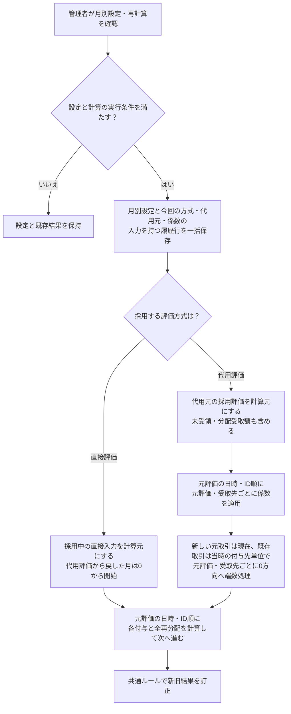

#### 「交換する仕組み」の係数を設定

- 設定する人と管理操作
  - 交換先の評価軸の`evaluationCriterionAdmin`または`appAdmin`が、フォーム・CSVで設定する。
  - A軸からB軸への倍率はB軸の管理者が決め、逆方向はA軸の管理者が別に設定する。
  - 倍率は0.5・1.5のような正の十進数文字列とし、小数部は4桁までとする。交換の有効・無効を別に設定する。複数の交換を経てポイントが増える組合せも許可する。
  - 作成・更新・無効化・再有効化・完全削除に対応する。
  - 交換許可OFFの軸でも設定を編集できる。
  - 実際の交換では、両軸の存在・交換許可・その方向の設定を検証する。
  - 同じ交換元・交換先の組ごとに`exchangeRate`の最新レコードを更新する。既存設定の更新・削除では現在versionを指定する。
  - 無効化では倍率を保持する。新規作成は倍率を必須とし、既存設定の保存で倍率が空欄の場合は現在値を維持する。

- 倍率の表示と確認
  - 評価軸プロフィール・検索結果など、評価軸の情報を表示する箇所に「交換倍率」の導線を設ける。交換画面では選択した方向の倍率を直接表示する。
  - 一覧には、その軸を交換元または交換先とする設定の方向、両軸の名前・ID、倍率、有効状態、現在の交換可否を表示する。
  - 無効化中・交換許可OFFの設定も、交換できない理由付きで表示する。閲覧権限のない非公開軸を含む設定は表示しない。
  - 確認画面には作成・更新・無効化・再有効化・削除の区別、両軸の名前・ID、変更前後の倍率・状態を表示する。
  - 設定変更の確定後は、新しい交換に最新の設定を適用する。利用者が交換を確認している間に倍率が変更された場合は、最新条件で再確認を求める。

- 倍率の保存と検証
  - 倍率は正規化した十進数文字列`multiplier`で保存する。
  - サーバーで認証・交換先の管理権限・評価軸・倍率・操作・状態・versionを検証する。
  - 確定した設定を保存し、管理操作の監査を記録する。

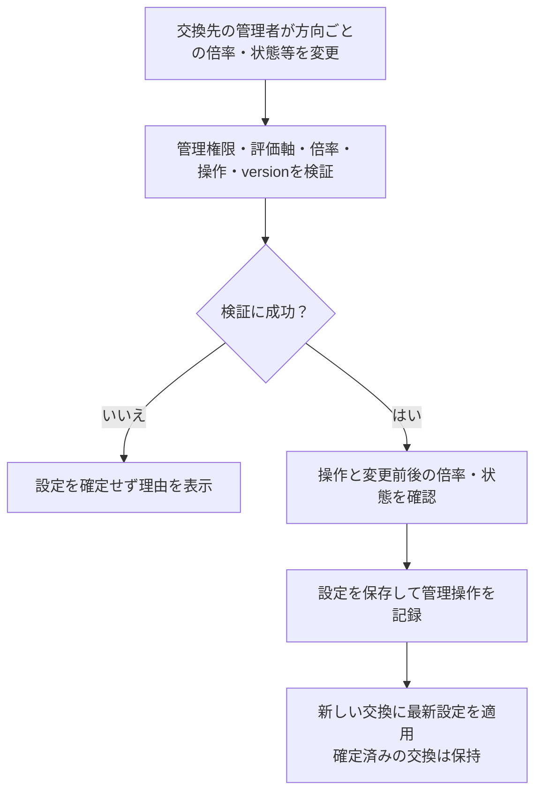

#### 評価軸ポイントの加算・減算

##### 登録する操作

- 評価結果は、直接評価または代用評価で定めた評価額と、その宛先・評価軸・評価対象月・受領状態を指す。
  - 評価額が0・負の場合や、未受領の場合も含む。

- 対象評価軸の管理者`evaluationCriterionAdmin`またはアプリ全体管理者`appAdmin`が、評価軸の管理画面からフォームまたはCSVで直接評価を登録する。公開プロフィールからも、その操作画面を開ける。

- 登録する評価は、それぞれ独立した評価として追加し、その評価の初回履歴IDで識別する。同じ人・同じ評価軸・同じ評価対象月にも、複数の評価を登録できる。
  - 同じ内容でも、別の冪等性キーで確定した操作は新しい評価として追加する。

- 評価額は符号付きの十進数文字列とし、対象軸の現在の最小単位の倍数を検証する。0や負の残高になる評価も受け付ける。

- 登録済みの評価を調整するときは、元の評価を保持し、差額を新しい評価として登録する。
  - 評価軸や評価対象月を変えたい場合は、元の対象に元評価と同じ絶対値で逆符号の評価を追加し、変更先に移したい額の評価を新しく登録する。

- 評価対象はUTCの年月を必須とし、日・時刻は任意とする。

- メモは任意で200文字以内とする。

- 入力するのは、その登録で加算・減算する評価額とする。
  - 残高と累計評価額は別に保持し、ポイント増減履歴と同じ原子処理で更新する。
  - 加算・減算の応答に、操作者が閲覧できない受領者の非公開残高を含めない。
  - 本人用の残高取得は、本人認証・認可の条件で別に判定する。

##### 宛先の指定

- 宛先は、次の4種類から一つを選び、フォーム・CSVで指定する。
  - 本人から共有された情報など、対象者との対応を確認できる識別子を使う。

  | 宛先の種類                | 指定する列                                           | 入力例                                    |
  | ------------------------- | ---------------------------------------------------- | ----------------------------------------- |
  | 外部プロフィールURLの候補 | `recipientProfileUrl`                                | `https://github.com/alice`                |
  | AccountsユーザーID        | `recipientAccountsOrigin`と`recipientAccountsUserId` | `https://accounts.example.com`と`user123` |
  | Provider内の固有ID        | `recipientProvider`と`recipientProviderAccountId`    | `github`と`12345`                         |
  | Provider内のユーザー名    | `recipientProvider`と`recipientProviderUsername`     | `github`と`alice`                         |

- URL候補は最大5件、各512文字以下とする。
  - フォームでは候補を追加する。

- AccountsユーザーIDはUTF-8で256バイト以下とする。
  - そのIDが属するAccounts系サービスのoriginを必須とする。
  - 同じIDでもoriginが異なれば別の宛先とし、CSVの各行で異なるoriginを指定できる。

- Providerは外部サービスの種類を表し、Accountsが定義する`google`・`github`などの識別子で指定する。
  - 入力形式とユーザー名の正規化は、[Accountsのサービス別の識別](../../../../../accounts-web-app/docs/specification/v0.1/verify-url.ja.md#サービス別の識別)に合わせる。
  - 固有IDとユーザー名は、それぞれUTF-8で256バイト以下の文字列とする。
  - 固有IDは数値に変換せず、入力した文字列を保持する。
  - 固有IDとユーザー名を区別し、Accountsが検証済みとして提供する識別子と照合する。

- URL・Provider指定では、Pointsサーバーが有効なAccounts系サービスへ順番に問い合わせ、その処理で見つかった一人を付与先にする。
  - サービス間・URL候補間の優先順位は保証しない。
  - AccountsユーザーID指定では、指定originのサービスだけに問い合わせる。

- 全候補が未照合の場合も、宛先候補を未受領評価として保持する。
  - 受領時は本人のAccounts識別子一覧と宛先を照らし、一致する未受領分を一度だけ反映する。

- 受領が確定した評価は、保存済みのユーザーIDへ帰属する。自動計算でその評価に訂正差額を追加する場合も、この本人へ反映する。
  - Accountsの紐付け・公開許可の変更や、宛先識別子の変更・受領後の解除・再所有があっても、この受領者を保持する。
  - 元のAccounts接続先が停止・取り下げ済みでも、保存済みの本人への自動訂正では外部の宛先を再照合しない。
  - これらの変更だけを理由に、確定済みの評価結果を取り消さない。

- 差額を登録する場合も、新しい評価の宛先を指定し、通常の登録と同じ照合を行う。

##### 直接評価の登録時の照合

- 送信から登録まで
  - 保存・付与は、フォームの送信またはCSVの明示的な確定操作を受けて行う。
  - 画面には付与先、今回登録する評価額、評価対象月、未受領の有無、分配による増減を表示する。

- 登録時に照合先を選ぶ処理
  - Pointsサーバーが、PointsをOAuthクライアントとして登録している有効なAccounts系サービスを取得し、サービスごとに順番に問い合わせる。
  - URL・Provider指定では、一つのサービスでその行の識別子を照合し、人物が見つからなければ次のサービスへ進む。
  - AccountsユーザーID指定では、入力originに対応する登録済み・有効な接続先だけで照合する。
  - 指定originの接続先が未登録・停止中、または有効な照合先が一つもない場合は、`409 ACCOUNTS_CONNECTION_NOT_ACTIVE`を返し、全件の登録を止める。
  - 人物が見つかった行は、そのサービスのoriginとAccountsユーザーIDの組で付与先を決める。
  - Points連携済みなら付与し、未連携または人物が見つからない場合は未受領評価として保存する。
  - 複数のサービスやURL候補に人物が紐付く場合は、その処理で見つかった最初の一人を選ぶ。

- 入力の検証と問い合わせ
  - Pointsは、選んだ宛先種類の必須列がそろい、他の種類の列が空欄であることを検証する。
  - 宛先が空、または必要な組の片方が欠けている場合は、`RECIPIENT_IDENTIFIER_REQUIRED`を該当行・列へ返す。
  - 複数の宛先種類を指定した場合は、`RECIPIENT_IDENTIFIER_AMBIGUOUS`を該当行へ返す。
  - URL候補の件数・空欄・長さと、origin・Provider・識別子の入力形式を検証する。
  - URLの正規化や受付条件の判定はAccountsが行う。
  - フォームも同じ入力条件とし、入力エラーがあれば全件を反映しない。

- PointsからAccountsへの宛先照合API
  - 入力エラーがなければ、Pointsサーバーから照合先のAccounts系サービスへ、`QUERY /api/v1/identities/resolve`で問い合わせる。
  - 接続先は、そのAccounts系サービスのoriginにこの経路を付けたURLとする。
  - このAPIは、指定した宛先の識別子が、どのAccountsユーザーに該当するかを照合する。
  - ポイントの付与は、回答を受けたPointsが行う。
  - 要求本文の`identifiers`配列には、次の形式で入れる。

  | 宛先の種類         | Accountsへ送る識別子                                |
  | ------------------ | --------------------------------------------------- |
  | URL候補            | `{ type: "url", url }`                              |
  | AccountsユーザーID | `{ type: "accounts_user", accountsUserId }`         |
  | Provider固有ID     | `{ type: "provider_account", provider, accountId }` |
  | Providerユーザー名 | `{ type: "provider_username", provider, username }` |
  - Accounts originは接続先の選択に使う。

- 問い合わせのまとめ方と件数
  - 同じAccounts系サービスへ照合する宛先を、CSVの行をまたいで一つの`identifiers`配列へまとめる。
  - URL候補1個、AccountsユーザーID1個、Providerと固有IDの組1個、Providerとユーザー名の組1個を、それぞれ識別子1件として扱う。
  - 1行に異なるURL候補が5個あれば5件とする。
  - 同じサービスへ送る識別子は、種類・Provider・入力値が同じものの重複を除き、一度だけ照合する。
  - Pointsで問い合わせの重複を除く際は入力値を比較し、Accountsによる正規化後の同一性の判定と区別する。
  - 重複を除いた識別子の合計が1,000件以内なら、1回の要求にまとめる。1,000件を超える場合は、各要求が最大1,000件となるようPointsが分割する。
  - CSV自体の1,000行上限と、Accountsへの1要求あたり1,000識別子の上限は、別々に適用する。
  - 各識別子と、それを指定したすべてのCSV行・候補との対応を処理中に保持する。分割後も、各要求の入力位置から元の行・候補へ回答を戻し、同じ識別子の照合結果を各行で使う。
  - 照合結果だけを共用し、評価の登録は元の各行どおりに行う。
  - 一つの行の候補が複数の要求に分かれた場合も、そのサービスへの全要求の回答をまとめてから、その行の付与先や次のサービスへの照合を決める。
  - URL・Provider指定で付与先が見つからなかった行は、次の有効なAccounts系サービスへ同じ方法で問い合わせる。

  | 同じAccounts系サービスへ照合する入力            | CSV行数 | 重複を除いた識別子数 | 要求回数と各要求の件数 |
  | ----------------------------------------------- | ------: | -------------------: | ---------------------- |
  | 1行に5URL、別の995行に各1URL、すべて異なるURL   |     996 |                1,000 | 1回、1,000件           |
  | 201行に各5URL、すべて異なるURL                  |     201 |                1,005 | 2回、1,000件と5件      |
  | 1,000行に各5URL、すべて異なるURL                |   1,000 |                5,000 | 5回、各1,000件         |
  | 1,000行すべてに、同じ5個のURL                   |   1,000 |                    5 | 1回、5件               |
  | 1,000行すべてに、同じoriginとAccountsユーザーID |   1,000 |                    1 | 1回、1件               |
  | 1,000行すべてに、同じProviderと固有ID           |   1,000 |                    1 | 1回、1件               |

- Accountsの回答と登録する内容
  - 人物を特定できた回答が`matched`である。
  - 選ばれた人物のoriginとAccountsユーザーIDを保存する。
  - 人物が見つからない回答が`no_match`である。
  - URL・Provider指定では全照合先、AccountsユーザーID指定では指定originで人物が見つからなければ、入力した宛先と評価額を未受領として保存する。
  - AccountsユーザーID指定の未照合でも、入力したoriginとIDの組を保持する。
  - 入力した宛先と照合結果は区別し、Points本人への帰属は受領を確定するまで未確定とする。
  - 受付できない入力への回答が`invalid_input`である。
  - 個別の照合結果を含むHTTP 400では、結果内の`invalid_input`を入力エラーとして扱う。
  - 該当する行・列に`RECIPIENT_IDENTIFIER_INVALID`を付け、`422 CSV_VALIDATION_FAILED`を返す。
  - 成功時は、実際に選ばれた付与先と接続先、照合結果、付与済み・未受領の別、評価と分配の処理結果を画面へ返す。

- 照合できない場合
  - 問い合わせが複数の要求に分かれた場合も、いずれかの要求で通信失敗、タイムアウト、サービス側の障害や制限、認証失敗、要求の拒否、不正な応答などがあり、照合を完了できなければ、評価も分配も全件を反映しない。
  - 照合できない場合は`503 ACCOUNTS_RESOLVE_UNAVAILABLE`を返す。
    - 問い合わせ制限で待ち時間が指定された場合は、`Retry-After`を返す。
  - Accountsが認証を拒否した場合は、`503 ACCOUNTS_CLIENT_UNAUTHORIZED`を返す。
  - 「正常に照合したが人物が見つからない場合」は未受領として登録できる。「照合処理を完了できない場合」はエラーとして登録を止める。

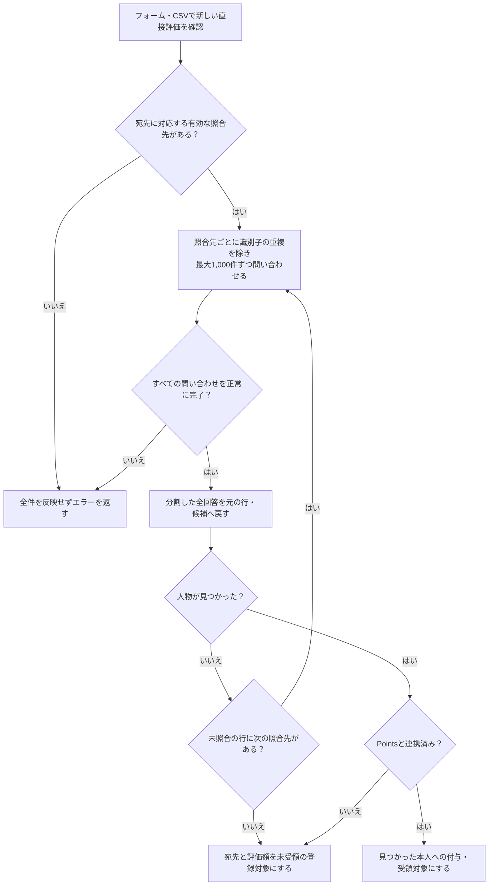

- 照合の確認例
  - 同じ接続先へ同じ種類・Provider・入力値を複数行から指定した場合、一度の照合結果がすべての指定行へ対応することを確認する。
  - 入力不正の回答も、該当するすべての行へ戻す。
  - 一つの行の候補が要求をまたぐ場合も、回答が元の行へ対応することを確認する。
  - `https://accounts-a.example.com`の`user123`と`https://accounts-b.example.com`の`user123`を別の宛先として照合する。
  - `github`の固有ID`12345`とユーザー名`alice`を、それぞれの種類で照合する。
  - 必須列の不足、複数種類の混在、未登録・停止中の接続先、通信失敗では全件未反映となることを確認する。
  - 正常な未照合では入力した宛先を保持し、CSVの確定要求の再送で二重付与しないことを確認する。
  - 受領後にユーザー名の所有者が変わった場合や元のAccounts接続先が停止した場合も、自動計算による訂正差額は外部再照合を行わず、保存済みのPoints受領者へ反映することを確認する。

- 各評価は初回履歴IDで識別し、APIでは`firstLedgerEntryId`として返す。
  - プロフィール内の履歴などにも、初回履歴IDを表示する。
  - 差額を追加した評価は、元の評価とは別の初回履歴IDを持つ。

- ポイント増減履歴は操作者・評価軸・初回通信ID・初回履歴IDで照会でき、後続の履歴も元の初回行への参照から取得する。

- 本人へ付与する評価額をポイント増減履歴へ確定し、残高と`evaluationTotal`へ反映する。
  - 例えば9月100を10月100へ移したい場合は、元の9月100を保持し、9月−100と10月＋100を新しい評価として追加する。月別の差分は9月−100・10月＋100、全月合計の差分は0となる。
  - 貢献評価代用では、各評価の登録した評価月と額を一件ずつ計算に使う。

- 各直接評価の登録額は、受領状態にかかわらずポイント増減履歴へ保存する。
  - 受領対象は初回履歴IDで識別し、その行と訂正差額の確定済み合計から現在額を取得する。
  - 受領時は、初回履歴行へ帰属先本人と受領日時などを保存する。受領額を重ねて履歴へ追加せず、合計額を一度だけ残高・累計評価額へ反映する。

- 直接評価の登録では、対象の評価月が直接評価を採用していることを検証する。
  - 別の月に差額を追加する場合も、登録する各月を検証する。
  - 代用評価へ切り替えた月の切替前の直接入力は、採用中の評価・残高・受領待ちの有効額に加えない。

- ポイント増減履歴の確定済みの入力・金額・必要な参照は不変とし、同じ評価処理による同じ結果を重複して保存しない。帰属と受領は初回履歴行で管理する。

- 各評価の登録時の入力・照合情報は、初回履歴行から取得する。
  - 監査ログには、[監査ログ](#監査ログ)で定める項目を記録する。

- フォームの送信または確認済みCSVの確定要求を受け、入力の検証と照合・計算がすべて成功した後、各評価の操作本体を確定する。CSVは行順に進める。各操作本体では次を一つのD1原子処理で確定する。
  1. 初回履歴行の入力・照合情報・登録額・確定日時と、後続分配を導くための元取引への参照。CSVでは`Idempotency-Key`と元の行番号も保存する。
  2. 未受領なら受領日時を未確定のまま保持し、即時受領なら帰属先本人・受領日時・照合根拠
  3. Workerが計算し、共通保存処理で代入する`point_accounts.balance`と`evaluation_total`
  4. 冪等性の結果

- サーバーはフォーム・CSVの両方で管理権限、宛先、金額、評価対象月の直接評価選択を検証する。

- 正の新規評価と未受領分の受領では、[分配・再分配・訂正の共通ルール](#分配再分配訂正の共通ルール)に従って分配を開始する。

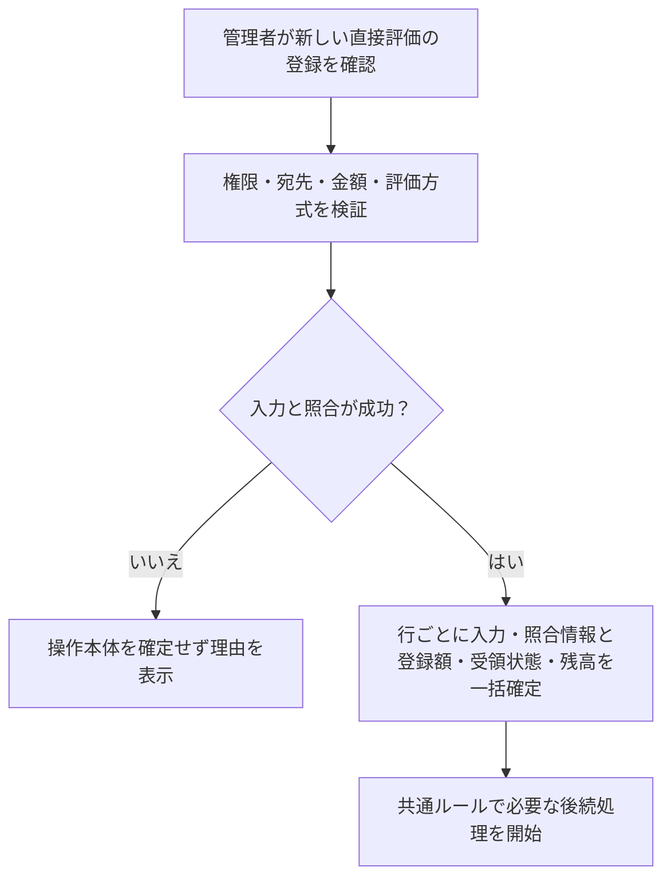

### ポイント交換する機能

- 交換の基本動作
  - 利用者が本人の交換元ポイントを減らし、本人の交換先ポイントを増やす。
  - 例えば、倍率0.5なら、A軸の100ポイントを使ってB軸の50ポイントを受け取る。
  - 元・先の両評価軸が交換を許可し、その方向の交換倍率が`ACTIVE`の場合に実行できる。
  - 交換は残高だけを変更する。累計評価額は維持し、交換による受取額は自動分配を開始する付与に含めない。
  - 確定済みの交換は保持する。元の種類へ戻す場合は、その時点の逆方向の倍率で新しい交換を行う。

- 入力と金額計算
  - フォームまたはCSVで、交換元・交換先の評価軸と、交換元額または希望受取額のどちらか一方を指定する。
  - 交換元額は消費してよい上限、希望受取額は受け取りたい最低額とする。
  - 金額は正の十進数文字列とし、元額入力は交換元、希望受取額入力は交換先の現在の最小単位の倍数を検証する。
  - Workerはbignumber.jsで、元・先それぞれの最小単位を満たし、倍率どおりに交換できる最小の一組を求める。
    - 元の単位を`s`、先の単位を`t`、倍率を`r`とし、`r * s / t`を正の既約整数比`a / b`で表す。
    - 一組の実消費額は`s * b`、実受取額は`t * a`とし、この組の整数倍だけを交換する。
    - 有限十進数を整数比へ変換して最大公約数で約分し、組数は整数商と剰余で求める。比の計算や受取額を途中で丸めず、中間の整数を`Number`へ変換しない。
  - 元額上限`sourceAmount`を指定した場合は、上限以下で最大の組数を使う。上限を一組の実消費額で割った整数商を組数とする。
  - 希望最低受取額`targetAmount`を指定した場合は、希望額以上になる最小の組数を使う。希望額を一組の実受取額で割り、余りがあれば整数商に1を加える。
  - 元残高から引き落とすのは実消費額だけとし、交換しない分は元残高に残す。

- 数値例
  - 元・先の単位がともに0.0001で、倍率3で0.0001ポイント以上を受け取りたい場合、元額は0.0001、実際の受取額は0.0003となる。
  - 元の単位1、先の単位0.1、倍率0.35の場合、一組は元2・先0.7となる。上限3を全額使った計算額1.05は先の単位に合わないため、次の額で交換する。

  | 指定する金額      | 実消費額 | 実受取額 | 上限の未使用額 |
  | ----------------- | -------: | -------: | -------------: |
  | 元額上限3         |        2 |      0.7 |              1 |
  | 希望最低受取額1.1 |        4 |      1.4 |   上限指定なし |
  - 上限3・元残高3なら、実消費2・交換後残高1となる。元残高が2でも実消費2を満たすため交換でき、交換後残高は0となる。この場合も上限の未使用額は1であり、交換後残高とは区別する。
  - 同じ単位・倍率で上限1なら、一組にも満たないため交換を拒否する。

- 受付と残高の条件
  - 組数が0、入力・保存・返却する金額が許可範囲外、または交換元の残高が実消費額未満の場合は拒否する。
  - 残高不足を理由に組数を減らしたり、希望受取額未満で交換したりしない。

- APIの入力と応答
  - フォーム・CSVのAPIは、`sourceEvaluationCriterionId`・`targetEvaluationCriterionId`と、`sourceAmount`・`targetAmount`のどちらか一方を受け付ける。
  - `sourceAmount`は消費上限、`targetAmount`は希望最低受取額を表し、両方の指定と両方の省略を拒否する。
  - 確認応答と確定結果では、実消費額を`consumedAmount`、実受取額を`receivedAmount`として十進数文字列で返し、入力額と区別する。
  - 上限の未使用額は`sourceAmount - consumedAmount`から求め、交換後残高とは分けて扱う。

- 確認と確定
  - サーバーで本人の認証、評価軸の存在、倍率の状態、交換可否、金額、残高を検証する。
  - 確認画面へ交換元・交換先、指定した消費上限または希望最低受取額、実消費額・実受取額・適用倍率・両軸の最小単位・交換後の両残高を表示する。
    - 上限指定では、上限の未使用額も表示する。
    - 希望額より多く受け取る場合も実額を確認できるようにする。
  - 確定前に倍率・両軸の最小単位・実際の金額が変わり、交換可能な場合は確定せず、最新条件を表示して再確認を求める。
    - 確定時には両評価軸の存在・交換可否と残高も再検証する。
    - 交換できなくなった場合は確定せず、その理由を確認画面へ表示する。
  - 元ポイントの引き落としと先ポイントの加算を、同じ原子処理で確定する。
  - `Idempotency-Key`と確定要求の内容を照合し、同じ要求の再送には既存の結果を返す。
    - 要求の照合には、上限指定か希望額指定かと、その入力額を含める。実消費額・実受取額が同じでも入力が違えば別の要求として扱う。

- 履歴への保存
  - 元・先の増減をポイント増減履歴へ記録する。上限指定か希望額指定かと入力額、操作者、確定日時は、交換の初回履歴行へ保存する。
  - 適用倍率は、確定した実消費額と実受取額から`receivedAmount / consumedAmount`で求める。交換は一組の整数倍なので、この比は適用した倍率と一致する。
  - 両軸の当時の単位は、初回履歴の確定日時から取得する。
  - プロフィールの公開設定にかかわらず、本人は設定画面の統合履歴で自分の交換を閲覧できる。
    - 種類・評価軸で絞り込み、新しい順に20件ずつ表示する。

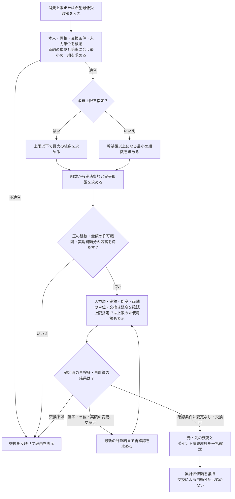

### ポイント譲渡する機能

- 操作・宛先・金額
  - ログイン利用者が、本人のポイントをフォームまたはCSVで他者へ譲渡する。
  - 評価軸ID・譲渡額・譲渡先ユーザーIDを指定する。
    - フォームでは公開プロフィールの検索からも相手を選べる。
  - 譲渡先は有効な他者に限定する。
    - 非公開プロフィールでもID指定で送れるが、自己宛て・退会済み・存在しない相手は拒否する。
  - 金額は正の十進数文字列とし、対象軸の現在の最小単位の倍数で、本人の残高以内に限定する。
    - 評価軸の設定として譲渡を許可している場合だけ実行できる。
    - 残高が0未満の場合は譲渡できない。

- ポイントと自動分配
  - 送信者の残高を減らし、受取人へ同じ種類・同じ額を加える。
  - 譲渡自体では双方の累計評価額を変更しない。
  - 譲渡で受け取った評価軸ポイントは、受取人の設定に従って自動分配・再分配を行う。
  - 分配結果は元の譲渡の初回履歴行に紐付ける。分配の計算と確定は、[分配・再分配・訂正の共通ルール](#分配再分配訂正の共通ルール)にまとめる。

- 確認と確定
  - 確認画面には宛先ID・公開可能な相手の名前・評価軸・譲渡額・送信者の確定後残高を表示する。
  - 受取人の自動分配に関する案内、非公開設定、分配先、残高は確認画面に表示しない。
  - サーバーで本人認証・評価軸・譲渡可否・宛先・金額・残高を検証する。確定時も条件を再検証する。
  - 送信者の引き落としと受取人への加算、元取引を示す参照を持つポイント増減履歴を同じ原子処理で確定する。
    - 譲渡の入力は初回履歴行へ保存する。
    - 残高不足など、譲渡の確定条件を満たさない場合は譲渡を反映しない。
  - 同じ確定要求の再送では二重譲渡しない。
    - 確定した増減を示すポイント増減履歴と、冪等性の結果を保持する。

- 確定後の扱い
  - 確定済みの譲渡は保持する。返す場合は受取人が新しい譲渡を行い、その時点の残高・譲渡条件・受取人の自動分配設定を適用する。
  - 設定画面の統合履歴で確認し、種類・評価軸で絞り込める。
  - 公開履歴には本人の公開設定を適用する。

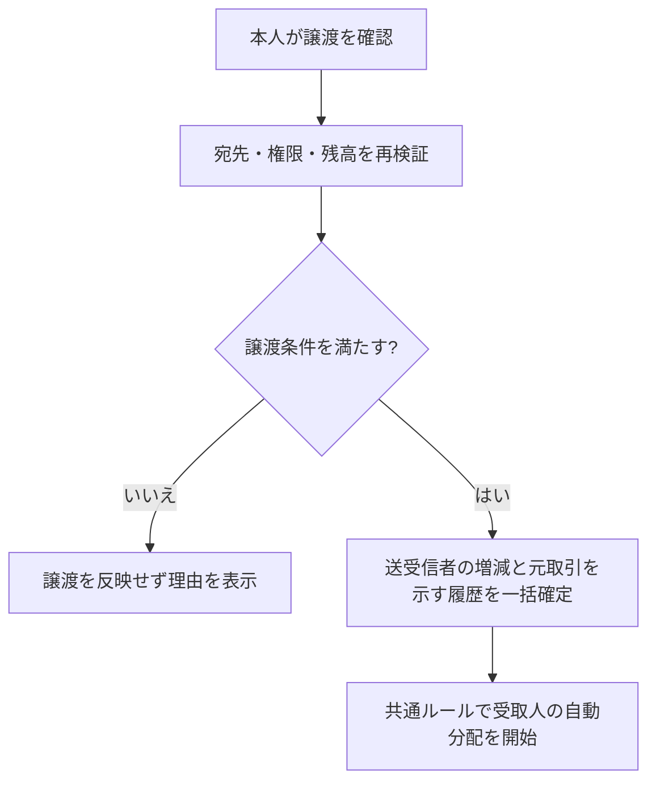

### 退会ボタン

- 退会の確認と確定
  - 本人は設定画面の「アプリ退会」から、削除する情報、保持する記録、連携の解除、管理者所属の解除を確認して退会する。
  - サーバーは`POST /api/account/close`で本人認証と現在の管理者所属を検証する。
  - 操作できる最後の`appAdmin`なら退会を拒否する。
    - 退会済み・ログイン停止中の`appAdmin`は残る管理者として数えない。
  - 確認画面に退会できない理由を表示し、操作できる別の`appAdmin`を先に追加するよう案内する。
  - 最後の`appAdmin`に該当するときは`409 ACCOUNT_CLOSE_LAST_ADMIN`を返し、情報を変更しない。
  - 評価軸・パッケージ・OAuthクライアントの管理者所属は、最後の1人でも退会者の分を解除する。
  - 状態変更、本人情報と設定の削除、連携と管理者所属の解除、本人認可の無効化を一括確定する。
    - 失敗した場合は全件を反映しない。

- 削除する本人情報と設定
  - 本人が登録した表示名を削除し、標準`user.name`を「仮ユーザー」へ戻す。
  - 説明と取得済みの外部アカウント情報など、本人のプロフィール情報を保存先から削除する。
  - 公開設定、公式パッケージの現在の登録と順序、自動分配の現在設定も削除する。
  - 本人の受信通知と既読情報を削除する。
  - 本人のAccounts用の標準Account行と、その拡張項目を削除する。
  - `user.pointsStatus`を退会済みの`CLOSED`にし、公開プロフィールとその公開応答を停止する。検索結果にも含めない。
  - 本人の全セッションと外部アプリへの認可を失効させてログアウトする。他のPointsアカウントのログイン状態は維持する。
  - Accounts側のそのPointsへの情報提供設定は維持する。情報提供も停止したい本人は、AccountsでPointsへの公開のチェックを外す。
  - 再連携後の情報取得と照合は、Accounts APIの現在の提供条件に従う。Pointsで確定済みの貢献とポイントの帰属は保持する。

- 保持する記録と識別情報
  - 残高、負の残高、累計評価額、評価入力、受領済み記録、取引記録、未受領中を含むポイント増減履歴、落札の引き落とし、過去の分配の訂正に必要な計算設定の版を保持する。
  - 負の残高でも退会できる。再開時には同じ残高を引き継ぐため、退会によって帳消しにはならない。
  - Google・GitHubの標準Account行と対応する標準User行、`user.pointsStatus`の`CLOSED`状態を保持する。ログイン用Accountと代用メールなどの認証情報は非公開とし、保存先と削除の制限は[OAuthログイン](#oauthログイン)に従う。
  - 代用メールと、退会時に戻した仮名・空画像は、本人識別に必要な認証対応とともに保持する。
  - 管理者が登録した評価の宛先識別情報・メモは、評価の確認と追加登録に必要な記録として、管理権限の範囲で保持する。
    - そのため、認証対応を扱う運営者や、評価入力の閲覧権限を持つ管理者には、退会後も本人を特定できる場合がある。
  - 証明画面では、経済履歴の対応に必要な不変のユーザーIDだけを示す。
  - 他の利用者の残高と取引記録、終了済みの精算は維持する。

- 外部アプリとMarketsへの影響
  - 退会する本人が外部アプリへ与えた認可を無効にする。退会後の新しい残高参照と引き落としは拒否する。
  - 退会者が管理していたOAuthクライアントと、他の利用者によるそのアプリへの認可は維持する。
  - PointsはMarketsの参加状況を照会せず、退会を個別に通知しない。

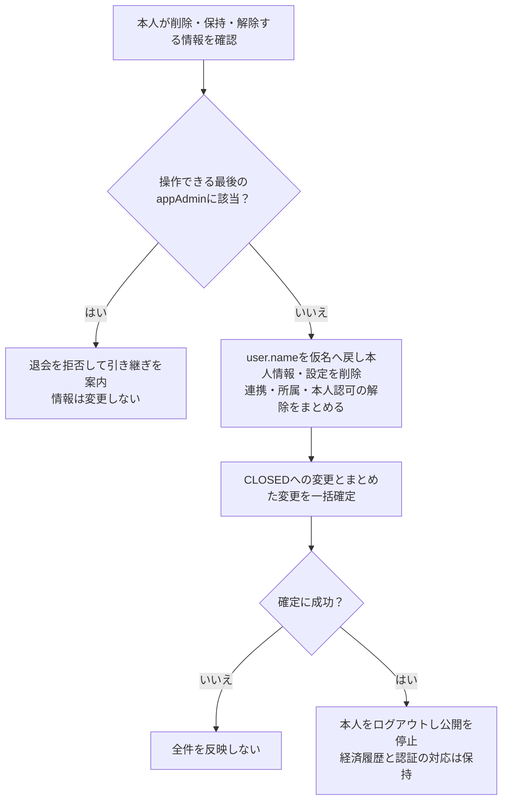

- 同じアカウントの再開
  - 同じGoogle・GitHubで再びログインしたときは、元のユーザーIDの通常のセッションを発行し、`/account/reopen`へ案内する。
  - 業務APIと、Better Authの`hooks.before`で`pointsStatus`を確認し、`CLOSED`の本人には再開に必要な操作だけを許す。
    - `hooks.before`の確認には標準の`/link-social`・`/unlink-account`・`/oauth2/authorize`なども含める。
  - 認証コールバックのGETでは再開しない。再開画面には、引き継ぐ残高と評価、プロフィールと設定の再登録、未受領分の受領手順を表示する。
  - 再開後は、設定画面の「未受領ポイントを受け取る」から受領できることを案内する。
  - 受取人が本人と確定している未処理分は本人認証だけで受領でき、外部宛先の受取人が未確定の分はAccountsへの再連携と照合で本人のものと確認する。
  - 本人の明示的な`POST /api/account/reopen`で、セッションの本人が`CLOSED`であることを検証する。
  - `user.pointsStatus`の`ACTIVE`への変更と固定情報の初期化を一括確定し、同じID・残高・累計評価額・取引記録を引き継ぐ。
  - 再開後もログイン中のセッションをそのまま使う。
  - 再開後の表示名は「仮ユーザー」、説明は空、プロフィール全体と各区画は非公開、自動分配は無効の初期状態とする。削除したプロフィールと設定は、本人が登録し直す。
  - 管理者所属は通常の追加操作で取得し直す。外部サービスとの連携と認可は、通常の認証・同意で取得し直す。

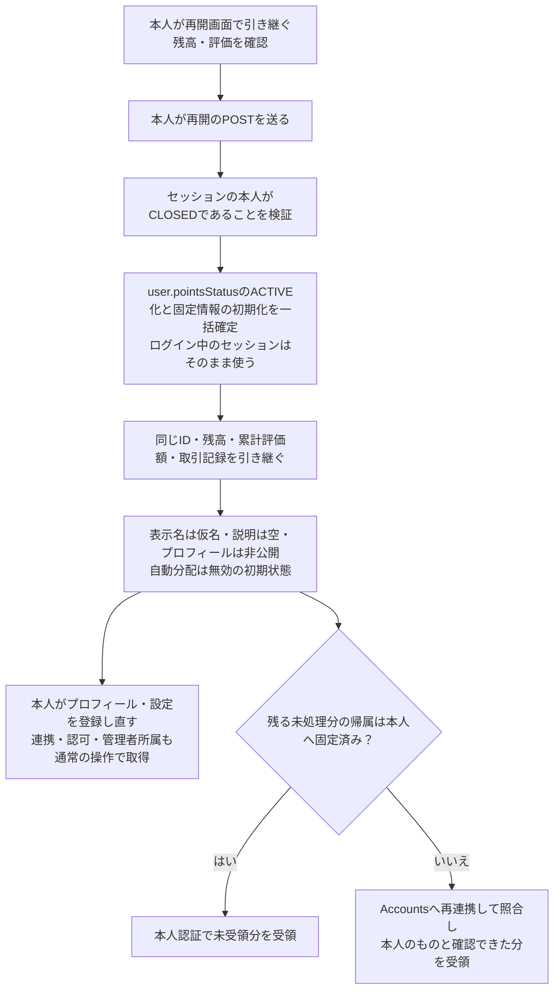

- 退会中の評価と未受領分
  - 本人への帰属が未確定の評価と分配額は、宛先の受領待ちとして保持する。
  - 退会中に本人へ反映した正負の増減も残高・累計評価額・履歴へ保持し、再開時に引き継ぐ。
  - 退会で削除した自動分配の現在設定は復元せず、退会後の新しい元取引では自動分配無効として扱う。
  - `CLOSED`の本人はAccounts連携や受領操作を行えない。
    - 未特定宛先の分は、再開後にAccountsへ再連携して照合し、受領する。
  - 受領済みの帰属は本人に固定し、同じ評価を二重に付与しない。
  - 元取引の訂正では、保持している受領済み記録とポイント増減履歴を使って、本人と分配先へ差額を反映する。
  - 再開時に負の残高がある場合や、受領によって残高が負になった場合も、再開状態を維持する。
    - その後の消費系操作は、各機能の残高条件で検証する。

### 公式パッケージの設定・自動分配

- パッケージ登録・並べ替えは、`PUT /api/profile/point-packages`へ順序付きの`pointPackageIds`配列全体を送る。
  - 本人の現在の登録を、同じD1原子処理で置き換える。
  - 存在しないID、重複ID、本人以外を対象にした要求を拒否する。
  - 新しく登録する非公開パッケージは、本人の編集権限を検証する。
  - 公開時から登録済みのパッケージは、非公開になっても保持できる。
  - 本人の自動分配設定の`version`で競合を検査する。

- 設定
  - 利用者は画面のフォームで、公式パッケージ、自動分配の有効・無効、分配する割合または固定額を設定する。
  - 保存時は本人の認証とサーバー側の検証を行い、計算に影響する変更では新しい版の追加も一括確定する。
  - 自分や他の利用者が作成したパッケージを、重複なく最大100件登録できる。登録した各パッケージへの配分割合を設定する。
  - 非公開パッケージも自動分配に使える。新規登録は、そのパッケージの編集権限がある本人に限る。公開時からの登録は、非公開への変更後も維持する。
  - 登録と構成割合は項目の利用状態にかかわらず保存できる。公開範囲の変更だけでは、登録済みの配分割合や自動分配を変更しない。
  - 公式パッケージの設定自体は任意。
  - 登録したパッケージの表示順を指定できる。公開プロフィールには、本人が公開を選んだ公開パッケージをその順に表示する。
  - 分配する割合は0％〜100％とする。固定額は0以上とする。
  - 初期状態は無効とする。パッケージを1件以上登録すると有効にでき、有効時は「自動分配を設定中」と表示する。
  - パッケージを登録解除すると、その配分割合も削除し、残った比率を合計100％へ正規化する。最後の1件を解除すると自動分配を無効にする。
  - 手動で送る場合は、既存のポイント譲渡機能を使う。

計算・再分配・訂正は[分配・再分配・訂正の共通ルール](#分配再分配訂正の共通ルール)にまとめる。

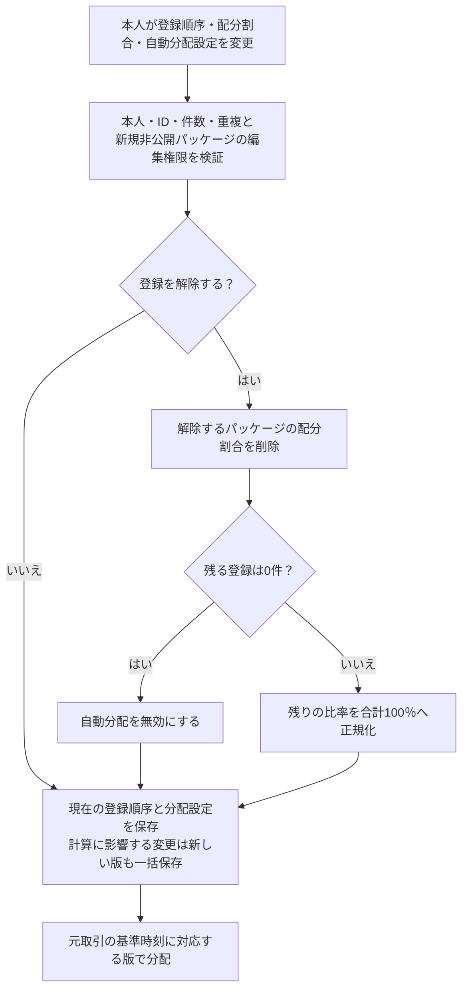

## 分配・再分配・訂正の共通ルール

直接評価・代用評価・譲渡・受領から始まる分配に、以下の計算と確定の規則を適用する。各機能の節では、開始条件、対象の選び方、操作本体の保存内容を定める。

本人への帰属が正式に確定した評価・分配・自動訂正の増減は、退会済みの`CLOSED`でも、その本人の残高と対象となる累計評価額へ反映する。本人への帰属が未確定の宛先は、受領待ちとして保持する。

### 分配方式

- 評価軸の作成者は、作成時に「本人の取り分から配る方式」または「追加発行して配る方式」を選ぶ。
  - 更新は、その評価軸の管理者が行う。
  - 自動分配は譲渡可否とは別に扱う。

- 本人の取り分から配る方式では、成立した分配で他の宛先へ配る額と、全員に配れず未配分になった枠を本人の残高から差し引く。
  - 成立した配分額だけを、帰属が確定した本人の残高または未確定宛先の受領待ちへ加える。
  - 分配元の累計評価額は減らさない。

- 追加発行して配る方式では、本人に受取額全額を残し、他の宛先への配分額を追加発行する。
  - 追加発行分は帰属が確定した本人の残高または未確定宛先の受領待ちへ加える。

- 評価付与を起点とする分配額は、本人へ反映する時点で、その受取人の残高と累計評価額へ加える。
  - 受領待ちへ保存した分は、受領まで本人の残高・累計評価額を変更しない。
  - 譲渡を起点とする場合は、全再分配先でも残高だけに反映する。

- 配るポイントの種類は受け取った種類のままとする。
  - パッケージ内の評価軸の累計評価額は、受取人と配分割合を決めるために使う。
  - 追加発行か取り分からの分配かは、受け取ったポイントの軸の設定に従う。

- 例えばAポイント100を受け取り、有効なパッケージ内のB軸の累計評価額で40を配る場合を示す。全対象へ配れるなら、A軸が追加発行方式の場合は本人にA100を残し、受取人へA40を新規発行する。
  - 同じ例でA軸が取り分方式なら、本人のA100から40を差し引き、受取人へA40を渡す。

- 例えば100ポイントを受け取り80％を分配する場合、取り分方式では本人に最低20を残して最大80を配り、追加発行方式では本人に100を残して最大80を追加発行する。

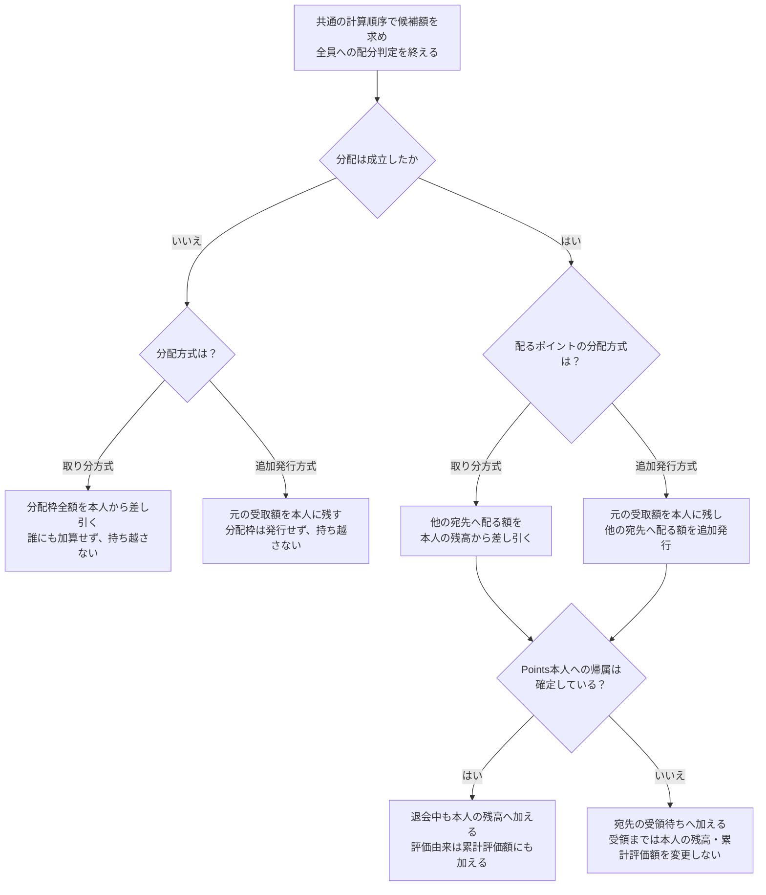

### 宛先と配分の重み

- Points本人への帰属が固定されるまでは、次の種類と識別情報の組を一つの宛先とする。
  - URL候補は、正規化した候補の組で区別する。
  - AccountsユーザーIDは、AccountsサービスのoriginとIDの組で区別する。
  - Provider固有IDは、Provider識別子と固有IDの組で区別する。
  - Providerユーザー名は、Provider識別子とサービス別規則で正規化したユーザー名の組で区別する。
  - URL候補の順番は同一宛先の判定に影響させず、候補の組全体へ一回だけ割り当てる。
  - 異なる宛先を同じ人物だと推測してまとめない。

- 同じ宛先・評価軸の評価を正負合算し、正の部分を配分の重みにする。
  - 採用中の直接評価・代用評価と、評価を起点とする分配の受取額を含める。
  - 未受領の元評価と分配待ち額も含め、合計が負なら計算上だけ0にする。
  - 各対象の確定済みの初回額と訂正差額の合計を、現在額として一度だけ使う。
  - 譲渡を起点とする分配待ち額は、残高へ渡す額として保持する。

- 本人への帰属を固定するまでは宛先別に計算し、受領で固定した分は、その本人の他の評価と正負合算する。
  - 同じ本人の重みは`max(本人の評価合計, 0)`とする。
  - 元の正・負の評価は保持し、本人へ移した額を宛先側と本人側へ重ねて数えない。

### 分配を始める時点

- 元取引の初回確定日時を分配の基準時刻として参照する。
  - この日時は元取引の初回履歴行の確定日時として、Unixミリ秒の整数で一か所に保持する。
  - 直接評価のアップロード日は、サーバーが評価の登録を確定した時点を指す。フォームからの登録も同じ扱いとする。
  - 評価を起点とする場合は元評価の初回登録時点、譲渡を起点とする場合は譲渡の確定時点を使う。新規の代用結果は、その結果自体の初回付与確定時点を使い、代用元の評価対象月や処理順の日時と区別する。
  - 未受領の元評価・分配待ち額の受領、全再分配、帰属統合による訂正でも、同じ元取引の基準時刻を引き継ぐ。

- 正の直接評価または代用評価では、今回の元付与額を累計評価額へ含めずに、最初の配分割合を計算する。受領で既に反映済みの場合も、今回の元付与額を計算上だけ除く。
  - 元の付与額は本人の残高と累計評価額へ全額反映し、その後に分配する。

- 譲渡の受取時も本人設定で分配を開始する。
  - 譲渡自体は累計評価額を変更せず、その時点の累計評価額から配分割合を計算する。
    - 利用者同士で譲渡を繰り返し、他の自動分配で取り分を増やすことを防ぐためである。
  - 分配の評価対象月はUTCの譲渡確定月とし、全再分配先の記録へ引き継ぐ。

- 新規登録する評価結果の額が0または負なら、その額を本人へ反映する。
- 未受領の元評価と分配待ち額は、受領後に元取引の基準時刻の設定で分配する。
- 新たな配分額は0以上とする。元の負の評価は本人に保持し、過払いの取消による負の訂正差額は反映する。

- 追加した直接評価は、新しい元取引として扱う。追加前の元取引と、その取引から確定した分配は保持する。
  - 新規評価は登録後の分配の重みに含める。帰属統合による過去の再計算にも、その分配時点より後に登録した評価は含めない。
  - 例えば取り分方式で＋100から30を分配済みなら、本人70・分配先30となる。その後に独立した−50の評価を追加すると、本人20・分配先30となる。
  - 帰属統合や代用評価の再計算による結果の調整は、以下の連鎖訂正として処理する。

### 設定履歴と子パッケージの版管理

- 計算設定は、初期版と、分配額・分配先に影響する変更時の版を不変の履歴として保存する。
  - 本人設定、各パッケージの直接構成、配るポイントと計算元の評価軸の計算条件を、それぞれ版管理する。
  - 現在の計算条件は対象ごとに適用開始時刻が最新の版から取得し、過去分の計算条件は基準時刻から版を選ぶ。
  - 名前・説明・公開範囲・表示順など、計算条件以外の情報は業務テーブルに保存する。
  - 退会や全登録解除で現在設定を削除・無効化するときも、その時点からの自動分配無効を表す版を一括保存する。
  - 同じ計算設定の再保存と、名前・説明・公開範囲・表示順だけの変更では、計算設定の版を追加しない。

| 設定の単位         | 版へ保存する計算条件                                                         |
| ------------------ | ---------------------------------------------------------------------------- |
| 本人の自動分配設定 | 分配する割合または固定額、登録パッケージIDと配分割合、自動分配の有効・無効   |
| 各パッケージ       | 評価軸・子パッケージの種類とID、正規化した構成割合、パッケージの利用状態     |
| 評価軸             | 配るポイントとして使う分配方式・最小単位、計算元として使うかを決める利用状態 |

- 自動分配の有効・無効、パッケージと計算元の評価軸の利用状態は配分結果を変えるため、対応する計算設定の版に含める。
  - 評価軸の停止・再開でも、状態の変更と同じ原子処理で、適用開始時刻を持つ新しい版を追加する。

- 各版の適用開始時刻もUnixミリ秒の整数で保存する。
  - 本人設定・各パッケージ・評価軸ごとに、適用開始時刻が基準時刻以下の版から、適用開始時刻が最も新しい版を選ぶ。
  - 基準時刻と適用開始時刻が等しい版も対象に含め、基準時刻より後の版は対象外とする。
  - 同一ミリ秒内は同じ時点として扱う。
  - 本人設定がまだ存在しなかった時点には、初期値の自動分配無効を使う。
  - 当初は未受領の状態だったため配分0だった人や計算経路に現れなかった人も、帰属統合後には当時の本人設定を参照できるようにする。
    - 受領前に本人が分からず、再計算の段階では受領済みのDさんの例
      - 9月1日：Dさんの再分配設定は50％。本人不明の宛先へ10ポイントを配分し、受領待ちにする。
      - 9月10日：Dさんが再分配設定を20％へ変更する。
      - 10月19日：Dさんが受領し、その宛先がDさんのものと確定する。再分配には、元の9月1日の50％を使う。
    - 受領前にも宛先への10ポイントの配分は存在するが、Dさん本人の設定による再分配はまだ行っていない。
    - 遅延受領に加え、帰属統合による再計算で初めて受取額が生じる人も、この扱いに含む。
  - 操作者の権限、現在の連携、受領資格は、操作を確定する時点で検証する。

- 親パッケージの版は、子パッケージをIDで参照する。
  - 子の割合を変更した場合は、その子の新しい版だけを保存し、親や本人の設定履歴は増やさない。
  - 新規分配では基準時刻で有効な構成を使い、過去分の訂正では元の基準時刻の構成を使う。
  - 子・孫まで、全階層を同じ基準時刻で展開する。

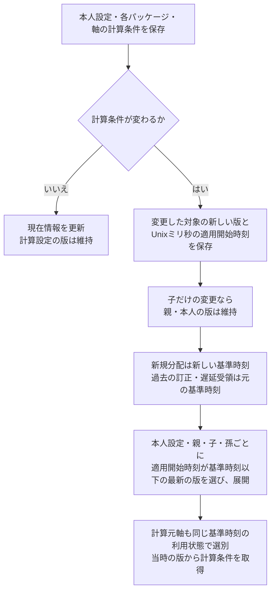

- 本人が親Pへ100％、Pが子Qへ100％を配分する例を示す。日時は2026年のUTCとし、Q以外の設定は変えない。

| UTC日時              |    Unixミリ秒 | 操作・処理                                                        | 使うQの構成割合                  |
| -------------------- | ------------: | ----------------------------------------------------------------- | -------------------------------- |
| 9月1日 09:00:00.000  | 1788253200000 | QのX50％・Y50％の版を保存し、適用開始時刻を記録                   | この時刻からX50％・Y50％         |
| 9月1日 09:00:00.125  | 1788253200125 | この値を基準時刻にして分配                                        | X50％・Y50％                     |
| 9月10日 09:00:00.000 | 1789030800000 | QをX20％・Y80％へ変更し、Qの版を追加                              | 変更後の新規分配からX20％・Y80％ |
| 9月15日 09:00:00.000 | 1789462800000 | 本人設定とPを変えず、この値を基準時刻に新しい分配を実行           | X20％・Y80％                     |
| 9月20日 09:00:00.000 | 1789894800000 | 帰属統合で9月1日分を訂正し、保存済みの基準時刻1788253200125を使う | 当時のX50％・Y50％               |

9月1日分では、適用開始時刻1788253200000の版が基準時刻1788253200125以下の最新となる。9月10日の版は基準時刻より後なので含めず、帰属統合後もX50％・Y50％で計算する。

- 過去分の訂正に必要な版は経済記録として保持し、退会や現在設定の登録解除でも保持する。
  - 24時間で期限切れになる`idempotency_results`とは別に保持する。

### 配分の計算順序

- 受取額と設定した割合・固定額から、分配する総額を求める。固定額は各段階の実際の受取額を上限にする。
- 登録パッケージ間の配分割合と、子パッケージまで辿った構成割合を掛け合わせる。計算には保存された元の割合を使う。
- 停止中の登録パッケージは全構成を除外し、停止中の子パッケージはその子を通る経路を除外する。
- 元取引の基準時刻で停止中の評価軸は、自動分配・再分配の計算元から全経路で除外する。
  - 配るポイントの評価軸が停止中でも、有効な別の計算元を使ってその種類のポイントを配れる。
- 宛先と配分の重みを求め、正の重み合計が0の評価軸を全経路から除外する。合算対象がない場合や、全員の累計評価額が0以下の場合も同じ扱いとする。分配元本人・未登録・未連携・退会中の宛先も重みに含める。
- 有効な計算元で別人のAさんが＋100、Bさんが−200なら、正の重み合計は100となる。軸全体の正負合計が−100でも、この軸を計算に使う。
- 残った経路の割合を同じ評価軸ごとに合算し、全体の合計を100％へ正規化する。途中のパッケージごとには比率を変更しない。
- 総額を正規化後の評価軸別割合で分け、各軸では、正の重み合計を分母、各本人・宛先の重みを分子として割り当てる。
  - パッケージごとの途中金額には丸めない。
  - 端数処理・本人別の合算・全員への配分判定は、[合算単位と端数](#合算単位と端数)の順序で行う。
- 例えば評価軸への配分額が30、Bさんの累計が60、Cさんが40なら、Bさんへ18、Cさんへ12を割り当てる。
- 各段階では、元取引の基準時刻の設定・パッケージ構成と、その論理的な計算位置までの累計評価額を使う。
  - 評価付与を起点とする分配の受取額は、方式にかかわらず後の段階の累計評価額へ反映する。
  - 譲渡を起点とする分配の受取額は、後の段階でも累計評価額に含めない。

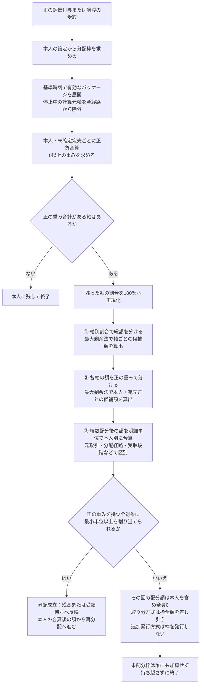

### 本人分と分配しない額

- 分配が成立した場合は、本人自身に割り当てた額を本人に残す。
- 成立した分配で本人への帰属が未確定の宛先へ割り当てた額は、受領待ちとして発行・確保する。
- 計算に使える軸や正の重みがなく分配を開始しない場合は、取り分方式では予定した額を本人に残す。
  - 追加発行方式では元の受取額を本人に残し、これらの額は発行しない。
- 評価軸・パッケージの停止・再開や重みの変化は、その後に始まる新規分配へ反映する。
  - 過去の取引への影響は、帰属統合や代用評価の再計算による連鎖訂正のみで計算し直す。

### 計算元を除外する場合の例

- Zポイント30を配る設定で、パッケージPの構成をX軸60％・Y軸40％とする。
- 表で正の評価がないと示した場合を除き、各軸には本人以外の宛先に正の累計評価額があるものとする。
- 配分額を示す行では、端数処理・本人別合算後に全対象へ最小単位以上を割り当てられるものとする。
- X軸に正の累計評価額を持つ本人・宛先がいない場合は、Y軸の比率を40％から100％へ計算し直し、Z30すべてをY軸の評価額に応じて配る。
- 次の表は、各軸を計算元として宛先へ配るZポイントの合計を示す。

| 計算元の状態                          | X軸の評価額で配るZ | Y軸の評価額で配るZ | 取り分方式で本人に残す額 | 追加発行する額 |
| ------------------------------------- | -----------------: | -----------------: | -----------------------: | -------------: |
| P・X・Yが有効                         |                 18 |                 12 |                        0 |             30 |
| P・Yが有効、Xが停止中                 |                  0 |                 30 |                        0 |             30 |
| P・Xが有効、Yが停止中                 |                 30 |                  0 |                        0 |             30 |
| Pが有効、X・Yとも停止中               |                  0 |                  0 |                       30 |              0 |
| P・X・Yが有効、配るZが停止中          |                 18 |                 12 |                        0 |             30 |
| P・X・Yが有効、Xに正の評価がない      |                  0 |                 30 |                        0 |             30 |
| P・X・Yが有効、X・Yとも正の評価がない |                  0 |                  0 |                       30 |              0 |
| Pが停止中、他に登録パッケージがない   |                  0 |                  0 |                       30 |              0 |

- 表の本人に残す額は、分配予定のZ30のうちの額とする。元の受取額全体とは区別する。
- 子パッケージを使う場合も同じ順序で計算する。Pが「X軸1・子Q3」、Qが「X軸1・Y軸1」で、Qだけが停止中なら、Qを通る経路を除外し、P直下のXを100％として使う。

### 正の重み合計が0の場合の例

- パッケージは評価軸Xだけで構成する。
- Y残高が0のAさんにY100を評価として付与し、その30％のY30を分配する場合を示す。
- Xの評価が次のいずれかの状態なら、分配用の重みの合計は0となる。

| 評価軸Xの状態              | 累計評価額の例              | 分配用の重みの合計 |
| -------------------------- | --------------------------- | -----------------: |
| 作成したばかりで評価がない | 評価入力0件                 |                  0 |
| 全員の累計評価額が0        | Aさん0、Bさん0、Cさん0      |                  0 |
| 全員の累計評価額が負       | Aさん−5、Bさん−20、Cさん−10 |                  0 |

- この場合、X軸を除外すると他に計算元が残らないため、予定したY30は分配せず、両方式ともAさんのY残高は100となる。
- 他の宛先への加算も、受領待ちの保存も行わない。
- 人物未特定・未登録・未連携でも、正の評価合計がある宛先には配分できる。その場合は受領待ちとして保存する。

### 合算単位と端数

- 再分配用の計算明細は、元取引・分配経路・受取段階・受取人・配るポイントの評価軸・対象月・累計評価額への反映区分で区別する。
  - 分配経路は、元取引から再分配で通過した受取人の並びで区別する。
  - 同じ明細単位の同じ本人への割当を、一つの再分配入力にまとめる。
  - 本人不明の間は宛先ごとに扱い、帰属統合後は本人単位で計算し直す。
  - 元取引や経路が異なる受取額は個別に再分配する。受領操作や残高表示で合算しても、計算明細は区別する。
  - 同じ段階の5と5を合算し、最小単位1で10％の分配枠を求める場合は1、別経路の5と5なら各経路の分配枠は0と0になる。
  - 本人が最初から分かっている場合も、後から判明する場合も同じ単位を使う。

- 端数処理と合算は、次の順序で行う。
  1. 正規化後の計算元の評価軸別割合で分配総額を分け、各軸への額を確定する。
  2. 各軸への額を、その軸の正の重みに応じて本人・宛先へ分ける。
  3. 各軸で端数を配り終えた候補額を、前述の明細単位で本人別に合算する。
- 1と2では、配るポイントの最小単位へ切り捨てた後、最大剰余法で余った額を端数の大きい順に最小単位ずつ追加する。
  - 同じ端数なら、軸間では計算元の評価軸ID、軸内では受取先の識別子の昇順で決める。
- 受取先は、帰属がPoints本人へ固定済みならユーザーID、それ以外は[宛先と配分の重み](#宛先と配分の重み)に記載する宛先の組で区別する。
- 種類はPoints本人、Accountsユーザー宛て、URL候補宛て、Provider固有ID宛て、Providerユーザー名宛ての順とする。
- 同じ種類では識別子を昇順に比較し、組は要素ごとに比較する。
- ユーザー名はサービス別規則で正規化した値を使い、確認と確定で同じ順序を使う。
- 帰属統合後は最終的なユーザーIDで同順位を判定し、端数差も訂正する。
- 本人分と待ち額への割当も端数の配分に含め、その後に残高・待ち額への反映を計算する。
- 分配総額の割合計算で最小単位未満になった端数は、取り分方式では本人に残し、追加発行方式では発行しない。整数の最小単位数で計算し、金額の精度を維持する。
  - 本人の固定分配額設定はそのまま保持し、実際の分配枠は、受取額と設定額の小さい方を、配る軸の採用単位へ切り下げる。受取額12・固定額10・単位3なら枠は9とし、同じ受取額・固定額でも当時の単位1の過去取引では枠10を使う。
  - 単位0.05で1.05の30％を配る場合は、計算額0.315から分配枠0.30を求め、取り分方式で本人に残る額は0.75となる。

- 分配枠を配る前に、正の重みを持つ全対象へ最小単位以上を割り当てられるか判定する。
  - この判定で使う分配枠は、割合計算による最小単位未満の端数を除いた額とする。
  - 全員に割り当てられる場合は分配を成立させ、各本人への確定額から再分配を計算する。
  - 対象は、計算に残ったいずれかの評価軸で正の重みを持つ本人・宛先とし、同じ本人・宛先は重複を除く。分配元本人も含め、丸めで候補額が0になった対象も除かない。
  - 軸間と各軸内の端数処理を終え、同じ計算明細の同じ本人への候補額を合算してから判定する。対象人数と分配枠の比較だけでは判定しない。
  - 本人不明・未登録・未連携でも、受領待ちへ割り当てられる場合は、配分できる対象として扱う。

- 一人でも合算後の候補額が最小単位未満なら、その回の分配は不成立とし、本人への割当も含めた全員の配分額を0にする。
  - 取り分方式では、本人への候補額を含む分配枠全額を分配元の残高から差し引く。追加発行方式では元の受取額を本人に残し、分配枠を発行しない。
  - 未配分枠は誰の残高・受領待ちにも加えず、後日へ持ち越さない。未配分を理由とする再試行も行わない。
  - 分配の不成立は処理失敗として扱わず、元の評価・譲渡・受領と分配以外の取り分は確定する。
  - 自動分配を開始しない条件と、循環による終了条件は、それぞれの規則を適用する。

- 元の受取額が100、分配枠が30で全員に配れない場合は、次の結果になる。本人の累計評価額は、分配元の引き落としでは減らさない。

  | 分配方式     | 本人に残る額 | 他の対象への配分額 | 誰にも計上しない分配枠 |
  | ------------ | -----------: | -----------------: | ---------------------: |
  | 取り分方式   |           70 |                  0 |                     30 |
  | 追加発行方式 |          100 |                  0 |           30（未発行） |

- 複数の計算元軸に同じ本人がいる例
  - 同じ種類のYポイント2を、計算元X・Zへ50％ずつ配分する。
  - XではBさん・Cさん、ZではBさん・Dさんが、それぞれ同じ正の重みを持つ。
  - 関係する軸とパッケージは有効、Yの最小単位は1、ユーザーIDの昇順はBさん・Cさん・Dさんとする。
  - B・C・Dさんの再分配は無効とする。
  - X・Zへの額を1ずつ計算し、各軸内の端数をID順で配った候補額と、全員への配分判定後の確定額は次のようになる。

  | 受取人 | XからのY候補額 | ZからのY候補額 | 合算後のY候補額 | 確定するY配分額 |
  | ------ | -------------: | -------------: | --------------: | --------------: |
  | Bさん  |              1 |              1 |               2 |               0 |
  | Cさん  |              0 |              0 |               0 |               0 |
  | Dさん  |              0 |              0 |               0 |               0 |
  - C・Dさんの候補額が最小単位未満のため、Bさんへの配分も0とし、Y2は誰にも計上しない。
  - 同じ条件で分配枠がY4なら、候補額はBさん2・Cさん1・Dさん1となり、全員に最小単位以上を配れるため、この額で分配する。

### 再分配と循環

- 受取人が自動分配を有効にしている場合は、受取額を基に再分配する。
  - 方式は、受け取ったポイントの評価軸の設定に従う。
  - 全員への配分判定は、各受取人が行う一回の再分配ごとに適用する。後続の再分配が不成立でも、成立済みの前段階の配分は取り消さない。
- 同じ段階の全受取先への反映を終えてから次の段階へ進む。
  - 各段階は端数計算と同じ受取先の識別子順とし、同じ人への別経路は経路上の利用者IDの並び順で処理する。
- 各段階の分配額は受取額以内とする。
- 自動分配が無効、受取額が最小単位以下、または再分配額が最小単位未満の場合は、受取人に残して終了する。
- 同じ経路で同じ人に戻った場合、直前にその人を通過してから今回まで追加発行がなく、端数処理後の受取額が前回より小さければ、再分配を続ける。
- 区間内に追加発行がある場合、または受取額が減っていない場合は、戻った額をその人に残して終了する。
- 本人不明の宛先では受領待ちの額と親となる履歴への参照を保存する。受領や帰属統合後の訂正では、当時の設定と履歴の参照から経路を再現し、統合後の本人で自己宛てと循環を判定する。

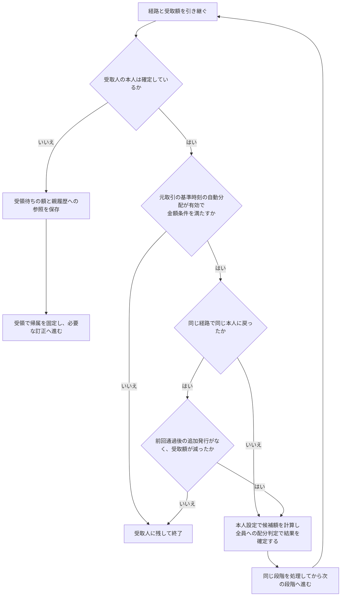

### 配分と受領待ちの計算例

- 評価軸Xの貢献から配分割合を計算し、Yポイントを配る例を示す。
  - パッケージはXだけで構成し、Yの最小単位は1ポイントとする。
  - パッケージとX・Y軸は有効とする。
  - AさんがY100を評価として受け取り、30％を分配する。
  - B・Cの受取後の再分配は、この例では無効とする。

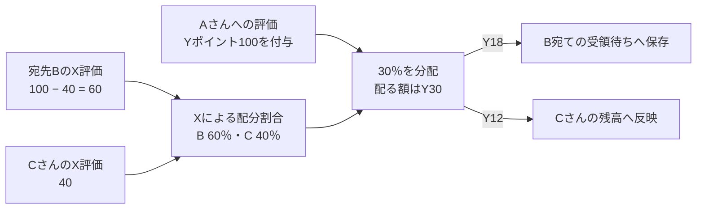

| 評価の宛先 | Xの評価入力 | 配分計算に使う合計 | 状態         |
| ---------- | ----------: | -----------------: | ------------ |
| 宛先B      |  ＋100、−40 |                 60 | 人物未特定   |
| Cさん      |        ＋40 |                 40 | Points利用中 |
| Aさん      |           0 |                  0 | Points利用中 |

- 計算に使う評価軸はX、配るポイントの種類はYである。
  - Y30をXの評価60対40で分けるため、B宛てにY18、CさんにY12を割り当てる。
  - Bの待ち額Y18は、Yを使う将来の配分計算へ含める。
  - Xの評価60に足すものではない。

Y残高が全員0の状態から、同じ配分を二つの方式で行うと次のようになる。

| 分配確定後のYポイント | 取り分方式 | 追加発行方式 |
| --------------------- | ---------: | -----------: |
| Aさんの残高           |         70 |          100 |
| B宛ての受領待ち       |         18 |           18 |
| Cさんの残高           |         12 |           12 |
| 残高と待ち額の合計    |    **100** |      **130** |

- 取り分方式は、待ち額を含むY30をAさんから差し引く。
- 追加発行方式は、待ち額を含むY30を新しく発行する。
- AさんのY累計評価額は、どちらの方式でも元の評価100とする。
- BのY18は、本人の残高へまだ反映していない発行・確保済みの額とする。

### 帰属統合と連鎖訂正

#### 帰属統合と訂正対象

- 受領などで本人への帰属を正式に固定したとき、Pointsサーバーは同じ本人の正・負の評価をまとめ、訂正対象を登録する。
  - 同じ評価を材料にした過去の分配が複数あれば、それぞれの元取引を対象とする。
  - 各元取引の分配時点に存在していた評価だけをまとめ、分配する元になった評価の初回登録時点から、その取引の全再分配を計算し直す。
  - 代用評価の再計算や月別評価方式の切替で採用結果が変わった場合も、旧付与・旧分配・旧追加発行からの差額を反映する。

分配枠30、Bさんの別宛先に＋100と−100、Cさんに＋100がある場合を示す。受取後の再分配は無効とする。

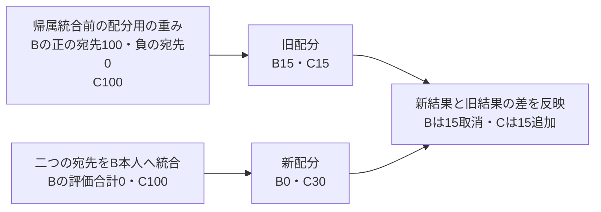

元の負の評価は保持する。Bの新しい配分結果は0であり、−15は旧配分の取消差額として記録する。

帰属統合までに設定を変更した場合を、時系列で示す。取り分方式、Yの最小単位1、B・Cさんの再分配は無効とする。

| 日時     | 登録・操作                                                    | その時点の結果                                |
| -------- | ------------------------------------------------------------- | --------------------------------------------- |
| 8月29日  | CさんへX＋100を登録                                           | Cさんの重み100                                |
| 8月30日  | 本人不明のユーザー名宛てにX−100、別の固有ID宛てにX＋200を登録 | 別宛先として重み0と200                        |
| 9月1日   | AさんへY100を登録し、30％を分配                               | A70・正の宛先20・C10                          |
| 9月10日  | Aさんの分配割合を50％へ変更し、別のY120を登録                 | A60・正の宛先40・C20                          |
| 10月19日 | 二つの宛先をBさん本人へ統合                                   | BのX合計100・C100として、過去の各元取引を訂正 |

| 元取引                  | 帰属統合前              | 当時の設定による新結果 | 訂正差額    |
| ----------------------- | ----------------------- | ---------------------- | ----------- |
| 9月1日のY100・30％分配  | A70・Bの正の宛先20・C10 | A70・B15・C15          | B−5・C＋5   |
| 9月10日のY120・50％分配 | A60・Bの正の宛先40・C20 | A60・B30・C30          | B−10・C＋10 |

Bの未受領分は帰属固定・受領と重複しないように差額を反映する。合計ではBの旧額60を45へ減らし、Cの旧額30を45へ増やす。X＋200が8月30日には存在せず、10月19日に初めて新規登録された場合は、9月1日・9月10日の重みへ加えない。

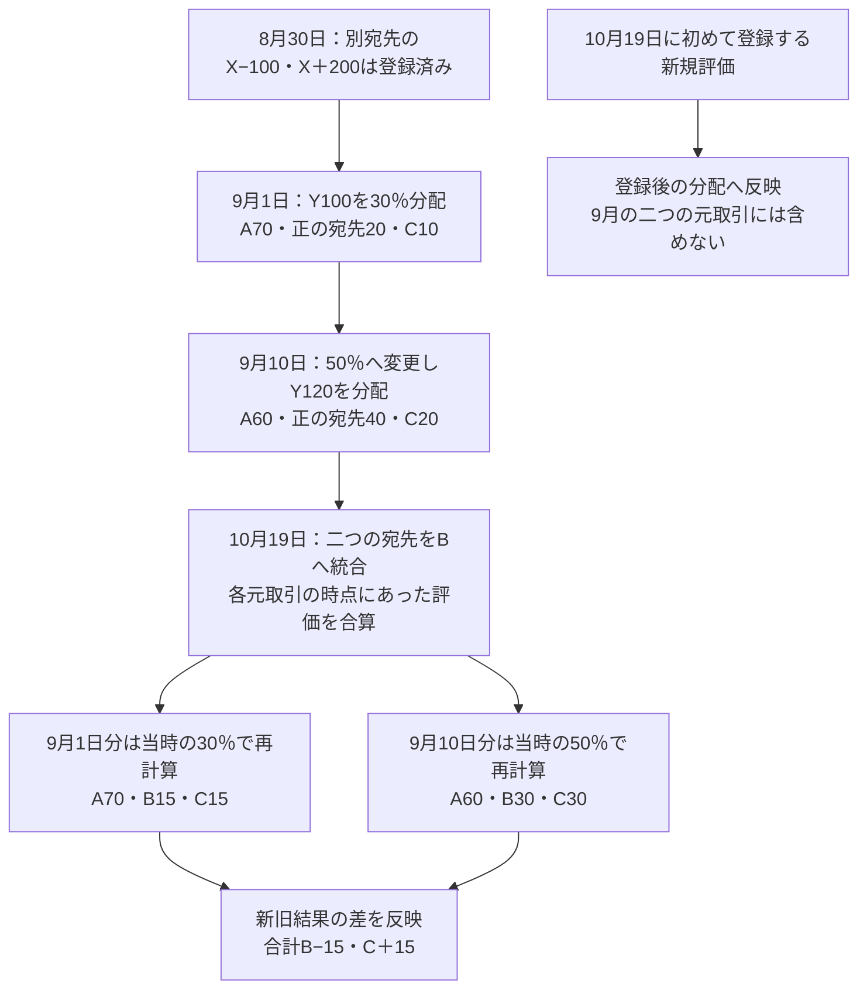

#### 元の分配時点の条件での再計算

- 訂正には、元取引の基準時刻から取得した本人設定・パッケージ構成・分配方式・最小単位を使う。
  - 同じ訂正結果を分割確定するときは、同じ訂正契機と入力を参照して新結果を再計算し、既存の確定履歴との対応から未確定分を続ける。別の帰属統合や月別設定変更による入力を途中へ混ぜず、入力順に進める。
  - 元取引の入力・対象月・取引間と取引内の論理的な計算順を保持する。
  - 評価材料は、その基準時刻までに登録済みで参照範囲に属する元評価の採用額と、その計算位置までの訂正後の分配受取額を使う。元評価の登録順と取引内の計算順を保ち、後から登録した評価、後続取引の旧結果、同じ取引内の未到達段階の結果は先行する計算へ含めない。
    - 例えば、次の順序で評価の登録・分配・帰属統合が行われた場合を示す。
      - 8月30日：X軸の評価を登録する。
      - 9月1日：X軸の評価をもとに、Yポイントを分配する。
      - 9月10日：受け取ったYポイントの評価額をもとに、Zポイントを分配する。
      - 10月19日：帰属統合により、過去の分配を訂正する。
    - この例では、次の順序で再計算する。
      1. 9月1日のY分配を、その時点までに登録され、その分配の参照条件で採用される評価で計算し直す。
      2. 訂正後のY受取額を使い、9月10日のZ分配を計算し直す。Y受取額が10から6へ変わった場合は、訂正後の6を材料にする。
      3. 9月1日の計算には、9月10日のZ分配の旧結果や、10月19日に新規登録した評価を含めない。
    - 同じ取引内の再分配も、AさんからBさん、BさんからCさんの順なら、Bさんの計算には、これから計算するCさんの受取結果を含めない。
    - 参照範囲に属する元評価の採用額は、その取引が参照する評価軸などの条件に合い、評価方式に従って採用される額を指す。
  - 帰属統合後の本人が最初から分かっていたものとして、本人別の合算・端数・全員への配分判定・自己宛て・循環を計算し直す。

- 訂正対象の旧付与・旧分配・旧追加発行・旧待ち額・未配分枠の旧引き落とし・受領後の再分配を計算上取り除き、新しい結果全体を求める。
  - 旧結果は、その訂正を始める前までの確定済み初回額と訂正差額の合計から取得し、新結果を当時の設定で計算する。
  - 分配の成立・不成立が変わった場合も、分配元の引き落としを含む新旧結果の差額を反映する。
  - 新しい計算元にいる人と旧結果にいる人の両方を比較し、新結果に存在しない旧対象は新結果0として扱う。
  - 旧履歴を物理的に削除せず、新旧結果の差額を本人・評価軸・対象月・累計評価額への反映区分ごとに記録する。
  - 未受領分は差額を履歴へ追加して現在額へ含め、受領済み分は履歴の追加とともに確定本人の残高・累計評価額へ差額を反映する。
  - 帰属の変更で自己宛てと分かった追加発行と、その先の再分配も訂正する。
  - 再計算で旧結果が対象外となった場合は、新結果を0として差額を反映する。差額によって残高が負になっても反映する。

前述の「分配枠30、Bの別宛先＋100・−100、C＋100」の例で、取り分方式によりBさんがDさんへ固定10、CさんがEさんへ固定10を再分配していた場合は、次のように訂正する。DさんとEさんの再分配は無効とする。

訂正前はBさん・Cさんが15ずつ受け取り、そのうち固定10をそれぞれDさん・Eさんへ再分配する。再分配額の上限は各人の受取額15なので、10を再分配でき、Bさん・Cさん本人には5ずつ残る。

| 最終的な保有者 | 旧結果 | 新結果 | 訂正差額 |
| -------------- | -----: | -----: | -------: |
| Bさん          |      5 |      0 |       −5 |
| Dさん          |     10 |      0 |      −10 |
| Cさん          |      5 |     20 |     ＋15 |
| Eさん          |     10 |     10 |        0 |

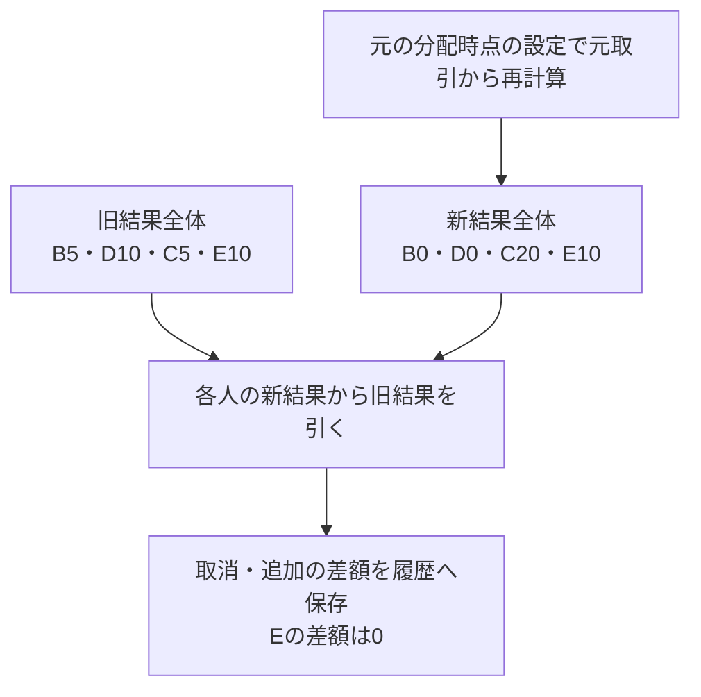

訂正差額は新しい受取額として再分配せず、確定履歴から取得した旧結果と再計算した新結果を比較する。Cさんへの増額15だけを再分配するとEさんへ余計な10を配るため、元取引の新結果全体を計算する。

#### 後続取引への訂正

- 評価を起点とする分配・再分配の受取額は、訂正後も後続の重みに含める。
  - 受取額を材料にした代用評価、その代用評価を使った分配も訂正対象に含める。
  - 先行取引の訂正が完了してから、その訂正後の結果を使って後続取引を計算する。
  - 影響を受けない元取引の確定結果は保持する。

```mermaid
flowchart TD
    I["本人への帰属を統合"] --> T1["X評価を材料にした各元取引を訂正<br/>例 T1のY配分 B15・C15からB0・C30へ"]
    T1 --> T2["Y評価を材料にした後続取引T2<br/>Zの配分と全再分配を訂正"]
    T1 --> P["Y受取額を材料にした代用評価を訂正"]
    P --> T3["代用評価を材料にした後続取引を訂正"]
    T2 --> E["依存する全取引の訂正完了"]
    T3 --> E
```

- 依存先の探索では、各元取引の当時の設定と入力から、参照する元評価・先行取引・評価軸・対象範囲・論理的な参照位置を求める。
  - 当初0件・重み0だった人や、正の重みがなく除外した軸、全員への配分判定で不成立になった計算も、当時の条件から再び検討する。実際に受取額が生じた人だけから依存先を探さない。
  - 訂正で生じた新しい経路や、各元取引の基準時刻の版で展開したパッケージの参照先も確認し、対象取引を追加する。
  - 後日の受領で生じた再分配は、元取引内の対応する計算位置へ組み込み、その位置以後の影響を再計算する。
  - 訂正途中の新旧結果を混ぜて計算せず、未完了の範囲を使う新規分配は待機させる。

同じ登録時点の評価材料と、各元取引の基準時刻の本人設定・パッケージ構成・計算規則なら、本人が最初から分かっていた場合と、帰属統合後に依存する全取引を訂正した場合の最終額を一致させる。訂正途中の残高や受領時期は区別し、実行結果には未完了の分を示す。

### 分割確定と再開

- 操作本体の設定変更・一次増減・受領と、後続の分配・訂正は確定単位を分ける。
  - 各機能で定める開始条件を検証して操作本体を確定し、元取引・訂正契機の入力への参照と当時の設定から後続処理を導く。
  - 受領本体では、初回履歴行への帰属固定・受領と本人への金額反映を一括確定する。後続処理はその受領済み履歴から導く。

- 全員への配分判定は、一回の分配の全候補について、残高・待ち額への個別反映と確定処理の分割より前に終える。

- 一回の分配・訂正の確定処理は最大1,000受取段階とする。
  - 一つの元取引が上限を超える場合も、元取引や経路を保ったまま分割する。
  - 各段階の増減に必要な分配元・受取人の履歴を同じ回へ含め、増減・結果通知・0を含む計算結果を一つのD1原子処理で保存する。
  - CSVの1,000行、パッケージの1,000構成行とは別に数える。
  - 待ち額への割当も一つの受取段階として数える。既存履歴を本人へ紐づけるだけの処理は、新しい分配として数えない。
  - Workerの時間・DB呼び出し・書き込みの上限に達する前に区切る。保存済みの入力・確定履歴と、基準時刻から選ぶ設定から残る段階を判定し、次の処理へ進める。

```mermaid
flowchart TD
    P["元取引・訂正入力と当時の設定から新結果を計算<br/>旧結果は訂正前の確定履歴から取得"] --> B["入力と0を含む確定履歴から未処理を判定<br/>次の最大1,000受取段階を選ぶ"]
    B --> V["現在の保存条件を検証"]
    V --> C{"確定段階を区別する参照と<br/>0を含む増減履歴を一括保存できた？"}
    C -->|"いいえ"|F["その回だけ未確定<br/>確定済みの分を保持"]
    F --> R["保存済みの入力・確定履歴を読み直して再開"]
    R --> P
    C -->|"はい"|M{"この元取引に残りがある？"}
    M -->|"はい"|P
    M -->|"いいえ"|D{"依存する後続取引がある？"}
    D -->|"はい"|N["先行取引の完了結果で<br/>次の元取引を計算"]
    N --> P
    D -->|"いいえ"|E["全体の訂正完了"]
```

- 失敗した回だけを未反映にし、確定済みの操作本体・帰属・受領・分配・訂正を保持する。
  - 金額やDB条件の検証に失敗した回を取り消し、その回に依存する後続処理も未完了のまま保持する。
  - 例えばXの受領に伴うYの過去配分の訂正で保存に失敗しても、Xの受領と確定済みの増減は保持し、Yの未完了位置から再実行する。
  - 再送や再実行では、保存済みの入力と当時の設定から処理順・経路を再現し、0を含む確定履歴と照合して未完了の段階から再開する。

### 分配結果と計算記録の保存

- 現在の設定と不変の計算設定の版を保持し、入力・確定した評価・分配・訂正の結果と必要な参照はポイント増減履歴へ集約する。
  - 元評価の登録時の入力・照合情報は初回履歴行へ一度保存する。入力した宛先の種類と識別情報、照合先のorigin、照合結果・照合時刻、符号付き評価額を含める。
  - 人物を特定できた場合は、照合したorigin・AccountsユーザーIDも照合結果に含める。
  - 入力識別子の種類は`URL`・`ACCOUNTS_USER`・`PROVIDER_ACCOUNT`・`PROVIDER_USERNAME`とし、種類に応じて入力したURL候補、Accounts originとユーザーID、Providerと固有ID、Providerとユーザー名を保持する。
  - ユーザー名の入力値は保持し、比較にはサービス別規則で正規化した値を使う。
  - 分配用に展開した全登録パッケージは、重複を除いて辿った構成行を数え、構成展開の1,000件上限を検証する。

- ポイント増減履歴は元の評価結果または譲渡の初回履歴行へ紐付け、元取引・本人または未受領宛先・評価軸・対象月・累計評価額への反映区分ごとに金額を合算する。
  - 未受領分も初回履歴IDで受領対象を識別し、初回額と訂正差額を記録する。
  - 実際の評価額0、訂正差額0、配分不成立などの計算結果0も、種類と対象段階を区別して履歴へ保存する。受領対象を持たない計算結果には架空の受領対象を作らない。
  - 残高・累計評価額への反映区分は[残高と累計評価額の計算](#残高と累計評価額の計算)に記載する。

- 再分配では、計算時の経路別の論理単位と、保存時に合算する経済額を区別する。
  - 元取引・親となる履歴・初回対象・訂正契機と訂正版・確定した段階を区別するために必要な参照を保存する。同じ段階の複数行に共通する事実は代表となる履歴行へ一度保存し、他の行から参照する。
  - 元取引の初回履歴行の確定日時から当時の設定を選び、候補額・重み・分配枠・端数配分・全員への配分判定・循環と経路を計算時に求める。未配分枠の引き落としなど、実際に確定した増減は履歴へ保存する。
  - 当時の設定・元入力と確定履歴から参照範囲と処理順を再現し、0を含む確定結果との対応から完了範囲と再開位置を判定する。

### 共通ルールの確認例

- 同じ宛先の＋100・−40を60とする正負合算、未特定宛先への割当、両方式でのY18の確保・追加発行を確認する。
- 評価由来と譲渡由来の受取額で、重みと累計評価額への反映を区別することを確認する。
- 軸間・各軸内の端数配分を終えてから同じ段階の本人受取額を合算すること、別経路の個別処理、最大剰余法の同順位、帰属統合後の自己宛てと循環再判定を確認する。
- Y2の例では全員0、Y4ではB2・C1・D1となること、元100・枠30が未配分なら取り分方式は本人70・追加発行方式は本人100となることを確認する。自己宛てと未確定宛先を含めて全員判定し、個別反映や分割より先に結果を決め、未配分額を持ち越さないことを確認する。
- Bの別宛先＋100・−100とC＋100、分配枠30の例で、旧B15・C15から新B0・C30へ訂正することを確認する。
- 登録済みのBのX−100・X＋200とCのX＋100を後日帰属統合する例で、9月1日分は30％、9月10日分は50％を使い、合計B−15・C＋15となることを確認する。X＋200を10月19日に新規登録した場合は、それ以前の二つの元取引へ含めないことも確認する。
- 本人や親Pを変更せず子Qだけを変更した例で、Qだけに版を追加し、新規分配と過去訂正がそれぞれの基準時刻以下の最新の構成を使うことを確認する。遅延受領、当初は未訪問だった受取人、退会後の訂正でも同じ基準時刻を使うことと、適用開始時刻が基準時刻と等しい版を含め、後の版を除くことを確認する。
- 計算元軸の停止で残りの有効な軸だけを100％へ正規化し、全計算元を除外した場合は分配を開始せず本人に残すことを確認する。配るポイントの軸が停止中でも分配でき、過去訂正・遅延受領では元の基準時刻の軸状態を使うことを確認する。
- 固定額再分配済みの先も新旧結果で訂正し、差額を新規受取として再分配しないことを確認する。
- 元取引の基準時刻で有効な軸について、軸全体の正負合計が0以下でも正の重みがあれば使い、正の重み合計が0の軸を除外することを確認する。
- 分配受取額・代用評価を介した後続取引、新しい経路、当初0件・重み0・除外だった参照範囲も訂正対象へ含めることを確認する。
- 単一元取引の分割、失敗した回の取消、確定済み結果の保持、冪等性結果の失効後の再開と二重反映防止を確認する。
- 確定済みの入力と0を含む確定履歴から後続の未処理の段階を判定し、再開できることを確認する。実際の評価0と、受領対象を持たない計算結果0を区別する。
- 元の分配時点の条件と論理的な計算位置を使い、全訂正完了後の最終額が、同条件で最初から本人が分かっていた場合と一致することを確認する。
- 入力・確定結果と必要な参照から当時の設定・経路・依存範囲を再現し、途中候補の保存を前提とせず再開できることを確認する。代用評価は月別設定の版、単位と自動分配は元取引の基準時刻から取得する。

## 多言語に対応

- JavaScriptの利用条件
  - Pointsの全画面でJavaScriptを必須とする。管理・ログイン・同意画面と、規約・プライバシー・ドキュメント・OSSライセンスなどの固定ページも対象とする。
  - JavaScriptが無効な場合は、通常の本文や操作部を表示せず、有効化と再読み込みを求める案内だけを日英併記する。
  - 案内はHTML標準の`<noscript>`を使い、SPAの初期HTMLと各静的生成ページのHTMLへ含める。
    - 日本語：「このサイトの利用にはJavaScriptが必要です。ブラウザの設定でJavaScriptを有効にして、ページを再読み込みしてください。」
    - 英語：「JavaScript is required to use this site. Enable JavaScript in your browser settings, then reload this page.」

- 表示と言語の選択
  - 全画面の項目名・操作ボタン・案内・エラーを日本語と英語に対応させる。管理画面、ログイン・同意画面、ドキュメント、規約も対象とする。
  - 未ログインでも共通ヘッダーから言語を切り替えられる。
  - 選択した言語は、同じブラウザの同じオリジンにあるPoints全画面へ適用する。`localStorage`の`freeism-language`へ`ja`または`en`を保存する。
  - 初期言語は、保存済みの有効な選択、`navigator.languages`で最初に現れる日本語・英語、英語の順で決める。`ja-JP`・`en-US`なども対応する言語として扱う。
  - 保存値が不正、または保存領域を利用できない場合は、ブラウザの優先言語から決める。保存できない場合も画面内では切り替えられる。
  - 選んだ言語はHeroUIの`I18nProvider`の`locale`へ渡し、`<html lang>`もそろえる。
  - 静的生成のページは生成時の言語で最初に描画し、hydrationの後に初期言語へ切り替える。
  - `<html lang>`は、hydrationの前に実行するスクリプトで初期言語へ更新し、`<html>`に`suppressHydrationWarning`を付ける。

- 翻訳する内容
  - 利用者が登録した名前・説明・メモ・URL・IDは、入力された内容を表示する。
  - 日時・数値の表示形式は日英共通とし、`Intl`へ渡すロケールを表示言語によらず固定する。
  - 日時にはUTCを明記し、評価対象月もUTC基準とする。
  - 金額の入力、CSV・APIの列名、値、計算方法は、表示言語にかかわらず既存の共通形式を使う。
  - 利用規約・プライバシーポリシーは、日本語を正本、英語を参照翻訳と明記する。
  - 日英の辞書には同じ型を`satisfies`で付け、キーの不足や余分を`vp check`の型検査で検出する。
  - 空文字の翻訳は型では検出できないため、テストで確認する。

- 切替時の動作
  - 言語を切り替えても、入力内容・検索条件・ページ・確認中の結果を維持する。切替操作では登録や確定を実行しない。
  - 項目名・案内・入力エラー・確認結果の説明を、選んだ言語へ切り替える。
  - ページ再読み込みや画面移動後も、保存した言語を適用する。

- 認証エラーの翻訳
  - Better Authが返すエラーメッセージには、公式の[`@better-auth/i18n`](https://better-auth.com/docs/plugins/i18n)と同梱の日英辞書を使う。
  - Points画面からBetter Authへ送る要求には、選択中の`ja`または`en`を`Accept-Language`へ設定し、標準のヘッダー判定で翻訳する。言語の保存先は上記の`localStorage`とする。
  - エラーコードと標準の応答形式を保持し、翻訳がない認証エラーは標準の英語メッセージを表示する。
  - OAuthの画面遷移後に戻るエラーは、Points画面がエラーコードから選択中の言語へ翻訳する。
  - 表示中の認証エラーもコードを保持し、言語切替時に翻訳し直す。画面の項目名・案内と、Points独自の業務エラーはPointsの翻訳辞書で管理する。

```mermaid
flowchart TD
    A["Pointsの画面を開く"] --> B{"JavaScriptが有効か"}
    B -->|いいえ| C["日英で有効化と再読み込みを案内"]
    B -->|はい| D{"保存済みの言語選択が有効か"}
    D -->|はい| E["保存した日本語・英語を使う"]
    D -->|いいえ| F["ブラウザの優先言語から日英を選ぶ<br/>該当がなければ英語"]
    E --> G["選んだ言語で画面を表示"]
    F --> G
    G -->|利用者が言語を切り替える| H["入力・検索条件・確認結果を保持して翻訳<br/>保存できる場合は選択を保存"]
    H --> G
```

## 複数のPointsアカウントの切り替え

- アカウントと追加
  - 個人名義やソフトウェア名義など、各名義は別々に認証する独立したPointsアカウントとする。残高・評価・管理権限・Accounts連携・公開設定は、各アカウントに属する。
  - Better Authの標準の複数セッションを使い、`maximumSessions: 10`を設定する。同じブラウザの同じPointsサービスで最大10アカウントのログイン状態を保持する。
  - 共通ヘッダーに、現在の表示名とアカウント切替の導線を設ける。
  - 「アカウントを追加」からGoogle・GitHubでログインする。初回は通常の新規登録を行う。
  - 上限時は追加を開始せず、既存のアカウントをログアウトするよう案内する。
  - 同じアカウントを再度追加しても一覧を重複させない。ログイン手段の連携は、別の管理操作として扱う。
  - 追加に成功したら追加先へ切り替える。中止・失敗した場合は、元のログインと画面の場所を維持し、入力は初期状態にする。

- 一覧と切替
  - 一覧には表示名・ユーザーID・現在選択中の印を表示する。非公開プロフィールも、ログイン済み本人の切替一覧には表示する。
  - 名前順、同名ならユーザーID順に並べる。
  - 切替後は画面全体を読み込み直し、切替先のホームを表示する。未保存の入力や未確定の確認結果がある場合は、破棄を確認してから切り替える。
  - 追加ログインでも切り替わるため、未保存の入力や未確定の確認結果があれば、追加を開始する前に破棄を確認する。認証開始後は中止・失敗した場合も入力を復元しない。
  - 切替前の本人用情報は読み込み直しで画面から消える。
  - ブラウザに保存した表示言語は維持する。
  - 切替先のログインが期限切れ・失効していた場合は、一覧から外して再ログインを案内する。現在のアカウントは維持する。
  - 退会済みアカウントへのログインは、既存の再開手順へ案内する。

- 別タブとログアウト
  - 別タブで切り替えた場合、他のタブは表示を維持する。次の操作時に変更を案内し、未確定の内容を反映せず、画面全体を読み込み直して切替先のホームを表示する。
  - 登録・確定要求には、入力・確認時のユーザーIDを含める。
  - サーバーは現在の認証本人のIDと照合し、不一致なら書込み前に拒否する。一致した場合も現在の権限を検証する。
  - 「このアカウントをログアウト」と「このブラウザの全アカウントをログアウト」を用意する。
  - 個別ログアウトでは他のログインを保持する。現在のアカウントをログアウトした場合は、残ったアカウントの選択画面を表示する。
  - 選択画面から未ログインの公開画面へ進める。ログインが残っていない場合も公開画面へ移動する。
  - ログアウト後も移動先の画面全体を読み込み直す。
  - ログアウトでは、ポイントやアカウントの登録情報を保持する。

```mermaid
flowchart TD
    A{"ログアウトの範囲"} -->|このアカウント| B["指定したログインだけを終了"]
    A -->|このブラウザの全アカウント| C["全ログインを終了"]
    B --> D{"現在のアカウントを終了したか"}
    D -->|いいえ| E["現在のアカウントを維持"]
    D -->|はい| F{"他のログインが残っているか"}
    F -->|はい| G["アカウント選択画面を表示<br/>選択後にホームへ移動"]
    F -->|いいえ| H["未ログインの公開画面へ移動"]
    C --> H
```

- 保持する情報
  - ログイン状態はBetter Authの複数セッションで管理し、一覧の表示には既存のPointsユーザー情報を使う。
  - 一覧取得は`multiSession.listDeviceSessions`、切替は`multiSession.setActive({ sessionToken })`、個別ログアウトは`multiSession.revoke`、全件ログアウトは`signOut`を使う。
  - 切替・ログアウトでは、`setActive`・`revoke`・`signOut`を呼ぶ前に、`useBlocker`と同じ未保存の判定で破棄を確認する。
  - 切替が成功したら、TanStack Routerの`router.navigate({ to: "/", reloadDocument: true, replace: true, ignoreBlocker: true })`で画面全体を読み込み直す。
    - 破棄は確認済みなので、この遷移では`ignoreBlocker: true`で`useBlocker`の確認を省く。
  - 個別ログアウト後に標準機能が残ったセッションを選んだ場合も、本人用画面へ進まず選択画面を表示する。利用者が選んだアカウントを有効にしてからホームを表示する。

```mermaid
flowchart TD
    A["切替・アカウント追加を選ぶ"] --> B["未保存入力・確認結果の破棄を確認"]
    B -->|続行| E{"既存アカウントへ切り替えるか"}
    E -->|はい| F{"切替先のログインが有効か"}
    F -->|はい| G["切替先を有効化し<br/>画面全体を読み込み直してホームを表示"]
    F -->|いいえ| H["一覧から外して再ログインを案内<br/>現在のアカウントを維持"]
    E -->|追加| I["最大10件の上限を確認して追加ログイン"]
    I -->|成功| G
    I -->|上限・中止・失敗| J["元のログインと画面の場所を維持<br/>認証開始後の入力は初期状態"]
    G -.->|別タブの次の確定操作| K["確認時のuserIdと現在のuser.idを照合<br/>不一致なら未反映で切替先ホームへ移動"]
```

## OAuthログイン

- ログインと本人識別
  - Google・GitHubのOAuth認証を提供し、Points独自のログイン状態をBetter Authで管理する。
  - 認証元の種類と不変のアカウントIDで本人を識別する。Googleは`sub`、GitHubは数値のアカウントIDを使う。
  - ログイン用OAuthアカウントとPoints本人の対応は永久に保持する。
    - Better Auth標準Accountの`providerId`・`accountId`で認証元アカウントを特定し、`userId`から標準Userへ対応づける。
    - 標準Accountテーブルに`(providerId, accountId)`の複合一意制約を定義し、同じOAuthアカウントの対応先を一人に限定する。
    - 標準Accountの`userId`は成立した本人対応から変更しない。
    - 受領済みの評価結果、累計評価額、ポイント増減履歴、訂正先も別のPointsユーザーへ移さない。
  - Google・GitHubを同じ認証元一覧に含め、通常ログインとログイン手段の追加で共通に使う。

- 本人対応の保持と削除の制限
  - 退会後も標準UserとGoogle・GitHubの標準Accountを保持し、同じ認証元でのログインを元のPoints本人の再開へつなぐ。
  - 本人による標準Userの物理削除は`user.deleteUser.enabled: false`で無効にし、Adminプラグインのロールにもユーザー削除権限を付けない。
  - Adminの権限は`appAdmin`ロールで管理し、ロールの判定を迂回する`adminUserIds`は空にする。
  - 標準の`databaseHooks.account.delete.before`でGoogle・GitHubのAccount削除をエラーとして拒否する。Accounts連携の解除は、対象のAccounts用Account行だけを削除する。

- 本人ごとの固定情報の保存
  - 表示名は標準`user.name`へ保存し、Pointsの利用状態・説明・プロフィール全体と各区画の公開設定は`user.additionalFields`で定義する。

  | 情報                         | 保存先                                                 | 初回登録・再開時の値 |
  | ---------------------------- | ------------------------------------------------------ | -------------------- |
  | 表示名                       | 標準`user.name`                                        | 「仮ユーザー」       |
  | Pointsの利用状態             | 追加列`pointsStatus`                                   | `ACTIVE`             |
  | 説明                         | 追加列`description`                                    | 空文字列             |
  | プロフィール全体・基本情報   | 追加列`profileVisibility`・`basicInfoVisibility`       | `PRIVATE`            |
  | ポイント一覧・公式パッケージ | 追加列`pointListVisibility`・`pointPackagesVisibility` | `PRIVATE`            |
  | 連携情報・履歴               | 追加列`connectionsVisibility`・`historyVisibility`     | `PRIVATE`            |
  - 追加列は`input: false`・`returned: false`とし、Pointsの業務APIが本人・入力・公開範囲を検証して更新・返却する。
  - 表示名もPointsの業務APIで更新し、標準の`/update-user`は`disabledPaths`で無効にする。
  - 初回登録・再開時の初期値と、D1側の型・値の制約をそろえる。[追加項目の公式資料](https://better-auth.com/docs/concepts/database#extending-core-schema)
  - 退会時は標準User行と`pointsStatus`の`CLOSED`を保持し、`user.name`を仮名へ戻し、説明と固定公開設定の追加列を`null`にする。
  - Pointsの利用状態は管理者による標準のログイン停止と区別する。
  - 軸別の金額公開設定、複数の登録パッケージと順序・配分割合、残高・評価・受領・分配の記録は、それぞれの業務テーブルへ保存する。

- 認証情報の取得と保存
  - Google・GitHubから認証時に取得する情報と、Pointsが保存する情報を区別する。
  - 代用メール
    - Better Auth標準の`mapProfileToUser`で、実メールの代わりに代用メールを設定する。
    - 個人情報をできる限り保持したくないため、無意味な代用メールを登録しておく。
    - 代用メールは、認証元の種類と不変のアカウントIDから決定的に生成し、`.invalid`ドメインを使う。
    - 代用メールはBetter Authの必須属性を満たすための値とする。
    - 本人識別と通知には使わない。
  - 同じ認証元アカウントでは同じ値とし、異なる認証元アカウントでは区別する。
  - 初回登録の`name`には`mapProfileToUser`で「仮ユーザー」を設定し、その後は本人が入力した表示名を保存する。
  - `image`は空（`null`）、`emailVerified`は`false`とする。
  - 認証元の実メール・名前・姓名・画像・画像URL・メール確認状態は、保存属性へ引き継がない。
  - 同じ実メールを返すGoogle・GitHubでも、既存の本人対応がなければ別々のPoints本人として登録する。
  - ログインで受け取ったIDトークン・アクセストークン・リフレッシュトークンは保存しない。
    - IDトークンはBetter Auth標準の認証検証に使う。
  - 認証元IDと、セッションのIPアドレス・User-Agentは保持する。
  - Accounts情報、評価の宛先識別情報・メモ、評価・残高・取引記録は、各機能の処理と権限に必要な範囲で保持する。

- 画面と認証後の動作
  - 共通ヘッダーからログインモーダルを開き、Google・GitHubのボタンを表示する。
  - 背景には閲覧中の公開画面を表示する。本人用画面へ直接来た場合は、公開の案内画面を背景にする。
  - Google・GitHubのボタン付近に、利用規約・プライバシーポリシーへのリンクを表示する。
  - 初回登録では、そのボタンから登録することで利用規約に同意する旨を表示する。
  - 認証は同じタブで認証元の画面へ移動する。通常ログイン・別アカウント追加・ログイン手段の連携では、両認証元へ`prompt=select_account`を送り、毎回アカウント選択を要求する。
  - 認証開始前に、未保存入力と未確定の確認結果を破棄することを案内する。認証開始時に破棄し、成功・中止・失敗のいずれでも復元しない。
  - 通常ログイン成功後は、Points内の開始した画面へ戻る。権限がなければホームへ移動し、未確定操作は自動実行しない。
  - 別アカウント追加の成功後は、そのアカウントのホームへ移動する。中止・失敗時は元のログインと画面の場所を維持し、入力は初期状態にする。
  - 同意拒否・通信失敗・認証失敗を区別して案内し、再試行できるようにする。表示言語は維持する。

- 初回登録
  - 初回は標準UserとAccountを作成し、Userの固定情報を初期化して利用を開始する。
  - プロフィール設定とAccounts連携を案内する。設定を完了する前も通常利用できる。

- ログイン手段の追加
  - 設定画面にログイン手段の一覧と追加操作を設ける。
  - 別アカウントへのログインと、現在の本人へのログイン手段追加を、別の操作として表示する。
  - ログイン済み本人は、`linkSocial`でGoogle・GitHubのアカウントを明示的に連携できる。
  - 既に別のPoints本人へ対応するOAuthアカウントの連携は拒否する。追加の中止・失敗では既存の手段を維持する。
  - ログイン手段の解除は提供しない。
  - 本人が変更した表示名などの情報は、再ログインやログイン手段の追加でも維持する。
  - Google・GitHubに`overrideUserInfoOnSignIn: false`、アカウント連携に`account.accountLinking.updateUserInfoOnLink: false`を設定する。[ログイン時の更新設定](https://better-auth.com/docs/concepts/oauth#overrideuserinfoonsignin)

- セッションと認証処理
  - セッションは有効期間7日、更新間隔1日とする。利用時に更新条件を満たしたら、その時点から7日へ延長する。
  - 認証処理とセッション検証はBetter Authの標準機能を使う。復帰先は許可されたPoints内の画面に限定する。
  - 退会済み本人は既存の再開手順へ案内する。
  - セッションには`expiresIn: 604800`、`updateAge: 86400`を設定する。単位は秒とする。

- Google
  - Google Accountは`providerId = google`とGoogle `sub`に相当する`accountId`で識別する。
  - Google APIを別用途で利用しない限り、ログインに不要な追加scopeやGoogle Refresh Tokenを要求しない。

- GitHub
  - GitHub OAuth Appを使用する。
  - Better Auth GitHub Providerの既定の最小scopeを使用し、用途のないscopeを追加しない。
  - GitHubの不変な数値Account IDを`accountId`とする。
  - GitHub username、表示名、メール、プロフィールURLの変更で本人対応を変更しない。
  - 一人のPointsユーザーが複数のGitHub Accountを明示linkすることは許可するが、各GitHub Accountの永久対応先は同じPointsユーザーに固定する。

- PointsのGoogle・GitHubログインと明示連携
  - staging・PRプレビューは、OAuth Proxyで固定したstaging callbackを共有する。
    - `OAUTH_PROXY_PRODUCTION_URL`は`https://staging.points.freeism.app`とする。
    - staging callbackはコードの交換と本人情報の取得だけを行い、暗号化した本人情報を開始元のPR画面へ渡す。本人とセッションは開始元の環境のD1へ保存する。[公式資料](https://better-auth.com/docs/plugins/oauth-proxy)
    - 本番は本番自身のURLとcallbackを使う。
  - ローカルはOAuth Proxyを使わず、ローカル自身のcallbackで直接受ける。
    - ローカルのoriginは`http://localhost:3000`とする。
  - 運営者は、Google・GitHubのOAuthアプリへcallbackを登録する。
    - Googleは`https://staging.points.freeism.app/api/auth/callback/google`と`http://localhost:3000/api/auth/callback/google`とする。Googleは`localhost`に限ってHTTPを認め、登録したURLとの完全一致を求める。[公式資料](https://developers.google.com/identity/protocols/oauth2/web-server)
    - GitHubは`https://staging.points.freeism.app/api/auth/callback/github`と`http://localhost:3000/api/auth/callback/github`とする。GitHubのOAuthアプリは複数のcallbackを登録でき、ワイルドカード照合を無効にしたcallbackは完全一致で照合する。[公式資料](https://docs.github.com/en/apps/oauth-apps/building-oauth-apps/authorizing-oauth-apps#redirect-urls)
  - OAuth Proxyは既存の認証鍵を使う。
    - 参加するstaging・PRでは、`BETTER_AUTH_SECRETS`をそろえる。ローカルは独自の値でよい。
    - 更新前から進行中のログイン・連携は、更新後にやり直す。
    - 認証鍵とProxyの更新条件は[Better Auth公式資料](https://better-auth.com/docs/plugins/oauth-proxy)を参照する。
  - GoogleとGitHubで別々のPointsユーザーを作成済みの場合は、それぞれ独立した本人対応を保持する。
    - 同じPoints本人として使う場合は、第二の認証元で新規登録する前に、既存の本人へログインして設定画面から追加する。

- 公式資料
  - 本人対応は[標準のAccountモデル](https://better-auth.com/docs/concepts/database#account)、削除の制限は[ユーザー削除](https://better-auth.com/docs/concepts/users-accounts#delete-user)と[Adminのアクセス制御](https://better-auth.com/docs/plugins/admin#access-control)を参照する。
  - 属性の変換と代用メールは[Better AuthのOAuth設定](https://better-auth.com/docs/concepts/oauth#mapprofiletouser)と[メールを提供しない認証元への対応](https://better-auth.com/docs/concepts/oauth#handling-providers-without-email)を参照する。
  - 明示連携は[Better Authのユーザー・アカウント管理](https://better-auth.com/docs/concepts/users-accounts)、有効期間と延長は[セッション管理](https://better-auth.com/docs/concepts/session-management)を参照する。
  - アカウント選択は[GoogleのOpenID Connect](https://developers.google.com/identity/openid-connect/openid-connect)と[GitHubのOAuth認可](https://docs.github.com/en/apps/oauth-apps/building-oauth-apps/authorizing-oauth-apps)を参照する。

- 実装との差と確認事項
  - 現在の`permanent_oauth_subject`による本人対応を、標準Account・Userへ移す。本人の参照を標準`user.id`へそろえ、既存の経済履歴の本人への帰属を維持する。
  - 現在の`points_user`と`profiles`にある本人の固定情報を標準Userへ集約する。プロフィール取得・更新・公開検索・エクスポート・退会・再開の参照先をそろえる。
  - 同じ認証元での再ログイン、明示連携、別本人への重複連携の拒否、退会・再開、標準`unlinkAccount`によるGoogle・GitHubの解除拒否、Accounts連携だけの解除を確認する。

```mermaid
flowchart TD
    A["ログインまたはログイン手段の追加を選ぶ"] --> B["規約などを案内し未確定入力を破棄<br/>Google・GitHubでアカウントを選択"]
    B --> C{"認証に成功したか"}
    C -->|いいえ| D["同意拒否・通信失敗・認証失敗を案内"]
    C -->|はい| E{"現在の本人へログイン手段を追加するか"}
    E -->|はい| F{"別のPoints本人に対応済みか"}
    F -->|はい| G["追加を拒否し既存の手段を維持"]
    F -->|いいえ| H["同じuser.idへ認証元Accountを追加<br/>既存プロフィールを維持"]
    E -->|通常ログイン・別アカウント追加| I["認証元の種類と不変IDで標準Accountを検索"]
    I --> U["標準AccountのuserIdでuser.idを特定<br/>未登録なら仮名・User追加列の初期値で<br/>標準User・Accountを作成"]
    U --> J["退会済みなら同じuser.idで再開手順へ案内<br/>それ以外は操作別の復帰先へ戻る"]
```

### Better Auth共通設定

- OAuthアカウントの連携と保存の設定は、`account`と`account.accountLinking`の配下へ置く。
- Google・GitHub・AccountsのIDトークン・アクセストークン・リフレッシュトークンは、Accountの作成・更新前の[標準フック](https://better-auth.com/docs/concepts/database#database-hooks)で保存対象から除く。
  - Better Authは既定でこれらを標準Accountへ保存する。
- `BETTER_AUTH_SECRETS`から、バージョン付きの認証鍵の一覧を組み立てて`secrets`へ渡す。
  - OAuth Proxy・OAuth state・JWT署名鍵の暗号化に使う。
  - 先頭の鍵を現在の暗号化に使い、残りの鍵は復号だけに使う。
- 標準APIのセッションの新しさの確認は、`session.freshAge: 0`で無効にする。[公式資料](https://better-auth.com/docs/concepts/session-management)
- 以下の例は認証鍵・標準経路の無効化・セッションの新しさ・明示連携の設定を示す。トークンの非保存と認証属性の変換も、上記の保存方針に合わせる。

```ts
betterAuth({
  secrets: versionedBetterAuthSecrets,
  disabledPaths: ["/update-user"],
  session: {
    freshAge: 0,
  },
  account: {
    storeStateStrategy: "database",
    storeAccountCookie: false,
    accountLinking: {
      enabled: true,
      disableImplicitLinking: true,
      trustedProviders: ["google", "github"],
      allowDifferentEmails: true,
      updateUserInfoOnLink: false,
    },
  },
});
```

## Accountsと連携

### Accounts連携の役割と単位

- Accountsは外部アカウントの登録・所有確認・情報提供の許可を管理する。Pointsは提供された情報で貢献者を識別し、評価とポイントを管理する。
- PointsへのログインとAccounts連携は別の操作とする。連携・解除によってPointsのログイン手段や確定済みポイントを変更しない。
- 一つのPoints本人に、複数のAccountsサービス・Accountsユーザーを連携できる。同じAccountsサービス内の複数ユーザーも対象とする。
- Accountsユーザーはサービスのoriginと不変のユーザーIDで区別する。同じAccountsユーザーの連携先は、一つのPointsサービス内で最大一人とする。
- 同じAccountsユーザーを別々のPointsサービスに連携できる。サービスごとに本人が情報提供へ同意する。
- Pointsへの情報提供同意は、貢献者の照合、Pointsの公開プロフィール・公開APIでの表示と、Marketsが提供する落札証明での表示を含む。Accounts自身の一般公開設定とは別の許可として扱う。
- Pointsは、本人が操作していないときも許可済みの情報を照合できる。公開表示にはPoints側のプロフィール公開設定を適用する。

### 連携・再連携の操作

- 本人はPointsへログインし、設定画面`/settings/connections`を開く。
- アプリ全体管理者が有効化したAccountsサービスから選び、「Accountsと連携する」を押す。
- 連携開始前に、連携後は正・負を含む未受領評価を自動で受け取り、負の評価も残高へ反映することを案内する。
- Accountsで本人認証と情報提供への同意を行う。未登録の場合はAccountsで登録し、貢献の識別に使う外部アカウントの所有確認と提供設定を行う。
- Pointsの認証コールバックで、Better Auth標準の処理が認証応答を検証し、開始した本人へ連携を保存する。
  - 連携の途中でアカウントを切り替えてから認証を完了した場合も、連携は開始した本人へ保存する。
- 提供できる外部アカウントが0件でも連携を保持する。同意拒否・認証失敗の場合は既存の連携を維持し、再試行を案内する。
- 有効な接続先の連携には「再連携」を表示する。
  - 再連携は同じ接続先で連携し直す操作とし、本人認証と同意を行う。
  - 同じAccountsユーザーで認証した場合は、その連携を更新する。
    - 連携ID（`account.id`）は変わらない。
  - 別のAccountsユーザーを選んだ場合は、新しい連携として追加し、既存の連携も維持する。
- 既に別のPoints本人へ連携済みのAccountsユーザーは追加できない。変更する場合は、元のPoints本人が解除したあと、移動先の本人が認証と同意をして連携する。
- 連携前からPointsに登録されていた外部アカウントも、Accountsで所有確認と提供設定を行う。Pointsに保存済みの貢献とポイントは保持する。

### 連携情報の更新と公開

- 一覧にはAccountsサービスの表示名・origin、AccountsユーザーID、状態、最後に取得した外部アカウント一覧と取得日時を表示する。
- 各連携にAccountsの管理画面`{origin}/account-links`とプロフィール`{origin}/profiles/{accountsUserId}`へのリンク、再連携、解除を表示する。
- 状態は、取得に成功して提供情報がある場合を「提供中」、取得に成功して提供情報がない場合を「情報提供なし」、一度も取得に成功していない場合を「未取得」と表示する。
- 情報は連携・再連携直後と、本人が「情報を更新」を押したときに取得する。更新ボタンは、有効な接続先の本人の全連携をまとめて取得する。
  - ボタンの近くに、正・負の未受領評価と分配待ち額を自動で受け取り、負の評価による残高の減少と、本人設定による再分配も反映することを案内する。

- `QUERY /api/accounts-links`は保存済み情報を返す。設定画面の表示・再読み込みではAccountsへ問い合わせない。
- 「情報を更新」は、本人認証を要求する`POST /api/accounts-links/refresh`で実行する。
  - 更新結果には連携ごとの取得成否を返し、設定画面は取得に成功した連携の自動受領へ進む。

- 取得成功時は、連携ごとの最新一覧・取得日時を更新する。Accounts側の情報や提供許可の変更は、次の取得時に反映する。
- 通信失敗・制限超過・不正な応答では前回の情報と公開表示を維持する。本人には更新失敗と前回取得した情報であることを表示し、初回取得の失敗は「未取得」とする。
- Accounts APIの応答で提供情報が取り消されたことを確認した場合は、取得済み一覧を消して「情報提供なし」にする。
  - Accountsユーザーの退会も同じ扱いとし、連携対応と確定済みポイントは保持する。
- 公開プロフィールには保存済み情報を使い、公開画面の閲覧ではAccountsへ問い合わせない。

```mermaid
flowchart TD
    A["本人が「情報を更新」を押す"] --> B["有効な接続先の本人の全連携を取得"]
    B --> C{"連携ごとの取得に成功したか"}
    C -->|いいえ| D["前回の情報・公開表示を維持<br/>更新失敗と前回情報である旨を表示"]
    C -->|はい| E["最新一覧・取得日時を保存<br/>状態は一覧から求める<br/>空の一覧や提供取消も反映"]
    E --> F["その連携の自動受領POSTを送る"]
    F --> G{"受領に成功したか"}
    G -->|はい| H["正負の受領結果と確定済みの増減を表示<br/>残る分配・訂正は進捗を表示"]
    G -->|いいえ| I["更新済み情報と他の連携の成功分を保持<br/>受領の再実行を案内"]
```

### 連携・情報更新後の自動受領

- 新規連携・再連携の成功後は、設定画面が「情報を更新」を実行する。
- 「情報を更新」で情報を取得できた連携では、設定画面から受領POSTを送る。
  - 元評価と分配待ち額を対象とする。
  - 正負合計が0でも受領と帰属を確定し、未受領中の履歴を本人へ紐づける。

- 設定画面では、Accounts連携の有無にかかわらず、手動の「未受領ポイントを受け取る」を利用できる。
- 自動受領・手動受領の確認、一覧照合、段階的な確定と失敗時の再実行は[アカウント紐付け時のポイント付与](#アカウント紐付け時のポイント付与)にまとめる。

### 連携解除

- 本人は設定画面から、標準の`unlinkAccount`でAccounts連携を一件ずつ解除する。
  - `accountId`にはAccounts連携用の標準Account行の`account.id`を指定する。
  - 同じ接続先の他の連携は維持する。

- 解除した連携の一覧と公開表示を終了する。Accountsが人物を返しても、Points内に現在の連携対応がある場合だけ、そのPoints本人へ対応付ける。
- Accounts側の提供設定は維持する。提供を止めたい本人には、AccountsでPointsへの公開選択をすべて外す操作を案内する。
- 解除後も確定済みの評価・ポイント・取引記録と未受領分を保持する。
  - 本人への帰属が固定済みの分は、Pointsの本人認証だけで受領できる。
  - 本人への帰属が未確定の宛先は、再連携後に現在の受領資格で照合して受領する。

```mermaid
flowchart TD
    A["本人が連携の解除を選ぶ"] --> B["画面が標準のunlinkAccountへ<br/>Account行のaccount.idを送る"]
    B --> C{"本人のAccounts連携か"}
    C -->|いいえ| D["標準のエラーを返し連携を変更しない"]
    C -->|はい| E["対象のAccount行だけを削除"]
    E --> F["対象連携の一覧・公開表示を終了<br/>他の連携とログイン手段を維持"]
    F --> G["確定済み記録と未受領分を保持<br/>本人固定済みの分は本人認証だけで受領<br/>本人未確定の宛先は再連携後に現在の資格で照合・受領"]
```

### 接続先Accountsの管理

- 管理者は、一般ユーザーが連携先として選べるAccountsサービスを登録する。
  - 登録・有効化・取り下げは、Pointsのアプリ全体管理者`appAdmin`が`/admin/accounts-connections`で行う。
  - 接続先を有効にした後、各ユーザーがそのAccountsで本人認証と情報提供への同意を行い、自分のPointsアカウントへ連携する。
  - 利用者の選択肢は`QUERY /api/accounts-connections`が返す`ACTIVE`の接続先ID・表示名・originとする。
  - 作成の重複は取り下げていない接続先のoriginの一意制約で防ぎ、有効化・取り下げの二重処理は`version`の競合検査で防ぐ。

- 登録から利用開始まで
  - 例えば`https://accounts.example.com`を追加する場合、管理者とPointsは次の順序で処理する。

  | 順番 | 操作する人・システム | 処理                                                                        |
  | ---- | -------------------- | --------------------------------------------------------------------------- |
  | 1    | Points管理者         | Accountsのoriginと表示名を入力する                                          |
  | 2    | Points               | 接続先の対応機能を確認し、署名用とDPoP用の鍵を生成して登録待ちにする        |
  | 3    | Points管理者         | Pointsに表示されたアプリ情報・連携完了URL・署名用公開鍵をAccountsへ登録する |
  | 4    | Accounts             | 登録したPointsアプリへClient IDを発行する                                   |
  | 5    | Points管理者         | Client IDをPointsへ入力する                                                 |
  | 6    | Points               | AccountsからAPI用のAccess Tokenを取得できることを確認し、接続先を有効にする |

  ```mermaid
  flowchart LR
      P["登録待ち<br/>PENDING_CLIENT_REGISTRATION"] -->|"登録内容とToken取得の検証に成功"| A["利用可能<br/>ACTIVE"]
      P -->|"検証失敗なら登録待ちを維持"| P
      P -->|"取り下げ"| W["取り下げ済み<br/>WITHDRAWN<br/>連携・鍵を削除"]
      A -->|"取り下げ"| W
  ```

- 接続先のURLと入力条件
  - originは接続先サービスの起点を表し、scheme・host・必要なportからなる値とする。
  - HTTPSを使い、path・query・fragment・userinfoを含めない。
  - `APP_ENV=local`ではloopbackのHTTPも受け付ける。
  - 表示名はユーザーが接続先を選ぶときの名前とし、前後の空白を除いて1〜100文字とする。
  - Client IDはAccountsに登録したPointsアプリの識別子とし、前後の空白を除いて1〜255文字とする。
  - 同じoriginで`WITHDRAWN`以外の接続先は1件だけとする。
  - 別のoriginへ移す場合は新しい接続先を追加し、ユーザーが新しい接続先で認証・同意する。
  - 旧接続先の連携は、その接続先を取り下げるまで維持する。

  | originの入力例                          | 扱い                              |
  | --------------------------------------- | --------------------------------- |
  | `https://accounts.example.com`          | 接続先として指定できる            |
  | `https://accounts.example.com/settings` | pathを含むため受け付けない        |
  | `https://accounts.example.com?user=123` | queryを含むため受け付けない       |
  | `http://localhost:5173`                 | `APP_ENV=local`の場合に受け付ける |

- 接続先の対応機能と有効化の検証
  - メタデータは、Accountsが公開する認証方式やAPIの機能を説明した情報とする。
  - Pointsはメタデータを取得し、`issuer`がoriginと一致すること、`jwks_uri`があること、次の機能への対応を検証する。

  | 機能              | この連携での役割                                            |
  | ----------------- | ----------------------------------------------------------- |
  | `private_key_jwt` | 秘密鍵の署名で、登録済みのPointsアプリであることを証明する  |
  | EdDSA・Ed25519    | 署名方式と、その署名に使う鍵の種類                          |
  | DPoP              | Tokenに対応する鍵を持つPointsからの要求であることを検証する |
  | PKCE S256         | ユーザー連携の認可コードを、連携開始時の処理へ結び付ける    |
  | `openid`          | 認証したAccountsユーザーを確認する                          |
  | `identities:read` | 外部アカウント一覧の取得と識別子の照合を許可する            |
  | 認可応答の`iss`   | 想定したAccountsからの認可応答であることを確認する          |
  - PointsはClient IDと保存済みの鍵で、Client Credentialsの`identities:read` Access Tokenを取得する。
  - 取得できた場合だけ接続先を`ACTIVE`にし、失敗した場合は`PENDING_CLIENT_REGISTRATION`に保つ。
  - この検証はPointsアプリの接続試験とし、一般ユーザーとしてのログインや本人連携とは分ける。
  - APIで取得できる情報は、Accountsが各ユーザーの現在の情報提供許可から判定する。

- 鍵の生成とAccountsへのアプリ登録
  - 接続先の作成時に、Pointsは`private_key_jwt`署名用とDPoP用のEd25519鍵ペアを別々に生成する。
  - 管理画面に、推奨アプリ名`Freeism Points`、紹介URL `{APP_ORIGIN}`、接続先ごとの`registration.redirectUri`、署名用の公開JWK Setを表示する。
  - 管理者は表示された情報をAccountsへ登録し、発行されたClient IDをPointsへ入力する。
  - 署名用の秘密鍵とDPoP用の鍵はPointsが保管し、DPoP用の鍵は要求ごとのproofに使う。
  - 連携完了URLは、staging・PRプレビューでは`https://staging.points.freeism.app/api/auth/callback/accounts-{connectionId}`とする。
  - ローカルでは`http://localhost:3000/api/auth/callback/accounts-{connectionId}`とし、ローカルのD1に作った接続先を、別のClient IDとしてAccountsへ登録する。Accountsはローカル開発用のHTTPのloopback URLを登録でき、ポートだけを除いて照合する。
  - 本番では本番originの同じpathとする。

  | 情報                          | 用途・保管場所                                                         |
  | ----------------------------- | ---------------------------------------------------------------------- |
  | Client ID                     | Accountsに登録したPointsアプリを識別する                               |
  | 署名用の公開鍵                | Accountsへ登録し、Pointsからの署名を検証するために使う                 |
  | 署名用の秘密鍵                | Pointsが保管し、アプリ認証の署名に使う                                 |
  | DPoP用の鍵                    | Pointsが保管し、要求での鍵の所持証明に使う                             |
  | Access Token                  | Pointsの処理ごとに接続先から取得し、保存せずにその処理内だけで使う     |
  | `ACCOUNTS_KEY_ENCRYPTION_KEY` | D1へ保存する秘密鍵の暗号化・復号に使う                                 |

- 秘密鍵の保存
  - 接続先レコードに、署名用とDPoP用の鍵をまとめて保存する。
  - 署名用の鍵IDは公開JWKの`kid`から取得し、JWTの署名にも同じ値を使う。
  - 秘密鍵は暗号化鍵`ACCOUNTS_KEY_ENCRYPTION_KEY`を使い、AES-256-GCMで暗号化してD1へ保存する。
  - 暗号化鍵は32バイトの値をbase64で表したものとする。
  - AADには接続先IDと用途を含め、別の接続先・用途の暗号文として復号できないようにする。[Web Cryptoの説明](https://developer.mozilla.org/en-US/docs/Web/API/AesGcmParams#additionaldata)
  - 共有テストD1を使うstaging・PRプレビューでは、同じ`ACCOUNTS_KEY_ENCRYPTION_KEY`を使う。ローカルは、ローカルのD1に合わせた独自の値を使う。
  - 暗号化鍵の登録先は[テスト環境の認証とPRプレビュー](#テスト環境の認証とprプレビュー)にまとめる。

- 取り下げ
  - 取り下げは、そのAccountsサービスとの接続を終了する操作とし、状態を`WITHDRAWN`へ変更する。
  - 同じD1 batchで、その接続先の`providerId`を持つ標準Account行と拡張項目を削除し、接続先レコードの秘密鍵の保存列を空にする。
  - 取り下げた接続先はGeneric OAuthのproviderとして登録しないため、進行中の連携のコールバックは標準のエラーで失敗する。
  - `WITHDRAWN`は終端の状態とし、再利用するときは同じoriginで新しい接続先を作る。
    - ユーザーは新しい接続先で、本人認証と情報提供への同意から連携し直す。

  | 削除する情報             | 保持する情報                       |
  | ------------------------ | ---------------------------------- |
  | その接続先のユーザー連携 | Pointsの確定済み評価・ポイント     |
  | 暗号化した秘密鍵         | 評価と受領の履歴に残る接続元origin |
  |                          | Accounts側の情報提供設定           |
  |                          | `WITHDRAWN`の接続先レコード        |

- 入力・状態・通信のエラー
  - 次のエラーは、失敗した入力や処理を管理画面で確認できるようにする。
  - 外部サービスから再試行までの待ち時間が分かる場合は、`Retry-After`を返す。

  | 条件                                               | HTTP状態とコード                               |
  | -------------------------------------------------- | ---------------------------------------------- |
  | 有効化・取り下げの対象が存在しない                 | `404 ACCOUNTS_CONNECTION_NOT_FOUND`            |
  | 表示名が条件を満たさない                           | `422 ACCOUNTS_CONNECTION_DISPLAY_NAME_INVALID` |
  | originが条件を満たさない                           | `422 ACCOUNTS_CONNECTION_ORIGIN_INVALID`       |
  | 作成時に同じoriginの取り下げていない接続先がある   | `409 ACCOUNTS_CONNECTION_ORIGIN_DUPLICATED`    |
  | 取得したメタデータが条件を満たさない               | `422 ACCOUNTS_DISCOVERY_INVALID`               |
  | Client IDが条件を満たさない                        | `422 ACCOUNTS_CLIENT_ID_INVALID`               |
  | 登録待ち以外の接続先へClient IDを入力した          | `409 ACCOUNTS_CONNECTION_NOT_PENDING`          |
  | Client IDや登録鍵の条件によりToken取得を拒否された | `422 ACCOUNTS_CLIENT_VERIFICATION_FAILED`      |
  | 取り下げ済みの接続先を再度取り下げた               | `409 ACCOUNTS_CONNECTION_WITHDRAWN`            |
  | 外部サービスとの通信失敗・一時的な利用不能         | `503 DEPENDENCY_UNAVAILABLE`                   |
  | 外部サービスから不正な応答が返った                 | `502 DEPENDENCY_UNAVAILABLE`                   |
  | 外部サービスの応答待ちが時間切れになった           | `504 DEPENDENCY_UNAVAILABLE`                   |

- 接続先管理の確認例
  - 作成・有効化・取り下げ、再検証失敗、同一originの重複、状態違反、`version`の競合を確認する。
  - 取り下げ後も過去の評価履歴と受領情報を保持し、同じoriginで新しい接続先を作れることを確認する。

- Accountsが提供する認証・外部アカウント情報・照合APIの条件は、[Accounts v0.1仕様](../../../../../accounts-web-app/docs/specification/v0.1/main.ja.md)に記載する。

### Accounts認証・APIの処理

- 連携を保存する標準Accountと拡張項目
  - Accounts連携は、Better Auth標準の`account`テーブルへ保存する。
  - Google・GitHubなどのログイン用アカウントと、認証ユーザーとの対応を保存する標準テーブルを、Accounts連携にも使う。
  - 一つのAccountsユーザーとの連携を一行で表し、同じサービスの別ユーザーは別の行へ保存する。
  - Accounts連携の指定には標準`account`テーブルの`id`カラムを使う。PointsのAPIでもこの連携行を指定する項目名は`id`とする。
  - 本人と外部ユーザーの対応には標準列を使い、連携に必要な追加情報は`account.additionalFields`で定義する。

  | 情報                         | 保存先・取得方法                                                                                               |
  | ---------------------------- | -------------------------------------------------------------------------------------------------------------- |
  | 連携ID                       | Accounts連携用の標準Account行の`id`を使う                                                                      |
  | Points本人                   | 標準の`account.userId`から標準Userの`user.id`を参照する                                                        |
  | Accounts接続先               | 標準の`providerId`を`accounts-{connectionId}`とし、接続先を特定する                                            |
  | AccountsユーザーID           | 標準の`account.accountId`へ、検証済みの`sub`を保存する                                                         |
  | origin・サービス表示名       | 接続先レコードから取得する                                                                                     |
  | 初回連携日時                 | 標準の`createdAt`を使う                                                                                        |
  | 情報提供状態                 | `externalAccountsJson`が`null`なら未取得の`null`、空の一覧なら`NOT_PROVIDED`、一件以上なら`PROVIDED`として返す |
  | 取得済みの外部アカウント一覧 | 拡張項目`externalAccountsJson`へ最新の一覧を保存する。未取得は`null`とする                                     |
  | 一覧の取得日時               | 拡張項目`externalAccountsFetchedAt`へ保存する。未取得は`null`とする                                            |
  - `account.id`は連携行のID、`account.userId`は本人の`user.id`、`account.accountId`は外部サービスのユーザーIDを表す。
  - 拡張項目はサーバーで更新し、`input: false`・`returned: false`とする。
  - 本人用一覧と公開プロフィールへ返す情報は、Pointsの業務APIで公開設定と閲覧権限を検証して選ぶ。
  - 本人用一覧は、標準Accountの一覧からAccounts用の行を選び、接続先情報と拡張項目を加えて返す。
  - 連携行の更新日時には標準の`updatedAt`を使い、外部アカウント一覧の取得日時には`externalAccountsFetchedAt`を使う。
  - `(providerId, accountId)`を複合一意とし、同じAccountsユーザーの連携先を一人に限定する。
  - 同じoriginの取り下げていない接続先を一件に限定し、取り下げ時はその接続先の連携行を削除することで、originと`sub`による本人識別を保つ。
  - Points本人は標準User、残高は口座、評価・受領情報はポイント増減履歴に保持する。
  - 例えばGoogleでログインした本人がAccountsユーザーB・Cを連携した場合、Googleの行に加え、B・CのAccount行を一行ずつ保持する。
  - B・Cの標準Account行には、それぞれ異なる`account.id`がある。
  - Bへ再連携するとBの行を更新し、Bだけを解除するとGoogleとCの行は残る。
  - 標準Accountの識別方法と管理操作は[ユーザー・アカウント管理](https://better-auth.com/docs/concepts/users-accounts#accounts)、保存前の処理は[DBフック](https://better-auth.com/docs/concepts/database#database-hooks)を参照する。

- 連携の開始とstate
  - 画面はBetter Auth標準の`authClient.linkSocial({ provider: "accounts-{connectionId}", callbackURL, errorCallbackURL })`を直接呼んで、連携を始める。
    - 標準の`/link-social`は、ログイン済みの本人だけが呼べる。[Generic OAuth公式資料](https://better-auth.com/docs/plugins/generic-oauth)
  - Accountsの認証元は、ログイン済み本人への明示連携に限って使う。
  - 標準の`user.validateUserInfo`とフックで、Accountsの通常ログインと新規登録を拒否する。[検証フックの公式資料](https://better-auth.com/docs/concepts/users-accounts#callbacks)
  - `disableSignUp: true`、`accountLinking.disableImplicitLinking: true`、`allowDifferentEmails: true`、`updateUserInfoOnLink: false`を使い、対象のAccounts認証元を`trustedProviders`へ含める。
  - stateには、連携を開始した本人（`link.userId`）を標準の`linkSocial`が固定する。
    - コールバックではstateに固定した本人へ連携を保存する。
    - stateはBetter Authの標準verificationレコードとしてD1へ保存し、nonceとcode verifierも標準の保存情報を使う。
    - stateは一回限りで、標準の期限で失効する。
    - 重複した応答では連携を再保存しない。
  - 認可要求には`scope=openid`、`state`、`nonce`、PKCE S256、`prompt=consent`を付ける。
  - 再連携でもAccountsの同意画面を表示する。
  - Accountsは登録済みのコールバックへ戻す。staging・PRプレビューではOAuth Proxyを経由して開始元のPointsへ復帰し、ローカルはローカルのコールバックで直接受ける。

- 認証結果の検証と連携の保存
  - Generic OAuthの`discoveryUrl`には接続先のメタデータのURLを指定し、`requireIdTokenVerification: true`とする。
  - 認可コード交換とID Tokenの検証はGeneric OAuthの標準処理に任せる。
    - PKCE（S256）は既定で有効とする。
    - nonceの照合はJWKSのある接続先で既定で有効になる。
    - ID Tokenの署名・`iss`・`aud`・`exp`・`iat`は、標準処理が検証する。
    - コールバックの`iss`がメタデータの`issuer`と一致しない場合は、標準のエラー`issuer_mismatch`で失敗する。
  - トークン要求には`tokenEndpointAuth: { method: "custom", customizeRequest }`を使い、次の値を付ける。
    - custom方式では`client_id`が自動で付かないため、`client_id`を付ける。
    - `better-auth/oauth2`の`signPrivateKeyJwtClientAssertion`で、署名用の鍵から`client_assertion`を作って付ける。
      - EdDSAで署名し、`expiresIn: 60`で有効期間を約60秒にする。
      - `client_assertion_type`には標準の`CLIENT_ASSERTION_TYPE`を付ける。`client_assertion`だけを付けると、Better Authがトークン要求の前に例外を投げる。
    - DPoP用の鍵でDPoP proofを作り、`DPoP`ヘッダーに付ける。
      - proofはjoseなどで作る。
  - `getUserInfo`は、標準処理が先に検証したID Tokenから`sub`などを返す。
    - 標準のuserinfo取得はBearerで送るため、DPoPに結び付いたトークンでは使えない。
    - `accountSubject`は`sub`とする。
  - Accountsユーザーは、接続先originと検証済みの`sub`で識別する。
  - Better Auth内部のメール属性は、originと`sub`から決定的に生成する。
  - 検証に成功したら、標準`linkSocial`のコールバック処理が、開始した本人のAccount行を作成または更新する。
    - 同じAccountsユーザーの行があれば更新し、連携ID・初回日時・取得済み一覧を保つ。
    - 別のPoints本人に連携済みのAccountsユーザーで認証した場合は、標準のエラー`account_already_linked_to_different_user`で失敗する。
    - 標準の連携処理がAccount行へトークンを保存しようとするため、[Better Auth共通設定](#better-auth共通設定)の保存前の標準フックでトークンを保存対象から除く。
  - 検証に失敗した場合は、連携行と拡張項目を変更しない。

- 完了後の画面とエラー
  - 連携保存後は標準のリダイレクトで`callbackURL`の`/settings/connections?accountsLinkResult=LINKED`へ戻る。
  - 戻った設定画面は[連携・情報更新後の自動受領](#連携情報更新後の自動受領)へ進む。
  - 失敗時は、標準の処理が`errorCallbackURL`の設定画面へ、クエリ`error=`を付けて戻す。
    - 再使用・重複した応答のようにstateを特定できない失敗は、Better Authの`onAPIError.errorURL`に指定した設定画面へ戻す。
    - `linkSocial`の開始要求そのものが失敗した場合は、その応答のエラーを設定画面に表示する。
  - 画面は`error`の値で表示を分ける。
    - `state_mismatch`などのstateのエラーは`ACCOUNTS_LINK_ATTEMPT_INVALID`として表示する。
    - `account_already_linked_to_different_user`は`ACCOUNTS_USER_LINKED_TO_OTHER_POINTS_USER`として表示する。
    - `access_denied`は同意拒否として表示する。
    - それ以外は`ACCOUNTS_UNAVAILABLE`として表示する。

```mermaid
flowchart TD
    A["画面が標準のlinkSocialで<br/>連携・再連携を開始"] --> B["開始した本人を固定した標準stateを保存"]
    B --> C["Accountsで本人認証と情報提供へ同意"]
    C --> D["Generic OAuthの標準処理で<br/>state・iss・PKCE・nonce・ID Tokenを検証"]
    D --> E{"検証に成功し<br/>別のPoints本人へ連携済みでないか"}
    E -->|いいえ| F["連携を変更せず<br/>標準のerrorを付けて設定画面へ戻る"]
    E -->|はい| G["開始した本人の標準accountへ連携を保存<br/>idは連携行・userIdは本人のuser.id<br/>同じAccountsユーザーならidと初回日時を保持"]
    G --> H["設定画面へ戻り「情報を更新」を実行"]
    H --> I["取得成功した連携の自動受領へ進む<br/>取得失敗でも連携は保持"]
```

- 外部アカウント情報の取得
  - 一覧はその処理内で取得した接続先のClient CredentialsのAccess Tokenで、`QUERY {origin}/api/v1/external-accounts`から取得する。
  - `401`なら`ACCOUNTS_CLIENT_UNAUTHORIZED`として記録する。
  - `200`で一覧が一件以上ある場合は、最新一覧をAccountの拡張項目へ保存する。
  - `200`で一覧が空、または提供情報がないことを示す`404`の場合は、空の一覧を保存する。
  - どちらも情報取得の正常完了とし、取得日時を更新する。
  - 通信失敗では、一覧・取得日時の保存値を維持する。
  - 更新失敗は、識別子・Tokenを含めずに構造化ログへ記録する。
  - 連携単位の`INVALID_RESPONSE`は、次の連携へ進む。
  - それ以外の失敗は接続先単位で一回記録し、同じ接続先の残りの取得を終了する。
  - 連携・再連携直後の情報取得に失敗しても、連携自体は成立とする。
  - 受領処理では、認証済みAccountsユーザーIDを指定して最新の一覧を取得し、Points内の宛先と照合する。失敗時はその受領要求の全件を未反映として再実行を案内する。

- 実装時の確認
  - 現在の実装との差は、Accounts連携の保存先、独自の連携試行・完了処理、受領時の参照先、一覧表示時の情報取得にある。
  - 標準Accountの拡張項目と標準stateを使い、検証済みのコールバック内で初回連携・再連携を完了できることを確認する。
  - customのトークン要求でAccountsが認可コードを交換でき、`getUserInfo`が検証済みのID Tokenから`sub`を返すことを確認する。
  - 同じサービスの複数ユーザー、別本人への重複連携拒否、再連携時の同意と一覧維持、再連携で別のAccountsユーザーを選んだ場合の新しい連携を確認する。
  - AccountsでPointsへログインできず、期限切れ・再使用のstateや保存前の検証失敗で連携が変更されないことを確認する。
  - 連携の途中で本人を切り替えた場合も、開始した本人へ連携が保存されることを確認する。
  - 解除・退会・接続先取り下げは、対象のAccounts行と拡張項目だけを削除し、Google・GitHubの認証元対応、Points本人、評価・ポイントを保持することを確認する。
  - 受領・CSV照合・公開プロフィールは標準Accountから本人を特定し、解除後も確定済み記録を保持することを確認する。
  - 情報提供あり・空の一覧・提供取消・初回取得失敗・再取得失敗を区別し、新規連携・再連携の両方で情報取得と自動受領へ進むことを確認する。
  - 「情報を更新」では、今回の取得に成功した連携だけが自動受領へ進み、取得に失敗した連携の古い一覧で受領しないことを確認する。

## 評価軸のプロフィール画面

- 基本情報
  - 評価軸を利用する前に、何を評価する軸か、どの操作が可能かを確認する画面とする。
  - 公開できる設定事項をすべて表示し、利用や管理の操作画面を開けるようにする。

- 公開範囲とURL
  - 評価軸全体を公開・非公開に切り替える。新規作成時は非公開とする。
  - 公開軸は未ログインでも閲覧できる。公開状態と利用状態を別々に判定し、停止中でも公開プロフィールを表示する。
  - 非公開軸の公開プロフィール画面は、管理者を含め全員に404を返す。管理者は管理画面で情報を確認する。
  - URLは`/criteria/<評価軸ID>`とする。名前の変更後も同じURLを使う。
  - 評価軸IDとプロフィールURLのコピーボタンを表示する。

- 基本情報と設定の表示
  - 名前・ID・説明・関連URLを表示する。同名の評価軸はIDで区別する。
  - 利用状態を「有効」「停止中」と表示し、停止中は決済利用が停止され、新規分配の計算元から除外される旨を示す。譲渡・交換・即決価格の許可、自動分配方式も表示する。
  - 自動分配方式は「本人の取り分から配る方式」または「追加発行して配る方式」と表示する。
  - 最小単位は「最小単位」と表示する。新規の付与・譲渡・交換・通常消費の金額と競売作成時の価格刻み、自動分配の丸めと再分配の終了判定に使うことを説明する。
  - 作成日時・更新日時・現在の更新番号を表示する。更新番号は、現在レコードの競合検査用の`version`とする。
  - 日時にはUTCを明記する。

- 月別の評価方式
  - 設定済みの月を新しい順に1ページ20件表示する。対象月での絞り込みと次・前のページ移動を用意する。
  - 各月の直接評価・代用評価の選択を表示する。代用評価では、代用元の名前・ID・プロフィールへのリンクと係数を表示する。
  - 代用元が非公開なら、名前・ID・リンクを隠し、「代用元は非公開」と表示する。管理者が閲覧する場合も、プロフィール上では同じ表示とする。
  - 代用元が非公開でも、方式・対象月・係数は表示する。
  - 表示対象がない場合も区画を表示し、「月別設定がありません」と案内する。

- 管理者と更新者
  - 管理者、最終更新者、最後に停止や再開をした人を表示する。
  - 本人プロフィール全体と基本情報区画が公開なら、名前・ユーザーID・プロフィールへのリンクを表示する。
  - 本人プロフィール全体または基本情報区画が非公開なら、「非公開のユーザー」と表示し、名前・ID・リンクを隠す。
  - 対象軸の管理者とアプリ全体管理者は、管理画面で非公開の管理者・更新者も確認できる。
  - 非公開の代用元の詳細は、その代用元を管理できる操作者だけに表示する。付与先の管理権限と代用元の管理権限は別に判定する。
  - 停止・再開などの記録がまだない区画も表示し、記録がない旨を案内する。

- 閲覧と操作の導線
  - 「交換倍率」から、その軸を交換元または交換先とする一覧を開けるようにする。閲覧権限のない非公開軸を含む設定は一覧に表示しない。
  - 利用者には譲渡・交換の導線を表示する。この評価軸から交換する操作と、この評価軸へ交換する操作を区別する。
  - 管理者には、軸の編集、評価の登録、月別評価、交換倍率設定、管理者設定への導線を表示する。
  - 利用できない操作は無効にし、譲渡不可・交換不可など、その操作の理由を表示する。
  - 未ログインで利用可能な譲渡・交換を選んだ場合は、ログインモーダルを開く。ログイン成功後は開始した画面へ戻り、処理を自動確定しない。

- サーバーでの検証
  - プロフィールの公開範囲を検証し、非表示の人物や代用元の情報を表示用応答から除く。
  - 操作時は、認証・権限・利用可否を再検証する。

### 評価軸のプロフィール・交換倍率取得API

- `QUERY /api/v1/evaluation-criteria/{evaluationCriterionId}`を、公開プロフィールと管理画面で共用する。
  - `operationId`は`getEvaluationCriterion`とする。
  - `data`は単一オブジェクトとし、表示・管理情報に加えて、単体出品用の計算情報を`calculation`へ常に返す。
  - 公開取得では、基本情報・設定・管理情報・月別評価方式のうち、公開プロフィールに表示できる情報を返す。
  - 月別評価方式は`page`で1ページ20件、新しい月から返す。既定は1とし、`evaluationMonth`でUTCの年月へ絞り込める。
  - 月別設定のページ情報は`meta`へ返す。
  - 対象軸の管理者またはアプリ全体管理者には、非公開軸も含め、現在の設定・`version`・管理情報・月別設定を返す。
  - 管理用の応答には非公開の管理者・更新者も含める。非公開の代用元の詳細は、その代用元も管理できる場合に返す。
  - 公開取得では、非公開の管理者・更新者・代用元の名前とIDを隠し、画面用の非公開表示を返す。

- `QUERY /api/v1/evaluation-criteria/{evaluationCriterionId}/exchange-rates`を、倍率一覧と管理画面で共用する。
  - `operationId`は`listExchangeRates`とする。
  - 指定した軸を交換元または交換先とする設定のうち、両軸を閲覧できる設定を返す。
  - `data`に方向、両軸の名前・ID、倍率、設定の有効状態、現在の交換可否と理由を返す。
  - 交換許可OFF・無効な設定も理由付きで返す。
  - 公開取得では両軸が公開の設定だけを返す。管理用の取得では、非公開軸ごとに操作者の管理権限を検証する。
  - 設定の編集権限は交換先の軸で判定し、編集できる設定には現在の`version`を返す。
  - 例えばA→Bでは、A軸の管理者であるだけではB軸の倍率設定を編集できず、非公開のB軸の情報も取得できない。

- 指定した軸が存在しない場合と、非公開で閲覧権限がない場合は`404 RESOURCE_NOT_FOUND`を返す。
  - 停止中でも、公開軸または本人が管理できる軸は取得できる。

## パッケージのプロフィール画面

- 基本情報
  - パッケージを利用する前に、設定・構成・利用できる用途を確認する画面とする。
  - 公開可能な設定事項を表示し、公式パッケージへの登録や管理の操作画面を開けるようにする。

- 公開範囲とURL
  - 公開パッケージは未ログインでも閲覧できる。停止中でも表示する。
  - 非公開パッケージの公開プロフィール画面は、本人や管理者を含め全員に404を返す。管理者は設定画面の管理対象一覧から確認する。
  - URLは`https://points.freeism.app/package/<パッケージID>`とし、名前の変更後も維持する。
  - URLを短く保つため、IDには不変の標準Nano IDを使う。
  - パッケージIDとプロフィールURLのコピーボタンを表示する。

- 基本情報と管理情報
  - 名前・ID・説明・関連URLを表示する。同名のパッケージはIDで区別する。
  - 利用状態を「有効」「停止中」と表示する。
  - 管理者・最終更新者・作成日時・更新日時・現在の更新番号を表示する。
  - 更新番号は、現在レコードの競合検査に使う`version`とする。日時にはUTCを明記する。
  - 利用者のプロフィール全体と基本情報区画が公開なら、名前・ユーザーID・プロフィールへのリンクを表示する。
  - プロフィール全体または基本情報区画が非公開なら「非公開のユーザー」と表示し、名前・ID・リンクを隠す。

- 構成する評価軸・子パッケージと割合
  - 直接登録した構成要素を登録順に並べ、1ページ20件表示する。次・前のページへ移動できるようにする。
  - 公開要素には種類・名前・ID・プロフィールへのリンク・利用状態・割合を表示する。停止中の公開要素も表示する。
  - 割合は全構成に対する分数と百分率を併記し、非公開要素を除いて計算し直さない。
  - 百分率は`Intl.NumberFormat`の`style: "percent"`で表示し、`maximumFractionDigits: 4`を明示して小数4桁まで四捨五入する。
  - 丸めた場合は「約」を付け、例えば「1/3・約33.3333%」と表示する。
  - 非公開要素は「匿名Aの評価軸」「匿名Bのパッケージ」などの匿名名と割合を表示する。実名・実ID・リンク・非公開の子構成は、公開画面とAPIの表示用区画に含めない。
  - 匿名名は全構成の表示順に基づいて応答時に生成し、ページ移動でも同じ構成順の名前を使う。永続的な匿名IDは保存しない。
  - 全要素が非公開でも、構成区画に匿名名と割合を一覧表示する。
  - 最終的に構成する評価軸の割合も計算して、表示用区画に一覧表示する。展開後の一覧にも、前述の非公開要素の匿名表示と割合の表示規則を適用する。公開画面には、この表示用区画を使う。

- 用途と現在状態
  - 自動分配の利用可否と、外部サービスへ提供するパッケージ・構成軸の現在状態を表示する。
  - 登録済みパッケージは、非公開であることだけでは自動分配の計算から除外しない。
  - 公開パッケージは、停止中・非公開の構成軸を含んでも、外部サービス向けAPIからIDと構成割合を取得できる。
  - 競売と精算の責務は、[パッケージ情報の提供と精算時の検証](#パッケージ情報の提供と精算時の検証)にまとめる。

- 登録と管理への導線
  - 「公式パッケージに追加」から、ログイン中の本人の設定画面を開く。停止中の公開パッケージも追加できる。
  - 既存の配分割合を表示し、追加後の割合を本人が指定・確認してから保存する。
  - 登録済みならその旨を表示し、重複登録を防ぐ。最大100件の上限に達している場合は理由を表示する。
  - 未ログインの場合はログインモーダルを開き、成功後はパッケージのプロフィールへ戻る。登録を自動確定しない。
  - パッケージ管理者とアプリ全体管理者には、編集・管理者設定への導線を表示する。

- サーバーでの検証
  - 問い合わせ時点の公開範囲を検証し、表示用区画の非公開構成要素は匿名名と割合で返す。非公開ユーザーの個別情報も表示用区画から除く。
  - 公式パッケージへの登録時は、本人認証・公開範囲・件数上限・重複を再検証する。
  - 管理操作時は認証・管理権限を再検証する。

```mermaid
flowchart TD
    A["評価軸・パッケージの公開プロフィールを開く"] --> B{"対象全体が公開か"}
    B -->|いいえ| C["管理者を含め全員に404<br/>管理者は管理画面で確認"]
    B -->|はい| D["停止中も公開プロフィールを表示"]
    D --> E["非公開の人物情報を隠す"]
    E --> F{"評価軸かパッケージか"}
    F -->|評価軸| G["非公開の代用元の名前・ID・リンクを隠す"]
    F -->|パッケージ| H["非公開構成は匿名名と元の割合を表示<br/>非公開の子構成を隠す"]
    G --> I["操作の可否と理由を表示<br/>操作時はサーバーで再検証"]
    H --> I
```

### パッケージのプロフィール取得API

- `QUERY /api/v1/point-packages/{pointPackageId}`を、公開プロフィール・管理画面・外部アプリで共用する。
  - `operationId`は`getPointPackage`とする。
  - `data`は単一オブジェクトとし、閲覧できる基本情報・管理情報・現在状態・直接の構成要素と、展開後の計算情報を返す。
  - 直接の構成は`data.components`、その合計割合は`data.totalWeight`とする。展開後の計算情報は`data.calculation`へ常に返す。
  - JSON本文の`page`は既定1とし、直接の構成要素を匿名表示の行も含めて登録順に20件ずつ返す。ページ情報は`meta`へ返す。

- 公開取得の表示用区画は、公開プロフィールと同じ範囲を返す。
  - 非公開要素は種類・匿名名・元の割合を返し、実名・実ID・リンク・非公開の子構成を除く。割合は全構成に対する値を保つ。
  - 全要素が非公開でも、基本情報と匿名名・割合の一覧を返す。
  - 非公開の管理者・更新者の名前・IDは含めない。

- パッケージ管理者またはアプリ全体管理者には、非公開パッケージも含め、管理用の情報を返す。
  - 現在の設定・`version`、非公開の管理者・更新者、登録済みの全構成要素の種類・ID・`weight`・`totalWeight`・`displayOrder`を取得できる。
  - 非公開の構成要素の現在名などの詳細は、その要素も管理できる場合に返す。親と子の管理権限は別に判定する。
  - 構成全体を置き換える編集では、全ページを取得してから、最大1,000件の全構成を確認する。

- 存在しないパッケージと、非公開で閲覧権限がないパッケージは`404 RESOURCE_NOT_FOUND`を返す。
  - 停止中でも、公開パッケージまたは本人が管理できるパッケージは取得できる。

- 公開画面では表示用区画を使い、Marketsは同じ応答の`calculation`を使う。
  - 計算情報は、直接構成のページにかかわらず、評価軸まで展開した全割合を返す。
  - 展開が件数・安全整数の上限を超えた場合は、詳細取得全体を失敗とする。

## 公式パッケージの作成・更新・削除

- 用途
  - 評価軸の組み合わせと割合を定め、自動分配や競売で使う。
  - 利用者のプロフィールや商材に、使用する公式パッケージを紐付ける。
  - 非公開パッケージも公式パッケージとして認める。
  - 自動分配の組み合わせと割合を他の人に公開せず、自分独自の配分を設定できるようにする。

- 操作する人と画面
  - ログインしたPoints利用者は誰でも作成できる。作成者は、そのパッケージの`packageAdmin`になる。
  - 更新・完全削除・利用停止・再開は、そのパッケージの`packageAdmin`または`appAdmin`が行う。
  - 設定画面の管理対象一覧から、フォーム・CSVで操作する。公開プロフィールにも管理者向けの編集導線を設ける。
  - 共通の作成画面では「パッケージ」を選び、フォーム入力またはCSVアップロードで作成する。
  - 管理者は、そのパッケージのOrganizationで管理する。管理者設定画面でユーザーIDを指定して追加・解除する。

- 入力項目と初期値
  - IDは作成時に発行する不変の標準Nano IDとする。同名を許可し、選択画面では名前とIDを表示する。更新対象はIDで指定する。
  - 名前は必須で1〜30文字、説明は任意で0〜500文字とする。表示値はNFCで保存する。
  - 説明はUTF-8で2,000 bytes以下とし、空文字は`NULL`として保存する。説明内のURLは安全にリンク表示する。
  - 関連URLは任意で最大20件とする。HTTPSとする。
  - 利用状態は`status`へ`ACTIVE | INACTIVE`、公開範囲は`visibility`へ`PUBLIC | PRIVATE`を保存する。
  - 新規作成の初期値は`INACTIVE`・`PRIVATE`とする。公開範囲と利用状態は別々に設定する。

- 構成する評価軸・子パッケージと割合
  - 直接の構成要素は1件以上、最大1,000件とする。
  - 各要素は`type: AXIS | PACKAGE`、対応する`evaluationCriterionId`または`pointPackageId`、`weight`、`displayOrder`を持つ。
  - 同じ種類・IDの直接登録は重複させない。異なる経路で同じ評価軸へ到達する構成は許可する。
  - 新しく追加できるのは公開要素、または本人に編集権限がある非公開要素とする。停止中も選択でき、フォーム・CSVで同じ条件を適用する。
  - JSON復元では、同じ操作で新IDとして作成し本人管理となる非公開軸・子パッケージも含められる。
  - 割合は正のJavaScript安全整数で入力する。全割合を最大公約数で割り、各`weight`と合計`totalWeight`が正の安全整数であることを検証する。
  - 例えば`2:6`は`1:3`として保存し、構成比は厳密な`weight / totalWeight`で保持する。
  - `displayOrder`は0から始まる連続整数とする。更新では、指定した全構成・割合・順番で現在の構成を置き換える。
  - 構成要素が後から非公開になっても参照を保持できる。一度外した非公開要素を再追加する場合は、その要素の編集権限を検証する。
  - 管理画面には種類・ID・割合・順番を表示する。非公開要素の現在名などは、その要素も管理できる場合だけ表示する。

- 子パッケージの展開と上限
  - 保存時に自己参照・間接的な循環を拒否する。すべての経路が評価軸へ到達する構成とし、参照先の存在を検証する。
  - 構成取得では最新の版、自動分配では元取引の基準時刻の版を使い、子パッケージを辿る。経路上の比率を掛け合わせ、同じ評価軸の比率を合算する。
  - 中間値はBigIntの分子・分母で扱う。最終比率を整数比へ変換して最大公約数で正規化し、各`weight`と`totalWeight`を安全整数範囲で検証する。範囲外は処理を失敗させる。
  - 一回の展開で辿る構成行は、重複を除いて最大1,000件とする。共通の子パッケージは一度だけ読み出して数え、各経路の割合の計算にはそれぞれ使う。
  - 保存するパッケージ自身からの展開も検証する。子の更新で別の親パッケージが上限を超える場合、その子の保存は確定し、親を展開する時点でエラーを返す。
  - 展開は計算中に行う。構成の版と適用開始時刻は、[設定履歴と子パッケージの版管理](#設定履歴と子パッケージの版管理)の単位で保持する。
  - CSV・JSON復元の一括変更は、変更後の全構成から参照・循環・権限・上限を検証する。JSON復元で新IDとして作成した子パッケージへの参照は、新IDへ置き換える。

```mermaid
flowchart TD
    A["構成取得は最新の版<br/>自動分配は元取引の基準時刻の版を選ぶ"] --> B["同じ基準時刻の子構成を辿る<br/>共通の子は一度だけ読み出す"]
    B --> C{"循環・参照・構成行1,000件の条件内か"}
    C -->|いいえ| D["展開を失敗させる"]
    C -->|はい| E["経路ごとの割合を掛け<br/>同じ評価軸の割合を合算"]
    E --> F["BigIntの分数を整数比へ変換<br/>最大公約数で正規化"]
    F --> G{"各割合と合計は安全整数か"}
    G -->|いいえ| D
    G -->|はい| H["その計算で使う展開結果を返す"]
    B -.-> N["子の更新が確定していても<br/>親の展開はその時点の上限を検証"]
```

- ネストした構成の計算例
  - Pの構成を「X軸1・子Q3」、Qの構成を「X軸1・Y軸1」とする。
  - Pから直接Xへは1/4、Q経由のX・Yへは各3/8となる。Xを合算すると、最終割合はX5/8・Y3/8、整数比は5対3となる。
  - 自動分配の計算対象は、[配分の計算順序](#配分の計算順序)で定める。
  - 出品用の構成取得では、停止状態や評価額にかかわらず全構成の比率を返す。
  - 子Qの構成変更は変更後に始まる新規分配へ反映する。

- 実装時に確認する例
  - 軸だけの構成、複数階層、異なる経路の同一軸、共通の子パッケージ、自己参照・間接循環を確認する。
  - 直接構成と展開で辿る構成行について、各1,000件の境界と、子更新後の親の上限超過を確認する。
  - 割合の正確な合算・安全整数範囲、合算後の端数配分、CSVの種類付き入力、JSON復元で新IDとした子への参照の置換、親参照による削除拒否を確認する。

- 確認と確定
  - 確認画面に、作成・更新・停止・再開・公開範囲変更・完全削除の区別と、変更前後の設定・構成、停止・削除の影響を表示する。
  - サーバーで認証・管理権限・入力・構成要素の存在と公開範囲・循環・件数上限・versionを再検証する。新しく追加する非公開要素には、その要素の編集権限も要求する。
  - 既存の非公開構成要素を残す更新と、新しい構成要素の追加を区別して検証する。
  - 同じIDの最新レコードを更新する。versionは更新・停止・再開・削除の競合検査に使い、競合時は`409`を返す。
  - パッケージ本体・構成を同じD1原子処理で確定する。作成では、冪等性の結果も同じ処理で保存する。
  - 全件をまとめて確定し、1件でも失敗すれば全件を反映しない。
  - 同じ確定要求の再送では二重処理しない。作成は冪等性の結果、それ以外はversionの競合検査で判定する。

```mermaid
flowchart TD
    A["作成または更新の設定・全構成を入力"] --> B["作成・更新の区別と変更前後を確認"]
    B --> C["サーバーで入力・参照・公開範囲<br/>追加要素の権限・versionを再検証"]
    C --> D["循環・直接構成1,000件・展開上限を検証<br/>割合を最大公約数で正規化"]
    D --> E{"全条件を満たすか"}
    E -->|いいえ| F["全件未反映でエラーを返す<br/>version競合は409"]
    E -->|はい| G["本体・構成・必要な計算設定の版・入力と確定結果の履歴を<br/>同じ原子処理で確定、作成時は冪等結果も保存"]
    G --> H["作成時は停止中・非公開で開始<br/>更新時は同じIDを維持"]
```

### 利用停止・再開・完全削除

- 未使用のパッケージの完全削除
  - Points内の利用者設定・親パッケージ・過去の本人や他のパッケージの計算設定の版・分配記録などから参照されていない場合に限り、完全削除できる。
  - そのパッケージ自身の作成・設定変更だけを記録した入力と確定結果は、完全削除を妨げる参照に含めず、削除後も保持する。分配不成立など金額0の経済計算で参照した場合も、参照済みとして扱う。
  - 削除確定時に参照を再検査し、参照済みなら削除せず利用停止を案内する。
  - 構成・そのパッケージ自身の計算設定の版・管理者所属・対応するOrganizationなど、作成に付随する情報も整理する。子パッケージ本体と既存の確定履歴は保持する。
  - 削除したIDは再利用しない。
  - Marketsの保存済み競売は、Pointsの完全削除の参照検査に含めない。

- 利用停止と再開
  - 利用停止は`ACTIVE`から`INACTIVE`への変更とし、設定・構成・利用者の登録・確定履歴を保持する。権限と公開範囲に従った閲覧や構成割合の表示は続けられる。
  - 停止中でも、管理者による設定変更・管理者変更・条件を満たす完全削除と、利用者による公式登録や構成への指定を行える。これらは再開に向けた準備として保存する。
  - 停止状態は構成取得で返す。
  - 停止後に始まる新規分配では、そのパッケージを通る構成を除外する。登録と構成割合は保持し、再開後の新規分配から再び使う。
  - 管理者は同じIDのまま`ACTIVE`へ戻せる。既存の設定・構成・登録を使って利用を再開する。

```mermaid
flowchart TD
    A{"管理者が選ぶ操作"} -->|利用停止| B["停止中へ変更<br/>設定・構成・登録・確定履歴を保持"]
    B --> C["停止後の新規分配では<br/>このパッケージを通る経路を除外"]
    A -->|再開| D["同じIDで有効へ戻す<br/>既存の設定・構成・登録を使う"]
    A -->|完全削除| E{"確定時にPoints内の参照があるか"}
    E -->|はい| F["削除せず利用停止を案内"]
    E -->|いいえ| G["本体と付随情報を削除<br/>子本体・既存記録を保持しIDは再利用しない"]
```

- 利用停止と非公開の違い
  - 利用状態は、自動分配の配分計算に使うかを決める。
  - 公開範囲は、一般向けのプロフィール・検索・APIで情報を見せるかを決める。
  - 非公開でも、有効な登録パッケージを自動分配の計算に使える。構成軸の利用条件は、[配分の計算順序](#配分の計算順序)にまとめる。
  - 競売と精算の責務は、[パッケージ情報の提供と精算時の検証](#パッケージ情報の提供と精算時の検証)にまとめる。

| 利用状態             | 公開範囲            | 公開プロフィール | 本人認証付きの構成取得       | 登録済みの新規自動分配の計算 | 保存済み競売の精算     |
| -------------------- | ------------------- | ---------------- | ---------------------------- | ---------------------------- | ---------------------- |
| 有効（`ACTIVE`）     | 公開（`PUBLIC`）    | 表示できる       | 取得できる                   | 条件を満たす構成軸を使う     | 全指定軸が有効なら可能 |
| 有効（`ACTIVE`）     | 非公開（`PRIVATE`） | 全員に404        | 管理できる本人だけ取得できる | 条件を満たす構成軸を使う     | 全指定軸が有効なら可能 |
| 停止中（`INACTIVE`） | 公開（`PUBLIC`）    | 停止状態を表示   | 停止状態とともに取得できる   | 使えない                     | 全指定軸が有効なら可能 |
| 停止中（`INACTIVE`） | 非公開（`PRIVATE`） | 全員に404        | 管理できる本人だけ取得できる | 使えない                     | 全指定軸が有効なら可能 |

- 構成取得では未認証でも公開パッケージを取得できる。
- 精算には本人認可・金額・残高などの共通条件を適用する。
  - 精算要求は、消費する評価軸ポイントの種類と金額で指定する。パッケージの利用状態は精算の許可条件に含めない。

- 非公開でもできること
  - パッケージ管理者またはアプリ全体管理者は、設定画面の管理対象一覧から、設定・構成を確認して更新できる。
  - 編集権限がある本人は、自分の公式パッケージへ新しく登録できる。
  - 公開時から登録していた利用者も、登録と配分割合を保持できる。
  - 自動分配の利用条件は公開時と同じとする。
  - 編集権限のない人は、非公開パッケージを新しく登録できない。登録済みであることだけでは、パッケージの編集権限を与えない。
  - 一般向けの検索結果と利用者の公開プロフィールの公式パッケージ一覧には表示しない。編集権限がある本人の検索には表示できるが、公開プロフィールは管理者を含む全員に404を返す。

- パッケージの停止は、構成する評価軸の利用状態を変更しない。

- 利用停止と非公開の例
  - Aさんが管理する「研究への貢献」パッケージを、公開軸X・Yの割合3対1で作成し、有効・公開にする。Aさんは自分の公式パッケージに登録し、Bさんも公開中に登録しているものとする。
  - 有効のまま非公開にした場合、Aさんは設定画面で構成を管理でき、Aさん・Bさんとも自動分配の計算に使い続けられる。未認証の構成取得は404となるが、管理者AさんはOAuth認証付きで取得して出品に使える。Bさんは登録済みであることだけでは非公開構成の取得権限を得ない。
  - このパッケージを停止すると、このパッケージを通ってX・Yへ至る経路を配分計算から除外する。他の有効な登録パッケージに、正の累計評価額を持つ本人・宛先がいる構成軸があれば、その軸だけで割合を100％へ計算し直す。
  - 他に計算に使える軸がなければ、分配予定のZ40は、取り分方式では分配元に残し、追加発行方式では発行しない。
  - X・Yそのものの利用状態は変わらない。X・Yでの付与・譲渡・交換は、各操作の条件を満たせば続けられる。
  - このパッケージが停止・非公開でも、精算要求のX・Yが有効で、本人認可・必要額・残高などの共通条件を満たせば精算できる。
  - X軸そのものを停止すると、Xを含む新しい精算は全件拒否する。Xを再開すれば、未確定の精算要求を現在の条件で再検証できる。

### 精算要求で受け取る情報

- Pointsは、評価軸IDと必要額の組を`components`配列で受け取る。

  | 項目                    | 意味                                             | 例                       |
  | ----------------------- | ------------------------------------------------ | ------------------------ |
  | `evaluationCriterionId` | 引き落とすポイントの種類を識別する評価軸ID       | Xの評価軸ID、Yの評価軸ID |
  | `requiredAmount`        | その評価軸で引き落とす必要額。非負の十進数文字列 | Xは`"12"`、Yは`"8"`      |
  - 次のJSONは、精算要求の落札者一覧`winners`の1人分から、`components`だけを抜き出した例とする。
  - 「落札者からXポイントを12、Yポイントを8引き落としてほしい」という要求を示す。
  - 評価軸IDには説明用の仮の値を記載する。

  ```json
  {
    "components": [
      {
        "evaluationCriterionId": "Xの評価軸ID",
        "requiredAmount": "12"
      },
      {
        "evaluationCriterionId": "Yの評価軸ID",
        "requiredAmount": "8"
      }
    ]
  }
  ```

- Pointsは受け取った必要額を現在の最小単位へ丸め直さず、その倍数でないことだけでは精算を拒否しない。

- 新しい精算では、Pointsは要求の全評価軸IDの存在と現在状態を検証する。
  - 必要額0の行も含め、一つでも停止中なら全件を引き落とさない。
  - 評価軸の公開範囲は精算の許可条件に含めない。

- 各落札者のトークン・DPoP署名と権限、各対象の存在、非負の金額、軸の重複、金額精度、残高も検証する。
  - 存在しない評価軸による新しい精算は拒否する。
  - Workerが受け取った必要額を検査し、同じ本人・評価軸ごとの合計と引き落とし後の残高を正確に計算する。共通の原子処理で引き落とす。

### 出品用の評価軸・パッケージ情報

- Marketsは検索で候補を取得し、選択した種類とIDから対象別の詳細を取得する。
  - 一覧は`QUERY /api/v1/search`へ`{ "types": ["POINT_PACKAGE", "EVALUATION_CRITERION"], "page": 1, "pageSize": 20 }`を送る。
  - パッケージは`QUERY /api/v1/point-packages/{pointPackageId}`へJSON本文`{}`を送る。
  - 評価軸単体は`QUERY /api/v1/evaluation-criteria/{evaluationCriterionId}`へJSON本文`{}`を送る。
  - 認証なしでは公開対象、有効なCookieセッションまたは`points` scopeのOAuth認証がある場合は、本人が管理できる非公開対象も取得できる。
  - 公開範囲は問い合わせ時点の値を検証する。非公開で閲覧できない対象と不存在は、同じ`404 RESOURCE_NOT_FOUND`を返す。
  - 対象・構成軸の停止は200応答の状態として返す。この取得は出品の許可や精算成功を保証するものではない。

- 詳細取得APIの返答例
  - 対象別の詳細は、単一オブジェクトの`data`に表示・管理情報と計算情報を返す。
    - `type`、`id`、`name`、`visibility`、`status`、`editable`、`description`、`relatedUrl`を返す。説明はnullを許可し、関連URLは最大20件とする。
    - パッケージの`status`は保存している`ACTIVE | INACTIVE`を返す。
  - `data.calculation`に`components`・`totalWeight`・`amountUnit`・`packageTick`を常に返す。
    - 計算情報の取得を切り替える入力項目は設けない。
    - `calculation.components`は、子パッケージまで展開して同じ軸を合算した1件以上の配列とし、評価軸ID昇順で全件返す。
    - 直接構成と月別設定のページ分割は、計算情報の対象範囲へ影響させない。
    - 各要素の`evaluationCriterionId`・`weight`・`minimumUnit`・`status`・`buyNowEnabled`を必須とする。`buyNowEnabled`には、その軸で即決価格の利用を許可する現在の設定値を返す。利用状態と公開範囲にかかわらず返す。
    - 展開途中の非公開子パッケージのID・名前・構造は返さない。
    - 公開軸には名前・説明などの公開情報も返す。
    - 非公開軸では原則としてID・割合・最小単位・状態・即決価格の許可など競売で必須の情報だけを返す。
    - その非公開軸も管理できる本人への認証済み応答では、名前などの詳細を返せる。親パッケージの管理権限だけでは、その軸の詳細取得を許可しない。
    - 評価軸単体の`calculation`は、対象軸だけの`components`1件、`weight: 1`、`totalWeight: 1`と、`amountUnit`・対象軸の最小単位と同額の`packageTick`を返す。軸の最小単位が初期値の1なら、`packageTick`は`"1"`となる。
  - 応答例は、Pの直接構成をX軸1・非公開の子Q3、Qの構成をX軸1・Y軸1とした場合を示す。
    - 展開結果はX対Y＝5対3となり、X・Yの最小単位はともに0.0001とする。
    - Y軸も非公開・停止中とし、問い合わせた本人にはQとY軸の管理権限がないものとする。
    - X・Y軸の即決価格の利用可否は、どちらも初期値のONから変更していないものとする。
    - 直接構成ではQを匿名表示し、計算情報ではY軸のID・割合・状態・即決価格の許可を返す。

```json
{
  "data": {
    "type": "POINT_PACKAGE",
    "id": "V1StGXR8_Z5jdHi6B-myT",
    "name": "研究への貢献",
    "description": null,
    "relatedUrl": ["https://example.com/package"],
    "visibility": "PUBLIC",
    "status": "ACTIVE",
    "editable": false,
    "totalWeight": 4,
    "components": [
      {
        "type": "AXIS",
        "evaluationCriterionId": "Uakgb_J5m9g-0JDMbcJqL",
        "name": "X軸",
        "weight": 1,
        "status": "ACTIVE"
      },
      {
        "type": "PACKAGE",
        "name": "匿名Bのパッケージ",
        "weight": 3
      }
    ],
    "calculation": {
      "totalWeight": 8,
      "amountUnit": "0.0001",
      "packageTick": "0.0008",
      "components": [
        {
          "evaluationCriterionId": "Uakgb_J5m9g-0JDMbcJqL",
          "weight": 5,
          "minimumUnit": "0.0001",
          "status": "ACTIVE",
          "name": "X軸",
          "buyNowEnabled": true
        },
        {
          "evaluationCriterionId": "Z7wYdE5vT9mQx3nKp2aBc",
          "weight": 3,
          "minimumUnit": "0.0001",
          "status": "INACTIVE",
          "buyNowEnabled": true
        }
      ]
    }
  },
  "meta": {
    "requestId": "req_550e8400-e29b-41d4-a716-446655440000",
    "page": 1,
    "pageSize": 20,
    "hasPrevious": false,
    "hasNext": false
  }
}
```

- Pointsが返す割合と価格刻み
  - 展開後の`weight`は最大公約数で正規化した正の安全整数、`totalWeight`はその安全整数合計とする。比率は厳密な`weight / totalWeight`とする。
  - `amountUnit`は、金額の小数4桁に対応する固定値`"0.0001"`を返す。
  - 各componentの`minimumUnit`は、取得時点の評価軸の最小単位を十進数文字列で返す。
  - `packageTick`は、各componentへの配分額がその軸の最小単位の倍数になる、最小の正の価格刻みとする。`component`は、パッケージを構成する各評価軸を指す。
    - 価格を各軸へ割合どおりに分けたとき、どの軸の必要額も最小単位に合うようにするための刻みである。
    - 各軸の整数の単位数を`unitCount = minimumUnit / amountUnit`とする。
    - 各軸の`unitCount * totalWeight / GCD(unitCount * totalWeight, weight)`を求め、その最小公倍数に`amountUnit`を掛ける。`GCD`は、二つの整数の最大公約数を表す。
    - 単位数と最小公倍数は任意精度の整数として厳密に計算し、計算途中の整数が大きくなっても桁落ちや誤差を起こさずに扱う。
    - 結果の金額には共通の桁数・大きさの上限を適用する。割合を表す`weight`・`totalWeight`の安全整数条件とは区別する。
  - `amountUnit`・`packageTick`はDBの列として持たず、応答のたびに求めて返す。

- 価格刻みの例：X対Y＝3対2、Xの最小単位0.1、Yの最小単位0.05の場合
  - 商品1個の価格をXへ60％、Yへ40％に分ける。両方の必要額が各軸の最小単位に合うよう、価格の刻みを決める。

  | 商品1個の価格 | Xの必要額（60％） | Yの必要額（40％） | 最小単位に合うか     |
  | ------------: | ----------------: | ----------------: | -------------------- |
  |          0.25 |              0.15 |              0.10 | Xが0.1の倍数ではない |
  |          0.50 |              0.30 |              0.20 | 両方とも合う         |
  |          1.00 |              0.60 |              0.40 | 両方とも合う         |
  - この条件では、両方の最小単位に合う最小の正の価格刻みは0.5となる。この刻みの整数個分を価格にすれば、各軸の必要額を丸めずに計算できる。
  - `amountUnit`の0.0001を使い、次の順で求める。
  1. 各軸の最小単位を、`amountUnit`の整数個分で表す。
     - Xの`unitCount`は`0.1 / 0.0001 = 1000`、Yは`0.05 / 0.0001 = 500`となる。
  2. 価格を`amountUnit`何個分で表すかを考え、各軸の条件を満たす価格の刻み数を求める。`totalWeight = 3 + 2 = 5`、Xの`weight`は3、Yは2とする。
     - Xは`1000 * 5 / GCD(5000, 3) = 5000`となる。価格の刻み数を5000の倍数にすれば、Xの必要額が0.1の倍数になる。
     - Yは`500 * 5 / GCD(2500, 2) = 1250`となる。価格の刻み数を1250の倍数にすれば、Yの必要額が0.05の倍数になる。
  3. 両方の条件を満たす最小の刻み数を金額へ戻す。
     - 5000と1250の最小公倍数は5000なので、`packageTick = 5000 * 0.0001 = 0.5`となる。

### パッケージ情報の提供と精算時の検証

- Pointsは問い合わせ時点の情報を提供する。外部サービスは、最新情報をいつ取得するか、競売を作成・開始・進行するか、状態の変化に応じてどう扱うかを決める。
- 外部サービスが常に最新情報を取得するとは限らないため、取得時の状態だけでは後日の精算成功を保証しない。
- 新しい精算では、Pointsが要求に指定された全評価軸の存在・現在の稼働状態と、本人認可・金額・残高を検証する。非公開であることだけでは拒否しない。
- 認可本人が管理する非公開軸の名前は、PointsのOAuth認可画面で情報提供への同意を得た場合に提供する。
  - 提供した非公開名は本人向けの選択に限り利用でき、公開競売への実名の保存・表示は許可範囲に含めない。出品ごとの追加同意は設けない。
  - `points`への同意は本人が利用できる業務API全体の委任であり、API応答の項目制限だけで外部アプリによる情報保存を制御できるものではない。
- 非公開時の応答制限は、外部サービスが以前取得した情報の消去を保証しない。Nano IDは不変IDであり、以前の公開情報との対応まで消すものではない。

図は、情報取得と新しい精算でPointsが行う処理を示す。有効な冪等性結果を返す再送は、[落札精算の引き落とし](#落札精算の引き落とし)に従う。

```mermaid
flowchart TD
    A["外部サービスからの検索・詳細取得要求"] --> B["Pointsが閲覧範囲を検証<br/>表示用区画と計算情報を分けて返す"]
    B --> B2["計算情報には全展開軸のID・割合<br/>状態・各軸の最小単位・システムの金額刻み・価格刻みを返す"]
    E["外部サービスからの精算要求<br/>評価軸IDと必要額を受け取る"]
    E --> F["Pointsが全指定軸の存在・現在状態<br/>各明細の金額・本人認可・合算した必要額と実残高を検証<br/>必要額を現在の単位へ丸め直さない"]
    F --> G{"全条件を満たすか"}
    G -->|いいえ| H["全件を引き落とさず拒否<br/>必要額0の停止軸も拒否対象"]
    G -->|はい| I["精算の引き落としへ進む<br/>非公開・パッケージ停止だけでは拒否しない"]
```

## 利用規約

- 対象と掲載
  - 利用規約はPointsの利用条件を定める。
  - Accounts・Marketsには各サービスの利用規約を適用し、Pointsとの連携における各サービスの役割と責任範囲を説明する。
  - `/terms`はPointsへログインせずに閲覧できる。
  - 共通フッターに、利用規約とプライバシーポリシーへのリンクを表示する。
  - 本文は日本語を正本、英語を参照翻訳と明記し、Points共通の言語選択を適用する。
  - 規約本文は日英のMarkdownとしてリポジトリで管理し、ビルド・配信で更新する。

- 初回登録時の同意
  - ログイン画面のGoogle・GitHubのボタン付近に、利用規約とプライバシーポリシーへのリンクを表示する。
  - 初回登録では、そのボタンから登録することで利用規約に同意する旨を案内する。
  - 同意のための追加操作や、専用の同意版番号・日時・履歴の保存は設けない。

- 規約の変更
  - 規約ページに施行日・更新日・変更内容を表示する。
  - 運営は、法令で認められる条件と手続きに従って規約を変更し、変更後の規約本文・変更内容・施行日を事前に規約ページへ掲載する。
  - 重要な変更でも通常の操作を継続でき、再ログイン・再同意を求めたり、利用を止めたりしない。
  - 日英の本文を同時に更新し、施行日・更新日とリポジトリの記録から掲載した内容を確認できるようにする。

- 規約に含める内容
  - 運営者の表示名を「Freeism Points運営」とする。
  - 登録・認証・アカウント管理、評価の付与・訂正、自動分配・再分配、譲渡、交換、外部連携の利用条件を説明する。
  - 運営によるポイントの現金販売・換金は行わず、ポイントの金銭的価値を保証しない。
  - 負の残高はポイントの計算結果として扱い、それだけで現金の返済義務は生じない。
  - 違法行為などによる損害賠償の扱いは、負のポイント残高とは別に定める。
  - 未成年者は法定代理人の同意を得て利用する。
  - 年齢や法定代理人の同意を確認する専用の収集機能は設けない。
  - なりすまし、不正なポイント取得、機能の悪用、サービスの妨害、他者の権利侵害などを禁止する。
  - 登録した情報の権利は、登録者または正当な権利者に帰属する。
  - 運営は、選択された公開範囲を守り、サービスの表示・計算・API提供に必要な範囲で登録情報を利用する。
  - 利用制限、サービスの中断・終了、責任、規約変更の条件を定める。
  - 利用制限や責任の範囲は法令に従い、運営に無制限の裁量や免責を認める内容にはしない。
  - 退会後も、確定済みの取引記録と、負の残高を含む残高を、退会・再開の仕様に沿って保持する。
  - 準拠法は日本法とし、裁判管轄は法令に従って定める。
  - 一般の問い合わせ・処分への異議申立て先は、公開リポジトリの[Issues](https://github.com/yuichisugio/freeism/issues)とする。
  - 個人情報を含む問い合わせ・請求は、プライバシーポリシーに掲載する非公開のメール窓口へ案内する。

- 規約違反に対するポイント没収の方針
  - 没収の実行機能・本人への表示の設計と実装時期は別途決める。
  - アプリ全体管理者だけが、規約違反に関連する評価軸のポイントを没収できる。
  - 不正に取得したポイントの回収に加え、規約違反への処分としても没収を行える。
  - 違反の内容と影響に応じて没収額を決め、理由・対象軸・対象額を記録する。
  - 没収額と同じ額を、本人の残高と累計評価額の両方から減らす。
  - 残高が不足しても減算し、負の残高を許可する。
  - 累計評価額の減算は、処分を確定したUTCの月へ計上する。
  - 過去の譲渡・分配や、他の利用者の確定済みの残高・累計評価額へは波及させない。
  - 本人だけが、処分の日時・評価軸・額・理由・問い合わせ先を確認できるようにする。

## プライバシーポリシー

- 対象と掲載
  - Pointsが取得・利用・保存・提供する情報の扱いを定める。
  - Accounts・Marketsには各サービスのポリシーを適用し、Pointsとの連携における役割と情報の扱いを説明する。
  - `/privacy`は未ログインでも閲覧できる。
  - 共通フッターとログイン画面に、ポリシーへのリンクを表示する。
  - 日本語を正本、英語を参照翻訳と明記し、Points共通の言語選択を適用する。

- 取得する情報と利用目的
  - Google・GitHubから、認証元ID・名前・メール・画像URL・トークンなどを認証時に一時取得する。
  - 認証元の実メール・名前・画像・メール確認状態を保存せず、IDトークン・アクセストークン・リフレッシュトークンは認証の処理に使った後も保存しない。
  - 認証元IDは、認証、ログイン手段の連携、同じPoints本人との対応に使い、必要な範囲で保持する。
  - 保存する認証属性の扱いは、[OAuthログイン](#oauthログイン)に記載する。
  - 本人が入力した表示名・説明・公開範囲・自動分配設定などを、プロフィールの表示と本人が設定した処理に使う。
  - 管理者が登録した宛先の種類と識別情報、評価額・対象月・メモなどを保存し、貢献者の照合と評価の付与・受領・自動計算による訂正に使う。
  - Pointsに未登録・未連携の人への評価も、未受領評価として保存する。
  - Accountsが許可に基づいて提供した本人識別情報・外部アカウント情報を、照合、本人への対応付け、許可された表示と外部連携に使う。
  - 残高・累計評価額・付与・分配・譲渡・交換・精算・訂正の記録を、ポイントの計算と取引結果の確認に使う。
  - お知らせ本文、受信先、既読情報と処理結果を、本人への案内と通知一覧の表示に使う。
  - 問い合わせの連絡先・内容・対応に必要な本人確認情報を、問い合わせと本人の請求への対応に使う。
  - セッションのIPアドレス・User-Agentなどの通信・端末情報を、認証と不正対策に使う。
  - 処理の結果・件数・所要時間などの運用情報を、障害調査とサービスの運用・改善に使う。

- 公開範囲と外部サービス
  - 一般公開は本人が選んだ公開範囲に限定する。
  - 管理操作や取引に必要な情報は、各機能の権限に基づいて扱う。
  - 管理者のお知らせは指定した受信者へ共有し、通知の対象名は送信時の受信者の閲覧権限で判定する。
  - Google・GitHubには、ログインとログイン手段の連携に必要な認証要求を送り、認証情報を受け取る。
  - Accountsには、本人の連携と貢献者の照合に必要な要求を送り、許可された本人識別情報・外部アカウント情報・照合結果を受け取る。
  - 本人が認可した外部アプリには、その認可とAPIの権限で許可された情報を提供する。
  - Cloudflareを、配信、DBへの保存、通信の保護、ログの処理に利用する。
  - 各外部サービスについて、利用目的と送受信する情報をポリシーへ掲載する。
  - 国外での取り扱いは、実際の設定・契約と各サービスの公式情報を確認して説明する。
  - Cloudflareの取り扱いは[公式ポリシー](https://www.cloudflare.com/policies/privacy/)も確認する。

- ブラウザ保存と安全管理
  - 認証用Cookieは、ログイン状態の管理に使う。
  - 表示言語は、同じブラウザの`localStorage`の`freeism-language`へ保存する。
  - 認証と表示設定の保存を、広告目的の追跡と区別して説明する。
  - HTTPSによる通信保護、本人認証、管理権限と公開範囲の検証を行う。
  - 運用ログにはトークン・Cookie・メール・宛先識別情報・プロフィール本文を出力せず、処理名・結果・コード・件数などを記録する。

- 保持と退会後の扱い
  - 退会後は公開を止め、本人入力の表示名を仮名へ戻し、説明・公開設定・公式パッケージの現在の登録と順序・自動分配の現在設定・Accounts連携を削除する。
  - 本人の受信通知と既読情報も削除する。
  - 評価と受領済み記録、確定済みの取引記録、負の残高を含む残高、累計評価額、ポイント増減履歴、過去分の訂正に必要な計算設定の版を保持する。
  - 同じ本人を識別するログイン対応は非公開で保持し、評価入力の宛先識別情報・メモは管理権限の範囲で保持する。
  - 権限を持つ運営者や管理者には本人を特定できる場合があることを、保持する情報とともに説明する。
  - 未受領評価は、後から受領や自動再計算を行えるよう期限を設けず保持する。
  - 運用ログは3日保持する。
  - セッションの有効期限と、保存情報を削除する時期は区別して説明する。

- 本人の請求と問い合わせ
  - 窓口名は「Freeism Points運営」とする。
  - 一般の問い合わせは公開リポジトリの[Issues](https://github.com/yuichisugio/freeism/issues)へ案内する。
  - 個人情報を含む問い合わせと、開示・訂正・利用停止・削除などの請求は、非公開のメール窓口で受け付ける。
  - 運営が本人確認し、法令と情報を保持する必要性に基づいて対応する。
  - 対応できない場合は、本人へ理由を伝える。
  - 運営者の氏名または名称・住所、法人の場合は代表者氏名などの必要な情報は、請求に応じて遅滞なく回答する。
  - ポリシーには請求方法を掲載し、取り扱いは[個人情報保護委員会のガイドライン](https://www.ppc.go.jp/personalinfo/legal/guidelines_tsusoku/)に沿って定める。
  - 窓口メールの実際のアドレスと運営者情報は、ポリシー本文の公開前に運営が確定する。

```mermaid
flowchart TD
  A["利用者：問い合わせ・本人の請求"] --> B{"個人情報を含む問い合わせ<br/>または開示・訂正・削除などの請求？"}
  B -- いいえ --> C["公開リポジトリのIssuesへ案内"]
  B -- はい --> D["非公開のメール窓口で受付"]
  D --> E["運営：本人確認"]
  E --> F{"法令と情報を保持する必要性に基づき<br/>請求へ対応できる？"}
  F -- はい --> G["請求へ対応"]
  F -- いいえ --> H["本人へ対応できない理由を伝える"]
```

- 変更のお知らせ
  - 施行前に、変更後の本文・変更内容・施行日・更新日を、日英のポリシーへ掲載する。
  - 施行前に、全利用者共通の変更案内をアプリ内の利用者ごとのお知らせ一覧へ掲載する。
  - お知らせには、変更内容・施行日・ポリシーへのリンクを表示する。
  - ポリシー更新による再同意は求めない。
  - Accounts連携や外部アプリへの情報提供の同意は、それぞれの機能で扱う。

## 通知

### アプリ内通知

- v0.2.1の通知は、Points内の本人用の通知一覧へ表示するアプリ内通知とする。
  - 管理者が文章を書いて送るお知らせと、処理結果・重要な変更の自動通知を扱う。
  - 受信先はユーザーIDで区別し、選択中のアカウントの通知を表示する。
  - 通知の受信設定は設けず、対象となる通知を保存する。

### 通知する出来事と送信先

- 管理者は、自分が管理する対象についてお知らせを送れる。
  - 共同管理者向け・関係ユーザー向け・両方から送信範囲を選ぶ。
  - アプリ全体管理者は各対象の管理に加え、利用中の全ユーザー向けに送信できる。

| 管理対象          | 共同管理者               | 関係ユーザー                                                                              |
| ----------------- | ------------------------ | ----------------------------------------------------------------------------------------- |
| アプリ全体        | アプリ全体管理者         | 利用中の全ユーザー                                                                        |
| 評価軸            | その軸の管理者           | その軸の受領済み評価・分配・譲渡・交換・精算などの記録がある人。現在の残高が0・負でも含む |
| パッケージ        | そのパッケージの管理者   | 現在の公式パッケージ登録者と、直接・間接にそのパッケージを含む親パッケージの管理者        |
| OAuthクライアント | そのクライアントの管理者 | Points側にそのクライアントへの同意が残っている人。トークンの期限切れは問わない            |

- 送信先は確定時点の関係で決め、その後は固定する。
  - 同じ人が複数の条件に該当しても、一つのお知らせを一度だけ届ける。
  - 登録解除や同意取消しの後も受信済みのお知らせは残る。
  - 後から関係した人への過去分の配信は行わない。
  - OAuthクライアント側だけで連携解除しても、Points側に同意が残っている間は送信対象とする。

- 退会済み・本人未確定の宛先は送信先から除く。
  - ログイン停止中の本人には保存し、再ログイン後に閲覧できるようにする。

- 自動通知は、次の出来事を対象とする。

| 出来事                                                  | 通知先・内容                                                           |
| ------------------------------------------------------- | ---------------------------------------------------------------------- |
| 付与・訂正・受領・分配・譲渡・交換・精算の確定          | 影響を受けた本人へ、一回の確定処理による本人分の結果をまとめて通知する |
| 管理者の追加・解除                                      | 変更された本人へ、対象と権限の変更を通知する                           |
| 評価軸・パッケージ・OAuthクライアントの停止・再開・削除 | その対象の共同管理者と関係ユーザーへ、状態の変更を通知する             |

- 対象を完全削除するときは、対象と管理者所属を削除する直前の関係から通知先を決める。

- 確定結果の通知は、再分配の経路ごとに分けず、本人の評価軸別の増減と結果を示す。
  - 本人未確定の宛先への履歴保存だけでは本人向け通知を作らず、本人が受領したときに受領結果を通知する。
  - 入力エラーや受領失敗などの業務失敗は、その操作画面へ表示する。

### 管理者のお知らせの送信

- 管理画面で、対象・送信範囲・タイトル・本文を入力する。
  - 送信前に、対象人数と内容を確認する。
  - サーバーは確認段階では確認結果だけを返し、お知らせの保存・送信を行わない。
  - 受信者の個人情報一覧は表示しない。
  - 確定時に管理権限・対象範囲・人数・本文を再検証し、確認内容が変わった場合は再確認を求める。

- タイトルと本文は、日本語・英語の入力欄を設ける。
  - 少なくとも一方の言語で、タイトルと本文の両方を入力する。
  - タイトルは各言語100文字以内、本文は各言語5,000文字以内とする。
  - 本文は改行を保つ通常の文章とし、HTTPS URLをリンクにする。
  - 選択言語でタイトルと本文がそろっていなければ、両方が入力済みのもう一方の言語で表示する。
  - 自動通知の項目名・説明は、Points共通の表示言語で表示する。

- 送信済みお知らせは、管理対象の送信済み一覧で確認できる。

```mermaid
flowchart TD
  A["管理者：お知らせを入力"] -->|QUERYで確認| B["サーバー：送信範囲・人数・内容を確認用に返す<br/>お知らせの保存・送信は行わない"]
  B --> C["管理者：対象人数と内容を確認して確定"]
  C -->|POSTで送信確定| D["サーバー：管理権限・対象範囲・人数・本文を再検証"]
  D --> E{"確認した内容のまま<br/>送信できる？"}
  E -- 内容変更 --> B
  E -- 権限不足など --> F["送信せず理由を表示"]
  E -- はい --> G["確定時点の関係で送信先を固定<br/>重複・退会済み・本人未確定を除く"]
  G --> H["本文・送信先と送信操作の情報を一括確定"]
  H --> I["受信者の一覧へ表示"]
```

### 通知の閲覧と保存

- 共通ヘッダーに、選択中の本人の未読件数と通知一覧への入口を表示する。
  - デザインはベルのアイコン
  - 一覧は新しい順に20件ずつ表示し、すべて・未読・既読で絞り込める。
  - 各通知にタイトル・種類・送信元・日時・既読状態を表示する。
  - 詳細には本文と、本人が閲覧・操作できる関連画面への導線を表示する。

- 詳細を開いたときに、その通知を既読にする。
  - 一覧を開くだけでは既読にしない。
  - 「すべて既読」と、本人による受信通知の削除を用意する。
  - アカウントを切り替えたら、切替前の通知と未読件数を消し、切替先の情報を取得する。

- 新着は、ログイン・アカウント切替・画面移動・タブ復帰・手動更新で取得する。
- 通知は期限を設けず保存する。
  - 同一のお知らせの本文と送信記録は共有の一件とし、受信者ごとの受信情報・既読情報を個別に保存する。
  - 本人が削除するか退会すると、本人の受信通知と既読情報を削除する。
  - 他の受信者の通知、管理対象の送信記録、ポイント増減履歴と取引記録は保持する。
  - JSONエクスポートには、本人が閲覧できる受信通知を参照用データとして含める。

```mermaid
flowchart TD
  A["ログイン・画面移動・タブ復帰・手動更新など"] --> B["選択中の本人の通知一覧と未読件数を取得"]
  B --> C{"本人が行う操作"}
  C -- 詳細を開く --> D["本人の通知詳細を取得<br/>画面から既読化POSTを送る"]
  C -- すべて既読 --> E["本人の受信通知をまとめて既読にする"]
  C -- 通知を削除 --> F["本人の受信通知・既読情報を削除<br/>他人の通知・共有本文・送信記録を保持"]
  C -- アカウント切替 --> G["切替前の通知と未読件数を消す"]
  G --> B
```

### 通知の公開範囲

- 通知の対象名は、送信時に受信者が閲覧できる名前だけを保存する。
  - 保存した名前は、対象が後から非公開になっても受信済み通知に残す。
  - 送信時から閲覧できない対象は、「非公開のパッケージ」などの匿名の文言で示す。
  - 非公開評価軸の保有者本人には、本人用の取得条件で許可される軸名と本人の金額を表示できる。
  - 親パッケージの管理権限だけで、非公開の子パッケージ名を通知へ含めない。

- 管理者が入力したお知らせ本文は、指定した受信者全員へ共有する文章として表示する。
  - 送信確認画面にも、本文をその範囲へ共有することを示す。
  - 関連画面を開く際は現在の権限と公開範囲を検証する。
  - 通知に過去の名前が残っていても、現在閲覧できない詳細を取得する権限にはならない。

### 通知APIと確定処理

| 用途                     | メソッド・経路                                        | 入力                                             | 応答・処理                                           |
| ------------------------ | ----------------------------------------------------- | ------------------------------------------------ | ---------------------------------------------------- |
| 本人の通知一覧・未読件数 | `QUERY /api/v1/me/notifications`                      | ページ、すべて・未読・既読の絞り込み             | 本人の通知配列、ページ情報、未読件数                 |
| 本人の通知詳細           | `QUERY /api/v1/me/notifications/{notificationId}`     | 通知ID                                           | 本人が受信した通知の単一オブジェクト                 |
| 一件の既読化             | `POST /api/v1/me/notifications/{notificationId}/read` | 通知ID                                           | 本人の通知を既読にする                               |
| 全件の既読化             | `POST /api/v1/me/notifications/read-all`              | `{}`                                             | 本人の通知をまとめて既読にする                       |
| 本人の受信通知の削除     | `DELETE /api/v1/me/notifications/{notificationId}`    | 通知ID                                           | 本人の受信通知と既読情報を削除する                   |
| 管理対象の送信済み一覧   | `QUERY /api/v1/announcements`                         | 管理対象の種類・ID、ページ                       | 管理権限のある対象の送信済みお知らせ配列とページ情報 |
| 送信の確認               | `QUERY /api/v1/announcements/preview`                 | 管理対象の種類・ID、送信範囲、日英タイトル・本文 | 対象範囲・人数・内容の確認結果                       |
| 送信の確定               | `POST /api/v1/announcements`                          | 送信内容と確認結果、冪等性キー                   | 保存したお知らせと送信結果                           |

- 送信の確定では、冪等性キーを`Idempotency-Key`ヘッダーへ指定する。

- 取得APIの条件はJSON本文へ記載し、一覧のページは1から始める。
  - 通知一覧の既定は、最初のページ・すべての既読状態とする。
  - 詳細の取得自体では既読にせず、画面が詳細を開いたときに既読化POSTを送る。
  - 一覧・詳細の応答は、共通APIの配列・単一オブジェクトとページ情報の形式に合わせる。

- 画面と外部アプリで同じAPIを使う。
  - Cookieセッションまたは既存の`points` scopeで認証し、受信者は認証本人から決める。
  - お知らせの確認・送信・送信済み一覧には、現在の対象管理権限も要求する。
  - 他人の受信通知と、管理権限のない対象の送信記録を返さない。

- 業務結果と、送信対象の本人への自動通知を、操作ごとの確定単位で一括保存する。
  - 通知保存に失敗した場合は、その通知と同じ確定単位の業務変更を未確定とする。
  - 再実行可能な失敗を、確定済みの冪等性結果として固定しない。

- 同じ確定要求の再送では、冪等性の結果または`version`の競合検査で二重通知を防ぐ。
  - 管理者のお知らせも、本文・送信先と通知に必要な操作者・確定日時を一括確定する。
  - D1の一括書き込み制約を適用し、超過・保存失敗時は全件を未確定とする。
  - 対象者の一部だけを黙って配信対象にしない。
  - 通知の参照だけで評価軸・パッケージの完全削除を妨げず、削除後も受信済みの本文を保持する。

```mermaid
flowchart TD
  A["通知対象の業務操作を処理"] --> B{"業務処理が成功した？"}
  B -- はい --> C["送信対象の本人へ自動通知をまとめ<br/>業務変更と同じ確定単位で一括保存<br/>通知先がなければ業務変更だけを保存"]
  C --> D{"保存に成功した？"}
  D -- はい --> E["業務結果と通知を確定"]
  D -- いいえ --> F["同じ確定単位の業務変更と通知を未確定にする"]
  B -- いいえ --> I["失敗の理由を操作画面へ表示"]
  F --> I
```

### 通知の具体例と確認事項

| 場面                                                               | 通知と記録の扱い                                                                                                  |
| ------------------------------------------------------------------ | ----------------------------------------------------------------------------------------------------------------- |
| Aさんへの代用評価を再計算して100から50へ変更し、その分配も変わった | Aさんと分配先それぞれに、今回の本人分の訂正結果を一件ずつ通知する。ポイント増減履歴は別に保持する                 |
| 子パッケージPを停止した                                            | Pの共同管理者・現在の公式登録者・直接または間接の親パッケージ管理者へ知らせる。同じ人が複数に該当しても一件とする |
| 非公開の子パッケージQについて親の管理者へ通知した                  | Qの名前の閲覧権限がなければ匿名で示す。送信時に閲覧できた名前は、その後非公開になっても通知に残す                 |
| お知らせ送信後にCさんが登録解除し、Dさんが新しく登録した           | 元のお知らせはCさんに残り、Dさんには配信しない                                                                    |

- 管理者の種類ごとの送信権限と、共同管理者・関係ユーザー・両方の範囲を確認する。
- 対象者の重複、残高0・負、親パッケージの参照、同意取消しとトークン期限切れ、退会・ログイン停止を確認する。
- 日英の入力と代替表示、文字数の境界、URL、送信時に見える名前と後日の公開変更を確認する。
- 20件のページ分割、未読・既読、全件既読、本人だけの削除、アカウント切替、新着取得を確認する。
- 再送と通知保存失敗時の全件未反映を確認する。
- 現在のユーザー向け通知のDB・API・一覧画面・既読管理は未実装のため、実装時に上記の動作と保存結果を確認する。

## ドキュメント画面

### ページと掲載内容

- `/docs/`はドキュメントの目次と概要を表示する。
  - OSSライセンス画面へのリンクを表示する。

- `/docs/concept`は無料主義の考え方と、Points・Accounts・Marketsの役割を具体例で説明する。
  - 無料主義全体の詳しい議論は、別のドキュメントサイトへリンクする。

- `/docs/usage`は一般利用者・管理者の操作、仕組み、計算例、FAQ、失敗時の対処をまとめる。
  - 登録・ログイン・アカウント切替・Accounts連携・受領・プロフィール・検索を説明する。
  - 評価軸・パッケージの管理、評価の追加と自動再計算、分配・譲渡・交換、退会と再開を説明する。
  - 本人データのJSON出力、設定の復元・コピーと、参照用の取引記録の扱いを説明する。

- `/docs/api`は外部連携用APIを説明する。
  - 説明と例は、Pointsが生成するOpenAPIと、提供中の認証・権限仕様に合わせる。
  - OAuth、必要な権限、入力・応答・エラー、要求・応答例を掲載する。
  - 公開情報の取得と、利用者の認可が必要な操作を区別する。
  - 利用者認可付きAPIには、既存仕様のDPoP認証と一致する説明・例を掲載する。
  - APIの実行は利用者の開発環境で行う。

### 閲覧と言語切替

- 全ページを未ログインでも閲覧できる。
- 共通ヘッダーにドキュメントへの入口を設ける。
- 各ページにドキュメントの目次、章へのリンク、ホームへ戻る導線を表示する。
- 日本語・英語に対応し、Points共通の言語選択を適用する。
- 言語を切り替えても、同じページ・章を表示する。

### ドキュメントの全文検索

- ドキュメント画面の検索欄で、選択中の言語の見出し・本文を全文検索できる。
- 検索対象は、目次・理念・操作説明・API説明の4ページとする。
- 結果にはページ名・章名・本文の抜粋を表示し、選択すると該当する章へ移動する。
  - 章へ移動するための見出しのidは、react-markdownの`components`で`h2`・`h3`に付ける。
- 検索を始めたときに本文を遅延読み込みし、ブラウザで検索する。
  - 読み込みにはViteの`import.meta.glob()`へ`{ query: '?raw', import: 'default' }`を指定する。[Vite公式資料](https://vite.dev/guide/features#glob-import)
- 結果0件と検索データの取得失敗を区別して表示する。
  - 本文の遅延読み込みに失敗した場合を、検索データの取得失敗とする。

```mermaid
flowchart TD
  A["利用者：ドキュメントのページ・章を開く"] --> B["選択言語で表示<br/>未ログインでも閲覧できる"]
  B -- 言語切替 --> C["同じページ・章の別言語を表示"]
  C --> B
  B -- 全文検索 --> D["選択言語の本文を遅延読み込み"]
  D --> E{"読み込みに成功した？"}
  E -- いいえ --> F["検索データの取得失敗を表示"]
  E -- はい --> G["ブラウザで見出し・本文を検索"]
  G --> H{"該当する章がある？"}
  H -- いいえ --> I["検索結果0件を表示"]
  H -- はい --> J["ページ名・章名・抜粋を表示<br/>結果を選ぶと該当する章へ移動"]
```

### 文書の更新と公開

- 本文は日英のMarkdownとしてリポジトリで管理し、ビルド・配信で更新する。
- 現在提供する仕様を説明し、文書ごとの最終更新日をUTCで表示する。
- 目次・理念・操作説明・API説明の4ページとも、ビルド時に静的生成する。

### OSSライセンス画面

- 掲載対象と内容
  - `/licenses`は未ログインでも閲覧できるOSSライセンス画面とする。
  - 一覧と原文の表示はFreeism Accountsを参考にする。
  - ブラウザ向けビルドに含まれた依存ライブラリを、Vite標準の[`build.license`](https://vite.dev/config/build-options.html#build-license)が生成するJSONから掲載する。
  - ライセンス本文を取得できた項目を掲載する。
  - ライセンス名が不明な場合は「記載なし」と表示する。
  - 一覧にはパッケージ名・バージョン・ライセンス名・npmのパッケージページへのリンクを表示する。
  - パッケージ名、バージョンの順に並べる。
  - 同じ名前でもバージョンが異なる項目は別々に表示する。
  - 各項目を開くと、Viteが取得したライセンス本文を原文で表示する。
  - Points自身のライセンスは別の区画に表示する。
  - リポジトリの`LICENSE`にあるApache-2.0の本文と、ソースコードへのリンクを掲載する。
  - 掲載できる依存が0件の場合は、その旨を表示する。

- 閲覧と言語対応
  - 共通フッターにOSSライセンス画面へのリンクを表示する。
  - 項目名・案内・操作の表示は日本語と英語に対応し、Points共通の言語選択を適用する。
  - パッケージ名・バージョン・ライセンス名・原文は、取得した内容を表示する。
  - 一覧と原文を静的HTMLに含め、原文の開閉にはHTML標準の`details`を使う。

- 生成と更新
  - ビルド時に、そのビルドの依存情報から画面を生成し、配信時に更新する。

```mermaid
flowchart TD
  A["リポジトリの日英Markdownと依存情報"] --> B["ビルド"]
  B --> C["文書4ページを静的生成"]
  B --> D["Viteのbuild.licenseで依存ライセンスJSONを生成"]
  D --> E["ライセンス本文を取得できた依存から<br/>一覧と原文を含む静的HTMLを生成"]
  C --> F["配信して文書・ライセンス画面を更新"]
  E --> F
  F --> G["文書はUTCの最終更新日を表示<br/>ライセンス原文はdetailsで開閉"]
```

## ライブラリ

- v0.2.1で採用するライブラリ・開発ツール・サービスを、用途ごとに整理する。
  - 「導入済み」は、現在の依存・設定・実装に含まれることを示す。機能全体の実装完了を意味するものではない。
  - 「導入予定」は、v0.2.1で導入する方針が決まったものを示す。
  - 細かな版は`package.json`とロックファイルで管理し、ここには互換性に関わる主な版だけを記載する。

- 実行用・開発用のライブラリとツールは相互に互換性がある最新安定版を採用する。
  - `cf`とCloudflare Vite plugin v2は安定版がないため、ベータ版を固定して使う。
  - 導入予定のライブラリも同じ方針で選び、更新時に公式の変更履歴・Node.js要件・関連パッケージの依存条件を確認する。
  - 依存パッケージの選定にはpnpmで定める公開後の待機と例外条件も適用する。
  - Vite+や`cf`、Cloudflare Vite pluginが内部で使うツールは、採用した本体が指定する組合せで使う。
  - 更新後は型検査・静的解析・ビルド・単体テスト・結合テスト・E2Eを行い、採用する版とロックファイルを確定する。
  - 共有のpnpm・Vite+設定やロックファイルを更新する場合は、同じ設定を参照する他のワークスペースへの影響も確認する。

- 技術選定の参考資料
  - [Webサービスの技術構成に関する記事](https://zenn.dev/catnose99/articles/f8a90a1616dfb3)
  - [Nani Translateの技術構成に関する記事](https://zenn.dev/catnose99/articles/nani-translate)

### 画面・画面遷移・取得データ

- React 19以上で画面を作る。Reactは導入済みである。
  - React・ReactDOMと各型定義は対応する版へまとめて更新する。

- HeroUI v3とTailwind CSS v4を導入する。
  - HeroUIは入力欄・ボタン・一覧・モーダルなどの表示を担当する。見た目が好きなため採用する。
  - Tailwind CSSは画面のスタイルを担当する。
  - 両方とも導入予定とする。ReactとTailwind CSSの版は、[HeroUIの公式要件](https://heroui.com/en/docs/react/getting-started/quick-start)に合わせる。

- TanStack Start・TanStack Routerで、画面遷移と静的生成を扱う。両方とも導入済みである。
  - 更新時は、Startが要求するRouter・Vite・Node.jsの版へそろえる。
  - `navigate({ reloadDocument: true })`の遷移で離脱確認が二重にならない版（`@tanstack/router-core` 1.171.32以上）を使う。
  - 検索条件・ページ・タブは、[Router標準の検索パラメータ](https://tanstack.com/router/latest/docs/guide/search-params)で管理する。
  - URLから条件を復元し、共有・再読み込み・詳細画面からの復帰に対応する。

- TanStack QueryでAPIから取得したデータと、更新後の再取得を管理する。
  - 依存は導入済みとし、画面への適用は導入予定とする。
  - 検索条件・ページなど、取得結果を変える条件を`queryKey`へ含める。[公式資料](https://tanstack.com/query/latest/docs/framework/react/guides/query-keys)
  - 取得処理の`queryFn`から渡される`signal`を`fetch()`へ渡し、検索条件の変更などで不要になった通信を中止できるようにする。[公式資料](https://tanstack.com/query/latest/docs/framework/react/guides/query-cancellation)
  - 画面からの更新・確定処理は`retry: false`とし、本人の再試行操作で送る。
  - 取得の中止と、確定済みの業務処理の取消を区別する。
  - 画面内の取得データはメモリ上で管理し、HTTP応答の保存条件とは区別する。
  - 別タブの切替検知とサーバーでの本人・権限の再検証も行う。

### 入力フォーム・表示補助

- 登録・編集の入力状態はReact Hook Form、値の形と制約はValibotで管理する。
  - React Hook Formと[公式のValibot resolver](https://github.com/react-hook-form/resolvers#valibot)は導入予定、Valibotは導入済みである。
  - Valibotは、バンドルの小ささを重視して採用する。
  - HeroUIで入力欄とエラーを表示し、React Hook FormからValibotの検証を呼び出す。
  - 通常の入力欄は`defaultValues`を設定し、`formState.isDirty`で未保存の変更を判定する。[公式資料](https://react-hook-form.com/docs/useform/formstate)
  - ファイルの選択状態と、未確定の確認結果は別に管理する。

- 入力の破棄確認はTanStack Router標準の`useBlocker`にまとめる。[公式資料](https://tanstack.com/router/latest/docs/guide/navigation-blocking)
  - `enableBeforeUnload: () => isDirty`で、未保存の入力があるときだけ、再読み込みやタブを閉じる操作にブラウザ標準の離脱確認を出す。
  - アカウント切替・ログアウトでは、本人を変える前に、`useBlocker`と同じ未保存の判定で破棄を確認する。
  - 外部認証の開始ではBetter Authのクライアントが画面を移動するため、破棄の確認はブラウザ標準の離脱確認で行う。
  - `reloadDocument`の遷移は、ブラウザ標準の離脱確認と二重にならない。

- フォーム・CSV・JSON復元・APIで、同じ意味の入力項目には共通のValibot検証定義を使う。
  - 入力形式ごとの解析を終えてから、項目の型・必須条件・文字数・バイト数などを検証する。
  - 検証には[`safeParse()`](https://valibot.dev/api/safeParse/)、UTF-8のバイト数には[`maxBytes()`](https://valibot.dev/api/maxBytes/)、Unicodeコードポイント数には[`maxCodePoints()`](https://valibot.dev/api/maxCodePoints/)を使い、各項目で定めた上限を適用する。
  - 金額の十進数文字列、bignumber.jsでの検証・計算、端数処理は金額の共通仕様で扱う。
  - ファイル全体・要求本文の容量も、それぞれの上限で検査する。
  - サーバーでも入力値を検証し、認証・権限・残高・version・参照先・循環などの業務条件を確認する。
  - 検証で見つかった問題は、共通の入力エラー形式へ変換する。
  - CSVでは行番号と列名も付ける。

- 金額の検証後の計算・集計には導入予定の`bignumber.js`、画面の表示には標準の`Intl.NumberFormat`を使う。
  - 金額の共通処理で十進数文字列を受け渡し、業務上の丸めと表示を分ける。[公式API](https://mikemcl.github.io/bignumber.js/)

- Markdownの表示には、導入済みのreact-markdownを使う。
  - ホームや固定ページの本文を、Reactの画面と静的HTMLへ描画する。
  - Markdown内のHTMLは描画せず、[react-markdownの公式機能](https://github.com/remarkjs/react-markdown)で扱う。

- アイコンにはlucide-reactを導入する。

- コマンドパレットは、HeroUIの検索欄・一覧・モーダルを組み合わせる。
  - キーワードで操作やショートカットを絞り込み、一覧から選べるようにする。

### CSV・ファイル・日時

- サーバーでのCSVの構文解析にはPapa Parseを導入する。

- ファイル選択と保存には、導入済みのブラウザ標準機能を使う。
  - 選択はボタンと`<input type="file">`で行う。
  - サーバーからのJSONダウンロードと、ブラウザ内の`Blob`・オブジェクトURL・ダウンロードリンクを使う。

- 日付の比較・加算には導入済みの標準`Date`のUTC機能を使う。
  - 評価対象月や日時の表示・入力は、UTCを基準とする共通仕様に合わせる。

- 日時の表示には標準の`Intl.DateTimeFormat`を使う。[MDN](https://developer.mozilla.org/en-US/docs/Web/JavaScript/Reference/Global_Objects/Intl/DateTimeFormat/DateTimeFormat)
  - `timeZone: "UTC"`、`timeZoneName: "short"`、`hourCycle: "h23"`を指定し、年・月・日・時・分を表示する。
  - `dateStyle`は`timeZoneName`と同時に指定できないため、年・月・日・時・分は項目ごとに指定する。

### バックエンド・認証・配信

- フロントエンドとバックエンドの言語は、導入済みのTypeScriptとする。
  - 型で値の扱いを確認し、読める人が多い言語で実装するため採用する。

- バックエンドのHTTP処理には、導入済みのHonoを使う。
  - `app.query()`と`methodNotAllowed()`に対応するHono 4.13以上を使う。
  - 軽さ・速さと、HTTP処理の読みやすさを重視して採用する。
  - HTTP処理を読みやすくまとめ、外部から呼ぶAPIもHTTPのエンドポイントとして提供する。
  - APIはREST形式とし、HTTPのメソッドとURLでリソースの取得・更新を扱う。
  - GraphQLとの比較では、実装の単純さを重視してRESTを採用する。

- OpenAPIの生成には導入予定のhono-openapiを使う。[公式資料](https://github.com/rhinobase/hono-openapi)
  - Valibotの定義は`@valibot/to-json-schema`でJSON Schemaへ変換する。
  - 要求の検証には`@hono/standard-validator`の`sValidator()`を使う。

- 配信と保存には、導入済みのCloudflare Workers・Static Assets・D1を使う。
  - Workersは画面の配信処理とAPI、Static AssetsはHTML・JavaScript・CSSなど、D1はデータベースを担当する。
  - D1のテーブル定義・クエリ・マイグレーションは、導入済みのDrizzleで管理する。
  - Drizzleは、軽さ・速さと、SQLに近い書き方による学習の負荷の小ささを重視して採用する。

- ログイン認証には、導入済みのBetter Authと公式のDrizzle adapterを使う。
  - Better Auth本体・公式adapter・OAuth Provider・`auth` CLI・導入するi18nは、同じリリースへまとめて更新する。
  - Drizzle ORMとKitも、adapterと相互に互換性がある最新安定版へそろえる。
  - [公式の`better-auth/minimal`](https://better-auth.com/docs/installation)を使い、adapterをDrizzleに絞って未使用のKysely adapterを除いたWorkerのバンドルを構成する。
  - OAuth Provider・JWT・OAuth Proxy・Accounts向けGeneric OAuthは導入済みである。
    - Accounts向けGeneric OAuthには、OAuth Proxy経由のコールバックでも標準と同じ`iss`・nonceの検査を行うBetter Auth 1.7.12以上を使う。
  - Admin・Organization・Multi Sessionは導入予定とし、管理権限と複数アカウントの切替を標準プラグインで扱う。
  - 公式の`@better-auth/i18n`は導入予定とし、認証エラーの翻訳を[多言語の共通仕様](#多言語に対応)に従って扱う。
  - AccountsのClient CredentialsによるAccess Tokenの取得には、導入済みのoauth4webapiを使う。
  - CLIで認証スキーマを生成するため、`src/backend/infrastructure/auth/auth-cli.ts`で認証インスタンスをエクスポートする。
    - 実行時と同じ認証インスタンス生成処理と共通設定を使う。
    - Pointsのプロジェクト直下で、`pnpm exec auth generate --config src/backend/infrastructure/auth/auth-cli.ts --adapter drizzle --dialect sqlite --output src/backend/infrastructure/db/schema/auth.ts --yes`を実行する。
  - 更新時は一時ファイルへ認証スキーマを生成して差分を確認し、必要なD1マイグレーションへ既存のindexと独自制約を引き継ぐ。

- secretと`Env`の型は`cf`の標準機能で管理する。
  - secretは`cloudflare.config.ts`で`bindings.secret()`として宣言する。
  - 値は環境ごとに一度だけ`cf workers secrets bulk`で登録する。
    - `cf deploy`は登録済みのsecretを保持するため、配信のたびには渡さない。
  - PRプレビューのsecretは[テスト環境の認証とPRプレビュー](#テスト環境の認証とprプレビュー)に書いたPreviews共通の設定へ登録する。
  - `Env`の型は、型検査の前に`cf workers types`で生成する。[公式資料](https://developers.cloudflare.com/cf/projects/#generate-types)
    - このコマンドは`mode`を渡さないため、設定の関数は`mode`が未指定のとき`development`として扱う。
  - 値の形式は必要な項目だけアプリ側で検証する。
    - `BETTER_AUTH_SECRETS`のバージョン付きの鍵の一覧や、`ACCOUNTS_KEY_ENCRYPTION_KEY`の32バイトの値などを検証する。

- 開発・ビルドとCloudflareの接続には、導入済みのCloudflare Vite pluginと、導入予定の`cf`を使う。
  - `cf`は`cf@1.0.0-beta.21`をdevDependencyで固定する。
    - ベータの版の間でも互換性を壊す変更があるため、版の更新はstagingで確かめてから行う。
  - Cloudflare Vite pluginはv2 beta（`@cloudflare/vite-plugin@beta`）を使う。
    - `cf`はv1を受け付けない。
  - Cloudflare Vite pluginは、Viteの開発・ビルドとWorker・接続先・Static Assetsを結び付ける。
  - `cf`は、`cloudflare.config.ts`による環境別の設定、ビルド、D1の更新、配信、PRプレビュー、secretの登録を担当する。
  - WranglerはPreviews共通のsecretの登録、`wrangler tail`によるログの確認、テスト基盤（`@cloudflare/vitest-plugin`・`createTestHarness()`）に使う。
    - Wranglerとテスト基盤はWranglerの設定ファイルを読み、`cloudflare.config.ts`を読まない。[公式資料](https://developers.cloudflare.com/cf/wrangler/reference/)
    - テスト基盤が`cloudflare.config.ts`を読めない間は、テスト用の`wrangler.jsonc`を残し、`cloudflare.config.ts`と同じ値にそろえる。
  - Workersの`compatibilityDate`はライブラリやNode.jsの更新とは別に、実行時の変更内容を確認して更新する。

### 開発・品質検査・テスト

- パッケージ管理には、導入済みのpnpmを使う。
  - pnpm 12系への更新時は依存パッケージのビルド許可を`allowBuilds`へ移し、`esbuild: true`と`workerd: true`を設定する。[公式移行手順](https://pnpm.io/migration)
  - ルートの`packageManager`・`engines.pnpm`・CIの版指定をまとめて更新し、更新したロックファイルで`vp install --frozen-lockfile`が成功することを確認する。
  - `minimumReleaseAge: 4320`で、公開から4,320分経過した版を依存解決の対象にする。
  - `blockExoticSubdeps: true`で、間接依存の特殊な取得元を制限する。
  - 適用する例外は、リポジトリのpnpm設定で管理する。[pnpm公式資料](https://pnpm.io/settings)

- 開発・ビルド・整形・静的解析・型検査・テスト・コミット前検査は、Vite+へまとめる。
  - Vite+は導入済みとし、コミット前検査とテスト構成の整備は導入予定とする。
  - 整形はOxfmt、静的解析はOxlintをVite+から実行する。
  - コミット前検査は、Vite+標準のフック管理と`vp staged`で行う。[公式資料](https://viteplus.dev/guide/commit-hooks)を参照する。
  - 手動で依存を書き換える前に、元のロックファイルと導入済みパッケージを残した状態で、ワークスペースルートから公式の`vp migrate`を実行する。[公式移行手順](https://viteplus.dev/guide/vitest-v5#before-you-migrate)
  - Vite+の更新時は`vite`のaliasも同じ版の`@voidzero-dev/vite-plus-core`へそろえる。
  - pnpmの`overrides`で、`vite@*`をこのaliasへ、`vitest@*`を`vp toolchain vitest`で確認した同梱版へそろえる。
  - 生成された`overrides`と`peerDependencyRules`を含め、共有設定への変更内容をレビューする。[依存設定の公式資料](https://viteplus.dev/guide/local-cli)

- 開発時とCIの書式の検査・静的解析・型検査には、`vp check`を使う。
  - ワークスペースルートの`vite.config.ts`の`lint.options`に、`typeAware: true`と`typeCheck: true`を設定する。
  - `typeAware`は型情報を使う静的解析、`typeCheck`は型検査を有効にする。[Vite+公式資料](https://viteplus.dev/guide/check)

- 開発端末のNode.jsとpnpmは、Vite+のグローバルCLIにある`vp env`で管理する。
  - Node.jsは採用するツールに対応する最新LTSを使う。2026-10-23時点では`24.22.1`を採用する。[公式リリース](https://nodejs.org/en/blog/release/v24.22.1)
  - `@types/node`は採用するNode.jsと同じメジャー内の最新版を使う。
  - Node.jsの版は`.node-version`、pnpmの版は`package.json`の`packageManager`へ記載する。
  - 開発端末とCIは、採用するVite+に対応する同じ版を使う。[環境管理の公式資料](https://viteplus.dev/guide/env)

- 未使用のexport・ファイル・依存の検出にはKnipを導入する。

- 単体テストと結合テストは、Vite+標準の`vp test`で実行する。
  - VitestはVite+に同梱されたものを使い、テストAPIは`vite-plus/test`から読み込む。
  - Vitest本体・snapshot・utilsはVite+の内部依存として扱う。
  - 設定は`vite.config.ts`の`test`へまとめ、実行環境ごとにVitest標準のプロジェクトを分ける。
  - 通常の実行とCIには`vp test`、変更の監視には`vp test watch`、カバレッジの計測には`vp test run --coverage`を使う。[Vite+公式資料](https://viteplus.dev/guide/test)
  - 実行するプロジェクトは`--project`で選び、単体テスト、ビルド、結合テストの順に進める。
  - カバレッジの計測にはWorkers内のテストに対応するIstanbulを使い、`@vitest/coverage-istanbul`を同梱Vitestと同じ版で追加する。[Cloudflare公式資料](https://developers.cloudflare.com/workers/testing/vitest-integration/known-issues/#coverage)、[Vite+公式資料](https://viteplus.dev/guide/vitest-v5#entry-points-and-packages)

- Workerに依存しない計算ロジックは、Node.js上の単体テストで検証する。
  - 画面の部品はTesting Libraryで検証し、テスト用のDOM環境で実行する。
  - Testing Libraryは導入予定とする。

- Workerの関数・モジュール・接続先は、Cloudflare公式の`@cloudflare/vitest-plugin`で検証する。
  - Vite+同梱のVitestに対応する版を使い、既存の`@cloudflare/vitest-pool-workers`から依存名・設定のimport・TypeScriptの型参照を移す。[公式移行手順](https://developers.cloudflare.com/workers/testing/vitest-integration/migration-guides/migrate-to-vitest-plugin/)
  - `cloudflareTest()`へWorkerの設定を指定し、テストと対象の処理をWorkersの実行環境である`workerd`内で動かす。
  - Worker固有APIやD1などの接続先を直接使い、処理結果と保存内容を確認する。[Cloudflare公式の単体テスト手順](https://developers.cloudflare.com/workers/testing/vitest-integration/write-your-first-test/)
  - D1のマイグレーションは、Node.js側で`readD1Migrations()`により読み込み、Workers内で`applyD1Migrations()`を適用する。
  - ストレージはテストファイルごとに分離されるため、同じファイル内の各テストに必要な初期状態を用意する。[分離の仕様](https://developers.cloudflare.com/workers/testing/vitest-integration/isolation-and-concurrency/)

- アプリ全体は、Wrangler標準の`createTestHarness()`による結合テストで検証する。
  - `createTestHarness()`には、テスト用の`wrangler.jsonc`を指定する。`cf build`の成果物を読めるかは、実装時に確認する。
  - テストコードはNode.js上の`vp test`で実行し、Worker本体は`workerd`内で動かす。
  - `server.listen()`で起動し、`server.fetch()`でHTTP要求を送り、終了時に`server.close()`で閉じる。[Cloudflare公式の結合テスト手順](https://developers.cloudflare.com/workers/testing/test-harness/get-started/)
  - APIの応答とD1への保存結果から、認証・権限・原子的な確定・失敗時の全件未反映を確認する。
  - テスト間は`server.reset()`で状態を戻し、次のテスト前に`worker.applyD1Migrations(bindingName)`でD1のマイグレーションを適用する。
  - マイグレーションの適用後に、必要な初期データを準備する。[準備手順](https://developers.cloudflare.com/workers/testing/test-harness/prepare-test-state/)

- 外部通信は、Cloudflareが案内する方法でテスト用の応答へ置き換える。
  - Workers内のテストでは`@msw/cloudflare`を使う。[公式資料](https://developers.cloudflare.com/workers/testing/vitest-integration/mock-outbound-requests/)
  - MSWと`@msw/cloudflare`は相互の依存条件を満たす組合せで導入・更新する。
  - 結合テストでは、Node.js側のMSWまたは`vi.spyOn()`で通信を置き換える。
  - D1のテストデータはローカルに用意し、共有テスト環境や本番のD1から分離する。

- ブラウザ操作と配信後のHTTP疎通は、Playwrightで検証する。
  - Playwrightは導入済みとし、E2Eテストは専用コマンドで実行する。
  - E2Eの実行系は、APIの安定性を重視してPlaywrightを採用する。
  - Playwrightの更新時は対応するブラウザもインストールする。

- テストデータはfisheryと`@faker-js/faker`を組み合わせて作る。両方とも導入予定とする。

### 開発支援・文書作成

- ソースコード管理はGit、リポジトリとレビュー・CIはGitHubで行う。
- エディタはCursor、軽い編集にはZedを使う。
- 画面案・ワイヤー・コンポーネント表の共有にはFigmaを使う。
- 利用規約とプライバシーポリシーのテンプレートには、[kiyaku.jp](https://kiyaku.jp/index.html)を使う。

### 標準機能へまとめる項目

- Huskyとlint-stagedの直接管理は、Vite+標準のフック管理と`vp staged`へまとめる。
  - Vite+が内部で使うlint-stagedは、直接設定するツールと区別する。

- nuqsの役割は、TanStack Router標準の検索パラメータへまとめる。
- cmdkの役割は、HeroUIの検索欄・一覧・モーダルへまとめる。
- micromarkの直接採用は、react-markdownへまとめる。
  - react-markdownの内部依存にmicromarkが含まれる場合も、Pointsから直接呼ぶ処理とは区別する。

- file-saverとreact-dropzoneの役割は、ブラウザ標準のファイル選択・保存へまとめる。
- ts-pruneの未使用export検査は、ファイル・依存も検出するKnipへまとめる。
- Day.jsの日付処理は標準`Date`のUTC機能と`Intl.DateTimeFormat`へまとめる。
- t3-envの役割は`cloudflare.config.ts`の`bindings.secret()`と`cf workers types`へまとめる。

### v0.2.1の対象外・今後の検討

- Docker・Docker Composeはv0.2.1の対象外とする。
  - ローカルとCIを同じコンテナ・compose定義へ揃える案は、今回の構成には含めない。

- fflateは、圧縮の用途が決まるまで保留とする。
- Bunは対象外とする。必要な処理を実現できるか、理解が十分でないためである。
- framer-motionは対象外とする。v0.2.1では凝った動きより仕様の理解を優先する。
- Google Analytics・react-gaによるアクセス解析は対象外とする。
- Google AdSense・react-adsenseによる広告は対象外とする。
- Google Search Consoleによる検索結果の分析は対象外とする。
  - 検索語や索引の状態を確認する用途の候補として扱う。

- 追加のCDNは、DDoS対策として前段へ置く必要が生じた時点で検討する。
  - 採用済みのCloudflareの配信基盤とは別の検討である。

- [PageSpeed Insights](https://developers.google.com/speed/pagespeed/insights/)による継続的な速度監視は対象外とする。
- Supabase・Next.js・Prisma ORM・Auth.js・Vercel・Upstash Redisは対象外とする。
- Resend・`@react-email/*`・react-emailによるメール送信と、web-pushによるプッシュ通知は対象外とする。
- TanStack DB・OPFS・Service Workerはv0.2.1の対象外とする。
- jujutsuは、Git以外のソースコード管理として興味のある検討候補に残す。

- Webサービス紹介サイトへの掲載は、今後の検討候補とする。
  - [Service Safari](https://www.service-safari.com/)
  - [startapp](http://startapp.jp/)
  - [applishow](https://applishow.com/)
  - [eightbit](http://creators.eightbit.jp/)
  - [webatume](http://webatume.net/)
  - [tsukutter](http://inajob.dip.jp/tsukutter/)
  - [seekups](https://seekups.seekgeeks.net/)
  - [eggineer](https://www.eggineer.com/)

- Sentryによるエラー通知は、今後の検討候補とする。
  - 導入する場合は例外を一箇所に集め、利用者・リリース・環境を付けて本番の例外を追う。
  - 再読み込み時や認証時にuidを設定し、環境のtagで通知を分ける。
  - Slackやメールへの通知も検討する。アプリ利用者への通知とは別に、運用者がエラーの文脈を確認する用途とする。

## JSONエクスポート・設定復元仕様

- 用途と操作
  - ログイン中の本人に関連するデータを、一つのJSONファイルへ出力する。
  - 閲覧・集計・バックアップ・移行と、設定の編集・復元に使う。
  - 復元するのは設定とし、付与・分配などの経済処理は行わない。
  - 残高・評価入力・確定済みの取引は参照用として出力する。Pointsサーバーは、参照用の値で復元先の経済データを上書きしない。

- 復元できる設定の出力
  - 本人のプロフィール、公開範囲、軸別の金額の公開設定、公式パッケージの登録と順序、自動分配設定を含める。
  - プロフィールの表示名は標準`user.name`、説明と固定公開設定はUserの追加列から取得し、復元時も同じ保存先へ反映する。
  - `pointsStatus`は参照用の本人状態として出力し、設定復元の対象から外す。
  - 本人が管理者として登録されている評価軸・パッケージの設定を含める。
  - 交換倍率は、交換先の評価軸に本人が管理者として登録されている方向を含める。
  - 本人が管理者として登録されているOAuthクライアントのアプリ情報、リダイレクトURL、公開鍵などの設定も含める。これらは通常の登録・更新画面へ読み込んで別途保存する。
  - `appAdmin`の出力も、本人が管理者として登録されている評価軸・パッケージ・OAuthクライアントを対象とする。

- 参照用データの出力
  - 本人の残高・累計評価額と、本人に関わる付与・訂正・分配・譲渡・交換・消費・精算のポイント増減履歴、保存済みの入力・照合事実・必要な参照を含める。出力するのは保存済みの事実とする。
  - 月別の直接・代用評価設定は、付与先の評価軸に本人が管理者として登録されている設定を含める。フォーム・CSVで入れ直すときの参照に使う。
  - 受領済みの対象は、未受領中に記録した全履歴も含め、各履歴の発生日時と初回対象行の受領日時を取得して出力する。
  - 本人の受信通知と既読状態を含める。
  - 管理者所属、認証元の識別情報、Accountsとの連携情報、外部アプリへのOAuth認可情報を含める。
  - 非公開情報も、本人が閲覧できる範囲で出力する。
  - 管理者であることだけを根拠に、管理する軸の全員分の評価入力・付与結果を出力対象へ加えない。
  - 未受領評価は出力対象から外す。
  - セッション、アクセストークン、リフレッシュトークン、秘密鍵などの認証資格情報は出力対象から外す。
  - Accountsの連携情報には、標準Account行と拡張項目の保存済み情報を使う。
  - 出力操作では受領・分配やAccountsへの情報更新・宛先照合を実行しない。

- JSONの形式
  - UTF-8のJSONとし、BOMを付けない。
  - 形式の版、出力日時、復元可能な設定、参照用データを区別する。
  - 形式の版はファイルの読み取り形式を示す。
  - 各設定のversionは、同じIDの更新を検査するための番号として扱う。
  - 金額は「金額表現」で定めるカンマのない小数文字列、IDは不変の文字列、日時はUTCのRFC 3339で出力する。
  - 名前・説明・メモなどの文字列をJSONとしてエスケープし、保存済みの内容を保持する。
  - UTF-8のファイル全体で最大5MiBとし、設定復元の受付上限と同じにする。
  - 上限には、整形後のJSONの括弧・区切り・エスケープ後の文字列を含む全バイト数を数える。

- 取得とダウンロード
  - サーバーは本人と閲覧権限を確認し、D1から取得したJSON全体を一括で応答する。
  - エクスポート専用のスナップショットを保存しない。
  - 取得途中に追加・更新されたデータが、後続の取得結果へ反映されることを許容する。
  - 出力日時は取得の開始日時とし、全データがその時点に揃っていることを示す値にはしない。
  - 上限超過・取得失敗・通信失敗では出力全体を失敗とする。上限を超える場合は、JSONを出力せずエラーを返す。
  - ブラウザは受信が成功した場合だけ、一つのJSONファイルを保存する。
    - `fetch()`の応答では`Content-Disposition`が使われないため、受信した本文を`Blob`と`URL.createObjectURL()`で保存し、保存名は`<a download>`の値で指定する。
  - 取得中・完了・失敗を区別して表示する。

```mermaid
flowchart TD
  A["本人：JSONを出力"] --> B["サーバー：本人と閲覧権限を確認"]
  B --> C["D1から取得してJSON全体を組み立てる<br/>本人が閲覧できる対象だけを出力"]
  C -- 取得失敗・5MiB超過 --> D["JSONを出力せずエラーを返す"]
  C -- 5MiB以内 --> E["ブラウザ：JSONを一括で受信"]
  E --> F{"受信が成功した？"}
  F -- はい --> G["一つのJSONファイルを保存"]
  F -- いいえ --> H["出力失敗を表示<br/>ファイルとして保存しない"]
  D --> H
```

- 復元ファイルの読み込み
  - 本人が最大5MiBのJSONファイルを選ぶ。
  - ブラウザはファイルを読み、形式の版を確認する。
  - 復元要求には、形式の版と設定部分を含める。確定要求には、後述の確認結果も加える。
  - 送信する設定復元要求は、確認結果を含むUTF-8のJSON本文全体で最大5MiBとする。
  - サーバーは送信された設定を再検証する。
  - JSONに書かれた本人ID・管理者所属・ロール・連携情報を、認証や権限の根拠として使わない。

- 更新と作成の判定
  - ファイル内のIDの対象が存在し、復元する本人がその対象の管理者なら、その対象を更新する。
  - それ以外の対象は、新しいIDで作成する。作成した対象の管理者は、復元する本人とする。
  - 新IDで作成した対象へのファイル内の参照は、新IDへ置き換える。子パッケージを含む構成、公式パッケージ登録、軸別公開設定、自動分配、交換倍率の参照が対象となる。変更後の全構成の循環・権限・件数上限も検証する。
  - 同じ操作で新IDとして作成し本人管理となる非公開軸・子パッケージも、パッケージの構成へ含められる。
  - ファイルにない既存設定レコードを残す。
  - 更新する対象は、確認時に現在versionを取得し、確定時に再検証する。元ファイルに記録された過去のversionを、現在の更新を許可する根拠にしない。
  - ファイル外の参照先は、復元先での存在・閲覧条件・利用条件を検証する。
  - 解決できない参照がある場合は全件を失敗させ、対象項目と修正理由を表示する。本人がJSONの参照IDを修正して再実行する。
  - 元IDと新IDの対応は処理中に扱い、永続的なID対応表や復元専用のスナップショットを追加しない。

- 公式パッケージと自動分配設定
  - ファイルに公式パッケージ・自動分配設定の項目がある場合は、本人の登録・順序・配分割合と自動分配設定をその内容で全置換する。
  - 確認画面に、復元後の全登録と順序・配分割合を表示する。

- OAuthクライアントと外部連携
  - JSONに含まれるOAuth設定は、通常の登録・更新画面へ読み込む。その他の設定を復元する一括確定とは別に、本人が確認して保存する。
  - 別途OAuth設定の保存に失敗した場合も、確定済みの設定復元の結果は保持する。
  - 同じサービスの既存クライアントを更新する場合、その対象の`oauthClientAdmin`または`appAdmin`の権限を確認する。
    - 既存クライアントの更新では、JSONの公開鍵を反映せず、紹介URLも削除しない。公開鍵の更新は標準の`rotate-keys`で行う。
  - 存在しないクライアントや別サービスへの移行では、新規登録画面へ読み込む。別本人によるコピーでも、元の管理権限を引き継がず、新しいクライアントとして登録する。
  - 新規登録後は新しいClient IDを表示し、外部アプリ側の接続設定の更新を案内する。
  - 保存時は通常の登録・更新条件と、一つのクライアントの管理者20人、本人が管理者として登録できるクライアント5件の上限を検証する。
  - ログイン・Accounts・Markets連携と利用者の認可は、移行先で通常の認証・同意を行う。

- 確認・API・確定
  - 本人の設定画面に「JSONを出力」と「設定を復元」を設ける。
  - `QUERY /api/data-export`は、Cookieセッションまたは`points` scopeのOAuth認証から本人を検証し、JSON本文`{}`で全対象データを返す。
  - 応答は`application/json`とする。
  - `QUERY /api/settings/restore/validate`は、設定を検証し、元IDと新IDの対応、処理順序、作成・更新対象と更新対象の現在version、復元後の参照・割合を返す。
  - ブラウザは、この応答のうち新IDの対応と処理順序、更新対象の現在version、確認画面に表示した重要な対象・条件を確認結果として保持する。
  - OAuth設定は、通常の登録・更新画面で別途保存する項目として表示する。復元APIの一括保存対象は、それ以外の設定とする。
  - 検証エラーは対象項目と理由をまとめて返し、確認だけでは保存しない。
  - `POST /api/settings/restore/commit`には、本人の明示確認後、同じ設定とブラウザで保持した確認結果を送る。
  - Pointsサーバーは現在の本人・管理権限・version・参照先を再検証し、ブラウザが返した確認結果を権限の根拠にはしない。
  - サーバーは、新IDの対応と処理順序、確認時のversion、および利用者が確認した重要な対象・条件を照合する。
  - 確認した内容と一致すれば、復元本体を確定する。重要な確認項目が変わった場合はそのまま確定せず、最新の確認結果を返し、管理者に再確認を求める。
  - 管理権限を失った場合など、操作を続けられない場合は、その理由を表示する。
  - 確認のQUERYと確定のPOSTの両方で、CookieまたはOAuthによる共通の本人認証・要求元検査と、対象の管理権限を検証する。
  - 確定要求には`Idempotency-Key`を必須とする。
  - 設定、作成した対象と管理者所属、冪等性の結果を同じ原子処理で確定する。
  - 復元本体の入力・権限・参照先・保存に失敗した場合は、復元本体を全件未反映にする。
  - 同じ確定要求の再送には、作成済みのIDを含む既存結果を返す。
  - 同じファイルによる新しい復元操作でも、同じ判定で更新と作成を決める。前回の操作で新IDとして作成した対象はファイル内のIDと異なるため、もう一度新しいIDで作成する。

- 件数と実装時の確認
  - CSV固有の20件・1,000行の受付制限と、JSON復元の容量上限を区別する。
  - パッケージの構成件数、本人の登録件数、金額範囲、D1の一括書き込み制約は、復元本体の確定前に検証する。
  - 容量内でも復元本体の上限を超える場合は、復元本体を全件未反映にする。
  - 現在の実装は本人プロフィールのCSV出力に限られる。
  - JSONの全対象出力と設定復元の一括確定は、実装時に追加する処理として確認する。
  - 非公開データと対象外データ、エクスポートと確認結果を含む復元要求の5MiBの境界、取得失敗、管理する既存IDの更新、それ以外の新IDでの作成と参照の置換、参照切れ、非公開軸、公式パッケージと自動分配の全置換、確認後の重要項目の変化と再確認、OAuthクライアントの再登録、権限変更、全件失敗、再送時の二重処理防止を確認する。

```mermaid
flowchart TD
  A["ブラウザ：JSONから設定を読み込み<br/>QUERYでvalidateへ送信"] --> B["サーバー：権限・参照先などを検証<br/>設定は保存せず確認結果を返す"]
  B --> C["ブラウザ：新ID対応・処理順・現在versionと<br/>重要な対象・条件を保持して表示"]
  C --> D["利用者：復元内容を確認して確定"]
  D --> E["ブラウザ：同じ設定と保持した確認結果をPOSTでcommitへ送信<br/>確認情報込みで5MiB以内・Idempotency-Key必須"]
  E --> F["サーバー：現在の権限・version・参照先を再検証<br/>確認結果と照合"]
  F --> G{"権限の喪失などで<br/>操作を続けられない？"}
  G -- はい --> H["復元本体は未反映<br/>続けられない理由を表示"]
  G -- いいえ --> K{"ID対応・処理順・versionと<br/>重要な確認項目が一致する？"}
  K -- いいえ --> L["サーバー：最新の確認結果を返す"]
  L --> C
  K -- はい --> M["設定・作成対象・管理者所属・<br/>冪等性の結果を一括確定"]
```

## CSVアップロード

### 対象操作と画面

- 各操作の画面から、一つのCSVファイルを選ぶ。
  - 評価軸・パッケージの作成・更新・停止・再開・完全削除、直接評価の登録、月別評価方式の設定・再計算、交換倍率の設定・削除、ポイント譲渡・交換を対象とする。
  - 操作ごとにテンプレート、入力例、各列の説明を用意する。
  - ファイルを選んだ後は、サーバーの検証（QUERY）の結果を表示する。

- 入力エラーは、利用者がファイルを修正して選び直す。
  - 画面には、該当する行・列・理由と修正方法をまとめて表示する。
  - 選び直したファイルは全件を再検証する。

### ファイル形式と受付上限

- UTF-8のCSVを最大5MiBまで受け付ける。
  - BOMは先頭だけに任意で付けられる。
  - 区切り文字はカンマとし、改行はLF・CRLF・CRを受け付ける。
  - カンマ・改行・二重引用符を含むセルは、二重引用符で囲む。
  - セル内の二重引用符は`""`と記載する。
  - 引用符内の改行は、一つのセルの内容として扱う。
  - 引用と区切りは[CSVの共通形式（RFC 4180）](https://www.rfc-editor.org/rfc/rfc4180)に基づく。

- 見出しを除くデータ行は、共通で最大1,000件とする。
  - CSVを解析した行の件数で数え、引用符内の改行で件数を増やさない。
  - 全セルが空の行は無視し、件数に含めない。
  - 空白だけが入力されたセルは空欄と区別し、通常の入力検証を行う。
  - データが0件の場合は「データ行がありません」と表示し、確認・確定へ進めない。

- 評価軸・パッケージは1行1件、作成・更新・削除を合わせて最大20件とする。
  - 関連URLを同じ対象の別行へ分けず、一つのセルへ記載する。
  - パッケージの直接の構成要素は、1パッケージ最大1,000件、一回の操作でも合計1,000件までとする。展開で辿る構成行の1,000件上限も検証する。
  - 分配処理件数など、各機能の業務上の上限も検証する。

### 列名と入力値

- 最初の行に、対象操作で定義する列名をすべて記載する。
  - 任意の値を空欄にする場合も、その列は必要とする。
  - 列名で値を対応付け、列の順序は自由とする。
  - テンプレートは、後述する列一覧の順で用意する。
  - 列名の重複・不足・未定義の列と、見出しと異なる列数のデータ行を拒否する。
  - 列名と状態などの入力値は、表示言語によらず定義した表記を使う。

- 解析にはサーバーでPapa Parseを使う。
  - `delimiter`をカンマ、`header`と`dynamicTyping`を`false`にし、行とセルの配列として読み取る。
  - 見出しはPoints側で検証して列名から対応付ける。
  - 空行の判定は解析後に行い、元の行番号を維持する。
  - 設定は[Papa Parseの公式資料](https://www.papaparse.com/docs)を参照する。

- セルは文字列として読み取り、列ごとの制約を検証する。
  - 名前・説明・URL・IDなどの長さは、各機能の入力条件を使う。
  - メモは200文字以下とする。
  - 金額・係数の書式は「金額表現」の半角の十進数文字列とし、整数部30桁・小数部4桁の上限を検証する。
  - 符号・0・空欄の可否は各操作の条件で判断する。
  - 評価時期はUTCの年月を必須とし、日・時刻は任意とする。
  - 月別設定は`YYYY-MM`を使い、地域によって解釈が変わる日付表記を拒否する。

- 複数URLは一つのセルへカンマ区切りで入力する。
  - 評価軸・パッケージの`relatedUrl`は最大20件、直接評価の`recipientProfileUrl`は最大5件とする。
  - 複数URLのセル全体を二重引用符で囲む。
  - この欄へ指定する各URLには、区切り文字と同じカンマを含められない。
  - 必要な場合は、提供元で有効な`%2C`を含むURLを利用者が用意する。
  - Pointsは区切りのカンマをURL内の文字として自動変換しない。
  - カンマと`%2C`は同じURLを意味するとは限らないため、有効なリンクであることを確認する。[URIの予約文字（RFC 3986）](https://www.rfc-editor.org/rfc/rfc3986#section-2.2)

### 操作ごとの列と指定方法

- 評価軸の作成・更新・削除
  - 列は`operation`、`evaluationCriterionId`、`expectedVersion`、`status`、`visibility`、`name`、`description`、`minimumUnit`、`transferEnabled`、`exchangeEnabled`、`buyNowEnabled`、`autoDistributionMode`、`relatedUrl`とする。
  - `SAVE`で作成・更新・停止・再開・公開範囲変更、`DELETE`で未使用軸の完全削除を行う。
  - 新規作成はIDと`expectedVersion`を空欄、更新・削除は両方を必須とする。
  - 新規作成では名前・説明を必須とし、他の設定が空欄なら通常の作成初期値を使う。
  - 新規用テンプレートには、停止中・非公開、譲渡・交換・即決価格ON、取り分方式、最小単位1ポイントの初期値を入れる。
  - 更新では空欄の設定を維持し、値を指定した設定だけを置き換える。
  - `relatedUrl`は更新時の空欄で現在値を維持し、`[]`で全削除、URL指定で一覧全体を置き換える。
  - 新規作成の`relatedUrl`が空欄または`[]`なら、関連URLなしとする。
  - `status`は`ACTIVE | INACTIVE`、`visibility`は`PUBLIC | PRIVATE`、利用可否は`true | false`とする。
  - `autoDistributionMode`は`OWN_SHARE | ADDITIONAL_ISSUANCE`とする。
  - 削除行はIDと現在versionだけを指定し、設定欄は空欄にする。

- パッケージの作成・更新・削除
  - 列は`operation`、`pointPackageId`、`expectedVersion`、`status`、`visibility`、`name`、`description`、`relatedUrl`、`components`とする。
  - `SAVE`で作成・更新・停止・再開・公開範囲変更、`DELETE`で未使用パッケージの完全削除を行う。
  - 新規作成はIDと`expectedVersion`を空欄、更新・削除は両方を必須とする。
  - 保存行は名前・状態・公開範囲・全構成を必須とし、説明と関連URLは任意とする。
  - `status`は`ACTIVE | INACTIVE`、`visibility`は`PUBLIC | PRIVATE`とする。
  - 新規用テンプレートには`INACTIVE`・`PRIVATE`の初期値を入れる。
  - 空欄の説明・関連URLは、現在の値を空に置き換える。
  - `components`は`AXIS:軸ID:1,PACKAGE:子パッケージID:3`の形式で、セル全体を二重引用符で囲む。
  - 各構成要素は種類`AXIS | PACKAGE`、対応するID、正の整数の割合をコロンで区切り、要素同士はカンマで区切る。直接の同じ種類・IDの重複を拒否し、一括変更後の参照・循環・追加権限を検証する。
  - 構成要素の記載順を表示順とし、指定した全構成で現在の構成を置き換える。
  - 削除行はIDと現在versionだけを指定し、設定欄は空欄にする。

- 直接評価の登録
  - 列は`recipientProfileUrl`、`recipientAccountsOrigin`、`recipientAccountsUserId`、`recipientProvider`、`recipientProviderAccountId`、`recipientProviderUsername`、`evaluationCriterionId`、`amount`、`evaluationAt`、`memo`とする。
  - 見出しには全10列を記載する。
  - 各行を独立した新しい評価として登録する。
  - 各行の宛先は[宛先の指定](#宛先の指定)の4種類から一つを選び、その種類に必要な欄へ値を入れる。
  - 使わない宛先種類の欄は空欄にする。
  - 評価軸ID、符号付き評価額、評価時期を必須とし、メモは任意とする。
  - 入力した宛先をPointsサーバーが照合し、選ばれた人物と付与済み・未受領の別を表示する。

- 月別評価方式の設定・再計算
  - 設定の列は`targetEvaluationCriterionId`、`evaluationMonth`、`evaluationMode`、`sourceEvaluationCriterionId`、`coefficient`、`expectedVersion`とする。
  - `evaluationMode`は`DIRECT | SUBSTITUTION`とする。
  - 代用評価では代用元と符号付き係数を必須とし、直接評価では両方を空欄にする。
  - 再計算の列は`targetEvaluationCriterionId`、`evaluationMonth`、`expectedVersion`とし、対象月の現在設定で全員分を計算する。
  - 新規設定の`expectedVersion`は空欄、既存設定の変更・再計算は現在versionを必須とする。
  - 循環の検査には、そのファイルで変更する月別設定全体を使う。

- 交換倍率の設定・削除
  - 列は`operation`、`sourceEvaluationCriterionId`、`targetEvaluationCriterionId`、`multiplier`、`status`、`expectedVersion`とする。
  - `SAVE`で作成・更新・無効化・再有効化、`DELETE`で完全削除を行う。
  - 保存行では`status`を`ACTIVE | DISABLED`から指定する。
  - 新規作成は倍率を必須、`expectedVersion`を空欄とする。
  - 更新は現在versionを必須とし、倍率が空欄なら現在値を維持する。
  - 削除行は交換元・交換先の評価軸IDと現在versionを指定し、倍率・状態は空欄にする。

- ポイント譲渡
  - 列は`evaluationCriterionId`、`amount`、`recipientUserId`とし、すべての値を必須とする。
  - 送信者は認証した本人とし、宛先は有効な他者のユーザーIDで指定する。

- ポイント交換
  - 列は`sourceEvaluationCriterionId`、`sourceAmount`、`targetEvaluationCriterionId`、`targetAmount`とする。
  - 元・先の評価軸IDを必須とし、`sourceAmount`に消費上限、または`targetAmount`に希望最低受取額を指定する。
  - 両金額の同時指定・両方空欄を拒否する。

### 検証・確認・確定

- 全操作を、サーバーでの検証・計算、利用者による確認、明示的な確定の順に進める。
  - ブラウザは、CSVの検証要求をQUERYで送る。
  - サーバーはファイルを解析し、列・値・参照先・権限・更新番号・宛先の照合・金額と分配を検証する。
  - 構文が壊れているファイルは、解析エラーとして受け付けない。
  - 解析できた場合は全行の入力を検査し、エラーを`row`で表す行番号、`field`で表す列名、安定した`code`、修正可能な説明付きでまとめて返す。
  - 行番号は見出しを1行目とするCSV解析後の行番号とし、途中の空行を無視しても番号を詰めない。
  - エラーがある場合は確認画面へ進めず、全件を反映しない。

- サーバーの検証・計算が成功してから、確定直前の確認画面を表示する。
  - 件数、作成・更新・削除の内訳、対象、適用条件、金額の正負別合計、注意事項を操作に合わせて表示する。
  - 各機能で定めた確認項目と表示権限を適用する。
  - パッケージは、各パッケージの内容を確認できるモーダルを表示する。
  - ファイルを選ぶだけでは、登録・付与・確定を行わない。

- 利用者が確定した場合だけ、[CSVの要求形式](#csvの要求形式と容量上限)でサーバーへPOSTの確定要求を送る。
  - サーバーは全行の入力と現在の条件を再検証・再計算する。
  - 確定前の検証で入力・権限・計算した残高・保存条件を一件でも満たさなければ、全行を反映しない。

- 評価軸・パッケージ・交換倍率のCSVは、全行を一つのD1原子処理で確定する。
  - 全行の設定変更を業務レコードと設定の版へ保存し、冪等性の結果も同じ原子処理で保存する。

- 直接評価の登録、月別評価方式の設定・再計算、ポイント譲渡・交換のCSVは、ポイントの増減を伴う行を行順に確定する。
  - 各行の入力と外部照合の事実は、その行の一次増減と同じD1原子処理でポイント増減履歴へ保存する。
  - 入力には確定要求の`Idempotency-Key`と元のCSV行番号を含め、この組を一意にする。
  - 月別評価方式の行では、月別設定の新しい版をその行の最初の確定単位で保存し、版にも`Idempotency-Key`と行番号を保存する。
  - 後続処理は、[分配・再分配・訂正の共通ルール](#分配再分配訂正の共通ルール)で定める単位で確定する。
  - 冪等性の結果は最後の行の操作本体と同じD1原子処理で保存する。

- 途中の行で失敗した場合は、確定済みの行を保持してエラーを返す。
  - 応答のProblem Detailsに確定済みの最後の行番号`lastCompletedRow`を含め、画面には確定済みの行と残る行の行番号を表示する。
  - 同じファイル・`validationHash`・`Idempotency-Key`で再送すると、確定済みの行と段階を飛ばして続きを処理する。
  - 残る行だけのCSVを新しい確定要求で送る場合は、新しい操作として検証する。確定済みの行を含むファイルを新しい操作として送ると、その行を重ねて反映することを画面で案内する。

- 確定後は処理結果を表示し、管理操作の監査は既存の構造化ログへ記録する。

```mermaid
flowchart TD
  S["ブラウザ：QUERYでCSVの検証を要求"] --> A["サーバー：CSVを検証・照合して全行を計算<br/>確認段階では保存しない"]
  A --> B[利用者が対象・条件・金額を確認]
  B --> C[POSTの確定要求で入力と現在条件を再検証]
  C --> D{全行の条件を満たす?}
  D -- いいえ --> E[CSV本体を全行未反映]
  D -- はい --> K{"ポイントの増減を伴うCSV？"}
  K -- いいえ --> L["全行の設定変更と冪等性結果を一括確定"]
  K -- はい --> G["次の行の入力と一次増減を一括確定<br/>最後の行では冪等性結果も保存"]
  G --> H[共通ルールでその行の全再分配・訂正を完了]
  H --> I{次の行がある?}
  I -- はい --> G
  I -- いいえ --> J[全行の処理完了]
  G -. 失敗 .-> X["確定済みの行を保持し<br/>lastCompletedRowを返す"]
  H -. 失敗 .-> X
  X --> R["同じ要求の再送で<br/>確定済みの行と段階を飛ばして続きを処理"]
  R --> G
```

### 行の処理順と重複

- 金額を計算する操作は、ファイルの記載順に処理する。
  - 直接評価・譲渡は、各行とそこから発生する全再分配を計算してから次の行へ進む。
  - 月別評価の設定・再計算は、各行の全員分を元評価の`createdAt`昇順、同時刻なら元評価の初回履歴ID昇順で計算してから次の行へ進む。
  - 月全員分の内部でも、各付与とそこから発生する全再分配を終えてから次の対象へ進む。
  - 先の行の計算結果を後の行へ反映し、交換では先に受け取ったポイントを後の行で使える。
  - 全行の検証を終えてから、各行を検証した順序で確定する。
  - 再送時は、`Idempotency-Key`と行番号を持つ履歴・月別設定の版と、元処理・対象・訂正版・確定段階に対応する履歴を確認する。親履歴への参照から経路をたどり、0の結果も完了済みとして扱い、最初の未確定の行・段階から処理する。

- 同じ内容の新規行は、別々の操作として受け付ける。
  - 同じ人物・評価軸・評価対象月への同額の新規評価、同内容の譲渡・交換、同名の新規評価軸・パッケージも対象とする。
  - 確認画面に、同じ内容の行があることと、該当件数・合計額を表示する。

- 同じ既存対象への重複操作は拒否する。
  - 評価軸の管理では同じ評価軸ID、パッケージの管理では同じパッケージIDを、同じファイルで複数回指定できない。
  - 交換倍率の設定では同じ方向、月別設定・再計算では同じ付与先評価軸と評価対象月の重複を拒否する。
  - 保存と削除の重複も拒否する。
  - 各パッケージの直接の構成要素の種類・IDなど、各機能が定める一意性も検証する。

### 条件変更と再送

- 確認した重要な対象・条件・金額が変わった場合は、最新の結果を再確認する。
  - サーバーは確定時の検証・計算結果から同じ確認項目を取り出し、`validationHash`を照合する。
  - 一致しない場合は確定せず、実行可能なら最新結果を表示する。
  - 利用者が最新結果を確認してから、新しい確定要求を送る。
  - 権限不足、残高不足などで実行できなくなった場合は、全件を反映せず理由を表示する。
  - 明示した現在versionと一致しない更新・削除は`409 VERSION_CONFLICT`とし、最新の更新番号と内容を確認してファイルを修正する。

- 同じ操作の再送には、[通信IDと二重処理防止](#通信idと二重処理防止)の再送ルールを適用する。

```mermaid
flowchart TD
  A["新しいCSVのPOST確定要求を<br/>現在の条件で再検証・再計算"] --> B{"明示したversionが<br/>現在の値と競合する？"}
  B -- はい --> C["409 VERSION_CONFLICT<br/>最新の内容を確認してファイルを修正"]
  B -- いいえ --> D{"権限・残高など<br/>実行条件を満たす？"}
  D -- いいえ --> E["全件を反映せず理由を表示"]
  D -- はい --> F{"重要な対象・条件・金額の<br/>validationHashが一致する？"}
  F -- いいえ --> G["最新の結果を再確認して<br/>新しい確定要求を送る"]
  G --> A
  F -- はい --> H["設定のCSVは全行と冪等性結果を一括確定<br/>ポイントの増減を伴うCSVは元の行順で各行を確定"]
```

### 保存・D1処理・ログ

- 確認中のファイル・検証結果・`validationHash`はブラウザで保持する。
  - 確認用のファイルや下書きはDBへ保存しない。
  - 確定した行の入力と、評価・分配・訂正の結果をポイント増減履歴に保持する。
  - ファイル本文、自由入力セル、個人情報を通常ログへ出さない。

- CSVの1,000行・5MiBの境界を実D1環境で測定し、[D1の一括書き込み制約](#d1の一括書き込み制約)を満たすことを確認する。
  - サービス上限内に収まらない場合は、受け付ける件数・容量を保ったまま、スキーマと一括書き込みの方式を見直す。

### 確認する例

- UTF-8・先頭BOM・不正な文字コード、5MiBの境界、LF・CRLF・CR、引用符内の改行・カンマ・二重引用符、日本語を含むセル。
- データ0件、途中の空行、空白のみのセル、1,000件・20件・直接構成合計1,000件・展開で辿る構成行1,000件の境界。
- 列の順序変更、重複列・不足列・未定義列、列数の不一致。
- 複数URLのカンマ区切り、件数上限、URL内のカンマ、評価軸のURL維持・全削除・置換。
- 同内容の新規行の独立処理と警告、既存ID・方向・対象月の重複拒否。
- `0.0001`、小数5桁の拒否、指数表記、Unicodeマイナス、整数部30桁と31桁の境界、大きな金額と微小額の加算、評価軸の現在単位の倍数検証、単位変更後の端数残高保持、過去取引の受領・訂正への当時単位の適用。
- 交換の消費上限以下で最大の組数、希望最低受取額以上で最小の組数、両単位と倍率への厳密な適合、未使用額の保持、0組の拒否、実消費額による残高検証。
- 評価軸の新規初期値・空欄更新・停止・再開・未使用軸の削除と、参照済みの削除拒否。
- 記載順の計算、後続行で先の結果を利用、全再分配後に次の行を処理。
- 確認した重要な対象・条件・金額の変更時の再確認と、確認項目が同じで画面に表示しない内部分配だけが変わった場合の確定。
- version競合、非権限者、失効したセッション、不正なOrigin・Content-Type。
- 1行の入力エラーと、設定のCSVのD1失敗で全行が未反映となること。途中の行で失敗したときに確定済みの行を保持して`lastCompletedRow`を返すこと、同一要求の再送で行順を保って続きを処理すること、新しい操作での同じCSVの再実行。
- 確定した行の入力が履歴に保持され、未処理の行が残高・評価・配分用の重み・発行額・受領対象に含まれないこと。評価軸・パッケージ・交換倍率のCSVでポイント増減履歴に行が増えないこと。確定履歴から未完了の行・段階を判定し、0の結果を二重実行せずに再開すること。
- 確認中の下書きがDBへ保存されず、ログにファイル本文や個人情報が出ないこと。

## 命名規則

### 対象と基本方針

- Pointsの開発者が、コード・DB・API・CSVの名前を決めるときの規則とする。
- 名前で対象と用途を区別し、金額には評価額・残高・必要額などの対象が分かる名前を付ける。
- Pointsのプロジェクトは`points-web-app`、Workerの基本名は`points-worker`、公開ドメインは`points.freeism.app`とする。
  - 環境別のWorker名は、その環境の配信設定を使う。
  - Marketsは別サービスとして扱い、Pointsのコードや型と分ける。

### ファイル・型・変数の名前

- クラス・型・Reactコンポーネントは`PascalCase`とする。例は`EvaluationCriterion`とする。
- TypeScriptの関数・変数・プロパティとJSONの項目名は`camelCase`とする。
- 通常のファイル・ディレクトリ・URLの経路名は`kebab-case`とする。
- 環境変数とPoints独自の列挙値は`SCREAMING_SNAKE_CASE`とする。
  - 状態・種類・方式・操作などの値を大文字でそろえる。
  - 例は`ACTIVE`・`PRIVATE`・`SAVE`・宛先の種類`URL`・`ACCOUNTS_USER`・`PROVIDER_ACCOUNT`・`PROVIDER_USERNAME`とする。
- D1のテーブル・列・インデックス・制約の名前は`snake_case`とする。
- 評価軸の英語名は`evaluationCriterion`とする。複数形は`evaluationCriteria`とする。
  - 評価軸管理者は`evaluationCriterionAdmin`、アプリ全体管理者は`appAdmin`、パッケージ管理者は`packageAdmin`、OAuthクライアント管理者は`oauthClientAdmin`とする。
  - 権限のロール名は`camelCase`とし、状態・種類・方式・操作の列挙値と区別する。

### IDと照合キー

- PointsのユーザーIDはBetter Auth標準の`user.id`に統一する。
  - 認証・管理者所属・公開プロフィール・残高・評価・受領・ポイント増減履歴の本人参照に同じ値を使う。
  - PointsのAPIで本人を参照する基本の項目名は`userId`とする。
  - 利用者検索結果など対象自身の識別項目には`id`を使い、値は同じ`user.id`とする。
  - 標準`account.userId`・`session.userId`・管理者所属の`userId`もこの`user.id`を参照する。
  - ユーザー作成時は標準の`advanced.database.generateId`でUserモデルに標準`nanoid()`の21文字を発行する。他の標準モデルのIDはライブラリの生成規則を維持する。
  - 値は不変とし、退会・再開やログイン手段の追加でも引き継ぐ。
  - [Better AuthのID生成設定](https://better-auth.com/docs/concepts/database#id-generation)を参照する。

- 評価軸・パッケージのIDは、接頭辞なしの標準Nano IDとする。
  - 作成時に標準の`nanoid()`で21文字を発行し、同じ対象では不変とする。
  - 項目名は、それぞれ`evaluationCriterionId`・`pointPackageId`とする。
  - [Nano IDの公式資料](https://github.com/ai/nanoid#api)を参照する。

- その他のPoints独自の内部IDは、対象を示す接頭辞とUUIDを組み合わせる。
  - ポイント増減履歴は`ledger_`、要求は`req_`など、対象を示す接頭辞を使う。
  - 評価・受領対象など、初回履歴行から始まる対象は初回履歴IDで識別し、APIでは`firstLedgerEntryId`とする。
  - 例は`req_550e8400-e29b-41d4-a716-446655440000`とする。
  - 外部へ渡すIDは、内部に保存したIDと同じ値を使う。

- IDは文字列として扱い、公開するIDには整数の連番やメールアドレスを使わない。
- ログイン用OAuthアカウントは`providerId`と`accountId`の組で識別する。
- PointsとMarketsの連携主体は`issuer`と`subject`の組で識別する。
- 通信の照合には`requestId`、確定要求の二重処理防止には`idempotencyKey`を使う。

### 金額と時刻

- 金額の項目名は、入力・計算・保存・応答で同じポイント額を表す。
  - APIとJSONでは十進数文字列、D1では`TEXT`として扱う。
  - 複数の額を区別する場合は、評価額の`fixAmount`など対象名を付ける。

| 意味                     | API・計算上の項目 | DB列               |
| ------------------------ | ----------------- | ------------------ |
| 金額                     | `amount`          | `amount`           |
| 残高                     | `balance`         | `balance`          |
| 累計評価額               | `evaluationTotal` | `evaluation_total` |
| 最小単位                 | `minimumUnit`     | `minimum_unit`     |
| システムの金額刻み       | `amountUnit`      | —（応答時に計算）  |
| 競売の価格刻み           | `packageTick`     | —（応答時に計算）  |
| ポイント増減履歴の増減額 | `deltaAmount`     | `delta_amount`     |

- `minimumUnit="1"`は1ポイントを表す。CSVでも同じ小数文字列を使う。
- Pointsの精算APIは、評価軸IDと必要額`requiredAmount`の組を配列で扱う。
- 件数を表す名前には`Count`を付ける。例は`claimedCount`とする。
  - 個数・割合の重み・versionは、それぞれの値として扱う。

- 時刻の項目名は`createdAt`・`effectiveAt`・`expiresAt`などとする。
  - APIの時刻はUTCのRFC 3339形式とする。
  - 分配の基準時刻と計算設定の適用開始時刻は、内部ではUnixミリ秒の整数で保存・比較する。APIで返す場合は、ミリ秒の精度を保持してUTCのRFC 3339形式へ変換する。
- 時間の長さには単位を付ける。例はミリ秒単位の`durationMs`とする。

### versionと業務状態

- 各レコードは最新の状態を保存する。
  - ポイント増減履歴の確定済みの入力・原額・差額・必要な履歴参照と、分配の計算設定の版は不変で保持する。
  - 初回履歴にある本人への帰属・受領情報は、確定時にversionを検査して更新する。
  - 現在額と受領状態・処理の進捗は、確定履歴と初回履歴の受領情報から判定する。

- 最新レコードの更新競合を検査する値は`version`とする。
  - 更新要求には`expectedVersion`を指定する。
  - 計算設定の版は当時の条件を再現するために使い、最新レコードの更新競合を検査する`version`とは区別する。

- 業務上の状態は`status`を基本とする。
  - 複数対象の状態を扱う場合は、各対象のオブジェクト内へ`status`を記載して区別する。
  - パッケージの利用状態は、保存項目とAPI応答のどちらも`status`で表す。
  - 状態の値と遷移は各機能で定義し、複数の真偽値を組み合わせて一つの状態を表さない。

- 公開範囲は`visibility`、操作許可は`transferEnabled`などの`*Enabled`として、利用状態と分ける。
- 完了済みの経済処理を未実行へ戻す`reset*`・`undo*`という操作は設けない。
- OAuthの`state`とHTTP応答の`status`は、業務状態とは別の標準項目として扱う。

### HTTPとAPI

- 公開画面・本人設定・管理画面の取得APIを、`/api/v1/...`で共用する。
  - 一覧は検索API、詳細は利用者・評価軸・パッケージごとのAPI、履歴と交換倍率は各対象の配下のAPIを使う。
  - 詳細の`data`は単一オブジェクト、一覧・履歴の`data`は配列とする。
  - 更新・確認・確定などの操作は、各機能に定めた経路を使う。

- 共用する取得APIは、サーバーがCookieセッションまたはOAuth認証から操作者を決め、現在の閲覧権限で返す項目を選ぶ。
  - OAuthでは`points` scopeとPoints API audience、DPoP、本人の現在状態を検証する。有効な本人認証がない場合は公開情報だけを返す。
  - 本人の設定と非公開情報は本人に、対象の管理用設定はその対象を管理できる操作者に返す。
  - 指定した非公開の対象を閲覧できない場合は、存在しない場合と同じ`404 RESOURCE_NOT_FOUND`を返す。検索・一覧では閲覧できる対象へ絞り込む。
  - 取得はQUERYとJSON本文を使い、成功時は200とする。冪等性キーは要求せず、入力値の誤りは422とする。

- 利用者・評価軸・パッケージの公開プロフィール画面と「公開プロフィールを確認」では、ログイン中もCookieを送らず取得する。
  - ブラウザでは`credentials: "omit"`を使い、OAuthの認証ヘッダーも送らない。公開画面をサーバーで生成する場合も本人認証を取得先へ引き継がない。
  - 本人設定・管理画面では、同じAPIへ本人セッションを送る。本人用検索にも本人セッションを送る。
  - 非公開プロフィールの公開URLは本人・管理者にも404を返し、管理用の情報は設定・管理画面で表示する。

- 検索による利用者一覧とShields.io用バッジは、各用途の公開情報を返す。
  - 出品用の選択は検索API、計算情報は対象別の詳細APIを使う。詳細応答の`calculation`と、プロフィール表示用の区画を分ける。
  - 残高照会・精算、受領、JSON出力・復元などは、共通の本人認証に加え、各機能の権限・確定手順を検証する。

- OAuthと公開メタデータの経路は、Better Authと標準の`/.well-known/...`を使う。
- APIの項目名はDBの列名と分ける。
  - DBの`evaluation_total`に対応する項目名は、APIでは`evaluationTotal`とする。

- 他サービスとの契約には、OpenAPIから生成した型を使い、呼び出しは素の`fetch()`で行う。
  - OpenAPIはhono-openapiの`describeRoute()`・`validator()`・`generateSpecs()`で、Honoの経路とValibotの定義から生成する。
  - hono-openapiの`validator()`は内部で`sValidator()`を使うため、[HTTPメソッドと入力](#httpメソッドと入力)の入力検証と同じ処理になる。
  - QUERYは[OpenAPI 3.2](https://spec.openapis.org/oas/v3.2.0.html#path-item-object)の`query`操作で定義し、`requestBody`には各APIが受け付ける本文形式を指定する。
  - `defaultValidationErrorResponse: false`とし、400・422の応答は`describeRoute()`の`responses`に書く。
  - multipartのファイル項目はValibotの変換で出力に残らないため、`describeRoute()`の`requestBody`に書く。
  - PointsとMarketsのバックエンドの型は、それぞれのサービス内で管理する。

### バックエンドのファイルと型

- Honoの経路定義は`{resource}-routes.ts`、ミドルウェアは対象名か目的を示す`*-middleware.ts`とする。
- ユースケースのファイル名は動詞から始める。例は`create-*`・`verify-*`・`debit-*`とする。
- リポジトリのインターフェースは`{Domain}Repository`、D1実装は`D1{Domain}Repository`とする。
- Honoの環境型は`Bindings`、要求ごとの変数型は`Variables`とする。

### データベース

- スキーマのソースは業務領域ごとに分ける。
- Drizzleのテーブル定数は`camelCase`の複数形、DBのテーブル名は`snake_case`の複数形とする。
  - 例は`pointLedgerEntries`と`point_ledger_entries`とする。
- 外部キーのDB列は`{target}_id`、Drizzleのプロパティは`{target}Id`とする。
- 一意制約・検査制約・インデックスには、目的が分かる明示的な名前を付ける。
- マイグレーションの番号とファイル名は、生成ツールの規則に従う。
  - 連番と`kebab-case`または`snake_case`の説明を使い、番号はツールが生成する。
- D1のバインディング名は`DB`とする。

### フロントエンド

- TanStack Routerの経路ファイルと経路コンポーネントは、ライブラリが定める名前を使う。
- Reactコンポーネントは`PascalCase`、フックは`useXxx`、通常のファイルは`kebab-case.tsx`とする。
- サーバー状態のキーを作る関数は`camelCase`とし、キー配列の先頭に対象の業務領域を置く。
- ブラウザへ公開する環境変数には`VITE_`を付ける。
  - 秘密鍵・トークン・Client Secretを含む環境変数には付けない。
- 新規コードのファイル名と機能名は、採用しているVite・React・TanStack Routerの規則を使う。

### テスト

- テストファイルは`*.test.ts`・`*.test.tsx`、Workerを対象とするテストは`*.worker.test.ts`とする。
- 検証用データには、秘密を含む実際の認証資格情報を置かない。
- テスト名は、操作と期待する結果を表す名前にする。

### スクリプト

- パッケージのスクリプト名は、用途を`:`で区切る。
  - 例は`test:worker`・`db:migrate:staging`とする。
- スクリプト名の単語は`kebab-case`とする。
- 本番操作のコマンド名には、対象の環境を明記する。
- リポジトリのスクリプトと説明に載せるコマンドは、pnpm・Vite+の規則を使う。

### 標準仕様・生成コードの例外

- OAuthの項目名・値、JWTのclaim、RFCで定めるヘッダー、Better Authの生成スキーマは標準の名前を維持する。
- Cloudflareのバインディングと設定項目は、公式スキーマの名前を維持する。
- OpenAPIから生成した型は、Honoの経路から生成したOpenAPIをもとに再生成して更新する。
- ライブラリが発行するIDは、そのライブラリの規則に従う。
- 例外を加える場合は、理由と根拠を近くのコメントか仕様へ記録する。

### 実装との差の確認

- 現在の実装には、`pusr_`を付けたUUIDのユーザーIDがある。
  - 標準`user.id`への統一と21文字の標準Nano IDへの変更は、今後の実装で対応する。
- 現在の独自DBには、`points_user`・`evaluation_criterion`・`fix_result`など単数形のテーブル名がある。
  - 独自テーブルは今後の実装で複数形にそろえ、認証ライブラリの生成スキーマは標準の名前を維持する。
- 金額の実装には`minimumUnitScaled`と`minimum_unit_scaled`など、整数値を区別する名前がある。
  - 十進数文字列への移行時に、API・集計値・関連する項目を今回の金額名へそろえる。
- 管理者のロール名と宛先の種類は、権限検査・入力検証・保存値を含めて今回の名前にそろえる。
- PointsとMarketsの連携では、価格刻みの応答と利用側の項目名・金額表現を、実装時にそろえる。

## アカウント紐付け時のポイント付与

- 貢献の宛先が分かれば、人物未特定・未登録・未連携でも、その宛先へ評価と分配額を貯める。
- 評価は受領先だけが未確定の正式な結果であり、成立した分配の割当額は分配時に発行・確保する。

分配・再分配・訂正の計算と保存は、[分配・再分配・訂正の共通ルール](#分配再分配訂正の共通ルール)にまとめる。この章では宛先の照合、受領資格、受領の記録と操作を定める。

### 本人への受領と再分配

- Accounts連携時に、Pointsサーバーは認証済みAccountsユーザーIDで本人の最新の外部アカウント一覧を取得する。
- 一覧の識別子と保存した宛先を照らし、元の評価と分配待ち額を本人へ反映する。

```mermaid
flowchart TD
    L["本人認証と受領資格を確認"] --> Q{"外部宛先を照合する？"}
    Q -->|"はい"|A["対象連携のAccounts最新一覧と照合"]
    Q -->|"いいえ"|F["本人への帰属が固定済みの分を選ぶ"]
    A --> S["本人宛て固定済み分と照合した分を<br/>重複なく選ぶ"]
    F --> S
    S --> M{"受領対象がある？"}
    M -->|"いいえ"|Z["0件で正常完了<br/>受領待ちを保持"]
    M -->|"はい"|C["初回履歴の帰属・受領情報と本人への反映<br/>元処理・対象への履歴参照を一括確定"]
    C --> D["受領結果と残る処理の進捗を返す"]
```

[配分と受領待ちの計算例](#配分と受領待ちの計算例)のB宛てY18を受領する。Bさんの再分配が無効の場合は次のようになる。元のX評価60も未受領なら、同じ受領処理の対象となる。

| 項目                |     受領前 |       受領後 |
| ------------------- | ---------: | -----------: |
| B宛てのY未受領残額  |         18 |            0 |
| B本人のY残高        | 本人未確定 |           18 |
| B本人のY累計評価額  | 本人未確定 |           18 |
| 分配計算用のY評価額 |         18 | **18のまま** |

別の例として、取り分方式でBさんが受領したY18の50％を再分配する。元のX評価の受領と関連処理は完了済みで、このYの受領に伴ってXの配分材料は変わらないものとする。BさんのパッケージはZだけで構成し、ZではCさんだけが正の評価を持つ。Cさんの再分配は無効とする。

```mermaid
flowchart LR
    B["BさんがY18を受領"] --> D["50％を再分配<br/>Y9"]
    Z["Zの正の評価はCさんだけ"] --> D
    D --> C["CさんへY9"]
    B --> K["Bさんの残高にはY9"]
```

| 対象  | 再分配後のY残高 | Y累計評価額 |
| ----- | --------------: | ----------: |
| Aさん |              70 |         100 |
| Bさん |               9 |          18 |
| Cさん |              21 |          21 |
| 合計  |         **100** |     **139** |

受領後の再分配を反映すると、Y残高の合計は100、累計評価額の合計は139となる。上の図と表はYの分だけを示す。

### 受領資格とAccounts一覧の照合

- Accountsで宛先を照合する受領は、本人の連携ごとに行う。
  - サーバーは、有効な接続先と現在の本人の連携を検証する。
  - 検証済みのorigin・AccountsユーザーIDを指定し、Accountsから最新の外部アカウント一覧を取得する。
  - URL候補とProvider指定は、一覧の同じ種類の識別子と照合する。
  - AccountsユーザーID指定は、origin・ユーザーIDの組と照合する。
  - URL候補は[AccountsのURL正規化規則](../../../../../accounts-web-app/docs/specification/v0.1/verify-url.ja.md#url正規化)で比較用に整え、最新一覧のURL型の識別子とURL全体で完全一致を判定する。
  - 入力したURLは保持し、宛先の同一性を比較するときも同じ正規化規則を使う。
  - Provider固有IDは、Provider識別子と固有IDの文字列の完全一致で判定する。
  - Providerユーザー名は、Provider識別子とサービス別規則で正規化したユーザー名の完全一致で判定する。
  - 候補のいずれかが一致し、まだ受領されていない場合に対象とする。

- 登録時に人物を特定できなかった評価も、最新一覧と宛先を照合する。
  - 評価対象月、初回登録日時、連携日時は受領資格を制限しない。
  - 外部アカウントの所有者が移った場合は、受領時点の情報提供を許可した本人が未受領分を受け取る。
  - ユーザー名宛ての未受領評価も、受領時点でその名前の所有を確認できる本人を対象とする。
  - 受領済みの帰属はPoints本人へ固定する。

- Providerユーザー名で指定した場合の例
  - `github`の`alice`宛ての評価が未受領の間に、元の所有者が改名し、別の人が`alice`を取得した場合を示す。
  - 受領時点でAccountsが新しい所有者の検証と情報提供を確認できれば、その人が受領できる。
  - 人物を固定して指定したい場合はProvider固有IDを使う。
  - 受領済みなら、改名や所有者の変更後も確定したPoints本人への帰属を保持する。

- 情報提供がない識別子や、解除済みの連携の待ち額は保持する。
  - 情報提供への再同意、または再連携後に受領できる。
  - 一覧の取得に失敗した要求では新しい帰属や受領を確定せず、表示用に保存した古い一覧を受領資格の根拠にしない。

### 自動受領と再実行

- 本人操作による受領では、元評価と分配待ち額を対象とする。
  - 元評価は、その評価軸・対象月で採用中の直接評価または代用評価の現在額を対象とする。
  - 代用評価は、計算元の宛先の種類と識別情報を引き継ぐ。
  - 代用評価へ切り替えた月の切替前の直接入力は受領対象から外す。直接評価は初回履歴IDごとに扱い、代用評価は採用中の現在額を使う。
  - 同じ対象の初回額と自動訂正差額の履歴を保持し、受領時にまとめて本人へ帰属させる。
  - 正・負・0の元評価と、最新の分配待ち額を受領対象とする。
  - 実際に確定した分の結果を通知する。
  - Accounts連携は保持する。

- 自動受領は、設定画面から`POST /api/unclaimed-fixes/claims`を送って行う。
  - 新規連携・再連携後は、保存した連携を対象とする。
  - 「情報を更新」では、今回の取得に成功した連携ごとに、標準Account行の`account.id`を項目`id`へ指定して受領POSTを送る。
  - 一つの連携で受領に失敗しても、他の連携の受領を続ける。
  - 各POSTでサーバーが現在の連携と受領資格を検証し、Accountsから取得した最新の一覧で宛先を照合する。
  - 連携情報の更新と受領は別々に確定する。
  - 受領に失敗しても、更新済みの一覧・取得日時と、他の連携で確定した受領・再分配の結果を保持する。
  - 設定画面には連携ごとの情報更新と受領の成否を分けて表示し、分配・訂正の進行中と完了も区別する。中断した処理は手動受領から再実行できるよう案内する。

- 設定画面では、本人宛てに確定した分と、Accountsで本人のものと確認する分を、同じ「未受領ポイントを受け取る」操作で扱う。
  - 受取人が本人と確定している未受領分は、Accounts連携の有無にかかわらず、この操作から受領できる。
  - 有効なAccounts連携の欄にも同じ操作を表示し、その連携で本人のものと確認できた外部宛先の分を、本人宛てに確定した分とあわせて受領する。
  - 画面が、受領に使うAccounts連携に応じて`id`の指定・省略を決める。
  - 手動受領では、共通の確認画面に元評価、分配待ち額、再分配・訂正による増減と計算した残高を示し、利用者が確認してから確定する。
  - 自動受領に失敗した場合も、連携を保持して同じ操作から再実行できる。
  - 実行後は受領件数、確定済みの評価軸別増減、残る分配・訂正の進捗を表示する。

- 処理失敗や上限で未処理の割当が残った場合も、固定済みのユーザーIDへの帰属を保持する。
  - 本人は、設定画面の「未受領ポイントを受け取る」から、Pointsの本人認証だけで受領できる。
  - この割当にはAccounts再連携と外部宛先の再照合を要求せず、他の本人や外部アカウントの現在所有者へ移さない。人物未特定の宛先の受領には、Accounts連携と照合を行う。

- 受領確認は`QUERY /api/unclaimed-fixes/claim-preview`とする。
  - 本人認証を要求し、現在の経済データと必要な宛先照合の結果から、受領対象の初回履歴ID・現在額・元評価か分配かの区分・再分配結果・反映後残高を返す。
  - 連携指定の項目`id`にはAccounts連携用の標準Account行の`account.id`を画面から渡す。利用者にIDの入力や指定・省略の選択を求めない。
  - 省略した要求では、受取人が認証本人と確定している未受領分だけを対象とし、Pointsの本人認証で確認する。
  - 指定した要求では、指定された連携で外部宛先が本人のものか確認し、受取人が認証本人と確定している未受領分もあわせて対象とする。
  - 同じ受領対象は一度だけ扱い、本人宛てに確定している分の確認ではAccountsへ問い合わせない。
  - サーバーは指定されたIDを標準の`account.id`で照合し、Accounts連携用の行であること、認証本人の所有であること、接続先が有効であることを検証する。
  - 確認だけではポイントを変更しない。

- 確定は`POST /api/unclaimed-fixes/claims`とする。
  - 本人認証を要求し、受領者は認証本人から決める。連携IDの指定・省略による対象範囲は受領確認と同じとする。
  - 手動受領では表示した確認結果そのものも送る。自動受領では連携IDを送る。
  - JSON本文は確認結果を含めて最大5MiBとし、超過した場合は解析前に`413 REQUEST_BODY_TOO_LARGE`で拒否する。

- サーバーは受領の確定要求を次の順で処理する。
  - 最初に、現在の本人認証を確認する。
  - 次に、初回履歴の受領日時と、元処理・対象・訂正版・確定段階に対応する履歴を確認し、確定済みの受領を繰り返さず、未完了の分配・訂正を再開する。新しい受領では受領対象を選び、受領と分配・訂正を計算する。
  - 宛先照合を行う場合は、現在の連携と受領資格も検証する。
  - 連携IDを指定した要求では、標準Account行の所有者・用途と接続先の有効性も再検証する。
  - 手動受領では、送られた確認結果と再計算した結果を比較し、変わった場合は`409 CLAIM_SET_CHANGED`で再確認を求める。確認した対象がすべて受領済みになった再送は、変更として扱わない。

- 成功は`201`とし、`claimedCount`、評価軸別の正味受領額・正件数・負件数・全件数、分配による本人の増減を返す。
  - 受領対象一覧と受領時の結果は、各対象の初回履歴にある受領情報と、その時点までの確定履歴から取得する。後続処理の進捗も確定履歴から判定して応答する。
  - 初回履歴の受領日時で受領済みの対象を除き、確定済みの受領を重ねて反映しない。
  - 件数は元評価と分配待ち額の受領対象を数える。再分配用の計算明細の数とは区別する。
  - 合計0でも帰属を確定した受領対象は1件と数える。過去のポイント増減履歴の行数は、受領件数へ加えない。分配・訂正が残る場合は、受領済みの結果と未完了の進捗を分けて返す。
  - 対象0件と、同じ対象を受領済みの再送も、`claimedCount: 0`で正常完了とする。

受領本体の確定と後続処理は、次のように分ける。図は、未完了処理の再開に該当しない、新しい受領の流れを示す。

```mermaid
flowchart TD
  A["本人認証・必要な宛先照合を行い<br/>受領対象を計算"] --> B{"手動受領で確認内容が変わった？"}
  B -- はい --> C["409 CLAIM_SET_CHANGED<br/>最新の内容で再確認"]
  B -- "いいえ・自動受領" --> D["受領対象・帰属・必要な連携と受領資格を最終検証"]
  D --> F["初回履歴の帰属・受領情報・本人反映と<br/>元処理・対象への履歴参照を一括確定"]
  F --> G["確定履歴から未完了の段階を判定し<br/>後続の分配・訂正を分割して処理"]
  G --> H["201：確定済みの受領結果を返す<br/>分配・訂正が残る場合は進捗も返す"]
```

- 入力・接続先の失敗は次の応答とする。
  - 指定した連携が本人の連携でない・存在しない場合は`404 ACCOUNTS_LINK_NOT_FOUND`とする。
  - 解析後の本文の入力値が不正なら`422 CLAIM_BODY_INVALID`とする。
  - JSONの構文を解析できなければ`400 MALFORMED_REQUEST`とする。
  - Accountsによる宛先照合を行う場合、接続先が有効でなければ`409 ACCOUNTS_CONNECTION_NOT_ACTIVE`とする。以下のAccounts通信エラーも、宛先照合を行う場合に適用する。
  - 一覧の通信失敗・一時的な利用不能・制限超過は`503 ACCOUNTS_UNAVAILABLE`とし、Accountsの`429`では`Retry-After`を転記する。
  - 不正な一覧応答は`502 ACCOUNTS_UNAVAILABLE`、応答待ちのタイムアウトは`504 ACCOUNTS_UNAVAILABLE`とする。
  - Accountsが認証を拒否した場合は`503 ACCOUNTS_CLIENT_UNAUTHORIZED`とする。
  - 識別子・Tokenを含めずに、構造化ログへ記録する。

### 受領の処理順と確定

- 対象月、初回登録日時、初回履歴IDの昇順で処理する。

- 初回履歴の帰属・受領情報・本人への反映と、元処理・対象を示す履歴への参照を同じD1原子処理で確定する。
  - 受領対象の現在額、認証本人への帰属、外部宛先の現在の連携と受領資格を保存時に検証する。
  - 検証や受領情報の更新が成立しない場合は、その回の変更を全件未反映にする。
  - Workerが既存履歴の未反映合計を計算し、共通保存処理で`point_accounts.balance`と`point_accounts.evaluation_total`へ一度だけ反映する。
  - 累計評価額は反映対象の履歴だけを合計する。
  - 合計0でも帰属を固定し、合計が負なら負のまま受領する。負残高では消費系操作を拒否する。
  - 初回履歴の受領日時とversionを検査し、未受領から受領済みへの更新と残高反映を同時に確定する。自動訂正時の即時付与との競合も同じ条件で検査する。

### Pointsが保存する経済データ

未受領の間も、登録額と自動訂正の差額をポイント増減履歴へ保存する。履歴の保存と、本人の残高・累計評価額への反映は別の処理である。次は、自動分配を無効にした本人が、同じ宛先への直接評価＋100と、別途アップロードした直接評価−50を受領する例である。

| 操作                    | 保存するポイント増減履歴                      | 未受領残額の合計 | 本人の残高・累計評価額への反映 |
| ----------------------- | --------------------------------------------- | ---------------: | ------------------------------ |
| 未受領で＋100を登録     | 初回履歴ID1の評価に＋100                      |              100 | なし                           |
| 別の評価として−50を登録 | 初回履歴ID2の評価に−50、ID1の＋100を保持      |               50 | なし                           |
| 本人が2件を受領         | それぞれの履歴を本人へ紐づけ、2件の帰属を固定 |                0 | 各対象を一度ずつ反映し、合計50 |

- 未受領の直接評価・代用評価・自動分配・再分配は、不変の初回履歴IDへ履歴を紐づける。
  - 各訂正行から初回履歴を参照し、対象の現在額は確定済みの初回額と訂正差額の合計から求める。
  - 各履歴の増減額、発生元への参照と確定日時を保持する。同じ出来事の日時と操作入力・外部照合の事実は対応する履歴へ一度保存し、関連する行から参照する。
  - 未受領残額は、未受領なら現在額、受領済みなら0とする。受領後も初回額と過去の訂正履歴を保持する。
  - 初回履歴で本人と受領日時を確定し、その対象の全履歴を本人へ対応付ける。確定した原額・差額・操作入力と必要な履歴参照はそのまま保持する。

- 宛先Aへの直接評価＋100を相殺し、宛先Bへ50を付ける場合は、Aへ−100、Bへ＋50をそれぞれ新しい評価として登録する。
  - Aの＋100、Aの−100、Bの＋50は三つの初回履歴IDで保持する。A宛ての履歴はAが合計0で受領し、B宛ての履歴はBが50で受領する。
  - 同じ本人がA・Bの両方を受領できる場合も、三つの初回履歴IDと各宛先の記録を保持する。

- 代用評価の再計算や帰属統合による自動訂正では、同じ受領対象の初回履歴を参照する差額行を追加する。
  - 例えば、未受領の代用評価100を再計算して50にした場合は、同じ初回履歴IDの対象に初回＋100と自動訂正−50を保持する。現在額50を一件として受領し、受領後も初回額と訂正履歴を保持する。現在額はその確定履歴の合計から求める。
  - 自動訂正時に連携済みの本人が見つかった場合は、訂正差額だけでなく、未反映の履歴合計を受領として一度だけ反映する。
  - 受領後は同じ本人へ帰属を固定し、その後の自動訂正差額を履歴へ追加して本人へ反映する。

次の例は、B宛てのY18を保存する内容を示す。待ち額は実際の利用者残高と分けて保持する。

| 保存する内容       | 保存例                              |
| ------------------ | ----------------------------------- |
| 初回履歴ID         | B宛てY18の初回履歴行のID            |
| 発生元への参照     | AさんへのY100の評価と元取引の基準時刻をたどれる履歴への参照 |
| 宛先候補           | Bの外部プロフィールURL候補の組      |
| 評価軸・対象月     | Y軸・2026年9月（UTC）               |
| 初回額と現在額     | 初回履歴にY18を保存し、現在額は確定履歴合計から算出 |
| 結果の区分         | 分配待ち額                          |
| 累計評価額への反映 | 対象（評価を起点とする分配）        |
| 受領状態・受領前の帰属 | 未受領・本人未確定               |

- 元評価と分配待ち額は、`point_ledger_entries`の初回行として、種別を分けて保持する。
  - 入力識別子、評価軸、評価対象月と任意の日・時刻、符号付きの十進数文字列の初回額、宛先の種類と識別情報、反映区分、発生元の履歴への参照を保存する。
  - 登録時の操作入力・外部照合の事実と、元処理・対象・訂正版・確定段階を識別する最小限の履歴参照を保存する。経路は親履歴への参照からたどり、自動分配の条件は元取引の基準時刻と既存の設定履歴から取得する。
  - 代用評価を再計算した履歴は適用した月別設定の版を参照し、その版から方式・代用元・係数を選ぶ。自動分配に使う元取引時点の設定とは区別する。
  - 元評価の登録日時と分配の基準時刻には、初回履歴の確定日時を使う。
  - 新しい直接評価には新しい初回履歴IDを使い、代用評価の自動再計算では元の初回履歴を参照する訂正差額を追加する。
  - 発行額の集計では、成立した分配の未受領額も、確定履歴から一度だけ数える。

- 計算の結果が0の場合も、元処理・種別・訂正版・確定段階を識別する履歴参照と0の結果を保存する。
  - 自動訂正の差額0は、元の対象への訂正履歴として保持する。
  - 全員へ配れなかった分配枠30の例では、元取引へ紐づく結果0を保持し、誰の残高・受領待ち・発行額にも計上しない。分配枠30は元の入力と当時の設定から求める。
  - 0の元評価は受領対象として一件と数える。対象を持たない計算結果0からは、受領対象を作らない。

- 各対象の初回履歴へ、帰属する本人と、受領日時・帰属の照合根拠を保持する。
  - Accountsで照合した場合は、その時点のorigin・AccountsユーザーIDを帰属の照合根拠として保持する。登録時と同じ一回の照合を使う場合は、その履歴の根拠への参照を使う。受領時に改めて照合した根拠は初回履歴の受領情報へ保存する。
  - 固定済み本人への受領だけを行う場合は、受領者のユーザーIDを使い、Accountsのorigin・ユーザーID・連携IDは省略する。
  - 初回履歴の受領日時が未設定なら未受領、設定済みなら受領済みと判定する。受領前に固定した本人も同じ初回履歴で保持し、受領後も同じ本人への帰属を使う。
  - 受領時点までの履歴を特定する末尾履歴への参照を初回履歴に保存する。受領対象の初回履歴ID一覧と当時の対象別の受領額は、この受領情報と、その対象の初回行から参照先までの確定履歴から求め、件数と評価軸別集計を応答する。
  - 受領情報の更新と既存履歴合計の残高・累計評価額への反映は、同じD1原子処理で確定する。受領額を表す増減履歴を重ねて追加しない。
  - 帰属・受領情報の更新はversionを検査し、受領後の自動訂正差額は固定済みの本人へ履歴の追加と同時に反映する。
  - 登録時と受領時の通信IDは異なる通信として扱い、受領時の通信IDは初回履歴の受領情報へ保存する。同じ受領操作の複数対象に共通する情報は、代表となる対象の初回履歴へ一度保存し、他の対象から参照する。
  - 連携先を履歴の外部キーにせず、連携解除後も経済履歴と帰属を保持する。

### 退会後の受領

- 本人による未処理分の受領は、アカウントの再開後に行う。
  - 固定済み本人の残件は本人認証で受領する。
  - 本人への帰属が未確定の外部宛先の分はAccountsへ再連携し、その時点で受領資格を満たす分を受領する。

### 実装時に確認する例

- 未受領の直接評価＋100と、別の初回履歴IDを持つ評価としてアップロードした−50が2件のまま保持され、本人への受領額は合計50となることを確認する。
- 宛先Aへの＋100を保持し、Aへ−100、Bへ＋50を追加した場合、Aは2件を合計0、Bは1件を50で受領することを確認する。過去の履歴はそれぞれ元の宛先に保持する。
- 代用評価100の自動再計算で50になった場合は、同じ初回履歴IDの履歴＋100・−50を一件の現在額50として受領することを確認する。自動訂正時の即時受領、合計0・負の受領、受領後の自動訂正も確認する。
- 代用評価の再計算・方式切替や帰属統合による自動訂正で未受領額が更新されること、受領済みの帰属が固定されることを確認する。
- 退会済み本人へ帰属が固定された評価（正・負・0）、成立した分配、自動訂正差額は残高と対象となる累計評価額へ反映し、退会を理由とする受領待ちを作らないことを確認する。本人未確定の宛先は待ち額を保持し、再開後も現在の照合で受領することを確認する。
- 一覧の取得失敗、0件、確認後の変更、再送と並行受領での二重受領防止を確認する。
- 「情報を更新」の操作前に、正・負の評価の受領と再分配が反映されることを案内し、取得に成功した連携ごとに自動受領することを確認する。
- 複数連携の一つで受領に失敗しても、更新済みの情報と他の連携の受領・再分配の成功分を保持し、残る連携の受領を続けることを確認する。
- 情報更新と受領の成否を区別して表示し、受領失敗後に手動で再実行しても、成功済みの対象を二重反映しないことを確認する。
- Accounts連携がない本人も、共通の「未受領ポイントを受け取る」から、本人宛てに確定した分を本人認証だけで受領できることを確認する。
- 有効な連携の欄から同じ操作を使った場合、本人宛てに確定した分と、その連携で照合できた分を重複なく受領し、利用者が`id`を入力・選択しないことを確認する。
- 有効なX軸と停止中のY軸に未受領分がある場合と、すべての受領対象ポイントの軸が停止中の場合も、正・負・0の分を受領できることを確認する。元取引の基準時刻で有効な計算元があれば再分配できることも確認する。
- 受領確認後や保存前の評価軸の停止・再開だけでは、受領対象や確認結果が変わらないことを確認する。DB・通知保存の失敗では、その回だけが未反映となることを確認する。
- Xの受領で停止中のYの過去配分の訂正が必要な場合、Yの訂正と依存する後続処理も進むことを確認する。
- 受領済みの対象への再送は、二重反映せず受領件数0の正常完了となることを確認する。
- 本人内の対象月・初回登録日時・初回履歴IDによる順序を確認する。
- 現在の受領実装は、宛先をまとめてAccountsの照合APIへ送る。対象0件はエラーとしている。
  - 実装時は、本人の最新一覧との照合、確認結果そのものの比較、0件の正常完了へ揃える。
  - 分配待ち額の保存・発行額集計、未特定宛先の重み、受領後の再分配を含む訂正は、今回の仕様と実装の差を確認する。
  - 未受領中の履歴保存と、初回履歴の受領情報による既存履歴の帰属・合計額の反映は、実装時に確認する。受領時に最新額を新しい増減履歴へ記録する経路は、この仕様との差として扱う。
  - 受領・自動訂正が、評価軸の停止・再開を理由に制限されないことを確認する。
  - 図・表の数値例と実装の受入結果は分けて確認する。

## Cookie、CSRF、Origin

- 標準対策と適用範囲
  - Cookie・セッション・CSRF・Origin・Fetch Metadata・OAuth state・PKCEの対策は、[Better Authの公式セキュリティ仕様](https://better-auth.com/docs/reference/security)を基準とする。
  - 要求の許可・拒否は標準処理の適用条件と判定に従う。
  - 認証API（`/api/auth/*`）ではBetter Authの標準処理を使う。
    - `disableCSRFCheck=false`、`disableOriginCheck=false`とし、標準の検査を有効にする。
  - Points独自API（`/api/auth/*`を除く`/api/*`）の要求元検査には、Hono標準の`csrf()`（`hono/csrf`）を使う。[公式資料](https://hono.dev/docs/middleware/builtin/csrf)
    - `GET`・`HEAD`・`OPTIONS`以外（QUERYを含む）で、`Content-Type`が`application/x-www-form-urlencoded`・`multipart/form-data`・`text/plain`の要求を検査する。
    - `Content-Type`がない要求も`text/plain`として検査する。
    - `Sec-Fetch-Site: same-origin`か、`Origin`が要求URLのoriginと一致すれば通し、それ以外は403で拒否する。
    - 拒否で投げられる`HTTPException(403)`は、`app.onError()`で`403 REQUEST_ORIGIN_REJECTED`のProblem Detailsへ変換する。
    - 認証・権限のミドルウェアは、応答のコードを持たせた`HTTPException`を投げ、`csrf()`の403と区別する。
    - DPoPで認証する要求（`Authorization: DPoP ...`）は、`hono/combine`の`except()`で`csrf()`の対象から外す。
      - 除外の条件はasync関数にすると常に除外されるため、同期関数にする。
    - JSONの要求は`csrf()`の対象外だが、PointsはCORSを設定せず`application/json`以外の本文を415で拒否するため、他サイトからのJSON要求はブラウザの事前確認（CORS preflight）で止まる。
    - Cookieで認証する経路には、要求の`Origin`をそのまま許可するCORS設定を付けない。
  - 本人セッションの取得と要求元検査はそれぞれ実行する。
  - サーバーは要求元の検査に加え、入力形式・現在の本人・対象操作の権限を検証する。
  - 外部アプリ向けAPIの認証・認可は、各APIに定めたAccess Token・DPoPなどの検証に従う。

- Cookieと保存先
  - Points・Accounts・Marketsは、Cookieの接頭辞・認証DB・Secretをサービスごとに分ける。
  - PointsのCookie接頭辞は`points`とする。
  - Cookieは各サービスの対象ホストだけに送るhost-onlyとする。
  - 本番の対象ホストは、Pointsが`points.freeism.app`とする。
  - 属性は`HttpOnly; SameSite=Lax; Path=/`とし、HTTPS環境では`Secure`を付ける。
  - ローカルのHTTP環境では、標準の環境設定に従ってCookieを扱う。[Cookieの公式資料](https://better-auth.com/docs/concepts/cookies)
  - セッション・アカウントはBetter Authのサーバー側へ保存し、ブラウザには標準の認証Cookieだけを渡す。
  - 表示言語の`localStorage`保存は、[多言語に対応](#多言語に対応)に従う。

- 環境ごとの許可先
  - Better Authの`trustedOrigins`には環境ごとに必要なPointsのoriginを設定する。
  - originは、方式・ホスト・ポートの組み合わせとする。
  - 本番は本番Pointsのorigin、ローカルは`http://localhost:3000`、共有テスト環境は固定staging origin・`https://points-pr-*-points-worker-staging.<subdomain>.workers.dev`を登録する。
  - `<subdomain>`には、staging設定の`PREVIEW_WORKERS_SUBDOMAIN`を使う。
  - subdomainを変更するときは、stagingの許可先とPR配信のURL設定を一緒に変更する。
  - Pointsの画面からの業務API呼び出しは、同一originの`/api/*`を窓口にしてサーバーへ渡す。
  - サーバーで認証・認可を検証する。

- 更新要求とOAuthコールバック
  - Points独自APIの取得はQUERYとJSON本文を使い、業務状態の変更はPOST／PUT／PATCH／DELETEで行う。標準認証・HTML・静的ファイル・バッジの配信には、それぞれの標準メソッドを適用する。
  - 更新要求はJSONを基本とし、CSVには各操作で定めた形式を使う。
  - ブラウザから送る要求本文の容量上限は、[HTTP共通仕様の容量表](#csvの要求形式と容量上限)にまとめる。
  - 認可コードはPKCE S256で保護し、認証元に登録したコールバックURLと完全一致で検証する。
  - OAuth stateと検証情報は、Better Authの標準verificationレコードとしてD1へ保存する。
  - stateの有効期限・一度だけの消費・認証応答の検証は、標準処理に従う。
  - OAuthコールバックのGETでは、標準の認証検証に続けて認証・連携情報を保存する限定例外を認める。
  - Accounts連携は、[Accounts認証・APIの処理](#accounts認証apiの処理)に従って検証後に保存する。

- 責務の分離
  - Pointsがポイント付与・受領・分配・精算を管理する。
  - Marketsが競売の管理をする。

- 実装との差と確認事項
  - 現在のAccounts連携実装には、ticket・独自の`accounts_link_attempts`テーブル・`GET /api/accounts-links/finish`による保存処理がある。
  - 実装時は連携の開始を画面からの標準`linkSocial`へ移し、stateの管理と連携の保存をGeneric OAuthの標準処理に任せる。
  - 現在の独自更新APIには要求元検査を適用する共通処理がない。
  - `getSession()`による本人確認とは別に、Points独自APIへ`csrf()`を掛ける。
  - 通常・Proxy経由の連携、再連携、連携途中の本人切替、期限切れ、重複応答、受領失敗を確認する。

## 権限

- 権限の種類と管理範囲
  - アプリ全体管理者を`appAdmin`、評価軸管理者を`evaluationCriterionAdmin`、パッケージ管理者を`packageAdmin`、OAuthクライアント管理者を`oauthClientAdmin`とする。
  - `appAdmin`はBetter AuthのAdminプラグイン、他の3つはOrganizationプラグインのカスタムロールとする。操作権限はコードで固定する。
  - 対象の管理者は、設定変更・利用停止・再開・完全削除と、管理者の追加・解除を、その機能の条件に従って行える。
  - 同じ対象の管理者は全員同じ権限を持つ。作成者も同じ扱いとし、他の管理者と同じく解除できる。
  - `appAdmin`は、全評価軸・パッケージ・OAuthクライアント・Accounts接続先を管理し、管理者の追加・解除と利用者のログイン停止・再開を行える。
  - 本人の設定変更・譲渡・交換などは本人の権限で行う。アプリ全体管理者に代理ログインの操作は提供しない。
  - お知らせの送信と送信済み一覧の閲覧は、現在の対象管理権限で検証する。通知の受信だけでは対象の編集権限を取得しない。

- 管理者の追加と人数上限
  - 管理者設定画面で、既存のユーザーIDを指定して直接追加する。相手の受諾は必要としない。
  - 追加先は、Pointsの状態が`ACTIVE`でログイン停止中ではない利用者に限る。保存時にも現在の状態を検証する。
  - 全体管理者の追加・解除は`appAdmin`が行う。対象の管理者の追加・解除は、その対象の管理者または`appAdmin`が行う。
  - アプリ全体管理者は最大20人とする。評価軸・パッケージ・OAuthクライアントも、それぞれ1件につき管理者は最大20人とする。
  - 対象ごとのOrganizationには管理者だけを所属させ、標準の`membershipLimit: 20`を設定する。[公式資料](https://better-auth.com/docs/plugins/organization#options)
  - 利用者1人が管理者として登録できるOAuthクライアントは最大5件とする。作成時の登録と、後からの管理者追加を合わせて数える。
  - 例えばAさんがX・Yの管理者なら、Aさんの管理件数は2件となる。XをA・B・Cさんで管理する場合、Xの管理者人数は3人となる。
  - `appAdmin`は、各対象の管理者に登録されていなくても管理できる。この全体権限は、各対象の20人と本人のOAuthクライアント5件の上限へ含めない。
  - 同じ人を同じ対象へ再度追加しても所属を重複させない。ログイン停止中に保持する所属は、人数・件数の上限へ含める。

- 最後の管理者と退会
  - 解除・退出・退会・ログイン停止によって、操作できる`appAdmin`がいなくなる変更を拒否する。
  - 操作できる`appAdmin`は、Pointsの状態が`ACTIVE`で、ログイン停止中ではない`appAdmin`とする。
  - 変更できない理由を表示し、操作できる別の`appAdmin`を先に追加するよう案内する。
  - 評価軸・パッケージ・OAuthクライアントでは、最後の管理者の解除・退出・退会・ログイン停止も拒否しない。
    - 操作できる管理者が残らない対象は、`appAdmin`が管理する。
  - 退会時は全体管理者のロールと各対象の管理者所属を解除する。再開後は、通常の追加操作で管理権限を取得し直す。
  - 対象そのものを完全削除する場合は、その対象のOrganizationと管理者所属も整理する。

- ログイン停止と再開
  - `appAdmin`が対象利用者を選び、Better Auth標準のログイン停止情報で停止・再開を管理する。停止に期限を設けず、再開は明示操作とする。
  - ログイン停止は、Pointsの退会状態`CLOSED`とは別に扱う。
  - 停止時は本人の全セッションを失効させる。停止中はログイン、本人用API、本人の外部認可による操作、トークン更新を拒否する。
  - 発行済みのアクセストークンを使う要求でも、現在のログイン停止状態をサーバーで確認する。
  - 作成済み競売の新しい引き落としも拒否し、その落札者の拒否理由を`AUTHORIZATION_UNAVAILABLE`とする。確定済みの取引と引き落としは保持する。
  - 停止中も管理者所属・公開設定・外部認可・取引記録を保持する。評価・分配・譲渡の受取りと、受取人設定による自動分配は続ける。
  - 停止した本人が管理者のOAuthクライアントと、他の利用者によるそのアプリへの認可も維持する。
  - 再開後は、有効な外部認可を利用できる。失効・期限切れの認可は通常の再認可を行う。
  - 失効させたセッションは復活させず、本人が再ログインする。

```mermaid
flowchart TD
  A["appAdminが利用者のログイン停止を要求"] --> B{"操作できるappAdminが残る？"}
  B -- いいえ --> C["停止を拒否し引き継ぎを案内"]
  B -- はい --> D["ログイン停止を保存<br/>本人の全セッションを失効"]
  D --> E["ログイン・本人用API・外部認可による操作<br/>トークン更新を拒否"]
  D --> F["所属・公開設定・認可・取引記録を保持<br/>ポイントの受取りと自動分配は継続"]
  E --> G["appAdminが明示的に再開"]
  F --> G
  G --> H["本人は再ログイン<br/>有効な外部認可を再利用"]
```

- 標準モデルとサーバー検証
  - Better AuthのAdmin・Organizationの標準モデルで権限を管理する。対象ごとにOrganizationを1件対応させる。
  - 評価軸とパッケージの名前・公開情報は、その対象のドメインテーブルで保持する。経済処理とCSV入力の情報はポイント増減履歴で保持する。
  - 評価軸とパッケージは`organizationId`、OAuthクライアントは標準の`referenceId`でOrganizationとの対応を一意にする。
  - 管理者所属は、標準モデルの`userId`・`organizationId`・`role`で表す。
  - サーバーは認証本人、対象IDとOrganizationの対応、現在の権限、人数・件数、操作できる`appAdmin`が残ることを検証する。画面の表示も同じ権限に合わせる。
  - 各対象の管理者所属の追加・解除・退出には、標準のOrganization API（`addMember`・`removeMember`・`leaveOrganization`）を使う。[公式資料](https://better-auth.com/docs/plugins/organization#add-member)
    - 追加先の状態と本人のOAuthクライアント5件の上限は、標準の`organizationHooks`の`beforeAddMember`で検証する。
    - 対象ごとの20人の上限は`membershipLimit`だけで判定する。
    - `removeMember`は対象のOrganizationに所属する管理者だけが使える。所属していない`appAdmin`が解除するときは、Pointsのサーバーが標準の`member`行を削除する。
    - 管理者の追加・解除の通知は、所属の変更を確定した後に保存する。

```mermaid
flowchart TD
  A["管理操作を要求"] --> B{"appAdmin または<br/>対象に登録された管理者か"}
  B -->|いいえ| R["変更を拒否"]
  B -->|はい| C["現在の本人状態と<br/>対象・Organizationの対応を確認"]
  C --> D{"所属の追加・解除を伴うか"}
  C -. 検証失敗 .-> R
  D -->|いいえ| E["機能固有の条件で操作"]
  D -->|はい| F["追加ではフックで追加先の状態と本人の件数を検証<br/>membershipLimitで人数を検証"]
  F --> G{"条件を満たすか"}
  G -->|いいえ| R
  G -->|はい| H["標準のOrganization APIで<br/>対象者のuser.idの所属を登録・解除<br/>所属していないappAdminの解除はサーバーがmember行を削除"]
```

- 作成時の管理者登録
  - ログインしたPoints利用者は、評価軸・パッケージ・OAuthクライアントを作成できる。作成者をその対象の管理者にする。
  - 評価軸・パッケージの作成は、本体・Organization・作成者所属を、同じD1の一つの`batch()`で確定する。失敗時は全件を反映しない。
  - OAuthクライアントはOrganizationと作成者所属を先に一つのD1 batchで確定してから、標準登録APIで登録する。
    - 標準の`clientReference`からそのOrganizationのIDを返し、クライアントを結び付ける。
    - 登録に失敗した場合は、所属だけのOrganizationが残り、クライアントは作成されない。
    - 所属だけのOrganizationは、本人のOAuthクライアント5件の上限に数えない。
  - JSONのOAuth設定は通常の登録・更新画面へ読み込み、本人が別途確認して保存する。その他の設定のJSON復元は一括確定する。

```mermaid
flowchart TD
  A["作成者と登録条件を検証"] --> B["Organizationと作成者所属を<br/>D1 batchで確定"]
  B -. 保存失敗 .-> G["作成失敗として終了"]
  B --> C["clientReferenceでOrganizationを指定し<br/>標準APIでクライアントを登録"]
  C --> D{"登録に成功したか"}
  D -->|はい| E["管理者がいるクライアントとして利用"]
  D -->|いいえ| F["作成失敗として終了<br/>所属だけのOrganizationが残る"]
```

- 初期管理者
  - 初期の`appAdmin`は、運営者が`cf`のD1のコマンドで手動で登録する。
  - Secretsでの指定は不要とする。

- 実装との差と確認事項
  - 現在の認証設定にはAdmin・Organizationプラグインがなく、全体管理者を独自の`admin_membership`で判定している。4種類の権限を標準モデルで判定できることを実装時に確認する。
  - 現在の全体管理者の人数上限は50人である。各20人とOAuthの本人5件の上限へそろえ、最後の管理者の検査は操作できる`appAdmin`の条件へそろえる。
  - 標準のOrganization APIの追加時に、`membershipLimit`と`organizationHooks`で20人と本人5件の上限を検証できることを確認する。
  - 現在のOAuthクライアント管理は登録者の認証ユーザーIDで対象を限定している。Organizationによる共同管理を実装時に確認する。
  - 現在のResource APIの利用者状態検証に、ログイン停止の検証を加える。ログイン停止・再開とトークン更新の連動も実装時に確認する。
  - 停止中の受取りと外部操作の拒否、再開後の認可利用、OAuth登録の失敗時に所属だけのOrganizationが残りクライアントが作成されないことを確認する。

### 管理操作の認証・権限

- Points Workerは経路ごとに認証・権限・冪等性キーのミドルウェアを付ける。
  - 各ミドルウェアはHono標準の`createMiddleware()`（`hono/factory`）で作る。[公式資料](https://hono.dev/docs/helpers/factory)
  - ミドルウェアの合成には`hono/combine`の`some()`・`every()`・`except()`を使う。[公式資料](https://hono.dev/docs/middleware/builtin/combine)
  - Points独自業務APIの本人認証は、Cookieセッションと`points` scopeのOAuth認証を`some()`で合成し、どちらかで行う。
  - Points独自API（`/api/auth/*`を除く`/api/*`）には`except([公開の経路, 精算の経路], 本人認証)`を掛け、既定で本人認証を要求する。
    - 精算は、本文で受け取る各落札者のトークンとDPoP署名で認証する。
    - 公開の経路には、認証情報があれば本人を確かめる任意の本人認証を掛ける。
    - `except()`の文字列の条件は経路だけで判定し、HTTPメソッドを見ない。同じ経路に公開の取得と本人用の更新を並べない。
  - `every()`の中で`false`を返すと500になるため、認証・権限が足りない要求には`HTTPException(401)`・`HTTPException(403)`を投げる。
  - Better Auth標準のログイン・セッション・認証手段・OAuthクライアント管理・管理者所属は、標準の認証フローで扱う。
  - ミドルウェアの付け忘れは`hono/dev`の`inspectRoutes()`を使うテストで確認する。[公式資料](https://hono.dev/docs/helpers/dev)
    - `inspectRoutes()`は関数名でミドルウェアを示すため、ミドルウェアは名前付きの関数で作る。

以下の表は、主要操作の認証・権限をまとめたものとする。退会・再開や本人のAccounts連携など、表にない操作の認証・権限と冪等性キーの要否は各機能で定める。

| 操作                                          | 経路・操作方法                                                                                                      | 追加条件                                                                                                       |
| --------------------------------------------- | ------------------------------------------------------------------------------------------------------------------- | -------------------------------------------------------------------------------------------------------------- |
| 未受領評価・分配の受領                        | `QUERY /api/unclaimed-fixes/claim-preview`、`POST /api/unclaimed-fixes/claims`                                      | 本人認証、固定済みの帰属または本人の連携IDと最新一覧による宛先照合、確定時の確認結果の比較                     |
| 評価軸の作成                                  | 評価軸のフォームまたはCSV                                                                                           | ログインしたPoints利用者、冪等性キー                                                                           |
| 評価軸の更新・停止・再開・完全削除            | 評価軸のフォームまたはCSV                                                                                           | その評価軸の`evaluationCriterionAdmin`または`appAdmin`、`version`の競合検査、CSV確定の冪等性キー               |
| 公式パッケージの作成                          | パッケージのフォーム・CSV                                                                                           | ログインしたPoints利用者、冪等性キー                                                                           |
| 公式パッケージの更新・停止・再開・完全削除    | パッケージのフォーム・CSV                                                                                           | そのパッケージの`packageAdmin`または`appAdmin`、`version`の競合検査、CSV確定の冪等性キー                       |
| OAuthクライアントの更新・一時停止・再開・削除 | Better Auth OAuth Providerの標準管理API                                                                             | 対象の`oauthClientAdmin`または`appAdmin`、サーバー側の管理権限検証                                             |
| 管理者の追加・解除・退出                      | 管理者設定画面                                                                                                      | 全体管理者の変更は`appAdmin`、対象の変更は対象管理者または`appAdmin`、本人の退出、人数・件数・最後の`appAdmin` |
| 利用者のログイン停止・再開                    | 管理者設定画面                                                                                                      | `appAdmin`、最後の`appAdmin`                                                                                   |
| 直接評価の登録の確定                          | 直接評価のフォーム・CSV                                                                                             | その評価軸の`evaluationCriterionAdmin`または`appAdmin`、冪等性キー                                             |
| 交換倍率の保存・削除                          | 交換倍率のフォーム・CSV                                                                                             | 交換先評価軸の`evaluationCriterionAdmin`または`appAdmin`、`version`の競合検査、CSV確定の冪等性キー             |
| 貢献評価代用の確定                            | 貢献評価代用のフォーム・確定／再計算ボタン・CSV                                                                     | 付与先評価軸の`evaluationCriterionAdmin`または`appAdmin`、`version`の競合検査、CSV確定の冪等性キー             |
| ポイント交換のフォーム確定                    | ポイント交換フォーム                                                                                                | 本人認証、交換条件・金額・残高の検証、冪等性キー                                                               |
| 譲渡フォームの確定                            | 譲渡フォームの確認・確定                                                                                            | 本人、譲渡条件・宛先・金額・残高の検証、冪等性キー                                                             |
| 利用者CSV確定                                 | `POST /api/{transfers,exchanges}/csv/commit`                                                                        | 本人、冪等性キー                                                                                               |
| 自動分配設定の保存                            | 自動分配設定フォーム                                                                                                | 本人認証、サーバー側検証、`version`の競合検査                                                                  |
| JSON設定復元の確認・確定                      | `QUERY /api/settings/restore/validate`、`POST /api/settings/restore/commit`                                         | 本人、各設定の管理権限、確定時の冪等性キー                                                                     |
| 管理者のお知らせの確認・送信                  | `QUERY /api/v1/announcements/preview`、`POST /api/v1/announcements`                                                 | 対象の管理権限、送信範囲・人数・内容の再検証、確定時の冪等性キー                                               |
| 接続先Accountsの作成／有効化／取り下げ        | `/api/admin/accounts-connections`、`/api/admin/accounts-connections/{accountsConnectionId}/{activation,withdrawal}` | `appAdmin`、作成は取り下げていない接続先のoriginの一意制約、有効化・取り下げは`version`の競合検査              |

## HTTPリクエスト・HTTPレスポンス

### 適用範囲と標準

- APIの仕様は、それぞれの機能の節へ記載する。
  - 目的、メソッド・経路、認証・権限、入力、出力、主な失敗条件、二重処理防止の要否を明確にする。
  - 本人設定・各管理操作・CSV・Accounts連携・受領・退会・復元も、対応する機能の条件をサーバーで検証する。
  - Better Auth標準のログイン・セッション・管理者・OAuth APIは、各機能の説明から標準APIを参照する。

- Points独自のREST APIと、ブラウザの画面が呼ぶAPIに適用する。
  - メソッド・ヘッダー・状態コードは[HTTP標準（RFC 9110）](https://www.rfc-editor.org/rfc/rfc9110.html)を基準とする。
  - JSONの構文と文字コードは[JSON標準（RFC 8259）](https://www.rfc-editor.org/rfc/rfc8259.html)を基準とする。
  - 失敗応答は[Problem Details（RFC 9457）](https://www.rfc-editor.org/rfc/rfc9457.html)、キャッシュは[HTTPキャッシュ標準（RFC 9111）](https://www.rfc-editor.org/rfc/rfc9111.html)を基準とする。

- 標準が定める形式と、Pointsの補足ルールを区別する。
  - 成功本文の`data`・`meta`、ページ情報、エラーコード、通信IDはPointsの共通ルールとする。
  - OAuth・公開メタデータ・Better Auth標準APIは、それぞれの標準形式で要求と応答を扱う。
  - HTML、リダイレクト、ファイルダウンロード、WebSocketのイベントは、それぞれの形式を維持する。
  - JSONエクスポートは復元用のファイル形式を返す。
  - Shields.io向けの応答は、バッジで必要となる形式を返す。

- 通常のJSON応答とJSONエクスポートは、Hono標準の`prettyJSON({ force: true })`で常に整形する。[公式資料](https://hono.dev/docs/middleware/builtin/pretty-json)
  - `application/json`の成功本文と`application/problem+json`の失敗本文を対象とし、項目・値・状態コードを保持する。
  - HEAD・204・304の応答は、本文なしを維持する。

### HTTPメソッドと入力

- HTTPメソッドは、処理の目的に合わせて使う。
  - Points独自の取得APIは`QUERY`とする。検索・プロフィール・履歴・設定一覧・受領確認・JSONエクスポートも対象とする。
  - Points独自APIで業務状態を変更しない確認・検証・試算も`QUERY`とする。
  - `QUERY`は安全かつ冪等な問い合わせとし、登録・受領・精算などの業務変更を確定しない。[HTTP QUERY標準（RFC 10008）](https://www.rfc-editor.org/rfc/rfc10008.html)
  - QUERYの経路はHono標準の`app.query()`で定義する。
  - OAuth・Better Auth標準API、公開メタデータ・JWKS・UserInfo、HTML・静的ファイル・Shields.ioバッジの配信は、それぞれの標準のGET・HEADなどを使う。
  - `POST`は新規作成・確定など、その操作で定めた処理とする。
  - `PUT`は指定した内容全体への置換、`DELETE`は対象の削除とする。
  - 更新・確定操作は、各操作で定めた経路・メソッドを使う。

- QUERYの本文は、UTF-8のJSONを基本とする。
  - 検索語・複数の種類・フィルター・並び順・ページなど、各操作で定めた項目を直接記載する。条件がない場合も`{}`を送る。
  - JSON本文では`Content-Type: application/json`を必須とする。欠落やJSON構文の誤りは400、未対応の形式は415、入力値の誤りは422とする。
  - JSON本文のAPIでは、サーバーは`Accept-Query: application/json`で対応する問い合わせ形式を示す。
  - CSV検証のQUERYでは`multipart/form-data`を使い、サーバーは`Accept-Query: multipart/form-data`を返す。
  - ブラウザは`fetch()`でQUERYを送る。JSONエクスポートも受信に成功した後にファイルを保存する。
  - Routerで画面のURLへ保存した検索条件も、APIへの送信時はJSON本文へ入れる。
  - OAuthコールバックのクエリと保存手順は、認証プロトコルの標準形式で扱う。

- 通常の要求本文は、UTF-8の`application/json`で送る。
  - 各操作で定めた入力項目を、JSON本文へ直接記載する。
  - 金額の文字列表現と桁数は、金額の共通仕様を適用する。

- JSON本文とmultipart本文は`@hono/standard-validator`の`sValidator(target, schema, hook)`で解析し、共通のValibot検証定義で値を検証する。[公式資料](https://github.com/honojs/middleware/tree/main/packages/standard-validator)
  - JSON本文には`sValidator('json', ...)`、multipart本文には`sValidator('form', ...)`を使う。
  - JSON本文のQUERYでも`sValidator('json', ...)`を使い、URLのクエリパラメーターを検証する`sValidator('query', ...)`とは区別する。
  - `Content-Type`が合わない要求でも`sValidator`が`{}`を検証にかけるため、`sValidator`を呼ぶ前に`Content-Type`の欠落・非対応を判定する。
  - 検証の失敗は全経路で共有する`hook`で422のProblem Detailsへ変換する。
  - 本文の構文の誤りで投げられる`HTTPException(400)`は、`app.onError()`で400のProblem Detailsへ変換する。
  - 検証済みの値を`c.req.valid('json')`・`c.req.valid('form')`から業務処理へ渡す。
  - OpenAPIへ要求の定義を出すため、経路ではhono-openapiの`validator()`を使う。この`validator()`は内部で`sValidator()`を使う。

- `Content-Type`は送信内容の形式、`Accept`は受け取れる形式を示す。
  - 通常のJSON APIでは、`Accept: application/json, application/problem+json`で成功と失敗の形式を指定できる。
  - JSONの文字コードはUTF-8とし、`charset`パラメーターを必須にしない。
  - サーバーはメディアタイプとパラメーターを解析し、ヘッダー全体の文字列一致で形式を判定しない。
  - ヘッダー名はHTTP標準どおり、大文字・小文字を区別せずに扱う。

- 本人と操作権限は、サーバーで検証する。
  - Cookie認証ではBetter Authのセッションと`csrf()`による要求元検査を適用する。
  - 利用者の認可による外部APIでは、`Authorization: DPoP {token}`と`DPoP: {proof}`を送る。
  - 外部からのPoints独自業務APIには`points` scopeを要求し、トークン・DPoP、本人の現在状態、対象の権限を検証する。
  - CookieのOrigin・CSRF検証とOAuthのDPoP検証は、それぞれの認証方式へ適用する。DPoPの`htm`は実際のHTTPメソッドと照合し、QUERYでは`QUERY`を検証する。
  - 精算では本文で受け取る各落札者のトークンとDPoP署名を検証する。
  - 本文に書かれた本人ID・ロールだけを、認証や権限の根拠にしない。

```mermaid
flowchart TD
  A["本人認証が必要なAPIで<br/>新しい業務操作を実行"] --> B["Content-Typeを確認<br/>bodyLimitで本文全体の容量を制限"]
  B --> V["sValidatorのjsonまたはformで本文を解析<br/>Valibotで値・ファイルの容量と形式を検証"]
  V --> C{"本人認証の方式"}
  C -->|Cookie| D["標準セッションを検証<br/>csrf()で適用対象の要求元を検査"]
  C -->|OAuth| E["Token・DPoP・scope・audienceを検証"]
  D --> F["現在の本人状態と<br/>対象操作の権限をサーバーで検証"]
  E --> F
  F --> G["操作固有の業務処理へ"]
  B -. 検証失敗 .-> R["対応するエラーを返す"]
  V -. 検証失敗 .-> R
  D -. 検証失敗 .-> R
  E -. 検証失敗 .-> R
  F -. 検証失敗 .-> R
```

### CSVの要求形式と容量上限

- CSVは[フォーム送信の標準（RFC 7578）](https://www.rfc-editor.org/rfc/rfc7578.html)に基づく`multipart/form-data`で送る。
  - ブラウザは`FormData`を使い、`Content-Type`の`boundary`を含む送信用の区切り情報を自動生成する。
  - QUERYの検証要求には、CSVファイルを`file`へ入れる。
  - POSTの確定要求には、同じ`file`と、利用者が確認した重要な確認項目のハッシュを表す`validationHash`を送る。
  - `validationHash`の照合対象は、確認画面に表示した重要な対象・条件・金額だけとし、その値を正規化してハッシュを求める。
  - 交換では、交換元・交換先の評価軸、上限指定か希望額指定かとその入力額、実消費額・実受取額・適用倍率・両軸の最小単位を含める。上限指定では、表示した上限の未使用額も含める。
  - 確定要求の`Idempotency-Key`は、要求ヘッダーへ送る。
  - サーバーは受け取ったファイルを解析し直し、入力・権限・更新番号・宛先・計算条件を再検証する。

- CSVのmultipart本文の解析と検証は、QUERYの検証要求とPOSTの確定要求に適用する。

- 要求の容量上限は、受け取る形式と操作ごとに定める。
  - JSON・multipart本文の解析前にHono標準の`bodyLimit({ maxSize, onError })`を適用する。[公式資料](https://hono.dev/docs/middleware/builtin/body-limit)
  - `maxSize`には下表の経路ごとの本文全体の上限を設定する。
  - `bodyLimit()`の`onError`でも、共通のProblem Details形式で容量超過を返す。
  - 上限を超えた要求は`413 REQUEST_BODY_TOO_LARGE`とし、業務処理を行わない。
  - JSON本文の上限を超えた場合は、JSONを解析する前に拒否する。
  - CSVでは、ファイル部分と、フォーム項目・各部分のヘッダー・区切り情報を含む本文全体を別々に検証する。
  - ファイル部分の容量はValibotの`v.pipe(v.file(), v.maxSize(...))`で検証する。
    - ファイルの中身は、サーバーのPapa ParseとUTF-8の検証で判定する。
  - 設定復元では、ブラウザが選ぶファイルと、設定・確認結果を含めてサーバーへ送るJSON本文を区別し、どちらも最大5MiBとする。

| 対象                 | 容量を数える範囲                        | 上限                           |
| -------------------- | --------------------------------------- | ------------------------------ |
| 通常のJSON要求       | UTF-8の本文全体                         | 65,536 bytes（64KiB）          |
| 設定復元の検証・確定 | 設定・確認結果を含むUTF-8のJSON本文全体 | 5,242,880 bytes（5MiB）        |
| 未受領評価の受領確定 | 確認結果を含むUTF-8のJSON本文全体       | 5,242,880 bytes（5MiB）        |
| 精算の一括引き落とし | UTF-8のJSON本文全体                     | 1,048,576 bytes（1MiB）        |
| CSVファイル          | `file`のファイル内容                    | 5,242,880 bytes（5MiB）        |
| CSVのフォーム送信    | 区切り情報を含む本文全体                | 5,308,416 bytes（5MiB＋64KiB） |

- 取得APIで要求の待機時間を制限するときは、Hono標準の`timeout()`を使う。[公式資料](https://hono.dev/docs/middleware/builtin/timeout)
  - 適用先は、業務変更の確定を含まない処理に限定する。
  - 外部通信の中断にはWeb標準の`AbortSignal.timeout()`を使う。
  - 待機時間超過は共通のHTTP状態コードとProblem Detailsで返す。

### 成功時の応答

- 成功本文は`application/json`で返す。
  - 単一の対象、一覧、処理結果を`data`へ入れ、補足情報を`meta`へ入れる。
  - `data`・`meta`・`meta.requestId`を必須とする。
  - 作成・更新したIDやversion、実行結果などは、各操作で必要な項目を`data`へ返す。

```json
{
  "data": {},
  "meta": {
    "requestId": "req_550e8400-e29b-41d4-a716-446655440000"
  }
}
```

- 一覧は、1から始まるページ番号を指定する。
  - `meta.page`は現在ページ、`meta.pageSize`は1ページの表示件数とする。
  - `meta.hasPrevious`・`meta.hasNext`は、前後のページの有無を表す真偽値とする。
  - 検索の20件など、各機能で決めた表示件数と並び順を維持する。
  - 該当項目がない場合も正常完了とし、`data`へ空の配列を返す。

- HTTP標準で本文を返さない応答は、本文なしで返す。
  - HEADの応答、`204`、`304`が該当する。
  - `304`は静的ファイルなど、条件付き取得で保存済みの応答を再利用する配信に適用する。
  - 通信IDは`X-Request-Id`応答ヘッダーへ返す。

### 失敗時の応答

- 応答開始前の業務APIの例外はHono標準の`app.onError()`で共通に捕捉し、Problem Detailsへ変換する。[公式資料](https://hono.dev/docs/api/exception)
  - HTTP標準の意味に合う状態コードと、Pointsの業務エラーコード、公開可能な補足情報を使う。

- 失敗本文は`application/problem+json`で返す。
  - `type`・`title`・`status`・`code`・`requestId`を必須とする。
  - `type`は問題の種類を示す安定したHTTPS URIとする。
  - `title`は問題の種類ごとの短い固定文言、`status`は実際のHTTP状態コードとする。
  - `code`は安定した`SCREAMING_SNAKE_CASE`とする。
  - 状況の説明を表す`detail`と、個々の問題の発生を識別する`instance`は任意とする。
  - `code`・`requestId`・`errors`と各操作で必要な補足情報は、RFC 9457が認めるProblem Detailsの拡張項目として返す。

- Points独自の業務APIの説明文は英語とし、画面は`code`に対応する日英文を表示する。Better Authの認証エラーは[多言語の共通仕様](#多言語に対応)に従う。
  - 入力エラーの説明も、エラーコードと項目名から表示する。
  - 秘密情報、トークン、SQL、スタック情報、内部のbinding名を応答へ含めない。
  - 説明文には個人情報・入力された秘密値を含めない。
  - 各操作で明示した補足項目は、認証と表示権限を検証して返す。

- 入力エラーは`errors`配列へまとめる。
  - 各要素の`code`と、修正の説明を表す英語の`message`を必須とする。
  - 項目に対応するエラーは`field`へ項目名を入れる。
  - 入れ子の項目はValibotの[`getDotPath()`](https://valibot.dev/api/getDotPath/)で求めたパスを`field`へ入れる。
  - CSVの行別エラーは、`row`と、列に対応する場合の`field`も返す。
  - CSVの`row`は解析後の行番号とし、見出しを1行目、最初のデータを2行目とする。
  - CSVの途中の行で確定に失敗した場合は、確定済みの最後の行番号を`lastCompletedRow`として返す。確定済みの行がなければ返さない。
  - セル内改行で番号を増やさず、空行を無視しても番号を詰めない。
  - 構文を解析できたCSVは全行を検査し、入力エラーをまとめて返す。

```json
{
  "type": "https://points.freeism.app/problems/validation-failed",
  "title": "Validation failed",
  "status": 422,
  "code": "VALIDATION_FAILED",
  "requestId": "req_550e8400-e29b-41d4-a716-446655440000",
  "errors": [
    {
      "row": 2,
      "field": "amount",
      "code": "INVALID_AMOUNT",
      "message": "Enter an amount within the configured digit limits."
    }
  ]
}
```

- 共通のエラーコードを定める。
  - `MALFORMED_REQUEST`、`AUTHENTICATION_REQUIRED`、`INVALID_ACCESS_TOKEN`、`INSUFFICIENT_SCOPE`、`REQUEST_ORIGIN_REJECTED`、`RESOURCE_NOT_FOUND`、`CONTENT_TYPE_UNSUPPORTED`、`REQUEST_BODY_TOO_LARGE`、`VALIDATION_FAILED`、`IDEMPOTENCY_KEY_REQUIRED`、`IDEMPOTENCY_KEY_REUSED`、`RATE_LIMITED`、`INTERNAL_ERROR`、`DEPENDENCY_UNAVAILABLE`とする。
  - 操作固有のコードには、`AUTHORIZATION_UNAVAILABLE`、`INSUFFICIENT_BALANCE`、`EVALUATION_CRITERION_INACTIVE`など、各操作で定めた値を使う。
  - 精算の`rejectedWinners`など、操作固有の拡張項目と返却範囲は各操作の契約で定める。

### HTTP状態コード

| 状態コード | 用途                                                                     |
| ---------- | ------------------------------------------------------------------------ |
| `200`      | 要求された処理が成功し、取得した情報または処理結果を返す場合             |
| `201`      | 新しい対象の作成                                                         |
| `202`      | 処理を受け付けたが、まだ完了していない場合                               |
| `204`      | 本文なしの成功                                                           |
| `304`      | 条件付き取得で、保存済みの応答を利用できる場合                           |
| `400`      | 要求の構文を解析できない、または必須の`Idempotency-Key`が欠落した場合    |
| `401`      | 必要な認証がない、または無効な場合                                       |
| `403`      | 認証済みだが操作権限・scopeが不足する場合、または要求元を拒否した場合    |
| `404`      | 対象が存在しない、または開示できない場合                                 |
| `405`      | 経路は存在するが、そのHTTPメソッドを受け付けない場合                     |
| `409`      | 更新番号、保存済みの冪等性キー、利用状態、残高などが要求と両立しない場合 |
| `413`      | 要求本文・ファイルの容量上限を超えた場合                                 |
| `415`      | その操作で受け付ける本文形式と異なる場合                                 |
| `422`      | 解析済みの本文で、必須項目・型・入力値・登録条件が不正な場合             |
| `429`      | 要求回数の制限を超えた場合                                               |
| `500`      | 想定外の内部障害                                                         |
| `502`      | 外部サービスから不正な応答を受けた場合                                   |
| `503`      | 一時的にサービスや外部依存を利用できない場合                             |
| `504`      | 外部サービスの応答待ちがタイムアウトした場合                             |

- 状態コードと、具体的な理由を表す`code`を組み合わせる。
  - 残高不足は`409 INSUFFICIENT_BALANCE`とする。
  - `405`では、利用できるメソッドを`Allow`応答ヘッダーへ返す。
  - `401`では、要求先で利用できる認証方式のチャレンジを`WWW-Authenticate`応答ヘッダーへ返す。
  - DPoPで保護するAPIではDPoPチャレンジを返し、Better Auth標準APIは標準の応答形式と認証ヘッダーを維持する。
  - 外部障害で待ち時間が分かる場合も、`Retry-After`で案内する。
  - `Retry-After`はHTTP標準の秒数またはHTTP日時で扱う。
  - 外部サービスの制限を`503`として返す操作では、取得した待ち時間も引き継ぐ。

- Points独自APIの未対応メソッドはHono標準の`methodNotAllowed({ app, onMethodNotAllowed })`で判定する。[公式資料](https://hono.dev/docs/middleware/builtin/method-not-allowed)
  - アプリ全体に掛けるとBetter Authが返した404も405になるため、Points独自APIのサブアプリに掛ける。
  - 登録済みの経路から利用可能なメソッドを求め、`onMethodNotAllowed`で共通のProblem Detailsと`Allow`ヘッダーを返す。
  - Better Authへ委譲する標準APIは、標準のメソッド検証と応答を維持する。

### 通信IDと二重処理防止

- Pointsは通信ごとに、`req_`付きUUIDの`requestId`を発行する。
  - Hono標準の`requestId()`で、`headerName: ''`と`generator: () => 'req_' + crypto.randomUUID()`を設定する。[公式資料](https://hono.dev/docs/middleware/builtin/request-id)
  - 呼び出し元が送ったIDとは別に、Pointsが発行したIDを使う。
  - `c.get('requestId')`から取得した値を、成功時の`meta.requestId`、失敗時の`requestId`、その処理の運用ログに使う。
  - `headerName: ''`では応答ヘッダーも自動設定されないため、共通の応答処理で同じ値を`X-Request-Id`へ設定する。
  - `X-Request-Id`は、Pointsが通信IDを返す独自の応答ヘッダーとする。
  - 同じ業務要求の再送でも、今回の通信IDを発行する。

- 再送で結果が増える操作は、二重処理を防ぐために`Idempotency-Key`を要求する。
  - 評価軸・パッケージの作成、直接評価、譲渡、交換、CSV確定、お知らせ送信、設定復元、精算が該当する。
  - 更新・停止・再開・削除などの設定変更と受領は、`version`の競合検査や受領日時で二重反映を防ぐ。
  - 必須となる操作と本人・対象の条件は、各操作の契約に記載する。
  - 必須の操作でヘッダーが欠落した場合は、`400 IDEMPOTENCY_KEY_REQUIRED`を返し、業務処理を実行しない。
  - QUERYと標準のGET・HEADでは要求しない。
  - 内部の項目名は`idempotencyKey`とする。
  - HTTPメソッドの冪等性と、Pointsが業務結果を保存して返す処理を区別する。
  - `Idempotency-Key`はPointsの補足ルールとする。[IETF文書](https://datatracker.ietf.org/doc/draft-ietf-httpapi-idempotency-key-header/)は2026-10-07時点で期限切れの草案として掲載されている。

- 二重処理防止と再送応答の結果は、D1の`idempotency_results`へ保存する。
  - 本人の操作はユーザーID・操作種別・冪等性キー、精算はClient ID・操作種別・冪等性キーの組で識別する。
  - 正規化した要求内容のhash、初回のHTTP状態コード・結果ID・`data`、確定日時`createdAt`、有効期限`expiresAt`を保存する。
  - 業務変更と同じD1原子処理で保存し、有効な同じ識別範囲の結果は一つとする。
  - 同じ識別範囲の期限切れ結果が残っている場合は、新しい確定結果でその行を置き換える。
  - 置き換えは既存結果が期限切れであることを条件とし、業務変更と同じD1原子処理で行う。
  - 評価・分配・訂正・受領に必要な情報と、ポイントの増減を伴うCSVの入力はポイント増減履歴へ集約し、精算などの固有情報は各機能で定める保存先へ保持する。

- 再送保証の有効期間は、各結果の初回確定から1日（24時間、86,400秒）とする。
  - `expiresAt`は`createdAt`の86,400秒後とし、再送で延長しない。
  - 現在時刻が`expiresAt`未満の結果だけを再送の照合に使う。
  - 期限後は、同じキーでも新しい要求として現在の認証・権限・入力・業務条件を検証する。
  - 新しい独立操作として実行条件を満たす要求は、期限後に以前と同じ内容でも再実行され得る。CSVの続きの行や、確定済みの操作から続く分配・訂正では、業務記録の完了状態を確認し、未完了の部分だけを再開する。
  - この有効期間は、CSV・通知・設定復元・精算を含む、`Idempotency-Key`を要求する全操作に適用する。

- 期限切れの結果は、[Cron Triggers](https://developers.cloudflare.com/workers/configuration/cron-triggers/)で1日1回起動するWorkerの`scheduled()`で一定件数ずつ削除する。
  - UTC基準の日次スケジュールを`cloudflare.config.ts`の`triggers.scheduled()`で管理する。
  - `expiresAt`にインデックスを設け、処理時点で期限切れの結果を有効期限の古い順に削除する。
  - 1回のCron実行で削除する件数の上限は、サーバー側の定数で管理する。
  - 上限を超えた残りの期限切れ結果は、次回の日次実行で削除する。

- 有効な結果がある同じ要求には、保存済みの業務結果を返す。
  - 同じキーと同じ正規化内容のhashには、初回のHTTP状態コード・結果ID・`data`を返す。
  - 初回が`201`なら再送も`201`とする。
  - 保存済みのキーで内容が異なる場合は`409 IDEMPOTENCY_KEY_REUSED`とする。
  - 全件未確定で終わった失敗は結果として固定せず、同じ要求の再送時に現在の条件で再検証する。

- 再送する要求と、新しい操作を区別する。
  - 通信失敗で成否不明なら、同じ入力・確認結果・キーを使う。
  - 入力や確認結果を変更した場合は、新しいキーを使う。
  - CSVの内容照合にはファイル内容と入力項目を使い、送信用の区切り情報や各部分の配置に依存しない。
  - CSVで未確定が明確に返った後に再確認する場合は、新しい検証結果と新しいキーを使う。
  - 確定済みのCSVを新しい操作として使う場合も、改めて確認し、新しいキーで確定する。
  - 画面からの更新・確定要求は、本人の再試行操作で送る。
  - 待ち時間が指定された場合は画面で案内し、その時間を待って再試行する。
  - 認証プロトコル、精算などの背景処理は、各処理の再試行条件を維持する。

```mermaid
flowchart TD
  subgraph request["Idempotency-Keyが必須の操作"]
    A["操作で定めた認証・入力検証を適用"] --> B{"キーがあるか"}
    B -->|いいえ| R["400 IDEMPOTENCY_KEY_REQUIRED"]
    B -->|はい| C{"同じ識別範囲に<br/>確定から24時間未満の結果があるか"}
    C -->|ある| D{"正規化した内容が同じか"}
    D -->|同じ| E["初回の状態コード・結果ID・dataを返す<br/>今回のrequestIdを付ける"]
    D -->|異なる| F["409 IDEMPOTENCY_KEY_REUSED"]
    C -->|ない・期限切れ| G["現在の認証・権限・入力・業務状態を検証"]
    G --> P{"CSVの続きや後続処理の再開か"}
    P -->|新規操作| N["新しい操作として実行"]
    P -->|はい| Q{"未完了の処理があるか"}
    Q -->|ある| U["保存済み入力と0を含む確定履歴から<br/>次の未確定処理を選んで再開"]
    Q -->|ない| O["既存の業務結果と完了状態を取得"]
    N --> H["必要な業務変更と今回の結果を同じ原子処理で確定<br/>期限切れの同じ行は置き換える"]
    U --> H
    O --> H
    G -. 全件未確定の失敗 .-> I["結果を固定せず<br/>再送時に現在の条件で検証"]
    N -. 全件未確定の失敗 .-> I
    U -. 今回の確定単位が未確定の失敗 .-> I
  end
  subgraph cleanup["1日1回のCron Triggers"]
    J["scheduledで起動"] --> K["期限切れの古い順に<br/>上限件数まで削除"]
    K --> L["残った期限切れ結果は次回へ<br/>業務記録とポイント履歴は保持"]
  end
```

### 応答のキャッシュ

- `/api/*`の応答には共通のミドルウェアで`Cache-Control: no-store`を付ける。
  - 成功・失敗の応答と、Better Authが返す応答を対象とする。
  - OAuthのトークン応答の`Pragma: no-cache`はBetter Auth標準の`noStore`に任せる。[OAuth標準（RFC 6749）](https://www.rfc-editor.org/rfc/rfc6749.html#section-5.1)
    - `noStore`はトークンエンドポイントなどの応答に`Cache-Control: no-store`と`Pragma: no-cache`を付ける。

### APIの呼び出し経路

- Pointsの画面は、[Cookie、CSRF、Origin](#cookiecsrforigin)の条件に従って同一originのAPIを利用する。

- Marketsなどの外部サービスは、そのサービスのバックエンドからPoints APIを呼ぶ。
  - 公開情報の取得には認証情報を送らず、取得時点の公開条件に従って応答する。
  - 本人用情報の取得・操作にはOAuthとDPoPを使い、Pointsが本人と操作権限を検証する。認証方式ごとの検査は、[HTTPメソッドと入力](#httpメソッドと入力)の本人認証・権限検証に従う。
  - 外部サービスの画面は、そのサービスのバックエンドを通じて結果を取得する。

- 外部サイトに表示するバッジは、Shields.ioのサーバーがPointsのバッジ用JSONを取得し、生成した画像をブラウザへ返す。
  - JSONの公開条件・項目・金額の指定方法は、[利用者のプロフィール取得API](#利用者のプロフィール取得api)に従う。

```mermaid
flowchart TD
  subgraph points["Pointsの画面とAPI"]
    P["Pointsのブラウザ画面"] -->|同一origin| A["Points API<br/>認証方式に応じて公開条件・本人・権限を検証"]
  end
  subgraph external["外部サービスとの連携"]
    M["Marketsなどのブラウザ画面"] --> B["利用側サービスのバックエンド"]
    B -->|公開取得は認証情報なし<br/>本人用はOAuth・DPoP| A
    A -->|取得・操作の結果| B
    B -->|結果| M
  end
  subgraph badge["Shields.ioのバッジ"]
    V["外部サイトのブラウザ"] -->|画像を要求| S["Shields.ioのサーバー"]
    S -->|JSONを取得| J["PointsのバッジAPI<br/>現在の公開条件を検証"]
    J -->|バッジ用JSON| S
    S -->|生成したバッジ画像| V
  end
```

### セキュリティヘッダー

- 静的配信とWorkerの応答へ、共通のセキュリティヘッダーを付ける。
  - 配信する静的HTML、SPAの初期HTML、画面へのフォールバック、Workerが返すHTML・JSON・Problem Detailsを対象とする。
  - CSP、コンテンツ形式の推測防止、参照元情報の抑制、ブラウザ機能の制限、フレーム内表示の拒否、HSTSの設定値をそろえる。

- Workerの応答にはHono標準の`secureHeaders()`を使い、デフォルト設定を基本とする。[Hono公式資料](https://hono.dev/docs/middleware/builtin/secure-headers)
  - CSPとPermissions Policyだけを下記の値で明示して設定する。
  - HSTS・`X-Frame-Options`・`X-Content-Type-Options`・`Referrer-Policy`は、デフォルト設定を使う。
  - 静的配信ではビルド時に生成する`_headers`の共通ルール`/*`へ、デフォルトを含めて同じ応答ヘッダーと値を記載する。
    - `_headers`は`vite.config.ts`のプラグインでビルドの最後に出力し、`cf build`だけで成果物に入るようにする。
  - 共通ルールは、静的HTML・SPAの初期HTML・JavaScript・CSSなどの全静的ファイルへ適用する。
  - 画面へのフォールバックとして返す`index.html`にも、`/*`の規則が適用される。
  - パス別の規則は`index.html`のパスではなく元の要求URLで照合される。
  - `_headers`はWorkerが生成する応答には適用されないため、Worker側にも設定する。[Cloudflare公式資料](https://developers.cloudflare.com/workers/static-assets/headers/)

- CSPでは、配信する最終HTML内のインラインスクリプトについて、ハッシュが一致するものだけを許可する。
  - 静的生成したページとSPAの初期HTMLを含む、最終成果物の全HTMLを対象とする。
  - 全対象のHTML出力が確定してから、インラインスクリプトのハッシュを集約する。
  - 静的配信とWorkerのCSPへ同じ値を設定する。
  - `{artifactInlineScriptHashes}`は、この集約したハッシュを表す。
  - `{appHost}`は、対象アプリのstagingまたはproductionのホストを表す。

- トークンや認証の証明を含む可能性がある画面にも、共通の`Referrer-Policy: no-referrer`を適用する。

```text
default-src 'none';
script-src 'self' {artifactInlineScriptHashes};
style-src 'self' 'unsafe-inline';
img-src 'self' data: blob:;
font-src 'self';
connect-src 'self' wss://{appHost};
form-action 'self';
base-uri 'none';
object-src 'none';
frame-src 'none';
frame-ancestors 'none';
manifest-src 'self';
worker-src 'none';
upgrade-insecure-requests
```

明示する設定と主なデフォルト値は次のとおりとする。

| ヘッダー                    | 値                                                             |
| --------------------------- | -------------------------------------------------------------- |
| `Content-Security-Policy`   | 上記CSPへ対象環境のホストを指定                                |
| `Permissions-Policy`        | `camera=(), microphone=(), geolocation=(), payment=(), usb=()` |
| `Strict-Transport-Security` | `max-age=15552000; includeSubDomains`                          |
| `X-Frame-Options`           | `SAMEORIGIN`                                                   |
| `X-Content-Type-Options`    | `nosniff`                                                      |
| `Referrer-Policy`           | `no-referrer`                                                  |

### 確認例と実装との差

- 静的HTML、SPAの初期HTML、画面へのフォールバック、Workerの成功・失敗応答で共通ヘッダーを確認する。
- ページの追加・出力先の変更後も、`_headers`の共通ルール`/*`が静的ファイルへ適用されることを確認する。
- SPAの初期HTMLを含む全HTMLの最終内容と、CSPハッシュが一致することを確認する。
- 環境ごとのCSP、デフォルト値のHSTS・`X-Frame-Options`、JSONエクスポートの保存名を確認する。
- JSONの通常入力、UTF-8、メディアタイプのパラメーター、構文不正と入力値不正を確認する。
- JSON・multipart本文の解析前に`bodyLimit()`を適用し、容量超過を共通の413応答で返すことを確認する。
- CSV検証のQUERYと確定のPOST、両方のmultipart本文と必須フォーム項目、入力ファイルの再検証と重要な確認項目の変更検出、5MiBのファイル境界、本文全体の容量境界を確認する。
- multipart本文を`sValidator('form', ...)`で解析し、フォーム項目とファイルの容量・形式を検証することを確認する。
- CSVの見出し・空行・セル内改行と行番号、全行の入力エラー、`field`による列名の返却を確認する。
- ページ番号・表示件数・前後の移動・空の一覧、HEAD・204・304の本文なし応答を確認する。
- 通常の成功JSON・Problem Details・JSONエクスポートの常時整形と、JSONエクスポートが5MiBを超えた場合のエラーを確認する。
- 未対応メソッドの405・`Allow`・Problem Detailsと、未登録経路や閲覧できない対象の404を確認する。
- QUERYのJSON本文・複数種類とID集合による検索・対象別の詳細取得・本文形式のエラーと、Cookie／OAuth／未認証の公開取得を確認する。
- フォームの事前確認・検証・試算が業務状態を変更しないことと、CSV検証を含む各QUERYの本文形式に対応した`Accept-Query`を確認する。
- Pointsの画面からの同一originの呼び出し、外部サービスのバックエンド経由の連携、Shields.ioのサーバーによるバッジ用JSONの取得を確認する。
- DPoPの`htm=QUERY`、公開表示での本人認証の省略、必須操作の`Idempotency-Key`と401の`WWW-Authenticate`による認証チャレンジを確認する。
- `/api/*`の成功・失敗とBetter Authの応答に`Cache-Control: no-store`が付き、OAuthのトークン応答に`Pragma: no-cache`も付くことを確認する。
- 成功・失敗・再送で通信IDを本文・応答ヘッダー・ログから照合し、確定済みの結果を二重に実行しないことを確認する。
- 未確定失敗後の再検証、入力変更後の新しいキー、同じ内容で区切り情報が変わるCSV再送、待ち時間の案内を確認する。
- 待機時間の制限は業務確定を含まない取得処理に適用し、外部通信の中断と共通エラーへの変換を確認する。
- 実装との差は、実装時の確認事項として扱う。
  - 現在の静的ヘッダー生成は5個のHTMLを列挙し、Worker側には独自のヘッダー設定処理がある。
  - 実装時は、静的配信の共通ルール`/*`とWorkerの`secureHeaders()`へそろえ、最終HTMLからCSPのハッシュを生成する。
  - 現在のCSV送信は`text/csv`本文と独自ヘッダーで追加情報を送っている。フォーム送信と`validationHash`による重要な確認項目の照合へそろえる。
  - 現在のCSVエラーには`column`があり、空行後の番号が検証段階で異なる経路がある。`field`と解析後の行番号へそろえる。
  - 現在の検索にはページ指定の処理がなく、種類別の取得件数を合算している。混合一覧のページ情報と既存の20件表示へそろえる。
  - 現在の独自取得APIはGETを使い、OAuthの業務scopeも機能別である。標準の`app.query()`によるQUERY・JSON本文・単一の`points` scopeと、Cookie／OAuthの共通権限検証へ移行する。
  - Honoのルーティング、Cloudflare Workers、同一originのブラウザの`fetch()`、外部サービスのバックエンドの`fetch()`とOpenAPI 3.2の定義によるQUERYの送受信は、実装時に実環境で確認する。標準認証・配信のGETも確認する。
  - 現在の応答には`meta.requestId`がない経路があり、入力ヘッダー・エラー本文・拒否ログのIDも一致していない経路がある。今回の通信IDへ統一する。
  - 現在のCSV画面は確定ごとに新しいキーを発行し、通信失敗で確認結果を消す。成否不明時の同じ要求・キーの保持へそろえる。
  - 保存する失敗結果がある操作は、未確定失敗の再検証と区別して見直す。
  - この仕様更新では実装コードを変更せず、Worker・実D1・外部サービスを使う動作検証は実装時に行う。

## 金額表現

- 金額と係数の入力
  - フォーム・CSV・APIは、半角数字と小数点によるカンマのない十進数文字列を受け付ける。
  - 整数部は`0`、または1〜9で始まる半角数字列とする。
  - 小数点を付けた場合は、小数部を1桁以上入力する。
  - 負数を許可する操作では、先頭に半角の`-`を付ける。
  - 負数・0・空欄の可否は、操作ごとの条件で判断する。
  - カンマ、全角数字、前後の空白、先頭の`+`、指数表記、Unicodeマイナス、`NaN`、`Infinity`を拒否する。
  - 整数部は最大30桁の定数とする。負号と小数点は桁数に含めず、正数・負数とも同じ上限を適用する。
  - 確定小数桁数`p`は4の定数とする。
  - 新しい入力では小数部を末尾の0も含めて数え、`p`を超えた値を丸めずに拒否する。
  - `-0`や`-0.0000`は0として扱い、0を許可するか検証する。

| 入力例                                       | 書式の判定                                                                                            |
| -------------------------------------------- | ----------------------------------------------------------------------------------------------------- |
| `1`、`0.5`、`1234.5000`、`0.0001`、`-1.25`   | 書式・小数桁数が有効。軸の最小単位の倍数、符号、整数部の桁数は別途検証する。                          |
| `01`、`.5`、`1.`、`+1`、`1,000`、`１`、`1e3` | 書式エラー。入力例を表示して修正を求める。                                                            |
| `1.00000`                                    | 小数部5桁のため桁数超過として拒否する。                                                               |
| `123456789012345678901234567890.1234`        | 整数部30桁・小数部4桁で桁数の条件を満たす。軸の最小単位などは別途検証する。                           |
| `1000000000000000000000000000000`            | 整数部31桁のため拒否する。負数も同じ桁数で判定する。                                                  |

- 保存と送受信
  - 残高・累計評価額・ポイント増減履歴・受領待ち額・価格・必要額・最小単位・倍率・係数は、正規化した十進数文字列で保存・送受信する。
  - D1の保存型は`TEXT`とする。[D1の型変換](https://developers.cloudflare.com/d1/worker-api/#type-conversion)
  - TEXTの金額列はDrizzleの`customType<{ data: BigNumber; driverData: string }>`で定義し、`dataType()`を`"text"`とする。[Drizzle公式資料](https://orm.drizzle.team/docs/custom-types)
  - `toDriver`は、桁数を指定しない`toFixed()`でbignumber.jsの値を十進数文字列にする。
  - `fromDriver`は十進数文字列からbignumber.jsの値を作る。
  - この変換は`db.batch()`でまとめた処理にも適用される。
  - 生の`sql`テンプレートに直接書いた値と集計結果は、変換されない。
    - 値は列と比べる形で渡す。
  - 出力は指数表記を使わず、小数末尾の不要な0を除く。負のゼロも含め、0は`"0"`へそろえる。
  - 金額をJSONの数値型で受け付けず、API応答でも文字列を返す。
  - 例えば1.25ポイントは、入力・保存・API応答のいずれも`"1.25"`とする。
  - 最小単位を変更しても、保存済みの金額を換算・丸め直さない。

- 計算と上限
  - Workerが検証済みの文字列から`bignumber.js`の値を作り、加減乗算・比較・合計を計算する。[公式API](https://mikemcl.github.io/bignumber.js/)
  - 入力から保存・応答まで十進数の精度を保ち、金額をJavaScriptの`Number`へ変換しない。
  - D1はWorkerが計算した文字列を保存し、金額の算術・大小比較・集計はWorkerが行う。
  - 有限十進数の加減乗算と、有限桁で表せない除算の端数は分けて扱う。
  - 比率は分子・分母を保持し、必要な単位の個数について`dividedToIntegerBy()`と剰余で丸めを確定する。異なる分母の剰余は交差積で比較し、途中で丸めた小数を使って配分順位を決めない。
  - 計算中の除算をライブラリ既定の小数桁数で丸めてから、業務上の丸めを重ねない。
  - 整数部・小数部の桁数と、要求本文・D1の容量・Workerの処理量の上限を検証する。
  - 入力、業務上の計算結果、集計後、保存前、API応答前に必要な範囲を確認し、上限を超えた場合はその確定単位を拒否する。比率の分子・分母、剰余の交差積、価格刻みを求める最小公倍数などの途中計算は任意精度で保持し、確定額へ適用する桁数に丸めない。
  - 整数部の桁数に収まる場合、`900719925474.0991`と`900719925474.0992`はどちらも正確に扱う。負数も同じ絶対値で判定する。
  - パッケージの割合・件数・versionは金額と区別し、各機能で定める整数の条件を適用する。

- システムの金額刻みと評価軸ごとの最小単位
  - システムの金額刻み`amountUnit`は、小数4桁に対応する`"0.0001"`とする。
  - 評価軸の最小単位`minimumUnit`は、`amountUnit`以上で小数4桁までの正の値とする。小数桁数だけでなく、その値の整数倍を金額の単位とする。
  - 新規の直接評価・付与・譲渡・通常の消費・交換には、対象軸の現在の最小単位を適用する。入力額はその単位の整数倍を必須とし、合わない額を丸めずに拒否する。負数と0の可否は操作ごとの条件を維持する。
  - 競売の精算では、受け取った必要額の書式・非負・範囲と、本人認可・全指定軸の現在状態・実残高などを検証する。
  - 新しい元取引として作る代用評価には初回付与確定時の付与先の単位を使う。分配・再分配は、元取引の基準時刻の、配るポイントの単位を全段階で引き継ぐ。
  - 保存済みの評価・分配待ち額の受領と、既存取引の自動訂正には、保存した元取引の基準時刻の単位を使う。保存済みの額を現在の単位で丸め直さず、受領後の再分配も当時の条件で計算する。
  - 受領や処理再開では、保存済みの額を新規入力として単位の倍数か再検証せず、そのまま扱う。当時の単位は、新たに計算する配分額の端数処理へ適用する。JSONによる設定復元では、確定済みの取引は参照用に保持する。
  - 過去評価の調整分を新しい直接評価として追加する場合は、新規操作として現在の単位を適用する。
  - 倍率・係数・割合と、複数軸に共通する本人の固定分配額設定は、共通の書式・桁数で受け付ける。実際に確定するポイント額に、対象軸の単位を適用する。
  - サーバーが対象軸と元取引の基準時刻から単位の版を選び、保存済みの設定履歴から取得する。

| 適用する最小単位 | 金額の例        | 新規入力の扱い                                       |
| ---------------- | --------------- | ---------------------------------------------------- |
| `0.05`           | `1.20`・`-1.20` | 単位の倍数。符号などの操作条件を満たせば受け付ける。 |
| `0.05`           | `1.23`・`-1.23` | 単位の倍数でないため拒否する。                       |
| `1`              | `0`             | 0を許可する評価などでは受け付ける。                  |

- 最小単位を変更した後の残高と履歴
  - 最小単位の変更は設定の新しい版を保存する操作とし、既存残高・累計評価額・受領待ち額・ポイント増減履歴を変更しない。
  - 残高と累計評価額の合計値は、現在の最小単位の倍数でなくても保持する。単位変更だけでは増減履歴を作らない。
  - 現在の残高が正なら、現在の最小単位を使う新規支出の参考額`spendableBalance`は、残高をその単位へ切り下げた値とする。残高が0以下なら`"0"`とする。この値は表示・応答時に計算する。作成済み競売の精算には、この参考額でなく実残高を使う。
  - 最小単位を`0.01`から`0.1`へ変更し、残高が`1.23`なら、残高は`1.23`、支出可能額は`1.2`とする。全額譲渡でも`0.03`を残し、その額を失効させない。交換では、さらに交換先の単位と倍率に合う組へ調整するため、より多く残る場合がある。残高`-1.23`もそのまま保持し、支出可能額は0とする。
  - 残る`0.03`は、`0.1`単位の新規入出金だけでは解消されない。当時の条件による受領`0.07`が加われば、合計`0.1`を支出できる。
  - `0.1`から`0.01`への変更では旧単位の金額をすべて新単位で扱える。`0.05`から`0.03`への変更では、旧額`0.05`は新単位の倍数にならないため、同じ端数保持の扱いとする。
  - 当時の単位が`0.01`の未受領額`1.23`は、現在の単位が`0.1`でも`1.23`のまま受領する。過去の計算結果`0.03`を0へ訂正する差額も、`-0.03`のまま反映する。

- 端数の扱い
  - 交換の上限・希望額は実消費額と区別し、両軸の単位と倍率に合う一組の整数倍へ調整する。
  - 代用評価は、元評価・受取先ごとの計算結果を、付与先へ適用する単位で0方向に切り捨てる。単位`0.05`では`0.128`は`0.10`、`-0.128`は`-0.10`となる。
  - 負数の0方向への切り捨ては、絶対値が小さくなる方向とする。
  - 自動分配の丸め・固定枠・同順位・単位未満の端数は、[合算単位と端数](#合算単位と端数)にまとめる。
  - パッケージの構成割合など、金額以外の計算・表示は各機能の仕様で定める。

- 画面に表示する金額
  - 正規化した金額の十進数文字列を、そのまま`Intl.NumberFormat`へ渡して表示する。[MDN](https://developer.mozilla.org/en-US/docs/Web/JavaScript/Reference/Global_Objects/Intl/NumberFormat/format)
  - 文字列は桁を失わずに整形されるため、表示処理も十進数の全桁を保持する。
  - `maximumFractionDigits`は既定が3のため`4`を明示し、表示のために丸めたり桁を省略したりしない。
  - `signDisplay: "negative"`を指定し、負のゼロは`0`と表示する。
  - 日本語・英語とも、整数部を3桁ごとのカンマで区切り、小数末尾の不要な0を除く。
  - 本人向けの画面では、全桁を保持した残高と、現在の最小単位・支出可能額を区別して表示する。

| 入力するポイント額  | 保存する十進数文字列  |             画面表示 | JSON・APIの金額       |
| ------------------- | --------------------- | -------------------: | --------------------- |
| `1234.5000`         | `"1234.5"`            |              1,234.5 | `"1234.5"`            |
| `0.0001`            | `"0.0001"`            |               0.0001 | `"0.0001"`            |
| `-1.2500`           | `"-1.25"`             |                -1.25 | `"-1.25"`             |
| `-0.0000`           | `"0"`                 |                    0 | `"0"`                 |
| `900719925474.0991` | `"900719925474.0991"` | 900,719,925,474.0991 | `"900719925474.0991"` |

- 実装との差と確認事項
  - 現在の実装は金額を10,000倍した整数で保存し、金額項目に`Scaled`・DB列に`_scaled`を付けている。十進数文字列への初回移行では、保存列・履歴・API・表示をまとめて変更する。
  - 付与・譲渡・交換などの倍数検証と、代用評価の丸め・交換の組数計算を共通の金額処理へそろえ、新規・過去取引で採用する単位版を分ける。
  - 現在の希望受取額による交換は、実際の受取額が希望額と一致しない場合に拒否する。希望額以上になる最小の組数から実額を表示して確定できるようにする。
  - 現在の受領確認応答には、金額をJSONの数値で返す箇所がある。API・JSON・画面を共通の十進数文字列へそろえる。
  - 無料枠のWorker・D1で、最大入力件数と整数部30桁・小数部4桁の金額を組み合わせた計算・一括保存を測定し、処理量と容量の上限内に収まることを確認する。
  - 負のゼロ・0.0001ポイント・小数末尾の0・正負の大きな額に加え、整数部30桁の受け付けと31桁の拒否、集計による桁あふれ、小数部5桁の拒否を確認する。

```mermaid
flowchart TD
  A{"処理する金額の種類は？"} -->|新規の評価・付与・譲渡・通常消費・交換| B{"共通の書式・桁数と操作条件を満たすか"}
  B -->|いいえ| R["入力を丸めずに拒否"]
  B -->|はい| D["対象軸の現在の最小単位の倍数を検証"]
  D -->|適合| E["Workerがbignumber.jsで計算<br/>交換は両軸・倍率に合う額へ調整、代用は対象軸の単位で端数処理"]
  D -->|不適合| R
  A -->|保存済み取引の受領・自動訂正| F["元取引の単位版を選ぶ<br/>保存額と訂正差額は全桁保持"]
  F --> E
  A -->|競売精算の要求| P["必要額の書式・非負・範囲を検証<br/>現在の単位へ丸めず、認可・軸の状態・実残高を検証"]
  P -->|適合| L
  P -->|不適合| R
  A -->|倍率・係数・割合・共通固定額の設定| S["項目固有の書式・桁数条件で検証し<br/>計算に影響する設定の版を保存"]
  E --> G{"分配・再分配を行うか"}
  G -->|はい| K["元取引の単位を継承し<br/>整数商・剰余で端数を確定"]
  G -->|いいえ| L["既存残高の全桁を保持して合算"]
  K --> L
  L --> M{"確定値の桁数・大きさは許可範囲内か"}
  M -->|いいえ| N["その確定単位を拒否し<br/>確定済みの残高・履歴を保持"]
  M -->|はい| H["共通の原子処理で<br/>履歴・残高・冪等結果を保存"]
  H --> I["API・JSONは十進数文字列<br/>本人向けには実残高と支出可能額を区別"]
```

## ポイント増減履歴、残高、累計評価額

### 概要

- ポイントの増減をポイント増減履歴に記録する。本人への反映が確定した履歴に基づいて、残高と累計評価額を更新する。
- 残高は保有しているポイント額、累計評価額は評価として受け取った額と、その訂正額の合計を表す。
- 消費しても、受けた評価自体は減らない。
- 負の評価の追加と、自動計算による負の訂正差額は累計評価額にも反映する。
- 受領待ちの額は本人の残高・累計評価額と分けて保存する。評価を起点とする待ち額は配分用の評価合計に含め、受領時に本人へ移す。発行額の集計では発行済みの待ち額を一度だけ数え、誰にも計上しない未配分枠は含めない。取り分方式では、未配分枠の引き落としも反映して集計する。

### ポイント増減履歴と集計値の保存

- `point_ledger_entries`へ、ポイントの増減を伴う操作のフォーム・CSVの入力と増減額、自動訂正の差額と、確定した事実・対応に必要な参照を集約する。
  - ポイントの増減を伴う操作は、評価・代用評価・分配・再分配・譲渡・交換・消費・落札の引き落としと、それらの訂正とする。
  - 評価軸・パッケージ・交換倍率・月別設定・自動分配設定の変更は、業務レコードと設定の版へ保存する。
  - CSVの各行の入力はその行の一次増減と同じ確定単位で保存し、`Idempotency-Key`と元の行番号で識別する。
  - 元評価の登録日時と元分配の基準時刻には、対応する初回履歴の確定日時を使う。
  - 元評価と分配の対象は初回履歴IDで識別し、自動訂正の行はその初回行と同じ対象の直前の確定履歴を参照する。対象の現在額は、確定済みの初回額と訂正差額をWorkerが合計して求める。
  - 各行には、その種類に必要な宛先・評価軸・対象月・入力・照合結果・操作者と、元処理・初回対象・訂正契機・確定した段階を識別する参照を保持する。同じ訂正の識別には、既存の契機への参照と訂正版を使う。
  - 外部照合の入力・回答・照合日時と、その回答によって固定した本人は、その時の事実として保持する。登録時と受領時の照合は異なる出来事として扱う。
  - 複数行に共通する情報は、その情報を持つ元の履歴行への参照で取得する。

- 設定と計算から求められる情報は、取得・再計算して使う。
  - 本人設定・親子パッケージ・評価軸の条件は、元取引の基準時刻と対象IDから設定履歴の版を選ぶ。
  - 代用評価で今回適用する月別方式・代用元・係数は、履歴行が参照する月別設定の版から取得する。元取引の基準時刻で選ぶ分配条件・金額単位とは区別する。
  - 本人別の評価合計・重み・正規化割合・分配枠・候補額・端数順位・全員への配分判定・未配分額は、元入力・確定履歴・適用する設定から計算する。
  - 再分配の全経路・自己宛てと循環の判定・前回受取額・追加発行の有無・依存する取引の一覧は、同じ計算順で再展開する。
  - 確定結果を区別する親履歴などの参照は保持し、経路別の計算内訳と設定版の一覧は必要なときに求める。
  - APIの既存の計算項目は、この取得・再計算の結果から応答する。保存済みの経済結果は、実際の初回額と訂正差額から取得する。応答用の再計算では、履歴・残高を変更しない。

- 差額0と分配不成立も、計算結果を示す0の履歴として保存する。
  - 計算の種類と元処理・訂正契機・対象・確定した段階を識別する参照を保持し、同じ段階を重ねて処理しない。
  - 分配枠30を全員に配れなかった場合は、配分不成立と計上額0を確定する。枠30は元金額と適用する設定から求める。誰の残高・受領待ちにも計上せず、持ち越さない。
  - 受取人がいない計算結果には、元取引への参照を持たせる。実際の評価0とは区別し、受領対象を持たない計算結果は受領件数へ含めない。

- 確定した入力・金額は不変とし、金額の変更は差額の追記で表す。
  - 初回対象行の帰属・受領情報は現在の確定状態とversionを検証して更新する。
  - 受領日時が未設定の対象は未受領とし、本人への帰属だけが固定された状態と区別する。
  - 受領者・受領日時・照合根拠と、受領時点の対象履歴の末尾への参照は、初回対象行に保持する。受領時の額は、その対象の初回行から参照先までをたどった確定履歴から取得し、後日の訂正差額と区別する。
  - 同じ一回の照合や同じ確定単位の日時・操作者は、対応する履歴行へ一度保存し、必要な参照から取得する。

- 残高と累計評価額は、確定済み履歴と初回対象行の本人への帰属・受領情報から再計算して復元できる。
- `point_accounts`テーブルには、ポイント増減履歴から集計した利用者・評価軸ごとの残高`balance`と累計評価額`evaluation_total`を保存する。画面で表示するたびにポイント増減履歴を全件集計する必要を減らす。

### 履歴・受領・集計値の更新

- Workerの共通保存処理が、今回の履歴と受領に伴う集計値を計算する。
  - 本人への反映が確定済みの履歴は、その増減額を残高へ反映する。累計評価額への反映対象なら、その値も更新する。
  - 未受領対象の履歴は、本人の残高・累計評価額を変更せず、確定履歴の合計を受領待ちの現在額とする。
  - 受領時は、その対象の未反映の履歴合計を一度だけ本人へ反映する。受領後の訂正は、確定本人へ差額を反映する。

- 同じ利用者・評価軸へ複数の履歴を追加する場合も、履歴は各行を保持し、残高・累計評価額の保存は最終値一件へまとめる。
  - 計算順と、途中で必要な残高不足の検査は保持する。
  - 例えば残高100へ＋7・−3を反映するときは履歴を2行保存し、残高を`"104"`へ一度更新する。

- `point_accounts`の更新は、この共通保存処理を通し、履歴の初回確定・差額の追加・帰属と受領情報・必要な業務変更・冪等結果と同じD1 `batch()`で確定する。
  - 競合検査・初回口座の作成・二重反映の防止は、以下の「業務変更の一括確定」にまとめる。

```mermaid
flowchart TD
  A["今回の履歴・受領対象を取得"] --> B{"本人への反映は確定済みか"}
  B -->|いいえ| C["Workerが受領待ちの現在額を計算<br/>本人の集計値は保持"]
  B -->|はい| D["Workerが残高と対象の累計評価額を計算"]
  E["保存済みの待ち額を受領"] --> F["未反映の履歴合計を一度だけ本人へ移す<br/>受領額を重ねて履歴へ追加しない"]
  F --> D
  C --> G["口座ごとの最終値と保存する履歴を準備"]
  D --> G
  G --> H["共通保存処理が前提・versionを照合し<br/>履歴・受領・集計値・冪等結果を一括確定"]
```

### 残高と累計評価額の計算

- 利用者・評価軸ごとに、本人への反映が確定した履歴を、初回対象行の本人への帰属・受領情報を使って重複なく集計する。
  - 未処理入力と未受領の履歴は本人の集計から除く。受領によって、同じ額の増減履歴を追加しない。

- 残高は、累計評価額への反映有無にかかわらず、この本人への反映が確定した履歴の増減額を合計する。
  - `balance`は、対象履歴の`deltaAmount`をWorkerがbignumber.jsで正確に合計した値と一致させる。
- 累計評価額は、同じ本人への反映が確定した履歴のうち、`affectsEvaluationTotal=true`の増減額だけを合計する。
  - `evaluationTotal`は、対象履歴のうち`affectsEvaluationTotal=true`の`deltaAmount`を同じ方法で合計した値と一致させる。
- `affectsEvaluationTotal=true`は、残高に加えて累計評価額にも反映する印である。
  - `false`は残高だけに反映する印である。
  - ポイント増減履歴に記録した額の正負と、累計評価額へ反映するかどうかは別に扱う。

| ポイント増減履歴に記録する操作                           | 累計評価額への反映 | 更新する値                   |
| -------------------------------------------------------- | ------------------ | ---------------------------- |
| 正・負・0の直接評価                                      | `true`             | 残高・累計評価額             |
| 代用評価（`SUBSTITUTION_FIX`）とその訂正                 | `true`             | 残高・累計評価額             |
| 評価付与を起点とする両方式の分配受取額とその訂正         | `true`             | 受取人の残高・累計評価額     |
| 取り分からの分配元引き落とし（未配分枠を含む）とその訂正 | `false`            | 分配元の残高                 |
| 譲渡を起点とする両方式の自動分配・再分配                 | `false`            | 分配元・受取人の残高         |
| 通常のポイント譲渡                                       | `false`            | 送信者・受取人の残高         |
| ポイント交換                                             | `false`            | 交換元・交換先の評価軸の残高 |
| 消費・落札の引き落とし                                   | `false`            | 利用者の残高                 |

たとえば、残高と累計評価額がともに0の状態から、自動分配を行わずに評価で100ポイントを受け取り、その後30ポイントを消費すると、同じ利用者・評価軸の値は次のようになる。消費はポイント増減履歴に記録するが、累計評価額には含めない。

| 操作                    | ポイント増減履歴の増減額 | `affectsEvaluationTotal` | 操作後の残高 | 操作後の累計評価額 |
| ----------------------- | -----------------------: | ------------------------ | -----------: | -----------------: |
| 評価で100ポイントを受領 |                     +100 | `true`                   |          100 |                100 |
| 30ポイントを消費        |                      −30 | `false`                  |           70 |                100 |

評価付与を起点とする取り分からの自動分配で他者へ20ポイントを渡す場合は、分配元と受取人にそれぞれポイント増減履歴の行を追加する。分配元の評価は維持し、受取人には分配された額を評価として計上する。

| 対象   | ポイント増減履歴の増減額 | `affectsEvaluationTotal` | 残高の変化 | 累計評価額の変化 |
| ------ | -----------------------: | ------------------------ | ---------: | ---------------: |
| 分配元 |                      −20 | `false`                  |        −20 |         変化なし |
| 受取人 |                      +20 | `true`                   |        +20 |              +20 |

通常のポイント譲渡では、受取人への直接加算も`false`とし、送信者・受取人とも譲渡自体では累計評価額を変更しない。譲渡後の自動分配・再分配も、取り分方式・追加発行方式ともすべてのポイント増減履歴の行を`false`とし、残高だけを変更する。

### 引き落としの検査と拒否

- Workerが現在残高と必要額をbignumber.jsで比較し、操作の条件を満たす場合だけ保存処理へ進む。
  - D1の一括処理内で、その判断に使った残高・本人・認可・対象の現在条件を照合する。
  - 競売精算では、必要額0の行を含む全指定評価軸が存在し、有効であることも、引き落としと同じ一括処理内で検査する。
- 残高不足や計算前提の変更があれば、履歴を含むその確定単位の全件を未反映にする。
- たとえば残高70で80ポイントを消費しようとしても、消費やポイント増減履歴の追加は確定しない。残高は70のままとする。
- 負の評価額、差し戻し、過去の確定履歴との差分により、残高と累計評価額は負になってよい。負の残高を0に丸めたり、履歴を削除して帳尻を合わせたりしない。

### 金額の検査

- Workerは履歴の増減額、受領対象の現在額、受領合計、反映後の残高・累計評価額をbignumber.jsで計算し、金額の桁数の条件で検査する。
  - 当時の最小単位は、新たに計算する配分額などの端数処理へ適用する。残高・累計評価額・受領待ち額と訂正差額は、既存の金額の全桁を保持して正確に合算する。
  - 例えば、最小単位を0.0001から0.01へ変更した後の残高`"1.01"`へ、現在の単位0.01と区別して、当時の単位0.0001で求めた訂正`"0.0001"`を加えると、`"1.0101"`のまま保存する。
  - 受領では、未反映の履歴合計を使う。＋100・−50の受領は、合計50を検査して反映する。
  - 未受領履歴の確定時にも、増減額と確定履歴から求める現在額を検査する。
  - D1は金額の加算結果を再計算せず、保存時の前提条件・対象・件数・一意性を検査する。

### 業務変更の一括確定

- 以下の条件は、付与・受領・消費・譲渡・交換・落札の引き落としと、分配・訂正の各確定単位へ適用する。
  - 分配・訂正の分割単位は、[分配・再分配・訂正の共通ルール](#分配再分配訂正の共通ルール)で定める。

- Workerは計算に必要な現在値とversionを読み、bignumber.jsで計算してから、D1標準の`batch()`を一度呼ぶ。[D1公式資料](https://developers.cloudflare.com/d1/worker-api/d1-database/#batch)
  - 関連する現在値とversionは、同じSQLまたは読み取り用batchで、互いに整合する状態として取得する。
  - Workerの計算中は、読み取った状態をDBで固定しない。保存直前に、同じbatch内のSQLで計算前提を照合する。
  - 残高・累計評価額は計算済みの文字列を代入し、業務レコード・イベント・履歴の確定と帰属・受領情報・結果の自動通知・`idempotency_results`を同じbatchへ入れる。
  - 一つのSQL文が失敗したら、その確定単位の全件を取り消す。

- 利用者・評価軸ごとの口座にはversionを持ち、更新時に増やす。
  - 既存口座は、読み取ったversionと保存時のversionの一致を検証する。
  - 初回口座は、読み取り時に存在しなかったことを前提に含める。別の要求が先に作成していたら、全件を取り消して現在値を読み直す。
  - 初回対象行の帰属と受領情報・計算設定・評価材料など、計算に参照した変更可能な情報のversionも照合する。現在の最小単位を計算に使う新規操作では、評価軸の`version`を照合する。最小単位を変えると評価軸の`version`が上がるため、変更時は読み直す。過去取引では、元取引の基準時刻から選んだ設定履歴の単位版を参照する。
  - 評価材料が新しく追加された場合は、参照範囲を表す評価軸などの更新versionで検知する。変更不能な履歴や設定版は、保存済みのIDで特定する。
  - 現在の本人・認可・対象の存在・利用条件と、予定する対象件数も検証する。

- 前提の不一致や、条件付きUPDATEの更新0件を、batch内部でSQLエラーにする。
  - 履歴の初回確定・差額追加・受領情報の更新時などにSQLで前提を照合し、不一致なら`NOT NULL`などの制約違反にする。
  - 保存後の件数確認だけでは成功扱いにせず、実際の業務記録・イベント・履歴と受領情報が必要なIDと件数を満たすこともbatch内で検査する。
  - 条件違反では全件を取り消し、version競合は`409 VERSION_CONFLICT`など、操作に応じた安定したエラーコードを返す。
  - 再試行するときは、同じキーの確定済み結果を確認し、未確定なら現在値を読み直して計算する。古い計算結果をそのまま保存しない。
  - 再計算で利用者が確認した重要な対象・条件・金額が変わる場合は、既存の`validationHash`の条件で再確認を求める。

- 同じ要求の二重反映は、業務変更と同時保存する`idempotency_results`の一意性で防ぐ。
  - 受領は、初回履歴の受領日時と`version`で防ぐ。
  - 同じ有効キーの要求が同時に届いた場合は一方だけを確定し、他方は全件取消後に保存済み結果を取得する。要求hashが異なる場合は`409 IDEMPOTENCY_KEY_REUSED`とする。
  - 応答が失われて成否不明の場合も、同じ入力・確認結果・キーで再送し、確定済みの結果を返す。

- 再開時は、保存した入力・確定した事実・必要な参照と、適用する設定から次に必要な処理を再計算し、確定履歴と照合する。
  - CSVでは`Idempotency-Key`と行番号を持つ履歴と後続の計算結果を調べ、行番号順に、その行から生じる分配・訂正まで完了してから次の行へ進む。
  - 分配・訂正では、元取引・訂正契機と訂正版・確定した段階・対象・履歴種別と、保存時の合算単位を識別できる参照の組を一意にする。親履歴などの必要な参照で別経路の確定結果も区別し、残高へ反映する同じ増減を重ねて確定しない。
  - 差額0や配分不成立の履歴も段階の完了判定に使う。APIの完了件数・未完了件数・再開位置は、入力と確定履歴から求める。
  - 次の分配先や依存する取引は、保存済み入力と当時の設定から範囲を調べ、論理的な順序で再計算して求める。当初の結果が0、計算元の除外、配分不成立だった範囲も調べ、先行する未完了の計算を終えてから後続へ進む。
  - 分割した同じ訂正には、同じ契機と入力の適用範囲を使う。途中で起きた別の帰属統合や設定変更は、その変更を契機とする訂正として区別する。
  - 同時に再開した場合も、初回対象行などのversion・未確定条件・一意性を同じD1原子処理で検査し、一方だけを確定する。
  - 入力・確定履歴・帰属と受領情報は、冪等結果の1日TTLとは別に保持する。
  - 元分配の基準時刻、外部照合日時、受領日時、後日の訂正日時は異なる出来事として保持する。再試行時の通信IDは今回の応答と運用ログに使い、各操作の初回通信IDは、その操作を最初に確定した履歴の入力・受領・訂正の該当情報から取得する。
  - 有効な冪等結果や履歴の重複が見つかったら、対応する確定結果を確認するか、その確定単位を全件取り消す。履歴・残高・帰属と受領情報を対応させて確定する。

```mermaid
flowchart TD
  A["同じ有効キーの確定済み結果を確認"] --> B{"保存済みの結果があるか"}
  B -->|ある| C["要求hashを照合<br/>一致なら保存結果、不一致なら409"]
  B -->|ない| Q{"既存の受領・自動処理の再開か"}
  Q -->|はい| T{"入力・当時の設定から段階を再現し<br/>0を含む確定履歴・受領情報と照合して未完了があるか"}
  T -->|ない| O["既存の業務結果と完了状態を返す"]
  T -->|ある| U["履歴から次の未確定処理を選ぶ<br/>確定済みの受領・増減を保持"]
  Q -->|新規操作| D["元入力・適用する設定・確定履歴と現在値を取得<br/>Workerがbignumber.jsで順に計算"]
  U --> D
  D --> E["必要な検証と書き込みを<br/>同じD1 batchへまとめる"]
  E --> F["batch内で全前提・version・認可を照合<br/>不一致や更新0件をSQLエラーにする"]
  F --> G["口座ごとの最終金額と0を含む履歴・受領情報<br/>必要な業務変更・通知・冪等結果を同時保存"]
  G --> H{"必要なID・件数・一意性を満たすか"}
  H -->|はい| I["その確定単位を全件確定"]
  H -->|いいえ| J["その確定単位を全件取り消す"]
  F -->|条件違反| J
  G -->|SQLエラー| J
  J --> K["競合の再試行・成否不明時は同じキーの結果を確認<br/>未確定なら現在値から再計算"]
  L["最大入力でサービス上限を超える設計"] --> M["対象行を削らず<br/>保存方式と計画を見直す"]
```

### D1の一括書き込み制約

- CSV最大1,000行、JSON設定復元、複数落札者の引き落としの保存方式は、D1のサービス上限と最大入力での検証結果に基づいて選ぶ。
  - JSON配列を`json_each(?)`・`json_extract`で展開する方式や、行ごとのprepared statementを同じ`batch()`へまとめる方式などを選べる。
  - JSONを文字列パラメーターとして渡す場合は、UTF-8のバイト数を測り、文字列サイズの上限を超える場合に分割する。
  - 入力データを分割する場合も、一つの確定単位の検証と書き込みは同じ`batch()`へまとめる。

- D1のサービス上限を満たす。[Cloudflare公式資料](https://developers.cloudflare.com/d1/platform/limits/)
  - 一つのクエリのパラメーターは100個、SQLは100KBまでとする。
  - 文字列・BLOB・DBの一つの行のサイズは、それぞれ2MBまでとする。
  - 無料枠の一回のWorker実行では、認証・参照・一括保存を含むD1への呼び出しを50回以内に収める。
  - 一括送信するSQL文数と、WorkerからD1への呼び出し回数は区別して扱う。
  - 一括処理の実行時間は30秒までとする。

### 一括保存の確認例と実装との差

- 必要な更新対象の不存在、versionの競合、残高不足、認可の失効、予定件数の不一致で、業務レコード・ポイント増減履歴・二重処理防止結果が全件未確定となることを確認する。
- 受領対象が0件の場合は、`claimedCount: 0`で正常完了することを確認する。
- 途中のSQLエラーと更新0件で、先行する残高更新を含め、その確定単位の変更が残らないことを確認する。
- 残高100から80ずつの譲渡を同時に計算した場合、一方の確定後に他方をversion競合で全件取消とし、読み直した残高20では不足することを確認する。
- 未作成口座の同時作成、受領対象の現在額の変更、評価材料の新規追加、同じキーの同時要求を検知し、二重反映や古い計算額の上書きがないことを確認する。
- 同じ口座の複数履歴と、途中の残高不足検査を保持し、最終額の合算で実行できない消費を通さないことを確認する。
- 文字列・BLOB・DBの1行のサイズ、SQL長、パラメーター数の境界と、各機能の最大入力での一括保存を確認する。
  - JSONを文字列パラメーターとして渡す場合は、UTF-8のバイト数と、必要な分割後も同じ確定単位で保存・取消できることを確認する。
- 同じキーの再送で保存済みの結果を返し、ポイント増減履歴と集計値を二重に増減しないことを確認する。
- 初回確定から24時間未満の再送、有効期限ちょうどの失効、再送で期限が延長されないこと、期限後の同じキーによる新しい実行を確認する。
- 冪等性結果の期限切れ後も、業務記録とポイント増減履歴が保持されることを確認する。
- 冪等性結果が失効しても、確定済みの同じ訂正段階を再反映せず、保存済み入力と履歴から未確定の処理を選んで再開することを確認する。
- 受領済みの同じ対象は、冪等性結果によらず初回履歴の受領日時で再反映しないことを確認する。
- 差額0・配分不成立も0の履歴から完了を判定でき、同時再開の一方だけが確定することを確認する。
- CSVの最初の行と途中の行で中断した場合に、確定済みの行を保持し、同じ要求の再送で確定履歴から続きを処理できることを確認する。未処理の行の予定額を本人の残高や評価材料へ加えないことも確認する。
- 保存元へ集約したID・日時・操作者を参照して、履歴API・JSONエクスポート・受領結果の既存項目と、元処理・訂正版の追跡を維持できることを確認する。
- 日次Cronで期限切れ結果だけを上限件数まで削除し、残りを次回に持ち越すことを確認する。
- Cronで未削除の期限切れ結果が残っていても、同じキーの新しい要求を処理でき、確定時にその結果を置き換えることを確認する。
- 削除待ちの期限切れ結果が再送照合に使われず、有効な結果は削除されないことを確認する。
- `Idempotency-Key`が必須の操作で欠落した場合に、`400 IDEMPOTENCY_KEY_REQUIRED`となり、業務データが変更されないことを確認する。
- 無料環境で、最大入力の確定処理と日次CronがD1・Workerのサービス上限内に収まることを確認する。
  - 認証・参照を含むD1呼び出し回数、一括処理内のSQL文数・実行時間、WorkerのCPU時間・メモリ使用量を測定する。
- 現在の譲渡・交換には、業務固有の処理状態と検査用トリガーがある。
  - 操作に必要な状態・検査条件を保ち、標準の一括処理で全件確定・取消となることを実装時に確認する。
  - 現在は履歴・受領記録の追加トリガーで集計値を更新し、本人のアカウント再開では直接保存する経路もある。実装時は全経路をWorkerの共通保存処理へそろえ、旧トリガーとの二重反映を防ぐ。
  - 現在の落札精算は予約の確定を使っているため、現在残高・認可を検証する引き落とし仕様との差を実装時に確認する。
  - この仕様更新では実装コードを変更せず、Worker・実D1での動作検証は実装時に行う。

### 本人の残高一覧API

- `GET /api/v1/me/point-balances`で、認可された本人が残高を持つ全評価軸の残高と、評価軸の情報を返す。
  - `operationId`は`listPointBalances`、成功は200とする。
  - Points画面ではCookieセッション、外部アプリでは`points` scopeの利用者アクセストークン、Points API audience、DPoP認証を要求する。
  - Pointsはトークン・DPoPと、本人・権限を検証する。本人が退会・ログイン停止中なら取得を拒否する。
  - 公開設定にかかわらず、認可された本人の残高を返す。
  - 認証不成立は401、scope不足は403とする。

- 対象は、本人の`point_accounts`に行がある全評価軸とする。
  - 残高が0や負の評価軸も含める。
  - 本人のポイント一覧と同じく、非公開・停止中の評価軸も含める。

- `data.balances`の各要素は`evaluationCriterionId`・`name`・`status`・`minimumUnit`・`balance`とし、評価軸ID昇順で返す。
  - `status`は評価軸の利用状態（`ACTIVE`・`INACTIVE`）、`minimumUnit`は現在の最小単位とする。
  - `balance`は全桁を保持した符号付きの実残高とし、[金額表現](#金額表現)の十進数文字列で返す。
  - 取得ではポイントを確保しない。精算では、確定時の実残高で改めて判定する。

## Points–Markets連携契約

### サービスごとの役割

- PointsとMarketsは独立したサービスとする。
  - Pointsの認証、D1、利用者ID、セッション、Secret、業務モデル、実行時の型は、外部サービスから独立して管理する。
  - 各サービスは、他のサービスのD1を直接参照しない。
  - Marketsは、登録したPoints互換サービスのoriginへ素の`fetch()`でAPIを呼び出す。
  - 要求・応答の型は、PointsがHonoの経路から生成するOpenAPIから型定義だけを生成して使う。
  - バックエンドのソースは各サービス内に限定する。

- Marketsは連携と競売の進行、落札証明を管理し、精算時に評価軸ID別の必要額をPointsへ送る。

- Pointsは認可とポイントの増減を管理する。
  - OAuth 2.1の認可サーバーとして、本人認証・同意・トークン発行を提供する。
  - APIでは標準のOAuth検証に加え、本人の利用可否、金額、評価軸、残高を検証する。
  - 引き落としと共通の二重処理防止結果を一括保存する。
  - Marketsも他のOAuthクライアントと同じ外部サービスとして扱い、競売の作成データや進行状態を保存しない。
  - 最新状態による精算の許可・拒否はPointsが決め、外部サービス側の事前判定だけでは引き落としを許可しない。

### 開発者向けOAuthクライアント管理

- Pointsへログインした利用者は、「開発者向け」画面でアプリをOAuthクライアントとして登録できます。
  - 登録後の一覧・詳細・更新・一時停止・再開・削除は、そのクライアントの`oauthClientAdmin`または`appAdmin`が行います。
  - Pointsの管理権限は、[権限](#権限)に従って判定します。

- 入力項目の参考として、[Accounts v0.1のOAuthクライアント管理](../../../../../accounts-web-app/docs/specification/v0.1/main.ja.md#oauthクライアント管理)を示します。
  - Accountsではv0.1以降、外部サービスの開発者がAccountsの画面でアプリを登録できます。
  - これはAccounts向けの登録であり、Points向けの登録は本節の手順で行います。

- 必須は、アプリ名、1件以上のリダイレクトURL、`private_key_jwt`用の公開鍵です。
  - 公開鍵はインラインJWKSの`{"keys":[...]}`で登録します。
  - 紹介URLはHTTPSの任意項目で、説明文も任意です。未入力でも、ほかの登録条件を満たせば登録できます。
  - 説明文は標準の列が無いため、`oauthClient.metadata.description`へ保存します。
  - Client IDはPointsが発行し、対応する秘密鍵は利用側サービスのバックエンドだけが保管します。
  - 項目の整理は、[GoogleのWebアプリ向けOAuth設定](https://developers.google.com/identity/protocols/oauth2/web-server#creatingcred)と[同意画面の設定](https://developers.google.com/identity/gsi/web/guides/get-google-api-clientid#configure_your_oauth_consent_screen)を参考にします。
  - アプリ名、紹介URL、説明文をアプリ情報とし、リダイレクトURL、Client ID、公開鍵を接続情報とします。
  - 入力項目と提供機能は、本仕様で定めた内容です。

- リダイレクトURLは、認証と同意のあとで利用者を戻す先です。
  - 1つのクライアントへ1件以上を登録でき、認可要求ごとに`redirect_uri`を1つ指定します。
  - バックエンドは、その値が登録済みURLのいずれかと文字列で完全一致することを確認します。
  - URLはHTTPSとします。
  - HTTPSのホストには、loopback（`localhost`、`127.0.0.0/8`、`[::1]`）を使えません。
  - ローカル開発用には、ホストが`localhost`、`127.0.0.1`、`[::1]`のいずれかのURLをHTTPで登録できます。
  - 一致確認は[RFC 8252](https://www.rfc-editor.org/rfc/rfc8252#section-7.3)に従い、ポートだけを除きます。
  - 1つのクライアントに、本番のHTTPSのURLとローカル開発用のURLを併記できます。
  - ローカル開発用のURLを含むクライアントは`application_type: "native"`、それ以外は`application_type: "web"`として、Better Auth標準の登録・更新APIへ渡します。
  - `private_key_jwt`、Client Credentials、DPoPは、`application_type`によらず使用できます。

- 管理者と管理一覧
  - 管理者の所属・人数と件数の上限・最後の管理者・退会・ログイン停止の扱いは、[権限](#権限)に従います。
  - Better Auth標準の`clientReference`でクライアントをOrganizationに紐づけ、`clientPrivileges`で対象の管理者権限を検証します。[公式資料](https://better-auth.com/docs/plugins/oauth-provider#organizations)
  - 管理者の一覧は標準モデルから取得します。
  - 本人の管理一覧には、本人が管理者として登録されているクライアントを表示します。`appAdmin`は全クライアントを確認・削除できます。
  - 解除・退出・Points退会では対象者の所属だけを解除し、アプリを維持します。
- 登録と更新の検証
  - 登録画面とバックエンドは、必須項目とリダイレクトURLの規則を共通のschemaで検査します。
  - リダイレクトURLはBetter Auth標準の登録規則で検証します。
  - 一覧・詳細・更新・一時停止・再開・削除では、対象クライアントのOrganizationと管理者所属をサーバーで確認します。
  - 「その他」の「開発者向け」で、登録時に公開鍵を登録できます。登録時の鍵の検査とクライアント認証には、Better Auth標準の機能を使います。

- JSONのOAuth設定は通常の登録・更新画面へ読み込み、本人が内容を確認して別途保存します。
  - 保存時は、[権限](#権限)の管理権限と人数・件数の上限に加え、本節のURLと公開鍵の条件を検証します。
  - 別サービス・別本人へのコピーは、通常の新規登録として新しいClient IDとOrganizationを作り、登録する本人を管理者にします。

- 実装時の確認
  - 現在のクライアント管理は、登録者の`userId`で対象を限定します。Organizationへの紐づけと`oauthClientAdmin`の検証は実装されていません。
  - 対象ごとの管理権限、複数人の管理、新規作成・管理者追加での本人5件と管理者20人の上限を確認します。
  - 管理者の退会後も、残った管理者または`appAdmin`がアプリを管理でき、他の利用者の認可が維持されることを確認します。

登録は`adminCreateOAuthClient`、アプリ情報とリダイレクトURLの更新は`adminUpdateOAuthClient`です。管理画面からのこの更新では公開鍵を変更しません。紹介URL（`client_uri`）は変更だけを受け付け、削除（`NULL`への更新）はしません。

公開鍵は、クライアント自身が標準の`POST /api/auth/oauth2/client/rotate-keys`で更新します。Pointsは`oauthProvider({ allowClientKeyRotation: true })`で、このエンドポイントを有効にします（Better Auth 1.7.10以上）。クライアントは現在の鍵で署名した`client_assertion`（`aud`はこのエンドポイントのURL）と、新しい`jwks`（鍵の全体）を送ります。送らなかった鍵はすぐ無効になるため、新旧の鍵を併記して送ってから、新しい鍵だけを送る2段階で切り替えます。秘密鍵を失った場合や漏れた場合は、クライアントを登録し直し、利用者は同意し直します。

- クライアントの一時停止・再開
  - 対象の`oauthClientAdmin`または`appAdmin`が「開発者向け」画面で操作します。
  - サーバーで管理権限を確認し、Better Auth標準の`adminUpdateOAuthClient`へ`disabled: true`を渡して一時停止します。
  - 停止中は、標準の`disabled`により新規認可・認可コード交換・Token発行・更新を拒否します。
    - 発行済みのJWT Access Tokenは、最長15分の期限まで有効です。
  - Client ID・登録内容・同意・Tokenの有効期限を保持し、`disabled: false`で再開します。[公式資料](https://better-auth.com/docs/plugins/oauth-provider#update-client)
  - 管理者は自身のログインSessionから、停止中の登録情報・記録を閲覧し、設定変更・管理者変更・再開・削除を行えます。
  - 再開後は、期限内のAccess Tokenと有効なRefresh Tokenを再利用できます。有効期限は延長しません。
  - Resource APIでのAccess Tokenの検証は、[Access TokenとResource APIの検証](#access-tokenとresource-apiの検証)に従います。
  - 利用者本人の退会・ログイン停止は別に判定し、現在の本人状態に応じて業務操作とトークン更新を拒否します。

```mermaid
flowchart TD
  A["クライアント管理者が一時停止を要求"] --> B["管理権限を検証してdisabledをtrueへ変更"]
  B --> C["新規認可・Token発行・更新を拒否<br/>発行済みJWTは期限まで有効"]
  C --> D["Client ID・登録内容・同意・有効期限を保持<br/>管理者は自身のSessionで管理を継続"]
  D --> E["管理者が再開しdisabledをfalseへ変更"]
  E --> F["期限内のAccess Tokenと有効なRefresh Tokenを再利用<br/>有効期限は延長しない"]
```

- ProviderのTokenと署名鍵の保存
  - Pointsが発行するRefresh Tokenと、不透明なAccess Tokenを使う場合の保存値は、Better Auth標準の`storeTokens: "hashed"`とします。[公式資料](https://better-auth.com/docs/plugins/oauth-provider#storage)
  - Pointsが発行するJWT Access Tokenの本体は、ProviderのTokenレコードへ保存しません。
  - JWT署名秘密鍵は、Better Auth JWTプラグインの標準暗号化を有効にしたまま、D1の標準`jwks`モデルへ保存します。
  - 暗号化に使うBetter Authの認証鍵はWorker Secretで管理します。
  - JWT署名鍵の更新間隔は`jwks.rotationInterval: 2592000`（30日）とし、旧鍵の検証猶予`gracePeriod`は標準の30日を使います。[公式資料](https://better-auth.com/docs/plugins/jwt#key-rotation)
  - 新しいTokenは更新後の鍵で署名し、発行済みTokenは旧鍵で期限まで検証できるようにします。
  - 署名鍵の更新、Refresh Tokenのローテーション・再利用検知、保存Tokenの失効は、それぞれBetter Auth標準の処理を使います。

- 標準機能への移行時の確認
  - 同意画面では標準の`verifyOAuthQueryParams`・`getOAuthClientPublic`・`oauth2.consent`を使い、採用する版の公開export・型・動作を確認する。
  - 同意画面の改変・期限切れクエリの拒否、ログイン前の遷移、公開アプリ情報、要求scope・claimsの表示、承認・拒否と再送時の動作を確認する。
  - クライアントの停止・再開には標準の`adminUpdateOAuthClient`で`disabled`を更新する。2026-10-23時点では対応するBetter Auth `1.7.12`を採用基準とする。[公式資料](https://better-auth.com/docs/plugins/oauth-provider#update-client)
  - OAuth state・Proxyの暗号化方式が変わる版への更新では、同じProxyフローに参加する環境をそろえて更新し、更新前に開始したログイン・連携は最初からやり直す。導入済みの`1.7.6`からの更新もこの対象とする。[公式変更履歴](https://github.com/better-auth/better-auth/blob/v1.7.12/packages/better-auth/CHANGELOG.md#177)
  - 更新後は外部Providerへのログイン、OAuth Proxy、Accounts連携、認可コード・PKCE、JWT・DPoP、クライアント管理を確認する。
  - 公開鍵の更新では標準の`rotate-keys`で新旧の鍵を併記した送信、新しい鍵だけへの切替、切替後のクライアント認証を確認する。
  - JWTの有効期間はProviderの`accessTokenExpiresIn: 900`で最長15分に設定します。
  - 停止中の認可・発行・更新の拒否と、再開後のToken再利用を確認します。Tokenのハッシュ保存、署名鍵の暗号化保存と更新も確認します。
  - DB照会数の実測とAPIの動作確認は実装時に行い、文書の検査とは区別します。
  - 更新期限を持たない既存の署名鍵への設定適用は、採用中のBetter Authで確認します。

利用者認可には`authorization_code`と`refresh_token`を使い、利用者scope、Points API resource、登録済みのredirect URIを指定します。

| 用途       | grant                                 | scope・検査                              |
| ---------- | ------------------------------------- | ---------------------------------------- |
| 利用者委任 | `authorization_code`、`refresh_token` | `openid profile offline_access points`。 |

- Points独自の業務scopeは`points`一つとする。
  - 認可本人がPoints独自業務APIで行える全操作を委任する。本人用の非公開情報の取得、設定の更新、譲渡・交換・受領・精算・退会、本人が管理権限を持つ対象への操作を含む。
  - 各要求では本人と対象の現在の権限を検証する。`points`への同意だけで、他人の非公開情報や本人が持たない管理権限を与えない。
  - `openid`・`profile`・`offline_access`は、それぞれ本人識別・表示名の提供・更新用トークンの標準scopeとして扱う。
  - Better Auth標準の認証・クライアント管理・管理者所属は、標準のセッションと操作フローで扱う。[公式資料](https://better-auth.com/docs/plugins/oauth-provider)
  - Marketsも他の外部アプリと同じscope・権限で利用する。

落札の引き落としは、この利用者認可の`points`だけで行います。OAuthクライアントも、受け取ったresourceとscopeが認可要求に対応することを確認します。

`private_key_jwt`は、`iss=sub=clientId`です。`aud`は、認証を受け付けるPointsのOAuthエンドポイントの絶対URLです。あわせて約60秒の`iat`と`exp`、ランダムな`jti`、`alg=EdDSA`、登録済み`kid`で署名します。秘密鍵は、PointsのWorker、D1、ブラウザー、ログ、成果物へ渡しません。

### Access TokenとResource APIの検証

Pointsは、標準JWT Access Tokenを発行します。issuerはPointsのorigin、audienceは`{origin}/api/v1`、利用者委任の`sub`はPointsの標準`user.id`です。有効期間は最長15分です。

認可サーバーと資源APIのメタデータは、`{origin}/.well-known/openid-configuration`、`{origin}/.well-known/oauth-authorization-server`、`{origin}/.well-known/oauth-protected-resource/api/v1`で公開します。

Resource APIは、次の条件を検証します。

- 標準の`verifyAccessTokenRequest`で、Better Auth標準JWKSによるJWT署名とDPoPを検証します。JWKSの取得先を`jwksUrl`へ指定し、`remoteVerify`は省略します。
- issuer、Points API audience、期限、Client ID、必要なscope、DPoP proofの鍵結合と再送を検査します。
- 利用者Tokenには有効なPoints本人と利用者用scopeを要求し、利用者本人の現在の利用可否と対象操作の権限を確認します。退会・ログイン停止中の本人による新規利用を拒否します。
- 別resourceのTokenと未定義scopeを拒否します。`points`と認可済みの標準scopeは併用できます。

Token取得、資源API要求、refreshには同じDPoP鍵を使います。資源APIには、`Authorization: DPoP`と`DPoP`ヘッダーを送ります。一括精算でのトークンとproofの渡し方は、[落札精算の引き落とし](#落札精算の引き落とし)に記載します。

一般アプリも、同じ登録方法とClient IDで利用できます。`openid profile`のみなら、通常のAuthorization Code認可を利用できます。Pointsの接続が必要なscopeを使う場合は、利用者の認可コードの流れで同意を得ます。

### 認可された本人の確認

- OAuthクライアントは、検証済みJWTのissuerと`sub`でPoints本人を識別する。
  - 許可されたscopeはトークンから確認する。
  - 本人情報を取得する場合は、discoveryに掲載されたBetter Auth標準のUserInfo APIを使う。
  - UserInfoには`openid`を要求する。`profile`への同意がある場合は、Pointsで設定した本人の表示名を`name`へ返す。
  - 表示名の提供はプロフィールの一般公開設定と別に扱い、非公開の場合も提供することを同意画面で案内する。
  - UserInfoの`name`には標準`user.name`を使う。[標準のClaims](https://better-auth.com/docs/plugins/oauth-provider#claims)
  - `openid`だけを許可した場合、表示名を提供しない。

### 複数名義の連携と支払名義

- サービスと名義を区別する。
  - サービスは、独立して運営するPointsまたはMarketsのアプリを指す。
  - 名義は、そのサービス内の利用者アカウントを指す。
  - 別のMarketsサービスの競売は、それぞれ独立して精算する。

- Marketsの利用者は、登録済みのPointsサービスへログイン・同意して連携する。
  - 一つのMarkets名義に、同じPointsサービスの複数名義を連携できる。
  - 同じPoints名義を、複数のMarkets名義へ連携できる。
  - メール・表示名・Google ID・GitHub IDで本人を対応付けない。

### 同意と連携の開始

- 初回と認可するscopeの追加時には、Points側で明示的な同意画面を表示する。`points`について、非公開を含む本人用情報の取得、設定変更、譲渡・交換・精算・退会、本人が管理できる対象への操作を委任することを説明する。`profile`による表示名の提供と、`offline_access`によるオフライン利用も別に説明する。
- 同意画面の表示前に、Pointsサーバーが標準の`verifyOAuthQueryParams`と`auth.$context`の`secret`で署名付きクエリを検証する。改変・期限切れの場合は画面を表示せず、連携を最初からやり直すよう案内する。
- 検証済みのクエリから要求されたscope・claimsを表示し、アプリ名などの公開情報は標準の`auth.api.getOAuthClientPublic`で取得する。表示前にはログインと本人の利用可否も検証する。
- 承認・拒否は標準の`authClient.oauth2.consent`で確定する。署名の検証だけで認可を許可せず、クライアント・scopeなどの検証と同意の保存には標準の認可処理を使う。[公式資料](https://better-auth.com/docs/plugins/oauth-provider#consent-screen)
- 連携開始は、利用者のブラウザによる認可コードの流れだけで行う。

### 認可コードによる連携手順

- OAuthクライアントは、Pointsが公開するOIDC、OAuth Authorization Server、Protected Resourceのdiscoveryを使い、issuerが接続先のoriginと一致することと、authorization／token／JWKS endpointが同じoriginに属することを確認する。
  - 実装時には、採用する標準OAuth実装でこれらを検証できることを実環境で確認する。

1. OAuthクライアントが、登録済みClient ID・redirect URI・scope・resource、PKCE S256のchallenge、state、nonceを付けてブラウザから認可を要求する。
2. Pointsが標準の本人認証・要求検証・クライアント検証を行い、本人へ同意を求める。
3. 本人が承認した場合、Pointsが一回限りの認可コードを発行する。
4. OAuthクライアントがPKCE verifier、`private_key_jwt`とDPoPを使ってコードを利用者トークンへ交換する。Token取得・introspection・revokeでは、登録済み公開JWKSに対応する秘密鍵で署名した`private_key_jwt`とDPoPを使う。

- 認可コードは一回限りとし、PKCE S256、state、nonce、issuer、redirect URI、resourceを検証する。
  - OAuthクライアントは、受け取ったscopeとRefresh Tokenの有無も要求したフローに対応することを確認する。
  - 要求に含まれる任意の利用者ID、メール、トークンの見た目を認可の根拠にしない。

```mermaid
sequenceDiagram
  actor U as 利用者
  participant C as OAuthクライアント
  participant P as Points
  C->>P: ブラウザで認可要求<br/>Client ID・redirect URI・scope・resource・PKCE・state・nonce
  P->>P: 要求・本人・クライアントを検証
  P->>U: 要求scope・claimsとアプリ情報を表示
  U->>P: 承認または拒否
  alt 承認
    P-->>C: 一回限りの認可コード
    C->>P: PKCE・private_key_jwt・DPoPでコード交換
    P-->>C: 認可したscopeの利用者トークン
  else 拒否
    P-->>C: 認可を拒否
  end
```

### 連携解除と外部失効

- 外部アプリでのトークン削除と、Points側のOAuth認可の失効を区別する。
  - 外部アプリがトークンを削除しても、Points側の同意情報や発行済みJWTの有効期限は変わらない。
  - Points上での同意取消は、本人認証を要求する標準の`deleteOAuthConsent`で、本人の同意レコードを削除する。
  - 同意取消は次回の認可で同意を求め直す操作とする。
  - 既存のRefresh Tokenと発行済みJWTの失効は、別に扱う。
  - Refresh Tokenの失効には、そのTokenを保持するクライアントからBetter Auth標準の`/oauth2/revoke`を使う。[公式資料](https://better-auth.com/docs/plugins/oauth-provider#revoke-endpoint)
  - Refresh Tokenを失効した後は、そのTokenで更新できない。
  - 発行済みJWT Access Tokenは、本人・権限などの条件を満たす場合に最長15分の期限まで利用できる。

- 再認可は、通常の本人認証と同意から行う。
  - 確定済みの引き落としは業務記録として保持し、二重処理防止結果は共通の有効期間だけ保持する。

### 連携・精算の確認例

- 同じ競売の複数落札者の一括確定、同じPoints本人の必要額の合算、認可無効・残高不足による全件未反映を確認する。
- 同じキー・同じ内容の再送、金額などの要求内容の変更の拒否、トークン更新・署名の作り直し、同時再送での一回だけの確定を確認する。
- 現在の実装にはPoints側の連携状態・世代管理・独自解除APIと、名義の1対1制限がある。
  - 実装時は標準OAuth検証と、一括精算の入力・処理順への移行を確認する。
  - 今回は仕様書を更新し、依存・DB・認証・精算の実装コードは変更していない。

### 落札精算の引き落とし

`POST /api/v1/settlement-debits`

- `operationId`は`debitPointSettlement`、成功は200、本文上限は1,048,576バイトとする。
  - `Idempotency-Key`を必須とする。

- Marketsは一つの競売の全落札者を一つの要求で送る。
  - 例えば、同じ競売で田中さんが60ポイント、佐藤さんが30ポイントを支払う場合、その二人分をまとめて送る。
  - 別の競売や別のMarketsサービスの落札者は、それぞれの精算要求へ分ける。
  - ポイントは消費として引き落とし、出品者の残高と落札者の累計評価額を増減しない。

- 各落札者のトークンとDPoP署名で認可を確かめ、呼び出し元もトークンから決める。
  - Marketsは、各落札者の利用者アクセストークンと、そのトークンに対応する今回の要求のDPoP署名を送る。
  - 各トークンとDPoP署名はBetter Authの公開API`verifyAccessTokenRequest`で検証する。
  - JWTの署名・発行者・宛先・期限・クライアント・権限`points`と、DPoPの鍵結合・HTTPメソッド`POST`・URL・トークンとの対応・再送を検証する。
  - 複数のWorkerでDPoPの再送を検出できるよう、`dpop.replayStore`にはBetter Auth標準のDB保存を使う。
  - 各人のトークンと署名を一つのJSON本文へまとめる形式は、標準のJWT・DPoP検証規則を利用する承認済みの独自APIとする。
  - トークンと署名は検証にだけ使い、ポイント増減履歴・ログ・応答へ保存しない。

- 要求には落札者ごとに評価軸IDと必要額を指定する。
  - 本文には`winners`、ヘッダーには`Idempotency-Key`を必須とする。
  - `winners`は1件以上とし、各要素には`accessToken`、`dpopProof`、`components`を必須とする。
  - 再送でも新規の精算と同じく全要素にトークンと署名を付ける。
    - DPoP署名は再送のたびに作り直し、期限切れのトークンは更新して送る。
  - 支払名義は検証済みトークンの`sub`が示すPoints本人とする。
  - `components`は1件以上の`{evaluationCriterionId, requiredAmount}`とし、共通の金額表現・桁数と重複軸の検証を行う。
  - 必要額が0の行も含め、要求に指定した全評価軸の存在と現在状態を検証する。

- Pointsは、次の順で処理する。
  1. 要求の形式を検証し、各落札者のトークンとDPoP署名を検証する。検証できない落札者がいれば、その落札者の拒否理由を`AUTHORIZATION_UNAVAILABLE`とし、要求全体を拒否する。
  2. 全トークンの`client_id`が同じであることを確かめ、その値を呼び出し元のClient IDとする。違えば`403 ACCESS_TOKEN_CLIENT_MISMATCH`で要求全体を拒否する。
  3. 呼び出し元Client IDの枠で、共通の要求回数制限を1回確認する。
  4. `idempotency_results`でClient ID・精算の操作種別・`Idempotency-Key`に対応する有効な結果を探し、各落札者の評価軸ごとの必要額を照合する。
  5. 有効な結果と内容が違えば`409 IDEMPOTENCY_KEY_REUSED`を返す。内容が同じならその結果を返し、本人の現在の利用可否・残高・評価軸の現在状態・最小単位を再検査しない。
  6. 有効な結果がなければ、本人の現在の利用可否と権限、必要額0の行を含む全指定評価軸の存在・現在の稼働状態、各落札者・各軸の必要額の書式・非負・範囲と、合算した必要額を実残高が満たすことを検証する。評価軸の公開範囲は精算の許可条件に含めない。
  7. 全件が条件を満たせば、引き落とし・ポイント増減履歴・`idempotency_results`の結果を一括確定する。

- 精算の再送照合は、共通の`idempotency_results`で行う。
  - 正規化では各落札者の`components`を評価軸ID順へそろえ、金額の表記を統一する。
  - `winners`は要求の配列順のまま比べる。
  - トークンとDPoP署名は内容照合の対象から外す。
  - 同じキーの要求が同時に届いても、確定する引き落としは一回とする。
  - 精算の確定結果は、呼び出し元Client IDと各落札者のポイント増減履歴として保持する。
  - 受領証の番号はPointsで発行せず、成功応答を受けたMarketsが発行する。
  - 再送応答とキーの対応は、共通の有効期間だけ保持する。

- Pointsの二重処理防止は`Idempotency-Key`だけで行う。
  - 別のキーで同じ精算を二重に送らない管理は、Marketsが行う。

- 要求に含まれる全落札者・全評価軸の引き落としを、一回で確定する。
  - 各落札者・各軸の必要額の書式・非負・範囲を検証してから、同じPoints本人が複数行に現れる場合は、必要額を評価軸ごとに合算する。
  - 例えば競売作成時の単位0.01で求めた必要額0.03と0.07は、精算時の単位が0.1でも受け付ける。同じ本人・同じ軸なら合計0.1を実残高と比較し、他の条件も満たせば全件を確定する。
  - 例えば同じ本人の残高が100、二つのMarkets名義の必要額が60と50なら、合計110なので両方を残高不足とする。
  - 一人でも認可が無効、または合算した必要額を満たさなければ、全件の引き落としとポイント増減履歴への追加を行わない。
  - 拒否後に落札者・金額などの要求内容を変更する場合は、別の冪等性キーを使う。
  - 指定した評価軸が一つでも停止中なら、全件を拒否する。作成時や残高照会時に有効でも、確定時の現在状態を使う。
  - 評価軸が非公開でも、有効なら精算できる。要求の必要額を検証し、現在のパッケージ構成とは照合しない。
  - 指定軸が完全削除されていれば新しい精算を拒否する。
  - 確定済みの精算結果は停止・非公開化・削除後も業務記録として保持し、有効な冪等性結果があれば同じ要求の再送にその結果を返す。

- 指定した評価軸が停止中なら`409 EVALUATION_CRITERION_INACTIVE`を返す。
  - 存在しない評価軸は`404 RESOURCE_NOT_FOUND`とする。
  - これらは要求全体の精算失敗として返し、特定の落札者だけのエラーにはしない。

- 精算結果が不明な場合は、再送保証の有効期間内に、同じ`winners`の`components`と同じ冪等性キーで結果を確認する。
  - トークンとDPoP署名の検証での拒否は、精算が確定済みかどうかを示さない。

- 認可が無効、または本人がログイン停止中の落札者がいれば`409 AUTHORIZATION_UNAVAILABLE`、残高が足りない落札者がいれば`409 INSUFFICIENT_BALANCE`とする。
  - 両方いる場合も、拒否された落札者ごとに`reason`で分ける。
  - 追加項目`rejectedWinners`は`index`と`reason`（`AUTHORIZATION_UNAVAILABLE`または`INSUFFICIENT_BALANCE`）だけを、`index`昇順で返す。
  - `index`は拒否された落札者の`winners`での0始まりの配列位置とする。
  - 空配列は返さない。残高、評価軸、必要額、Pointsの利用者IDは返さない。

- 成功時の`data`は`status`と`debitedAt`だけとする。
  - `status`は`DEBITED`、`debitedAt`は引き落としを確定した日時とする。

- 要求と応答の例
  - トークン・DPoP署名・ID・`title`の文言は説明用の値とする。
  - 応答には共通の`X-Request-Id`と`Cache-Control: private, no-store`を付ける。

  | 場面                                   | 状態コード・`code`                     | 補足                                         |
  | -------------------------------------- | -------------------------------------- | -------------------------------------------- |
  | 全員の引き落としを確定した             | `200`                                  | `data.status`・`data.debitedAt`              |
  | 確定済みの要求を同じキー・内容で再送した | `200`                                  | 初回と同じ`data`、新しい`requestId`          |
  | 検証できない落札者がいる               | `409 AUTHORIZATION_UNAVAILABLE`        | `rejectedWinners`                            |
  | 残高が足りない落札者がいる             | `409 INSUFFICIENT_BALANCE`             | `rejectedWinners`                            |
  | 指定した評価軸が停止中                 | `409 EVALUATION_CRITERION_INACTIVE`    | 要求全体の失敗                               |
  | 指定した評価軸が存在しない             | `404 RESOURCE_NOT_FOUND`               | 要求全体の失敗                               |
  | トークンの`client_id`が混在している    | `403 ACCESS_TOKEN_CLIENT_MISMATCH`     | 要求全体の失敗                               |
  | 同じキーで内容が違う                   | `409 IDEMPOTENCY_KEY_REUSED`           | 業務処理をしない                             |
  | `Idempotency-Key`がない                | `400 IDEMPOTENCY_KEY_REQUIRED`         | 業務処理をしない                             |
  | 必要額の書式・範囲・重複軸が不正       | `422 VALIDATION_FAILED`                | `errors[].field`に項目のパス                 |
  | 呼び出し元Client IDの回数制限を超えた  | `429 RATE_LIMITED`                     | `Retry-After`                                |

要求

```http
POST /api/v1/settlement-debits HTTP/1.1
Host: points.freeism.app
Content-Type: application/json
Idempotency-Key: 6f1c2e8a-3b4d-4c5e-9f60-7a8b9c0d1e2f
```

```json
{
  "winners": [
    {
      "accessToken": "eyJhbGciOiJFUzI1NiIsInR5cCI6ImF0K2p3dCJ9.tanaka...",
      "dpopProof": "eyJ0eXAiOiJkcG9wK2p3dCIsImFsZyI6IkVTMjU2In0.tanaka...",
      "components": [
        { "evaluationCriterionId": "V1StGXR8_Z5jdHi6B-myT", "requiredAmount": "60" }
      ]
    },
    {
      "accessToken": "eyJhbGciOiJFUzI1NiIsInR5cCI6ImF0K2p3dCJ9.sato...",
      "dpopProof": "eyJ0eXAiOiJkcG9wK2p3dCIsImFsZyI6IkVTMjU2In0.sato...",
      "components": [
        { "evaluationCriterionId": "V1StGXR8_Z5jdHi6B-myT", "requiredAmount": "20" },
        { "evaluationCriterionId": "Uakgb_J5m9g-0JDMbcJqL", "requiredAmount": "10" }
      ]
    }
  ]
}
```

- 各`dpopProof`は、`htm`を`POST`、`htu`を`https://points.freeism.app/api/v1/settlement-debits`、`ath`をその落札者の`accessToken`のハッシュとし、要求ごとに新しい`jti`で作る。

成功

```json
{
  "data": {
    "status": "DEBITED",
    "debitedAt": "2026-10-25T03:00:00.000Z"
  },
  "meta": {
    "requestId": "req_550e8400-e29b-41d4-a716-446655440000"
  }
}
```

- 同じキー・同じ内容の再送では、初回と同じ`data`を返し、`meta.requestId`だけを今回の通信IDにする。

検証できない落札者がいる

```json
{
  "type": "https://points.freeism.app/problems/authorization-unavailable",
  "title": "Point authorization unavailable",
  "status": 409,
  "code": "AUTHORIZATION_UNAVAILABLE",
  "requestId": "req_550e8400-e29b-41d4-a716-446655440001",
  "rejectedWinners": [
    { "index": 1, "reason": "AUTHORIZATION_UNAVAILABLE" }
  ]
}
```

残高が足りない落札者がいる

```json
{
  "type": "https://points.freeism.app/problems/insufficient-balance",
  "title": "Insufficient point balance",
  "status": 409,
  "code": "INSUFFICIENT_BALANCE",
  "requestId": "req_550e8400-e29b-41d4-a716-446655440002",
  "rejectedWinners": [
    { "index": 0, "reason": "INSUFFICIENT_BALANCE" }
  ]
}
```

指定した評価軸が停止中

```json
{
  "type": "https://points.freeism.app/problems/evaluation-criterion-inactive",
  "title": "Evaluation criterion inactive",
  "status": 409,
  "code": "EVALUATION_CRITERION_INACTIVE",
  "requestId": "req_550e8400-e29b-41d4-a716-446655440003"
}
```

指定した評価軸が存在しない

```json
{
  "type": "https://points.freeism.app/problems/resource-not-found",
  "title": "Resource not found",
  "status": 404,
  "code": "RESOURCE_NOT_FOUND",
  "requestId": "req_550e8400-e29b-41d4-a716-446655440004"
}
```

トークンの`client_id`が混在している

```json
{
  "type": "https://points.freeism.app/problems/access-token-client-mismatch",
  "title": "Access token client mismatch",
  "status": 403,
  "code": "ACCESS_TOKEN_CLIENT_MISMATCH",
  "requestId": "req_550e8400-e29b-41d4-a716-446655440005"
}
```

同じキーで内容が違う

```json
{
  "type": "https://points.freeism.app/problems/idempotency-key-reused",
  "title": "Idempotency key reused",
  "status": 409,
  "code": "IDEMPOTENCY_KEY_REUSED",
  "requestId": "req_550e8400-e29b-41d4-a716-446655440006"
}
```

`Idempotency-Key`がない

```json
{
  "type": "https://points.freeism.app/problems/idempotency-key-required",
  "title": "Idempotency key required",
  "status": 400,
  "code": "IDEMPOTENCY_KEY_REQUIRED",
  "requestId": "req_550e8400-e29b-41d4-a716-446655440007"
}
```

必要額が不正

```json
{
  "type": "https://points.freeism.app/problems/validation-failed",
  "title": "Validation failed",
  "status": 422,
  "code": "VALIDATION_FAILED",
  "requestId": "req_550e8400-e29b-41d4-a716-446655440008",
  "errors": [
    {
      "field": "winners.1.components.0.requiredAmount",
      "code": "INVALID_AMOUNT",
      "message": "Enter a non-negative amount within the configured digit limits."
    }
  ]
}
```

回数制限を超えた

```http
HTTP/1.1 429 Too Many Requests
Content-Type: application/problem+json
Retry-After: 60
```

```json
{
  "type": "https://points.freeism.app/problems/rate-limited",
  "title": "Too many requests",
  "status": 429,
  "code": "RATE_LIMITED",
  "requestId": "req_550e8400-e29b-41d4-a716-446655440009"
}
```

```mermaid
flowchart TD
  A["Marketsが一つの競売の全落札者を<br/>各人のToken・DPoPとともにJSON本文で送信<br/>再送でもToken・DPoPを含める"] --> B["要求形式と全員のToken・DPoPを検証<br/>subから支払名義を決める"]
  B -->|検証できない落札者がいる| T["409 AUTHORIZATION_UNAVAILABLE<br/>確定済みかどうかは示さない"]
  B --> M{"全Tokenのclient_idが同じか"}
  M -->|いいえ| X["403 ACCESS_TOKEN_CLIENT_MISMATCH<br/>全件未反映"]
  M -->|はい| L["client_idを呼び出し元Client IDとし<br/>その枠で回数制限を1回確認"]
  L --> C{"有効な冪等性結果があるか"}
  C -->|ある| D{"各落札者のcomponentsが<br/>配列順で同じか"}
  D -->|いいえ| R["409 IDEMPOTENCY_KEY_REUSED"]
  D -->|はい| E["本人の利用可否・現在残高・軸・単位を<br/>再検査せず結果を返す"]
  C -->|ない| U["各落札者・各軸の必要額の書式・非負・範囲を検証<br/>現在の単位と異なるだけでは拒否しない"]
  U -->|適合| G["本人の必要額を評価軸別に合算<br/>全指定軸・その本人の現在状態と実残高を検証"]
  U -->|不適合| Q["422・共通の入力検証エラーを返す<br/>全件未反映"]
  G --> H{"全落札者・全指定軸が条件を満たすか"}
  H -->|はい| I["引き落とし・履歴・冪等性結果を一括確定"]
  H -->|いいえ| J["全件未反映<br/>拒否された落札者などの理由をまとめて返す"]
```

### 連携APIの確認例と実装との差

- 検索でパッケージ・評価軸の一覧を取得し、選択後は対象別の詳細を取得することを確認する。
  - 詳細の`data`は単一オブジェクトとし、`calculation`を常に含める。
  - 直接構成のページ分割と計算情報の全件取得を区別し、公開画面の匿名表示と、非公開軸のID・割合・停止状態を含む計算情報を確認する。
  - 非公開軸の名前などは、その軸も管理できる本人だけ取得できることを確認する。
  - 非公開パッケージは管理できる本人だけ取得でき、停止は200応答で示す。
  - ネストの展開上限・安全整数範囲を超えた場合に、詳細全体が失敗することを確認する。
- 精算では、パッケージの変更・停止・非公開化・完全削除にかかわらず保存済みの軸別金額で処理し、指定軸の停止によって全件を拒否することを確認する。軸が有効・非公開なら共通条件を満たす範囲で成功することを確認する。取得後の停止、再開後の新しい要求、停止後の確定済み再送、存在しないIDも区別して確認する。
- 本人認可による残高取得では、公開設定に関係なく認可された本人の値を返すことを確認する。
  - 軸の最小単位を変更しても、要求の必要額を丸め直さず精算で受け付け、実残高で判断することを確認する。
  - 残高一覧が、非公開・停止中の軸と0・負の残高を含めて評価軸ID昇順で返り、金額表記がそろうことを確認する。
  - 精算で引き落とした評価軸ID・金額が要求と一致することを、ポイント増減履歴で確認する。
  - 確定済み再送では、初回と同じ`status`・`debitedAt`を返し、通信IDだけを新しくすることを確認する。
  - 本文上限、認可不成立、トークンの`client_id`の不一致、`rejectedWinners`の`index`、同一本人の複数名義の合算、全落札者の一括確定・取消も確認する。

- 現在の実装には、ポイント予約・capture・パッケージ改訂参照を使うAPIがある。
  - 最新仕様の現在パッケージ取得、本人の残高一覧、全落札者の一括引き落としとの差を実装時に確認する。
  - 現在の予約・captureの保存構造は、呼び出し元Client IDを持つ各落札者のポイント増減履歴と、共通の`idempotency_results`へ置き換える。
  - パッケージIDを含まない精算の入出力・保存・再送照合と、全指定軸の現在状態検証、非公開構成要素の応答項目、作成初期値は実装時に確認する。現在の実装のパッケージ改訂参照や状態定義から、今回の契約へ移行する必要がある。
  - hono-openapiによるOpenAPIの生成と、生成した型の更新・動作検証は、実装時に行う。

## Rate limit

- APIの要求回数に共通の上限を設ける。
  - 認証以外のAPIは、同じ操作主体の要求を60秒間に合計60回までとする。
  - 情報取得・検索・登録・確認・確定を合算し、URL・操作の種類・管理対象ごとに枠を分けない。
  - AIによるアクセスにも同じ制限を適用する。
  - 静的ファイル、ヘルスチェック、認証用の公開メタデータは共通枠の対象外とする。

- 標準機能で回数を数える。
  - 共通枠には、[Cloudflare WorkersのRate Limiting binding](https://developers.cloudflare.com/workers/runtime-apis/bindings/rate-limit/)を使う。
  - `cloudflare.config.ts`の`rateLimit`で60秒60回の枠を設定し、対象のHTTP要求では、その枠の`limit({ key })`を1回呼ぶ。
  - 回数はCloudflareの拠点ごとに非同期で反映されるため、全拠点を通じた厳密な上限にはならない。
  - ログイン・セッション取得・OAuthの認証開始・コールバック・トークン発行などには、[Better Auth標準の制限](https://better-auth.com/docs/concepts/rate-limit)を適用する。
  - Better Authの保存先は標準のD1モデルとし、開発環境でも制限を有効にする。
  - Better Auth配下の管理・設定操作も共通枠へ含め、認証処理か管理操作かで判定する。
  - Better Auth自身の標準制限は、共通枠の対象となる管理・設定APIにも適用する。

- サーバーが確認した操作主体で枠を区別する。
  - 通常のセッションでは認証済みの認証ユーザーID、利用者認可では検証済みの`sub`とClient IDを使う。
  - 管理対象の本人IDや、要求本文に書かれた任意の本人IDを計数に使わない。
  - キーには要求の種類も含め、本人ID・Client ID・IPが同じ文字列でも別の種類の枠と区別する。

| 要求の種類                   | 同じ枠として数える単位              |
| ---------------------------- | ----------------------------------- |
| 通常のログイン利用者         | 認証済み本人のID                    |
| 利用者の認可による外部アプリ | 認証済み本人のID＋検証済みClient ID |
| 利用者を伴わない外部アプリ   | 検証済みClient ID                   |
| 未ログインの公開API          | Cloudflareが確認した接続元IP        |

- 一括精算は、トークンの検証後に分かる呼び出し元Client IDの枠へ1回数える。
  - 表の「利用者を伴わない外部アプリ」の枠を使い、落札者の人数は要求回数へ加えない。

- HTTP要求の入口で、業務処理の前に制限を確認する。
  - 操作主体の認証・識別を済ませてから、本人用の業務レコードの作成、外部の業務処理、冪等性結果の照合・保存へ進む前に判定する。
  - CSVの行数・分配人数・内部関数の呼び出し回数は、要求回数へ加えない。
  - 再送も1回数え、制限を通過した後に保存済みの冪等な結果を返す。
  - Better Authの`/api/auth/link-social`によるAccounts連携開始は、本人の枠で数える。

- Pointsの実行環境ごとに枠を分ける。
  - 本番用と共有テスト用のnamespaceを分け、ステージング・PRプレビューは同じ共有テスト用の枠を使う。
  - ローカルは、手元で実行する独立した60秒60回の枠とする。
  - [Cloudflareの対応表](https://developers.cloudflare.com/workers/local-development/bindings-per-env/#local-development)では、Rate Limiting bindingはローカルの模擬動作に対応し、リモート接続には対応していない。
  - 同じnamespaceとキーは別Workerでも共有されるため、Worker名やbinding名だけで分離した扱いにしない。
  - 接続先のAccounts・Marketsとは別の枠とする。

- 制限を超えた場合は、待ってから利用者が再試行する。
  - 共通枠の超過ではHTTP `429`、`RATE_LIMITED`、`Retry-After: 60`を返し、本文はPointsのProblem Details形式とする。
  - 60秒は再試行の目安であり、正確な解除時刻を表すものではない。
  - 業務データを変更せず、429を冪等性の確定結果として保存しない。
  - Better Auth自身が返す429は、[Better Auth所定の本文](https://better-auth.com/docs/concepts/rate-limit#handling-rate-limit-errors)を保持し、Pointsが待機秒数をHTTP標準の`Retry-After`で返す。
  - Better Authの429応答の扱いは、Better Authの認証APIと管理・設定APIのどちらにも適用する。
  - 画面は本文の`code`の有無にかかわらずHTTP 429を扱い、`Retry-After`の待機時間を表示する。
  - 入力内容と確認結果を維持し、確定要求は利用者の操作で再送する。
  - 再試行時に条件が変わった場合は、その操作で定めた再確認を求める。
  - 超過の状況は、既存のWorkersログで確認する。

```mermaid
flowchart TD
  A["共通枠の対象要求<br/>操作主体を認証・識別済み"] --> B["操作主体の枠を決める<br/>一括精算は呼び出し元Client IDの枠"]
  B --> C["その枠を1回数える<br/>60秒間に60回まで"]
  C --> D{"枠の上限を超えたか"}
  D -->|いいえ| E["業務処理へ進む<br/>再送は保存済み結果を返す"]
  D -->|はい| F["429 RATE_LIMITED<br/>Retry-After: 60"]
  F --> G["入力・確認結果を維持し<br/>利用者が待ってから再試行"]
  G --> A
  H["Better Authが429を返す"] --> I["本文を保持し<br/>待機秒数をRetry-Afterで返す"]
  I --> J["画面はRetry-Afterの待機時間を表示"]
  J --> K["入力・確認結果を維持し<br/>待ってからBetter Authの操作を再試行"]
```

- 回数の数え方を例で示す。
  - 同じ本人の検索40回と更新20回は、合計60回として同じ枠を使う。
  - この計数が反映された状態で、同じ60秒間の次の要求が上限超過と判定された場合は429を返す。
  - CSVの100行を一つの要求で送った場合は1回とし、確認と確定をそれぞれ送った場合は合計2回とする。
  - Aさんの落札2件とBさんの落札1件を一つの要求で一括精算する場合は、呼び出し元Client IDの枠へ1回数える。

- 実装時に、仕様との差異と動作を確認する。
  - 現在のAccounts連携開始には、独自のD1カウンター（`app_rate_limit_window`）による本人ごとの1時間10回制限がある。
  - この独自カウンターと保存構造はv0.2.1で削除する。
  - API共通の制限とRate Limiting bindingは未導入である。
  - 現在の429の待機時間ヘッダーと画面の扱いを、共通枠とBetter Authの429の両方で`Retry-After`へそろえる。
  - 本人別・Client別・未ログインIP別の枠、管理APIと、`link-social`によるAccounts連携開始の計数を確認する。
  - 本番と共有テスト環境の分離、ステージング・PR間の共有、ローカル枠の独立を確認する。
  - 再送・待機後の再試行、条件変更時の再確認を確認する。
  - 一括精算と確定済み再送をトークンから決めた呼び出し元Client IDの枠へ1回数えることを確認する。
  - 対象外の要求、超過時の業務データ未変更と冪等性結果の未保存、共通枠とBetter Authの429の待機時間表示を確認する。
  - 実Cloudflare環境で、拠点ごとの制限と非同期の計数を検証する。

## フォルダ構成

### 構成図

- v0.2.1のソース・テスト・補助スクリプトは、`src/frontend/`・`src/backend/`・`src/shared/`へ分類する。
- 各領域内は役割別を基本とし、その中を付与・分配・交換などの機能で分ける。
- 必要になったフォルダから作成する。

```text
points-web-app/
├─ src/
│  ├─ frontend/
│  │  ├─ router.tsx
│  │  ├─ routeTree.gen.ts
│  │  ├─ routes/              URLと画面の接続
│  │  ├─ components/          画面部品・フォーム
│  │  ├─ api/                 API呼び出し
│  │  ├─ query/               取得データ・キャッシュ
│  │  ├─ auth/                ブラウザ側の認証操作
│  │  ├─ i18n/                表示言語・翻訳
│  │  ├─ styles/              画面のスタイル
│  │  ├─ content/             日英のドキュメント・規約本文
│  │  ├─ scripts/             表示用データなどの生成
│  │  └─ test/                画面の結合テスト・検証用データ
│  ├─ backend/
│  │  ├─ server.ts            Workerの配信入口
│  │  ├─ app.ts               APIと依存する実装の組み立て
│  │  ├─ http/                API受付・認証確認・静的配信・入出力の変換
│  │  │  ├─ routes/           経路と処理の入口
│  │  │  ├─ middleware/       全APIに共通する前後処理
│  │  │  ├─ auth/             操作主体の確認
│  │  │  └─ csv/              CSVの解析・検証
│  │  ├─ usecases/            付与・訂正などの処理手順
│  │  │  └─ ports/            DB・認証基盤・外部サービス・ログの操作の型
│  │  ├─ domain/              金額計算・分配などのルール
│  │  ├─ infrastructure/     外部サービス・保存先・実行基盤へのアクセス
│  │  │  ├─ db/
│  │  │  │  ├─ schema/        テーブル定義
│  │  │  │  ├─ drizzle/       マイグレーション・生成メタデータ
│  │  │  │  └─ repositories/  D1の読み書き
│  │  │  ├─ auth/             認証設定・認証処理・生成用入口
│  │  │  ├─ accounts/         Accountsとの通信
│  │  │  ├─ ratelimit/        Rate Limiting bindingの呼び出し
│  │  │  ├─ crypto/           保存する秘密情報の暗号化
│  │  │  └─ observability/    ログ・監査の出力
│  │  ├─ scripts/             DB更新などの補助処理
│  │  └─ test/
│  │     ├─ integration/      API・D1の結合テスト
│  │     └─ contract/         外部APIとの契約テスト
│  └─ shared/
│     ├─ contracts/           共通の入出力の型
│     ├─ schemas/             共通の入力形式・値の検証
│     ├─ utils/               共通の計算・変換処理
│     ├─ scripts/             全体のビルド・配信・稼働確認
│     └─ test/
│        ├─ e2e/              ブラウザ・API・DBを通した検証
│        ├─ fixtures/         複数領域で使う検証用データ
│        └─ support/          複数領域で使うテスト補助
└─ docs/                     開発者向け仕様書
```

### 各領域の役割と依存関係

- 依存の向き
  - 説明
    - 内側の`domain/`・`usecases/`は、外側の`http/`・`infrastructure/`を知らない。
    - 外側をつなぐのは`backend/app.ts`だけとする。

  - 依存してよい先
    - `http/`は、`usecases/`・`shared/contracts/`・`shared/schemas/`と、認証の確認・回数の計数のための`infrastructure/auth/`・`infrastructure/ratelimit/`を読み込む。
    - `usecases/`は、`domain/`・`usecases/ports/`・`shared/utils/`を読み込む。
    - `domain/`は、`shared/utils/`だけを読み込む。
    - `infrastructure/`は、実装する`usecases/ports/`と、変換に使う`domain/`の型を読み込む。
    - `frontend/`は`shared/`だけを読み込み、`backend/`は読み込まない。

  - 依存してはいけない先
    - `domain/`・`usecases/`から、`http/`・`infrastructure/`・Better Auth・Drizzle・D1・Hono・外部APIを読み込まない。
    - `usecases/`・`domain/`から、`shared/contracts/`のAPIの型を読み込まない。
    - `shared/`から、`frontend/`・`backend/`を読み込まない。

- `frontend/`
  - 説明
    - 画面とブラウザ側の処理を担当し、API経由で`backend/`を呼ぶ。
    - 業務ルールの正本は`backend/`に置き、画面では表示と入力の補助だけを行う。
  - 入れる内容
    - `router.tsx`・`routeTree.gen.ts`
      - 説明
        - TanStack Routerの設定と、生成した画面ルートの一覧を置く。
        - `routeTree.gen.ts`は生成物とし、手で編集しない。
    - `routes/`
      - 説明
        - URLと画面を接続する。
        - 画面ごとのルート、検索パラメータの定義、読み込み前の確認。
    - `components/`
      - 説明
        - 画面部品とフォームを作る。
        - HeroUIを使った部品、React Hook Formのフォーム、確認画面・一覧・モーダル。
    - `api/`
      - 説明
        - 同一originの`fetch()`でAPIを呼ぶ処理をまとめる。
        - 要求の組み立て、`shared/contracts/`の型による応答の受け取り、Problem Detailsの読み取り、`X-Request-Id`の取得。
    - `query/`
      - 説明
        - TanStack Queryの取得データとキャッシュをまとめる。
        - `queryKey`の定義、取得と更新後の再取得、アカウント切替時の取得の中止とデータの除去。
    - `auth/`
      - 説明
        - ブラウザ側の認証操作をまとめる。
        - Better Authのクライアント、ログイン・ログアウト・アカウント切替、Accounts連携の開始と解除。
    - `i18n/`
      - 説明
        - 表示言語の判定と、日英の翻訳をまとめる。
    - `styles/`
      - 説明
        - Tailwind CSSの設定と、画面全体のスタイルをまとめる。
    - `content/`
      - 説明
        - 日英のドキュメント・規約本文をまとめる。
    - `scripts/`
      - 説明
        - ビルド前に表示用データなどを生成する処理をまとめる。
    - `test/`
      - 説明
        - 画面の結合テストと、その検証用データをまとめる。

- `backend/`
  - 説明
    - API受付・認証・業務処理・DB操作を担当する。
    - 業務の手順は`usecases/`、計算ルールは`domain/`、外部アクセスは`infrastructure/`へ分ける。

  - 入れる内容
    - `server.ts`
      - 説明
        - Workerの配信入口とする。
        - 静的配信とAPIの振り分け、Cron Triggersの`scheduled()`を置く。
    - `app.ts`
      - 説明
        - 各実装を組み立て、ユースケースやHTTP処理へ接続する。
        - `infrastructure/`の実装を作り、`usecases/ports/`の型として`usecases/`と`http/`へ渡す。
    - `http/`
      - 説明
        - 外から届くHTTP要求の入口とする。
        - ユースケースへの要求と応答を担当し、ユースケースがHTTPの知識を持たずに、データを受け取って処理して返すことに専念できるようにする。
        - 業務の手順と計算ルールは持たない。
      - 入れる内容
        - `routes/`
          - 説明
            - Honoの経路と、各APIの処理の入口を置く。
            - hono-openapiの`describeRoute()`・`validator()`による要求の検証、APIの入出力の型とユースケースの入出力の変換、成功応答`{ data, meta }`の組み立て。
        - `middleware/`
          - 説明
            - 全APIに共通する前後処理を置く。
            - 通信ID、セキュリティヘッダー、本文の上限、Origin検査、回数制限の適用、BASIC認証、`app.onError()`によるProblem Detailsへのエラー変換。
        - `auth/`
          - 説明
            - 認証済み本人のID・Client ID・IPなど、操作主体を確認する。
            - Cookieセッションと`points` scopeのOAuth認証の合成、DPoP付きトークンの検証の呼び出し、権限の確認。
        - `csv/`
          - 説明
            - CSVを入力の変換として解析・検証する。
            - Papa Parseによる解析、列と行番号付きの入力エラー、ユースケースの入力への変換。
    - `usecases/`
      - 説明
        - 付与・訂正などの処理手順を組み立てる。
        - 1つの操作を1つのファイルにまとめ、付与・分配・受領・譲渡・交換・精算・CSV確定・設定復元などの機能で分ける。
        - 一括確定の範囲（どこまでを1回の原子処理にするか）は、ユースケースで決める。
      - 入れる内容
        - `ports/`
          - 説明
            - ユースケースが外へ求める操作の型（インターフェース）を置く。
            - 型の形はユースケースが必要とする業務の言葉で決め、D1やBetter Authの都合に合わせない。
          - 入れるもの
            - ポイント増減履歴・残高・設定の版などの保存先の操作。付与・残高・分配・ポイント増減履歴の確定と受領情報の更新は、操作本体または一回の分割処理ごとに一括確定できる保存操作とする。
            - 認証基盤の操作（管理者所属の変更など）、Accountsとの通信、ログ・監査の出力。
    - `domain/`
      - 説明
        - 金額計算・分配などのルールを置く。
        - DB・HTTP・実行環境から独立させ、入力から結果を求める処理だけにする。
      - 入れるもの
        - 金額の検証と端数処理、配分の重みと最大剰余法、再分配と循環の判定、代用評価の計算、交換の組の計算、訂正の差額の計算。
    - `infrastructure/`
      - 説明
        - 外部サービス・保存先・実行基盤へのアクセスをまとめ、`usecases/ports/`を実装する。
      - 入れる内容
        - `db/`
          - 説明
            - D1とDrizzleを扱う。
          - 入れる内容
            - `schema/`
              - 説明
                - テーブル定義を置く。Better Authの生成スキーマもここへ出力する。
            - `drizzle/`
              - 説明
                - マイグレーションと生成メタデータを置く。
            - `repositories/`
              - 説明
                - D1の読み書きを行い、保存先のポートを実装する。一括確定は`batch()`で行う。
        - `auth/`
          - 説明
            - Better Authの認証設定・認証処理と、スキーマ生成用の入口`auth-cli.ts`を置く。
            - 標準フック・Organizationのフック・OAuth Providerの設定もここへ置く。
        - `accounts/`
          - 説明
            - Accountsとの通信を行う。Client Credentialsのトークン取得とDPoP署名も含める。
        - `ratelimit/`
          - 説明
            - Rate Limiting bindingの呼び出しを行う。
        - `crypto/`
          - 説明
            - D1へ保存する秘密情報の暗号化・復号を行う。
        - `observability/`
          - 説明
            - 構造化ログと監査ログを出力し、ログのポートを実装する。
    - `scripts/`
      - 説明
        - DB更新などの補助処理を置く。
    - `test/`
      - 説明
        - `integration/`にAPI・D1の結合テスト、`contract/`に外部APIとの契約テストを置く。

- `shared/`
  - 説明
    - `frontend/`と`backend/`の両方で使う内容や、両方を操作する処理を置く。
    - ブラウザ・Workerなどの実行環境から独立させる。
    - ブラウザから読み込むので、秘密鍵・トークンの保管やDB接続などのサーバー専用処理を含めない。
    - この共有範囲はPoints内とし、Accounts・MarketsとはAPIを通して連携する。

  - 入れる内容
    - `contracts/`
      - 説明
        - APIの入出力の型を置く。`http/`と`frontend/`で使う。
    - `schemas/`
      - 説明
        - フォーム・CSV・JSON復元・APIで共通の、入力形式と値のValibot定義を置く。
    - `utils/`
      - 説明
        - 金額の十進数文字列の扱いやUTCの日時など、共通の計算・変換処理を置く。
    - `scripts/`
      - 説明
        - 全体のビルド・配信・稼働確認を置く。
    - `test/`
      - 説明
        - `e2e/`にブラウザ・API・DBを通した検証、`fixtures/`に複数領域で使う検証用データ、`support/`に複数領域で使うテスト補助を置く。

### テストとスクリプトの配置

- 単体テストは、各領域の対象ファイルの隣へ置く。
- 特定領域だけの結合テスト・検証用データ・テスト補助は、その領域の`test/`へ置く。
  - API・D1の結合テストは`src/backend/test/integration/`、外部APIとの契約テストは`src/backend/test/contract/`へ置く。
  - 領域専用の検証用データはその領域の`test/fixtures/`、テスト補助は`test/support/`へ置く。

- ブラウザからAPI・DBまで確認するE2Eは、`src/shared/test/e2e/`へ置く。
- 複数領域で使う検証用データは`src/shared/test/fixtures/`、テスト補助は`src/shared/test/support/`へ置く。
- 補助スクリプトは、その用途が属する領域の`scripts/`へ置く。
  - 表示用データの生成はfrontend、DB更新はbackend、全体のビルド・配信・稼働確認はsharedへ置く。
  - テストとスクリプトは、用途に応じた実行環境で動かす。
  - ブラウザ・Workerのビルド対象は、保存場所とは別に入口と依存関係から決める。

### 開発ツールの設定と生成先

- 開発ツールの設定ファイルはPointsのプロジェクト直下に置き、各領域内の入口・生成先・テストを指定する。
- TanStack Startの画面ルート・Router・生成一覧は、`src/frontend/routes/`・`src/frontend/router.tsx`・`src/frontend/routeTree.gen.ts`を指定する。
  - 配信入口は`src/backend/server.ts`とし、`cloudflare.config.ts`のWorker入口も一致させる。
  - ルート生成では、画面ルートの隣に置いた単体テストを探索対象から除外する。

- Drizzleのマイグレーション生成先は、`src/backend/infrastructure/db/drizzle/`とする。
  - `cf d1 migrations apply`の`--dir`と、テスト・補助スクリプトの読み込み先も同じ場所にする。
  - テーブル定義は`src/backend/infrastructure/db/schema/`で管理する。

- 認証スキーマ生成用の入口は`src/backend/infrastructure/auth/auth-cli.ts`とし、ライブラリの節に記載した生成コマンドの参照先と出力先をそろえる。
- Playwrightのテスト探索先は、`src/shared/test/e2e/`を指定する。
- 単体・結合テストの探索先は、各領域の配置に合わせて指定する。

### フォルダ構成の移行時に確認すること

- この構成への移行では、実ファイルの移動と、設定・コマンド内の参照先の更新を合わせて行う。
  - 現在の`src/client/`・`src/routes/`・`src/content/`、プロジェクト直下の`worker/`・`drizzle/`・`test/`・`scripts/`から、役割に応じて移す。
  - `package.json`・CI・補助スクリプト内のパスと、移動したファイルの相対参照も更新する。
  - 外部アクセスの実装を`infrastructure/`へ集約し、現在のユースケースからD1操作などへの直接参照は、操作のインターフェースを使う形へそろえる。
  - 現在の`src/backend/csv/`は`http/csv/`へ、`src/backend/security/`は`infrastructure/crypto/`へ移す。ユースケースから認証基盤・ログを直接呼ぶ処理は、ポートを通す形へそろえる。

- 実装時は、ルート生成とテストの除外、画面と固定ページの静的生成、Workerの配信を確認する。
- 認証スキーマ生成、DBマイグレーション、単体・結合・契約・E2Eのテスト探索、補助コマンドとCIの実行を確認する。

## デプロイ設定

### 環境と配信先

- PointsはCloudflare WorkersとStatic Assetsで配信する。
  - TanStack Startで画面のルートを扱い、Honoで同じドメインの`/api/*`を提供する。
  - 画面とAPIを一つのWorkerとして管理し、配信入口を`src/backend/server.ts`とする。
  - HTML、JavaScript、CSS、フォントはStatic Assetsで配信する。

- 本番と共有テスト環境を分ける。
  - 本番は`points.freeism.app`、Workerは`points-worker-production`とする。
  - 共有テスト環境は`staging.points.freeism.app`、Workerは`points-worker-staging`とする。
  - `staging`と`production`の`mode`ごとに、`domains`へカスタムドメインを定義する。
  - ドメインはCloudflare Registrarで取得する。

- Cloudflareの構成は`cf`の設定ファイルであるPointsの`cloudflare.config.ts`で宣言する。
  - `defineConfig()`に関数を渡し、`mode`（`development`・`staging`・`production`）ごとに、Worker名・カスタムドメイン・D1のID・変数・バインディングを返す。
  - アカウントIDは`accountId`に書く。
  - 設定ファイルで書けない一度だけの操作（通知の作成など）は、運用の文書に書いた`cf`のコマンドで行う。
  - 他サービスの配信・基盤設定は、そのサービスで管理する。
  - [設定ファイルの公式資料](https://developers.cloudflare.com/cf/projects/cloudflare-config/)を参照する。

- 共有テスト環境とPRプレビューは、同じテスト用D1を使う。
  - 本番のD1、認証鍵、外部サービスの認証情報はテスト環境と分離する。

- ローカルは、手元のD1を使う。
  - `DB`の接続設定に`remote`を指定せず、ローカルのD1へ接続する。ローカルのデータは開発サーバーの再起動後も残る。[公式資料](https://developers.cloudflare.com/d1/best-practices/local-development/)
  - 開発サーバーのD1は、Cloudflare Vite pluginがプロジェクトの`.cloudflare/state/`に保存する。
    - `cf`のコマンドの`--local`は別の保存先を使い、開発サーバーのD1には書き込まない。[公式資料](https://developers.cloudflare.com/cf/projects/#local-resource-data)
    - 開発サーバーのD1へマイグレーションと初期データを入れる方法は、実装時に確認する。
  - ローカルの認証鍵・暗号化鍵・Accounts接続先は、テスト環境と別に用意する。
  - Pointsと他サービスのDBは、サービスごとに管理する。
  - 接続方式は[Cloudflareの対応表](https://developers.cloudflare.com/workers/local-development/bindings-per-env/)を参照する。

### 画面・静的ファイル・ビルド

- 画面はSPAとし、`/index.html`へSPAの初期HTMLを出力する。
  - `/`を含む画面は、このHTMLから起動してブラウザで描画する。
  - ビルド時に静的生成するページは`/terms`、`/privacy`、`/docs/`、`/docs/concept`、`/docs/usage`、`/docs/api`、`/licenses`とする。
  - 出力先はそれぞれ`/terms.html`、`/privacy.html`、`/docs/index.html`、`/docs/concept.html`、`/docs/usage.html`、`/docs/api.html`、`/licenses.html`とする。
  - 静的生成の対象は明示し、`autoStaticPathsDiscovery`と`crawlLinks`を無効にする。

- 静的HTMLの生成情報は、TanStack Start標準の`prerender.onSuccess({ page, html })`で収集する。[公式資料](https://tanstack.com/start/latest/docs/framework/react/guide/static-prerendering)
  - 各ページの生成完了時に、ページ情報と生成したHTMLを受け取る。
  - 収集した情報は、最終成果物の全HTMLを確認してCSPのハッシュを生成するために使う。
  - SPAの初期HTMLも含め、ハッシュ生成とヘッダー設定は[セキュリティヘッダー](#セキュリティヘッダー)に従う。

- Static Assetsの配信設定を明示する。
  - `cloudflare.config.ts`の`assets`で、`notFoundHandling: "single-page-application"`、`htmlHandling: "auto-trailing-slash"`とする。[公式資料](https://developers.cloudflare.com/workers/static-assets/routing/single-page-application/)
  - 静的HTMLの末尾スラッシュはStatic Assets、画面のURLはTanStack Routerの標準機能で扱う。

- 本番とローカルでは静的ファイルを先に配信する。
  - `assets.runWorkerFirst: ["/api/*", "/.well-known/*"]`とし、APIと認証メタデータの要求はWorkerを先に実行する。
  - 末尾にスラッシュのない`/api`と`/.well-known`は、この配列に一致しない。
  - 静的ファイルが見つからない要求には、Workerを起動せずに`index.html`を返し、ブラウザがSPAを描画する。
  - 存在しないJavaScript・CSSなどの静的ファイルの要求にも、404ではなく`index.html`を200で返す。
    - 配列形式の`assets.runWorkerFirst`では画面への移動かどうかを判定しないためである。
  - Workerの未登録経路はトップレベルのHono標準`app.notFound()`で処理する。

- 更新前のHTMLから、新しい配信で消えたチャンクを読み込んだ場合は、Viteの`vite:preloadError`で画面を再読み込みする。[Vite公式資料](https://vite.dev/guide/build#load-error-handling)

```mermaid
flowchart TD
  A["本番・ローカルへのHTTP要求"] --> B{"API・認証メタデータか"}
  B -->|はい| C["Workerで処理する<br/>存在しないAPIは404"]
  B -->|いいえ| D{"静的ファイルがあるか"}
  D -->|はい| E["Static Assetsから配信"]
  D -->|いいえ| F["Workerを起動せずindex.htmlを返す<br/>ブラウザがSPAを描画"]
```

- Vite+で開発サーバーとテスト用のビルドを実行する。配信用のビルドは、内部でViteを使う`cf build`で行う。
  - タスクの実行・キャッシュ・依存関係は[vite-task](https://viteplus.dev/guide/run)で管理する。
  - 開発時の高速化には、[Vite 8.1の実験的なフルバンドルモード](https://vite.dev/blog/announcing-vite8-1)の`experimental.bundledDev`を検討する。

- `cf build --mode <staging|production>`で、配信先の環境用にビルドする。
  - 成果物は`.cloudflare/output/v0/`へ出力される。
  - ビルドが成功してから、Pointsのプロジェクトディレクトリで`cf deploy --prebuilt --mode <staging|production> --no-provision`を実行し、その成果物を配信する。
    - `--no-provision`で、D1を新しく作らせず、`cloudflare.config.ts`に書いた今のD1のIDを使う。このフラグの有無は実装時に`cf deploy --help`で確認する。
  - 配信前にWorker名、ドメイン、環境変数、D1接続先が対象環境と一致することを確認する。
  - `mode`の選択とビルド済みの成果物の配信は、[`cf`の公式資料](https://developers.cloudflare.com/cf/projects/)を参照する。

### テスト環境の認証とPRプレビュー

- 共有テスト環境とPRプレビューの画面・静的ファイルを、同じBASIC認証で保護する。
  - Hono標準の`basicAuth()`を使う。[公式資料](https://hono.dev/docs/middleware/builtin/basic-auth)
  - ユーザー名とパスワードはWorker Secretで設定する。
  - `assets.runWorkerFirst: true`で静的配信前にWorkerを実行し、BASIC認証を確認する。
  - 認証を通過した画面・静的ファイルの要求は、`env.ASSETS.fetch(request)`へ渡す。
    - `env.ASSETS.fetch()`を経由した要求にも`assets.notFoundHandling`が適用され、静的ファイルが見つからない要求には本番と同じく`index.html`を返す。
  - API、OAuth callback、認証メタデータは、それぞれに定めたSession・DPoP認証・公開範囲で扱う。
  - 本番の画面・静的ファイルは、アプリの公開範囲と通常の認証で扱う。
  - 配信順序は[Static Assetsの公式資料](https://developers.cloudflare.com/workers/static-assets/routing/worker-script/)を参照する。

- プレビューは、stagingのWorker `points-worker-staging`配下に作成する。
  - 同一リポジトリのPRごとにGitHub Actionsが配信し、レビュアーが画面・API・認証を確認する。
  - プレビュー名は`points-pr-<PR番号>`とする。
  - 安定したURLは`https://points-pr-<PR番号>-points-worker-staging.<subdomain>.workers.dev`とする。
  - `<subdomain>`にはstaging設定の`PREVIEW_WORKERS_SUBDOMAIN`を使う。
  - 現在の設定値`kyogoku`なら、URLは`https://points-pr-<PR番号>-points-worker-staging.kyogoku.workers.dev`となる。

- 配信前に、公式のURL形式からアプリのURLと許可先を設定する。
  - `APP_ORIGIN`・`APP_HOST`とCSPを、同じプレビューURLにそろえる。
  - `APP_ORIGIN`・`APP_HOST`は、`cloudflare.config.ts`の関数でビルド時の環境変数`PR_NUMBER`から組み立てる。
  - 配信後に、PRコメントとGitHub Actionsの実行結果へURLを表示する。

- Worker Previews用の設定は、`cloudflare.config.ts`の`staging`の`mode`に置く。
  - プレビューにはテスト用の変数と共有D1の`DB`接続先を指定する。
    - プレビュー用の値は、設定の関数が受け取る`isPreview`で分けて返す。
  - 静的ファイルの設定と互換性設定は、staging用のWorker設定と同じにする。
  - プレビューの作成・更新・削除とWorkerのsecretの操作は、同じstagingのWorkerを対象にする。
  - stagingでは`previewUrls: true`を明示する。

- 運営者は、プレビュー配信に必要なstagingを先に用意する。
  - 必要なDB変更を`test/*`の配信で反映する。
  - OAuth Proxy、Accounts連携、BASIC認証、プレビュー設定に対応したstagingを配信する。
  - Google・GitHubとAccounts接続先へ固定callbackを登録し、stagingでログイン・連携の往復を確認する。
  - プレビュー共通設定へ必要な秘密情報を登録する。

- 運営者が、staging用のプレビュー共通設定へ秘密情報を登録・更新する。
  - `BETTER_AUTH_SECRETS`、`ACCOUNTS_KEY_ENCRYPTION_KEY`、Google・GitHubの認証情報、BASIC認証のユーザー名とパスワードは、Workerのsecretとして設定する。
  - プレビューはstagingのWorker本体の設定を引き継がないため、Previews共通のsecretを別に登録する。
    - 登録は`wrangler preview base-config secret put`かダッシュボードで一度だけ行う。
  - 新しいプレビューは、作成時点の共通の秘密情報を受け取る。
  - 共通の秘密情報を変更した場合は、staging・プレビュー共通設定・作成済みプレビューの共有値をそろえる。
  - 本番の`ACCOUNTS_KEY_ENCRYPTION_KEY`は本番Workerのsecretへ別の値を登録する。

- 秘密情報の値は、保存先にかかわらずリポジトリ・仕様書・ログへ書かない。

- GitHub Actionsは、PRの作成・更新・再開時に検査と配信を行う。
  - Pointsに影響する変更を対象とし、`web-app-staging`の配信用資格情報を使う。
  - [配信前の共通検査](#自動配信と設定の管理)を行う。
  - 環境変数`PR_NUMBER`を渡して`cf previews deploy points-pr-<PR番号> --mode staging`を実行し、同じプレビュー名へ配信する。
    - staging本体の稼働コードは維持する。

- GitHub Actionsは、PR終了時にプレビューを削除する。
  - マージ済み・未マージの両方で、`cf previews delete points-pr-<PR番号> --worker points-worker-staging`を実行する。
    - 非対話の実行で確認を求めて中断しないことを、実装時に確かめる。[CIの公式資料](https://developers.cloudflare.com/cf/ci/)
  - 対象プレビューだけを削除し、共有D1のデータとstaging本体を保持する。
  - 再開したPRは、同じ名前で再作成する。

- プレビューの設定と操作は、Cloudflareの公式資料を参照する。
  - [URL形式](https://developers.cloudflare.com/workers/previews/custom-domains/)、[構成と秘密情報](https://developers.cloudflare.com/workers/previews/configuration/)、[環境別プレビュー](https://developers.cloudflare.com/workers/previews/compare-workflows/)に従う。
  - [導入条件](https://developers.cloudflare.com/workers/previews/get-started/)と[GitHub Actionsでの作成・更新・削除](https://developers.cloudflare.com/workers/previews/examples/)を確認する。

```mermaid
flowchart TD
  A["同一リポジトリのPRを<br/>作成・更新・再開"] --> B["共通検査"]
  B --> C["PR番号からプレビューURLを設定し<br/>同じプレビュー名へ配信"]
  C --> E["PRコメントとActionsの結果に<br/>URLを表示"]
  G["PR終了<br/>マージ済み・未マージ共通"] --> H["対象プレビューを削除<br/>共有D1・staging本体を保持"]
```

### 自動配信と設定の管理

- GitHub Actionsで、Pointsに関係する変更を検査・配信する。
  - Points本体と、Pointsに影響する共通依存・ビルド・配信設定を対象とする。
  - `pull_request`で必須検査を実行する。
  - 配信前にも、対象コードの検査が成功していることを確認する。
  - `test/*`へのpushは共有テスト環境へ、`main`へのpushは本番へ、検査成功後に自動配信する。

- CIのVite+環境は、公式の`voidzero-dev/setup-vp`で準備する。
  - Actionは最新安定版の正確なtagまたはcommit SHAを指定する。[版指定の公式資料](https://viteplus.dev/guide/ci#setup-vp-versioning)
  - `node-version-file`に`.node-version`を指定し、pnpmは`package.json`の`packageManager`から、開発端末と同じ版を使う。
  - Actionの`working-directory`と後続ステップの作業ディレクトリをPointsへそろえ、環境準備、依存関係のインストール、検査・ビルドを行う。
  - 依存関係は、`setup-vp`標準の`vp install`でインストールする。
  - `cache: true`でpnpmの依存データを再利用する。[CIの公式資料](https://viteplus.dev/guide/ci)、[setup-vpの公式資料](https://github.com/voidzero-dev/setup-vp)
  - `cache-dependency-path`に`../../pnpm-lock.yaml`を指定し、Pointsの作業ディレクトリからリポジトリ直下のロックファイルを参照する。
  - 依存データのキャッシュと、Vite Taskが管理するタスクの実行結果のキャッシュを区別する。

- `main`は、現在のリポジトリ構成でPRを使って保護する。
  - PR、必須検査の成功、最新の`main`との一致を、取り込みの条件とする。
  - 直接push、強制push、ブランチ削除、管理者による保護の迂回を禁止する。
  - 一人運用中の必須承認人数は0人とし、二人目の保守担当者を追加したら1人へ変更する。

- 配信前の検査を毎回実行する。
  - `vp check`で書式の検査・静的解析・型検査を実行する。
  - `mode`ごとの`cloudflare.config.ts`の設定と、計算・画面・Workers内の単体テストを確認する。
  - ビルド後に、アプリ全体の結合テストを実行する。
  - ブラウザ操作と認証は、[実環境での確認](#実環境での確認)に従って確認する。
  - 初回本番配信では、ブランチ保護、Cloudflareの認証・利用プラン、依存関係、必要なDB構造、接続先、復旧手順も確認する。

- 共有テスト環境と本番の配信は、「静的検査・単体テスト→ビルド→結合テスト→DB更新→Worker配信→画面・APIの疎通確認」の順に行う。
  - DB更新は`cf d1 migrations apply <DATABASE_ID> --dir src/backend/infrastructure/db/drizzle`で行う。
    - 既定でリモートのD1へ適用し、D1はIDで指定する。
    - DB更新は稼働中の版でも動く後方互換の変更とし、旧構造の削除は後日の配信で行う。
  - 本番もstagingと同じく、`cf deploy`で一度に配信する。
  - 本番で配信後の疎通確認に問題があれば、`cf workers deployments create`で前の版を100%に戻す。[版と配信の公式資料](https://developers.cloudflare.com/workers/configuration/versions-and-deployments/)

```mermaid
flowchart TD
  A["test/*またはmainへのpush<br/>対象環境と配信設定を確認"] --> B["静的検査・単体テスト"]
  B -->|成功| C["対象環境用にビルド"]
  C -->|成功| D["結合テスト"]
  D -->|成功| E["後方互換のDB更新"]
  E -->|成功| F["Workerを配信"]
  F -->|成功| G["画面・APIの疎通を確認"]
  G -->|成功| H["配信完了"]
  E -->|失敗| I["後続処理を止め<br/>運営者が修正・復旧を判断"]
  F -->|失敗| I
  G -->|test/*で失敗| I
  G -->|mainで失敗| R["前の版を100%に戻す"]
  R --> I
```

- GitHub Environmentで配信用の資格情報を管理する。
  - テスト用は`web-app-staging`、本番用は`web-app-production`とする。
  - 配信に渡す秘密は`CLOUDFLARE_API_TOKEN`だけとし、対象環境ごとに管理する。
  - API Tokenの権限は、対象Workerと配信・DB更新に必要な資源へ限定する。
  - PRの配信資格情報は同一リポジトリのPRにだけ渡す。
  - 認証方法は[CIで`cf`を使う公式資料](https://developers.cloudflare.com/cf/ci/)を参照する。

### DB更新と失敗時の対応

- テスト・本番とも、既存のデータを保持してDBを更新する。
  - 共有テストD1の更新は、`test/*`の配信で一元的に行う。
  - DB構造を変更するPRは、必要な変更を共有テスト環境へ反映してからプレビューを配信する。

- 本番・共有テストとも、後方互換にできないDBの構造変更で稼働中のコードが動かなくなる場合は、運営者が影響する機能・環境を一時停止する。
  - 運営者は変更前に影響範囲を確認する。共有テストD1ではstaging・既存PRプレビューを含める。
  - 停止後にDBとコードを更新し、画面・APIの疎通を確認してから再開する。
  - 更新・配信・疎通確認に失敗した場合は停止を維持し、運営者が修正または復旧を完了してから再開する。

- DB更新後に配信や疎通確認が失敗した場合は、処理を止める。
  - 運営者がDBの更新状況、稼働中のコード、失敗した処理を確認し、修正・再配信・復旧を判断する。
  - Workerの切り戻しとDBの復旧は、別々に判断する。
    - Workerの版を切り戻しても、D1は戻らない。
  - DBの復旧手段は[D1 Time Travel](https://developers.cloudflare.com/d1/reference/time-travel/)を参照する。

```mermaid
flowchart TD
  A["運営者がDB変更の影響を確認<br/>共有D1では既存プレビューも対象"] --> B{"稼働中のコードが<br/>動かなくなる変更か"}
  B -->|はい| C["影響する機能・環境を一時停止"]
  B -->|いいえ| D["DBとコードを更新"]
  C --> D
  D --> E{"更新・配信・疎通確認が成功したか"}
  E -->|はい| F["停止した機能・環境を再開"]
  E -->|いいえ| G["処理を止める<br/>停止中なら停止を維持"]
  G --> H["運営者がDB・コード・失敗箇所を確認<br/>Worker切り戻しとDB復旧を個別に判断"]
  H --> I["修正・再配信・復旧を行い<br/>画面・APIの疎通を確認"]
  I -->|完了| F
```

### 基盤のセキュリティと運用監視

- staging・productionは、Cloudflare Workers FreeとD1の無料枠で運用する。
  - APIとCronを合わせて1日10万回のWorker実行、1回10msのCPU時間の範囲に収める。[Workers公式資料](https://developers.cloudflare.com/workers/platform/limits/)
  - D1は1日500万行の読み取り・10万行の書き込み、1DBあたり500MB・アカウント全体5GBの範囲に収める。[料金](https://developers.cloudflare.com/d1/platform/pricing/)、[上限](https://developers.cloudflare.com/d1/platform/limits/)
  - D1の削除とインデックス更新も書き込み量に含め、通常操作・分配と連鎖訂正・日次Cronの利用量を合わせて管理する。

- CloudflareのDDoS対策、WAF、回数制限、TLSを使い、WorkerとD1で必要な業務条件を検証する。
  - WAFはzoneのFreeプランで既定のFree Managed Rulesetだけを使う。
  - 回数制限はWorkersの[Rate Limiting binding](#rate-limit)とBetter Auth標準の制限で行う。
  - Workerでは本人認証、OAuth、権限、Origin・CSRF、入力・容量、二重処理防止を検査する。
  - D1では一意制約・値の制約、versionなどの更新条件、追記型のポイント増減履歴、操作ごとの状態遷移を検証する。

- Workers Observabilityでログとトレースを取得する。
  - stagingの取得割合は、ログ・トレースとも`1`とする。
  - productionの初期値は、ログ`1`、トレース`0.05`とする。
  - Workers Logsは無料枠の1日20万ログ・3日保持で運用する。[公式資料](https://developers.cloudflare.com/workers/observability/logs/workers-logs/)

- アプリケーションの構造化ログには、処理の照合と運用に必要な項目を記録する。
  - `level`、`event`、`app`、`environment`、`requestId`、`operation`、`outcome`、安定した`code`、`durationMs`、`attempt`、`resourceType`を使う。
  - 個別の対象ID、OAuthトークン、Cookie、Secret、メール、外部URL・HTML、プロフィール本文を出力しない。

- 処理中の運用上の失敗は、Workersの構造化ログへ記録する。
- Cloudflare標準の通知は、公式の通知種別で提供される障害、5xx率、使用量のしきい値に使う。
- Workerの実行時例外は、Workers Logs・Tracesで確認する。

### 監査ログ

- Pointsバックエンドは、既存の構造化ロガーで監査記録をWorkers Logsへ出力する。
  - 管理者の変更、退会・再開、Accounts接続先の作成・有効化・取り下げ、Accounts連携・解除を対象とする。
  - 評価軸、パッケージ、交換倍率、自動分配設定、貢献評価代用、JSON設定復元の確定を対象とする。
  - 直接評価の登録、未受領評価の受領、譲渡、交換、消費、落札の引き落としを対象とする。

- 監査には、時点と処理の結果を記録する。
  - 共通の構造化ログ項目に加え、処理時点を表す`timestamp`を出力する。
  - 業務変更の成功は、D1の確定と実際の変更を確認した後に記録する。
  - 保存済みの結果を返す再送では、変更成功の監査ログを重ねて出力しない。
  - 拒否は拒否の確定後、一括保存の失敗はその確定単位の取消後に記録する。
  - 生のSQLや例外の`message`を出力しない。

- 件数や状態は、個別の対象の値を含めずに記録する。
  - 退会や接続先の取り下げによるAccounts連携解除は、`ACCOUNTS_LINKS_RELEASED`と解除件数`releasedLinkCount`を使う。
  - 未受領評価の受領は`claimedCount`、一括変更は`affectedCount`を使う。
  - 管理者の追加・解除は、処理名と結果を記録する。
  - 接続先・利用者の状態変更は`nextStatus`を記録し、変更前の状態が確定している場合は`previousStatus`も記録する。

- 操作者ID、対象ID、接続先ID、外部識別子、リクエスト本文をログへ出力しない。

- ログの出力失敗でも、確定した業務結果と応答を保持し、取引を再実行しない。
  - CSV入力・評価・分配・訂正・受領情報を集約するポイント増減履歴と、二重処理防止結果など各業務の保存情報はD1へ保存する。

```mermaid
flowchart TD
  A["処理の結果が確定"] --> B{"保存済み結果の再送か"}
  B -->|はい| C["変更成功の監査ログを<br/>重ねて出力しない"]
  B -->|いいえ| D["結果に応じた時点で監査を記録<br/>成功はD1確定後・拒否は確定後<br/>一括保存失敗は取消後"]
  D --> E["Workers Logsへ出力"]
  E --> G["ログの出力に失敗しても<br/>確定した業務結果・応答を保持"]
```

### 実環境での確認

- stagingで、処理の成功・拒否・失敗のログを確認する。
  - `requestId`でWorkers Logsの対象通信を照合し、業務の完了状態と再開位置は保存済み入力と確定履歴から確認する。
  - 機密情報がログへ混入しないこと、再送で成功監査が重複しないこと、ログの出力失敗で業務処理を再実行しないことを確認する。

- 配信後のHTTP疎通は、Playwrightの`APIRequestContext`で自動確認する。[公式資料](https://playwright.dev/docs/api/class-apirequestcontext)
  - ブラウザを起動せず、HTML・JavaScript・CSSとAPIの応答を取得する。
  - `maxRedirects: 0`を設定し、転送先を自動取得せず、最初の応答の状態コード・ヘッダー・本文を確認する。
  - BASIC認証付きの環境では、未認証のHTML・静的ファイルが401と認証要求ヘッダーを返し、認証後に取得できることを確認する。
  - 公開JSON APIの200と、認証必須APIの401・403を確認する。
  - 期待値の検査と結果の報告には、Playwright標準の`expect`とレポーターを使う。

- 配信後の画面は、Playwrightのブラウザ操作で確認する。
  - HTML・JavaScript・CSSの読み込みと、画面からのAPI呼び出しを確認する。
  - SPAの画面と静的生成ページで、JavaScript無効時の案内表示と、有効化・再読み込み後の通常表示を確認する。

- 初回と認証に関する変更時は、実際のログイン・連携を確認する。
  - Cookie、Google・GitHubのログインと明示連携を確認する。
  - Accountsの明示連携、保存済み情報の一覧、連携・再連携直後と「情報を更新」後の自動受領、失敗時の更新済み情報・他連携の成功分の保持と再実行を確認する。
  - 固定callbackから開始元の画面へ、同じPoints利用者として戻ることを確認する。

- PRプレビューの作成・更新・終了を確認する。
  - プレビューのURLと、`PR_NUMBER`から組み立てた`APP_ORIGIN`・`APP_HOST`が一致することを確認する。
  - 更新後もURLが同じで、最新コードを確認できることを確認する。
  - PR終了後に対象プレビューが削除されることを確認する。
  - 本番DBの分離、共有DBのデータ保持、秘密情報の更新、DB更新、配信失敗時の手順を確認する。

- 文書の検査と、実機での受入結果を区別する。
  - 文書では環境・認証・DB・手順の整合性と、参照リンクを確認する。
  - 実装移行時は、Cloudflareを操作する配信・D1更新・プレビューのスクリプトを`cf`のコマンドへ、HTTP疎通確認スクリプトを上記の標準機能へ移す。
  - 移行後は、現在のAPI経路・メソッドと配信条件で検証する。
  - 2026-10-01にsubdomain `kyogoku`を読み取り確認した記録は保持する。
  - 今回の仕様更新では、Worker Previewsの実配信、DB更新、GitHub Actions実行、外部OAuth、実URLへのアクセスは実施していない。
  - 実機での受入は、上記の操作を確認してから完了とする。

### 配信・取得の効率

- 表示を速くするため、バンドルサイズを可能な限り小さくする。
  - 未使用コードを除く。
  - 大きいSVGは``として読み込む。
  - 参考記事は[catnose99の記事](https://zenn.dev/catnose99/articles/nani-translate)とする。

- HTML・JavaScript・CSSなどの静的ファイルは、Static Assets標準のキャッシュとETagで配信する。[公式資料](https://developers.cloudflare.com/workers/static-assets/)
  - ファイル名にhashがある成果物は、配信ヘッダーに応じてブラウザでも再利用する。

- サーバー負荷と取得回数を減らすため、画面の状態を保持し、登録に必要な要求は最終確認の時点で送る。
  - TanStack Queryが画面内で管理する取得データと、静的ファイル・APIのHTTPキャッシュを区別する。
  - `/api/*`の応答には[応答のキャッシュ](#応答のキャッシュ)で定めた条件を適用する。

## テーブル・データ構造

- `idempotency_results`
  - 説明
    - 識別範囲・保存項目・有効期限・期限切れ削除は、[通信IDと二重処理防止](#通信idと二重処理防止)で定める。
    - `idempotency_key`は、その識別範囲を構成するキーとして保存する。
  - カラム
    - `request_hash`
      - 共通節の要求hash
    - `result_status`
      - HTTP状態コード
    - `result_body`
      - 応答結果
    - `created_at`
      - 確定日時
    - `expires_at`
      - 有効期限

## 採用しないもの

- email/password、Apple、ORCIDのv0.2認証Provider
- provider別link-onlyを作る独自Better Auth sign-in拒否hook
- email一致によるaccount merge、暗黙link、手動審査
- 精算の手動再試行は置かない。
- 定期R2 DB backup、30日超の長期backup Workflowは不要
- `api.points.*`の別公開domain
- 廃止する機能
  - Taskは完全廃止する。
  - Groupと一般コミュニティメンバー管理は完全廃止する。
  - 評価結果のdraft、承認待ちの評価結果、一般memberの権限は持たない。アップロードは確定した評価結果だけを受け付ける。
  - PWA、offline cache、画像アップロード、Q&A、chatは廃止する。
- v0.1データは移行しない。v0.1文書は実装履歴であり、v0.2の互換要件ではない。

## v0.2.0からv0.2.1への変更

- 外部サービスの接続保存・画面・競売進行・金額算出の内部仕様は、各サービスで管理する。PointsにはOAuth、情報提供と、一括精算の要求・検証・応答の連携契約を記載する。

- Accounts接続先の鍵IDは公開JWKの`kid`へ集約する。API用のClient Credentials Access TokenはPointsの処理ごとに取得し、保存しない。
- ポイントの増減を伴う操作の入力と評価・分配・訂正の金額、照合・帰属・受領などの確定した事実と必要な参照をポイント増減履歴へ集約し、差額0・分配不成立も保存する。本人への帰属・受領情報は初回対象行へ保存し、現在額・受領結果・再開位置は入力と確定履歴から取得する。設定値と版の一覧、重み・候補額・配分判定・全経路・依存一覧などは、設定履歴と元入力から取得・再計算する。代用評価の今回の月別方式・代用元・係数は月別設定の版から取得し、元取引当時の分配条件・単位と使い分ける。分配の基準時刻は元取引の初回確定日時を参照し、同じ意味のID・日時・共通情報は参照で取得する。交換・譲渡もポイント増減履歴だけで記録し、入力は初回履歴行へ保存する。交換の適用倍率は、確定した実消費額と実受取額から求める。通信ログの照合は`requestId`へ統一する。一意制約、APIの出力項目、帰属・受領・本人反映の原子確定を維持する。
- `idempotency_results`へ要求hashと確定済みのHTTP結果・確定日時・有効期限を保存する。Accounts連携の情報提供状態は保存済み一覧から求め、初回連携日時・連携行の更新日時・一覧取得日時を用途ごとに使う。
- 旧CSVスナップショット・運用アラート・予約・利用可否受領証の保存構造とAPIは、v0.2.1で削除する。
  - 対象は`csv_export_snapshot`・`csv_export_snapshot_row`、`ops_alert`、予約・予約内訳・capture・capture明細・予約イベント・予約状態、利用可否受領証の専用冪等性結果・受領証・明細である。

- 直接評価はフォーム・CSVから独立した評価として追加し、登録済みの額・宛先・評価軸・対象月を保持する。調整分も新しい正・負の評価として追加する。直接評価CSVは全10列の見出しを必須とし、使わない宛先欄を空欄にする。外部宛先の未受領分は宛先別に計算し、本人へ移した分から本人単位で合算する。

- 受領の確定要求は現在の本人認証を確認し、初回対象行の受領日時・versionと確定履歴で二重反映を防ぎ、未完了の後続処理を再開する。受領済みの対象への再送は、受領件数0の正常完了とする。新しい受領では連携・受領対象を再検証・再計算し、正常な受領対象0件と必要な更新対象の不存在を区別する。

- 本人操作の受領では帰属・受領を確定してから、分配・関連取引の訂正を段階的に進める。確認画面と実行結果には、処理の進捗を表示する。

- 本人宛てに確定した未受領分と、Accountsで本人のものと確認する分は、共通の「未受領ポイントを受け取る」操作と確認手順で扱う。画面が内部で連携を指定し、本人宛てに確定した分はAccounts連携なしでも受領できる。連携指定の`id`には、Google・GitHubのログイン用行と同じBetter Auth標準の`account`テーブルにある、Accounts連携用の行の`id`カラムを使う。

- 評価軸の停止は、新しい決済の引き落としを拒否し、新規分配の計算元から除外する状態とする。残った有効な計算元の割合を100％へ正規化し、計算元が残らなければ分配を開始せず本人に残す。停止中も設定変更・再計算・直接付与・自動訂正・受領・その種類のポイントの自動分配・再分配・譲渡・交換・代用元の参照を行える。軸の利用状態も計算設定の版に保存し、過去訂正・遅延受領には元取引の基準時刻の状態を使う。パッケージ・OAuthクライアント・Accounts接続先・本人の停止は、それぞれの利用条件を維持する。

- 停止中も記録を保持し、評価軸・パッケージは権限と公開範囲に従って閲覧でき、OAuthクライアントは管理者自身のSessionから閲覧できる。月別評価方式など結果の差し替えを伴う設定は、実行条件を満たす場合だけ一括確定する。保存済み構成による競売精算では、指定された評価軸の現在の決済可否を検証する。

- 未受領の評価・自動分配・再分配も、各対象の額と自動計算による訂正差額をポイント増減履歴へ保存する。直接評価の調整分は別の初回履歴IDで保持する。受領時は対象ごとの既存履歴を本人へ紐づけ、その合計額を一度だけ反映する。発生日時と受領日時を区別して表示する。

- 一覧は検索API、利用者の詳細は`/api/v1/users/{userId}`、履歴はその配下の`/history`へ整理する。パッケージ詳細は`/api/v1/point-packages/{pointPackageId}`とし、評価軸・パッケージの詳細には展開後の計算情報を常に返す。`amountUnit`・`packageTick`はDBに保存せず、応答のたびに求める。

- Pointsの検索・詳細取得は、評価軸単体とネストしたパッケージに対応し、公開範囲と本人の権限に応じて展開後の計算情報を返す。

- 評価軸・パッケージの初期値を非公開・停止中とする。Points本人への帰属が固定された評価・分配・自動訂正は退会中も本人へ反映し、帰属未確定の宛先は受領待ちとして保持する。

- ポイントの増減を追記する記録の呼び名を「ポイント増減履歴」に統一し、本文・見出し・目次をそろえる。

- パッケージ取得・残高照会の結果は実際の項目と金額で照合する。API応答・追加監査・OAuth連携の独自ハッシュと、CSVの独立したファイルハッシュ送信を整理する。CSVの重要な確認項目の変更検出、二重処理防止、標準の認証・セキュリティ処理は維持する。

- ソース・テスト・補助スクリプトをfrontend・backend・sharedへ分類する。DB・Accounts・認証・回数制限・ログなどの外部アクセス実装をbackendの`infrastructure/`へ集約し、DBの定義・マイグレーションと認証生成用入口も配置する。ブラウザ・API・DBを通すE2Eは`src/shared/test/e2e/`へ置き、開発ツールの設定と生成先・探索先をそろえる。

- API仕様を各機能の節へ統合し、公開プロフィール・一覧・ポイント・バッジの取得を定める。利用者一覧と検索は基本情報の公開設定にも従い、非公開軸の情報を隠す。バッジは残高・累計評価額を指定でき、既定を累計評価額とする。公開APIは外部サービスのサーバーから取得でき、最新の公開条件で応答する。外部サイトのバッジにはShields.ioが取得したJSONから生成する画像を使う。

- Points–Markets連携は複数名義に対応し、Pointsは共通のOAuth・DPoP検証と、一つの競売の全落札者の一括引き落としを担当する。
  - 精算は`POST /api/v1/settlement-debits`とし、要求を落札者ごとのトークン・署名・評価軸IDと必要額に絞る。
  - 要求から`settlementId`・`auctionId`・`pointsSubject`・`marketsUserId`を除き、支払名義はトークンの`sub`で決める。
  - 呼び出し元はトークンの`client_id`で決め、要求には`client_assertion`を含めない。全トークンの`client_id`がそろわなければ`403 ACCESS_TOKEN_CLIENT_MISMATCH`とする。
  - 再送でもトークンと署名を送る。
  - 成功応答は`status`・`debitedAt`だけとし、受領証の番号はMarketsが発行する。拒否は`winners`の配列位置`index`と`reason`で返す。
  - 再送は有効な冪等性結果をClient ID・操作種別・冪等性キー・各落札者の`components`で照合し、精算の確定結果は取引記録として保持する。

- セキュリティ・保存・運用の仕様を、HTTP、OAuth、ポイント増減履歴、精算、ライブラリ、デプロイの関連節へ統合する。D1はサービス上限と最大入力での検証結果に基づいて保存方式を選び、標準の一括処理と必要な業務条件で全件確定・取消を行う。mainはPR・必須検査・最新ブランチとの一致で保護する。精算の二重処理防止は`Idempotency-Key`だけで行い、別のキーで同じ精算を二重に送らない管理はMarketsが行う。

- 評価の宛先・評価軸・対象月・評価額・受領状態を持つデータの呼び名を「評価結果」に統一する。登録・受領・自動計算による訂正・分配の説明と見出しをそろえる。

- Google・GitHubの実メール・名前・画像を保存せず、代用メールと空画像を使う。標準`user.name`は初回に「仮ユーザー」とし、その後は業務APIで本人の入力を保存して、標準の`/update-user`は無効にする。Google・GitHub・AccountsのIDトークン・アクセストークン・リフレッシュトークンは保存せず、IDトークンは検証に使う。必要な認証対応・評価入力・取引記録は保持する。

- 認証以外のAPIは、操作主体ごとに共通の60秒60回制限をCloudflare Workersの標準機能で設ける。認証はBetter Auth標準の制限を適用し、Accounts連携開始も共通枠へ統一する。一括精算は呼び出し元Client IDの枠へ1回数える。429では待機時間を表示し、入力と確認結果を保って再試行できるようにする。

- HTTPリクエスト・レスポンスを標準仕様に基づいて一か所へ整理し、標準とPointsの補足を区別する。CSVはフォーム送信、一覧はページ番号、入力エラーは`field`へ統一する。通信IDはPointsが毎回発行し、独自ヘッダー`X-Request-Id`で返す。未確定失敗の再検証と確定済み結果の再送を区別する。

- HTTP状態コードは標準の意味に合わせて選ぶ。401の認証チャレンジを明示し、Better Authの429にも標準の`Retry-After`を付けて、429の待機時間を`Retry-After`へ一本化する。`/api/*`の応答には共通のミドルウェアで`Cache-Control: no-store`を付け、OAuthのトークン応答の`Pragma: no-cache`はBetter Auth標準の`noStore`に任せる。

- 金額は正規化した十進数文字列としてAPI・JSONで送受信し、D1のTEXTへ保存する。TEXTの金額列はDrizzleの`customType`でbignumber.jsの値と相互に変換する。Workerのbignumber.jsで計算・集計し、システムの小数桁数と評価軸の最小単位を区別する。整数部は最大30桁、小数部は4桁の定数とする。画面の金額は`Intl.NumberFormat`で日英共通の3桁区切りにする。操作ごとの端数処理と、入力・表示・保存の数値例を維持する。履歴・残高・受領情報・冪等結果は共通保存処理から同じD1 batchで確定し、計算前提のversion照合と一意制約で競合・二重反映を防ぐ。

- 管理操作の操作理由入力を削除する。

- 二重処理防止と再送応答の結果を`idempotency_results`へ集約し、各結果の初回確定から1日を有効期間とする。期限切れ結果は日次Cronで件数を制限して削除する。期限後は現在の業務条件を検証し、独立した新規操作と既存処理の再開を区別する。業務記録とポイント増減履歴は別に保持し、必須の`Idempotency-Key`が欠落した場合は`400 IDEMPOTENCY_KEY_REQUIRED`を返す。`Idempotency-Key`は、作成・直接評価・譲渡・交換・CSV確定・お知らせ送信・設定復元・精算など再送で結果が増える操作に要求し、設定の更新・停止・再開・削除は`version`の競合検査、受領は受領日時と`version`で二重反映を防ぐ。

- staging・productionをCloudflareの無料枠で運用する。D1の呼び出し・読み書き・保存量、Workerの実行回数・CPU時間、運用ログの利用量を無料枠に合わせ、Workers Logsは3日保持とする。

- CSVの列・入力条件・処理順を一か所へまとめ、全操作を検証・計算後の確認と明示確定に統一する。列順は自由、複数URLはセル内カンマ区切りとし、同内容の新規行は独立して処理する。評価軸CSVは1行1軸で作成・更新・削除に対応し、更新の空欄は維持、関連URLの`[]`は全削除とする。`validationHash`は利用者が確認した重要な対象・条件・金額だけを照合し、変わった場合は最新結果を再確認する。通信失敗の再送と新しい操作を区別する。
- 評価軸・パッケージ・交換倍率のCSVは全行を一つのD1原子処理で確定し、ポイント増減履歴へ保存しない。ポイントの増減を伴うCSVは、各行の入力をその行の一次増減と同時に保存する。途中の行で失敗したら確定済みの行を保持して`lastCompletedRow`を返し、同じ要求の再送で続きを処理する。月別設定の変更は設定の版へ保存し、代用評価を再計算した履歴から版を参照する。

- ライブラリの採用方針を用途別に整理し、導入済みと導入予定を区別する。画面・入力・URL・CSV・日時の役割を標準機能へまとめ、開発と品質検査はVite+、未使用検査はKnipへ集約する。secretは`cloudflare.config.ts`の`bindings.secret()`で宣言し、`Env`の型は`cf workers types`で生成する。OpenAPIはhono-openapiでHonoの経路とValibotの定義から生成する。

- 書式の検査・静的解析・型検査を`vp check`で実行する。開発端末の環境管理には`vp env`、CIの環境準備と依存インストールには公式の`setup-vp`を使う。

- 単体・結合テストはVite+標準の`vp test`で実行する。Workers内の単体テストは`@cloudflare/vitest-plugin`、本番用ビルドの結合テストはWrangler標準の`createTestHarness()`を採用し、D1の準備と状態リセットも標準機能で行う。

- フォーム・CSV・JSON復元・APIの同じ入力項目は、Valibotの検証定義を共用する。未保存入力はReact Hook Form、入力の破棄確認はTanStack Routerの`useBlocker`、取得の中止はTanStack Queryの標準機能で扱う。

- 経路ごとの認証・権限・冪等性キーの検査、本文容量の制限、通信ID、例外の捕捉をHono標準機能へまとめる。認証・権限・冪等性キーは`createMiddleware()`のミドルウェアを`hono/combine`で合成して経路ごとに付け、付け忘れを`inspectRoutes()`のテストで確認する。JSONは`@hono/standard-validator`の`sValidator('json', ...)`、multipartは`sValidator('form', ...)`で解析し、解析前に`bodyLimit()`を適用する。検証の失敗は全経路で共有する`hook`で422へ変換する。通常のJSON応答とJSONエクスポートは`prettyJSON({ force: true })`で整形する。金額計算・権限検証などの業務条件と、Pointsのエラー応答形式を保つ。

- Cloudflareの構成はPointsの`cloudflare.config.ts`で`mode`ごとに宣言し、ビルド・配信・D1の更新・PRプレビュー・secretの登録（Previews共通のsecretを除く）は`cf`で行う。CIの配信に渡す秘密は`CLOUDFLARE_API_TOKEN`だけとし、WAFはzoneで既定のFree Managed Rulesetだけを使う。配信後のHTTP疎通はPlaywrightで確認する。静的ファイルが見つからない要求には、Static AssetsのSPAモードで`index.html`を返す。静的ファイルの標準キャッシュ、画面内の取得データ、APIの保存制限を分けて整理する。

- 静的配信の共通ヘッダーは、Cloudflare標準の`_headers`の`/*`へ設定する。CSPのハッシュは、TanStack Start標準の生成完了通知とSPAの初期HTMLを含む最終HTMLから生成する。
  - WorkerはHono標準の`secureHeaders()`のデフォルト設定を基本とし、CSPとPermissions Policyだけを明示する。HSTSと`X-Frame-Options`もデフォルト値を使い、HSTSはstaging・productionとも`max-age=15552000; includeSubDomains`とする。静的配信にもデフォルトを含めて同じヘッダーと値を反映する。

- 共有テストD1の暗号化鍵`ACCOUNTS_KEY_ENCRYPTION_KEY`は`BETTER_AUTH_SECRETS`と同じWorkerのsecretとし、staging・PRプレビューに同じ値を登録する。ローカルと本番の鍵は分離する。

- プライバシーポリシーに、取得情報・利用目的・公開範囲・外部サービス・保持と本人の請求を具体化する。退会時は本人のプロフィール情報と現在設定を削除し、過去の計算設定の版を含む経済履歴とGoogle・GitHubの非公開の認証対応を保持する。個人情報の問い合わせはメールで受け付ける。変更は施行前にアプリ内のお知らせで通知し、再同意は求めない。

- 利用規約をPoints専用とし、初回登録ボタン付近の同意案内、日英の公開ページ、変更の事前掲載を定める。変更後も操作を継続できる。規約違反に対するポイント没収は方針を定め、実行・表示の設計と実装時期は別途決める。

- 公式パッケージはフォーム・CSVで作成・更新し、同名を許可する。公開要素と本人が管理できる非公開の評価軸・子パッケージを構成に登録できる。循環を防ぎ、計算対象時点の子構成を評価軸まで展開して割合を合算する。CSVは1行1パッケージで最大20件、直接構成と展開行数はそれぞれ1,000件までとする。過去の計算設定の版を含むPoints内の参照がなければ完全削除、参照済みなら停止・再開に対応する。

- パッケージの公開プロフィールは直接の構成を登録順に20件ずつ表示し、割合を分数と百分率で示す。非公開要素も匿名名と割合を表示し、実名・実ID・非公開の子構成を隠す。「公式パッケージに追加」から本人設定へ進み、停止中も登録できる。非公開の人物は「非公開のユーザー」と表示する。

- ドキュメントを目次・理念・操作説明・外部API説明の4ページに整理する。日英の本文を静的生成し、選択中の言語の全文検索を用意する。FAQと対処方法は操作説明へ統合し、ヘルプ画面から転送する。

- OSSライセンス画面には、ブラウザ向けビルドの依存のうち本文を取得できた項目と、Points自身のライセンスを掲載する。一覧と原文を静的生成し、共通フッターとドキュメント目次から移動できる。

- 利用者・評価軸・パッケージの非公開プロフィールの公開URLは、本人や編集権限のある管理者にも404を返す。検索結果から公開URLへの移動も同じ扱いとし、管理操作は設定画面から行う。

- 評価軸は初期非公開とし、公開プロフィールには表示可能な全設定を表示し、月別評価方式は20件ずつ表示する。非公開の人物・代用元を隠し、利用・管理操作への導線と利用できない理由を表示する。

- 再連携で同じAccountsユーザーを選ぶと既存の連携を更新し、別のAccountsユーザーを選ぶと新しい連携として追加する。Accounts連携・再連携後と「情報を更新」で取得に成功した連携では、正・負の未受領評価と分配待ち額を自動受領し、本人設定による再分配も反映する。更新操作の前にその旨を案内し、受領失敗時も更新済み情報・連携・他の連携の成功分を保持して再実行できるようにする。連携情報は本人の更新操作で全連携をまとめて取得し、一覧表示と公開プロフィールには保存済み情報を使う。

- Accounts接続先は、管理者が登録・接続検証して有効化する。作成の重複は取り下げていない接続先のoriginの一意制約、有効化・取り下げの二重処理は`version`の競合検査で防ぐ。取り下げでは鍵とユーザー連携を削除して終端の状態とし、再利用するときは同じoriginで新しい接続先を作る。

- Cookie・CSRF・OriginはBetter Authの標準対策を基準とする。要求元の検査は、認証APIではBetter Authの標準検査、Points独自APIではHono標準の`csrf()`で行い、DPoPで認証する要求は`csrf()`から除外する。

- Accounts連携の保存先をBetter Auth標準のAccount行と拡張項目へ統一する。連携は画面から標準の`linkSocial`で開始し、state・認可コード交換・ID Tokenの検証はGeneric OAuthの標準処理に任せて、開始した本人へ連携・再連携を保存する。トークン要求には`client_id`・`client_assertion`・DPoP proofを付ける。設定画面へ戻ってから「情報を更新」を実行し、ポイントを自動受領する。

- Accountsの情報取得は、成功して提供情報がない場合を「情報提供なし」、一度も成功していない場合を「未取得」に統一する。再取得に失敗した場合は前回の情報と取得日時を保持する。

- OAuthログインは公開画面を背景とするモーダルから開始し、毎回認証元のアカウント選択を要求する。通常ログイン後は開始した画面へ戻り、認証開始後の入力は復元しない。ログイン手段は設定画面で明示追加し、セッションは有効7日・更新間隔1日とする。

- Google・GitHubとPoints本人の対応は標準Account・Userで管理する。退会後も認証対応とUserの`pointsStatus`を保持し、同じPoints本人の再開へつなぐ。

- 同じブラウザで独立したPointsアカウントを最大10件保持し、共通ヘッダーから追加・切替できるようにする。個別・全件ログアウトを用意し、切替・ログアウト後は画面全体を読み込み直す。別タブの未確定操作は切替後に反映しない。Accounts連携の途中で切り替えた場合は、開始した本人へ連携を保存する。

- デプロイを環境別に整理し、関連変更の検査成功後に自動配信する。staging・PRはテスト用D1を共有し、ローカルは手元のD1を使い、本番を分離する。ローカルはOAuth Proxyを使わず、Google・GitHub・Accountsへ`http://localhost:3000`のcallbackを登録する。PRはWorker Previewsで作成・更新・終了時削除し、画面と静的ファイルをBASIC認証で保護する。DBはデータを保持して更新する。本番は`cf deploy`で一度に配信し、配信後の疎通確認で問題があれば前の版へ戻す。本番・共有テストの互換性を失う構造変更では影響する機能・環境を停止し、更新と疎通確認後に再開する。失敗時の復旧は運営者が判断する。

- 全画面でJavaScriptを必須とし、無効時は有効化と再読み込みの案内だけを日英併記する。

- 全画面と案内文を日本語・英語に対応させ、共通ヘッダーで選んだ言語を同じブラウザのPoints全画面へ適用する。選んだ言語はHeroUIの`I18nProvider`と`<html lang>`へ反映し、日英の辞書のキーに不足・余分があれば型検査で検出する。言語切替時も入力と確認結果を維持し、日時・数値はロケールを固定した`Intl`で日英共通に表示する。規約・プライバシーポリシーは日本語を正本とする。

- Better Authの認証エラーは、公式の`@better-auth/i18n`で日英へ翻訳する。画面の言語選択を要求へ反映し、言語切替時も表示中のエラーを翻訳し直す。

- ポイント譲渡をフォーム・CSVに対応させる。操作条件と譲渡を起点とする分配の扱いは、[ポイント譲渡する機能](#ポイント譲渡する機能)にまとめる。

- 交換倍率は停止中・交換不可の軸でも設定でき、保存・無効化・再有効化・完全削除に対応する。CSVで保存・削除を指定し、評価軸の情報から交換可否と理由付きの倍率一覧を開けるようにする。

- 公開プロフィールは公開項目がない区画にも非表示の案内を出す。パッケージの構成では、非公開要素の実名・実ID・リンク・非公開の子構成を隠し、匿名名と割合を表示する。割合は全構成に対する設定値を維持する。

- 公開プロフィールは本人にも公開範囲だけを表示し、編集と本人用情報を設定画面へまとめる。残高・累計評価額は軸ごとに別々に公開設定する。履歴は実行単位の統合表示とし、非公開の軸の情報を隠して20件ずつ表示する。

- 検索は名前・IDの複数語の部分一致とし、ヘッダーは最大5件、一覧は1ページ20件とする。`types`で種類を複数選択し、`ids`の完全一致と登録・作成日時順にも対応する。利用状態・公開範囲・編集権限の各フィルターは既定をすべてとし、ユーザーは自分のプロフィールだけを権限ありとする。CookieまたはOAuthの本人権限で非公開項目を判定し、並び順・ページを含む検索条件を画面のURLへ保存する。

- 直接評価の照合は、Accountsの宛先照合APIへ行をまたいで問い合わせる。同じサービス宛ての同じ種類・Provider・入力値は重複を除いて一度だけ照合し、結果を各行で使う。1要求最大1,000識別子に分割し、CSVでは照合・計算結果を確認してから保存・付与する。

- 直接評価のフォーム・CSVで、URL候補、Accounts originとユーザーID、Providerと固有ID、Providerとユーザー名を指定できるようにする。AccountsユーザーIDは指定originだけで、URL・Providerは有効なAccounts系サービスを順番に照合する。URL候補は最大5件とし、優先順位は保証しない。未受領分は受領時点の所有者と照合し、受領済みの帰属は本人に固定する。新規評価は初回履歴IDで識別し、登録時の照合結果と額を保存する。
  - 確定単位は、[分割確定と再開](#分割確定と再開)で定める。

- 外部アカウントの管理はAccountsが行い、Pointsの仕様にはその手順を書かない。
- 落札の支払いは、ポイントの仮押さえでは扱わない。

- 引き落としは利用者認可で行い、一つの競売の全落札者を1回の処理とする。同じPoints本人の必要額を評価軸ごとに合算し、一人でも失敗すればポイント増減履歴は0件とする。成功した引き落としは保持する。

- freshness sessionは要求せず、標準APIの確認も`session.freshAge: 0`で無効にする。

- 権限は`appAdmin`、`packageAdmin`、`evaluationCriterionAdmin`、`oauthClientAdmin`の4つである。`appAdmin`はBetter AuthのAdminプラグイン、他の3つはOrganizationプラグインのカスタムロールである。外部APIによる全体管理者の照会は廃止する。
- 管理者はユーザーIDで直接追加し、受諾を必要としない。同じ対象の管理者は全員同じ権限を持ち、作成者も同じ扱いとする。

- サービス間の利用可否受領証と、30秒の有効期限は置かない。

- PointsのBetter Authは、関連パッケージと互換性がある最新安定版を採用する。

- PointsのログインProviderはGoogleとGitHubである。

- 退会時は本人情報と現在設定を削除し、全セッション・本人認可・Accounts連携・管理者所属を解除する。過去の計算設定の版を含む経済履歴とGoogle・GitHubの非公開の認証対応を保持し、同じアカウントを非公開・自動分配無効で再開する。退会済みの本人も通常のセッションでログインし、`CLOSED`の間は再開に必要な操作だけを行える。再開後もそのセッションを使う。最後の`appAdmin`なら退会を拒否し、管理者が残らない評価軸・パッケージ・OAuthクライアントは`appAdmin`が管理する。

- OAuthクライアントはOrganizationの`oauthClientAdmin`で共同管理する。一つのクライアントの管理者は最大20人、利用者1人が管理者として登録できるクライアントは最大5件とする。全体管理権限は、各対象の人数と本人の管理件数へ含めない。公開鍵はクライアント自身が標準の`rotate-keys`で更新する。紹介URLは変更だけを受け付ける。

- 全体管理者と各対象の管理者はそれぞれ最大20人とする。各対象の管理者所属は標準のOrganization APIで追加・解除し、`membershipLimit`と`organizationHooks`で人数・件数と追加先を検証する。解除・退出・退会・ログイン停止で操作できる`appAdmin`がいなくなる変更を拒否する。

- 全体管理者が利用者のログインを無期限で停止・再開できる。停止中は本人用API・外部操作・トークン更新を拒否し、所属・公開設定・認可・取引記録と受取りは維持する。競売の新しい引き落としも停止中は拒否する。

- OAuthの新規登録では、Organizationと作成者所属を先に確定してから標準APIでクライアントを登録する。登録に失敗しても所属だけのOrganizationが残り、クライアントは作成されない。

- 代用元は公開軸または操作者が管理できる軸から選ぶ。登録後の非公開化でも計算を続け、非公開の代用元の詳細はその軸を管理できる操作者に表示する。

- 貢献評価代用は、付与先評価軸の`evaluationCriterionAdmin`または`appAdmin`が実行する。評価対象月`YYYY-MM`ごとに、評価軸全体で直接評価か代用評価を選択する。

- PointsではTask、PWA、画像は対象外とする。

- アプリ内通知に、管理範囲ごとのお知らせと本人分の処理結果・重要な変更の自動通知を設ける。未読件数・既読管理・本人による削除に対応し、業務結果と通知を一括保存する。

- Points OAuth Providerは標準のTokenハッシュ保存とJWT署名鍵の暗号化保存・30日間隔の更新を使う。クライアントの停止中は、標準の`disabled`で認可・Token発行・更新を拒否し、発行済みJWTは最長15分の期限まで有効とする。登録・同意・Tokenを保持し、再開後は期限を延長せず再利用できる。同意取消とRefresh Token失効を分けて扱う。

- OAuth同意画面は標準の`verifyOAuthQueryParams`で表示前に署名と期限を検証し、`getOAuthClientPublic`でアプリ情報を取得し、`oauth2.consent`で承認・拒否を確定する。

- 成功した引き落としを取り消して返す機能、ポイントを借りて返す帳簿、条件を満たしたときだけ別の人の代わりに購入する機能は、このアプリでは作らない。必要なら、アプリの外で扱う。

- PointsはOAuthクライアント経由の残高一覧と落札の一括引き落としに対応する。残高一覧は必要額の充足を判定せず、本人が残高を持つ全評価軸の残高と評価軸の情報を`GET /api/v1/me/point-balances`で返す。サービス間の呼び出しは、OpenAPIから生成した型と素の`fetch()`で行う。出品・入札・購入と落札証明はMarketsが管理する。

- 本人データと、本人が管理者として登録されている対象の設定を、最大5MiBの一つのJSONとして一括で応答する。上限を超える場合は出力せずエラーを返し、計算項目は再計算せず保存済みの事実を出力する。OAuth設定は通常の登録・更新画面へ読み込んで別途保存し、それ以外の設定は確認結果を含む最大5MiBの要求で一括確定する。確認結果はブラウザで保持して確定時に返し、重要な確認項目が変わった場合は再確認する。
  - 設定復元は経済処理のない設定だけの操作とし、月別評価設定は復元対象に含めずフォーム・CSVで入れ直す。確定済みの取引は参照用として保持する。
  - ファイル内のIDの対象が存在し、復元する本人がその対象の管理者なら更新し、それ以外は新しいIDで作成する。公式パッケージの登録と自動分配設定は、ファイルの内容で全置換する。
  - 出力するJSONファイルの保存名は、ブラウザが`<a download>`の値で指定する。

- 評価軸、Package、交換比率、貢献評価代用の設定、自動分配設定は、同じIDの業務レコードで管理する。分配の計算条件は不変の版に保存し、対象ごとに適用開始時刻が最新の版を現在の設定とする。計算に影響する変更時は新しい版を一括確定する。直接評価は独立した初回履歴として保持し、代用評価の結果と分配もポイント増減履歴へ集約する。再計算は旧額との差分を反映する。

- 自動分配の計算と、帰属統合による連鎖訂正・段階的な確定・再開を、[分配・再分配・訂正の共通ルール](#分配再分配訂正の共通ルール)へまとめる。

- 新規評価は登録後の分配へ反映する。帰属統合では各元取引の当時存在した評価をまとめ、元の分配時点の設定で全再分配と依存する後続取引を訂正する。本人設定と各パッケージを個別に版管理し、子だけの変更はその子にだけ版を追加する。元取引の初回確定日時を基準時刻として参照し、各版の適用開始時刻とともにUnixミリ秒で保持する。遅れて受領する場合も元取引の基準時刻以下の最新の設定を使い、同一ミリ秒内は同じ時点として扱う。

- 検索・詳細取得は`no-store`とする。精算要求では評価軸IDと必要額を受け取り、認証・権限・全指定軸の現在状態・金額・実残高を検証する。必要額の算出手順と競売データの保存方法はMarketsの責務とする。

- Accounts連携情報は連携・再連携直後と本人の「情報を更新」で取得し、経過時間と取得件数の制限を設けず、更新操作では本人の有効な連携すべてを取得対象とする。運用上の失敗は構造化ログへ記録する。

- 残高・累計評価額・評価結果の受領状態を再計算して照合する定期実行と手動機能を廃止する。

- 監査記録全般のDB保存をWorkersの構造化ログへ変更する。運用指標（`OPS_METRICS`）も廃止し、運用の記録を構造化ログへ一本化する。成功は業務データの確定後、拒否は拒否の確定またはロールバック後に記録する。ポイント増減履歴と、その入力・照合・計算・受領情報などの業務データはD1へ保存し、ログ出力の失敗で取引を再実行しない。

- 貢献評価代用は付与先評価軸・評価対象月単位で直接評価と切り替え、全員へ一括適用する。直接評価の月締めを設けず、保存済みの評価を使い、0件は0として扱う。代用元は一つとし、元評価・受取先ごとの直接・代用評価と分配受取額へ符号付き係数を掛ける。月別の循環を防ぎ、管理者が再計算する。方式変更は旧付与・旧分配を差し替え、未受領の代用評価も扱う。代用評価へ切り替えた月の既存の直接入力は以後採用せず、直接評価へ戻した月は0から始める。

- 月全員分の計算順は、[貢献評価を代用する仕組み](#貢献評価を代用する仕組みの設定)にまとめ、フォーム・CSVで共用する。

- ポイント交換と倍率設定をフォーム・CSVで行えるようにする。交換先の管理者が小数4桁までの正の倍率を設定し、本人の残高間で交換する。元額を消費上限、希望受取額を最低額として、両軸の最小単位を満たし倍率どおりになる最小の一組から実額を求める。引き落としは実消費額だけとし、未使用分を元残高に残す。条件変更時の再確認、CSV記載順の一括確定に対応し、累計評価額と自動分配は変更しない。

- 評価軸の同名を許可し、作成・更新CSVは1回20軸までとする。初期値は停止中・非公開、譲渡・交換・即決価格ON、取り分方式、最小単位1ポイントとする。未参照の軸は完全削除でき、参照済みの軸は停止・再開で管理する。

- 本人IDはBetter Auth標準の`user.id`へ統一し、認証・権限・プロフィール・経済履歴に同じ値を使う。本人の利用状態・説明・固定公開設定は`user.additionalFields`へ集約し、退会後もUser行と経済履歴を保持する。ユーザーのIDは標準のID生成設定で21文字のNano IDを発行する。評価軸・パッケージも標準Nano IDとし、その他のPoints独自内部IDは接頭辞付きUUIDとする。評価・受領対象は初回履歴IDで識別し、APIの項目名を`firstLedgerEntryId`へ統一する。評価軸管理者名は`evaluationCriterionAdmin`、金額は十進数文字列を表す対象別の名前、業務状態は`status`、独自の列挙値は大文字へ統一する。

- 外部宛先への分配待ちと本人への受領を設ける。計算と帰属統合後の訂正は共通ルールへ、本人照合と受領手順は[アカウント紐付け時のポイント付与](#アカウント紐付け時のポイント付与)へまとめる。

- ポイント増減の統合履歴に競売精算などの消費を含め、公開履歴では購入内容と相手方を隠す。プロフィールURLのコピーボタンはURLをコピーする。

- 手動受領は確認結果そのものを送って再計算結果と比較し、受領確定のJSON本文上限を5MiBとする。
  - 受領本体の確定前に容量・計算・DBの上限を超えた場合は、本体を確定しない。
  - 後続の分配・訂正の確定単位と上限超過時の扱いは、[分割確定と再開](#分割確定と再開)にまとめる。

- `profile`への同意で標準`user.name`をUserInfoへ提供する。一般公開設定とは別に同意を得る。OAuthクライアント管理者の所属はログイン停止中も保持する。

- Pointsの公開画面・設定画面は同一originで、外部サービスはそのバックエンド経由で業務APIを共用する。Points独自の取得と、業務状態を変更しない確認・検証・試算をQUERYへ統一し、CookieまたはOAuthの本人と権限で応答を決める。本文はJSONを基本とし、CSV検証ではmultipart形式を使う。送信・CSV・復元の確定はPOSTとする。標準認証・メタデータ・HTML・静的ファイル・バッジは標準メソッドを維持し、公開表示の確認では本人認証を送らない。

- Points独自の業務scopeを`points`一つへ統一し、本人用情報の取得と、本人の権限で実行できる業務操作全体を委任する。標準scopeとBetter Auth標準の認証・管理フローは、それぞれの用途を維持する。

- 自動分配では、端数処理と本人別合算後に全対象へ最小単位以上を配れる場合だけ分配する。配れない分配枠は本人にも戻さず、残高・受領待ちへ計上せず、後日へ持ち越さない。判定と両方式の扱いは[合算単位と端数](#合算単位と端数)にまとめる。公開プロフィールの匿名表示と、外部アプリが計算に使うID付き情報を区別する。

- 退会の処理
  - 現在の退会処理は表示名を置き換えて説明を空にするが、公式パッケージの登録と自動分配設定を削除していない。
    - 本人情報と設定の削除範囲を、今回の仕様に合わせる必要がある。
  - 現在の退会・再開処理は、現在のセッションを残して他のセッションを削除する。
    - 退会時の全セッション失効と、`CLOSED`の本人に業務API・`hooks.before`で再開に必要な操作だけを許すことは、実装時に確認する。
  - 現在の管理権限は独自の`admin_membership`にある全体管理者だけを判定する。
    - 退会時に、最後の`appAdmin`の検証と、各対象のOrganization管理者所属の解除を加える必要がある。
  - 現在の再開POSTは、未受領評価の受領を状態変更と同時に処理する。
    - 再開の確定と、その後の受領を別の操作に整理する。
    - 固定済み本人の分は本人認証、未特定宛先の分はAccounts再連携と照合で受領する。
  - 最後の`appAdmin`の退会拒否と引き継ぎ後の退会、本人情報と設定の削除、他の利用者の取引維持、他アカウントのログイン維持を確認する。
  - 負の残高での退会・再開、ログインだけでは再開しないこと、退会中の固定済み本人への付与、未特定宛先の蓄積と受領、二重受領の防止、訂正、失敗時の全件維持を確認する。

- 実装との確認事項
  - 現在のGoogle・GitHub認証には、今回定めた`mapProfileToUser`による保存属性の変換と、IDトークン・アクセストークン・リフレッシュトークンを保存対象から除く処理がない。実装時に追加し、保存結果を確認する。
    - 現在の設定は`account.encryptOAuthTokens: true`で、アクセストークン・リフレッシュトークンを暗号化して保存している。
  - 同じ認証元での再ログイン、同じ実メールを持つ別認証元の登録、本人による明示連携、別本人への重複連携拒否を確認する。
  - 初期名と編集済みプロフィールの維持、認証元の画像非保存、IDトークンの検証、IDトークン・アクセストークン・リフレッシュトークンを保存しないことを確認する。
  - 認証元ID・IPアドレス・User-Agent・評価入力・取引記録の保持を確認する。
  - 現在の固定ページは言語保存に`freeism.fixed-page-language.v1`を使うため、共通言語選択の`freeism-language`との差がある。
  - 現在の公開プロフィール処理は、設定がない場合に公開扱いとし、認証元の名前を表示する。
  - 仕様で定めた初期非公開と、本人が選んだ各区画の公開範囲に合わせる必要がある。
  - 退会時の本人情報・設定の削除範囲と、認証対応・評価入力・取引記録の保持範囲は、退会処理と認証処理の実装を照合する。
  - ログの実際の保持設定は、提供前に仕様との一致を確認する。

- 実行用・開発用のライブラリとツールは互換性がある最新安定版へ更新する。Node.jsは最新LTSを採用し、2026-10-23時点では`24.22.1`とする。関連パッケージの同時更新、pnpmの設定移行、認証フローへの影響確認を行う。
  - Vitest本体はVite+同梱版を使い、外部プラグインの依存解決とIstanbulのカバレッジ用パッケージも同梱版へそろえる。
  - Honoは2026-10-23時点の最新安定版`4.13.13`へ更新する。[配布情報](https://registry.npmjs.org/hono/4.13.13)
    - 更新後の`methodNotAllowed()`で405と`Allow`を扱い、`app.query()`でQUERYの経路を定義する。
    - 通常のJSON応答への`prettyJSON({ force: true })`の適用も、更新後のHonoを前提とする。

- 新規の評価・付与・譲渡・通常消費・交換は評価軸の現在の最小単位、過去取引の受領・自動訂正と再分配は当時の単位を使う。単位変更で既存残高・受領待ち・履歴を丸め直さず、本人向けの残高確認では実残高と現在単位での支出可能額を区別する。競売の精算では、要求の必要額を現在の単位へ丸め直さず、実残高で判断する。
